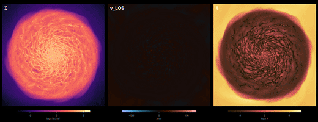
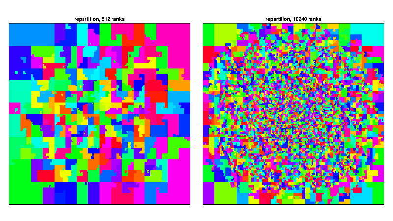
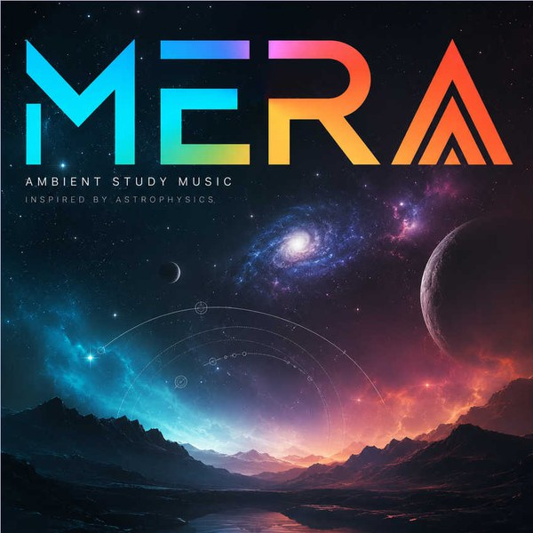

# MERA.jl

**Analyze RAMSES simulations at scale, in pure Julia.**

<h3>
  <a href="https://manuelbehrendt.github.io/Mera.jl/stable/">📖 Documentation</a> ·
  <a href="https://manuelbehrendt.github.io/Mera.jl/stable/where_to_start/">Where to start</a> ·
  <a href="#installation">Install</a> ·
  <a href="https://manuelbehrendt.github.io/Mera.jl/stable/gallery/">Gallery</a> ·
  <a href="https://manuelbehrendt.github.io/Mera.jl/stable/adding_a_reader/">Add a reader for your code</a>
</h3>

[](https://github.com/ManuelBehrendt/Mera.jl/releases)
[](https://github.com/ManuelBehrendt/Mera.jl/actions/workflows/CI.yml)
[](https://manuelbehrendt.github.io/Mera.jl/stable/)
[](https://zenodo.org/badge/latestdoi/229728152)
[](https://codecov.io/gh/ManuelBehrendt/Mera.jl?flags[0]=ci-smoke)
[](https://codecov.io/gh/ManuelBehrendt/Mera.jl?flags[0]=local-full)
[](https://github.com/JuliaTesting/Aqua.jl)
[](https://github.com/ManuelBehrendt/Mera.jl)

<sub>What the badges mean: [the two coverage numbers](#the-two-coverage-numbers),
[what Aqua checks](#package-hygiene-the-aqua-badge), and
[the badge for your own project](#get-involved). How the suite is built and run:
[Testing Framework](https://manuelbehrendt.github.io/Mera.jl/stable/advanced_features/testing_guide/).</sub>

**MERA** is an analysis framework for astrophysical simulations, written in Julia. It covers the
whole path from raw simulation output to a result you can publish: selecting regions, computing
physics in any unit, projecting from any viewing angle, profiles, phase diagrams, clump finding,
time series and movies. It reads [RAMSES](https://github.com/ramses-organisation/ramses) adaptive
mesh refinement output natively, with hydro and MHD, particles, gravity, clumps, sinks and radiative
transfer, and handles cosmological runs throughout.

<table><tr><td>

**📑 On this page:** &nbsp;[Why MERA?](#why-mera) · [First look](#first-look) · [Quickstart](#quickstart) · [Core capabilities](#core-capabilities) · [Installation](#installation) · [Multiple dispatch](#one-name-many-types-multiple-dispatch) · [Recipes](#recipes-and-shared-workflows) · [Documentation](#documentation) · [Roadmap](#roadmap) · [Testing](#testing) · [Study music](#ambient-study-music) · [Staying up to date](#staying-up-to-date) · [Get involved](#get-involved) · [License](#license)

</td></tr></table>



<sub>A galaxy tipped from face-on onto its edge and spun like a coin, in surface density,
line-of-sight velocity and temperature, made with Mera
([the recipe](https://github.com/ManuelBehrendt/Notebooks/tree/master/Mera-Docs/version_1.1/gallery/001_coin_flip_movie)).</sub>

Underneath, a snapshot is one table: one row per AMR cell, one column per quantity, each row
carrying its refinement level, so nothing is flattened onto a uniform grid first. You ask for
physics rather than write formulas:

```julia
using Mera
info = getinfo(400, "/path/to/my/simulation")
gas  = gethydro(info)

msum(gas, :Msol)                          # total gas mass
getvar(gas, :T, :K)                       # temperature of every cell

# a surface-density map seen from any angle; cells cut by the 15 kpc window count by the
# fraction inside, so the map holds exactly the mass in the window
projection(gas, :sd, :Msol_pc2; inclination=60, azimuth=30,
           center=[:bc], fov=15, fov_unit=:kpc, split=true)
```

Every quantity comes in the unit you name. The same calls work on particles and clumps.

> **Need a feature for your research?** If your project needs an analysis method, a RAMSES variant
> or a reader for another code that Mera does not have yet, write to
> [mera@manuelbehrendt.com](mailto:mera@manuelbehrendt.com). I am happy to collaborate on
> extensions.

On this `multicode` branch, version 2.0.0-DEV, Mera also reads **AREPO, GADGET, PLUTO, Athena++,
FLASH**, **Chombo** and **AMReX/Quokka** through the same API. The AMReX/Quokka reader was
contributed by [ChongChong He](https://github.com/chongchonghe). The branch is never registered, so
it is installed by URL; the released 1.x line reads RAMSES only:

```julia-repl
pkg> add https://github.com/ManuelBehrendt/Mera.jl#multicode
```

Coverage is deepest for RAMSES, which is the only code with gravity, radiative-transfer and clump
support. The others provide gas; AREPO and GADGET additionally provide particles and SUBFIND halo
catalogues.

**Trying it on your own simulation.** The readers differ, but what they produce does not: every one
returns the same objects, so the analysis never learns which code wrote the file. In practice that
means you can follow any tutorial and change one line.

```julia
info = getinfo("/path/to/your/output")   # the reader is picked from the files it finds

gas = gethydro(info)                     # grid codes: RAMSES, PLUTO, Chombo, Athena++, FLASH
gas = getparticles(info; families=[0])   # GADGET and AREPO: the gas lives in the particle file
```

**This branch wants testers more than anything else.** The non-RAMSES readers are checked against
files built to match each format specification, which pins the format down but cannot cover what
real projects produce. If you point one at your own run, we want to hear the result either way:
that it disagreed with a tool you trust, that it could not read your file, or that it simply worked.
The last one is the rarest report and is evidence we cannot get any other way. A small shareable
snapshot is even better, since it turns a format check into a lasting behaviour check.

You do not need to know Mera to help. See
[Other Simulation Codes](https://manuelbehrendt.github.io/Mera.jl/multicode/multicode/) for what each reader implements today, how to check
a first result, and where it is likely to be thin.

*Coverage is measured by the maintainer on a local run (the research simulations are too large for
GitHub Actions) and uploaded to Codecov; see [Testing](#testing) below and the
[Testing Framework](https://manuelbehrendt.github.io/Mera.jl/stable/advanced_features/testing_guide/) guide.*

## Why MERA?

- **When you select a region, Mera cuts the cells as well.** Pick a sphere, and some cells lie
  half inside it and half outside. Mera counts half of such a cell, not all of it and not none of
  it, so the numbers are right at the edge without your having to think about it. When the *picture*
  matters too, `refine_to` subdivides those edge cells down to your pixel size, so a rendered
  boundary is as sharp as the map you are drawing.
  [How it is measured](https://manuelbehrendt.github.io/Mera.jl/stable/computation_reference/)
- **Look at your galaxy from any angle.** Mera projects the original cells, keeping the detail of
  the smallest ones, and the mass you measure stays the same at any angle, pixel size or thread
  count. Cells cut by the edge of the window or of a depth slab are split too, so a map holds
  exactly the mass inside it.
  [Off-axis projection](https://manuelbehrendt.github.io/Mera.jl/stable/06_offaxis_Projection/)
- **See the volume, not only a map.** Render the gas in 3-D, with surfaces at the densities you
  choose and a camera that orbits or flies a path for a movie.
  [Volume rendering](https://manuelbehrendt.github.io/Mera.jl/stable/17_multi_Volume_Rendering/)
- **Restart RAMSES on any number of CPUs.** RAMSES restarts only on the number of ranks that wrote
  an output. Mera rewrites it for any other number, also from a mera file when the original files
  are gone, and checks the result against RAMSES itself.
  [RAMSES restart](https://manuelbehrendt.github.io/Mera.jl/stable/07_2_multi_RAMSES_Restart/)
- **Find structures with the method that suits your data.** Seven clump-finding algorithms behind
  one call, with a boundedness test, a catalogue and its mass function, and synthetic fields with
  known clumps to check a finder against.
  [Clump finding](https://manuelbehrendt.github.io/Mera.jl/stable/clumpfind/)
- **Read a snapshot once, then re-read it fast.** Save it in Mera's own format and it comes back
  much faster, from a much smaller file.
  [Benchmarks, and where they may not hold](https://manuelbehrendt.github.io/Mera.jl/stable/benchmarks/performance/)
- **Use your cores without writing parallel code.** Reading and projection are threaded already.
  Start Julia with more threads and Mera uses them. The guide also shows patterns for threading
  your own loops around Mera, and how to divide the threads between the two.
  [Multi-threading](https://manuelbehrendt.github.io/Mera.jl/stable/multi-threading/multi-threading_intro/)
- **Choose cells by physics, not by position in a list.** Select on temperature, density or any
  quantity Mera can compute, and join the conditions with and, or and not.
  [Masking and filtering](https://manuelbehrendt.github.io/Mera.jl/stable/05_multi_Masking_Filtering/)
- **Write a selection once and reuse it.** Keep the region, units and resolution in one bundle and
  hand it to every call, and short macros fold the common steps into a single line.
  [Pipelines](https://manuelbehrendt.github.io/Mera.jl/stable/pipelines/)
- **Get a first look in one call.** `quicklook` summarises a snapshot you have never opened, within
  a time budget, and reports you compose yourself say what they cost before they run.
  [First look](https://manuelbehrendt.github.io/Mera.jl/stable/first_look/)
- **Hear about a long job without watching it.** Mera can ring a bell, send an email or post to a
  Zulip channel when a run finishes, carrying the figures, the timings and, if something broke, the
  error.
  [Notifications](https://manuelbehrendt.github.io/Mera.jl/stable/notifications/)
- **The whole analysis is here**: regions, units, projections, profiles, phase diagrams, PDFs, clump
  finding, star formation, time series, movies and export.
- **Every result remembers where it came from**: the version of Mera, the exact code it ran on and
  the snapshot you used. Fifteen public test simulations with known answers let you check your own
  installation.
  [Reproducibility](https://manuelbehrendt.github.io/Mera.jl/stable/reproducibility/)
- **Bring your own hydro code.** Readers plug into a registry, so a reader written in your own
  package works with the whole analysis without changing Mera.
  [Adding a reader](https://manuelbehrendt.github.io/Mera.jl/stable/adding_a_reader/)
- **One language.** Julia from beginning to end, so the code you read is the code that runs. No
  plotting library is installed until you ask for a figure.

Details in [Core capabilities](#core-capabilities) below.

## First look

With a simulation on disk, one call summarises it, covering box and refinement levels, time and
redshift, particle and cell counts, component masses, SFR, and the density and temperature
ranges, as a text census:

```julia
using Mera
q = quicklook(80; path="/path/to/simulation")
```

Add a Makie backend to turn that into the dashboard: mass-weighted gas Σ (face-on plus two
edge-on views), stellar and dark-matter surface density, and the ρ–T phase diagram.

```julia
using CairoMakie
fig = quicklookplot(q)
```

## Quickstart

```julia
using Mera

# 1. read simulation metadata
info = getinfo(output=100, path="/path/to/ramses/output")

# 2. load gas (multi-threaded), restricted to a physical sub-box about the box centre
gas = gethydro(info, lmax=10,
               xrange=[-10., 10.], yrange=[-10., 10.], zrange=[-5., 5.],
               center=[:bc], range_unit=:kpc)

# 3. mass-conserving surface-density projection
proj = projection(gas, :sd, :Msol_pc2; direction=:z, pxsize=[10., :pc])

# 4. plot with your favourite backend
using CairoMakie
heatmap(log10.(proj.maps[:sd]), colormap=:inferno)
```

## Core capabilities

### Loading and filtering
- **`getinfo`**: simulation metadata (box size, time/redshift, grid structure, units)
- **`gethydro` / `getparticles` / `getgravity` / `getrt` / `getclumps` / `getsinks`**: load each data
  type, with optional spatial subregioning and refinement-level capping; `getparticlemask` picks
  stars, dark matter or another particle family
- **`subregion` / `shellregion`**: cuboid, sphere, cylinder and shell selections (`cuboid`, `sphere`,
  `cylinder`, `sphericalshell`, `cylindricalshell`) that preserve AMR structure. Regions are values: combine them with `∩ ∪ \ !`, that is intersection, union,
  difference and complement. If you would rather not type Unicode, `&`, `|`, `intersect`,
  `union`, `setdiff` and `!` do the same. Tilt a cylinder's
  axis, and boundary cells keep the fraction of themselves inside. `refine` / `refine_to`
  subdivide those edge cells for rendering, which sharpens a drawn boundary without changing
  any total, since the fraction already made the totals exact
- **`filterdata` / `getmask`**: select by physical value on anything `getvar` computes, with
  `Above`, `Below`, `InRange`, `AbovePercentile`, `Satisfies` and friends composed by `& | !`.
  Returns the same kind of object, so calls chain
- **Macros for the common shapes**: `@filter`, `@where`, `@apply`, `@region`, `@loadall`, `@project`
- **`withargs` / `ArgumentsType`**: write a selection once, reuse it across loading, projecting and
  profiling

### Looking at a simulation before you analyse it
- **`amroverview` / `dataoverview` / `storageoverview`**: refinement levels, the range of every
  variable, and what the files cost on disk
- **`viewfields` / `viewallfields` / `viewdata`**: look inside any Mera object without knowing its
  type first
- **`checkoutputs` / `checksimulations` / `gettime`**: which outputs exist, which are complete,
  and the time each one sits at
- **`namelist` / `makefile` / `patchfile` / `timerfile`**: the run's namelist, compile settings,
  patch files and timings, as RAMSES wrote them into the output

### Projections and grids
- **`projection`**: mass-conserving 2-D maps of any quantity, on- or off-axis (arbitrary line of
  sight, face-on/edge-on, angular-momentum-aligned). The default kernel spreads each cell over the
  area its shadow covers, so no pixel is left empty at any pixel size, and it tracks the analytic
  footprint integral to a median 0.0005 dex per pixel at about a third of the cost. With
  `split=true`, cells cut by the `fov` window or a `depth` slab count by the fraction inside
- **`volumerender` / `volumelook` / `volumeorbit` / `volumepath`**: volume rendering in Julia, with
  isosurfaces, tone curves and camera paths for movies
- **`face_on` / `edge_on` / `angmom` / `rotation_frame` / `restframe`**: pick the frame before you
  project, from the angular momentum of the gas (or of several components together) or from a
  velocity you supply
- **`gridoverlay`**: the AMR cell boundaries as lines, to draw over a map
- **Periodic boxes**: `:r_sphere_periodic`, `center_of_mass(...; periodic=true)`, regions with
  `periodic=true`, and `periodic_recenter` to show a structure on a box face whole.
  [Periodic boxes]({D}/periodic_boxes/)
- **`covering_grid` / `slice` / `offaxis_slice`**: resample AMR onto a dense uniform grid for FFTs,
  power spectra, volume rendering, or machine-learning inputs. `covering_grid_memory` costs the
  grid in GB before you commit to allocating it

### Restarting RAMSES
- **`repartition` / `writeramses` / `compareramses`**: rewrite an output for any number of MPI
  ranks, in Hilbert or bisection ordering and with IO groups, or write a new one from Mera data or
  a mera file; `compareramses` checks the result cell by cell, and `restart_completeness` says what
  a restart would still lack

### Single numbers from the data
- **`msum` / `center_of_mass` / `bulk_velocity` / `getextent`**: totals, centres and bounds, in any
  unit, for gas, particles or clumps
- **`velocitydispersion` / `localdispersion`**: velocity dispersion as a function of radius, and
  the local turbulent dispersion with bulk streaming removed
- **`wstat`**: mean, median, standard deviation, skewness, kurtosis and extrema of any array, with
  optional weights and a mask

### Profiles and phase diagrams
- **`profile` / `profile3d` / `profiletimeseries`**: weighted 1-D profiles of any quantity vs. any
  axis (radius, height, density…), with per-bin mean/std/sem/quantiles/extrema/shape-moments,
  equal-count binning and bootstrap CIs; works on 3-D data **or** on a projected 2-D map, and can
  be run across a whole run
- **`phase`**: 2-D weighted histograms (the classic ρ–T diagram, position–velocity, …)
- **`pdf`**: mass- or volume-weighted probability density functions of any quantity

### Structure finding (7 algorithms behind one call)
- **`clumpfind`**: one call backed by `ThresholdFoF` (the default), `DensityWatershed`,
  `Dendrogram`, `GraphSegFinder`, `HDBSCANFinder`, `PhaseSpaceFoF` and `PersistenceFinder`, all
  sharing the same neighbour search, boundedness test, validation and catalogue step
- **Gravitational boundedness**: Barnes–Hut self-potential, SUBFIND-style unbinding and tidal
  (Hill-radius) truncation
- **`clumptable` / `clump_massfunction` / `clump_mass_fraction`**: the catalogue, its mass
  function, and how much of the total mass the clumps hold; `save_clumps` / `load_clumps` keep it
- **`synthetic_clumps`**: real Mera objects with known clumps, built in memory, to try Mera or test a
  finder without any simulation data

### Derived fields and units
- **`getvar`**: derived quantities by name (`:T`, `:cs`, `:mach`, `:jeanslength`,
  `:vr_cylinder`, `:ekin`, `:jeansmass`, …); `getvar()` prints the full list
- **`add_field`**: register a custom derived field once; it then works inside `projection`,
  `profile` and `phase`. `list_fields`, `field_tree`, `field_info` and `getvar_requirements` show
  what exists and what each field needs, which also drives selective I/O
- **`setcomposition!`**: set the hydrogen mass fraction and the mean molecular weight, the two
  numbers behind `:nH` and `:T`
- **133 unit scale factors and 41 constants**, with `add_unit`, `list_units` and `getunit`

### Cosmological runs
- **`cosmic_time` / `lookback_time` / `age_of_universe` / `formation_redshift`**: ages and
  redshifts, with `iscosmological` to test a snapshot first; `stellar_age` and `formation_time` for
  star particles
- **`comoving_to_proper_length` / `comoving_to_proper_density`**, and the reverse, for converting
  either way
- **`critical_density` / `mean_matter_density` / `baryon_fraction`**: the background the run sits in

### Star formation
- **`sfr` / `sfr_snapshot` / `depletion_time`**: star-formation history, instantaneous rate over
  several look-back windows, gas depletion time and efficiency per free-fall time

### Saving and exporting
- **`savedata` / `loaddata`**: compressed MERA-file archive (LZ4/Zlib/Bzip2): smaller and faster to
  read than raw RAMSES. `convertdata` and `batch_convert_mera` convert a whole run
- **`savemap` / `loadmap`**: keep a finished projection, with its provenance, instead of recomputing
- **`upgrade_merafile`**: bring a MERA file written by an older version up to date
- **`export_vtk`**: write AMR cells / particles to VTK for ParaView/VisIt

### Quick looks and reports
- **`quicklook`**: point it at a snapshot you have never seen. Budgeted read, maps along all three
  axes, a phase diagram, and a census of masses, densities and temperatures
- **`report`**: composable dashboards whose cost you can `preview` before running, `calibrate!` to
  your machine, and `downsample` to a time budget

### Time evolution and movies
- **`timeseries`**: run any reducer over every output with one snapshot in memory at a time; adds
  redshift and scale factor automatically on cosmological runs
- **`getmovie` / `savemovie` / `rotation_sequence`**: animations from a sweep of outputs or of
  viewing angles, with a fixed field of view so frames do not jitter; `loadmovie`,
  `moviefromframes` and `makethumb` reload, assemble and preview them

### Reproducibility
- **`provenance` / `provenance_string`**: version, git branch and commit, a marker if the working
  tree was dirty, the snapshot and its time. Travels inside saved maps and reports
- **`download_testdata`**: fifteen small public RAMSES simulations, each with a known answer, either
  an analytic law that follows from its setup or a reference value published by the RAMSES developers

### While you work
- **Threads** on reads, off-axis projections and multi-quantity projections; `reading_sweep` finds
  where your storage stops rewarding more of them
- **`notifyme` / `bell` / `send_results`**: mail or Zulip when a long run finishes, with plots
  attached, or just a sound
- **Quiet when you want it**: `verbose(false)`, `showprogress(false)`, or `output_mode(false)` for
  both
- **Plotting is a weak dependency**: Mera installs without it, and the plotting functions
  (`quicklookplot`, `overviewplot`, `clumpplot`, …) appear once you load Makie
- **New readers plug in**: `register_reader!` adds a reader for another code's files without
  touching the analysis. [Adding a reader]({D}/adding_a_reader/)

## Installation

In the Julia REPL, press `]` to enter the package manager (backspace leaves it again):

```julia-repl
pkg> add Mera
```

or, equivalently, from a script:

```julia
using Pkg
Pkg.add("Mera")
```

Load it, and Mera greets you in the REPL:

```julia
using Mera
```

```
*__   __ _______ ______   _______
|  |_|  |       |    _ | |   _   |
|       |    ___|   | || |  |_|  |
|       |   |___|   |_||_|       |
|       |    ___|    __  |       |
| ||_|| |   |___|   |  | |   _   |
|_|   |_|_______|___|  |_|__| |__|
Mera v2.0.0-DEV | Julia 1.13.2 | 8 threads
```

It shows the Mera version, the Julia version and how many threads Mera can use. With one thread,
Mera adds a hint: start Julia with `julia -t 8` (or set `JULIA_NUM_THREADS=8`) to read and project
in parallel. In scripts the greeting is a single `[ Info: Mera v2.0.0-DEV` line, and `MERA_QUIET=1`
turns it off.

For collaborators, the in-development multi-code version (2.0, see the note at the top) is
installed from the branch, noting the `#multicode` suffix in the `pkg>` form:

```julia-repl
pkg> add https://github.com/ManuelBehrendt/Mera.jl#multicode
```

```julia
using Pkg
Pkg.add(url="https://github.com/ManuelBehrendt/Mera.jl", rev="multicode")
```

To go back to the released version afterwards, `pkg> free Mera` (or `pkg> add Mera`).

**Requirements**: Julia 1.10 or newer, with **1.12 or newer recommended** for the faster compiler
and the current GC. **Platforms**: macOS (incl. Apple Silicon), Linux, Windows.

**Tested on every push**: Julia 1.10 (the minimum supported), 1.11, 1.12 and 1.13 on Linux, macOS
**and Windows**: every supported version on every supported platform, twelve jobs. CI runners have no
access to simulation data, so they run the data-free
tiers: the analytic conservation oracles, the reader registry, the IO layer, the derived-field
registry and the mera-file round-trips. The full suite runs against real snapshots locally, on
one configuration: **Julia 1.12 on macOS (Apple Silicon)**. So the twelve-job matrix covers the
data-free tiers everywhere, while the data-backed tier is verified on a single platform.

## One name, many types: multiple dispatch

The same verbs work across gas, particles, clumps and gravity, and Julia picks the right method:

```julia
getvar(gas,       :mass)   # cell mass (ρ × volume)
getvar(particles, :mass)   # particle mass
getvar(clumps,    :mass)   # mass of each clump

projection(gas, :sd)              # gas surface density
profile(gas, :r_cylinder, :T)     # radial temperature profile
phase(gas, :rho, :T)              # ρ–T phase diagram
```

Write the analysis once; it works on every data type.

## Recipes and shared workflows


Complete workflows you can point at your own simulation: download a notebook, change the path and
the output number, run it. Two examples:

- **[A spun coin](https://github.com/ManuelBehrendt/Notebooks/tree/master/Mera-Docs/version_1.1/gallery/001_coin_flip_movie)**:
  an animation that tips a galaxy from face-on onto its edge and tumbles it like a spun coin, in
  surface density, line-of-sight velocity and temperature (above).
- **[Any number of CPUs](https://github.com/ManuelBehrendt/Notebooks/tree/master/Mera-Docs/version_1.1/gallery/005_ramses_any_rank_count)**:
  a galaxy output of 197 million cells, written by RAMSES on 5120 MPI ranks, rewritten for 512, 5120
  and 10240 ranks, once from its RAMSES files and once from its mera file alone. Every value is
  checked against the original, with the time, memory and disk each route costs (below: the same
  galaxy split for 512 and for 10240 ranks).



More recipes:

- **[Gallery](https://manuelbehrendt.github.io/Mera.jl/stable/gallery/)**, and the notebooks behind
  it in the [Notebooks repository](https://github.com/ManuelBehrendt/Notebooks/tree/master/Mera-Docs/version_1.1/gallery)

Sharing the workflow behind a paper is especially welcome: it gives your own work a second life,
lets others reproduce your method on their data, and teaches the parts of an analysis that never
make it into a figure caption.

**Every recipe says who wrote it.** A gallery cannot promise that shared code is correct, so instead
each notebook opens with three lines: author, contact, and a `provenance_string` line recording the
Mera version, snapshot and grid the recipe actually read, which cannot be written without having run
it. A template notebook prints that block for you. Recipes are marked *contributed* until someone
else has run one, then *checked* with the date.

Contributions are welcome by pull request, or via
[Discussions](https://github.com/ManuelBehrendt/Mera.jl/discussions). The
**[full instructions are in the documentation](https://manuelbehrendt.github.io/Mera.jl/stable/gallery/#How-to-contribute-one)**,
including what the attribution block should contain and what makes a recipe usable by someone else.

## Documentation

- **[Documentation & API reference](https://manuelbehrendt.github.io/Mera.jl/stable/)**
- **[Where to start](https://manuelbehrendt.github.io/Mera.jl/stable/where_to_start/)**: one page from
  "I want to ..." to the function that does it, for the twenty things people do first
- **New here?** Start with the Getting Started track: [First Steps](https://manuelbehrendt.github.io/Mera.jl/stable/00_multi_FirstSteps/),
  [Coming from Other Tools](https://manuelbehrendt.github.io/Mera.jl/stable/switching_to_mera/), and
  [Julia for Simulation Analysis](https://manuelbehrendt.github.io/Mera.jl/stable/julia_for_simulation_analysis/)
- **Working with an AI assistant?** [Using an AI Assistant](https://manuelbehrendt.github.io/Mera.jl/stable/assistant/)
  has a short grounding file to give it, and the checks worth keeping in whatever it writes. Experimental
- **[Tutorials](https://github.com/ManuelBehrendt/Notebooks/tree/master/Mera-Docs)**: step-by-step Jupyter notebooks
- In the REPL, `?getvar` shows the docstring and `getvar()` (no args) prints the full derived-quantity catalogue

## Roadmap

**1.x, RAMSES.** Continued depth on the RAMSES path: analysis, performance and documentation.

**2.0, multiple simulation codes.** AREPO, GADGET, PLUTO, Athena++, FLASH, Chombo and AMReX/Quokka
behind the same API, developed on the `multicode` branch. What each reader does today is listed in
[Other Simulation Codes](https://manuelbehrendt.github.io/Mera.jl/multicode/multicode/), and readers
are credited to the people who wrote them.

MERA is actively developed and its priorities are driven by user needs. Have a feature request, a
RAMSES variant to support, or a gap to report? Please
[open an issue](https://github.com/ManuelBehrendt/Mera.jl/issues) or start a
[discussion](https://github.com/ManuelBehrendt/Mera.jl/discussions), and contributions and ideas are welcome.
To discuss an extension for your own project in private, write to
[mera@manuelbehrendt.com](mailto:mera@manuelbehrendt.com).

## Testing

> **The full guide: [Testing Framework](https://manuelbehrendt.github.io/Mera.jl/stable/advanced_features/testing_guide/)**: the four ways to run the suite, the public test
> simulations and how to download them, what each block of tests proves, the CI workflows, and how
> coverage is measured.

MERA ships a tiered suite: data-free **smoke/oracle** tests that run on the full CI Julia matrix
(1.10 / 1.11 / 1.12 / 1.13), and **data-backed** integration tests run locally against real RAMSES output.

The data-free tier needs **no simulation data at all**, and includes every analytic correctness
oracle: conservation on-axis and off-axis, weighted statistics and structure-finder
profiles. [`test/README.md`](test/README.md) documents the tiers, what "synthetic"
means in each, and which simulation backs which test.

```bash
# smoke/oracle tests only (what CI runs)
MERA_SMOKE_ONLY=1 julia --project -e 'using Pkg; Pkg.test("Mera")'

# with the public test simulations (downloaded once, 307 MB): every test they can back
MERA_TEST_DATA="$(testdata/fetch_fixtures.sh --quiet)" MERA_SMOKE_ONLY=1 \
    julia --project -e 'using Pkg; Pkg.test("Mera")'

# full suite (requires the maintainer's research simulations as well)
MERA_TEST_DATA=/path/to/Mera-Tests julia --project -e 'using Pkg; Pkg.test("Mera")'
```

### Package hygiene: the Aqua badge

The **Aqua QA** badge is a structural check, not a physics one. It asserts that the *package* is
well formed: no undefined exports, no unbound type parameters, no method ambiguities among Mera's
own methods, no stale or uncapped dependencies, no type piracy. It executes no Mera code paths, so
it catches a different class of problem from every other test here.

One caveat worth knowing: the ambiguity check runs with `recursive=false`, so ambiguities
introduced by a dependency are not reported. All seven checks and the three deliberate exemptions
are listed in [`test/README.md`](test/README.md#what-the-aqua-check-covers).

### The two coverage numbers

The badges above report two different measurements, not one number twice.

| badge | what it covers | where it runs | when |
|---|---|---|---|
| **coverage: CI** | the data-free tier only | GitHub Actions | every push |
| **coverage: full** | the whole suite, data-backed tier included | maintainer's machine, Julia 1.12 on macOS (Apple Silicon), with the simulation data mounted | before a release, uploaded by `scripts/run_local_coverage.sh` or `scripts/run_coverage_with_notebooks.sh` |

Measured on 2026-10-20: the full suite covers **88.7%**, meaning 17 161 of 19 355 lines across 109
source files, while the CI tests alone cover **33%**. With the tutorial notebooks run on top, the
total is **89.8%**. The data-free tier that CI runs is about 2 170 tests in four to seven minutes; with
the simulation data present the same tier takes roughly 11 minutes, because a few of its files
opportunistically read every dataset they can find.

They differ because the data-backed tier reads real RAMSES output, and that data is far larger than
a hosted runner can hold. The readers, projections, region selection and mera-file round trips are
therefore exercised only in the second number.

The gap is closing. The public test simulations are published as release assets, and
`.github/workflows/fixtures.yml` downloads them and runs the physics oracles and the RAMSES
reference checks. That job is manual for now: the suite decides from one flag whether simulation
data is present, so once it is told yes it also reaches for the runs that are not published, and a
hosted runner fails on missing data instead of on a defect. Wiring it to every push needs those
tests to check for the one fixture they use. Until then the oracles run before each release, on
the machine where every simulation is mounted.

## Ambient Study Music

Written alongside Mera: **Ambient Study Music**, eighteen tracks named after astronomical objects,
inspired by astrophysics.

<p align="center">
  
</p>

<p align="center">
  <a href="https://open.spotify.com/album/4WiGfc2nQAj02jeJRY0dTn">Spotify</a>
  &nbsp;·&nbsp;
  <a href="https://music.apple.com/de/album/ambient-study-music/6805943329?l=en-GB">Apple Music</a>
  &nbsp;·&nbsp;
  <a href="https://youtube.com/playlist?list=OLAK5uy_mlavbfbMJji-L-Z49pyTUVQtP7aWr_MqM">YouTube</a>
</p>

## Staying up to date

Mera changes between releases, so if your analysis has to stay reproducible it is worth knowing
when a new version ships and what moved in it.

- **Be told about releases only.** On the GitHub page press **Watch**, choose **Custom**, and tick
  **Releases**. You then hear about versions and not about every issue and commit.
- **Or get an email, with no GitHub account.** Add `ManuelBehrendt/Mera.jl` on
  [newreleases.io](https://newreleases.io) and it emails you when a version ships, and nothing else.
  It is free, takes a minute, and works for the other packages you depend on too. If you would rather
  use a feed reader, the raw feed is
  <https://github.com/ManuelBehrendt/Mera.jl/releases.atom>.
- **Check before you upgrade.** `pkg> status --outdated` shows what a new version would change, and
  the release notes say what changed in it. Read them before `pkg> up`, not after.
- **Pin what a paper depends on.** A `Project.toml` and `Manifest.toml` in your analysis folder keep
  today's versions available whatever ships later. See
  [Reproducibility](https://manuelbehrendt.github.io/Mera.jl/stable/reproducibility/).

## Get involved

- **Collaborate**: if your research needs a feature or extension that Mera does not have yet, write
  to [mera@manuelbehrendt.com](mailto:mera@manuelbehrendt.com). I am happy to work on it together.
- **Cite & star**: if MERA helps your research, please cite the
  [Zenodo DOI](https://zenodo.org/badge/latestdoi/229728152) and ⭐ the
  [repository](https://github.com/ManuelBehrendt/Mera.jl); it helps measure impact and sustain development.
- **Ask**: [Discussions](https://github.com/ManuelBehrendt/Mera.jl/discussions) for questions and show-and-tell.
- **Report / request**: [Issues](https://github.com/ManuelBehrendt/Mera.jl/issues) for bugs and feature requests.
- **Contribute**: see [CONTRIBUTING.md](CONTRIBUTING.md); bug reports, docs fixes, examples and new
  algorithms are all welcome.
- **Add a reader for your simulation code**: the analysis never looks at the file format, so a
  reader is the only piece a new code needs. [How to add a reader](https://manuelbehrendt.github.io/Mera.jl/stable/adding_a_reader/) walks
  through it.
- **Show that your project works with Mera**: paste the badge into your own README.

  [](https://github.com/ManuelBehrendt/Mera.jl)

  ```markdown
  [](https://github.com/ManuelBehrendt/Mera.jl)
  ```

## License

MIT, see [LICENSE](LICENSE).

---

**Get started:** [manuelbehrendt.github.io/Mera.jl](https://manuelbehrendt.github.io/Mera.jl/stable/) ·
**Questions?** [open a discussion](https://github.com/ManuelBehrendt/Mera.jl/discussions)
