```@raw html
<!-- GENERATED FILE. Do not edit this markdown.
     Source notebook: 03_hydro_Get_Subregions.ipynb
     Regenerate with: MERA_DIR=<repo checkout> ./render_docs.sh
     Any edit here is lost the next time the docs are rendered. -->
```

# 3. Hydro: Get Subregions

!!! tip "Run it yourself"
    This page is also an executable **Jupyter notebook**: [open / download `03_hydro_Get_Subregions.ipynb`](https://github.com/ManuelBehrendt/Notebooks/blob/master/Mera-Docs/version_1.1/03_hydro_Get_Subregions.ipynb). The notebooks run end-to-end and double as part of Mera's test suite.


A subregion is a piece of the simulation box: a sphere around a galaxy, a slab around a disc,
a shell around a halo. This page shows how to cut such pieces out of hydro data, how to measure
them correctly, and how to combine them into any shape you need.

Gravity and RT data work exactly the same way. Particles, clumps and sinks use the same calls;
their own pages are linked at the bottom.

!!! tip "Cheatsheet"
    Every shape, keyword and rule on one page: [Subregions cheatsheet](subregions_cheatsheet.md).

## What subregions can do

| you want to | use |
|---|---|
| cut a box, a cylinder, a sphere, or a spherical or cylindrical shell | `subregion(gas, sphere(10.))` and the four other shapes |
| count a boundary cell by the part of it that lies inside | the default, `split=true`: each boundary cell gets a `:fraction` |
| keep whole cells instead | `split=false`, or `cell=true` / `cell=false` in the classic API |
| select everything outside a region | `inverse=true`, or `!region` |
| combine shapes | `∩` `∪` `\` `!`, and the `@region` block for long definitions |
| tilt a cylinder or a cylindrical shell | `axis=[x, y, z]` |
| make the edge of a cut sharp in a map | `refine=k` or `refine_to=[length, unit]` |
| wrap a region around the faces of a periodic box | the classic API with `periodic=true` |
| cut particles with the same region | `subregion(part, region)` |
| keep a cut for later sessions | `savedata` and `loaddata` |

Every cut returns an object of the same type as its input. `msum`, `getvar`, `projection`,
`profile` and another `subregion` work on it unchanged.

## Roadmap

The page goes from a first cut to complete measurements, one step at a time.

1. **The first cut**: one sphere, from region to number.
2. **The five shapes**: box, cylinder, sphere and the two shells.
3. **Placing a region**: the centre and the units.
4. **Boundary cells**: why a smooth surface on an AMR grid needs care, and the three ways to treat it.
5. **Inside and outside**: the inverse of a region.
6. **Combining regions**: intersection, union, difference, complement, and the `@region` block.
7. **Tilted regions**: cylinders along any axis.
8. **A mass budget that balances**: zones of a galaxy whose masses add up exactly, for gas and stars.
9. **Sharp edges for figures**: `refine` and `refine_to`.
10. **Regions with a purpose**: shapes that answer a question, some placed by the data.
11. **The classic API and periodic boxes**: `subregion(gas, :sphere; …)`, `shellregion`, `cell=`, `periodic=`.
12. **Large data**: cut once, save, reload.

Steps 1 to 6 are the basics and build on each other. Steps 7 to 12 can be read in any order.

## Setup: the galaxy and a plotting helper

We load one snapshot of a simulated disc galaxy in a 48 kpc box. We read only the density
`:rho`, up to level 12. Mass, volume, cell size and the `:fraction` column all follow from it.
The box centre, written `[:bc]`, is at (24, 24, 24) kpc.

```julia
# Example-data root. Point this at your own simulation folder, or set the
# MERA_EXAMPLES environment variable; every path below is built from it.
MERA_EXAMPLES = get(ENV, "MERA_EXAMPLES", "/Volumes/FASTStorage/Simulations/Mera-Tests");

using Mera, CairoMakie
CairoMakie.activate!()

info = getinfo(400, "$MERA_EXAMPLES/RAMSES/manu_sim_sf_L14", verbose=false)
gas  = gethydro(info, :rho, lmax=12, smallr=1e-11, verbose=false, show_progress=false);

kpc = info.scale.kpc   # code length -> kpc
println("cells loaded : ", length(gas.data))
println("box size     : ", round(gas.boxlen * kpc, sigdigits=4), " kpc, centre [:bc] at (24, 24, 24) kpc")
```

```
*__   __ _______ ______   _______
|  |_|  |       |    _ | |   _   |
|       |    ___|   | || |  |_|  |
|       |   |___|   |_||_|       |
|       |    ___|    __  |       |
| ||_|| |   |___|   |  | |   _   |
|_|   |_|_______|___|  |_|__| |__|
Mera v1.8.0 | Julia 1.12.7 | 2 threads
cells loaded : 18966620
box size     : 48.0 kpc, centre [:bc] at (24, 24, 24) kpc
```

One helper draws every map on this page. All maps share **one colour scale** for surface
density, so the same gas looks the same in every panel, and any two panels can be compared
directly. `proj` calls `projection` with the settings we reuse: along z, centred on the box,
ranges in kpc, `pxsize=[0.25, :kpc]`.

In the code cells, the line `# ── figure code from here …` marks where the Mera part ends and
the plotting begins. Read above the line; skim below it.

```julia
# ─────────────────────────────────────────────────────────────────────
# FIGURE INFRASTRUCTURE for the whole page, skim freely on first read.
# The one Mera-relevant definition is `proj` at the bottom: the projection
# defaults every panel reuses (direction, centre, pxsize in physical units).
# ─────────────────────────────────────────────────────────────────────
const SDLIM = (-3.0, 3.0)   # log10 Σ [Msol/pc²]: one colour scale for every map on this page

function show_sd!(ax, p; flo=1e-3, decorate=false, lims=SDLIM)
    xs = range(p.cextent[1]*kpc, p.cextent[2]*kpc; length=size(p.maps[:sd], 1))
    ys = range(p.cextent[3]*kpc, p.cextent[4]*kpc; length=size(p.maps[:sd], 2))
    heatmap!(ax, xs, ys, log10.(max.(p.maps[:sd], flo)); colormap=:inferno, colorrange=lims)
    ax.aspect = DataAspect()
    ax.backgroundcolor = :black
    decorate || hidedecorations!(ax)
    return ax
end

# same, but with FIXED axis limits (kpc, relative to the projection centre) so
# side-by-side panels compare fairly even when their data extents differ
function show_sd!(ax, p, lims; kwargs...)
    show_sd!(ax, p; kwargs...)
    limits!(ax, lims...)
    return ax
end

sd_bar!(pos) = Colorbar(pos; colormap=:inferno, colorrange=SDLIM,
                        label="log₁₀ Σ  [Msol pc⁻²]")

function scalebar!(ax, x0, y0, len)   # a white physical-length bar for tick-less panels
    lines!(ax, [x0, x0 + len], [y0, y0]; color=:white, linewidth=3)
    text!(ax, x0 + len/2, y0 + 0.4; text="$(round(Int, len)) kpc", color=:white,
          fontsize=11, align=(:center, :bottom))
end

proj(data; kwargs...) = projection(data, :sd, :Msol_pc2;
                                   direction=:z, center=[:bc], range_unit=:kpc,   # ranges in kpc
                                   pxsize=[0.25, :kpc],
                                   verbose=false, show_progress=false, kwargs...)
```

```
proj (generic function with 1 method)
```

## Step 1. The first cut

A region is a normal Julia value. `sphere(10.)` is a sphere with a radius of 10 kpc. Without
further keywords it sits at the box centre (`center=[:bc]`), and its sizes are in kpc
(`range_unit=:kpc`).

`subregion(gas, region)` cuts it out. The result has the **same type as `gas`** (a
`HydroDataType`), so everything that works on the full box also works on the cut.

Cells that the surface of the sphere passes through are counted by the part that lies inside.
This is `split=true`, the default. It is why the edge in the map below follows the dashed
circle and not the steps of the cells. Step 4 explains it in detail.

```julia
hello = subregion(gas, sphere(10.), verbose=false)   # center=[:bc], range_unit=:kpc are the defaults

println("returned type       : ", typeof(hello).name.name, "  (same as gas: fully chainable)")
println("cells selected      : ", length(hello.data), "  of ", length(gas.data))
println("gas mass, r < 10 kpc: ", round(msum(hello, :Msol), sigdigits=5), " Msol")

ph = proj(hello; xrange=[-11, 11], yrange=[-11, 11], pxsize=[0.1, :kpc])

# ── figure code from here: panels, overlays, colorbars, no new Mera concepts ──
fig = Figure(size=(600, 470))
ax  = Axis(fig[1, 1], title="first cut: sphere(10), boundary cells split")
show_sd!(ax, ph, (-11, 11, -11, 11))
arc!(ax, Point2f(0, 0), 10., 0, 2π; color=:white, linewidth=1, linestyle=:dash)
scalebar!(ax, -10, -10.3, 5)
sd_bar!(fig[1, 2])
fig
```

```
returned type       : HydroDataType  (same as gas: fully chainable)
cells selected      : 11079571  of 18966620
gas mass, r < 10 kpc: 1.821e10 Msol
```

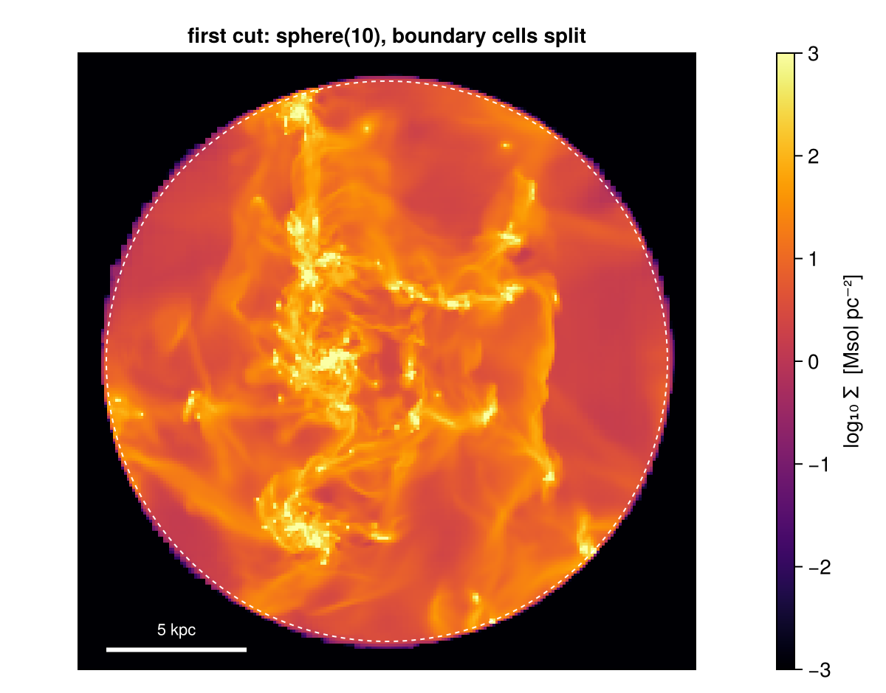

These three lines are the pattern of every cut on this page: a region, a result that works like
the original data, and a number. The dashed circle is the exact sphere. The gas ends on it
because cut cells contribute only the part that lies inside.

!!! tip "Try it"
    Change the radius to `sphere(5.)` and run the cell again. The number of cells drops much
    faster than the mass: the cut now goes through the refined, gas-rich disc, and most of the
    gas of this galaxy lies well inside 10 kpc.

## Step 2. The five shapes

| shape | constructor | arguments |
|---|---|---|
| box | `cuboid(xrange=[a, b], yrange=[c, d], zrange=[e, f])` | ranges, measured from the centre |
| cylinder | `cylinder(r, h)` | radius and **half-height**: the cylinder spans `±h` |
| sphere | `sphere(r)` | radius |
| spherical shell | `sphericalshell(r_in, r_out)` | inner and outer radius |
| cylindrical shell | `cylindricalshell(r_in, r_out, h)` | inner and outer radius, half-height |

All five take `center=` and `range_unit=` (Step 3). The cylinder and the cylindrical shell also
take `axis=` (Step 7). Note the half-height once and for all: `cylinder(12., 2.)` is 4 kpc
thick.

Below, each shape is cut with the default centre and unit and drawn twice: from the top
(face-on, along z) and from the side (edge-on, along x). The cylinder, named `disc_region`, is
the galaxy disc in later steps.

```julia
# With no keywords, every shape is centred on the box and measured in kpc.
box_region   = cuboid(xrange=[-12, 12], yrange=[-12, 12], zrange=[-2, 2])
disc_region  = cylinder(12., 2.)                   # radius 12 kpc, half-height 2 kpc
ball_region  = sphere(10.)
shell_region = sphericalshell(10., 20.)            # inner radius, outer radius
ring_shape   = cylindricalshell(6., 10., 2.)       # inner radius, outer radius, half-height

shapes = [("cuboid",           box_region),
          ("cylinder",         disc_region),
          ("sphere",           ball_region),
          ("sphericalshell",   shell_region),
          ("cylindricalshell", ring_shape)]

cuts = [subregion(gas, r, verbose=false) for (_, r) in shapes]
for ((name, _), c) in zip(shapes, cuts)
    println(rpad(name, 18), lpad(length(c.data), 9), " cells   ",
            round(msum(c, :Msol), sigdigits=4), " Msol")
end

disc   = cuts[2]                                   # the disc, used again later
m_disc = msum(disc, :Msol)
shape_maps = [(proj(c; xrange=[-21, 21], yrange=[-21, 21], pxsize=[0.2, :kpc]),
           proj(c; direction=:x, yrange=[-21, 21], zrange=[-21, 21], pxsize=[0.2, :kpc]))
          for c in cuts]
cuts = nothing

# ── figure code from here: panels, overlays, colorbars, no new Mera concepts ──
fig = Figure(size=(1180, 520))
for (k, ((name, _), (pf, pe))) in enumerate(zip(shapes, shape_maps))
    show_sd!(Axis(fig[1, k], title=name), pf, (-21, 21, -21, 21))
    show_sd!(Axis(fig[2, k]), pe, (-21, 21, -21, 21))
end
Label(fig[1, 0], "face-on", rotation=π/2, tellheight=false)
Label(fig[2, 0], "edge-on", rotation=π/2, tellheight=false)
scalebar!(content(fig[2, 1]), -19, -19.5, 10)
sd_bar!(fig[1:2, 6])
fig
```

```
cuboid             16714261 cells   2.63e10 Msol
cylinder           14591387 cells   2.283e10 Msol
sphere             11079571 cells   1.821e10 Msol
sphericalshell      7754688 cells   1.18e10 Msol
cylindricalshell    4084535 cells   8.032e9 Msol
```

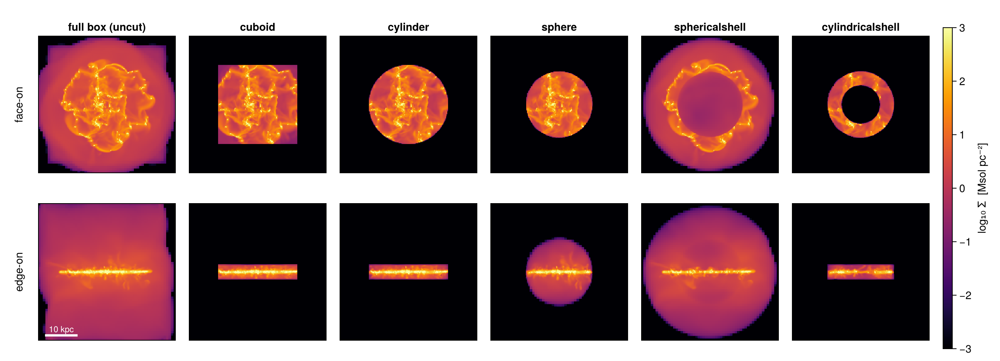

Face-on, the box and the cylinder differ only in the corners; edge-on, both are the same ±2 kpc
slab. The two shells show how a projection hides depth. Face-on, the cylindrical shell is a ring
with an empty middle, because its hole goes through its full height. The spherical shell is not
empty in the middle: a line of sight through its hole still crosses the front and the back wall.
Edge-on, the cylindrical shell looks like a solid slab for the same reason. The sphere of Step 1
is exactly the hole of the spherical shell.

## Step 3. Placing a region: centre and units

`center` takes three values in `range_unit`, measured from the box corner. Any of them can be
`:bc` for the box centre, so `[13., :bc, :bc]` means x = 13 kpc with the box centre in y and z.
`[:bc]` alone is the box centre.

`range_unit` is the unit of the centre and of every size of the region: `:kpc` (the default for
regions), `:pc`, `:Mpc`, `:au`, and more, or `:standard` for code units. `info.scale` lists all
units.

The same sphere written in kpc and in pc selects the same gas. The centre can also come from the
data, here from the centre of mass of the gas:

```julia
s_kpc = subregion(gas, sphere(10.;     center=[13., :bc, :bc]), verbose=false)
s_pc  = subregion(gas, sphere(10_000.; center=[13_000., :bc, :bc], range_unit=:pc), verbose=false)
println("sphere in kpc    : ", round(msum(s_kpc, :Msol), sigdigits=8), " Msol")
println("same sphere in pc: ", round(msum(s_pc,  :Msol), sigdigits=8), " Msol")
s_kpc = s_pc = nothing

com  = center_of_mass(gas, :kpc)              # (x, y, z) in kpc, measured from the box corner
core = subregion(gas, sphere(3.; center=collect(com)), verbose=false)
println("centre of mass   : ", round.(com, digits=2), " kpc")
println("gas within 3 kpc : ", round(msum(core, :Msol), sigdigits=5), " Msol")
core = nothing
```

```
sphere in kpc    : 1.1953707e10 Msol
same sphere in pc: 1.1953707e10 Msol
centre of mass   : (23.35, 23.82, 23.97) kpc
gas within 3 kpc : 4.4566e9 Msol
```

!!! warning "The classic API starts at the box corner"
    Region values like `sphere(10.)` default to the box centre and to kpc. The classic calls
    `subregion(gas, :sphere; …)` and `shellregion(…)` default to `center=[0., 0., 0.]`, the box
    **corner**, and to code units. A classic sphere without `center` therefore sits on the
    corner, and only the eighth of it inside the box is kept. Mera prints a note when this
    happens. Step 11 covers the classic API.

## Step 4. Boundary cells

A sphere has a smooth surface, but an AMR grid is made of cubes. So the surface cuts through
cells, and what you do with these cut cells changes the result. There are three choices, and
Mera offers all of them:

1. **Whole cells.** Keep every cell that the surface touches, in full. This always gives too
   much: it is an upper bound.
2. **Centre test.** Keep a cell in full if its centre is inside. Some cells count too much and
   others are lost, so the error can go either way.
3. **Split.** Keep each cut cell with the part of its volume that lies inside. Mera stores this
   part in a `:fraction` column, and mass, volume and projections use it. This is the
   measurement. The other two show how large the boundary effect is.

The drawing below is not simulation data. It shows the three rules on a small grid with one
refined corner, because on an AMR grid the same circle crosses cells of different sizes.

```julia
# ── ILLUSTRATION ONLY: this cell just DRAWS the split-cell schematic, no
# ── simulation data. Skim it if you trust the picture; the concepts resume
# ── in the next cell.
# a drawn 12×12 patch of an AMR grid (coarse 1-unit cells, one 2× refined
# quadrant) and one circular region, which cells does each treatment keep?
cells = Tuple{Float64,Float64,Float64}[]          # (x0, y0, cell size)
for i in 0:11, j in 0:11
    if i >= 6 && j >= 6                           # the refined quadrant
        for di in 0:1, dj in 0:1
            push!(cells, (i + 0.5di, j + 0.5dj, 0.5))
        end
    else
        push!(cells, (Float64(i), Float64(j), 1.0))
    end
end
ccx, ccy, R = 5.7, 5.9, 4.3                       # a circle grazing both mesh scales
inside(x, y) = (x - ccx)^2 + (y - ccy)^2 <= R^2
function insidefrac(x0, y0, s; n=32)              # inside fraction by sub-sampling: what `nsub` does
    hits = 0
    for a in 1:n, b in 1:n
        hits += inside(x0 + s*(a-0.5)/n, y0 + s*(b-0.5)/n)
    end
    return hits / n^2
end
F = [insidefrac(c...) for c in cells]
θ = range(0, 2π; length=181)

# ── figure code from here: panels, overlays, colorbars, no new Mera concepts ──
fig = Figure(size=(1080, 400))
titles = ("whole cells: every touched cell, entire",
          "centre test: is the cell centre inside?",
          "split: each cell weighted by its true fraction")
axs = [Axis(fig[1, k]; title=titles[k], aspect=DataAspect()) for k in 1:3]
foreach(hidedecorations!, axs)
for (k, ax) in enumerate(axs)
    for (ci, (x0, y0, s)) in enumerate(cells)
        keep = k == 2 ? inside(x0 + s/2, y0 + s/2) : F[ci] > 0
        col = if !keep
            :white
        elseif k < 3 || F[ci] >= 1
            RGBf(0.27, 0.47, 0.68)                # counted in full
        else
            get(cgrad(:viridis), F[ci])           # boundary cell: weight = inside fraction
        end
        poly!(ax, Rect2f(x0, y0, s, s); color=col, strokecolor=:gray65, strokewidth=0.6)
    end
    lines!(ax, ccx .+ R .* cos.(θ), ccy .+ R .* sin.(θ); color=:red, linewidth=2)
end
let  # centre dots near the rim of panel 2: filled = centre inside, hollow = outside
    for (x0, y0, s) in cells
        xm, ym = x0 + s/2, y0 + s/2
        abs(sqrt((xm-ccx)^2 + (ym-ccy)^2) - R) < 1.4 || continue
        scatter!(axs[2], [xm], [ym]; color=inside(xm, ym) ? :black : :white,
                 strokecolor=:black, strokewidth=0.8, markersize=5)
    end
end
let  # fraction labels on a few coarse boundary cells of panel 3
    shown = 0
    for (ci, (x0, y0, s)) in enumerate(cells)
        if s == 1.0 && 0.1 < F[ci] < 0.95 && x0 < ccx && shown < 3
            text!(axs[3], x0 + 0.5, y0 + 0.5; text=string(round(F[ci], digits=2)),
                  align=(:center, :center), fontsize=10, color=:white)
            shown += 1
        end
    end
end
text!(axs[1], 0.3, 0.8; text="mostly-outside cells\nkept whole → over-count", fontsize=10, color=:black)
text!(axs[2], 0.3, 0.8; text="straddling cells\ndiscarded → under-count", fontsize=10, color=:black)
Colorbar(fig[1, 4]; colormap=:viridis, colorrange=(0, 1), label="volume fraction inside")
fig
```

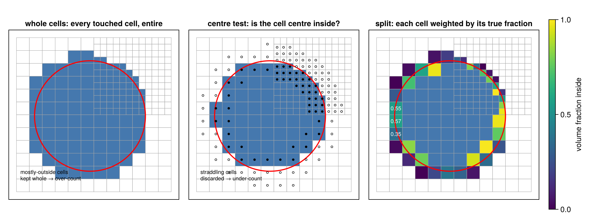

The errors are largest where the cells are large. In the refined corner the three panels almost
agree.

Now the same three rules on real data. We place a 10 kpc sphere off centre, at x = 13 kpc, so
its surface runs from small disc cells into large cells near the box edge. All three answers
come from one cut. The split cut is the reference. `split=false` gives the centre test. The
whole-cell answer is the split cut with its `:fraction` column removed, so that every touched
cell counts in full. (The classic API offers the same two alternatives as `cell=true` and
`cell=false`, see Step 11.)

```julia
ctr = [13., :bc, :bc]   # x = 13 kpc; box centre in y and z

sph        = subregion(gas, sphere(10.; center=ctr, range_unit=:kpc), verbose=false)  # split
sph_centre = subregion(gas, sphere(10.; center=ctr, range_unit=:kpc);
                       split=false, verbose=false)                    # centre-inside cells, whole

# whole-cell mode = the split selection with its :fraction column removed:
cols_keep = Tuple(filter(!=(:fraction), propertynames(Mera.columns(sph.data))))
sph_whole = construct_datatype(Mera.select(sph.data, cols_keep), sph)

m_upper = msum(sph_whole,  :Msol)
m_lower = msum(sph_centre, :Msol)
m_exact = msum(sph,        :Msol)

println("gas mass inside r = 10 kpc:")
println("  whole cells  (no :fraction) : ", round(m_upper, sigdigits=6), " Msol   +",
        round(100*(m_upper/m_exact - 1), sigdigits=3), " % vs split")
println("  centre test  (split=false)  : ", round(m_lower, sigdigits=6), " Msol   ",
        round(100*(m_lower/m_exact - 1), sigdigits=3), " % vs split")
println("  split        (:fraction)    : ", round(m_exact, sigdigits=6), " Msol   reference")
```

```
gas mass inside r = 10 kpc:
  whole cells  (no :fraction) : 1.19933e10 Msol   +0.332 % vs split
  centre test  (split=false)  : 1.19536e10 Msol   -0.00125 % vs split
  split        (:fraction)    : 1.19537e10 Msol   reference
```

The two differences are of different kinds. Whole cells are a **strict upper bound**: they hold
the split selection with every cut cell at full weight, so they can only be larger. The centre
test has **no guaranteed sign**: the cells it keeps count too much, the cells it drops count too
little, and the two partly cancel. Both differences shrink on a finer grid, but at any
resolution the split value is the one to quote.

**How exact is the fraction?** For a box aligned with the axes, Mera computes it exactly. For a
curved surface it tests a grid of `nsub × nsub × nsub` points in each boundary cell (default
`nsub=8`, so 512 points). A sphere has a known volume, (4/3)πR³, so we can measure the accuracy,
and improve it with a larger `nsub`:

```julia
v8    = sum(getvar(sph, :volume, :kpc3))
sph32 = subregion(gas, sphere(10.; center=ctr, range_unit=:kpc); nsub=32, verbose=false)
v32   = sum(getvar(sph32, :volume, :kpc3))
v_ana = 4π/3 * 10.0^3
sph32 = nothing

println("(4/3) π R³                    : ", round(v_ana, sigdigits=6), " kpc³")
println("split-cell volume, nsub = 8   : ", round(v8,  sigdigits=6), " kpc³   (",
        round(100*(v8/v_ana - 1),  sigdigits=2), " %)")
println("split-cell volume, nsub = 32  : ", round(v32, sigdigits=6), " kpc³   (",
        round(100*(v32/v_ana - 1), sigdigits=2), " %)")
```

```
(4/3) π R³                    : 4188.79 kpc³
split-cell volume, nsub = 8   : 4188.6 kpc³   (-0.0046 %)
split-cell volume, nsub = 32  : 4188.77 kpc³   (-0.00036 %)
```

The small deviation comes from the few large cells on the far side of the sphere. A larger
`nsub` reduces it and costs proportionally more time. Keep the default for normal work; raise it
when a boundary crosses very large cells and the last digits matter.

Now the maps. The second row zooms onto the coarse west edge, because at full size the
differences are smaller than a screen pixel. The dashed circle is the exact sphere.

```julia
zoomw = (center=ctr, xrange=[-12, 12], yrange=[-12, 12], pxsize=[0.1, :kpc])

p_up = proj(sph_whole;  zoomw...)
p_sp = proj(sph;        zoomw...)
p_lo = proj(sph_centre; zoomw...)

# The rim spans about 1.8 dex, while the page-wide scale spans 6. Measured across this
# window the three treatments differ from the split map by 15 % (whole) and 3 % (centres),
# which is 0.06 and 0.01 dex: about 1 % of a six-decade colour bar, and invisible. The zoom
# row therefore gets its own stretch, taken from the rim's own values.
ZLIM = (-1.8, 0.4)

# ── figure code from here: panels, overlays, colorbars, no new Mera concepts ──
fig  = Figure(size=(1080, 700))
L    = (-12, 12, -12, 12)
Lz   = (-11, -7, -2, 2)                              # the coarse west rim
panels = ((p_up, "whole cells: bulges outward"),
          (p_sp, "split: edge on the circle"),
          (p_lo, "centres only: eroded inward"))
for (k, (p, ttl)) in enumerate(panels)
    ax = Axis(fig[1, k], title=ttl)
    show_sd!(ax, p, L)
    arc!(ax, Point2f(0, 0), 10., 0, 2π; color=:white, linewidth=1, linestyle=:dash)
    lines!(ax, [-11, -7, -7, -11, -11], [-2, -2, 2, 2, -2]; color=:cyan, linewidth=1)
    axz = Axis(fig[2, k], title=k == 2 ? "zoom: the coarse west rim (own colour range)" : "")
    show_sd!(axz, p, Lz; lims=ZLIM)
    arc!(axz, Point2f(0, 0), 10., 0, 2π; color=:white, linewidth=1.2, linestyle=:dash)
end
scalebar!(content(fig[1, 1]), -11, -11.2, 5)
sd_bar!(fig[1, 4])
Colorbar(fig[2, 4]; colormap=:inferno, colorrange=ZLIM, label="log₁₀ Σ  (zoom)")
fig
```

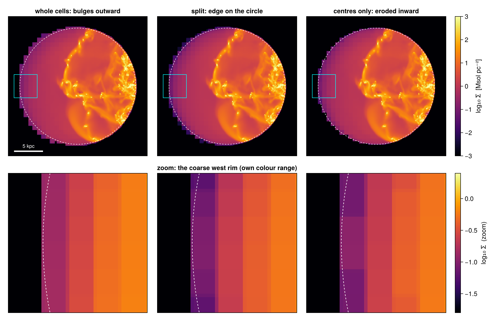

In the zoom, the three rules of the drawing appear on real data: whole cells stick out past the
circle, the centre test cuts into it, and the split edge lies on it. The split edge is a little
soft, because the projection spreads the (correctly reduced) mass of each cut cell over the
whole cell. Step 9 measures this and shows how to make the edge sharp.

The zoom row has its own colour range. On the page-wide scale of six decades, a difference of a
few per cent would be invisible.

Next, the fractions themselves. We take the boundary cells of the split sphere
(`0 < fraction < 1`) in a thin slab around the mid-plane and colour each cell by its fraction.
The marker size follows the cell size.

```julia
cs = getvar(sph, :cellsize, :kpc)
xr = getvar(sph, :x, :kpc) .- 13.   # cell centres relative to the sphere centre
yr = getvar(sph, :y, :kpc) .- 24.   #  (x = 13, y = z = 24 kpc)
zr = getvar(sph, :z, :kpc) .- 24.
f  = Mera.select(sph.data, :fraction)

sel = (f .< 1.0) .& (abs.(zr) .< 1.)   # boundary cells in a thin mid-plane slab

# ── figure code from here: panels, overlays, colorbars, no new Mera concepts ──
fig = Figure(size=(640, 520))
ax  = Axis(fig[1, 1], title="boundary cells, |z| < 1 kpc: marker size ∝ cell size",
           xlabel="x − x꜀ [kpc]", ylabel="y − y꜀ [kpc]", aspect=DataAspect())
sc  = scatter!(ax, xr[sel], yr[sel]; color=f[sel], colormap=:viridis,
               colorrange=(0, 1), markersize=16 .* cs[sel])
lines!(ax, 10 .* cos.(θ), 10 .* sin.(θ); color=:black, linewidth=1, linestyle=:dash)
text!(ax, -9.4,  6.5; text="coarse cells", color=:gray30, fontsize=11)
text!(ax,  5.2, -8.6; text="fine cells",   color=:gray30, fontsize=11)
Colorbar(fig[1, 2], sc, label="volume fraction inside")
fig
```

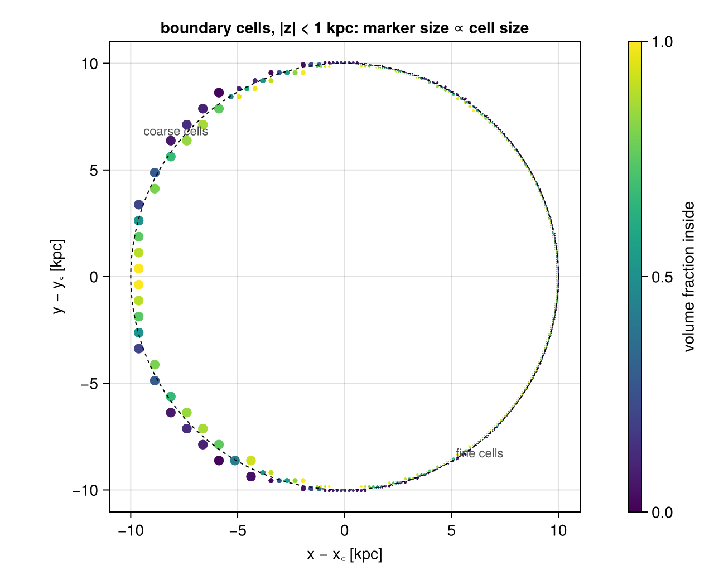

The fractions lie on both sides of the circle, as in the drawing. Toward the galaxy (lower
right) the circle crosses many small cells; toward the box edge (upper left) it crosses a few
large ones. These few large cells cause the differences above.

**Where the grid is coarse.** A small sphere high above the disc, where the grid was never
refined, shows how large the effect can get:

```julia
ctr_c = [:bc, :bc, 32.]                       # 8 kpc above the plane: coarse mesh
sph_c  = subregion(gas, sphere(1.5; center=ctr_c, range_unit=:kpc), verbose=false)
sph_cc = subregion(gas, sphere(1.5; center=ctr_c, range_unit=:kpc); split=false, verbose=false)
cols_c = Tuple(filter(!=(:fraction), propertynames(Mera.columns(sph_c.data))))
sph_cw = construct_datatype(Mera.select(sph_c.data, cols_c), sph_c)

mc_u, mc_l, mc_e = msum(sph_cw, :Msol), msum(sph_cc, :Msol), msum(sph_c, :Msol)
println("gas mass inside r = 1.5 kpc, 8 kpc above the plane:")
println("  whole cells : +", round(100*(mc_u/mc_e - 1), sigdigits=3), " % vs split")
println("  centre test : ", round(100*(mc_l/mc_e - 1), sigdigits=3), " % vs split")
println("  split       : ", round(mc_e, sigdigits=5), " Msol   reference   (",
        length(sph_c.data), " cells, largest ",
        round(maximum(getvar(sph_c, :cellsize, :kpc)), digits=3), " kpc)")
```

```
gas mass inside r = 1.5 kpc, 8 kpc above the plane:
  whole cells : +93.3 % vs split
  centre test : 19.1 % vs split
  split       : 560090.0 Msol   reference   (66 cells, largest 0.75 kpc)
```

Here the surface crosses a few dozen cells that are about as large as the region itself, and
the whole-cell and centre-test masses move far away from the split value. The error of a
whole-cell cut depends on the cell size at the boundary, not on the overall resolution of the
run. Whenever you cut something small, or something far from the refined regions, compare the
three numbers before you trust a whole-cell result.

## Step 5. Inside and outside

Every region has an inverse: everything else in the box. `inverse=true` selects it. The
fractions flip too (`fraction → 1 − fraction`), so a cut cell is shared between the region and
its inverse. Nothing is counted twice and nothing is lost: region and inverse together are
exactly the whole box.

We use the centre of the disc, a cylinder with a radius of 4 kpc and a half-height of 2 kpc.

A hint for maps: a hole is hard to see in a projection through the whole 48 kpc box, because
the line of sight still passes the gas in front of and behind it. To see a hole, limit the depth
of the projection to the region, here with `zrange=[-2, 2]`.

```julia
nucleus_region = cylinder(4., 2.; center=[:bc], range_unit=:kpc)

nucleus = subregion(gas, nucleus_region, verbose=false)
anti    = subregion(gas, nucleus_region; inverse=true, verbose=false)

m_nuc, m_anti, m_tot = msum(nucleus, :Msol), msum(anti, :Msol), msum(gas, :Msol)
println("nucleus zone          : ", round(m_nuc,  sigdigits=6), " Msol")
println("nucleus + inverse     : ", round(m_nuc + m_anti, sigdigits=8), " Msol")
println("whole box             : ", round(m_tot,          sigdigits=8), " Msol")
println("relative imbalance    : ", round((m_nuc + m_anti)/m_tot - 1, sigdigits=2))

pn = proj(nucleus; xrange=[-13, 13], yrange=[-13, 13], zrange=[-2, 2], pxsize=[0.1, :kpc])
pa = proj(anti;    xrange=[-13, 13], yrange=[-13, 13], zrange=[-2, 2], pxsize=[0.1, :kpc])

# ── figure code from here: panels, overlays, colorbars, no new Mera concepts ──
fig = Figure(size=(880, 440))
Ln  = (-13, 13, -13, 13)
ax1 = Axis(fig[1, 1], title="nucleus zone   (±2 kpc slab)")
ax2 = Axis(fig[1, 2], title="inverse=true: everything else   (±2 kpc slab)")
show_sd!(ax1, pn, Ln); show_sd!(ax2, pa, Ln)
for ax in (ax1, ax2)
    arc!(ax, Point2f(0, 0), 4., 0, 2π; color=:white, linewidth=1, linestyle=:dash)
end
sd_bar!(fig[1, 3])
fig
```

```
nucleus zone          : 5.93727e9 Msol
nucleus + inverse     : 3.0400672e10 Msol
whole box             : 3.0400672e10 Msol
relative imbalance    : 0.0
```

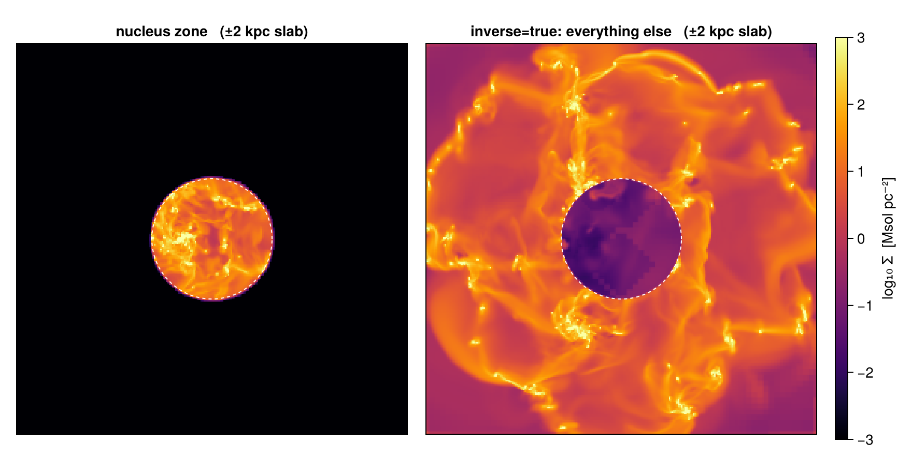

The two maps are exact complements, and the two masses add up to the box total. The hole is not
completely black: the remaining parts of the cut cells are drawn over their full cell size
(Step 9 explains this). The masses are exact regardless.

`!region` means the same as `inverse=true`, written as part of the region. This is useful inside
combinations (Step 6):

```julia
anti2 = subregion(gas, !nucleus_region, verbose=false)
println("!region      : ", round(msum(anti2, :Msol), sigdigits=8), " Msol")
println("inverse=true : ", round(m_anti,           sigdigits=8), " Msol")
anti2 = nothing
```

```
!region      : 2.4463406e10 Msol
inverse=true : 2.4463406e10 Msol
```

## Step 6. Combining regions

Regions combine with set operators, nested as deep as you like, and each part can have its own
centre. Boundary cells keep their fractions in every combination; for curved surfaces they are
sampled with `nsub` as in Step 4.

| operator | ASCII form | function | selects |
|---|---|---|---|
| `A ∩ B` | `A & B` | `intersect(A, B)` | inside both |
| `A ∪ B` | `A \| B` | `union(A, B)` | inside at least one |
| `A \ B` | | `setdiff(A, B)` | inside A but not inside B |
| `!A` | | | outside A |

!!! tip "Typing ∪ and ∩"
    In the Julia REPL, Jupyter and VS Code, type `\cup` and press TAB to get `∪`, or `\cap` and
    TAB to get `∩`. The ASCII forms in the table work everywhere.

A common case is the disc without the bulge. The bulge sphere (radius 4 kpc) reaches above and
below the ±2 kpc disc, so the mass it removes from the disc is the mass of `disc ∩ sphere`, not
the mass of the full sphere. The algebra keeps track of this:

```julia
bulge_sphere = sphere(4.; center=[:bc], range_unit=:kpc)

clean_disc = subregion(gas, disc_region \ bulge_sphere, verbose=false)
overlap    = subregion(gas, disc_region ∩ bulge_sphere, verbose=false)

m_clean = msum(clean_disc, :Msol)
m_olap  = msum(overlap,    :Msol)

println("disc \\ sphere : ", round(m_clean, sigdigits=6), " Msol")
println("disc ∩ sphere : ", round(m_olap,  sigdigits=6), " Msol")
println("sum           : ", round(m_clean + m_olap, sigdigits=8),
        "   vs disc: ", round(m_disc, sigdigits=8), " Msol")

pc1 = proj(clean_disc; xrange=[-13, 13], yrange=[-13, 13], pxsize=[0.1, :kpc])
pc2 = proj(clean_disc; direction=:x, xrange=[-3, 3], yrange=[-13, 13], zrange=[-4, 4],
           pxsize=[0.1, :kpc])                    # depth-restricted: the bite is visible

# ── figure code from here: panels, overlays, colorbars, no new Mera concepts ──
fig = Figure(size=(760, 560))
ax1 = Axis(fig[1, 1], title="disc \\ sphere, face-on")
show_sd!(ax1, pc1, (-13, 13, -13, 13))
arc!(ax1, Point2f(0, 0), 4., 0, 2π; color=:white, linewidth=1, linestyle=:dash)
ax2 = Axis(fig[2, 1], title="edge-on, ±3 kpc slab: the lens-shaped bite")
show_sd!(ax2, pc2, (-13, 13, -4, 4))
arc!(ax2, Point2f(0, 0), 4., 0, 2π; color=:white, linewidth=1, linestyle=:dash)
for zpl in (-2., 2.)
    lines!(ax2, [-13., 13.], [zpl, zpl]; color=:cyan, linewidth=1, linestyle=:dash)
end
sd_bar!(fig[:, 2])
fig
```

```
disc \ sphere : 1.69318e10 Msol
disc ∩ sphere : 5.90283e9 Msol
sum           : 2.2834624e10   vs disc: 2.2834625e10 Msol
```

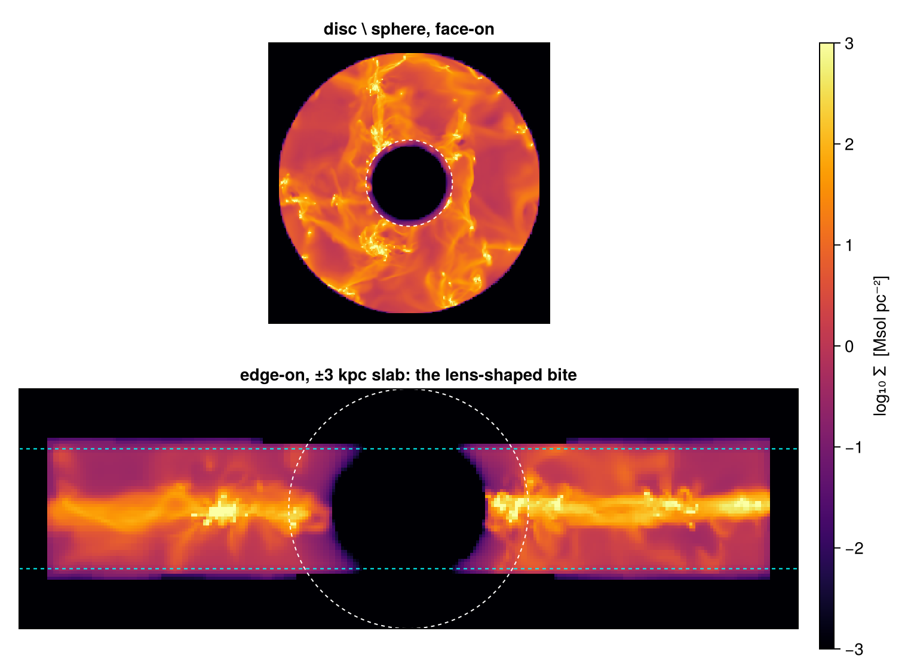

Difference and intersection split the disc into two parts, and their masses add up to the disc
mass. The side view is limited to a ±3 kpc slab, so the bite of the sphere shows as a dark lens
between the dashed faces of the disc.

Any number of parts can be combined. Below, the disc joined with a 5 kpc "companion" sphere,
minus two holes, in one expression, each part with its own centre:

```julia
sculpture = (disc_region ∪ sphere(5.; center=[33., :bc, :bc], range_unit=:kpc)) \
            (sphere(2.5; center=[18., :bc, :bc], range_unit=:kpc) ∪
             sphere(2.5; center=[30., :bc, :bc], range_unit=:kpc))

carve = subregion(gas, sculpture, verbose=false)
println("sculpture gas mass: ", round(msum(carve, :Msol), sigdigits=6), " Msol")

ps = proj(carve; xrange=[-16, 16], yrange=[-16, 16], pxsize=[0.1, :kpc])

# ── figure code from here: panels, overlays, colorbars, no new Mera concepts ──
fig = Figure(size=(640, 520))
ax  = Axis(fig[1, 1], title="(disc ∪ companion) \\ two holes")
show_sd!(ax, ps, (-16, 16, -16, 16))
text!(ax,  9.0,  5.6; text="companion", color=:cyan, fontsize=11, align=(:center, :bottom))
text!(ax, -6.5, -13.6; text="left hole: drills through\nthe whole ±2 kpc slab", color=:cyan,
      fontsize=10, align=(:center, :top))
text!(ax,  8.5, -13.6; text="right hole: companion gas\nremains behind it", color=:cyan,
      fontsize=10, align=(:center, :top))
scalebar!(ax, -15, 14.6, 5)
sd_bar!(fig[1, 2])
fig
```

```
sculpture gas mass: 2.25759e10 Msol
```

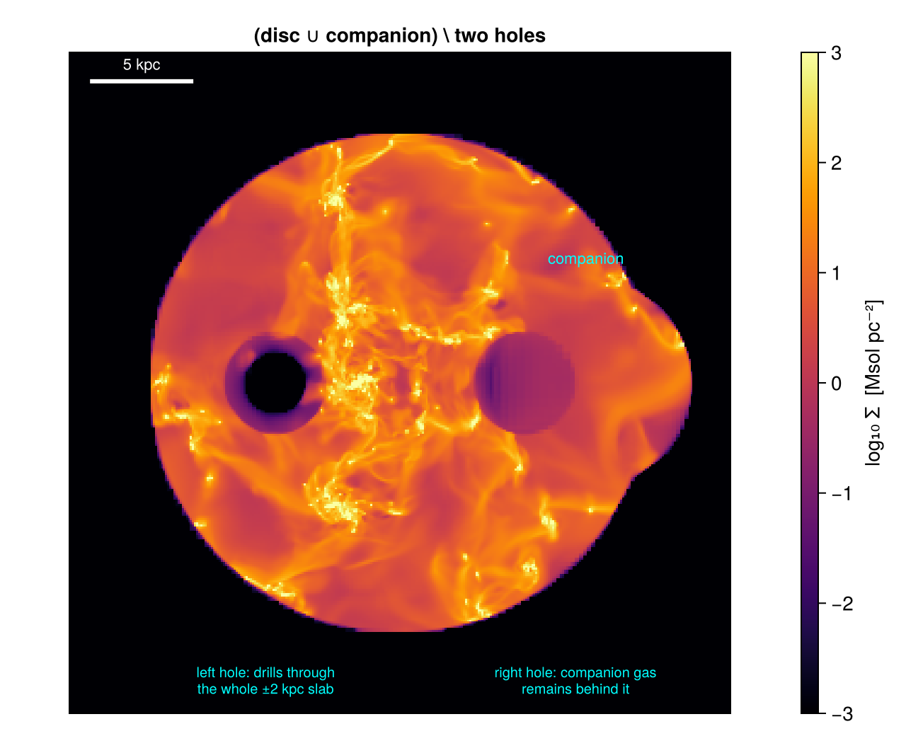

The left hole is black: its radius (2.5 kpc) is larger than the half-height of the disc (2 kpc),
so it goes through the whole disc. The right hole lies inside the companion sphere, which is
thicker than the hole along the line of sight, so gas in front of and behind the hole remains.
Reading the projection of a 3-D shape always needs this kind of depth reasoning.

**The `@region` block.** Long combinations get hard to read when every part repeats `center=`
and `range_unit=`. Inside `@region`, every constructor that does not set them itself gets the
`unit` and `center` of the block. Assignments name the parts, and the last line is the result:
an ordinary region, the same as the operator form.

```julia
sculpture2 = @region unit=:kpc center=[:bc] begin
    disc      = cylinder(12., 2.)
    companion = sphere(5.; center=[33., :bc, :bc])
    holeL     = sphere(2.5; center=[18., :bc, :bc])
    holeR     = sphere(2.5; center=[30., :bc, :bc])
    (disc ∪ companion) \ (holeL ∪ holeR)
end

carve2 = subregion(gas, sculpture2, verbose=false)
println("identical to the operator form : ", msum(carve2, :Msol) == msum(carve, :Msol))
```

```
identical to the operator form : true
```

Because the fractions pass through every operator, the rules of set algebra also hold for the
numbers. Here the rule vol(A ∪ B) = vol(A) + vol(B) − vol(A ∩ B), for the disc A and the
companion B:

```julia
A = disc_region
B = sphere(5.; center=[33., :bc, :bc], range_unit=:kpc)

volk(r) = sum(getvar(subregion(gas, r, verbose=false), :volume, :kpc3))

vA, vB, vAB, vAuB = volk(A), volk(B), volk(A ∩ B), volk(A ∪ B)
println("vol(A) + vol(B) − vol(A ∩ B) = ", round(vA + vB - vAB, sigdigits=6), " kpc³")
println("vol(A ∪ B)                   = ", round(vAuB, sigdigits=6), " kpc³")
```

```
vol(A) + vol(B) − vol(A ∩ B) = 2082.22 kpc³
vol(A ∪ B)                   = 2082.22 kpc³
```

**Cutting a cut.** `subregion` also works on an object that was already cut by a region. The
fractions then multiply. This is exact for every cell that only one of the two surfaces passes
through. For the few cells that both surfaces pass through it is an approximation, and Mera
prints a hint. For the exact result, combine the regions first:

```julia
disc_then_ball = subregion(disc, bulge_sphere, verbose=false)       # a cut of a cut
disc_and_ball  = subregion(gas, disc_region ∩ bulge_sphere, verbose=false)

m_chain, m_and = msum(disc_then_ball, :Msol), msum(disc_and_ball, :Msol)
println("disc, then sphere : ", round(m_chain, sigdigits=8), " Msol")
println("disc ∩ sphere     : ", round(m_and,   sigdigits=8), " Msol")
println("relative diff.    : ", round(m_chain / m_and - 1, sigdigits=2))
disc_then_ball = disc_and_ball = nothing
```

```
disc, then sphere : 5.9028068e9 Msol
disc ∩ sphere     : 5.9028314e9 Msol
relative diff.    : -4.2e-6
```

!!! tip "Try it"
    A cylindrical shell can also be written with the algebra:
    `cylinder(10., 2.) \ cylinder(6., 2.)` is the same ring as `cylindricalshell(6., 10., 2.)`.
    Cut both and compare `msum`. The shell computes its fractions in one pass, but both should
    agree to the sampling accuracy of Step 4.

## Step 7. Tilted regions

Structures in a simulation are rarely aligned with the grid. `cylinder` and `cylindricalshell`
take any 3-vector as `axis`; it does not need to be normalised. (The classic `:cylinder` is
always along z.) A map flattens the third dimension, so before cutting anything tilted, it helps
to draw the geometry once:

```julia
using LinearAlgebra

a  = normalize([1., 0., 2.])             # cylinder axis, tipped toward +x
e1 = normalize(cross([0., 0., 1.], a))   # ⊥ a
e2 = normalize(cross(a, e1))             # completes the orthonormal basis
θ3 = range(0, 2π; length=121)

# ── figure code from here: panels, overlays, colorbars, no new Mera concepts ──
fig = Figure(size=(700, 560))
ax  = Axis3(fig[1, 1]; aspect=:data, azimuth=0.9, elevation=0.25,
            title="a tilted cylinder through the disc: the geometry")
for zpl in (-2., 2.)                     # the ±2 kpc disc slab: top and bottom faces
    lines!(ax, 12 .* cos.(θ3), 12 .* sin.(θ3), fill(zpl, 121); color=:gray60)
end
for φ in range(0, 2π; length=9)[1:8]     # vertical strokes joining the faces
    lines!(ax, fill(12cos(φ), 2), fill(12sin(φ), 2), [-2., 2.]; color=:gray80)
end
for s in (-1., 1.)                       # the tilted cylinder: rims at ±1 kpc along its axis
    rim = [s .* a .+ 10. .* (cos(t) .* e1 .+ sin(t) .* e2) for t in θ3]
    lines!(ax, getindex.(rim, 1), getindex.(rim, 2), getindex.(rim, 3);
           color=:cyan, linewidth=1.5)
end
lines!(ax, [-6a[1], 6a[1]], [-6a[2], 6a[2]], [-6a[3], 6a[3]]; color=:teal, linewidth=2)
text!(ax, Point3f(6.6a[1], 0, 6.6a[3]); text="cylinder axis [1, 0, 2]", color=:teal, fontsize=11)
lines!(ax, [0., 0.], [0., 0.], [-6., 6.]; color=:black, linewidth=1)
text!(ax, Point3f(0, 0, 6.5); text="disc normal (z)", color=:black, fontsize=11)
fig
```

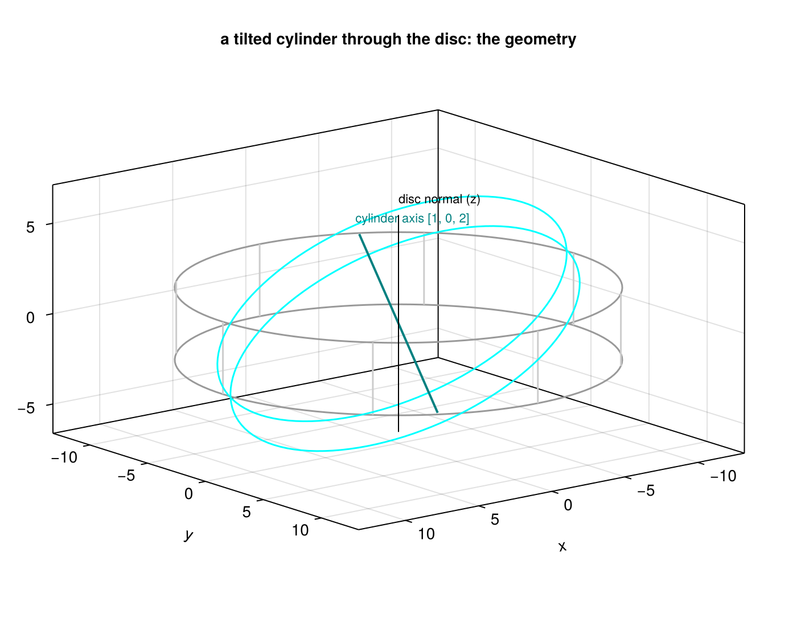

Now the cut: `cylinder(10., 1.; axis=[1., 0., 2.])`, a thin slab tilted toward +x. Two checks
show that the tilt costs nothing. The volume matches the exact value πR²·2h, which does not
depend on the orientation. And two views tell the same story: along z the tilt shows only as a
soft ellipse, along y it shows as what it is, an inclined bar. To *look along* the tilted axis
instead of only cutting along it, use the [off-axis projection](06_offaxis_Projection.md).

```julia
tilt_region = cylinder(10., 1.; axis=[1., 0., 2.], center=[:bc], range_unit=:kpc)
tilted = subregion(gas, tilt_region, verbose=false)

v_tilt = sum(getvar(tilted, :volume, :kpc3))
v_ana  = π * 10.0^2 * 2.0
println("tilted-cylinder gas mass : ", round(msum(tilted, :Msol), sigdigits=6), " Msol")
println("volume                   : ", round(v_tilt, sigdigits=6), " kpc³   vs  πR²·2h = ",
        round(v_ana, sigdigits=6), " kpc³   (", round(100*(v_tilt/v_ana - 1), sigdigits=2), " %)")

pt1 = proj(tilted; xrange=[-13, 13], yrange=[-13, 13], pxsize=[0.1, :kpc])
pt2 = proj(tilted; direction=:y, xrange=[-13, 13], zrange=[-7, 7], pxsize=[0.1, :kpc])

# ── figure code from here: panels, overlays, colorbars, no new Mera concepts ──
fig = Figure(size=(920, 440))
ax1 = Axis(fig[1, 1], title="seen along z: an ellipse with softened rims")
show_sd!(ax1, pt1, (-13, 13, -13, 13))
ax2 = Axis(fig[1, 2], title="seen along y: the inclined bar it actually is")
show_sd!(ax2, pt2, (-13, 13, -7, 7))
lines!(ax2, [0., 3.5a[1]], [0., 3.5a[3]]; color=:cyan, linewidth=1.5)
text!(ax2, 3.5a[1] + 0.5, 3.5a[3]; text="cylinder axis", color=:cyan, fontsize=11,
      align=(:left, :center))
sd_bar!(fig[1, 3])
fig
```

```
tilted-cylinder gas mass : 5.43585e9 Msol
volume                   : 628.848 kpc³   vs  πR²·2h = 628.319 kpc³   (0.084 %)
```

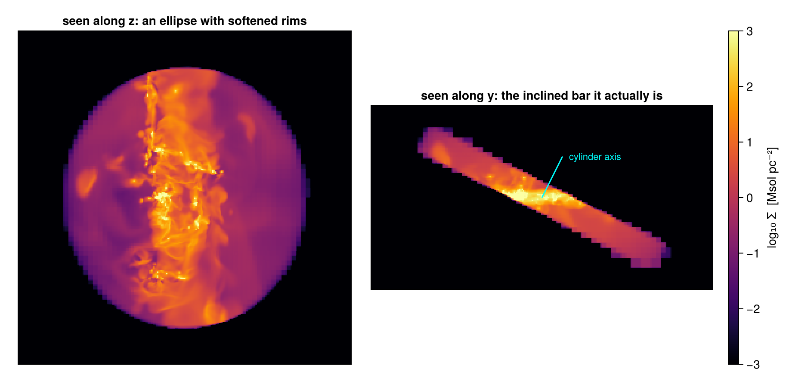

The volume matches the exact value to the usual sampling accuracy. The two views repeat the
depth lesson of Step 6: the same selection can look like a blur or like a bar, depending on the
direction of view.

Shells tilt as well: `cylindricalshell` takes the same `axis`. For a tilted shape the natural
view is along its own axis, which the off-axis projection gives directly (`los=` takes the same
vector). Three views of one tilted ring: from the top it is an elliptical ring, along its own
axis it is the circular ring it really is, and from the side (along y) it shows its tilt. As a
second check, an **in-plane bar**, a thin cylinder whose axis lies in the disc plane, with the
volume checks for both:

```julia
tshell_region = cylindricalshell(6., 10., 1.; axis=[1., 0., 2.], center=[:bc], range_unit=:kpc)
tshell = subregion(gas, tshell_region, verbose=false)
v_ts   = sum(getvar(tshell, :volume, :kpc3))
v_up   = sum(getvar(subregion(gas, cylindricalshell(6., 10., 1.; center=[:bc], range_unit=:kpc),
                              verbose=false), :volume, :kpc3))
println("tilted shell volume : ", round(v_ts, sigdigits=6), " kpc³   upright: ",
        round(v_up, sigdigits=6), " kpc³   analytic π(R²−r²)·2h = ",
        round(π*(100-36)*2, sigdigits=6), " kpc³")

bar_region = cylinder(4., 1.2; axis=[cosd(25.), sind(25.), 0.], center=[:bc], range_unit=:kpc)
bar = subregion(gas, bar_region, verbose=false)
println("in-plane bar volume : ", round(sum(getvar(bar, :volume, :kpc3)), sigdigits=6),
        " kpc³   analytic πR²·2h = ", round(π*16*2.4, sigdigits=6), " kpc³")

pt_f = proj(tshell; xrange=[-12, 12], yrange=[-12, 12], pxsize=[0.1, :kpc])
pt_a = projection(tshell, :sd, :Msol_pc2; los=[1., 0., 2.], center=[:bc], range_unit=:kpc,
                  pxsize=[0.1, :kpc], verbose=false, show_progress=false)
pt_e = proj(tshell; direction=:y, xrange=[-12, 12], zrange=[-8, 8], pxsize=[0.1, :kpc])
pb   = proj(bar; xrange=[-6, 6], yrange=[-6, 6], pxsize=[0.05, :kpc])

# ── figure code from here: panels, overlays, colorbars, no new Mera concepts ──
fig = Figure(size=(1180, 760))
ax1 = Axis(fig[1, 1], title="tilted ring along z: an elliptical annulus")
show_sd!(ax1, pt_f, (-12, 12, -12, 12))
ax2 = Axis(fig[1, 2], title="along its own axis (los = [1, 0, 2]): a circle again")
show_sd!(ax2, pt_a)
for r in (6., 10.)
    arc!(ax2, Point2f(0, 0), r, 0, 2π; color=:white, linewidth=1, linestyle=:dash)
end
ax3 = Axis(fig[2, 1], title="along y: the inclination, explicit")
show_sd!(ax3, pt_e, (-12, 12, -8, 8))
ax4 = Axis(fig[2, 2], title="in-plane bar (axis 25° in the disc plane), face-on")
show_sd!(ax4, pb, (-6, 6, -6, 6))
sd_bar!(fig[:, 3])
fig
```

```
tilted shell volume : 402.739 kpc³   upright: 403.265 kpc³   analytic π(R²−r²)·2h = 402.124 kpc³
in-plane bar volume : 120.595 kpc³   analytic πR²·2h = 120.637 kpc³
```

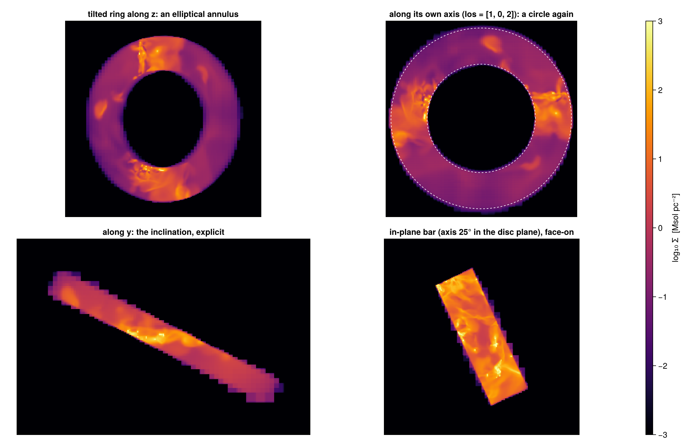

In the view along the axis, the dashed exact circles at 6 and 10 kpc lie on the edges of the
ring: cutting along a vector and looking along the same vector fit together. Both tilted volumes
agree with their upright versions and with the exact values.

## Step 8. A mass budget that balances

Now the tools answer one question: how is the gas of this galaxy distributed? We cut the disc
into zones and check that their masses add up to the disc mass.

On an AMR grid this does not happen by itself. Zones that overlap, or leave gaps, give a table
that does not add up, and nothing in the table warns you. Split regions that touch share each
boundary cell through complementary fractions, so their sum must close.

The plan, drawn on the data. Face-on: the **nucleus** (r < 4 kpc), the **inner zone** (4 to
6 kpc), the **ring** (6 to 10 kpc) and the **rim** (10 to 12 kpc), all within the ±2 kpc disc,
and in orange the off-centre sphere of Step 4. Edge-on: the disc slab and the 10 to 20 kpc
**envelope**, which we measure outside the budget.

```julia
p_face = proj(gas)                 # full box, face-on (z)
p_edge = proj(gas; direction=:x)   # full box, edge-on

# ── figure code from here: panels, overlays, colorbars, no new Mera concepts ──
fig = Figure(size=(1000, 480))
axf = Axis(fig[1, 1], title="face-on: the dissection plan",
           xlabel="x − x꜀ [kpc]", ylabel="y − y꜀ [kpc]")
show_sd!(axf, p_face; decorate=true)
arc!(axf, Point2f(0, 0),  4., 0, 2π; color=:cyan, linewidth=1.5)
arc!(axf, Point2f(0, 0),  6., 0, 2π; color=:cyan, linewidth=1.2, linestyle=:dash)
arc!(axf, Point2f(0, 0), 10., 0, 2π; color=:cyan, linewidth=1.2, linestyle=:dash)
arc!(axf, Point2f(0, 0), 12., 0, 2π; color=:cyan, linewidth=1.5)
text!(axf,  0.0,  4.4; text="nucleus", color=:cyan, fontsize=11, align=(:center, :bottom))
text!(axf,  5.9,  5.9; text="ring 6–10", color=:cyan, fontsize=11)
text!(axf,  9.2, -9.8; text="disc rim 12", color=:cyan, fontsize=11)
arc!(axf, Point2f(-11, 0), 10., 0, 2π; color=:orange, linewidth=1.5, linestyle=:dot)
text!(axf, -21.5, 10.6; text="sphere of Step 4", color=:orange, fontsize=11)

axe = Axis(fig[1, 2], title="edge-on: disc slab and envelope",
           xlabel="y − y꜀ [kpc]", ylabel="z − z꜀ [kpc]")
show_sd!(axe, p_edge; decorate=true)
lines!(axe, [-12., 12., 12., -12., -12.], [-2., -2., 2., 2., -2.]; color=:cyan, linewidth=1.5)
text!(axe, -11.5, 2.6; text="disc slab |z| ≤ 2", color=:cyan, fontsize=11)
arc!(axe, Point2f(0, 0), 10., 0, 2π; color=:orange, linewidth=1.2, linestyle=:dash)
arc!(axe, Point2f(0, 0), 20., 0, 2π; color=:orange, linewidth=1.2, linestyle=:dash)
text!(axe, 7.2, 17.5; text="envelope 10–20", color=:orange, fontsize=11)

sd_bar!(fig[1, 3])
fig
```

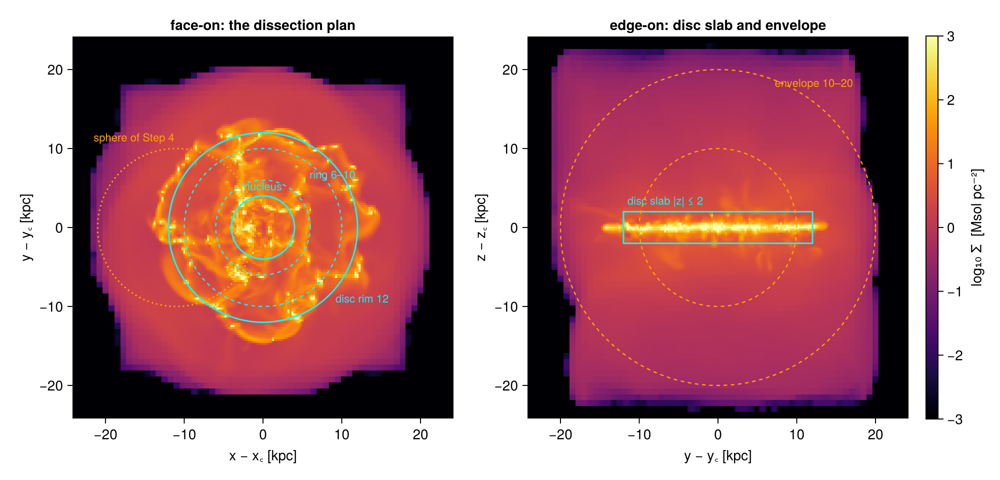

**The disc.** We cut `disc_region` from Step 2 twice, split and with `split=false`, to see the
lesson of Step 4 on a real structure:

```julia
disc_region = cylinder(12., 2.; center=[:bc], range_unit=:kpc)   # radius, half-height

disc       = subregion(gas, disc_region, verbose=false)                 # split boundary cells
disc_whole = subregion(gas, disc_region; split=false, verbose=false)    # centre test

m_disc  = msum(disc,       :Msol)
m_discw = msum(disc_whole, :Msol)
println("disc gas mass (r < 12 kpc, |z| < 2 kpc):")
println("  split       : ", round(m_disc,  sigdigits=6), " Msol")
println("  split=false : ", round(m_discw, sigdigits=6), " Msol   (",
        round(100*(m_discw/m_disc - 1), sigdigits=3), " %)")
```

```
disc gas mass (r < 12 kpc, |z| < 2 kpc):
  split       : 2.28346e10 Msol
  split=false : 2.28475e10 Msol   (0.0563 %)
```

The difference is tiny here: the mid-plane of the disc is highly refined, so the surface crosses
small cells almost everywhere. Where the choice matters is *above* the plane: seen from the
side, the flat faces of the cylinder at z = ±2 kpc (dashed) cut through the larger cells of the
thick gas layer.

The first two panels show the honest result: the two masses differ by less than a tenth of a per
cent, and on a six-decade colour scale the maps look the same. This is the usual case, and it is
why Step 4 argues with numbers rather than with pictures. The third panel subtracts the two maps.
The difference is not spread over the disc: it is a thin band on the two faces, where the split
cut keeps the inside part of each cut cell and the centre test keeps or drops the whole cell.

```julia
p3 = proj(disc;       direction=:x, yrange=[-14, 14], zrange=[-4, 4], pxsize=[0.1, :kpc])
p4 = proj(disc_whole; direction=:x, yrange=[-14, 14], zrange=[-4, 4], pxsize=[0.1, :kpc])

# The two maps differ by 0.06 % in mass: far too little to see against a six-decade
# colour scale. Subtracting them puts the disagreement where it actually lives.
dif  = p3.maps[:sd] .- p4.maps[:sd]
vals = sort!(abs.(filter(isfinite, vec(dif))))
dlim = vals[max(1, round(Int, 0.999 * length(vals)))]     # ignore a few extreme pixels

# ── figure code from here: panels, overlays, colorbars, no new Mera concepts ──
fig = Figure(size=(760, 720))
Le  = (-14, 14, -4, 4)
ax1 = Axis(fig[1, 1], title="disc edge-on, split")
show_sd!(ax1, p3, Le)
ax2 = Axis(fig[2, 1], title="disc edge-on, split=false")
show_sd!(ax2, p4, Le)
ax3 = Axis(fig[3, 1], title="split − split=false: the disagreement sits on the faces")
xs = range(p3.cextent[1]*kpc, p3.cextent[2]*kpc; length=size(dif, 1))
ys = range(p3.cextent[3]*kpc, p3.cextent[4]*kpc; length=size(dif, 2))
hm = heatmap!(ax3, xs, ys, dif; colormap=:balance, colorrange=(-dlim, dlim))
ax3.aspect = DataAspect(); hidedecorations!(ax3); limits!(ax3, Le...)
for ax in (ax1, ax2, ax3), zpl in (-2., 2.)
    lines!(ax, [-14., 14.], [zpl, zpl]; color=:cyan, linewidth=1, linestyle=:dash)
end
sd_bar!(fig[1:2, 2])
Colorbar(fig[3, 2], hm; label="Δ Σ  [Msol pc⁻²]")
fig
```

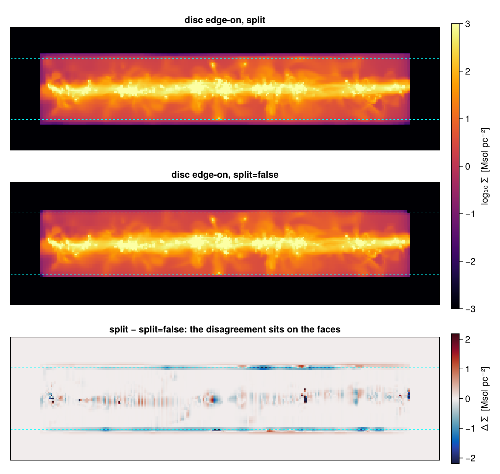

**The ring.** Dense gas often forms rings; this one lies between 6 and 10 kpc.
`cylindricalshell(6., 10., 2.)` selects it within the ±2 kpc slab. A shell has *two* surfaces,
so the centre test now makes errors on two edges at once. They can cancel or add up, which is
why Step 4 called the centre test an estimate and not a bound. We also cut the inverse of the
ring, everything except the ring, as a second check that region and inverse add up to the box:

```julia
ring_region = cylindricalshell(6., 10., 2.; center=[:bc], range_unit=:kpc)

ring     = subregion(gas, ring_region, verbose=false)
ring_ctr = subregion(gas, ring_region; split=false, verbose=false)

m_ring  = msum(ring,     :Msol)
m_ringc = msum(ring_ctr, :Msol)
println("ring gas mass (6 < r < 10 kpc, |z| < 2 kpc):")
println("  split       : ", round(m_ring,  sigdigits=6), " Msol")
println("  split=false : ", round(m_ringc, sigdigits=6), " Msol   (",
        round(100*(m_ringc/m_ring - 1), sigdigits=3), " %, net of two rims' cancelling errors)")

ring_inv = subregion(gas, ring_region; inverse=true, verbose=false)
println("ring + inverse = box?  ",
        round((msum(ring, :Msol) + msum(ring_inv, :Msol))/msum(gas, :Msol), digits=10))

pr  = proj(ring;     xrange=[-11, 11], yrange=[-11, 11], pxsize=[0.1, :kpc])
pri = proj(ring_inv; xrange=[-11, 11], yrange=[-11, 11], zrange=[-2, 2], pxsize=[0.1, :kpc])

# ── figure code from here: panels, overlays, colorbars, no new Mera concepts ──
fig = Figure(size=(1180, 420))
ax1 = Axis(fig[1, 1], title="ring, split: two boundary surfaces")
show_sd!(ax1, pr, (-11, 11, -11, 11))
lines!(ax1, [4, 11, 11, 4, 4], [-3, -3, 3, 3, -3]; color=:cyan, linewidth=1)
ax2 = Axis(fig[1, 2], title="zoom: both rims on their circles")
show_sd!(ax2, pr, (4, 11, -3, 3))
ax3 = Axis(fig[1, 3], title="inverse=true: the gap it leaves  (±2 kpc slab)")
show_sd!(ax3, pri, (-11, 11, -11, 11))
for ax in (ax1, ax2, ax3), r in (6., 10.)
    arc!(ax, Point2f(0, 0), r, 0, 2π; color=:white, linewidth=1, linestyle=:dash)
end
sd_bar!(fig[1, 4])
fig
```

```
ring gas mass (6 < r < 10 kpc, |z| < 2 kpc):
  split       : 8.03224e9 Msol
  split=false : 8.02745e9 Msol   (-0.0596 %, net of two rims' cancelling errors)
ring + inverse = box?  1.0
```

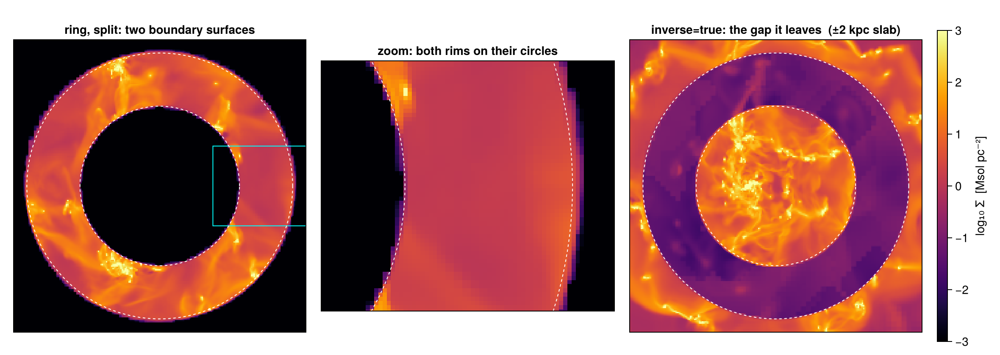

**The envelope.** Outside the disc lies a halo-like envelope, `sphericalshell(10., 20.)`. Its
inner surface is the same r = 10 kpc sphere as in Step 1 (`hello`). Shell and inner sphere share
the boundary cells at r = 10 through complementary fractions, so their masses must add up to
the mass of a plain 20 kpc sphere:

```julia
env_region = sphericalshell(10., 20.; center=[:bc], range_unit=:kpc)

env    = subregion(gas, env_region, verbose=false)
sph20  = subregion(gas, sphere(20.), verbose=false)

m_env, m_hello, m_20 = msum(env, :Msol), msum(hello, :Msol), msum(sph20, :Msol)
println("envelope (10–20 kpc)      : ", round(m_env,   sigdigits=6), " Msol")
println("enclosed sphere (< 10)    : ", round(m_hello, sigdigits=6), " Msol")
println("sum                       : ", round(m_env + m_hello, sigdigits=8), " Msol")
println("plain sphere(20) directly : ", round(m_20,            sigdigits=8), " Msol")
sph20 = nothing

pe1 = proj(env;   direction=:x, yrange=[-22, 22], zrange=[-22, 22], pxsize=[0.15, :kpc])
pe2 = proj(hello; direction=:x, yrange=[-22, 22], zrange=[-22, 22], pxsize=[0.15, :kpc])

# ── figure code from here: panels, overlays, colorbars, no new Mera concepts ──
fig = Figure(size=(880, 440))
Lv  = (-22, 22, -22, 22)
ax1 = Axis(fig[1, 1], title="envelope shell, edge-on")
ax2 = Axis(fig[1, 2], title="enclosed sphere, edge-on: same frame")
show_sd!(ax1, pe1, Lv); show_sd!(ax2, pe2, Lv)
arc!(ax1, Point2f(0, 0), 10., 0, 2π; color=:white, linewidth=1, linestyle=:dash)
arc!(ax1, Point2f(0, 0), 20., 0, 2π; color=:white, linewidth=1, linestyle=:dash)
arc!(ax2, Point2f(0, 0), 10., 0, 2π; color=:white, linewidth=1, linestyle=:dash)
sd_bar!(fig[1, 3])
fig
```

```
envelope (10–20 kpc)      : 1.18046e10 Msol
enclosed sphere (< 10)    : 1.82103e10 Msol
sum                       : 3.0014956e10 Msol
plain sphere(20) directly : 3.0014956e10 Msol
```

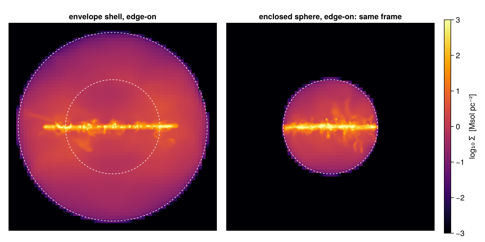

Both panels use the same frame (±22 kpc) and the same colour scale, so sizes and brightness can
be compared directly. The dashed r = 10 kpc circle is in both panels: it is the outer wall of
the sphere and the inner wall of the shell, and the printed sum shows its cut cells being shared
between the two without loss. The envelope is not part of the disc budget below, because a
spherical shell cannot tile with cylindrical zones; it is a separate line of the analysis.

**The ledger.** The four zones of the plan **tile** the disc: they have the same half-height,
and their radial edges meet exactly. So their masses must add up to the disc mass:

```julia
inner_zone = cylindricalshell(4., 6., 2.;  center=[:bc], range_unit=:kpc)
rim_zone   = cylindricalshell(10., 12., 2.; center=[:bc], range_unit=:kpc)

m_inner = msum(subregion(gas, inner_zone, verbose=false), :Msol)
m_rim   = msum(subregion(gas, rim_zone,   verbose=false), :Msol)

zones = [("nucleus: cylinder(4, ±2 kpc)",             m_nuc),
         ("inner  : cylindricalshell(4–6, ±2 kpc)",   m_inner),
         ("ring   : cylindricalshell(6–10, ±2 kpc)",  m_ring),
         ("rim    : cylindricalshell(10–12, ±2 kpc)", m_rim)]

println(rpad("disc zone", 44), "gas mass [Msol]")
println("-"^60)
for (name, m) in zones
    println(rpad(name, 44), round(m, sigdigits=5))
end
m_sum = sum(last.(zones))
println("-"^60)
println(rpad("sum of the four zones", 44), round(m_sum,  sigdigits=8))
println(rpad("disc, measured directly (Step 2)", 44), round(m_disc, sigdigits=8))
println(rpad("relative residual", 44), round(m_sum/m_disc - 1, sigdigits=2))
```

```
disc zone                                   gas mass [Msol]
------------------------------------------------------------
nucleus: cylinder(4, ±2 kpc)                5.9373e9
inner  : cylindricalshell(4–6, ±2 kpc)      3.9504e9
ring   : cylindricalshell(6–10, ±2 kpc)     8.0322e9
rim    : cylindricalshell(10–12, ±2 kpc)    4.9147e9
------------------------------------------------------------
sum of the four zones                       2.2834625e10
disc, measured directly (Step 2)            2.2834625e10
relative residual                           0.0
```

The ledger balances to floating-point accuracy. The numbers were not tuned: with split regions,
adding up is built in, because every cell on a shared edge gives its inside part to one zone and
the rest to the neighbour.

**The same budget for stars.** A region knows nothing about cells. Applied to particles,
`subregion` tests whether each particle position lies inside. So the same region values cut the
stars, with no new geometry. We load the star particles here; Step 10 uses them again.

```julia
# star particles only: drop dark matter (birth time 0)
part = getparticles(info, verbose=false, show_progress=false)
pcols = propertynames(Mera.columns(part.data))
:birth in pcols && (part = construct_datatype(filter(p -> p.birth > 0., part.data), part))
println("star particles: ", length(part.data))

zones_all = [("nucleus", nucleus_region, m_nuc),
             ("inner",   inner_zone,     m_inner),
             ("ring",    ring_region,    m_ring),
             ("rim",     rim_zone,       m_rim)]

println(rpad("disc zone", 12), lpad("gas [Msol]", 14), lpad("stars [Msol]", 15))
println("-"^41)
ms_zones = Float64[]
for (name, reg, mgas) in zones_all
    ms = msum(subregion(part, reg, verbose=false), :Msol)
    push!(ms_zones, ms)
    println(rpad(name, 12), lpad(string(round(mgas, sigdigits=4)), 14),
            lpad(string(round(ms, sigdigits=4)), 15))
end
ms_disc = msum(subregion(part, disc_region, verbose=false), :Msol)
println("-"^41)
println(rpad("sum", 12), lpad(string(round(m_disc, sigdigits=6)), 14),
        lpad(string(round(sum(ms_zones), sigdigits=6)), 15))
println(rpad("disc direct", 12), lpad(string(round(m_disc, sigdigits=6)), 14),
        lpad(string(round(ms_disc, sigdigits=6)), 15))

p_gasd = proj(disc; xrange=[-13, 13], yrange=[-13, 13], pxsize=[0.1, :kpc])
stars_d = subregion(part, disc_region, verbose=false)
sx = getvar(stars_d, :x, :kpc) .- 24.; sy = getvar(stars_d, :y, :kpc) .- 24.

# ── figure code from here: panels, overlays, colorbars, no new Mera concepts ──
fig = Figure(size=(640, 520))
ax = Axis(fig[1, 1], title="disc gas + its star particles: one region, two datatypes")
show_sd!(ax, p_gasd, (-13, 13, -13, 13))
scatter!(ax, sx[1:4:end], sy[1:4:end]; color=(:cyan, 0.15), markersize=1.2)   # every 4th star
scalebar!(ax, -12, -12.3, 5)
sd_bar!(fig[1, 2])
fig
```

```
star particles: 508939
disc zone       gas [Msol]   stars [Msol]
-----------------------------------------
nucleus            5.937e9        1.873e9
inner               3.95e9        1.153e9
ring               8.032e9        1.661e9
rim                4.915e9        4.586e8
-----------------------------------------
sum             2.28346e10      5.14581e9
disc direct     2.28346e10      5.14581e9
```

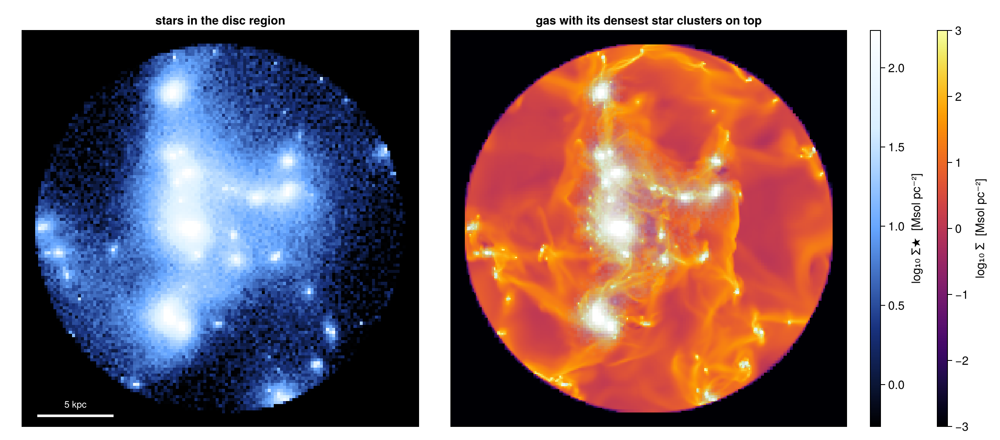

The stars tile the disc just like the gas. Particles are points, so each one belongs to exactly
one zone, and the four zones add up to the disc by construction. The overlay shows why the
ledger looks the way it does: the stars follow the dense gas they formed from, concentrated in
the nucleus and along the clumps of the ring.

## Step 9. Sharp edges for figures

"Exact" can mean two things.

**Numbers** (mass, volume, anything summed with `:fraction`) are exact to the sampling accuracy
of Step 4. Making the boundary cells smaller would not improve them: the children of a cell
carry the same values as the parent, and their inside parts add up to the inside part of the
parent. The `:fraction` column already holds that information. So `refine` and `refine_to` are
tools for maps, not for numbers.

**Maps** are a different matter. A projection spreads the reduced mass of each cut cell over the
whole cell. The mass is right, but it is spread at the size of the cell, so a split edge looks
soft. The rule is simple: mass can appear at most one boundary cell plus one pixel beyond the
exact surface. Where the boundary crosses large cells, this soft band is wide. `refine=k`
replaces only the boundary cells by their octree children, down to `k` levels, and each child
gets its own fraction. The band then shrinks to cellsize/2ᵏ.

We measure both on the flat face of the disc, in a small slab around its edge, so that the
refined cut stays cheap. Refining the whole boundary of a large region needs a lot of memory, so
limit `refine` to the part you will draw:

```julia
slab  = subregion(gas, :cuboid; xrange=[6., 14.], yrange=[-2., 2.], zrange=[-4., 4.],
                  center=[:bc], range_unit=:kpc, verbose=false)   # a light working slab
d_s0  = subregion(slab, disc_region, verbose=false)               # split, refine=0
d_ref = subregion(slab, disc_region; refine=2, verbose=false)     # boundary subdivided 2×

pe_s0 = projection(d_s0, :sd, :Msol_pc2; direction=:y, center=[:bc], range_unit=:kpc,
                   xrange=[6., 14.], zrange=[-4., 4.], pxsize=[0.02, :kpc],
                   verbose=false, show_progress=false)
pe_r  = projection(d_ref, :sd, :Msol_pc2; direction=:y, center=[:bc], range_unit=:kpc,
                   xrange=[6., 14.], zrange=[-4., 4.], pxsize=[0.02, :kpc],
                   verbose=false, show_progress=false)

zs     = collect(range(pe_s0.cextent[3]*kpc, pe_s0.cextent[4]*kpc; length=size(pe_s0.maps[:sd], 2)))
fringe(p) = maximum(maximum(abs.(zs)[p.maps[:sd][i, :] .> 1e-2]; init=0.0)
                    for i in 1:size(p.maps[:sd], 1)) - 2.0        # kpc beyond the |z| = 2 face
fr  = Mera.select(d_s0.data, :fraction)
csb = getvar(d_s0, :cellsize, :kpc)[0.0 .< fr .< 1.0]             # boundary cells only

println("largest boundary cell in the cut     : ", round(maximum(csb), digits=3), " kpc")
println("rendered fringe beyond |z| = 2 kpc   :")
println("  refine=0 : ", round(fringe(pe_s0), digits=3), " kpc   (bound: cell + pixel = ",
        round(maximum(csb) + 0.02, digits=3), " kpc)")
println("  refine=2 : ", round(fringe(pe_r),  digits=3), " kpc")
println("mass invariance, refine=2 / refine=0 : ",
        round(msum(d_ref, :Msol) / msum(d_s0, :Msol), digits=5))

# ── figure code from here: panels, overlays, colorbars, no new Mera concepts ──
fig = Figure(size=(920, 440))
Lf  = (6, 14, -4, 4)
ax1 = Axis(fig[1, 1], title="split, refine=0: fringe at the local cell size")
ax2 = Axis(fig[1, 2], title="split, refine=2: fringe ÷ 4")
show_sd!(ax1, pe_s0, Lf); show_sd!(ax2, pe_r, Lf)
for ax in (ax1, ax2), zpl in (-2., 2.)
    lines!(ax, [6., 14.], [zpl, zpl]; color=:cyan, linewidth=1, linestyle=:dash)
end
sd_bar!(fig[1, 3])
fig
```

```
largest boundary cell in the cut     : 0.375 kpc
rendered fringe beyond |z| = 2 kpc   :
  refine=0 : 0.265 kpc   (bound: cell + pixel = 0.395 kpc)
  refine=2 : 0.064 kpc
mass invariance, refine=2 / refine=0 : 0.99966
```

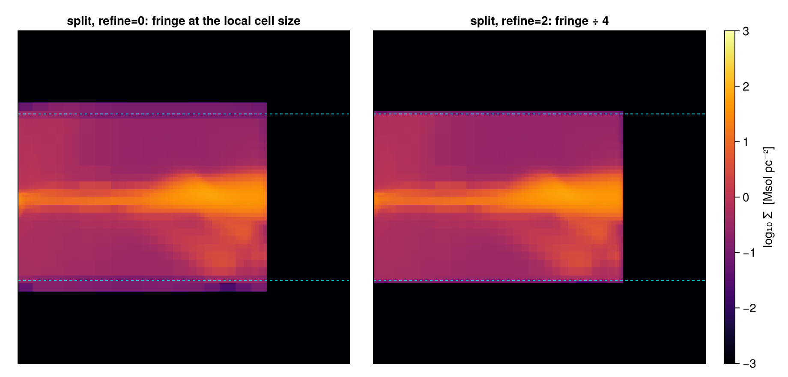

The soft band stays within its bound, and `refine=2` makes it four times thinner, while the mass
stays the same. The children get their own fractions, so changes in the fourth decimal place are
expected. Use `refine` when a *drawn* boundary must be sharp, for figures or mock observations;
plain `split` already gives the right numbers.

**Matching the boundary to the map.** You do not have to guess the depth. With
`refine_to=[length, unit]`, every cut cell picks its own depth, so that its children are no
larger than the given length. Set it to the `pxsize` of your map, and the edge becomes sharp at
the pixel scale, whatever the local AMR level:

```julia
d_px = subregion(slab, disc_region; refine_to=[0.05, :kpc], verbose=false)   # ≈ the map scale
slab = nothing

pe_px = projection(d_px, :sd, :Msol_pc2; direction=:y, center=[:bc], range_unit=:kpc,
                   xrange=[6., 14.], zrange=[-4., 4.], pxsize=[0.02, :kpc],
                   verbose=false, show_progress=false)
frx = Mera.select(d_px.data, :fraction)
csx = getvar(d_px, :cellsize, :kpc)[0.0 .< frx .< 1.0]
println("largest straddling cell after refine_to : ", round(maximum(csx), digits=3),
        " kpc   (was ", round(maximum(csb), digits=3), " kpc)")
println("rendered fringe beyond |z| = 2 kpc      : ", round(fringe(pe_px), digits=3), " kpc")
println("mass invariance vs refine=0             : ",
        round(msum(d_px, :Msol) / msum(d_s0, :Msol), digits=5))
```

```
largest straddling cell after refine_to : 0.047 kpc   (was 0.375 kpc)
rendered fringe beyond |z| = 2 kpc      : 0.024 kpc
mass invariance vs refine=0             : 0.99944
```

**Or simply clip the map.** For a publication figure, the soft band can also be cut off at the
exact surface, as long as the caption says so. The clip changes only the picture: the band holds
a tiny part of the map mass, and the numbers you quote come from `msum`, which never depended on
the map.

```julia
clipped = copy(pe_s0.maps[:sd])
zmask   = abs.(zs) .> 2.0
clipped[:, zmask] .= 0.0                                       # DISPLAY clip only
frac_clipped = sum(pe_s0.maps[:sd][:, zmask]) / sum(pe_s0.maps[:sd])
println("map mass removed by the display clip : ",
        round(100*frac_clipped, sigdigits=2), " %  (cosmetic only: msum is untouched)")

# ── figure code from here: panels, overlays, colorbars, no new Mera concepts ──
fig = Figure(size=(920, 440))
ax1 = Axis(fig[1, 1], title="split edge: as rendered")
show_sd!(ax1, pe_s0, (6, 14, -4, 4))
ax2 = Axis(fig[1, 2], title="display-clipped at |z| = 2  (cosmetic)")
xs2 = range(pe_s0.cextent[1]*kpc, pe_s0.cextent[2]*kpc; length=size(clipped, 1))
heatmap!(ax2, xs2, zs, log10.(max.(clipped, 1e-3)); colormap=:inferno, colorrange=SDLIM)
ax2.aspect = DataAspect(); ax2.backgroundcolor = :black; hidedecorations!(ax2)
limits!(ax2, 6, 14, -4, 4)
for ax in (ax1, ax2), zpl in (-2., 2.)
    lines!(ax, [6., 14.], [zpl, zpl]; color=:cyan, linewidth=1, linestyle=:dash)
end
sd_bar!(fig[1, 3])
fig
```

```
map mass removed by the display clip : 0.45 %  (cosmetic only: msum is untouched)
```


## Step 10. Regions with a purpose

A combination of shapes can be a small model: each shape below answers a question that a plain
shape cannot, and each one is a single region, with fractions on every boundary. First, a disc
with a "blister" sphere on its upper face and a "chimney" drilled through it, checked with the
rule m(A ∖ C) = m(A) − m(A ∩ C):

```julia
blister = sphere(2.5; center=[30., :bc, 26.], range_unit=:kpc)   # resting on the +z face
chimney = cylinder(1.2, 5.; center=[19., :bc, :bc], range_unit=:kpc)

capstone = (disc_region ∪ blister) \ chimney
cap = subregion(gas, capstone, verbose=false)

mAB  = msum(subregion(gas, disc_region ∪ blister, verbose=false), :Msol)
mC   = msum(subregion(gas, (disc_region ∪ blister) ∩ chimney, verbose=false), :Msol)
println("(disc ∪ blister) \\ chimney : ", round(msum(cap, :Msol), sigdigits=6), " Msol")
println("identity  m(A∪B) − m((A∪B)∩C) = ", round(mAB - mC, sigdigits=8),
        "   vs  ", round(msum(cap, :Msol), sigdigits=8))

pcf = proj(cap; xrange=[-14, 14], yrange=[-14, 14], zrange=[-2, 2], pxsize=[0.1, :kpc])
pce = proj(cap; direction=:y, yrange=[-1, 1], xrange=[-14, 14], zrange=[-4, 6], pxsize=[0.1, :kpc])

# ── figure code from here: panels, overlays, colorbars, no new Mera concepts ──
fig = Figure(size=(880, 440))
ax1 = Axis(fig[1, 1], title="face-on  (±2 kpc slab): chimney pierces, blister hides")
show_sd!(ax1, pcf, (-14, 14, -14, 14))
ax2 = Axis(fig[1, 2], title="along y, ±1 kpc slab: blister on the face, chimney cut")
show_sd!(ax2, pce, (-14, 14, -4, 6))
sd_bar!(fig[1, 3])
fig
```

```
(disc ∪ blister) \ chimney : 2.27205e10 Msol
identity  m(A∪B) − m((A∪B)∩C) = 2.2720464e10   vs  2.2720464e10
```

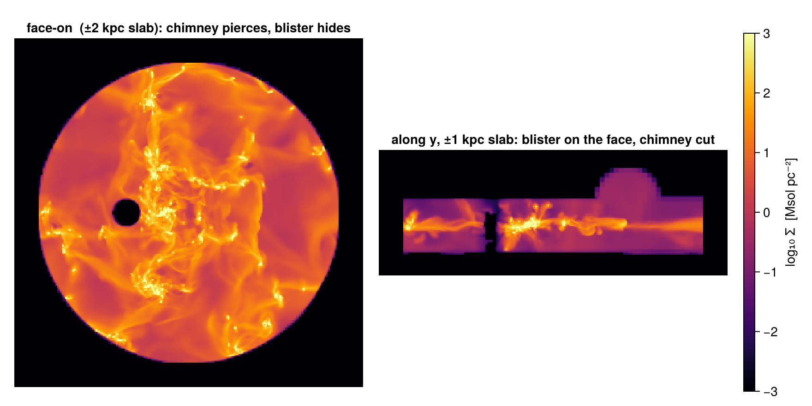

The rule holds, and the side view explains the top view: the blister adds gas only above the
upper face, where the bright disc hides it from the top, while the chimney removes a full column
(black from the top). Next, two shapes with astronomical names: **chimneys**, a disc with
vertical channels, and a **crescent**, two offset spheres, the shape of a shock front or a bow.
Each is shown in the views that make it clear:

```julia
chimneys_region = disc_region \ (cylinder(1.0, 5.; center=[18., :bc, :bc], range_unit=:kpc) ∪
                                 cylinder(0.8, 5.; center=[26., 29., :bc], range_unit=:kpc) ∪
                                 cylinder(1.2, 5.; center=[30., 20., :bc], range_unit=:kpc))
chim = subregion(gas, chimneys_region, verbose=false)

crescent_region = (sphere(5.; center=[28., :bc, :bc], range_unit=:kpc) \
                   sphere(4.5; center=[30.5, :bc, :bc], range_unit=:kpc)) ∩
                  cuboid(xrange=[-12, 12], yrange=[-12, 12], zrange=[-1.5, 1.5],
                         center=[:bc], range_unit=:kpc)
cres = subregion(gas, crescent_region, verbose=false)
println("chimneys: ", round(msum(chim, :Msol), sigdigits=5), " Msol   crescent: ",
        round(msum(cres, :Msol), sigdigits=5), " Msol")

pch_f = proj(chim; xrange=[-13, 13], yrange=[-13, 13], pxsize=[0.1, :kpc])
pch_e = proj(chim; direction=:y, yrange=[-0.9, 0.9], xrange=[-13, 13], zrange=[-3, 3], pxsize=[0.1, :kpc])
pcr_f = proj(cres; xrange=[-1, 10], yrange=[-6, 6], pxsize=[0.05, :kpc])
pcr_e = proj(cres; direction=:y, xrange=[-1, 10], zrange=[-3, 3], pxsize=[0.05, :kpc])

# ── figure code from here: panels, overlays, colorbars, no new Mera concepts ──
fig = Figure(size=(920, 800))
ax1 = Axis(fig[1, 1], title="chimneys, face-on: three drilled flow channels")
show_sd!(ax1, pch_f, (-13, 13, -13, 13))
ax2 = Axis(fig[1, 2], title="chimneys, edge-on  (±0.9 kpc slab: the x = −6 channel)")
show_sd!(ax2, pch_e, (-13, 13, -3, 3))
ax3 = Axis(fig[2, 1], title="crescent, face-on: two offset spheres")
show_sd!(ax3, pcr_f, (-1, 10, -6, 6))
ax4 = Axis(fig[2, 2], title="crescent, edge-on")
show_sd!(ax4, pcr_e, (-1, 10, -3, 3))
sd_bar!(fig[:, 3])
fig
```

```
chimneys: 2.2548e10 Msol   crescent: 2.1784e9 Msol
```

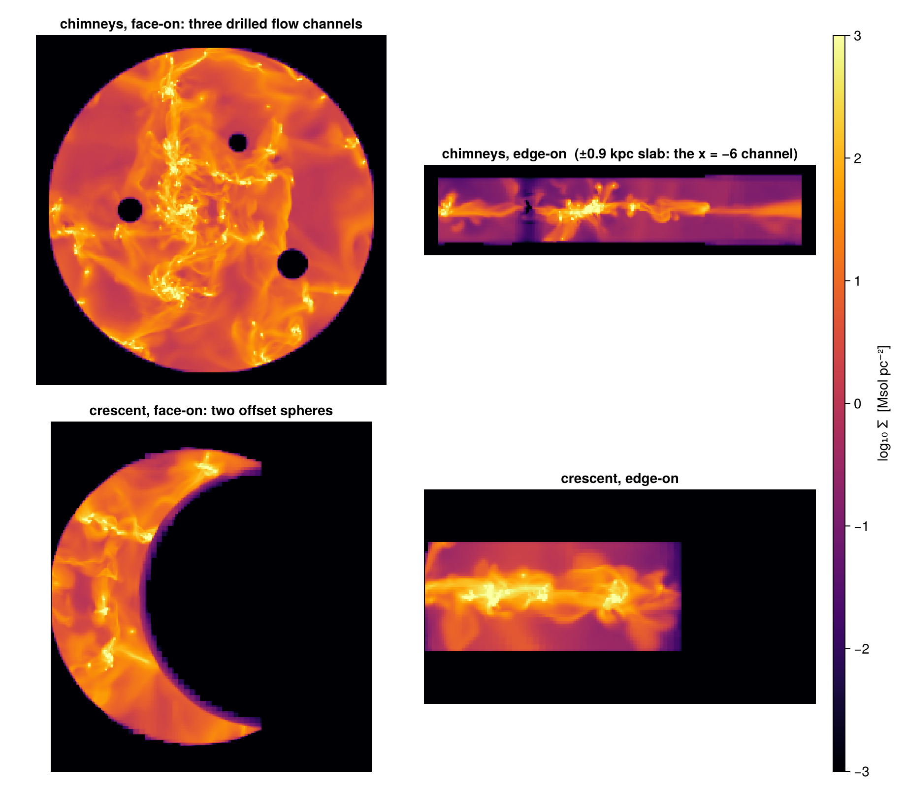

**Holes placed by the data.** Combinations become really useful when the data decide the
geometry. Here we cut a hole around each of the three densest star-forming sites of the galaxy,
found from the star particles of Step 8: the shape of gas cleared by feedback.

```julia
pxs = getvar(part, :x, :kpc) .- 24.; pys = getvar(part, :y, :kpc) .- 24.
pzs = getvar(part, :z, :kpc) .- 24.; pms = getvar(part, :mass, :Msol)

# densest star sites: 0.5-kpc 2-D mass grid in the 4 < r < 10 kpc disc annulus,
# greedy top-3 with ≥ 3 kpc separation
sel  = (16. .< pxs.^2 .+ pys.^2 .< 100.) .& (abs.(pzs) .< 2.)
bins = Dict{Tuple{Int,Int},Float64}()
for (x, y, m) in zip(pxs[sel], pys[sel], pms[sel])
    k = (floor(Int, x/0.5), floor(Int, y/0.5)); bins[k] = get(bins, k, 0.0) + m
end
sites = Tuple{Float64,Float64}[]
for (k, m) in sort(collect(bins); by=last, rev=true)
    c = (0.5k[1] + 0.25, 0.5k[2] + 0.25)
    all(hypot(c[1]-s[1], c[2]-s[2]) >= 3. for s in sites) && push!(sites, c)
    length(sites) == 3 && break
end
println("cluster sites [kpc, centre-relative]: ", [round.(s, digits=1) for s in sites])

holes  = reduce(∪, [sphere(1.3; center=[24. + s[1], 24. + s[2], :bc], range_unit=:kpc)
                    for s in sites])
cheese = subregion(gas, disc_region \ holes, verbose=false)
println("swiss-cheese disc: ", round(msum(cheese, :Msol), sigdigits=5), " Msol")

pw = proj(cheese; xrange=[-13, 13], yrange=[-13, 13], zrange=[-1.3, 1.3], pxsize=[0.1, :kpc])

# ── figure code from here: panels, overlays, colorbars, no new Mera concepts ──
fig = Figure(size=(640, 520))
ax = Axis(fig[1, 1], title="disc \\ three cluster-site spheres   (±1.3 kpc slab)")
show_sd!(ax, pw, (-13, 13, -13, 13))
for s in sites
    scatter!(ax, [s[1]], [s[2]]; marker=:xcross, color=:cyan, markersize=12)
end
scalebar!(ax, -12, -12.3, 5)
sd_bar!(fig[1, 2])
fig
```

```
cluster sites [kpc, centre-relative]: [(-3.2, 8.8), (-3.2, -5.8), (-2.2, 3.8)]
swiss-cheese disc: 1.5925e10 Msol
```

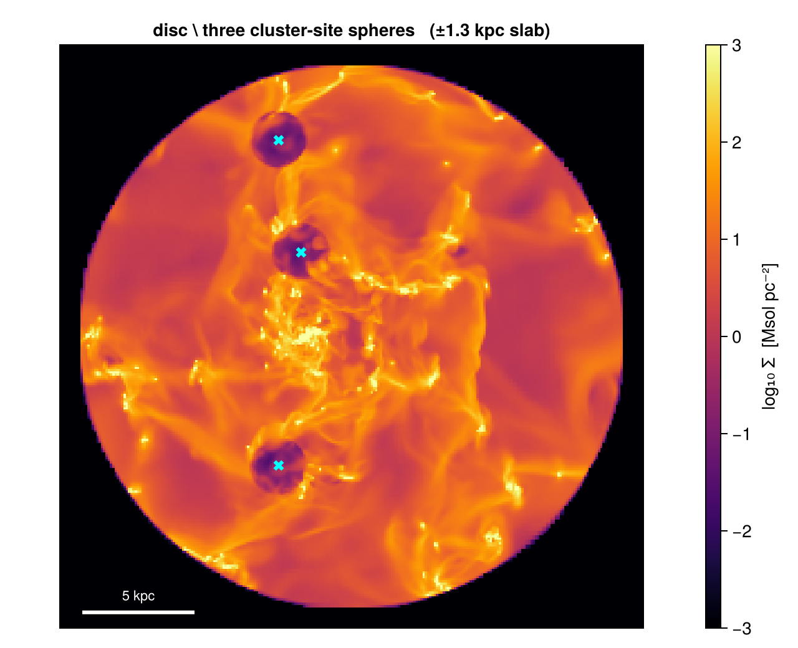

The crosses mark the sites the *particles* chose; the holes are where the *gas* was cut. The
three spheres hold a few per cent of the disc volume but a much larger share of its mass,
because star clusters sit on the densest gas. Two more shapes close the gallery: a **plate cut
into bows** by four corner spheres, and a **filament tube**, three tilted cylinders joined along
a path, the shape you would use to follow an accretion stream or a piece of a spiral arm:

```julia
plate = cuboid(xrange=[-7, 7], yrange=[-7, 7], zrange=[-1, 1], center=[:bc], range_unit=:kpc)
bows_region = plate \ (sphere(4.5; center=[17., 17., :bc], range_unit=:kpc) ∪
                       sphere(4.5; center=[31., 17., :bc], range_unit=:kpc) ∪
                       sphere(4.5; center=[17., 31., :bc], range_unit=:kpc) ∪
                       sphere(4.5; center=[31., 31., :bc], range_unit=:kpc))
bows = subregion(gas, bows_region, verbose=false)

waypoints = [(-9., -4.), (-2., 2.), (7., 6.)]
segs = AbstractRegion[]
for k in 1:length(waypoints)-1
    a = [waypoints[k]..., 0.]; b = [waypoints[k+1]..., 0.]
    d = b .- a; mid = (a .+ b) ./ 2 .+ 24.
    push!(segs, cylinder(1.2, sqrt(sum(abs2, d))/2 + 0.3; axis=d, center=mid, range_unit=:kpc))
end
fil = subregion(gas, reduce(∪, segs), verbose=false)
println("bows: ", round(msum(bows, :Msol), sigdigits=5), " Msol   filament tube: ",
        round(msum(fil, :Msol), sigdigits=5), " Msol")

pbw = proj(bows; xrange=[-8, 8], yrange=[-8, 8], pxsize=[0.05, :kpc])
pfl = proj(fil;  xrange=[-11, 9], yrange=[-6, 8], pxsize=[0.05, :kpc])

# ── figure code from here: panels, overlays, colorbars, no new Mera concepts ──
fig = Figure(size=(920, 440))
ax1 = Axis(fig[1, 1], title="plate \\ four corner spheres: bows")
show_sd!(ax1, pbw, (-8, 8, -8, 8))
ax2 = Axis(fig[1, 2], title="filament tube: three stitched tilted cylinders")
show_sd!(ax2, pfl, (-11, 9, -6, 8))
lines!(ax2, [w[1] for w in waypoints], [w[2] for w in waypoints];
       color=:cyan, linewidth=1, linestyle=:dash)
sd_bar!(fig[1, 3])
fig
```

```
bows: 1.0791e10 Msol   filament tube: 2.3211e9 Msol
```

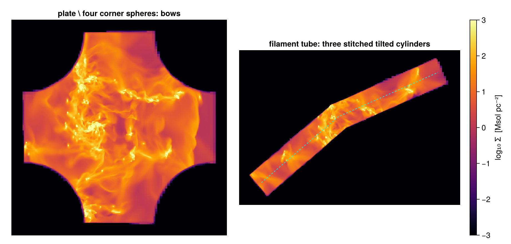

Every shape here is still a measurement: `msum` on any of them uses the fractions, adds up with
its inverse, and works on particles as well as on cells.

## Step 11. The classic API and periodic boxes

Before the region values existed, Mera selected regions with a shape symbol. This interface is
still fully supported. It keeps whole cells, it is the quickest way to make an exploratory cut,
and it keeps older scripts working.

| region value | classic call |
|:--|:--|
| `cuboid(xrange=…, yrange=…, zrange=…)` | `subregion(gas, :cuboid; xrange=…, yrange=…, zrange=…)` |
| `sphere(R)` | `subregion(gas, :sphere; radius=R)` |
| `cylinder(R, H)` | `subregion(gas, :cylinder; radius=R, height=H)` (along z only) |
| `sphericalshell(rin, rout)` | `shellregion(gas, :sphere; radius=[rin, rout])` |
| `cylindricalshell(rin, rout, H)` | `shellregion(gas, :cylinder; radius=[rin, rout], height=H)` |

What differs from the region values:

- **Defaults.** `center=[0., 0., 0.]` (the box **corner**) and `range_unit=:standard` (code
  units). Pass `center=[:bc]` and `range_unit=:kpc` to match the region values.
- **Boundary cells.** `cell=true` (default) keeps every cell the surface touches; `cell=false`
  keeps cells whose centre is inside. There is no `:fraction`, so the classic call cannot split.
- **Periodic boxes.** `periodic=true` lets the region wrap around the box faces. Only the classic
  API does this; region values are always clipped at the faces.
- **Sizes.** Radii and heights must be larger than zero.

Shared with the region values: `inverse=true` for the outside. `Mera.get_filtered_ranges` returns
the bounding ranges of a classic cut. The classic cylinder below lands *above* the split disc
mass, as whole cells must:

```julia
cub_c = subregion(gas, :cuboid; xrange=[-12, 12], yrange=[-12, 12], zrange=[-2, 2],
                  center=[:bc], range_unit=:kpc, verbose=false)
sph_c = subregion(gas, :sphere; radius=10., center=[13., :bc, :bc], range_unit=:kpc,
                  cell=false, verbose=false)
cyl_c = subregion(gas, :cylinder; radius=12., height=2., center=[:bc], range_unit=:kpc,
                  verbose=false)
shl_c = shellregion(gas, :sphere; radius=[10., 20.], center=[:bc], range_unit=:kpc,
                    verbose=false)

m_cylc = msum(cyl_c, :Msol)
println("classic cylinder (whole cells) : ", round(m_cylc, sigdigits=6), " Msol   +",
        round(100*(m_cylc/m_disc - 1), sigdigits=2),
        " % vs split disc: whole boundary cells, as in Step 4")

xr_c, yr_c, zr_c = Mera.get_filtered_ranges(cyl_c)   # normalised [0,1] box fractions of the cut
println("cut spans x ∈ ", round.(xr_c .* (gas.boxlen * kpc), sigdigits=4), " kpc (absolute)")
```

```
classic cylinder (whole cells) : 2.29023e10 Msol   +0.3 % vs split disc: whole boundary cells, as in Step 4
cut spans x ∈ [12.0, 36.0] kpc (absolute)
```

**Periodic boxes.** In a periodic run, an object near a face continues on the opposite side. A
region that crosses a face then needs `periodic=true`, otherwise the part outside the box is
dropped. `periodic=(x=true, y=true, z=false)` wraps only some axes, and a cylinder wraps only in
its two radial directions. Mera never wraps on its own: RAMSES does not store the boundary
conditions in its output. `info.boundaries` reports what the namelist says, if it is available.

Our galaxy is an isolated disc, so wrapping is not physical here. The mechanics still show: a
sphere on the box corner keeps an eighth of itself when clipped, and all of it when wrapped.

```julia
println("boundaries of this run: ", info.boundaries)

corner = (radius=3., center=[0., 0., 0.], range_unit=:kpc, verbose=false)
v_clip = sum(getvar(subregion(gas, :sphere; corner...), :volume, :kpc3))
v_wrap = sum(getvar(subregion(gas, :sphere; corner..., periodic=true), :volume, :kpc3))
println("volume, clipped at the faces : ", round(v_clip, sigdigits=4), " kpc³")
println("volume, wrapped (periodic)   : ", round(v_wrap, sigdigits=4), " kpc³   ratio ",
        round(v_wrap / v_clip, sigdigits=3))
```

```
boundaries of this run: unknown
volume, clipped at the faces : 21.52 kpc³
volume, wrapped (periodic)   : 172.1 kpc³   ratio 8.0
```

The ratio is eight: a sphere on the corner reaches into all eight corners of the box, and the
wrapped cut collects all eight pieces. Both volumes are larger than (4/3)π·3³ ≈ 113 kpc³,
because the classic call keeps whole cells (Step 4). The page [Periodic Boxes](periodic_boxes.md) covers the other tools for periodic runs:
`:r_sphere_periodic`, `center_of_mass(…; periodic=true)` and `periodic_recenter`.

## Step 12. Large data: cut once, save, reload

This snapshot loads in seconds, but the same workflow works for snapshots that do not. Two
steps, in this order.

**Read only the columns you need.** This whole page ran on `gethydro(info, :rho, …)`: the AMR
coordinates and one field are all a mass budget needs. On a large snapshot, this choice at read
time decides whether the data fit into memory.

**Then cut the window once.** Cut the region you will study, save it with `savedata`, and start
every later session from the small file. `loaddata` reads a whole data type before any spatial
selection, so the cut must happen before saving, not after loading:

```julia
win = subregion(gas, :cuboid; xrange=[-13, 13], yrange=[-13, 13], zrange=[-3, 3],
                center=[:bc], range_unit=:kpc, verbose=false)

tmpdir = mktempdir()
savedata(win, tmpdir; fmode=:write, verbose=false)
back = loaddata(400, tmpdir, :hydro, verbose=false)

fsz = sum(filesize, readdir(tmpdir; join=true)) / 1024^2
println("working file  : ", round(fsz, digits=1), " MB   (", length(back.data), " cells)")
println("mass, window  : ", round(msum(win,  :Msol), sigdigits=8), " Msol")
println("mass, reloaded: ", round(msum(back, :Msol), sigdigits=8), " Msol")
```

```
working file  : 147.5 MB   (17957496 cells)
mass, window  : 2.7966433e10 Msol
mass, reloaded: 2.7966433e10 Msol
```

The round trip loses nothing, and everything on this page (regions, algebra, budgets, `refine`)
works on the reloaded object. On very large data, release each working object when you are done
with it (`obj = nothing; GC.gc()`) and keep only one in memory at a time.

## Which mode when

- **Exploring?** Classic whole-cell cuts (`cell=true`) are the cheapest and show *all* gas near
  the region. Their mass is an upper bound.
- **Fewest cells?** The centre test (`split=false`, or classic `cell=false`) keeps fewer cells
  and usually lands close to the split value, but with no guaranteed sign (Step 8, the ring).
  Treat it as an estimate.
- **Measuring** a mass, a volume or a profile? Region values with the default `split=true`. The
  `:fraction` column makes `msum`, `getvar(:mass)`, `getvar(:volume)` and projections aware of the
  boundary, and touching regions add up exactly.
- **Drawing a cut for a figure?** Add `refine=k`, or `refine_to=` the `pxsize` of the map
  (Step 9), limited to the part you draw.
- **Periodic run, region across a face?** The classic API with `periodic=true` (Step 11).

**Cost.** Cells that cannot touch the region are skipped by a bounding-box test, so a small cut
costs roughly its own volume, not the whole data set. Splitting adds one fraction per boundary
cell; inner cells cost nothing extra. A larger `nsub` makes the fractions of curved surfaces
more precise and costs time in proportion. `refine=k` creates up to 8ᵏ children per boundary
cell: cheap on a slab, expensive on the full surface of a large region.

**Check your budget.** Region plus inverse is the whole box, and touching regions tile their
union. Both are one-line `msum` checks. Use them in real analyses too.

## Summary

- A region is a value: `cuboid`, `cylinder`, `sphere`, `sphericalshell`, `cylindricalshell`.
  `subregion(gas, region)` cuts it out and returns the same type as `gas`.
- Region values default to the box centre and kpc. The cylinder height is a half-height.
- Boundary cells are split by default: each gets a `:fraction`, and mass and volume use it.
  Whole cells over-count, the centre test can miss in either direction, and the split value is
  the one to quote.
- `inverse=true` or `!region` gives the outside; `∩ ∪ \ !` and `@region` build any shape; `axis=`
  tilts cylinders and cylindrical shells. Touching regions add up exactly.
- `refine` and `refine_to` sharpen the drawn edge; they do not change the numbers.
- The same region cuts particles. The classic API keeps whole cells and is the one that can wrap
  around a periodic box (`periodic=true`).

**Continue with:**

- [Subregions cheatsheet](subregions_cheatsheet.md): everything on one page.
- [Masking & Filtering](05_multi_Masking_Filtering.md): select by *value* (density, temperature,
  any derived quantity) and combine it with these regions.
- [Off-axis projection](06_offaxis_Projection.md): look along the axis of a tilted region.

---

**The same steps on the other data types:** [Gravity](03_gravity_Get_Subregions.md) · [Particles](03_particles_Get_Subregions.md) · [Clumps](03_clumps_Get_Subregions.md) · [Sinks](03_sinks_Get_Subregions.md)
