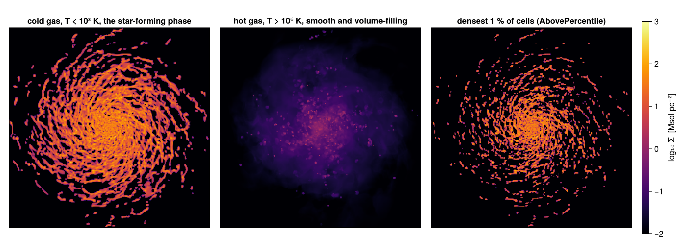
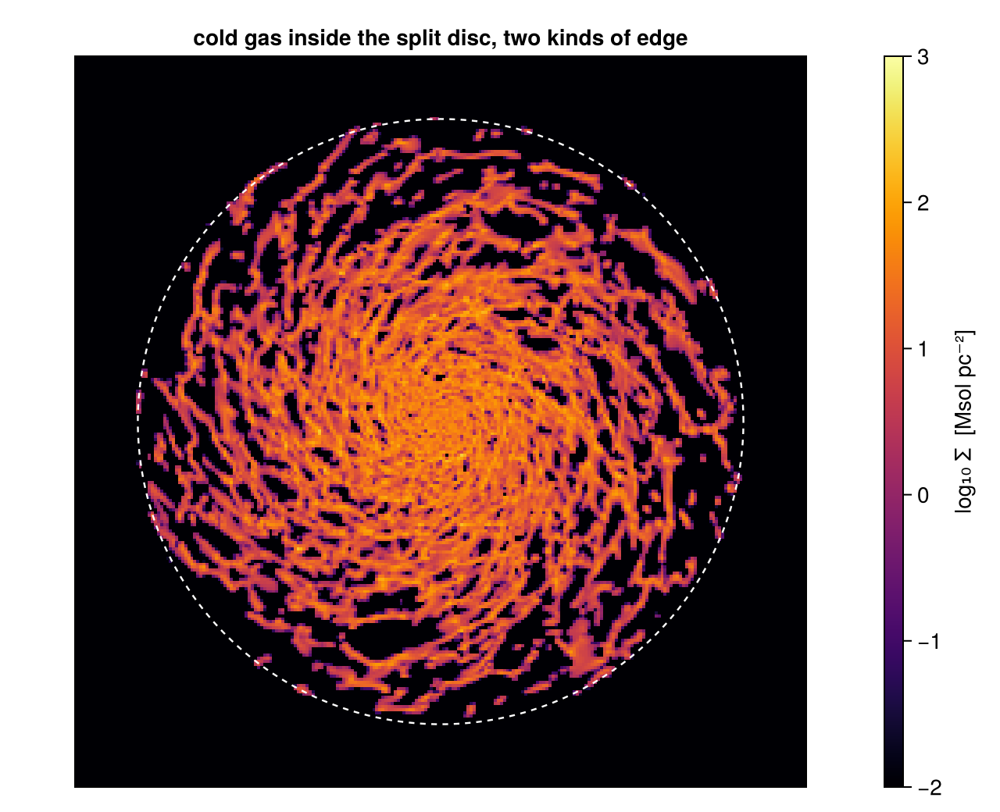

```@raw html
<!-- GENERATED FILE. Do not edit this markdown.
     Source notebook: 05_multi_Masking_Filtering.ipynb
     Regenerate with: MERA_DIR=<repo checkout> ./render_docs.sh
     Any edit here is lost the next time the docs are rendered. -->
```

# 5. Masking & Filtering: Selection by Value

!!! tip "Run it yourself"
    This page is also an executable **Jupyter notebook**: [open / download `05_multi_Masking_Filtering.ipynb`](https://github.com/ManuelBehrendt/Notebooks/blob/master/Mera-Docs/version_1.1/05_multi_Masking_Filtering.ipynb). The notebooks run end-to-end and double as part of Mera's test suite.


The [sub-region pages](03_hydro_Get_Subregions.md) select by **place**, a sphere,
a cylinder, a slab. This page selects by **state**: temperature, density, age,
speed, or any quantity Mera can derive. The two are independent, they compose in
either order, and together they cover most of what "give me *this* gas" means.

Two verbs do the work, and the only difference is what they hand back:

| | returns | use it when |
|:--|:--|:--|
| `filterdata(obj, condition)` | a **new object** of the same type | you want to carry on working, project it, cut it, weigh it |
| `getmask(obj, condition)` | a **`Vector{Bool}`** over the rows | you want to pass `mask=` to a Mera function and keep the original object |

Everything else on this page is about writing the *condition*.

**Reading convention.** Longer code cells are cut in two by a banner line:

```
# ── figure code from here: panels, overlays, colorbars, no new Mera concepts ──
```

Everything above the banner is the Mera part; everything below is Makie
decoration.

**On this page**

1. selection by state
2. a condition is a quantity, a threshold and a unit
3. combining conditions
4. two shapes: an object or a mask
5. masks inside Mera's own functions
6. seeing what a filter keeps
7. place × value
8. adding a column of your own
9. reference: the raw table path
10. practical guidance

## 1. Selection by State

This page runs on a snapshot of the AVALON disc galaxy, one of the maintainer's
research simulations. It is not part of the public example set, so point the path
below at a simulation of your own, or set `MERA_AVALON`; every call on the page
works the same on other data.

The working set is a **pre-cut window**, stored as a Mera file so it reloads in one
call: output 390, every cell inside ±12 × ±12 × ±6 kpc about the box centre,
37,055,386 of them, with the columns cut to the five hydro variables this page uses
(`:rho`, `:vx`, `:vy`, `:vz`, `:p`). The box is 48 kpc across, the levels run from 6
to 12, and the snapshot sits at t = 580 Myr.

Gas and particles are both loaded, because filtering is not a hydro-only idea:
particles filter on age, and on what kind of particle they are (§5).

```julia
# The AVALON run used here is the maintainer's own. Point AVALON at a snapshot of
# your own, or set the MERA_AVALON environment variable.
AVALON = get(ENV, "MERA_AVALON", "/Volumes/FASTStorage/Simulations/AVALONpaper/AV05CD/mera_masking")

using Mera

# A pre-cut window stored as a Mera file: ±12 x ±12 x ±6 kpc about the box centre,
# five hydro variables, and every particle. One call, nothing to select at load time.
gas       = loaddata(390, AVALON, :hydro;     verbose=false)
particles = loaddata(390, AVALON, :particles; verbose=false)
info      = gas.info

println("gas cells      : ", length(gas.data))
println("star particles : ", length(particles.data))
println("box            : ", round(gas.boxlen * info.scale.kpc, sigdigits=4),
        " kpc, levels ", gas.lmin, " to ", gas.lmax)
```

```
*__   __ _______ ______   _______
|  |_|  |       |    _ | |   _   |
|       |    ___|   | || |  |_|  |
|       |   |___|   |_||_|       |
|       |    ___|    __  |       |
| ||_|| |   |___|   |  | |   _   |
|_|   |_|_______|___|  |_|__| |__|
Mera v1.8.0 | Julia 1.12.7 | 8 threads
gas cells      : 37055386
star particles : 627896
box            : 48.0 kpc, levels 6 to 12
```

```julia
# the two verbs, on the same condition
hot  = filterdata(gas, Above(:T, 1e6, unit=:K), verbose=false)   # -> a HydroDataType
mask = getmask(gas,    Above(:T, 1e6, unit=:K))                   # -> a Vector{Bool}

println("filterdata → ", typeof(hot).name.name, ", ", length(hot.data), " cells")
println("getmask    → ", typeof(mask), ", ", count(mask), " true of ", length(mask))
println()
println("mass of hot gas, via the object : ", round(msum(hot, :Msol), sigdigits=6), " Msol")
println("            ... via the mask    : ", round(msum(gas, :Msol, mask=mask), sigdigits=6), " Msol")
println("identical                       : ", msum(hot, :Msol) == msum(gas, :Msol, mask=mask))

# `hot` stays alive to the end of §6, which draws it; `mask` is a BitVector, a few MB
```

```
filterdata → HydroDataType, 8423491 cells
getmask    → BitVector, 8423491 true of 37055386
mass of hot gas, via the object : 2.39909e7 Msol
            ... via the mask    : 2.39909e7 Msol
identical                       : true
```

Same selection, same answer, two shapes. Which one you want depends on what comes
next, §4 makes that concrete.

## 2. A Condition Is a Quantity, a Threshold and a Unit

`Above`, `Below`, `InRange` and `Equals` take a **quantity name**, a value, and
the unit that value is in. The quantity may be a stored column (`:rho`) or
anything `getvar` can *derive*, temperature, sound speed, Mach number, a
cylindrical radius. That is the whole point: you write the physics, not the code
that reconstructs it.

**Give the condition its frame.** A condition names a quantity, and that quantity is
computed by `getvar`, with `getvar`'s defaults. A radius is then measured from the
box corner, and a velocity-derived quantity such as `:mach` is in the box frame.
Neither is what you want for a galaxy sitting in the middle of its box and turning,
so pass `center` (with `center_unit`) and `vcenter` to `filterdata` and `getmask`
exactly as you would pass them to `getvar`. They are handed straight through.

```julia
# Two of these conditions name a quantity that depends on where the galaxy is, or on how
# fast it moves, so they are given a frame. The others do not have one.
conds = [
    ("Above(:rho, 1, :nH)",            Above(:rho, 1, unit=:nH),                NamedTuple()),
    ("Below(:T, 1e3, :K)",             Below(:T, 1e3, unit=:K),                 NamedTuple()),
    ("Above(:cs, 20, :km_s)",          Above(:cs, 20, unit=:km_s),              NamedTuple()),
    ("Above(:mach, 1)",                Above(:mach, 1),                         (vcenter=:auto,)),
    ("InRange(:r_cylinder,0,10,:kpc)", InRange(:r_cylinder, 0, 10, unit=:kpc),  (center=[:bc],)),
    ("Equals(:level, gas.lmax)",       Equals(:level, gas.lmax),                NamedTuple()),
]
m_all = msum(gas, :Msol)
println(rpad("condition", 32), rpad("frame", 16), rpad("cells", 12), "mass share")
println("-"^72)
for (name, c, kw) in conds
    s     = filterdata(gas, c; verbose=false, kw...)
    frame = isempty(kw) ? "-" : join([string(k, "=", repr(v)) for (k, v) in pairs(kw)], " ")
    println(rpad(name, 32), rpad(frame, 16), rpad(length(s.data), 12),
            round(100 * msum(s, :Msol) / m_all, digits=1), " %")
end
GC.gc()
```

```
condition                       frame           cells       mass share
------------------------------------------------------------------------
Above(:rho, 1, :nH)             -               8369634     62.7 %
Below(:T, 1e3, :K)              -               3270752     47.4 %
Above(:cs, 20, :km_s)           -               12035707    1.0 %
Above(:mach, 1)                 vcenter=:auto   30533846    99.8 %
InRange(:r_cylinder,0,10,:kpc)  center=[:bc]    31772889    81.2 %
Equals(:level, gas.lmax)        -               14318440    59.0 %
```

Note `:r_cylinder` in that list. A *geometric* quantity used as a value
condition selects a cylinder, but by testing each cell's centre, with no
boundary treatment, and only about the `center` you hand it. When the geometry is
what you care about, use a region instead (§7); the exactness is worth it.

Two further selectors are worth knowing:

- `Satisfies(:quantity, f)`, an arbitrary predicate, when a threshold is not enough.
- `IsFinite(:quantity)`, drops `NaN`/`Inf` before a statistic. Data hygiene, and
  cheap insurance.

## 3. Combining Conditions

`&`, `|` and `!` compose conditions into one condition. Passing several
conditions to `filterdata` ANDs them, which reads better for the common case.

```julia
cold_dense = filterdata(gas, Above(:rho, 1, unit=:nH) & Below(:T, 1e5, unit=:K), verbose=false)
either     = filterdata(gas, Above(:T, 1e6, unit=:K) | Above(:rho, 10, unit=:nH), verbose=false)
not_cold   = filterdata(gas, !Below(:T, 1e3, unit=:K), verbose=false)
# several arguments = AND, in a form that reads like a sentence; the frame serves both
disc_cold  = filterdata(gas, InRange(:r_cylinder, 0, 15, unit=:kpc),
                             Below(:T, 1e3, unit=:K), center=[:bc], verbose=false)

for (n, o) in (("rho > 1 nH  AND  T < 1e5 K", cold_dense),
               ("T > 1e6 K   OR   rho > 10 nH", either),
               ("NOT (T < 1e3 K)", not_cold),
               ("r < 15 kpc  AND  T < 1e3 K", disc_cold))
    println(rpad(n, 30), rpad(length(o.data), 10), round(msum(o, :Msol), sigdigits=5), " Msol")
end

# a condition and its complement partition the object exactly
cold = filterdata(gas, Below(:T, 1e3, unit=:K), verbose=false)
println()
println("cold + not-cold cells : ", length(cold.data) + length(not_cold.data),
        "   of ", length(gas.data))
println("cold + not-cold mass  : ", round(msum(cold, :Msol) + msum(not_cold, :Msol), sigdigits=10))
println("whole box mass        : ", round(m_all, sigdigits=10))

# `cold` stays for §6; the other selections are finished with
cold_dense = nothing; either = nothing; not_cold = nothing; disc_cold = nothing; GC.gc()
```

```
rho > 1 nH  AND  T < 1e5 K    8322439   4.1935e9 Msol
T > 1e6 K   OR   rho > 10 nH  10253905  2.7792e9 Msol
NOT (T < 1e3 K)               33784634  3.5279e9 Msol
r < 15 kpc  AND  T < 1e3 K    3270752   3.1769e9 Msol
cold + not-cold cells : 37055386   of 37055386
cold + not-cold mass  : 6.704844898e9
whole box mass        : 6.704844898e9
```

The partition is exact because `!` is a strict negation of the same test, no
cell is counted twice and none is dropped. That check costs one line and catches
a mis-specified threshold immediately.

**Adaptive and discrete selectors.** Sometimes the threshold should come from the
data rather than from you:

```julia
dense10 = filterdata(gas, AbovePercentile(:rho, 90), verbose=false)   # densest 10 % of cells
faint   = filterdata(gas, BelowPercentile(:rho, 10), verbose=false)   # the most diffuse 10 %
core    = filterdata(gas, Equals(:level, gas.lmax) &
                          AbovePercentile(:rho, 99), verbose=false)   # finest AND densest

println("densest 10 % of cells : ", rpad(length(dense10.data), 9),
        round(100*msum(dense10, :Msol)/m_all, digits=1), " % of the mass")
println("faintest 10 %         : ", rpad(length(faint.data), 9),
        round(100*msum(faint, :Msol)/m_all, digits=3), " %")
println("finest level & top 1 %: ", rpad(length(core.data), 9),
        round(100*msum(core, :Msol)/m_all, digits=1), " %")

dense10 = nothing; faint = nothing; core = nothing; GC.gc()
```

```
densest 10 % of cells : 3705539  50.5 % of the mass
faintest 10 %         : 3705539  0.073 %
finest level & top 1 %: 370554   20.1 %
```

`AbovePercentile(:rho, 90)` is *the densest tenth of the cells*, whatever the
density scale of this simulation happens to be, the right tool when you have not
looked at the numbers yet, or when the same script must run on several outputs.

## 4. Two Shapes: an Object or a Mask

Both verbs select the same rows. The choice is about what you do next.

**`filterdata` returns an object**, so it chains: project it, cut a region out of
it, filter it again, weigh it. Use it when the selection *is* the thing you are
studying.

**`getmask` returns a `Vector{Bool}`** aligned with the original rows. Use it when
you want a statistic *of the whole object* restricted to a subset, every Mera
function with a `mask=` keyword takes it, or when you need several different
subsets of one object without copying the data each time.

```julia
cond = Below(:rho, 1, unit=:nH)      # the diffuse gas: under one hydrogen atom per cm³

# the object route: chains straight into other Mera verbs
sel = filterdata(gas, cond, verbose=false)
p   = projection(sel, :sd, :Msol_pc2; pxsize=[0.5, :kpc], center=[:bc],
                 verbose=false, show_progress=false)
println("object route : ", length(sel.data), " cells, map max Σ = ",
        round(maximum(p.maps[:sd]), sigdigits=4), " Msol/pc²")

# the mask route: the object stays whole, the statistic is restricted
m = getmask(gas, cond)
println("mask route   : ", count(m), " cells, mass = ",
        round(msum(gas, :Msol, mask=m), sigdigits=6), " Msol")
println("same mass    : ", msum(sel, :Msol) == msum(gas, :Msol, mask=m))

# masks are plain Bool vectors: combine them with the usual operators
m2 = getmask(gas, Above(:T, 1e4, unit=:K))
println()
println("cells satisfying both : ", count(m .& m2))
println("... same as one combined condition : ",
        count(m .& m2) == count(getmask(gas, cond & Above(:T, 1e4, unit=:K))))

# `m` stays, §5 reuses it; the filtered copy and its map are done with
sel = nothing; p = nothing; m2 = nothing; GC.gc()
```

```
object route : 28685752 cells, map max Σ = 10.4 Msol/pc²
mask route   : 28685752 cells, mass = 2.49945e9 Msol
same mass    : true
cells satisfying both : 16154492
... same as one combined condition : true
```

## 5. Masks Inside Mera's Own Functions

Every aggregate that takes a `mask=` keyword applies it to the rows before
reducing. One condition, four statistics, gas and particles side by side:

```julia
mg = m                                                   # the §4 condition, already masked
mp = getmask(particles, Below(:age, 100, unit=:Myr))     # young stars

println(rpad("statistic", 34), rpad("all", 20), "masked")
println("-"^70)
println(rpad("gas  msum [Msol]", 34),
        rpad(round(msum(gas, :Msol), sigdigits=6), 20),
        round(msum(gas, :Msol, mask=mg), sigdigits=6))
println(rpad("gas  centre of mass x [kpc]", 34),
        rpad(round(center_of_mass(gas, :kpc)[1], digits=4), 20),
        round(center_of_mass(gas, :kpc, mask=mg)[1], digits=4))
println(rpad("gas  bulk velocity x [km/s]", 34),
        rpad(round(bulk_velocity(gas, :km_s)[1], digits=3), 20),
        round(bulk_velocity(gas, :km_s, mask=mg)[1], digits=3))
println(rpad("part msum [Msol]", 34),
        rpad(round(msum(particles, :Msol), sigdigits=6), 20),
        round(msum(particles, :Msol, mask=mp), sigdigits=6))

# wstat takes the mask the same way
s_all = wstat(getvar(gas, :vx, :km_s), weight=getvar(gas, :mass))
s_msk = wstat(getvar(gas, :vx, :km_s), weight=getvar(gas, :mass), mask=mg)
println()
println("gas ⟨vx⟩ mass-weighted [km/s] : all ", round(s_all.mean, digits=3),
        "   masked ", round(s_msk.mean, digits=3))

mp = nothing; s_all = nothing; s_msk = nothing; GC.gc()   # the masks are BitVectors, a few MB
```

```
statistic                         all                 masked
----------------------------------------------------------------------
gas  msum [Msol]                  6.70484e9           2.49945e9
gas  centre of mass x [kpc]       23.9998             24.0233
gas  bulk velocity x [km/s]       -0.157              2.52
part msum [Msol]                  5.03498e8           1.00609e8
gas ⟨vx⟩ mass-weighted [km/s] : all -0.157   masked 2.52
```

The mask must be as long as the object's row count, which is why it belongs to
the object it came from, `getmask(gas, …)` cannot be passed to a particle
function. Mixing them is the one mistake worth watching for.

### Selecting by what a particle *is*

Everything above selects on a **value**, a density, an age, a speed. Particles also carry a
**type**: RAMSES tags each one with a family code saying whether it is dark matter, a star, a
sink-cloud marker, debris, or a tracer. `getparticlemask` turns that into the same kind of
`Vector{Bool}` the rest of this page uses, so type and value conditions combine freely:

```julia
young_stars = getparticlemask(parts, :stars) .& getmask(parts, Below(:age, 100, unit=:Myr))
```

| family | code |
|---|---|
| dark matter | 1 |
| star | 2 |
| cloud / sink | 3 |
| debris | 4 |
| other | 5 |
| tracer (test particle) | ≤ 0 |

This run was written in the **modern** particle format, so it carries a `:family` column and the
type is then just another quantity. A named type, a value condition on `:family`, and a filtered
object all pick the same rows:

```julia
# three routes to the same particles, on this page's own data
println("families present             : ", Int.(sort(unique(getvar(particles, :family)))))
println("getparticlemask(:stars)      : ", count(getparticlemask(particles, :stars, verbose=false)))
println("getmask(:family, ==(2.0))    : ", count(getmask(particles, :family, ==(2.0))))
println("filterdata(:family, ==(2.0)) : ",
        length(filterdata(particles, :family, ==(2.0), verbose=false).data), " rows")
println("dark matter / tracers here   : ",
        count(getparticlemask(particles, :dm, verbose=false)), " / ",
        count(getparticlemask(particles, :tracer, verbose=false)))
```

```
families present             : [2]
getparticlemask(:stars)      : 627896
getmask(:family, ==(2.0))    : 627896
filterdata(:family, ==(2.0)) : 627896 rows
dark matter / tracers here   : 0 / 0
```

Every particle in this galaxy is a star, so `:dm` and `:tracer` select nothing. One case is
therefore missing: a **tracer**, a test particle advected by the flow without acting back on it.
The small public test simulation below carries Monte-Carlo tracers, so that route can be shown
too, on data anyone can download.

```julia
# the public test set, for the one particle type this galaxy has not got
MERA_EXAMPLES = get(ENV, "MERA_EXAMPLES", "/Volumes/FASTStorage/Simulations/Mera-Tests")
tracer_run = "$MERA_EXAMPLES/RAMSES-PUBLIC/sedov3d_grav_part"
if isdir(tracer_run)
    tp = getparticles(getinfo(3, tracer_run, verbose=false), verbose=false, show_progress=false)
    println("families present            : ", Int.(sort(unique(getvar(tp, :family)))))
    println("getparticlemask(:tracer)    : ", count(getparticlemask(tp, :tracer, verbose=false)))
    println("getmask(:family, ==(0))     : ", count(getmask(tp, :family, ==(0.0))))
    println("filterdata(:family, ==(0))  : ",
            length(filterdata(tp, :family, ==(0.0), verbose=false).data), " rows")
    # type and place compose, like everything else on this page
    core = subregion(tp, sphere(0.15; range_unit=:standard), verbose=false)
    println("tracers inside a sphere     : ", count(getparticlemask(core, :tracer, verbose=false)),
            " of ", length(core.data), " particles in the region")
    tp = nothing; core = nothing; GC.gc()
else
    println("fixture not installed: ", tracer_run)
end
```

```
families present            : [0]
getparticlemask(:tracer)    : 124990
getmask(:family, ==(0))     : 124990
filterdata(:family, ==(0))  : 124990 rows
tracers inside a sphere     : 1707 of 1707 particles in the region
```

Three routes to the same rows, a named type, a value condition on `:family`, and a filtered
object, and the type survives a `subregion`, so *where* and *what* compose in either order. The
same holds through a mera-file round trip: `:family` and `:tag` are ordinary columns and are
written and read back unchanged.

## 6. Seeing What a Filter Keeps

A condition is easier to trust when you can see it. Three filters on the same
box, same colour scale:

```julia
using CairoMakie
CairoMakie.activate!()

# ─────────────────────────────────────────────────────────────────────
# FIGURE INFRASTRUCTURE for the whole page, skim freely on first read.
# The one Mera-relevant definition is `prj`: the projection defaults every panel reuses.
# ─────────────────────────────────────────────────────────────────────
# The colour limits are a starting guess for this run. Check them against the first
# figure below and widen or narrow the range before comparing panels by eye.
const SDLIM5 = (-2.0, 3.0)     # log10 Σ [Msol/pc²], one colour scale for every panel below

function sdpanel!(ax, p; kpc=gas.info.scale.kpc)
    xs = range(p.cextent[1]*kpc, p.cextent[2]*kpc; length=size(p.maps[:sd], 1))
    ys = range(p.cextent[3]*kpc, p.cextent[4]*kpc; length=size(p.maps[:sd], 2))
    heatmap!(ax, xs, ys, log10.(max.(p.maps[:sd], 10.0^SDLIM5[1]));
             colormap=:inferno, colorrange=SDLIM5)
    ax.aspect = DataAspect(); ax.backgroundcolor = :black; hidedecorations!(ax)
    return ax
end

# the working set stops at ±12 kpc in x and y, so the maps stop there too
prj(d; kw...) = projection(d, :sd, :Msol_pc2; direction=:z, center=[:bc], range_unit=:kpc,
                           xrange=[-12, 12], yrange=[-12, 12], pxsize=[0.1, :kpc],
                           verbose=false, show_progress=false, kw...)
```

```
prj (generic function with 1 method)
```

```julia
# `cold` and `hot` were selected in §3 and §1; only the percentile cut is new here
dense1 = filterdata(gas, AbovePercentile(:rho, 99), verbose=false)   # adaptive: densest 1 %

for (n, o) in (("cold  T<1e3 K ", cold), ("hot   T>1e6 K ", hot), ("densest 1%    ", dense1))
    println(n, ": ", rpad(length(o.data), 10),
            rpad(string(round(100*length(o.data)/length(gas.data), digits=1), " % of cells"), 18),
            round(100*msum(o, :Msol)/m_all, digits=1), " % of the mass")
end

# ── figure code from here: panels, overlays, colorbars, no new Mera concepts ──
fig = Figure(size=(1180, 420))
sdpanel!(Axis(fig[1, 1], title="cold gas, T < 10³ K, the star-forming phase"), prj(cold))
sdpanel!(Axis(fig[1, 2], title="hot gas, T > 10⁶ K, smooth and volume-filling"), prj(hot))
sdpanel!(Axis(fig[1, 3], title="densest 1 % of cells (AbovePercentile)"), prj(dense1))
Colorbar(fig[1, 4]; colormap=:inferno, colorrange=SDLIM5, label="log₁₀ Σ  [Msol pc⁻²]")

cold = nothing; hot = nothing; dense1 = nothing; GC.gc()
fig
```

```
cold  T<1e3 K : 3270752   8.8 % of cells    47.4 % of the mass
hot   T>1e6 K : 8423491   22.7 % of cells   0.4 % of the mass
densest 1%    : 370554    1.0 % of cells    20.1 % of the mass
```



Three views of one simulation, on one colour scale, and the shares printed above say what
each panel holds. The cold phase is filamentary and carries 47.4 % of the mass in
8.8 % of the cells; the hot phase is smooth and volume-filling, and it is the mirror
image, 22.7 % of the cells holding 0.4 % of the mass; and the densest percentile, a
*relative* threshold, isolates the clumps while holding 20.1 % of the mass, without
anyone having to know this run's density scale.

Read the middle panel with the usual care: it is a column density, so a smooth
map means the hot gas is spread along every line of sight, not that it is
structureless in 3-D.

## 7. Place × Value

Geometry and state are independent, so they compose, and the order cannot change
the answer. Here the disc is cut as an **exact split region** (boundary cells
carry their `:fraction`) and then partitioned by temperature.

```julia
disc_reg = cylinder(10., 2.; center=[:bc], range_unit=:kpc)   # radius, half-height [kpc]
disc = subregion(gas, disc_reg, verbose=false)                # split: rim cells carry :fraction

cold_d = filterdata(disc, Below(:T, 1e3, unit=:K), verbose=false)
rest_d = filterdata(disc, !Below(:T, 1e3, unit=:K), verbose=false)

m_c, m_r, m_d = msum(cold_d, :Msol), msum(rest_d, :Msol), msum(disc, :Msol)
println("cold (< 1e3 K) in the disc : ", round(m_c, sigdigits=5), " Msol")
println("rest (≥ 1e3 K) in the disc : ", round(m_r, sigdigits=5), " Msol")
println("cold + rest  vs  disc      : ", round(m_c + m_r, sigdigits=9), "  vs  ",
        round(m_d, sigdigits=9), " Msol")
println()
# the other order gives the same rows
other = subregion(filterdata(gas, Below(:T, 1e3, unit=:K), verbose=false), disc_reg, verbose=false)
println("filter→region == region→filter cells : ", length(other.data) == length(cold_d.data))

# `cold_d` and `m_c` stay for the next two cells
disc = nothing; rest_d = nothing; other = nothing; GC.gc()
```

```
cold (< 1e3 K) in the disc : 3.0897e9 Msol
rest (≥ 1e3 K) in the disc : 2.3385e9 Msol
cold + rest  vs  disc      : 5.42822765e9  vs  5.42822765e9 Msol
filter→region == region→filter cells : true
```

The partition still closes exactly *inside a split region*, `filterdata`
preserves the `:fraction` column, so a half-inside boundary cell contributes its
half to whichever phase it belongs to. That is the property that lets you mix the
two selection styles without quietly losing mass at the rim.

The two edges in the map below are worth telling apart: the **outer rim** is
geometric and smooth, feathered by the fraction weighting; the **internal edges**
between cold and warm gas are value edges, and they are cell-sharp, because a
cell either passes the temperature test or does not, there is no such thing as
half a cell being cold.

```julia
p_cd = prj(cold_d)

# ── figure code from here: panels, overlays, colorbars, no new Mera concepts ──
fig = Figure(size=(640, 520))
ax = Axis(fig[1, 1], title="cold gas inside the split disc, two kinds of edge")
sdpanel!(ax, p_cd)
arc!(ax, Point2f(0, 0), 10., 0, 2π; color=:white, linewidth=1.2, linestyle=:dash)
Colorbar(fig[1, 2]; colormap=:inferno, colorrange=SDLIM5, label="log₁₀ Σ  [Msol pc⁻²]")

p_cd = nothing; cold_d = nothing; GC.gc()
fig
```



```julia
# refine the geometric edge below the map's pixel size (0.1 kpc), so what limits the
# drawn rim is the pixel grid and not the cells
disc_px = subregion(gas, disc_reg; refine_to=[0.05, :kpc], verbose=false)
cold_px = filterdata(disc_px, Below(:T, 1e3, unit=:K), verbose=false)

fr = Mera.select(cold_px.data, :fraction)
cs = getvar(cold_px, :cellsize, :kpc)
println("largest straddling cell on the rim : ",
        round(maximum(cs[0.0 .< fr .< 1.0]), digits=3), " kpc   (map-ready)")
println("cold mass, refine_to vs plain      : ", round(msum(cold_px, :Msol) / m_c, digits=5))

disc_px = nothing; cold_px = nothing; fr = nothing; cs = nothing; GC.gc()
```

```
largest straddling cell on the rim : 0.012 kpc   (map-ready)
cold mass, refine_to vs plain      : 1.0
```

`refine_to` changes how sharply the boundary is *drawn*, not how much mass is
inside it, the ratio above is 1 to five digits. The target here is 0.05 kpc, half
the pixel of the maps on this page: the rim cells of this run are already finer
than 0.1 kpc, so a coarser target would split nothing and change nothing. See §7 of
the [hydro sub-region page](03_hydro_Get_Subregions.md) for what it costs.

## 8. Adding a Column of Your Own

Any array as long as the table can be pushed in as a new column and then used
like a native one, projected, filtered, masked. `transform` adds it, `select …
Not(…)` removes it again.

```julia
using Mera.IndexedTables      # the table verbs (transform, select, Not, columns) live here

# one value per cell, in the gas rest frame: :mach is velocity-derived, so it needs a frame
mach = getvar(gas, :mach; vcenter=:auto)
gas.data = transform(gas.data, :mach => mach)   # push it onto the table (IndexedTables)
println("columns now: ", propertynames(Mera.columns(gas.data)))

# it behaves like any other column from here on, and a stored column needs no frame
supersonic = filterdata(gas, Above(:mach, 1), verbose=false)
println("supersonic cells : ", length(supersonic.data), "  = ",
        round(100*length(supersonic.data)/length(gas.data), digits=1), " % of the box")

gas.data = select(gas.data, Not(:mach))         # and take it away again
println("columns after removal: ", propertynames(Mera.columns(gas.data)))

mach = nothing; supersonic = nothing; GC.gc()
```

```
columns now: (:level, :cx, :cy, :cz, :rho, :vx, :vy, :vz, :p, :mach)
supersonic cells : 30533846  = 82.4 % of the box
columns after removal: (:level, :cx, :cy, :cz, :rho, :vx, :vy, :vz, :p)
```

Mera already derives `:mach` on demand, so this is not the way to *get* a Mach
number, it is the way to attach something Mera cannot know about: a tracer, a
label from an external catalogue, the output of your own model.

## 9. Reference: the Raw Table Path

Underneath, a Mera object holds an `IndexedTable`, and every filter above can be
written directly against it. This is the older interface. It is still the right
tool when you need a predicate that is not a value condition, one that mixes
columns, or calls out to your own function, and it keeps existing scripts
working unchanged.

The trade-off: you work in **code units**, positions must be reconstructed by
hand, and the result is a *table*, not a Mera object.

```julia
# ---- reading columns: three equivalent ways -------------------------------------------
r1 = select(gas.data, :rho)                # IndexedTables
r2 = getvar(gas, :rho)                     # Mera (same array, and unit-aware on request)
vt = columns(gas.data, (:rho, :level))     # a NamedTuple of columns
println("select == getvar : ", r1 == r2, "   columns() gives ", propertynames(vt))

# ---- filtering rows: a predicate on the table ------------------------------------------
density = 3. / gas.scale.Msol_pc3          # threshold in CODE units, no unit= here
filtered_db = filter(p -> p.rho >= density, gas.data)
println("rows kept: ", length(filtered_db), " of ", length(gas.data))

# ---- using a filtered table ------------------------------------------------------------
#  (a) pass it to getvar via `filtered_db`
m_a = sum(getvar(gas, :mass, :Msol, filtered_db=filtered_db))
#  (b) or rebuild a full Mera object from it
gas_new = construct_datatype(filtered_db, gas)
m_b = sum(getvar(gas_new, :mass, :Msol))
#  (c) the value-space equivalent of the whole thing
m_c2 = msum(filterdata(gas, Above(:rho, 3, unit=:Msol_pc3), verbose=false), :Msol)
println("mass via filtered_db / construct_datatype / filterdata : ",
        round(m_a, sigdigits=8), "  ", round(m_b, sigdigits=8), "  ", round(m_c2, sigdigits=8))

r1 = nothing; r2 = nothing; vt = nothing; gas_new = nothing; GC.gc()
```

```
select == getvar : true   columns() gives (:rho, :level)
rows kept: 62082 of 37055386
mass via filtered_db / construct_datatype / filterdata : 4.610364e8  4.610364e8  4.610364e8
```

```julia
# ---- multi-criteria on the raw table: geometry must be rebuilt by hand -----------------
boxlen = info.boxlen
cv     = boxlen / 2.                       # box centre, code units
radius = 3. / gas.scale.kpc
height = 2. / gas.scale.kpc

# a cell's CENTRE is (cx - 0.5) * boxlen / 2^level, cx is the 1-based index on the level grid
filtered_db = filter(p -> p.rho >= density &&
                     sqrt(((p.cx - 0.5) * boxlen/2^p.level - cv)^2 +
                          ((p.cy - 0.5) * boxlen/2^p.level - cv)^2) <= radius &&
                     abs((p.cz - 0.5) * boxlen/2^p.level - cv) <= height, gas.data)
println("hand-built cylinder + density : ", length(filtered_db), " rows, ",
        round(sum(getvar(gas, :mass, :Msol, filtered_db=filtered_db)), sigdigits=6), " Msol")

# the same thing as a region and a condition, units, exact boundary, and no geometry by hand
reg = cylinder(3., 2.; center=[:bc], range_unit=:kpc)
sel = filterdata(subregion(gas, reg, verbose=false), Above(:rho, 3, unit=:Msol_pc3), verbose=false)
println("region × condition            : ", length(sel.data), " rows, ",
        round(msum(sel, :Msol), sigdigits=6), " Msol   (split boundary)")

sel = nothing; GC.gc()
```

```
hand-built cylinder + density : 29798 rows, 2.2217e8 Msol
region × condition            : 29847 rows, 2.22173e8 Msol   (split boundary)
```

The two numbers differ, and the difference is the point of the sub-region pages:
the hand-built version keeps whole cells whose centres pass the test, the region
version weights the boundary cells by the fraction actually inside. Neither is
"wrong", they answer slightly different questions, but only one of them adds up
when you put regions next to each other.

**Macros.** `@filter` writes a single comparison compactly, and, applied to a
Mera object rather than a table, routes through `filterdata`, so it returns an
object and understands derived quantities:

```julia
finest   = @filter gas :level == gas.lmax          # Mera object → HydroDataType
tbl_only = @filter gas.data :rho >= density        # raw table → IndexedTable
println("@filter on the object : ", typeof(finest).name.name, ", ", length(finest.data), " cells")
println("@filter on the table  : ", typeof(tbl_only).name.name, ", ", length(tbl_only), " rows")

# @apply chains several table-level conditions
filtered_db = @apply gas.data begin
    @where :rho >= density
    @where abs((:cz - 0.5) * boxlen/2^:level - cv) <= height
end
println("@apply pipeline       : ", length(filtered_db), " rows")

finest = nothing; tbl_only = nothing; filtered_db = nothing; GC.gc()
```

```
@filter on the object : HydroDataType, 14318440 cells
@filter on the table  : IndexedTable, 62082 rows
@apply pipeline       : 62082 rows
```

**The macro compares in code units.** This is the one thing to know before reaching for `>` and
`<` on a Mera object, and it is easy to miss because the condition *looks* physical. `@filter gas
:T > 1e4` does not mean ten thousand Kelvin: it means ten thousand in this run's code units, which
here is about `6.8e9` K, hotter than anything in the box. Written with a unit the same number is a
real temperature cut and keeps roughly half the cells, a completely different selection.

Nothing is broken about the macro. It is compact and it understands derived quantities, which is
exactly what it is for. But a number without a unit is a statement about one particular run, so
whenever the threshold is physical, say the unit and let `Above` or `Below` do the conversion.

```julia
macro_hot = @filter gas :T > 1e4                             # 1e4 in CODE units, not Kelvin
unit_hot  = filterdata(gas, Above(:T, 1e4, unit=:K), verbose=false)

println("@filter gas :T > 1e4        : ", length(macro_hot.data), " cells")
println("Above(:T, 1e4, unit=:K)     : ", length(unit_hot.data), " cells   of ", length(gas.data))
println("1e4 code units is really    : ", round(1e4 * gas.info.scale.K, sigdigits=4), " K")
println("this run's gas spans        : ", round(minimum(getvar(gas, :T, :K)), sigdigits=3),
        " .. ", round(maximum(getvar(gas, :T, :K)), sigdigits=3), " K")

macro_hot = nothing; unit_hot = nothing; GC.gc()
```

```
@filter gas :T > 1e4        : 0 cells
Above(:T, 1e4, unit=:K)     : 16289680 cells   of 37055386
1e4 code units is really    : 6.803e9 K
this run's gas spans        : 12.0 .. 4.37e8 K
```

```julia
# ---- hand-built masks, for comparison with getmask -------------------------------------
thr = 4. / gas.scale.Msol_pc3
mask_a = map(row -> row.rho < thr, gas.data)             # predicate over rows
mask_b = getvar(gas, :rho, :Msol_pc3) .< 4.              # broadcast over a getvar array
mask_c = getmask(gas, Below(:rho, 4, unit=:Msol_pc3))    # the value-space verb

println("all three agree : ", mask_a == mask_b == mask_c, "   (", count(mask_c), " cells)")
println("type            : ", typeof(mask_c))

mask_a = nothing; mask_b = nothing; mask_c = nothing; GC.gc()
```

```
all three agree : true   (37025375 cells)
type            : BitVector
```

All three produce the same `Vector{Bool}`. `getmask` is the one that states the
unit, works on derived quantities, and composes with `&` `|` `!`, the others are
worth knowing because they are what to reach for when the test is not expressible
as a condition on one quantity.

## 10. Practical Guidance

**Say the unit.** `Above(:rho, 1, unit=:nH)` is a statement about physics.
`p.rho >= 3.0` on the raw table, and `@filter gas :rho >= 3.0` on the object, are
both statements about this run's code units and will mean something different in
the next simulation.

**Say the frame too.** A condition is computed by `getvar`, so a radius needs a
`center` and a velocity-derived quantity needs a `vcenter`. Leave them out and you
measure from the box corner, in the box frame, which on a galaxy in the middle of
its box is a selection nobody asked for (§2).

**Filter, then look.** A condition is cheap and a map is cheap. §6 takes seconds
and catches a threshold that selects nothing, or everything, before it becomes
a result.

**Check the partition.** A condition and its `!` must reproduce the parent's
count and mass. One line, and it catches an inverted comparison immediately.

**Choose the shape deliberately.** `filterdata` when the subset is the object of
study; `getmask` when you want a statistic of the whole restricted to a part, or
several subsets of one object without copying.

**Percentiles when the scale is unknown.** `AbovePercentile(:rho, 99)` ports
between simulations; `Above(:rho, 1e3, unit=:nH)` does not, unless you mean it
absolutely.

**Geometry belongs in a region.** `InRange(:r_cylinder, …)` works, given a
`center`, but it is a centre test with no boundary treatment. If the geometry
matters, cut it as a region (§7) and let the boundary cells carry their
fractions.

## Summary

- Two verbs: `filterdata` returns an **object** you can carry on working with,
  `getmask` returns a **`Vector{Bool}`** for any Mera function that takes `mask=`.
  They select identically (§1, §4).
- A condition is a **quantity, a threshold and a unit**, and the quantity can be
  anything `getvar` derives, temperature, sound speed, Mach number, age (§2).
- A condition also takes `getvar`'s **frame**: `center` for a quantity measured
  from a point, `vcenter` for one measured in a moving frame (§2).
- Conditions compose with `&`, `|`, `!`; several arguments mean AND; and
  `AbovePercentile`/`BelowPercentile` set the threshold from the data itself
  (§3).
- Value selection and geometric selection are **independent and commute**, and
  `filterdata` preserves a split region's `:fraction`, so a mass budget still
  closes when you mix them (§7).
- The raw `IndexedTables` path is still there for predicates that are not value
  conditions, at the price of code units and hand-built geometry (§9).

**Continue with:**

- [Hydro sub-regions](03_hydro_Get_Subregions.md), selection by place, exact
  cell splitting, and mass budgets.
- The sibling sub-region pages for
  [particles](03_particles_Get_Subregions.md),
  [gravity](03_gravity_Get_Subregions.md) and
  [clumps](03_clumps_Get_Subregions.md).
- [How Quantities Are Computed](computation_reference.md), the formula behind
  every quantity a condition can name.
