!!! tip "Run it yourself"
    This page is also an executable **Jupyter notebook**: [open / download `06_offaxis_Projection.ipynb`](https://github.com/ManuelBehrendt/Notebooks/blob/master/Mera-Docs/version_1.1/06_offaxis_Projection.ipynb). The notebooks run end-to-end and double as part of Mera's test suite.

```@raw html
<!-- GENERATED FILE. Do not edit this markdown.
     Source notebook: 06_offaxis_Projection.ipynb
     Regenerate with: MERA_DIR=<repo checkout> ./render_docs.sh
     Any edit here is lost the next time the docs are rendered. -->
```

## 0. What this page is

Every map here comes from one call:

`projection(obj, var, unit; <view>, <framing>, <binning>, <pxsize>)`

Off-axis adds exactly one thing to the [axis-aligned page](06_hydro_Projection.md): orientation.
`center`, `range_unit`, `pxsize`, `weighting` and units work unchanged, so this page teaches only
what changes when the camera leaves a box axis.

- Full capability list at a glance: **[off-axis cheatsheet](offaxis_cheatsheet.md)**
- Shared keywords: [hydro](06_hydro_Projection.md), [particles](06_particles_Projection.md)
- Formulas: [How Quantities Are Computed](computation_reference.md)
- Guarantees measured against closed-form answers: [validation page](offaxis_validation.md)

**Every chapter shows the same camera on gas and on stars**, because the keywords belong to the
camera, not to the data. Where the two genuinely differ, the page says so: a point has no
footprint, so `:overlap` and `:exact` fall back to `:cic` (Chapter 7); no size, so there is no
native resolution to stop at (Chapter 1); no volume, so `slice` refuses it (Chapter 12) and
`split` is not a keyword there at all (Chapter 5).

| you set | keywords | chapter |
|---|---|---|
| view | `los`, `direction`, `inclination`, `azimuth`, `position_angle`, `axis`, `up` | 2 |
| framing | `fov`, `fov_unit`, `aperture`, `xrange`/`yrange`/`zrange`, `center` | 3 |
| depth | `depth`, `depth_unit` | 4 |
| partial cells | `split` | 5 |
| orientation from data | `direction=:faceon`, `axis=:angmom`, `angmom_radius`, `angmom()` | 6 |
| placement | `binning`, `nmax` | 7 |
| quantity | `var`, `unit`, `:ncell`/`:npart` | 8 |
| totals | `weighting`, `mode` | 9 |
| selection | `mask`, `parttypes` | 10 |

Data: AVALON `AV05CD`, output 390. 51.5 million cells, levels 6 to 12, 48 kpc box, t = 580 Myr.
Not part of the public example set, so point the path at a run of your own or set `MERA_AVALON`.

Chapter 14 is the page's own test suite: it measures what a map total is worth.

## 1. Your first off-axis view

A projection is a camera. The data never moves, only the camera does.

### Am I off-axis at all?

This catches more people than anything else on the page.

| call | path |
|---|---|
| `direction=:x`, `:y`, `:z` | **axis-aligned.** No camera is built, and `m.los` comes back empty |
| `direction=:faceon`, `:edgeon` | off-axis |
| `los=`, `inclination=`, `azimuth=`, `theta=`/`phi=`, `position_angle=` | off-axis |

Some variables exist on one path only, so a call that quietly took the other one fails in a way
that does not name the cause. `m.los` is the check.

### Two kinds of aim

- **You name the direction.** `los=[1,1,1]`, or `direction=:x`/`:y`/`:z`. Pure geometry, valid on
  any data whether or not there is an object in the box.
- **You ask Mera to find it.** `direction=:faceon`/`:edgeon`, or `axis=:angmom`, read the
  orientation off the data's angular momentum. Convenient for a disc, an assumption everywhere
  else. Chapter 6.

This chapter uses the first kind, because it cannot be wrong.

```julia
# The AVALON snapshot used by every cell below. Point this at your own run, or set the
# MERA_AVALON environment variable.
AVALON = get(ENV, "MERA_AVALON", "/Volumes/FASTStorage/Simulations/AVALONpaper/AV05CD/mera")

using Mera, CairoMakie, Statistics, LinearAlgebra
CairoMakie.activate!(type="png")
BLAS.set_num_threads(1)     # the projection kernels should own the cores, not BLAS

gas  = loaddata(390, AVALON, :hydro; verbose=false)
part = loaddata(390, AVALON, :particles; verbose=false)   # the same snapshot's star particles
info = gas.info

println("cells loaded : ", length(gas.data))
println("stars loaded : ", length(part.data))
println("box length   : ", info.boxlen, " kpc")
println("levels       : ", gas.lmin, " to ", gas.lmax)
println("threads      : ", Threads.nthreads())
```

```
*__   __ _______ ______   _______
|  |_|  |       |    _ | |   _   |
|       |    ___|   | || |  |_|  |
|       |   |___|   |_||_|       |
|       |    ___|    __  |       |
| ||_|| |   |___|   |  | |   _   |
|_|   |_|_______|___|  |_|__| |__|
Mera v1.8.0 | Julia 1.12.7 | 8 threads
cells loaded : 51500562
stars loaded : 627896
box length   : 48.0 kpc
levels       : 6 to 12
threads      : 8
```

```julia
# ── figure code from here: panels, overlays, colorbars, no new Mera concepts ──
# ONE THEME AND ONE HELPER, used by every figure on this page.
#
# WHITE PAGE, GREY FOR NOTHING. The figures use Makie's default light theme, so they sit on the
# page rather than punching a dark hole in it.
#
# That leaves one decision worth making deliberately: what an EMPTY pixel should look like. An
# empty pixel arrives three ways, as the axis background where a frame does not fill its axis, as
# a NaN, and as the exact 0.0 that off-axis maps write. The temptation is to give it a small value
# so the picture looks smooth. Do not: that draws "no data" as faint signal, and on a star map,
# where most pixels are genuinely empty, it would invent a diffuse glow that is not there.
#
# Empty is drawn in light grey instead. It is clearly not white paper and clearly not the low end
# of the colour map, so a reader can tell "nothing here" from "a little here" at a glance.
set_theme!()                                   # Makie's default: white background, dark text
const EMPTY_COLOUR = RGBAf(0.88, 0.88, 0.90, 1.0)
update_theme!(Axis = (backgroundcolor = EMPTY_COLOUR,))

# The other rules that make a comparison honest: physical axes in kpc, DataAspect, no
# interpolation, and an optional SHARED colour range.
function showmap!(ax, m, key; logscale=true, cmap=:inferno, crange=nothing, blank0=true)
    A = Float64.(m.maps[key])
    blank0 && (A = replace(A, 0.0 => NaN))   # empty pixels, whichever convention produced them
    A = logscale ? log10.(A) : A
    e = getextent(m, :kpc)
    xs = range(e[1], e[2], length=size(A,1))
    ys = range(e[3], e[4], length=size(A,2))
    hm = heatmap!(ax, xs, ys, A; colormap=cmap, nan_color=EMPTY_COLOUR, interpolate=false,
                  colorrange = crange === nothing ? Makie.automatic : crange)
    ax.aspect = DataAspect()
    return hm
end

# shared colour range across a set of maps (2nd percentile → max), so panels are comparable
function sharedrange(ms, key; logscale=true)
    v = reduce(vcat, [vec(Float64.(m.maps[key])) for m in ms])
    v = logscale ? log10.(filter(x -> x > 0, v)) : filter(isfinite, v)
    (quantile(v, 0.02), maximum(v))
end

function maprow(ms, key, titles; clabel="log10 Σ  [M⊙/pc²]", cmap=:inferno,
                crange=nothing, logscale=true, lims=nothing)
    n = length(ms)
    fig = Figure(size=(330n + 110, 380), backgroundcolor=EMPTY_COLOUR); hm = nothing
    for i in 1:n
        ax = Axis(fig[1,i], title=titles[i], xlabel="x' [kpc]", backgroundcolor=EMPTY_COLOUR,
                  ylabel = i == 1 ? "y' [kpc]" : "")
        i > 1 && hideydecorations!(ax, grid=false)
        hm = showmap!(ax, ms[i], key; logscale=logscale, cmap=cmap, crange=crange)
        lims !== nothing && limits!(ax, lims...)
    end
    Colorbar(fig[1, n+1], hm, label=clabel)
    fig
end
```

```
maprow (generic function with 1 method)
```

### A direction you chose

Nothing here depends on what is in the box. You give a vector, you get the camera built from it,
and you can read that camera back.

The two calls below also mark the boundary this whole page is about. A box-axis view is **not** an
off-axis projection: it runs on Mera's axis-aligned path, where the image axes are box axes and
there is no camera basis to report. Off-axis begins the moment the view cannot be named by a box
axis, and the printed line below says which path each call took.

```julia
# ONE window, reused by every chapter, so the only thing that changes between cells is the keyword
# being taught. Chapter 3 explains `fov` and `aperture`; until then take it as "a 32 kpc frame".
win = (center=[:bc], fov=16, fov_unit=:kpc, aperture=:square,
       pxsize=[0.1, :kpc], verbose=false, show_progress=false)

# The simplest off-axis view there is: name the line of sight and look along it. `los` is any
# vector; Mera normalises it. Nothing about the data enters this choice.
diag = projection(gas, :sd, :Msol_pc2; los=[1,1,1], win...)

# A box axis, for comparison. `direction=:z` is the DEFAULT, so this is what you get if you ask
# for no view at all, and it is the on-axis map the rest of Mera would give you.
down_z = projection(gas, :sd, :Msol_pc2; direction=:z, win...)

# Read the camera back, and notice which of the two HAS one. `m.los`/`m.up` are the vectors the
# projection actually used, so they are the honest record of the view.
#
# The box-axis view comes back with them EMPTY, and that is the answer to "where does off-axis
# begin". `:x`, `:y` and `:z` are not off-axis: they take Mera's axis-aligned path, which needs no
# camera basis because the image axes are box axes. You cross into the off-axis machinery the
# moment you pass `los`, `inclination`, `azimuth`, `position_angle`, or `:faceon`/`:edgeon`.
for (nm, m) in (("los=[1,1,1]", diag), ("direction=:z", down_z))
    cam = isempty(m.los) ? "axis-aligned path, no camera basis" :
          "ŵ = " * rpad(string(round.(m.los, digits=3)), 26) *
          "û = " * rpad(string(round.(m.up, digits=3)), 22)
    println(rpad(nm, 14), " ", rpad(cam, 52), " frame ", size(m.maps[:sd]),
            "   m.direction = :", m.direction)
end

maprow([down_z, diag], :sd, ["direction=:z  (the default)", "los=[1,1,1]"];
       crange=sharedrange([down_z, diag], :sd))
```

```
los=[1,1,1]    ŵ = [0.577, 0.577, 0.577]     û = [-0.408, -0.408, 0.816] frame (321, 321)   m.direction = :offaxis
direction=:z   axis-aligned path, no camera basis                   frame (321, 321)   m.direction = :unspecified
```

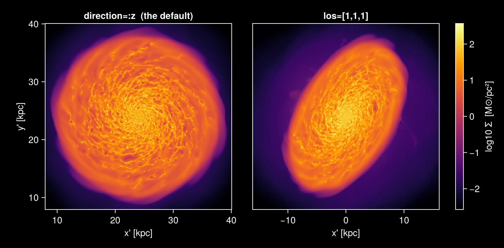

### A direction Mera works out for you

For a disc galaxy the view you usually want is along its spin axis, and `direction=:faceon` and
`:edgeon` compute that from the data. They are a convenience, not a different mechanism: they end
up as a `los` vector like the one above, and you can print it to see which one.

!!! warning "`:faceon` needs `center` on the object"
    `:faceon`/`:edgeon` and `axis=:angmom` derive the orientation from the **angular momentum of
    the loaded data about `center`**. `center` defaults to the box **corner**, and L about a corner
    is dominated by the lever arm of the whole box. You get a plausible-looking tilted galaxy, with
    no error and no warning. Always pass `center=[:bc]`, or the object's own centre. Chapter 2 says
    what it sums over and how to check it; Chapter 8 gives the test that catches a wrong centre.

```julia
# The convenience form, in the same window as the two maps above. Print the line of sight it chose
# and compare it with the ones you typed: :faceon is a `los` you did not have to work out.
fo = projection(gas, :sd, :Msol_pc2; direction=:faceon, win...)
eo = projection(gas, :sd, :Msol_pc2; direction=:edgeon, win...)

println("line of sight  ŵ = ", round.(fo.los, digits=3))
println("image up       û = ", round.(fo.up,  digits=3))
println("projection centre (box fraction) = ", round.(fo.center, digits=3))
println("frame: ", size(fo.maps[:sd]), "  and  ", size(eo.maps[:sd]))

cr = sharedrange([fo, eo], :sd)
display(maprow([fo, eo], :sd, ["direction=:faceon", "direction=:edgeon"]; crange=cr))

# The SAME camera on the stars. Nothing about the view changes, only the data handed to it, which
# is the point: `direction`, `fov` and `pxsize` mean exactly what they meant above.
#
# The stars get their OWN colour range. Σ_star and Σ_gas are different quantities with different
# magnitudes, so sharing a range would wash one of them out. And at this 100 pc pixel the outskirts
# speckle, because 628 thousand points over the disc leave about 15 stars in a pixel here: that
# noise is the price of a point tracer, and Chapter 11 picks pixels that pay less of it.
# ONE change from the gas window: `aperture=:circle`. The gas fills the fov=16 sphere so a square
# costs it nothing; the stars do not, and a square would cut this panel down to the thickness of
# the star layer. Chapter 3 states the rule and measures it.
star_win = (center=[:bc], fov=16, fov_unit=:kpc, aperture=:circle,
            pxsize=[0.1, :kpc], verbose=false, show_progress=false)
hero_sfo = projection(part, :sd, :Msol_pc2; direction=:faceon, star_win...)
hero_seo = projection(part, :sd, :Msol_pc2; direction=:edgeon, star_win...)
maprow([hero_sfo, hero_seo], :sd, ["stars, direction=:faceon", "stars, direction=:edgeon"];
       crange=sharedrange([hero_sfo, hero_seo], :sd))
```

```
[Mera] Hint: getvar(:lx) has no `vcenter` — velocities are in the BOX frame.
             Pass vcenter=:auto for an object with bulk motion (`center=` sets the origin,
             `vcenter=` the frame).
             (shown once per session; verbose(false) silences Mera's messages)
line of sight  ŵ = [0.0, 0.001, 1.0]
image up       û = [-0.0, 1.0, -0.001]
projection centre (box fraction) = [0.5, 0.5, 0.5]
frame: (321, 321)  and  (321, 321)
```

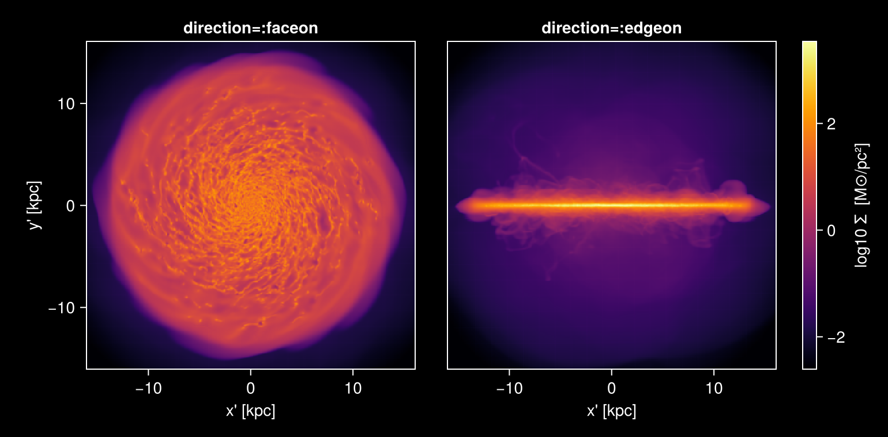

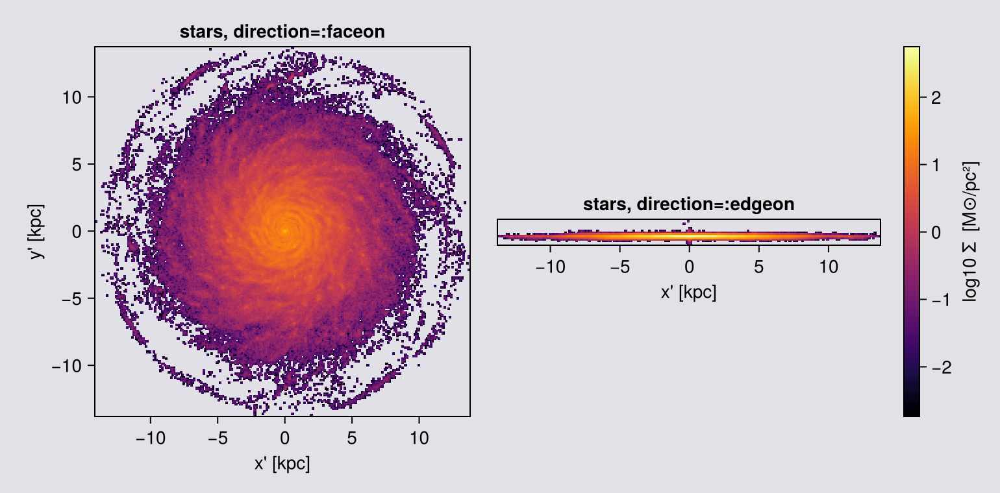

Read the output back:

- `m.maps` is a dict of 2-D arrays; `m.maps[:sd]` is the surface density in `Msol_pc2`.
- `getextent(m, :kpc)` returns `[xmin, xmax, ymin, ymax]` **in the image plane**, the raw `m.extent` is in code units, so always convert.
- `m.los`, `m.up`, `m.cam_right` are the camera basis the call actually used; `m.direction` reads `:offaxis`.

The `los` vector printed above is not a number you chose. It is the disc's angular momentum axis,
computed from your data about your `center`. Aligning the camera with the net angular momentum of
the disc is the standard way to define a simulated galaxy's own frame (Abadi et al. 2003). The
viewing angle is then an explicit parameter of the image, and a chosen one (Torrey et al. 2015;
Bottrell et al. 2017).

### How fine to make the pixels

`pxsize` is the one knob that costs time, and over the range these figures use it costs less than
most people expect. A projection reads every cell once whatever the pixel size, so while the pixel
stays coarser than the cells most of the work is the read and not the grid. Measured on the machine
that renders this page at `fov=16`, with 4 threads and the default `:overlap`. Treat the seconds as
a shape, not a benchmark: the footprint kernels are threaded, and the same sweep at 8 threads runs
30 to 40 per cent faster at the fine end.

| `pxsize` | map | time |
|---|---|---|
| 300 pc | 107² | 12.5 s |
| 100 pc | 321² | 13.7 s |
| 50 pc | 641² | 17.9 s |
| 20 pc | 1601² | 103 s |
| 11.7 pc, the finest cell in the run | 2731² | 452 s, 60 MB |

**The rule is the ratio, not the number.** A finer pixel is nearly free while it stays coarser than
the cells it is sampling, and it stops being free once it does not. On this mesh the turn is near
50 pc, because that is where the pixel meets the refined cells; on a run with a different mesh it
sits somewhere else. Find your own turn from your own `lmax`, not from this table.

**Why.** `:overlap` supersamples each cell with `n³` sub-points, `n = ⌈cell/pixel⌉`. While the pixel
is coarser than the cell, `n` is 1 and the grid is almost free; below that, cost climbs as the cube
of the ratio. In the table, 300 to 100 pc costs a tenth more, 100 to 20 pc costs eight times more.

Two chapters set their own pixel on purpose: Chapter 7, where the pixel-to-cell ratio *is* the
experiment, and Chapter 11, where a stellar map is limited by stars per pixel rather than by cost.

One thing does not move with `pxsize`: the mass on a gas map (Chapter 8). σ_LOS barely moves on
this galaxy, but that is a property of this galaxy and not of `:σlos`, so Chapter 8 measures it
rather than promising it. Pick `pxsize` for the image you want, and quote it.

```julia
# The one native-resolution figure on this page. The pixel is the finest cell in the run, so
# nothing is averaged away. It costs about 450 s and 60 MB for the map, against 12 to 20 s for
# every other figure here. Coarsen it if you are only re-running the page.
native = projection(gas, :sd, :Msol_pc2; direction=:faceon, center=[:bc],
                    fov=16, fov_unit=:kpc, aperture=:square,
                    pxsize=[gas.boxlen * gas.scale.kpc / 2^gas.lmax, :kpc],
                    verbose=false, show_progress=false)
println("native pixel : ", round(native.pixsize * native.scale.pc, digits=2), " pc")
println("map          : ", size(native.maps[:sd]))

# ── figure code from here: panels, overlays, colorbars, no new Mera concepts ──
# The stars at the SAME pixel, which is the one place the comparison is unkind to them on purpose.
# A cell has a size, so "native resolution" means something for gas: stop at the finest cell and
# nothing is averaged away. A particle is a point and has no size, so there is no pixel at which a
# star map stops improving. At 11.7 pc this frame holds about one star per twenty pixels, so what
# the right-hand panel shows is shot noise with a galaxy behind it, not structure.
snative = projection(part, :sd, :Msol_pc2; direction=:faceon, center=[:bc],
                     fov=16, fov_unit=:kpc, aperture=:square,
                     pxsize=[gas.boxlen * gas.scale.kpc / 2^gas.lmax, :kpc],
                     verbose=false, show_progress=false)
println("stars in the frame : ", length(part.data),
        "   pixels : ", prod(size(snative.maps[:sd])),
        "   occupied : ", round(100 * count(>(0), snative.maps[:sd]) /
                                length(snative.maps[:sd]), digits=1), " %")

fig = Figure(size=(1180, 640))
ax  = Axis(fig[1,1], title="gas: Σ at the finest cell size in the run",
           xlabel="x' [kpc]", ylabel="y' [kpc]")
h   = showmap!(ax, native, :sd)
Colorbar(fig[1,2], h, label="log10 Σ  [M⊙/pc²]")
ax2 = Axis(fig[1,3], title="stars: the same pixel, no native scale to stop at",
           xlabel="x' [kpc]", ylabel="y' [kpc]")
h2  = showmap!(ax2, snative, :sd)
Colorbar(fig[1,4], h2, label="log10 Σ  [M⊙/pc²]")
fig
```

```
native pixel : 11.72 pc
map          : (2731, 2731)
stars in the frame : 627896   pixels : 5405625   occupied : 16.7 %
```

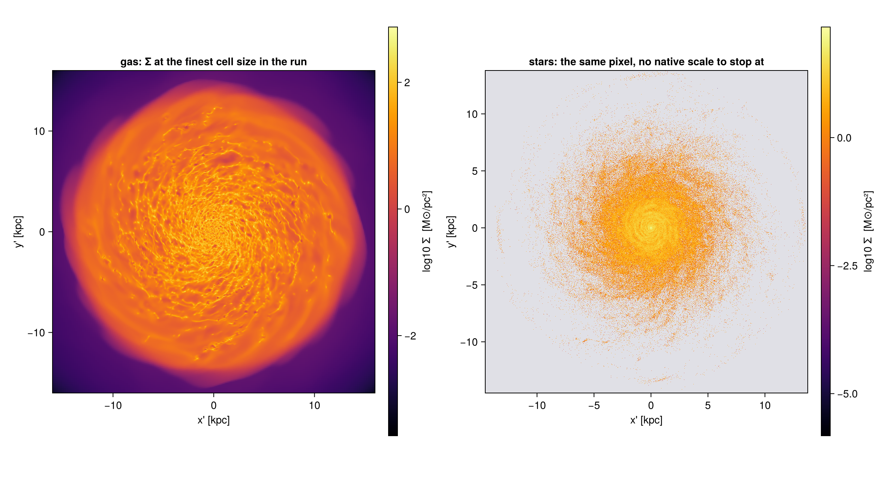

## 2. Pointing the camera

Give **exactly one** line-of-sight specifier. Two is an error, not a silent winner.

| you want | you say | needs the object? |
|---|---|---|
| a known viewing vector | `los=[1,1,1]` | no |
| down a box axis | `direction=:x` / `:y` / `:z` (`:z` is the default) | no |
| inclination from the box z | `inclination=60` | no |
| turn the camera about the reference axis | `azimuth=` | no |
| a sky position angle | `position_angle=30` | no |
| a disc flat on / on its side | `direction=:faceon` / `:edgeon` | **yes** |
| inclination from the disc's own spin axis | `inclination=60, axis=:angmom` | **yes** |

Modifiers, which combine with any of the above: `up=`, `position_angle=`, `angle_unit=:deg`
(default) or `:rad`.

`axis=` takes `:x`, `:y`, `:z`, a 3-vector, or `:angmom` (alias `:L`). Combining it with
`direction=:faceon`/`:edgeon` is an error, because those already use `L`.

### How `los` becomes an image

Mera builds a right-handed orthonormal basis from `los`, and returns it on the map:

| field | is |
|---|---|
| `m.los` | the viewing direction, normalised |
| `m.cam_right` | image x, the map's first index |
| `m.up` | image y, the map's second index |

with `cam_right x up = los`.

Without `up=`, the camera uses world **+z** as its up hint, and +y when the line of sight is
itself the z axis. That is what makes a box-axis `los` reproduce the matching preset:

| `los` | image x | image y | same as |
|---|---|---|---|
| `[0,0,1]` | `+x` | `+y` | `direction=:z` |
| `[1,0,0]` | `+y` | `+z` | edge-on with z up |
| `[0,1,0]` | `-x` | `+z` | |
| `[0,0,-1]` | `-x` | `+y` | looking the other way |

Pass `up=` whenever that is not what you want. `position_angle` then rolls the image about the
line of sight, leaving `m.los` alone.

### Meanings

`inclination` is the angle between the line of sight and the disc's spin axis, `i = 0` face-on,
the quantity observers infer from the projected axis ratio (Hubble 1926; Holmberg 1958).
`position_angle` is the roll of the image, the analogue of the sky position angle measured from
north through east (de Vaucouleurs et al. 1991). Together they are the pair a tilted-ring fit
assigns to each radius (Rogstad, Lockhart & Wright 1974; Begeman 1989).

`azimuth` turns the camera about the reference axis. For an axisymmetric disc the picture only
rotates, so it is a movie parameter rather than a modelling one, and it reappears in Chapter 13.

!!! warning "`azimuth` is not `phi`"
    They cover the same directions when `axis=:z`, but the zero point differs by a quarter turn:
    `inclination = theta`, `azimuth = phi + 90`. `phi` is measured from `+x`, the usual spherical
    convention. `azimuth` starts 90 degrees later, so `inclination=0` gives the same image
    orientation as `direction=:z`. Passing `azimuth=phi` rotates the picture by 90 degrees.

```julia
# Same window as Chapter 1, only `inclination` changes.
lad0  = projection(gas, :sd, :Msol_pc2; inclination=0,  axis=:angmom, win...)
lad30 = projection(gas, :sd, :Msol_pc2; inclination=30, axis=:angmom, win...)
lad60 = projection(gas, :sd, :Msol_pc2; inclination=60, axis=:angmom, win...)

# Is `direction=:faceon` the same as `inclination=0, axis=:angmom`? Separate the two halves of
# that question, the LINE OF SIGHT and the ROLL, because the answer differs for each.
println("max |ŵ_faceon − ŵ_inc0|     = ", maximum(abs, fo.los .- lad0.los))
println("angle(û_faceon, û_inc0)     = ",
        round(rad2deg(acos(clamp(sum(fo.up .* lad0.up), -1, 1))), digits=2), "°")
println("max |Σ_faceon − Σ_inc0|     = ", round(maximum(abs, lad0.maps[:sd] .- fo.maps[:sd]), digits=1))
# ... and the roll is recoverable exactly:
lad0_pa = projection(gas, :sd, :Msol_pc2; inclination=0, axis=:angmom, position_angle=-90, win...)
println("max |Σ_faceon − Σ_inc0,PA=-90| = ", maximum(abs, lad0_pa.maps[:sd] .- fo.maps[:sd]))

# "Exactly one view specifier" and "direction implies :angmom" are promises about behaviour:
for (lbl, kw) in (("inclination + los", (inclination=35, los=[1,1,1])),
                  ("direction=:faceon + axis", (direction=:faceon, axis=:angmom)))
    e = try (projection(gas, :sd; kw..., win...); "NO ERROR") catch e; typeof(e).name.name end
    println(rpad(lbl, 26), "→ ", e)
end

ladder = [lad0, lad30, lad60, eo]      # i = 90 is the edge-on map from Chapter 1
cr = sharedrange(ladder, :sd)
display(maprow(ladder, :sd, ["i = 0°", "i = 30°", "i = 60°", "i = 90°"]; crange=cr))

# The same ladder on the stars. `axis=:angmom` is computed from the data it is given, so the star
# ladder tilts about the STARS' own angular momentum, not the gas's. The two axes agree closely
# here because the young stars were born from this gas, and the printed angle below says how
# closely rather than leaving it to the eye.
sladder = [projection(part, :sd, :Msol_pc2; inclination=i, axis=:angmom, star_win...)
           for i in (0, 30, 60)]
push!(sladder, hero_seo)                   # i = 90 is the edge-on star map from Chapter 1
println("angle between the gas and star angular-momentum axes = ",
        round(rad2deg(acos(clamp(abs(sum(lad0.los .* sladder[1].los)), -1, 1))), digits=2), "°")
maprow(sladder, :sd, ["stars, i = 0°", "stars, i = 30°", "stars, i = 60°", "stars, i = 90°"];
       crange=sharedrange(sladder, :sd))
```

```
max |ŵ_faceon − ŵ_inc0|     = 0.0
angle(û_faceon, û_inc0)     = 0.0°
max |Σ_faceon − Σ_inc0|     = 0.0
max |Σ_faceon − Σ_inc0,PA=-90| = 194.82991713523964
inclination + los         → ArgumentError
direction=:faceon + axis  → ArgumentError
```

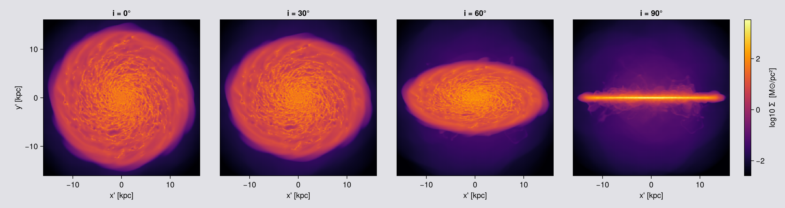

```
angle between the gas and star angular-momentum axes = 0.03°
```

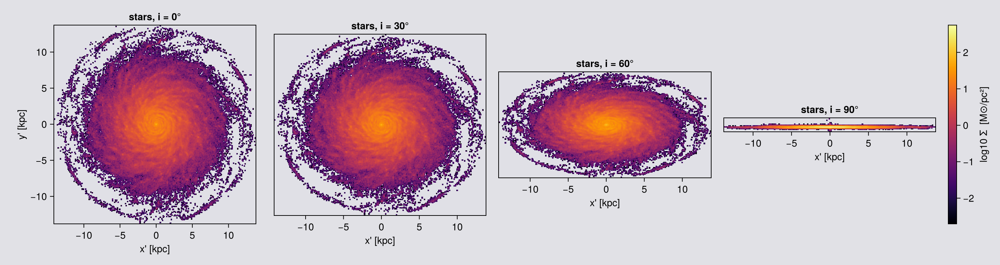

`direction=:faceon` and `inclination=0, axis=:angmom` are the **same view**: the same line of
sight to the last bit, the same up vector, and a map difference of exactly zero.

That is by design, not luck. A face-on view leaves the roll about `ŵ` free, so something has to
choose it, and one rule does so for every way of pointing the camera: with no `up=`, image up is
world `+z` seen across the line of sight, or `+y` when the line of sight is within 3 degrees of
the z axis. `inclination`/`azimuth` measure from that same reference, so `inclination=0` is the
face-on preset and `inclination=90` the edge-on one, and `face_on(gas)` splatted into
`projection` gives the same camera again.

The last printed line shows why the rule matters: rolling the image by 90° moves the map by
about 195 M⊙/pc². Two spellings that chose the roll differently would disagree by that much.

The lesson generalises past this one preset: whenever a view leaves a degree of freedom free,
compare the **camera vectors**, not the pixels. Two correct maps of the same scene can differ by a
roll.

**So:** pick `direction=:faceon/:edgeon` when you want the disc's own frame, `inclination`+`axis=:angmom` when you want a specific *i*, and `los=` when you already know the vector, for example when you want the same orientation across many snapshots (Appendix C).

## 3. Framing

Two ways to say what is in the picture, and they behave differently under rotation.

**World ranges.** `xrange`/`yrange`/`zrange` with `center` and `range_unit` select a box in the
simulation, exactly as for the axis-aligned path and for `subregion`. The camera frame is then
auto-fitted to the bounding box of that region **after rotation**, so:

- the frame grows with tilt, and frames at different angles are not comparable
- the window's own faces show up as straight edges across the image
- with no `zrange`, the whole box depth of foreground and background sits in your disc map

**`fov`.** The camera is orthographic, so the only framing control is the half-width of the frame.
`fov` selects a **sphere** about `center`, and a sphere projects to the same disc at every
orientation, so the frame is fixed by construction.

| `aperture` | selects | frame |
|---|---|---|
| `:circle` (default) | sphere of radius `fov` | rectangular array with **empty corners** |
| `:square` | sphere of radius √2·`fov`, then cropped | full rectangle, same pixel dimensions at every angle |

Use `:square` whenever you will compare or animate frames.

!!! warning "`fov` always needs `fov_unit`"
    `fov_unit` defaults to `:standard`, which is a **box fraction**. `fov=16` alone means 16 box lengths, silently clamped to the cap. Always write `fov=16, fov_unit=:kpc`.

### What `fov` does, and which to use

`fov` is not a zoom. The camera is orthographic, so there is no distance to change. `fov`
**selects data**, and for `:square` then crops the finished map:

1. a `subregion` sphere about `center`, radius `fov` for `:circle`, `√2·fov` for `:square`
2. projected, with the frame auto-fitted to the rotated data
3. for `:square` only, cropped to the central `2·fov / pixel` pixels, capped by the shorter side

Two side effects of step 1: `fov` **replaces** any `xrange`/`yrange`/`zrange`, and `center` is
then read in `fov_unit`, so `range_unit` is discarded. Step 3 is the one that costs mass, and it
is why a thin edge-on particle disc comes back cropped to its own thickness (Chapter 11).

With **no `fov`** there is no sphere and no crop: every selected cell lands on the map, but the
frame breathes with the viewing angle.

| what you are doing | pass | why |
|---|---|---|
| a mass, a budget, a conservation check | **no `fov`** | every selected cell is on the map, so the map total is the object total |
| measuring in a region you define | world ranges, no `fov` | a box you control, at the price of a frame that breathes |
| measuring something centred, one angle | `fov` + `:circle` | a selection with no crop after it |
| a picture, or frames that must match | `fov` + `:square` | same pixel dimensions at every angle, at the price of the corners |
| an orbit movie | `rotation_sequence` with `fov` | the same sphere, swept (Chapter 13) |
| point data that does not fill the sphere | `:circle` | `:square` would crop to the shorter side (Chapter 11) |

!!! warning "Never read a total off a cropped frame"
    With `fov` and `:square` the map does not hold all the mass, and how much is missing depends
    on the angle, because the crop is a square and the object is not. Check before quoting:
    `sum(m.maps[:sd]) * (m.pixsize * m.scale.pc)^2` against `msum(obj, :Msol)`.

**A fitted frame is not a centred frame.** The frame is fitted to the **extent** of the selected
data, not to its centre of mass. The gas fills the box, so the two agree. The stars do not: their
centre of mass sits 8 pc from the box centre, but their extent runs −14.00 to +13.61 kpc across
and −0.47 to +1.02 kpc vertically, set by a handful of outliers. 99.9 % of the stellar mass lies
inside |z| < 0.21 kpc, so an edge-on star frame is set by about one star in a thousand and the
disc sits visibly off centre in it. Nothing is wrong; pass a symmetric range, or fix the axes
yourself, as the star panels here do.

**The cap is silent.** `fov` is clamped to `0.49·boxlen` for `:circle` and `0.49/√2·boxlen` for
`:square`: on this 48 kpc box, 23.52 and 16.63 kpc. Ask for 20 kpc with `:square` and you get
16.63 with no warning. For an object larger than the cap, use world ranges.

```julia
# WORLD-space window, verbose=true so Mera's own hint about this is on the page.
world = projection(gas, :sd, :Msol_pc2; inclination=60, axis=:angmom, center=[:bc],
                   xrange=[-16,16], yrange=[-16,16], range_unit=:kpc,
                   pxsize=[0.1,:kpc], verbose=true, show_progress=false)

# CAMERA-plane frame, rotation-invariant sphere selection.
sq = projection(gas, :sd, :Msol_pc2; inclination=60, axis=:angmom, center=[:bc],
                fov=16, fov_unit=:kpc, aperture=:square,
                pxsize=[0.1,:kpc], verbose=false, show_progress=false)
ci = projection(gas, :sd, :Msol_pc2; inclination=60, axis=:angmom, center=[:bc],
                fov=16, fov_unit=:kpc, aperture=:circle,
                pxsize=[0.1,:kpc], verbose=false, show_progress=false)

for (nm, m) in (("xrange/yrange ±16 kpc", world), ("fov=16 :square", sq), ("fov=16 :circle", ci))
    println(rpad(nm, 24), " frame ", lpad(string(size(m.maps[:sd])), 12),
            "   extent [kpc] = ", round.(getextent(m, :kpc), digits=1))
end

# The same three windows on the stars, and the frames come out DIFFERENT. The keywords behave the
# same; what changed is what they are measured against. The frame is fitted to the data that is
# there, and these 628 thousand young stars do not fill the +-16 kpc window the gas fills.
#
# Watch `fov=16, aperture=:square`: on the gas it gives the full 32 kpc square, on the stars it
# gives a square of whatever the data allows. This is the rule from the start of this chapter,
# measured.
println()
star_frames = NamedTuple[]
for (nm, kw) in (("xrange/yrange ±16 kpc", (xrange=[-16,16], yrange=[-16,16], range_unit=:kpc)),
                 ("fov=16 :square",        (fov=16, fov_unit=:kpc, aperture=:square)),
                 ("fov=16 :circle",        (fov=16, fov_unit=:kpc, aperture=:circle)))
    m = projection(part, :sd, :Msol_pc2; inclination=60, axis=:angmom, center=[:bc],
                   kw..., pxsize=[0.1,:kpc], verbose=false, show_progress=false)
    push!(star_frames, (name=nm, map=m))
    println(rpad("stars, " * nm, 24), " frame ", lpad(string(size(m.maps[:sd])), 12),
            "   extent [kpc] = ", round.(getextent(m, :kpc), digits=1))
end
```

```
[Mera] Hint: off-axis view with `xrange`/`yrange` but no `zrange`.
             These are WORLD-space bounds, so after rotation the full box depth folds into
             the image. Pass `zrange`, or `fov=<half-width>` for a fixed camera frame.
             (shown once per session; verbose(false) silences Mera's messages)
[Mera]: 2026-09-27T06:57:56.844
center: [0.5, 0.5, 0.5] ==> [24.0 [kpc] :: 24.0 [kpc] :: 24.0 [kpc]]
domain:
xmin::xmax: 0.1666667 :: 0.8333333  	==> 8.0 [kpc] :: 40.0 [kpc]
ymin::ymax: 0.1666667 :: 0.8333333  	==> 8.0 [kpc] :: 40.0 [kpc]
zmin::zmax: 0.0 :: 1.0  	==> 0.0 [kpc] :: 48.0 [kpc]
Selected var(s)=(:sd,)
Weighting      = :mass
Off-axis LOS   = [0.0, -0.8657, 0.5006]  (binning=:overlap)
Effective resolution: 481^2  →  map size: 330 x 576
xrange/yrange ±16 kpc    frame   (330, 576)   extent [kpc] = [-16.5, 16.5, -28.8, 28.7]
fov=16 :square           frame   (321, 321)   extent [kpc] = [-16.0, 16.0, -16.0, 16.0]
fov=16 :circle           frame   (325, 327)   extent [kpc] = [-16.2, 16.2, -16.3, 16.3]
stars, xrange/yrange ±16 kpc frame   (279, 139)   extent [kpc] = [-14.1, 13.7, -6.9, 6.9]
stars, fov=16 :square    frame   (139, 139)   extent [kpc] = [-7.1, 6.8, -6.9, 6.9]
stars, fov=16 :circle    frame   (279, 139)   extent [kpc] = [-14.1, 13.7, -6.9, 6.9]
```

```julia
# ── figure code from here: panels, overlays, colorbars, no new Mera concepts ──
cr = sharedrange([world, sq, ci], :sd)
ttl = ["xrange/yrange = ±16 kpc\n" * string(size(world.maps[:sd])),
       "fov=16, aperture=:square\n"  * string(size(sq.maps[:sd])),
       "fov=16, aperture=:circle\n"  * string(size(ci.maps[:sd]))]
# BOTH ROWS ON ONE PAIR OF LIMITS. The world-range frame is the tallest thing here (±28.8 kpc
# against the ±16 that was asked for), so the limits are chosen to hold it. Every other panel then
# shows its true size inside that same box: the `fov` frames as smaller squares, the stars smaller
# still. Auto-scaling each panel instead makes every one fill its axis, which hides exactly the
# difference these six panels exist to show.
const FRAME_LIM = (-17.5, 17.5, -30.0, 30.0)

# THE OVERLAY HAS TO MATCH WHAT WAS ASKED FOR, or it teaches the wrong thing. `xrange`/`yrange` and
# `aperture=:square` request a SQUARE; `aperture=:circle` requests a DISC of radius `fov`. Drawing a
# square on the circular panel would show a boundary that was never requested and is not where the
# selection ends.
function request_outline!(ax, shape, r)
    if shape === :square
        lines!(ax, [-r,r,r,-r,-r], [-r,-r,r,r,-r], color=:dodgerblue, linestyle=:dash, linewidth=2)
    else
        t = range(0, 2π, length=200)
        lines!(ax, r .* cos.(t), r .* sin.(t), color=:dodgerblue, linestyle=:dash, linewidth=2)
    end
end

# A fourth window, the rectangular one, so the gas row has the same four panels as the star row
# below and the two can be read down the columns. It also makes a point on its own: a rectangle has
# to match the object. These are the same 16x4 kpc half-widths that suit the thin stellar layer,
# and on the gas they cut the disc, because seen at 60 degrees the gas is far thicker than 4 kpc.
gas_rect = projection(gas, :sd, :Msol_pc2; inclination=60, axis=:angmom, center=[:bc],
                      fov=[16,4], fov_unit=:kpc, aperture=:square, pxsize=[0.1,:kpc],
                      verbose=false, show_progress=false)
gmaps = [world, sq, ci, gas_rect]
gttl  = vcat(ttl, ["fov=[16,4] :square\n" * string(size(gas_rect.maps[:sd]))])
fig = maprow(gmaps, :sd, gttl; crange=sharedrange(gmaps, :sd))
for (k, shape) in enumerate((:square, :square, :circle, :rect))
    ax = contents(fig[1,k])[1]
    if shape === :rect
        lines!(ax, [-16,16,16,-16,-16], [-4,-4,4,4,-4], color=:dodgerblue, linestyle=:dash, linewidth=2)
    else
        request_outline!(ax, shape, 16)      # the ±16 kpc that was requested, in its own shape
    end
    limits!(ax, FRAME_LIM...)
end
display(fig)

# The same windows on the stars, plus the remedy, because the middle panel is a trap and a figure
# that only shows the trap is half the lesson. `fov=16, aperture=:square` collapses to the
# thickness of the star layer and cuts the galaxy; `:circle` keeps it whole; `fov=[16,4]` keeps it
# whole AND stops paying for empty sky above and below it.
star_rect = projection(part, :sd, :Msol_pc2; inclination=60, axis=:angmom, center=[:bc],
                       fov=[16,4], fov_unit=:kpc, aperture=:square, pxsize=[0.1,:kpc],
                       verbose=false, show_progress=false)
smaps = vcat([f.map for f in star_frames], [star_rect])
sttl  = vcat([f.name * "\n" * string(size(f.map.maps[:sd])) for f in star_frames],
             ["fov=[16,4] :square\n" * string(size(star_rect.maps[:sd]))])
figs4 = maprow(smaps, :sd, sttl; crange=sharedrange(smaps, :sd))
# Same pixel and same limits as the gas row, so the two rows can be read down the columns. Each
# outline is the shape that panel actually requested.
for (k, shape, r) in ((1, :square, 16), (2, :square, 16), (3, :circle, 16), (4, :rect, 16))
    ax = contents(figs4[1,k])[1]
    if shape === :rect
        lines!(ax, [-16,16,16,-16,-16], [-4,-4,4,4,-4], color=:dodgerblue, linestyle=:dash, linewidth=2)
    else
        request_outline!(ax, shape, r)
    end
    limits!(ax, FRAME_LIM...)
end
figs4
```

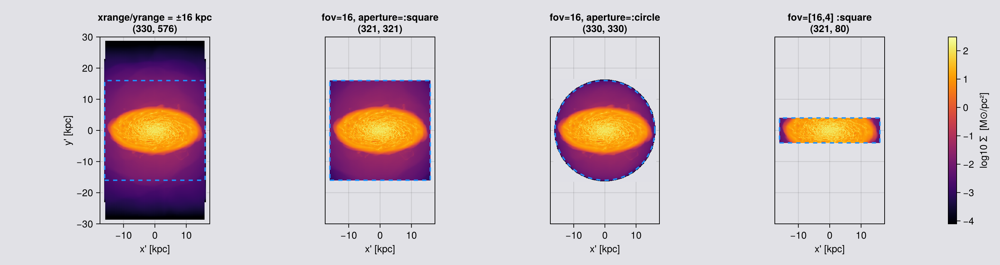

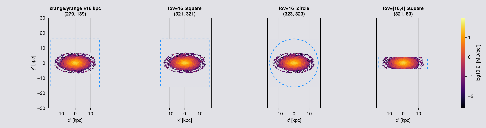

Read the frame sizes above, not just the pictures. The ±16 kpc request came back far taller:
`xrange`/`yrange`/`zrange` bound a box **in simulation coordinates**, and the frame is that box's
bounding box *after rotation*. The dashed blue outline is what was asked for, drawn in the shape it was asked in: a square for
`xrange`/`yrange` and for `aperture=:square`, a circle for `aperture=:circle`, which selects a disc
and not a box. Everything outside it is the rotated box's own footprint, and its faces are the
straight edges cutting across the map.

Those faces are worse than cosmetic. A sight line just inside the slab crosses its full depth; a
sight line just outside clips only a corner. The column density therefore drops along a straight
line, a hard edge that looks like a rendering artefact but is the selection box seen from an angle.

`fov` avoids all of this by framing the **camera plane** instead. The selection is a sphere, which
projects to the same disc at every orientation, so the frame cannot breathe.

Mera prints a one-off note when it sees an off-axis view with a windowed `xrange`/`yrange` and no
`zrange`, because the result is easy to mistake for a bug in the data.

### Choosing `fov`

`fov` is a **half-width**: the frame spans ±`fov`, so `fov=15, fov_unit=:kpc` is a 30 kpc image.

**A given `fov` buys an uneven depth.** The selection is a sphere of radius `R` (`fov` for
`:circle`, `√2·fov` for `:square`), so a ray at in-plane distance `d` integrates a chord, not a
slab: `depth(d) = 2·√(R² − d²)`. For `fov=15, :square` (R = 21.2 kpc):

| where in the frame | offset | column depth |
|---|---|---|
| centre | 0 kpc | 42.4 kpc |
| middle of an edge | 15 kpc | 30.0 kpc |
| **corner** | 21.2 kpc | **0 kpc** |

The corners of a `:square` frame sit on the selection sphere and integrate nothing. That soft
darkening in the corners of any `fov` map of a diffuse field is the selection boundary, not the
gas. Chapter 4 is how you make the depth even.

**Rule:** make `fov` comfortably larger than the structure you are measuring, and never read a
diffuse column, profile or scale height out to the frame boundary.

**Picking one.** Take the radius holding the mass fraction you care about and leave room. The gas
disc here is about 23 kpc across with nine tenths of its mass inside 11.4 kpc, so `fov=16` leaves
it where the depth is nearly flat.

**Changing it deliberately.** A smaller `fov` is also a shallower column, so it removes
foreground and background, and it buys resolution because the same pixels cover less sky. A
larger one buys context and a deeper column, at the price of more unrelated material on every
ray.

```julia
# What `fov` actually changes, in one row: the same camera and the same pixel at four widths.
# Each frame is a different SELECTION, so it is also a different column depth (see the table
# above), not merely a crop of the widest one.
fkw = (los=[1.,2,3], center=[:bc], fov_unit=:kpc, aperture=:square, pxsize=[0.25,:kpc],
       verbose=false, show_progress=false)
sweep = [projection(gas, :sd, :Msol_pc2; fov=f, fkw...) for f in (4, 8, 16, 23)]
# The delivered half-width, not the requested one: `fov` is capped silently, and the depth
# follows what you GOT. Reading the requested number here would overstate the last row.
println(rpad("fov asked", 11), rpad("delivered", 11), rpad("frame [px]", 13),
        rpad("extent [kpc]", 20), "central depth [kpc]")
for (f, m) in zip((4, 8, 16, 23), sweep)
    ex = getextent(m, :kpc)
    got = (ex[2] - ex[1]) / 2                       # half-width actually delivered
    println(rpad(f, 11), rpad(round(got, digits=2), 11), rpad(string(size(m.maps[:sd])), 13),
            rpad(string(round(ex[2]-ex[1], digits=2), " x ", round(ex[4]-ex[3], digits=2)), 20),
            round(2*sqrt(2)*got, digits=1))
end
maprow(sweep, :sd, ["fov = $(f) kpc" for f in (4, 8, 16, 23)];
       crange=sharedrange(sweep, :sd))
```

```
fov asked  delivered  frame [px]   extent [kpc]        central depth [kpc]
4          3.98       (32, 32)     7.96 x 7.96         11.3
8          7.96       (64, 64)     15.92 x 15.92       22.5
16         16.04      (129, 129)   32.08 x 32.08       45.4
23         16.66      (134, 134)   33.33 x 33.33       47.1
```

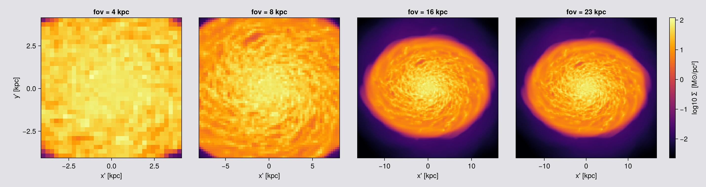

Four widths, one camera. The frame shrinks in pixels as `fov` shrinks, because the pixel size
is held fixed, and the **column gets shallower** with it: the selection is a sphere, so halving
`fov` halves the depth at the centre of the frame as well as the width. A smaller `fov` is
therefore not a crop of the larger one, and the surface density in the middle is genuinely lower
because less material lies along each ray.

The widest frame here is at the `:square` cap for this box (16.63 kpc), so asking for 23 gives
the cap without a warning.

### Moving the frame: `center` is where the camera points

`center` is the origin of the frame, not a property of the object. Move it and the camera pans,
with no rotation and no manual re-selection.

- **The axis numbers do not change.** `getextent` is measured from the centre, so every panel
  reads ±10 kpc wherever it points. Read `m.center` for where the frame sits.
- **Panning off the object is cheaper**, because a projection is priced by the cells it touches:
  about 6 s on the disc here against about 1 s out in the corner, for the same call.

```julia
# ONE camera direction, four places to point it. Nothing about the view changes between panels:
# same `los`, same `fov`, same pixel. Only `center` moves, so this is a pan across the box.
BC  = gas.boxlen * gas.scale.kpc / 2                    # 24 kpc, the box centre
pans = [("centre",            [BC,     BC,     BC]),
        ("8 kpc along x",     [BC+8,   BC,     BC]),
        ("8 kpc along y",     [BC,     BC+8,   BC]),
        ("12 kpc out, corner",[BC+12,  BC+12,  BC])]

panmaps = NamedTuple[]
for (lbl, ctr) in pans
    t = @elapsed m = projection(gas, :sd, :Msol_pc2; los=[1.,2.,3.], center=ctr, range_unit=:kpc,
                                fov=10, fov_unit=:kpc, aperture=:circle, pxsize=[0.1,:kpc],
                                verbose=false, show_progress=false)
    push!(panmaps, (label=lbl, map=m, secs=t))
end

println(rpad("center", 22), rpad("t [s]", 8), rpad("extent [kpc]", 30), "mass in frame [Msol]")
for (p, (lbl, ctr)) in zip(panmaps, pans)
    println(rpad(lbl, 22), rpad(round(p.secs, digits=1), 8),
            rpad(string(round.(getextent(p.map, :kpc), digits=1)), 30),
            round(sum(p.map.maps[:sd]) * (p.map.pixsize * p.map.scale.pc)^2, sigdigits=4))
end

# One colour range across the four, so "the outskirts are emptier" is something you can see rather
# than something each panel hides by stretching itself.
maprow([p.map for p in panmaps], :sd,
       [p.label * "\n" * string(round.(Int, p.map.center .* gas.boxlen .* gas.scale.kpc)) * " kpc"
        for p in panmaps];
       crange=sharedrange([p.map for p in panmaps], :sd))
```

```
center                t [s]   extent [kpc]                  mass in frame [Msol]
centre                5.7     [-10.2, 10.3, -10.3, 10.2]    5.453e9
8 kpc along x         3.8     [-10.3, 10.3, -10.4, 10.3]    3.699e9
8 kpc along y         3.7     [-10.3, 10.3, -10.4, 10.3]    3.692e9
12 kpc out, corner    1.1     [-10.5, 10.5, -10.7, 10.5]    5.032e8
```

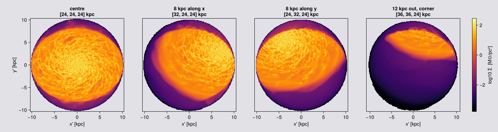

The same idea as a movie. The camera keeps one direction and one field of view, and the centre
walks across the box, so the galaxy drifts through the frame and out the other side. This is the
cheapest way to see what is where in a box you do not know yet.

```julia
# A pan: `center` walks along x while everything else is held. `rotation_sequence` turns the camera,
# so it is the wrong tool here; a pan is just a loop over `center`, which is why no special API is
# needed for it.
#
# Cost is modest and uneven: frames pointed at the disc touch the most cells, frames pointed at the
# outskirts touch few, so the sweep is fastest where there is least to see.
pancentres = [[x, BC, BC] for x in range(BC-14, BC+14, length=60)]
panseq = [projection(gas, :sd, :Msol_pc2; los=[1.,2.,3.], center=ctr, range_unit=:kpc,
                     fov=10, fov_unit=:kpc, aperture=:circle, pxsize=[0.15,:kpc],
                     verbose=false, show_progress=false) for ctr in pancentres]

crp = sharedrange(panseq, :sd)          # one range for the whole pan, so brightness means something
figp = Figure(size=(360, 360))
axp  = Axis(figp[1, 1], aspect=DataAspect(), title="pan: center walks across the box")
hidedecorations!(axp)
record(figp, "assets/offaxis/pan_movie.gif", eachindex(panseq); framerate=20) do k
    empty!(axp)
    showmap!(axp, panseq[k], :sd; crange=crp)
end
println("wrote assets/offaxis/pan_movie.gif  (", length(panseq), " frames, ",
        round(filesize("assets/offaxis/pan_movie.gif")/1024, digits=1), " KB)")
```

```
wrote assets/offaxis/pan_movie.gif  (60 frames, 5859.6 KB)
```

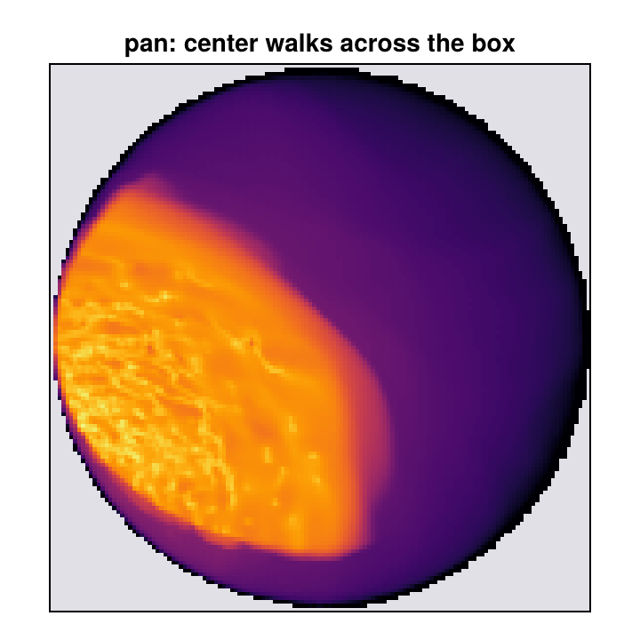

**What the pan is good for.** Finding things. A simulation box is mostly empty and an object you
have not located yet will not be at the centre. Panning at a fixed `fov` is a survey: it costs
little where there is nothing, and it tells you where to point properly. Once you know, set
`center` there and go back to one frame.

### A frame that is not square: `fov=[wx, wy]`

An edge-on disc is a thin strip, and in a square frame most pixels are empty sky at the same
cost as the ones with the galaxy in them. Two half-widths spend them where the object is.

Requires `aperture=:square`: a rectangle has no single radius, while `:circle` selects a disc,
which has one. A scalar `fov` is unchanged.

```julia
# Same camera, same pixel, same data. Only the shape of the frame changes.
fkw = (direction=:edgeon, center=[:bc], fov_unit=:kpc, aperture=:square,
       pxsize=[0.1,:kpc], verbose=false, show_progress=false)
sq   = projection(gas, :sd, :Msol_pc2; fov=16,     fkw...)
rect = projection(gas, :sd, :Msol_pc2; fov=[16,4], fkw...)
for (lbl, m) in (("fov=16", sq), ("fov=[16,4]", rect))
    npx = prod(size(m.maps[:sd]))
    println(rpad(lbl, 12), " frame ", rpad(string(size(m.maps[:sd])), 12),
            " pixels ", rpad(npx, 9),
            " extent ", round.(getextent(m, :kpc), digits=1))
end
println("the rectangle uses ", round(100*prod(size(rect.maps[:sd]))/prod(size(sq.maps[:sd])), digits=1),
        " % of the square's pixels for the same disc")

maprow([sq, rect], :sd, ["fov=16, a square frame", "fov=[16,4], the same disc"];
       crange=sharedrange([sq, rect], :sd))
```

```
fov=16       frame (321, 321)   pixels 103041    extent [-16.0, 16.0, -16.0, 16.0]
fov=[16,4]   frame (321, 80)    pixels 25680     extent [-16.0, 16.0, -4.0, 4.0]
the rectangle uses 24.9 % of the square's pixels for the same disc
```

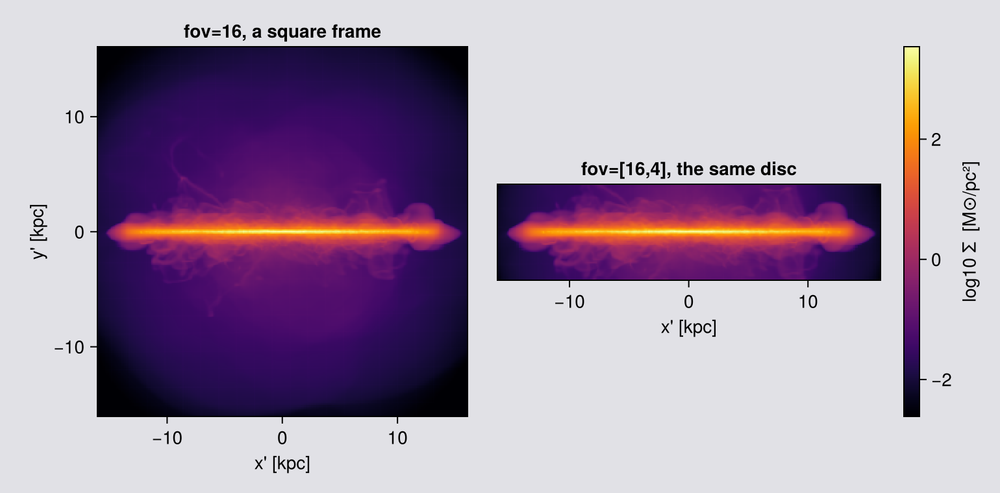

## 4. Depth along the line of sight

Every window so far is world space. Tilt the camera and `zrange` becomes a slab through the
**box**, not through the image. With `fov` it is subtler: a sphere is deep at the centre of the
frame and shallow at the edge, so the integration depth changes across the picture (Chapter 3).

`depth` is the one cut measured along the viewing direction itself.

| you want | you write |
|---|---|
| a slab of half-thickness 2 kpc about `center` | `depth=2, depth_unit=:kpc` |
| more behind than in front | `depth=[-2, 6], depth_unit=:kpc` |
| everything (the default) | omit it |

On a box-axis view the line of sight **is** a box axis, so `zrange` already cuts this slab and
`depth` raises there and says so.

By default the cut keeps a cell whole if its centre is inside. Chapter 5 is what to do when that
half-cell step matters.

```julia
# The same camera three times, with the depth window the only difference. Mass is the honest
# quantity to count here: a depth cut is a selection, so the map total tells you exactly what
# fraction of the object you kept.
Mgas_all = msum(gas, :Msol)
dkw = (los=[1.,2.,3.], center=[:bc], pxsize=[0.2,:kpc], verbose=false, show_progress=false)
depths = [(nothing, "no cut, the whole box"),
          (10.0,    "depth = ±10 kpc"),
          (2.0,     "depth = ±2 kpc")]
dmaps = NamedTuple[]
println(rpad("window", 26), rpad("mass in map [Msol]", 22), "fraction of the object")
for (d, lbl) in depths
    m = d === nothing ? projection(gas, [:mass, :sd], [:Msol, :Msol_pc2]; dkw...) :
                        projection(gas, [:mass, :sd], [:Msol, :Msol_pc2]; depth=d, depth_unit=:kpc, dkw...)
    push!(dmaps, (label=lbl, map=m))
    println(rpad(lbl, 26), rpad(round(sum(m.maps[:mass]), sigdigits=6), 22),
            round(sum(m.maps[:mass]) / Mgas_all, digits=4))
end

# One colour range, so "the thin slab is fainter" is visible rather than hidden by each panel
# stretching itself. The disc survives every cut; what disappears is the material in front of and
# behind it, which is exactly the contamination a column density should not carry.
maprow([d.map for d in dmaps], :sd, [d.label for d in dmaps];
       crange=sharedrange([d.map for d in dmaps], :sd))
```

```
window                    mass in map [Msol]    fraction of the object
no cut, the whole box     6.99534e9             1.0
depth = ±10 kpc           6.9878e9              0.9989
depth = ±2 kpc            3.34081e9             0.4776
```

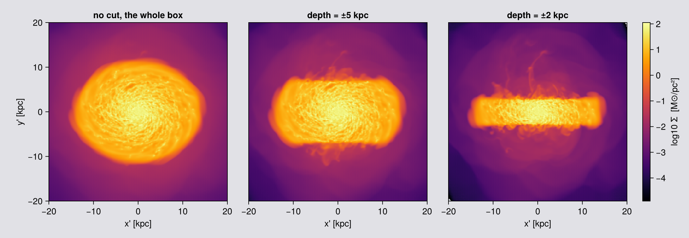

## 5. Whole cells or partial ones

A cut has to decide what to do with a cell it passes through. By default every off-axis cut keeps
the cell **whole** if its centre is inside, and drops it whole otherwise. `split=true` weights it
by the fraction of its volume that is really inside.

| | `split=false` (default) | `split=true` |
|---|---|---|
| `depth` slab | kept whole if the centre is in | weighted by the volume inside |
| `fov` sphere | kept whole if it reaches the sphere | weighted by its overlap |

Reach for it when the edge is a real part of the measurement: a small aperture, a thin slab, or
**any time you stack slabs and expect them to re-sum**.

`split` is grid only: it is not a keyword of the particle projection, so passing it is a
`MethodError`. A point has no volume to split.

This is the same idea the region algebra already offers, and that one flows into off-axis maps
too: `subregion(gas, sphere(10; center=[:bc], range_unit=:kpc); split=true)` attaches a
`:fraction` column that `getvar(:mass)` and `getvar(:volume)` honour. Write `sphere` if
Makie is loaded, because it exports a `Sphere` of its own and the bare name then binds to
neither.

```julia
# Two questions, both answered by a total, so `binning` is irrelevant here: every kernel is a
# partition of unity and conserves the total exactly (Chapter 14). `:ngp` is the cheapest.
skw = (los=[1.,2,3], center=[:bc], pxsize=[0.5,:kpc], binning=:ngp,
       verbose=false, show_progress=false)
slabmass(m) = sum(m.maps[:mass])

# 1. ADDITIVITY. Cut one slab into N adjacent pieces and add the pieces back up. Each cell must
#    be counted once in total, however many faces cross it.
println("ADDITIVITY of a [-20,20] kpc slab, re-summed from N pieces")
for sp in (false, true)
    ref = slabmass(projection(gas, :mass, :Msol; depth=[-20.,20.], depth_unit=:kpc, split=sp, skw...))
    print(rpad("  split=$(sp)", 16), "single slab ", round(ref, sigdigits=9))
    for N in (2, 4)
        e = range(-20, 20, length=N+1)
        s = sum(slabmass(projection(gas, :mass, :Msol; depth=[e[i],e[i+1]], depth_unit=:kpc,
                               split=sp, skw...)) for i in 1:N)
        print("   N=$(N): ", round(100*(s-ref)/ref, digits=4), "%")
    end
    println()
end

# 2. A SMALL APERTURE, against the mass of the sphere it selected. `msum` on a split subregion is
#    the independent answer: it never goes near the projection code.
println("\nAPERTURE: does the map hold the mass of the sphere it selected?")
println(rpad("  fov [kpc]", 12), rpad("whole cells", 16), rpad("split", 16), "true (msum)")
for R in (3, 6, 12)
    # `sphere`, not `Sphere`: Makie exports a Sphere too, and with both loaded the
    # bare name is ambiguous and binds to neither.
    truth = msum(subregion(gas, sphere(float(R); center=[:bc], range_unit=:kpc);
                           split=true, verbose=false), :Msol)
    a = slabmass(projection(gas, :mass, :Msol; fov=R, fov_unit=:kpc, aperture=:circle, skw...))
    b = slabmass(projection(gas, :mass, :Msol; fov=R, fov_unit=:kpc, aperture=:circle,
                       split=true, skw...))
    println(rpad("  $(R)", 12),
            rpad(string(round(100*(a-truth)/truth, digits=3), "%"), 16),
            rpad(string(round(100*(b-truth)/truth, digits=3), "%"), 16),
            round(truth, sigdigits=6))
end
```

```
ADDITIVITY of a [-20,20] kpc slab, re-summed from N pieces
  split=false   single slab 6.99466224e9   N=2: 0.0063%   N=4: 0.0063%
  split=true    single slab 6.99466087e9   N=2: 0.0%   N=4: 0.0%
APERTURE: does the map hold the mass of the sphere it selected?
  fov [kpc] whole cells     split           true (msum)
  3         0.448%          0.0%            1.20219e9
  6         0.239%          0.0%            3.24183e9
  12        0.22%           0.0%            6.32512e9
```

**The additivity line is the one to read.** With whole cells the pieces do not add up to the
slab they came from, and the error does not shrink as you cut more finely, because it is not a
discretisation error. It is double counting: on a regular grid seen along a rational line of
sight, whole lattices of cells land **exactly** on a face, and a cut that is inclusive at both
ends puts every one of them in both neighbours. `split=true` gives each such cell a fraction on
each side, and the pieces re-sum exactly.

**The aperture line** says the same thing about a curved boundary. Whole cells at the rim
overstate a small aperture badly, because the rim is a large part of a small sphere. With
`split=true` the map holds the mass of the sphere it selected, to round-off, at every radius.

Neither is free: `split=true` sub-samples every cell a boundary crosses. Cells wholly inside or
outside are settled by arithmetic, so the cost scales with the area of the cut, not the volume.

## 6. Choosing the axis from the data

`direction=:faceon`, `:edgeon` and `axis=:angmom` all ask the same question of the data:

```julia
L = [sum(getvar(obj, :lx, center=center)),
     sum(getvar(obj, :ly, center=center)),
     sum(getvar(obj, :lz, center=center))]
```

Three consequences, all of which bite:

- **It is the whole loaded object, not the galaxy.** Load a box and `L` is dominated by whatever
  carries the most angular momentum times lever arm, usually the outskirts. `angmom_radius`
  restricts the sum to a sphere about `center`.
- **It is measured about `center`.** Wrong origin, confident and wrong axis.
- **It is per object.** Gas and stars each have their own, so `:faceon` on one is a different
  camera from `:faceon` on the other.

For anything beyond one object's own axis, ask for the vector and reuse it:

| | |
|---|---|
| `angmom(gas; center=[:bc], range_unit=:kpc)` | the vector itself |
| `angmom(gas; radius=[10,:kpc])` | from a sphere about `center` |
| `angmom(gas; mask=cold)` | from part of the data (Chapter 10) |
| `angmom([gas, stars, dm]; ...)` | one axis from several components, momenta added |
| [`face_on`](@ref) / [`edge_on`](@ref) | a frame whose `los`/`up`/`center` splat into any call |

Feed the result to any view with `axis=L` or `los=L`. It is also the cheap route: `L` costs a
full pass over the data, and the presets recompute it on every call.

```julia
# What the orientation is computed FROM. `angmom_radius` restricts the sum to a sphere about
# `center`; without it, every loaded cell contributes, and the outer material has the longest
# lever arm. Print the axis each choice produces and the angle between them.
akw = (center=[:bc], range_unit=:kpc, fov=16, fov_unit=:kpc, aperture=:circle,
       pxsize=[0.3,:kpc], verbose=false, show_progress=false)
whole = projection(gas, :sd, :Msol_pc2; direction=:faceon, akw...)
println(rpad("orientation from", 24), rpad("cells in the sum", 18), "angle to the whole-box axis")
println(rpad("everything loaded", 24), rpad(length(gas.data), 18), "0 (by definition)")
for r in (10, 5, 2)
    m = projection(gas, :sd, :Msol_pc2; direction=:faceon, angmom_radius=[r,:kpc], akw...)
    n = length(subregion(gas, :sphere, radius=r, center=[:bc], range_unit=:kpc, verbose=false).data)
    ang = acosd(clamp(abs(sum(m.los .* whole.los)), -1, 1))
    println(rpad("a sphere of $(r) kpc", 24), rpad(n, 18), round(ang*60, digits=2), " arcmin")
end

# Two columns move, and both matter. The cells entering the sum fall away quickly, which is the
# mechanism: with no radius the orientation is decided by every cell you loaded, including material
# that may have nothing to do with the disc you meant. The angle then follows. It is small here
# because this disc is well aligned and its outskirts do not pull hard; on a warped disc, a
# merger, or a box holding a second galaxy, the same table would show degrees rather than
# arcminutes.
#
# That the axis CAN move is easy to show, because L belongs to whatever you summed: the stars of
# this same snapshot give their own axis, and it is not the gas one.
star_face = projection(part, :sd, :Msol_pc2; direction=:faceon, akw...)
println("\ngas axis  : ", round.(whole.los, digits=5))
println("star axis : ", round.(star_face.los, digits=5))
println("angle between them: ",
        round(acosd(clamp(abs(sum(star_face.los .* whole.los)), -1, 1)) * 60, digits=2), " arcmin")
println("so `:faceon` on the gas and `:faceon` on the stars are two different cameras.")
```

```
orientation from        cells in the sum  angle to the whole-box axis
everything loaded       51500562          0 (by definition)
a sphere of 10 kpc      32406690          1.86 arcmin
a sphere of 5 kpc       15105839          5.28 arcmin
a sphere of 2 kpc       4594230           4.25 arcmin
gas axis  : [3.0e-5, 0.00063, 1.0]
star axis : [-0.00012, 0.00022, 1.0]
angle between them: 1.49 arcmin
so `:faceon` on the gas and `:faceon` on the stars are two different cameras.
```

### One axis from several components

A galaxy's plane is set by its gas, its stars and its dark matter together, and each of the three
has its own axis. `angmom` takes a vector of objects and adds their momenta.

```julia
# The three axes, and the one you get by adding the momenta. `radius` keeps the sum on the disc
# rather than on everything loaded.
axisangle(a, b) = acosd(clamp(abs(dot(normalize(a), normalize(b))), -1, 1))
ctr = (center=[:bc], range_unit=:kpc, radius=[15, :kpc])

L_gas  = angmom(gas;  ctr...)
L_star = angmom(part; ctr...)
L_both = angmom([gas, part]; ctr...)

println(rpad("component", 14), rpad("|L| (code units)", 22), "axis")
for (nm, L) in (("gas", L_gas), ("stars", L_star), ("gas + stars", L_both))
    println(rpad(nm, 14), rpad(round(norm(L), sigdigits=6), 22), round.(normalize(L), digits=5))
end
println("\nthe joint vector is the exact sum of the parts: ", L_both ≈ L_gas .+ L_star)
println(rpad("\nangle gas to stars", 26), round(axisangle(L_gas, L_star) * 60, digits=2), " arcmin")
println(rpad("angle gas to gas+stars", 25), round(axisangle(L_gas, L_both) * 60, digits=2), " arcmin")

# And the vector drives any camera. One axis, two datasets, so the two maps are comparable.
# `aperture=:circle`, not `:square`. The square crop is capped by the shorter side of the
# fitted frame, and a thin edge-on stellar disc fits a frame only a few pixels tall, so
# `:square` would hand back a 9x9 star map beside a 161x161 gas one (Chapter 11).
jkw = (center=[:bc], range_unit=:kpc, fov=16, fov_unit=:kpc, aperture=:circle,
       pxsize=[0.2,:kpc], verbose=false, show_progress=false)
g_joint = projection(gas,  :sd, :Msol_pc2; axis=L_both, inclination=90, jkw...)
s_joint = projection(part, :sd, :Msol_pc2; axis=L_both, inclination=90, jkw...)
println("\nboth maps on the joint axis: ",
        "gas ", size(g_joint.maps[:sd]), "  stars ", size(s_joint.maps[:sd]),
        "   same camera: ", g_joint.los ≈ s_joint.los)
# Both panels on the SAME axes. The stellar map is genuinely only 9 pixels tall at this pixel
# size, because an edge-on stellar disc is thin; drawn on its own fitted frame it would look
# like a full-width image and hide that. Shared limits show the disc for what it is.
println("\nthe stellar frame is ", size(s_joint.maps[:sd]), " pixels: an edge-on stellar disc",
        " really is that thin at a 0.2 kpc pixel.")
# The figure must be the LAST expression in the cell, or Jupyter renders the println instead.
maprow([g_joint, s_joint], :sd, ["gas, edge-on to the JOINT axis", "stars, the same camera"];
       lims=(-16, 16, -16, 16))
```

```
component     |L| (code units)      axis
gas           159.317               [3.0e-5, 0.00063, 1.0]
stars         5.82406               [-0.00012, 0.00022, 1.0]
gas + stars   165.141               [2.0e-5, 0.00061, 1.0]
the joint vector is the exact sum of the parts: true
angle gas to stars        1.48 arcmin
angle gas to gas+stars   0.05 arcmin
both maps on the joint axis: gas (164, 164)  stars (141, 9)   same camera: true
the stellar frame is (141, 9) pixels: an edge-on stellar disc really is that thin at a 0.2 kpc pixel.
```

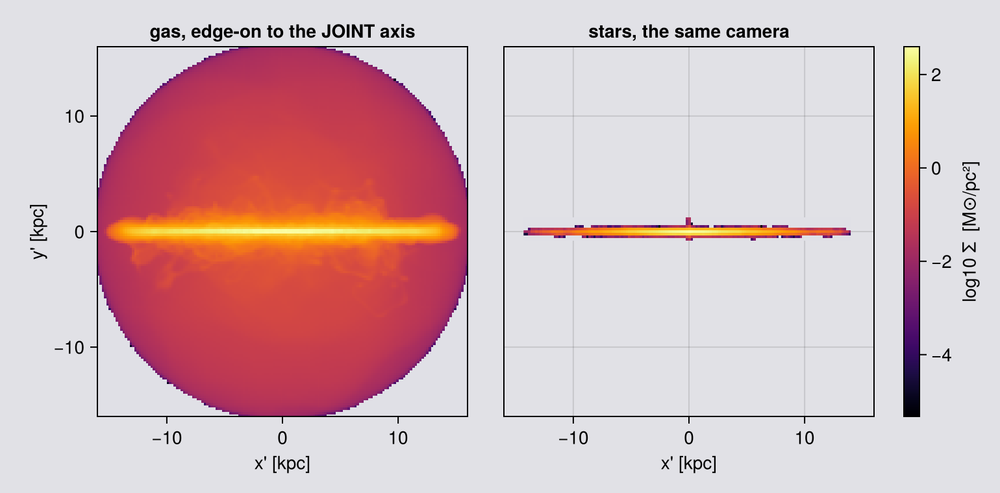

The angle between the gas and stellar axes is the number that decides whether this matters. A
few arcminutes, as here, and any of the three axes gives the same picture. Degrees, which is what
a warped disc, a merger or a box with a second galaxy will give you, and the choice of tracer
changes what you measure.

**Decide which tracer defines your frame, then use one vector everywhere.** Mixing `:faceon` on
the gas with `:faceon` on the stars compares two different cameras.

## 7. How a cell lands on the pixels

The camera is **orthographic**: every ray is parallel, the observer sits at infinity, nothing
gets larger by being nearer. So there is no camera distance to set, and the only control over
what is in frame is the width of the frame (Chapter 3).

A pixel is built from everything along the parallel ray through it, over the whole depth of the
selected data: the sum for `:mass`, the sum over the pixel area for `:sd`, a weighted mean for
everything else. This is the emission-only limit of the volume rendering integral (Max 1995), in
three dimensions the X-ray transform (Natterer 1986), the object Radon (1917) introduced in two.
That one picture explains why a projection conserves mass, why `zrange` matters as much as
`xrange`, and why a slice answers a different question (Chapter 12).

**Why the footprint is a hexagon.** Look at a cube from a general direction and you see the
three faces meeting at the nearest corner; their outline is a circuit of six cube edges. It
collapses to a rectangle only when the line of sight lies in a coordinate plane, which is exactly
the axis-aligned, face-on and edge-on cases. Off-axis you are generically hexagonal.

Every cell is an axis-aligned cube, so for one camera every cell casts the same hexagon at a
different scale: one footprint rule serves the whole AMR hierarchy.

!!! note "`position_angle` is a roll"
    It turns `(r̂, û)` about `ŵ`, so the scene does not move. With `aperture=:circle` the
    selection is a disc and Σ is untouched; with `:square` the crop rotates inside the selection
    sphere and its corners sweep different material, so Σ moves a little.

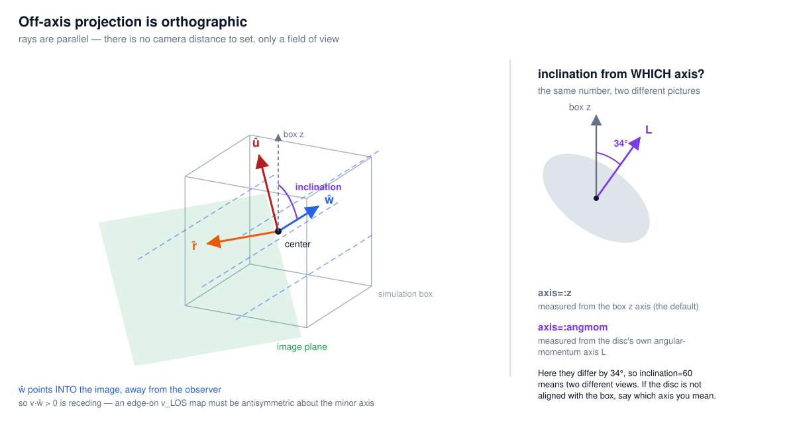

*Parallel rays, the image plane, and the camera basis `(r̂, û, ŵ)` planted at `center`. Right inset: `inclination` is measured from a **reference axis**, either the box `z` or the object's own angular-momentum axis `L`. They are not the same axis, and choosing the wrong one is the most common way to get a picture that looks right but is not. Tilted-ring fits of observed discs describe an orientation the same way, one inclination and one position angle per radius (Rogstad, Lockhart & Wright 1974).*

### The four kernels

The hexagon generally straddles several pixels. The four `binning` kernels are four answers to
"how is it shared out". All four share it out **completely**, which is why the total is the same;
they differ in where it lands.

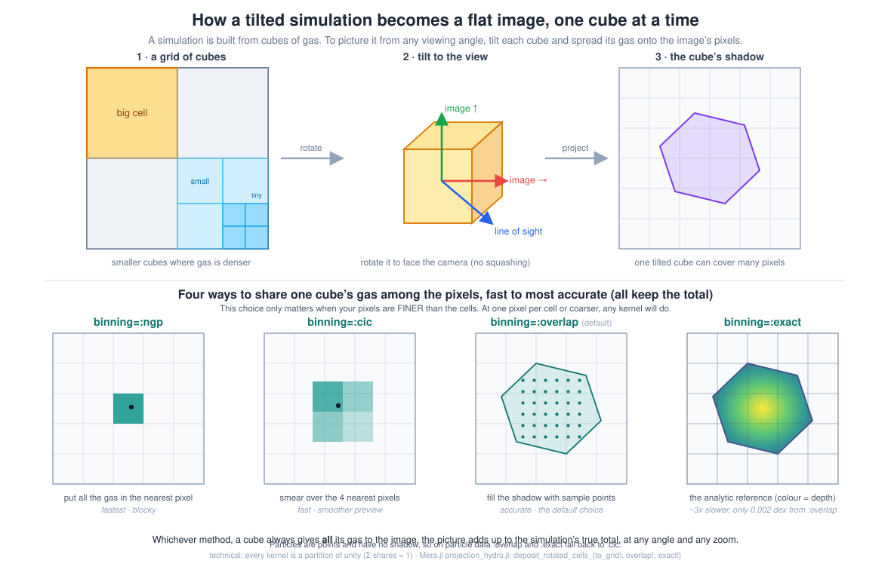

| `binning` | what it does | use it for |
|---|---|---|
| `:ngp` | all weight to the pixel holding the cell centre (Hockney & Eastwood 1988) | fastest preview; holes and moiré when pixels are finer than cells |
| `:cic` | bilinear over the 2x2 neighbours (Hockney & Eastwood 1988) | fast preview; smoother, still no footprint |
| `:overlap` **(default)** | supersampled over the true footprint (Westover 1990): `n³` sub-points, `n = ⌈cellsize/pixel⌉`, capped at `nmax=64`; past the cap a footprint-sized top-hat, which keeps coarse cells hole-free | **everything you publish** |
| `:exact` | the analytic footprint integral, a box-spline chord field over the hexagon | the reference the others are checked against; no cap, slower |

`:overlap` and `:exact` are threaded, `:ngp` and `:cic` are serial. The analytic case works
because the projected shadow of a uniform cube is a box spline (de Boor, Höllig & Riemenschneider
1993) and box splines are closed under the Radon transform (Entezari, Nilchian & Unser 2012).

Points have no footprint, so on particles `:overlap` and `:exact` fall back to `:cic` and say so.

The table is a claim. The next cell measures it, all four against `:exact`.

```julia
# Which regime are you in? Binning only matters when PIXELS ARE FINER THAN CELLS.
PXFINE = 0.005          # kpc, the zoomed pixel size used by every binning comparison below
PXPREV = 0.02           # kpc, roughly one pixel per cell here, the sensible preview size

for l in sort(unique(getvar(gas, :level)))
    cs = info.boxlen / 2^l
    println("level ", l, ":  cell ", rpad(round(cs, digits=4), 7), " kpc",
            "  →  ", round(cs / PXFINE, digits=1), " pixels per cell at pxsize = ", PXFINE, " kpc")
end

zoom = (center=[:bc], fov=1.5, fov_unit=:kpc, aperture=:square,
        pxsize=[PXFINE, :kpc], verbose=false, show_progress=false)

kern = Dict{Symbol,Any}(); secs = Dict{Symbol,Float64}()
for k in (:ngp, :cic, :overlap, :exact)
    projection(gas, :sd, :Msol_pc2; inclination=60, axis=:angmom, binning=k, zoom...)   # warm-up
    secs[k] = @elapsed kern[k] = projection(gas, :sd, :Msol_pc2; inclination=60,
                                            axis=:angmom, binning=k, zoom...)
end
k_ngp, k_cic, k_ovl = kern[:ngp], kern[:cic], kern[:overlap]

# :exact is the analytic reference, measure the others against it rather than asserting.
E = Float64.(kern[:exact].maps[:sd])
println()
println(rpad("binning", 10), rpad("empty px", 11), rpad("time [s]", 10), "median |Δ| vs :exact [dex]")
for k in (:ngp, :cic, :overlap, :exact)
    A = Float64.(kern[k].maps[:sd]); both = (A .> 0) .& (E .> 0)
    d = k === :exact ? 0.0 : median(abs.(log10.(A[both]) .- log10.(E[both])))
    println(rpad(k, 10), rpad(string(round(100*count(iszero, A)/length(A), digits=1), " %"), 11),
            rpad(round(secs[k], digits=3), 10), round(d, digits=4))
end

# THE SAME QUESTION ON POINTS, in the SAME WINDOW AND AT THE SAME PIXELS, so the two rows below
# can be read straight down the columns. Only two of the four kernels exist here: `:overlap` and
# `:exact` integrate a cell's FOOTPRINT, and a point has none, so Mera falls back to `:cic`.
#
# This window holds 150 thousand stars (printed below), so the fine pixel is not empty, it is
# SPARSE: 600x600 is 360 thousand pixels, about one star for every two. That is the point of
# running it at the gas pixel rather than at a comfortable one. The cell-versus-pixel question the
# gas row asks becomes a stars-per-pixel question, and the preview panel shows what a usable
# stellar pixel looks like in the same window.
skern = Dict{Symbol,Any}(); ssecs = Dict{Symbol,Float64}()
for k in (:ngp, :cic)
    projection(part, :sd, :Msol_pc2; inclination=60, axis=:angmom, binning=k, zoom...)  # warm-up
    ssecs[k] = @elapsed skern[k] = projection(part, :sd, :Msol_pc2; inclination=60,
                                              axis=:angmom, binning=k, zoom...)
end
# the same preview pixel the gas row uses in its first panel
spv = projection(part, :sd, :Msol_pc2; inclination=60, axis=:angmom, binning=:cic,
                 center=[:bc], fov=1.5, fov_unit=:kpc, aperture=:square,
                 pxsize=[PXPREV,:kpc], verbose=false, show_progress=false)

println()
println(rpad("stars", 10), rpad("empty px", 11), rpad("time [s]", 10), "what it does")
for (k, what) in ((:ngp, "whole star in the nearest pixel"), (:cic, "bilinear over 2x2"))
    A = Float64.(skern[k].maps[:sd])
    println(rpad(k, 10), rpad(string(round(100*count(iszero, A)/length(A), digits=1), " %"), 11),
            rpad(round(ssecs[k], digits=2), 10), what)
end
println("stars in this window: ",
        round(Int, sum(spv.maps[:sd]) * (spv.pixsize*spv.scale.pc)^2 /
                   mean(getvar(part, :mass, :Msol))))

# And the fallback is a fallback, not an approximation of one: asking for a footprint kernel on
# points returns the :cic map bit for bit. Checked rather than asserted.
for k in (:overlap, :exact)
    f = projection(part, :sd, :Msol_pc2; inclination=60, axis=:angmom, binning=k, zoom...)
    println("  binning=:", rpad(k, 9), "returns the :cic map exactly: ",
            f.maps[:sd] == skern[:cic].maps[:sd])
end
```

```
level 6.0:  cell 0.75    kpc  →  150.0 pixels per cell at pxsize = 0.005 kpc
level 7.0:  cell 0.375   kpc  →  75.0 pixels per cell at pxsize = 0.005 kpc
level 8.0:  cell 0.1875  kpc  →  37.5 pixels per cell at pxsize = 0.005 kpc
level 9.0:  cell 0.0938  kpc  →  18.8 pixels per cell at pxsize = 0.005 kpc
level 10.0:  cell 0.0469  kpc  →  9.4 pixels per cell at pxsize = 0.005 kpc
level 11.0:  cell 0.0234  kpc  →  4.7 pixels per cell at pxsize = 0.005 kpc
level 12.0:  cell 0.0117  kpc  →  2.3 pixels per cell at pxsize = 0.005 kpc
binning   empty px   time [s]  median |Δ| vs :exact [dex]
ngp       39.0 %     1.477     0.4115
cic       14.8 %     1.092     0.2638
overlap   0.0 %      2.555     0.0131
exact     0.0 %      9.683     0.0
stars     empty px   time [s]  what it does
ngp       53.3 %     0.01      whole star in the nearest pixel
cic       17.1 %     0.02      bilinear over 2x2
stars in this window: 153531
  binning=:overlap  returns the :cic map exactly: true
  binning=:exact    returns the :cic map exactly: true
```

### One number is not enough: where the disagreement lives

The median above says `:overlap` and `:exact` agree closely. A median hides its tail, and for a
figure you publish the tail is the part that matters, so look at the distribution instead, split by
how bright the pixel is.

```julia
# Reuses the projections computed above: no new reads, no new projections.
using Statistics, Printf
A = Float64.(kern[:overlap].maps[:sd]); B = Float64.(kern[:exact].maps[:sd])
both = (A .> 0) .& (B .> 0)
d = abs.(log10.(A[both]) .- log10.(B[both])); v = B[both]; peak = maximum(v)

@printf("total flux  overlap/exact = %.6f\n\n", sum(A)/sum(B))
println(rpad("pixels", 26), rpad("count", 8), rpad("median", 10), rpad("p99", 10), "max  [dex]")
for (lo, hi, lbl) in ((0.0, 1e-3, "faint   (<0.1% of peak)"),
                      (1e-3, 1e-1, "mid     (0.1-10%)"),
                      (1e-1, Inf,  "bright  (>10% of peak)"))
    s = (v ./ peak .>= lo) .& (v ./ peak .< hi)
    any(s) || continue
    println(rpad(lbl, 26), rpad(count(s), 8),
            rpad(round(median(d[s]), digits=5), 10),
            rpad(round(quantile(d[s], 0.99), digits=5), 10),
            round(maximum(d[s]), digits=5))
end
```

```
total flux  overlap/exact = 0.999995
pixels                    count   median    p99       max  [dex]
faint   (<0.1% of peak)   74819   0.00173   0.0179    0.0277
mid     (0.1-10%)         238525  0.01616   0.0476    0.13302
bright  (>10% of peak)    46656   0.02052   0.04878   0.07281
```

!!! warning "Do not carry these numbers to another simulation"
    They are a property of *this* map: how many cells fall in a pixel, the viewing angle, how
    sparse the outskirts are. The same measurement on a Milky-Way-like run at two angles and
    pixel sizes gave worst-case differences from 0.058 to 0.143 dex, all different from the
    value above.

The **shape** of the result does carry over, and it follows from how the kernels work. `:exact`
integrates the footprint analytically; `:overlap` samples it with `n³` sub-points, so a pixel is
exact in the limit of many sub-points and noisy when few land in it.

- **The total is conserved either way**, because both share out every cell completely. The one
  part in 10⁵ here is the crop of this `fov` frame, not a conservation floor; Chapter 14 measures
  the floor on an uncropped frame and finds a few machine epsilon.
- **The worst per-pixel disagreement is in the BRIGHT pixels**: median 0.0017 dex faint, 0.0162
  mid, 0.0205 bright. Bright pixels are where the structure is, so that is where the two kernels
  place mass differently.
- **`:overlap` is weakest on cells much coarser than the pixel**, because it caps supersampling
  at `nmax` and `:exact` has no cap.

### Which kernel, for which job

| what you are doing | use | why |
|---|---|---|
| looking, framing, iterating | `:cic` | a good preview at about one pixel per cell, and the cheapest thing that is not `:ngp` |
| any total or budget | `:cic` or `:overlap` | both hold one machine epsilon at every pixel size tested; take the cheaper |
| a figure for a paper | `:overlap` (default) | 0.013 dex from `:exact`, no empty pixels at any pixel size |
| a figure whose bright structure you will measure | `:exact` | `:overlap` differs from it most in the bright pixels (0.021 dex against 0.0017 faint) |
| zooming so cells span many pixels | `:exact`, or `:overlap` with `nmax` raised | `:overlap` stops supersampling at `nmax` |
| a total while zoomed below the cell size | `:cic` or `:overlap`, **not** `:exact` | `:exact` loses bits once cells take its analytic path (Chapter 14) |
| point data | `:cic` | only `:cic` and `:ngp` exist there |
| speed above all | `:ngp` | fastest, and the only one that leaves large holes: 39 % of pixels empty here |

**The trap:** `:exact` is the most accurate per pixel and the least reliable for a total once the
pixel is much finer than the cells. Different questions, different answers.

```julia
# ── figure code from here: panels, overlays, colorbars, no new Mera concepts ──
# Show the REGIME, not one strawman: :cic where you would actually use it, then the four
# kernels at pixels a few times finer than the local cell. :exact sits next to :overlap on
# purpose, so you can confirm the table's last column with your own eyes.
pc_ok = projection(gas, :sd, :Msol_pc2; inclination=60, axis=:angmom, binning=:cic,
                   center=[:bc], fov=1.5, fov_unit=:kpc, aperture=:square,
                   pxsize=[PXPREV,:kpc], verbose=false, show_progress=false)
k_exa = kern[:exact]
allv = reduce(vcat, [log10.(filter(>(0), vec(Float64.(p.maps[:sd]))))
                     for p in (pc_ok, k_ngp, k_cic, k_ovl, k_exa)])
cr = (quantile(allv, 0.02), maximum(allv))
display(maprow([pc_ok, k_ngp, k_cic, k_ovl, k_exa], :sd,
       [":cic @ $(PXPREV) kpc pixels
about 1 pixel per cell, a fine preview",
        ":ngp @ $(PXFINE) kpc pixels
all weight at cell centres",
        ":cic @ $(PXFINE) kpc pixels
2x2 split, still no footprint",
        ":overlap @ $(PXFINE) kpc pixels
same pixels, footprint deposit",
        ":exact @ $(PXFINE) kpc pixels
the analytic reference"]; crange=cr))

# The star row, laid out in the SAME five slots as the gas row above so the two can be read down
# the columns. Two slots stay empty on purpose, for the reason measured just above. An empty panel
# saying so is more honest than quietly dropping the columns.
scr = sharedrange([spv, skern[:ngp], skern[:cic]], :sd)
sfig = Figure(size=(3520 ÷ 2, 760 ÷ 2))
for (j, (lbl, m)) in enumerate((("stars, :cic @ $(PXPREV) kpc pixels\na usable stellar pixel", spv),
                                ("stars, :ngp @ $(PXFINE) kpc pixels\none star per pixel at most", skern[:ngp]),
                                ("stars, :cic @ $(PXFINE) kpc pixels\nthe same star over 2x2", skern[:cic]),
                                ("stars, :overlap\nnot defined for points", nothing),
                                ("stars, :exact\nnot defined for points", nothing)))
    ax = Axis(sfig[1, j], aspect=DataAspect(), title=lbl, titlesize=13)
    hidedecorations!(ax)
    if m === nothing
        hidespines!(ax)
        text!(ax, 0.5, 0.5; text = "a point has\nno footprint",
              align=(:center,:center), color=:gray, fontsize=13)
        limits!(ax, 0, 1, 0, 1)
    else
        showmap!(ax, m, :sd; crange=scr)
    end
end
sfig
```

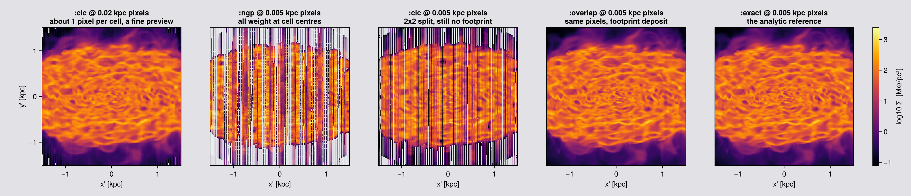

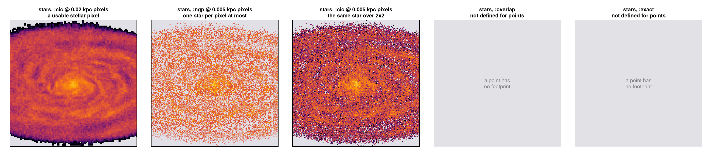

The totals agree and the pictures do not. Conservation alone is not enough.

**The pixel-to-cell ratio decides, not the kernel.** At the coarser pixel size, about one pixel per cell here, `:cic` is a
perfectly good preview. Push to pixels several times finer than a cell and the point-deposit
kernels fall apart: the empty-pixel column of the table above says how much of the map `:ngp` and
`:cic` leave blank. Each puts a cell's whole contribution at a single point, so the gaps between
cell centres receive nothing and the map acquires a texture that belongs to the grid rather than to
the galaxy. `:overlap` spreads each cell over the area its shadow actually covers, and at this pixel size it
leaves **no** pixel empty anywhere the data reaches. (Measured here at one pixel size. In the
whole-box table of Chapter 14 it sits at 14 %, which is the frame's empty corners, not gaps in the
disc.) The frame itself can still have empty
corners: it is a rectangle fitted to the rotated data, and at an off-axis angle the shadow of a box
is a hexagon, so the corners of the rectangle lie outside the data. That is the empty-pixel floor
the whole-box table in Chapter 14 runs into, and no kernel can fill it.

**And the numbers that justify the default.** The last column of that table is the median
per-pixel disagreement with `:exact`, the analytic footprint integral. `:overlap` sits far closer to
it than either point-deposit kernel, and the time column says what that costs. Those two columns
are the whole case for the default. They are printed rather than quoted here, because both move
with the data. `:exact` is the last panel above, so you can check the claim by eye as well: it
should be indistinguishable from `:overlap`.

The level table tells you which regime you are in: divide the local cell size by your `pxsize`.
Below about one pixel per cell, any kernel will do; well above it, only the footprint methods are
honest.

Practical rule: the default `:overlap` is already the accurate one, reach for `:cic`/`:ngp` when
you want a fast look at a sensible pixel size, and `:exact` when you want the analytic reference
rather than a sampled approximation to it.

## 8. What you can ask for

One call returns as many maps as you ask for, but they are not all the same kind of number, and
this is where wrong values get published.

| kind | examples | a pixel is | safe to sum? |
|---|---|---|---|
| **summed (extensive)** | `:mass` | the total in that column | **yes**, a budget (on particles only with `mode=:sum`, Chapter 9) |
| **per area** | `:sd` | mass / pixel area | no; multiply by `pixsize²` first, or use `:mass` |
| **weighted mean (intensive)** | `:T`, `:vx`, `:vlos`, `:σlos` | Σ(field·w) / Σw along the ray | no |

`weighting` is `[quantity, unit]` for hydro and RT, default `[:mass, missing]`, and applies to
every variable in the call. On particles it is a plain `Symbol` (Chapter 11).

!!! warning "A weighted mean is not an observable"
    A mass-weighted projected `T` along a multiphase sightline is dominated by cold dense gas,
    `weighting=[:volume]` gives a different number, and neither is the emission-weighted
    temperature an X-ray instrument reports. Quote projected means as diagnostics.

### Off-axis only, and axis-aligned only

| | |
|---|---|
| **off-axis only** | `:vlos`/`:σlos`, `:vcamx`/`:σcamx`, `:vcamy`/`:σcamy`, `:ncell`, `:npart` |
| **axis-aligned only** | `:r_cylinder`, `:r_sphere`, `:ϕ` |

The second group describes the pixel's own geometry, and an off-axis pixel is a slanted column
with no single radius. Everything else, including every velocity dispersion, works on both
paths.

```julia
mv = projection(gas, [:mass, :T], [:Msol, :K];
                inclination=35, axis=:angmom, center=[:bc],
                fov=16, fov_unit=:kpc, aperture=:square, pxsize=[0.1,:kpc],
                weighting=[:mass, missing], verbose=false, show_progress=false)

# a mass-weighted call ships a free :sd map you did not ask for, expect it when you iterate keys
println("maps returned : ", collect(keys(mv.maps)))
println("units         : ", mv.maps_unit)

# ── the conservation guarantee, measured once, on the WHOLE box (no fov, no window) ──
mtot = projection(gas, :mass, :Msol; los=[1,1,1], center=[:bc],
                  pxsize=[0.25,:kpc], verbose=false, show_progress=false)
println("Σ(map) / msum(gas) − 1  =  ", sum(mtot.maps[:mass]) / msum(gas, :Msol) - 1)

# The table above is a claim about which variables exist on which path. Check it rather than
# trust it: the dispersions must WORK, the pixel-geometry maps must refuse and say why.
gkw = (inclination=35, axis=:angmom, center=[:bc], xrange=[-15,15], yrange=[-15,15],
       zrange=[-15,15], range_unit=:kpc, pxsize=[1.0,:kpc], verbose=false, show_progress=false)
for v in (:σx, :σz, :σ, :σlos, :σcamx, :r_cylinder, :r_sphere, :ϕ)
    msg = try
        m = projection(gas, v, :km_s; gkw...)
        "ok, median " * string(round(median(filter(>(0), m.maps[v])), digits=1)) * " km/s"
    catch e
        first(replace(sprint(showerror, e), "\n" => " "), 60) * "…"
    end
    println(rpad(v, 12), msg)
end

# and the camera-frame names are refused where there is no camera
for v in (:vlos, :σcamx)
    msg = try
        projection(gas, v, :km_s; direction=:z, center=[:bc], pxsize=[1.0,:kpc],
                   verbose=false, show_progress=false)
        "NO ERROR, the page is wrong"
    catch e
        first(replace(sprint(showerror, e), "\n" => " "), 60) * "…"
    end
    println(rpad("$(v) on :z", 12), msg)
end
```

```
maps returned : Any[:T, :mass, :sd]
units         : DataStructures.SortedDict{Any, Any, Base.Order.ForwardOrdering}(:T => :K, :mass => :Msol, :sd => :standard)
Σ(map) / msum(gas) − 1  =  2.220446049250313e-16
σx          ok, median 12.8 km/s
σz          ok, median 10.0 km/s
σ           ok, median 12.2 km/s
σlos        ok, median 9.9 km/s
σcamx       ok, median 12.8 km/s
r_cylinder  projection: off-axis views (los/theta/phi/:faceon/:edgeon) d…
r_sphere    projection: off-axis views (los/theta/phi/:faceon/:edgeon) d…
ϕ           projection: off-axis views (los/theta/phi/:faceon/:edgeon) d…
vlos on :z  ArgumentError: :vlos is a CAMERA-frame quantity and needs an…
σcamx on :z ArgumentError: :σcamx is a CAMERA-frame quantity and needs a…
```

That relative error is at the floating-point floor, and it stays there at any viewing angle, any
pixel size and any `binning`. The floor itself moves a little, because it is summation round-off:
it grows when a map has few pixels and each accumulator therefore does more additions. Measured on
this snapshot, Chapter 14's sweep gives the whole-box gas total as −0.5 machine epsilon at a 372 pc
pixel and −70 at a 5.3 kpc pixel, which is one part in 10¹⁴. Read the exact values from that
table rather than from here: they are summation round-off, so they move with the order the
additions happen in, which means they move with the thread count.

**Chapter 14 turns this one line into the real test**, on gas and on stars, over viewing angle,
pixel size, all four kernels and the `nmax` cap. Read it before you quote a total from a map.

One consequence worth knowing about the frame edge. The camera frame is auto-fitted to the rotated
data and then padded by one pixel plus half the projected shadow of the coarsest selected cell, so
a border cell's footprint has somewhere to land and the fold-back onto the edge pixel is a
safeguard that rarely fires. What does happen at the edge is a crop, from `aperture=:square`, or a
selection-box face, from a world-space window. Either way the outermost row is not a clean
measurement, so take profiles from a frame larger than the region you care about.

### Which pixels can you trust: `:ncell` and `:npart`

A faint pixel and a well-sampled pixel look the same on a colour scale. The count map says which is
which: `:ncell` for cells, `:npart` for points, filled by the same deposit as the value.

**What the number means depends on the kernel**, and it is worth knowing before you use it:

| kernel | what one count is |
|---|---|
| `:ngp` | one per cell or particle, so the map sums to exactly how many there are |
| `:cic` | one per pixel of the 2x2 stencil it touches |
| `:overlap` | one per sub-point deposited, so it reads as sampling density |
| `:exact` | one per pixel the footprint covers |

Only `:ngp` gives you a literal object count. The others measure how much sampling reached a pixel,
which is the question you are usually asking anyway: the faintest pixels are the least sampled, and
a point map's dispersion is exactly zero wherever a pixel holds a single star.

```julia
# Surface density beside the count that produced it, for cells and for points. Same camera, same
# pixel, so the two panels of each pair line up.
ckw = (los=[1.,2.,3.], center=[:bc], fov=16, fov_unit=:kpc, aperture=:circle,
       pxsize=[0.3,:kpc], verbose=false, show_progress=false)
gc = projection(gas,  [:sd, :ncell], [:Msol_pc2, :standard]; binning=:ngp, ckw...)
pc = projection(part, [:sd, :npart], [:Msol_pc2, :standard]; binning=:ngp, ckw...)
# `fov` selects a sphere, so the map can only count what the frame selected, not the whole box.
# Compare against the selection and the identity is exact, which is the check worth making.
nsel_gas  = length(subregion(gas,  :sphere, radius=16., center=[:bc], range_unit=:kpc, verbose=false).data)
nsel_part = length(subregion(part, :sphere, radius=16., center=[:bc], range_unit=:kpc, verbose=false).data)
println("cells  in the fov: ", nsel_gas,  "   :ncell sums to ", round(Int, sum(gc.maps[:ncell])))
println("points in the fov: ", nsel_part, "   :npart sums to ", round(Int, sum(pc.maps[:npart])))
println("pixels holding a single star: ",
        count(==(1.0), pc.maps[:npart]), " of ", count(>(0), pc.maps[:npart]), " filled")

# ── figure code from here: panels, overlays, colorbars, no new Mera concepts ──
fig = Figure(size=(1180, 640))
for (row, (m, vk, ck, who)) in enumerate(((gc, :sd, :ncell, "gas"), (pc, :sd, :npart, "stars")))
    ax1 = Axis(fig[row,1], aspect=DataAspect(), title="$(who): Σ", ylabel="y' [kpc]")
    showmap!(ax1, m, vk)
    A = replace(Float64.(m.maps[ck]), 0.0 => NaN)
    e = getextent(m, :kpc)
    ax2 = Axis(fig[row,2], aspect=DataAspect(), title="$(who): count per pixel (:ngp)")
    hm = heatmap!(ax2, range(e[1],e[2],length=size(A,1)), range(e[3],e[4],length=size(A,2)),
                  log10.(A); colormap=:viridis, nan_color=EMPTY_COLOUR)
    Colorbar(fig[row,3], hm, label="log10 count")
    hideydecorations!(ax2, grid=false)
end
fig
```

```
cells  in the fov: 43922383   :ncell sums to 43922383
points in the fov: 627896   :npart sums to 627896
pixels holding a single star: 529 of 4520 filled
```

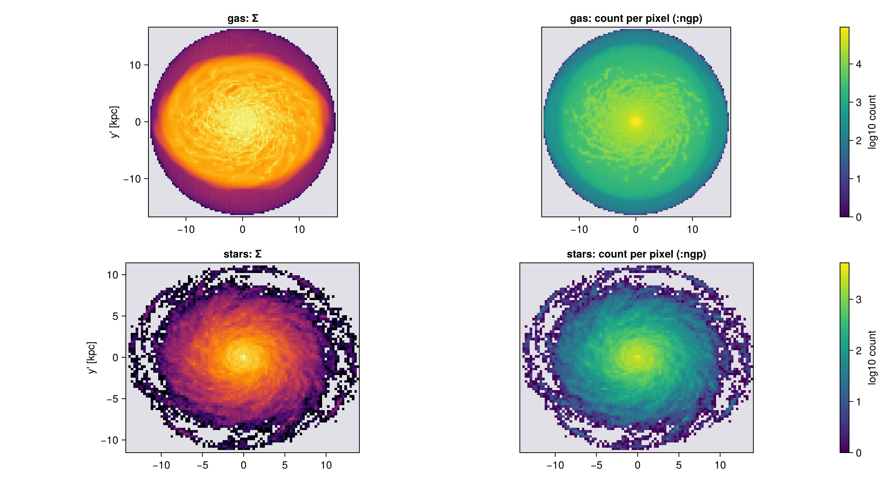

### Velocity along the line of sight, and across it

Two different frames, and confusing them is the most common error on this page.

| | frame | meaning |
|---|---|---|
| `:vz`, `:σz` | **box** axes | the spread along the simulation z, whatever the camera is doing |
| `:vlos`, `:σlos` | **camera** | along the line of sight, what a spectrum measures |
| `:vcamx`/`:σcamx`, `:vcamy`/`:σcamy` | **camera** | along image x and image y |

Both sets work off-axis. `:σz` on a face-on view is still the simulation z, which is almost never
what a face-on view is asking about. The line-of-sight pair is the observable one.

The full box-frame set is `:σx :σy :σz :σ :σr_cylinder :σϕ_cylinder :σr_sphere :σθ_sphere
:σϕ_sphere`, each built from its own `v` and `v²`.

!!! warning "`:σ` is not the tensor trace"
    `:σ` is the spread of the **speed**, `√(⟨|v|²⟩ − ⟨|v|⟩²)`. The trace of the dispersion tensor
    is `σx² + σy² + σz² = ⟨|v|²⟩ − |⟨v⟩|²`. Different numbers, and `:σ` is the smaller one.

The camera triple and the box triple are one tensor in two frames, so
`σcamx² + σcamy² + σlos² = σx² + σy² + σz²` pixel by pixel. The cell after next checks it.

### What `:σlos` is, and is not

`:vlos` is signed so positive is receding, and it is defined for **any** camera. `:σlos` is
`√(⟨v_LOS²⟩ − ⟨v_LOS⟩²)` over the mass in a pixel. With `:sd` and `:vlos` it completes the
zeroth, first and second moments of the line-of-sight velocity distribution, the three maps an
H I or CO cube is reduced to (Walter et al. 2008).

It is a **width of a distribution inside one pixel**, not a per-cell quantity: many cells along
the ray land in the same pixel, each with its own `v·ŵ`. Edge-on that spread is dominated by
ordered rotation along the sightline, not by turbulence. An observed dispersion carries the
velocity gradient inside the resolution element and must be corrected before anyone calls it
intrinsic (Davies et al. 2011).

Below, that shows up as the brightest σ_LOS **off** the disc plane: a sightline through the disc
samples nearly co-rotating gas, one passing above it crosses infalling and outflowing material
with a far wider spread.

```julia
# The same camera, the same pixel, four dispersions. Two are box axes and two are camera axes,
# and the difference is the whole point of the table above.
dkw = (center=[:bc], fov=15, fov_unit=:kpc, aperture=:square, pxsize=[0.25,:kpc],
       binning=:ngp, verbose=false, show_progress=false)
L = angmom(gas; center=[:bc], range_unit=:kpc, radius=[15,:kpc])

for (view_name, view) in (("face-on", (; axis=L, inclination=0)),
                          ("edge-on", (; axis=L, inclination=90)))
    m = projection(gas, [:σz, :σlos, :σcamx, :σcamy, :ncell], :km_s; view..., dkw...)
    ok = m.maps[:ncell] .> 1                      # a single-cell pixel has no spread to report
    println(rpad(view_name, 10),
            join([rpad("$(v) " * string(round(median(m.maps[v][ok]), digits=1)), 18)
                  for v in (:σz, :σlos, :σcamx, :σcamy)]))
    if view_name == "edge-on"
        global sig_eo = m
    end
end
println("\nmedian km/s over pixels fed by more than one cell.")
println(":σz is the SIMULATION z in both rows, so it barely moves when the camera does.")
println(":σlos follows the camera, which is what a spectrum would see.")
```

```
face-on   σz 9.2            σlos 9.2          σcamx 13.9        σcamy 13.8
edge-on   σz 22.0           σlos 19.4         σcamx 19.2        σcamy 22.0
median km/s over pixels fed by more than one cell.
:σz is the SIMULATION z in both rows, so it barely moves when the camera does.
:σlos follows the camera, which is what a spectrum would see.
```

```julia
# The identity that says the camera triple and the box triple are one tensor in two frames:
#   σcamx² + σcamy² + σlos²  ==  σx² + σy² + σz²
# It has to hold pixel by pixel, at any angle, with any kernel.
tkw = (center=[:bc], fov=15, fov_unit=:kpc, aperture=:square, pxsize=[0.3,:kpc],
       los=[1.,2,3], verbose=false, show_progress=false)
println(rpad("binning", 12), rpad("pixels used", 14), rpad("median rel. diff", 20), "p99")
for b in (:ngp, :cic, :overlap, :exact)
    t = projection(gas, [:σcamx,:σcamy,:σlos,:σx,:σy,:σz,:ncell], :km_s; binning=b, tkw...)
    cam = t.maps[:σcamx].^2 .+ t.maps[:σcamy].^2 .+ t.maps[:σlos].^2
    box = t.maps[:σx].^2    .+ t.maps[:σy].^2    .+ t.maps[:σz].^2
    ok  = (box .> 0) .& (t.maps[:ncell] .> 1)
    r   = abs.(cam[ok] .- box[ok]) ./ box[ok]
    println(rpad(":$(b)", 12), rpad(count(ok), 14),
            rpad(round(median(r), sigdigits=3), 20), round(quantile(r, 0.99), sigdigits=3))
end
println("\n`:ncell` is how the single-cell pixels are excluded: their spread is exactly zero,")
println("so the ratio of two round-off values there says nothing about the identity.")

# The edge-on maps side by side: one camera, one pixel, two different questions. `maprow` shares
# one key across maps, so this pair needs its own two-panel figure.
let m = sig_eo
    fig = Figure(size=(770, 380), backgroundcolor=EMPTY_COLOUR)
    cr  = sharedrange([m, m], :σlos)          # one scale, so the two are comparable
    hm  = nothing
    for (i, (k, ttl)) in enumerate(((:σz,   "σ_z  (box axis, edge-on)"),
                                    (:σlos, "σ_LOS  (camera, the same view)")))
        ax = Axis(fig[1,i], title=ttl, xlabel="x' [kpc]", backgroundcolor=EMPTY_COLOUR,
                  ylabel = i == 1 ? "y' [kpc]" : "")
        i > 1 && hideydecorations!(ax, grid=false)
        hm = showmap!(ax, m, k; cmap=:viridis, crange=cr)
    end
    Colorbar(fig[1,3], hm, label="log10 σ  [km/s]")
    fig
end
```

```
binning     pixels used   median rel. diff    p99
:ngp        10201         5.03e-14            2.08e-12
:cic        10201         1.03e-13            3.66e-12
:overlap    10201         7.12e-14            2.24e-12
:exact      10201         7.04e-14            2.23e-12
`:ncell` is how the single-cell pixels are excluded: their spread is exactly zero,
so the ratio of two round-off values there says nothing about the identity.
```

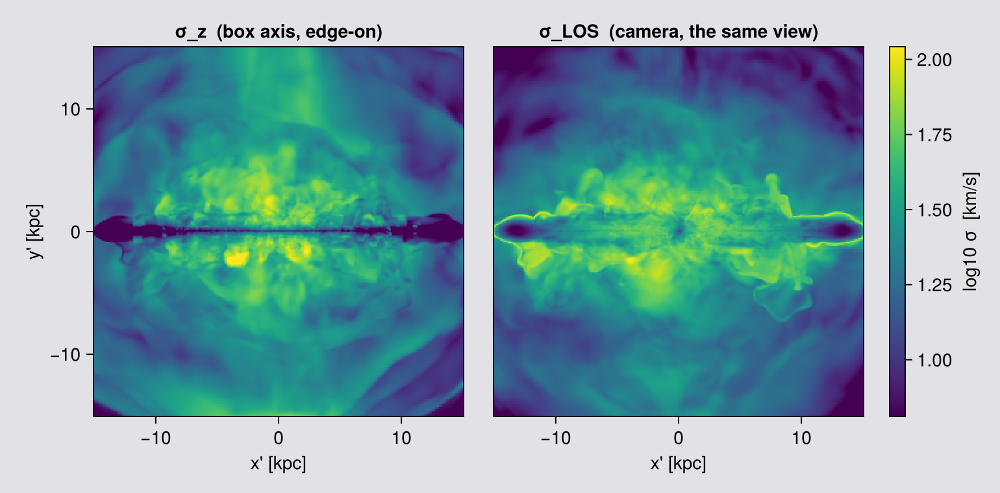

Read the two rows of the first table against each other. `:σz` hardly moves between face-on
and edge-on, because it is the spread along the **simulation** z and the camera has nothing to do
with it. `:σlos` changes completely, because it is the spread along the **line of sight**, which
is the quantity a spectrograph integrates.

The second table is the check that the two frames describe one tensor: its trace is invariant
under rotation, so the camera triple and the box triple must agree in every pixel. They do, to
about `1e-15`, for all four kernels. That is not a convergence statement; it is bookkeeping, and
it holds at any pixel size.

!!! warning "Sign convention"
    `:vlos` follows the observational convention: **positive means receding** (redshifted),
    negative means approaching (blueshifted), exactly as a radial velocity is reported in a paper.

    Note the relation to the camera. `ŵ` (`m.los`) points **out of** the image, toward the
    observer, so the map is `-(v·ŵ)`. If you compute the projection yourself from `m.los`,
    remember that minus sign, or your rotation curve comes out inverted.

    A sign flip inverts a rotation curve and changes nothing else in the figure, so check the shape
    too: on an edge-on map `:vlos` must be **antisymmetric about the minor axis**. If it is not, your
    `center` is off the object (Chapter 1).

```julia
kin = (center=[:bc], fov=15, fov_unit=:kpc, aperture=:square,
       pxsize=[0.1, :kpc], verbose=false, show_progress=false)

# ask for :sd alongside, used below only to SET THE COLOUR RANGE from where the mass is;
# every pixel is still plotted
keo = projection(gas, [:vlos, :σlos, :sd], [:km_s, :km_s, :Msol_pc2]; direction=:edgeon, kin...)
kfo = projection(gas, [:vlos, :σlos, :sd], [:km_s, :km_s, :Msol_pc2]; direction=:faceon, kin...)

finite(A) = filter(isfinite, vec(Float64.(A)))
println("edge-on   max |v_LOS| = ", round(maximum(abs, finite(keo.maps[:vlos])), digits=1), " km/s")
println("face-on   max |v_LOS| = ", round(maximum(abs, finite(kfo.maps[:vlos])), digits=1), " km/s")
println("median σ_LOS edge-on  = ", round(median(finite(keo.maps[:σlos])), digits=1), " km/s")

# THE SAME TWO MAPS ON THE STARS. `:vlos` and `:σlos` are not gas-only: a particle carries a
# velocity, so the same call works on points, and it is a mass-weighted mean over the stars in the
# pixel instead of over the cells. The same call, with `part` where `gas` was.
#
# The number to compare is σ_LOS, and on points it needs care. σ is the spread of velocities INSIDE
# a pixel, so a pixel holding exactly one star has no spread and reports exactly 0. At this pixel
# size most star pixels hold one star or none, so a median over every pixel would come back 0.0
# km/s and would be measuring the sampling, not the stars. Measure it where it is defined instead,
# over the pixels that hold more than one star, which is what σ > 0 selects. The gas is measured
# the same way so the two numbers are comparable.
#
# The physics worth checking: gas is dissipative and radiates its random motion away, settling into
# a thin cold layer, while stars keep theirs once born and gain more from every encounter. The
# printed numbers say whether that shows up here.
# `aperture=:circle` again (Chapter 3). With `:square` every number below would describe a 1.7 kpc
# box at the centre rather than the disc the gas panels show.
star_kin = (center=[:bc], fov=15, fov_unit=:kpc, aperture=:circle,
            pxsize=[0.1, :kpc], verbose=false, show_progress=false)
skeo = projection(part, [:vlos, :σlos, :sd], [:km_s, :km_s, :Msol_pc2]; direction=:edgeon, star_kin...)
skfo = projection(part, [:vlos, :σlos, :sd], [:km_s, :km_s, :Msol_pc2]; direction=:faceon, star_kin...)

println()
println("stars edge-on   max |v_LOS| = ", round(maximum(abs, finite(skeo.maps[:vlos])), digits=1), " km/s")
println("stars face-on   max |v_LOS| = ", round(maximum(abs, finite(skfo.maps[:vlos])), digits=1), " km/s")
sσ = filter(>(0), finite(skeo.maps[:σlos]))       # star pixels holding more than one star
gσ = filter(>(0), finite(keo.maps[:σlos]))
println("stars: pixels with σ > 0    = ", length(sσ), " of ", length(finite(skeo.maps[:σlos])),
        "   (", round(100 * length(sσ) / length(finite(skeo.maps[:σlos])), digits=1), " %)")
println("stars median σ_LOS edge-on  = ", round(median(sσ), digits=1), " km/s   (over those pixels)")
println("  gas median σ_LOS edge-on  = ", round(median(gσ), digits=1), " km/s   (same measure)")
```

```
edge-on   max |v_LOS| = 218.1 km/s
face-on   max |v_LOS| = 47.1 km/s
median σ_LOS edge-on  = 20.3 km/s
stars edge-on   max |v_LOS| = 257.3 km/s
stars face-on   max |v_LOS| = 20.6 km/s
stars: pixels with σ > 0    = 1558 of 4675   (33.3 %)
stars median σ_LOS edge-on  = 22.2 km/s   (over those pixels)
  gas median σ_LOS edge-on  = 20.3 km/s   (same measure)
```

```julia
# ── figure code from here: panels, overlays, colorbars, no new Mera concepts ──
# Every pixel is shown. The colour range is set from the bright pixels (98th percentile), so the
# disc's rotation is legible and the faint outskirts SATURATE rather than being hidden, a reader
# can see there is signal there and that it is off the end of the scale, which a black mask would
# have concealed.
kinvals(m, key) = Float64.(m.maps[key])

function kinpanel!(ax, m, key, cmap, crange; logscale=false)
    A = kinvals(m, key); A = replace(A, 0.0 => NaN)   # an empty pixel, never a real value
    A = logscale ? log10.(A) : A
    e = getextent(m, :kpc)
    hm = heatmap!(ax, range(e[1],e[2],length=size(A,1)), range(e[3],e[4],length=size(A,2)), A;
                  colormap=cmap, nan_color=EMPTY_COLOUR, interpolate=false, colorrange=crange)
    ax.aspect = DataAspect(); hm
end

# Colour range from the 2nd to 98th percentile of ALL pixels, not just the bright ones. Scaling to
# the disc alone drives the halo off the end of the scale, and a saturated slab hides structure
# just as effectively as a mask does. σ_LOS spans the disc and the halo by a large factor here, so
# it needs a log scale to show both at once.
pix(m, key) = filter(isfinite, vec(Float64.(m.maps[key])))
vmax = quantile(abs.(pix(keo, :vlos)), 0.98)
sl   = filter(>(0), vcat(pix(keo, :σlos), pix(kfo, :σlos)))
srng = (log10(quantile(sl, 0.02)), log10(quantile(sl, 0.98)))

fig = Figure(size=(1180, 400))
ax1 = Axis(fig[1,1], title="edge-on  v_LOS", xlabel="x' [kpc]", ylabel="y' [kpc]")
h1  = kinpanel!(ax1, keo, :vlos, :balance, (-vmax, vmax))
Colorbar(fig[1,2], h1, label="v_LOS [km/s]")
ax2 = Axis(fig[1,4], title="edge-on  σ_LOS", xlabel="x' [kpc]")
h2  = kinpanel!(ax2, keo, :σlos, :viridis, srng; logscale=true)
ax3 = Axis(fig[1,5], title="face-on  σ_LOS", xlabel="x' [kpc]")
kinpanel!(ax3, kfo, :σlos, :viridis, srng; logscale=true)
hideydecorations!(ax2, grid=false); hideydecorations!(ax3, grid=false)
Colorbar(fig[1,6], h2, label="log10 σ_LOS [km/s]")
colsize!(fig.layout, 3, Fixed(14))    # spacer: keeps the v colorbar from reading as panel 2's ylabel
display(fig)

# The star row: same three panels, same figure size, same colour scales, and the same axis limits
# as the gas row above. The limits matter here. The stars sit in a much thinner layer than the gas,
# so the fitted frame is a long thin strip; left to itself each panel would be stretched to fill
# its box and the two rows could not be compared. Pinned to the gas window, the stars appear at
# their true size, which is itself the result: the young stellar disc is thinner than the gas.
gext = getextent(keo, :kpc)
fig2 = Figure(size=(1180, 400))
bx1 = Axis(fig2[1,1], title="stars, edge-on  v_LOS", xlabel="x' [kpc]", ylabel="y' [kpc]")
g1  = kinpanel!(bx1, skeo, :vlos, :balance, (-vmax, vmax))
Colorbar(fig2[1,2], g1, label="v_LOS [km/s]")
bx2 = Axis(fig2[1,4], title="stars, edge-on  σ_LOS", xlabel="x' [kpc]")
g2  = kinpanel!(bx2, skeo, :σlos, :viridis, srng; logscale=true)
bx3 = Axis(fig2[1,5], title="stars, face-on  σ_LOS", xlabel="x' [kpc]")
kinpanel!(bx3, skfo, :σlos, :viridis, srng; logscale=true)
hideydecorations!(bx2, grid=false); hideydecorations!(bx3, grid=false)
Colorbar(fig2[1,6], g2, label="log10 σ_LOS [km/s]")
colsize!(fig2.layout, 3, Fixed(14))
for bx in (bx1, bx2, bx3)
    limits!(bx, gext[1], gext[2], gext[3], gext[4])
end
fig2
```

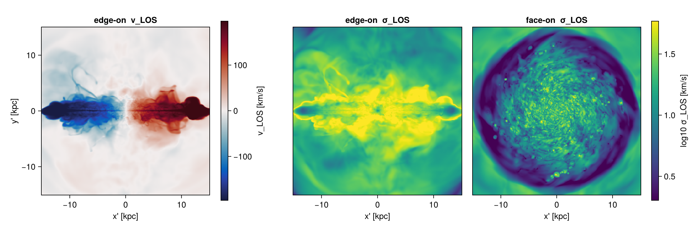

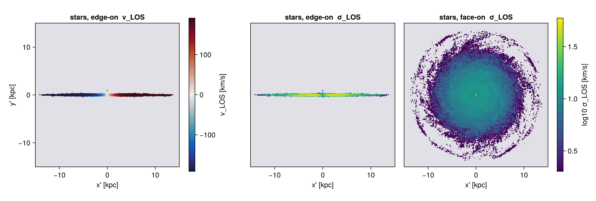

```julia
# Does σ_LOS depend on how finely you pixelate? Measure it rather than assume.
# (cells here run from 48/2^12 = 0.012 kpc at lmax to 48/2^6 = 0.75 kpc at lmin, so this
#  sweep sits at and above the coarse end of the hierarchy)
med(A) = median(filter(x -> isfinite(x) && x > 0, vec(Float64.(A))))
println(rpad("pxsize [kpc]", 15), rpad("median σ_LOS", 16), "mean σ_LOS")
for px in (0.15, 0.6, 2.4)
    p = projection(gas, :σlos, :km_s; direction=:edgeon, center=[:bc], fov=15, fov_unit=:kpc,
                   aperture=:square, pxsize=[px, :kpc], verbose=false, show_progress=false)
    v = filter(x -> isfinite(x) && x > 0, vec(Float64.(p.maps[:σlos])))
    println(rpad(px, 15), rpad(round(median(v), digits=1), 16), round(mean(v), digits=1))
end
```

```
pxsize [kpc]   median σ_LOS    mean σ_LOS
0.15           20.3            25.2
0.6            20.7            26.0
2.4            21.3            28.8
```

Now the result, and it is not the one the "width inside a pixel" picture suggests: **on this
galaxy a 16× change in `pxsize` barely moves σ_LOS**, as the table above shows. Here σ_LOS is set
mostly by the spread of velocities **along the ray**, and the ray is the same ray whatever the
pixel width. Making pixels smaller sub-divides the sky, not the sightline.

That is a licence on this galaxy, not a general one: choose `pxsize` for the *image* you want, and
σ_LOS will not move much under you here. Quote the pixel size anyway, so a reader can check. In
general σ_LOS is **not** resolution independent, and exactly how much of it a pixel holds is fixed
by the law of total variance, measured against an object with closed-form answers on the
[off-axis validation page](offaxis_validation.md).

### Taking the rotation out

Earlier in this chapter the edge-on σ_LOS was shown to be dominated by **ordered rotation**, not turbulence, because one
sightline crosses many radii that rotate at different speeds. That is a warning you can now act on.

A dispersion already subtracts the mean **inside each pixel**, so a single bulk velocity changes
nothing. What it cannot see is an ordered gradient **along the ray**. To remove that, subtract a
velocity field before projecting.

`rotation_frame` measures the field from the data itself and `restframe` applies it, both described
in [How Quantities Are Computed](computation_reference.md#Subtracting-an-ordered-flow). Two of its
properties decide how the numbers below read. Cells are binned by cylindrical radius, **100 bins by
default** spread over the radial extent of whatever you hand it, and **the model has no height
dependence.** The curve it returns is the curve of the material you measured it on, and it is then
applied at every height. This is the simulation counterpart of correcting an observed dispersion
for the velocity gradient across the beam (Begeman 1989; Davies et al. 2011).

```julia
# 300 pc, and the cost of this cell is the eight projections, four rotation frames and two
# subregions, not the grid: a projection is priced by the scan over the cells and hardly at all
# by the pixel count. The pixel-size sweep further up was measured on the UNCORRECTED field and
# does not carry over to the residual, which is a much smaller number made of different
# motions. If you quote a residual, measure its pixel-size behaviour again.
sig = (center=:bc, fov=15, fov_unit=:kpc, aperture=:square,
       pxsize=[0.3,:kpc], verbose=false, show_progress=false)     # note: no `direction` here
good(A) = filter(x -> isfinite(x) && x > 0, vec(A))

# THE CAMERA IS TAKEN ONCE, FROM THE UNCORRECTED OBJECT, AND REUSED.
# `direction=:edgeon` re-derives the view from the angular momentum of whatever it is handed, and
# `rotation_frame` removes the mass-weighted mean vϕ in every radial bin, which is most of L. The
# corrected object therefore has almost no net angular momentum left and its axis is set by what
# noise remains, so an "after" map asked for with :edgeon points somewhere arbitrary.
function rot_pair(g; nbins=100)
    f  = rotation_frame(g; center=:bc, nbins=nbins)   # the rotation curve measured from THIS gas
    gr = restframe(g; vcenter=f, center=:bc)
    A  = projection(g,  :σlos, :km_s; direction=:edgeon, sig...)   # camera fixed HERE
    B  = projection(gr, :σlos, :km_s; los=A.los, sig...)           # same camera, reused
    return median(good(A.maps[:σlos])), median(good(B.maps[:σlos]))
end

# `subregion` cuts the object already in memory, so the snapshot is read once, not once per case.
gall  = subregion(gas, :cuboid, zrange=[-24.,24.], center=[:bc], range_unit=:kpc, verbose=false)
gdisc = subregion(gas, :cuboid, zrange=[-2.,2.],   center=[:bc], range_unit=:kpc, verbose=false)

# Report the removed fraction as a fraction of the VARIANCE. Variances add, widths do not.
res = Dict{String,NTuple{2,Float64}}()
println(rpad("selection", 26), rpad("σ_LOS before", 14), rpad("after", 10),
        rpad("removed, variance", 19), "width ratio")
for (label, g, nb) in (("all gas", gall, 100),
                       ("disc, |z| < 2 kpc", gdisc, 100),
                       ("disc, nbins = 400", gdisc, 400))
    ma, mb = rot_pair(g; nbins=nb)
    res[label] = (ma, mb)
    println(rpad(label, 26), rpad(round(ma, digits=1), 14), rpad(round(mb, digits=1), 10),
            rpad(string(round(100 * (1 - (mb/ma)^2), digits=1), " %"), 19),
            round(mb/ma, digits=3))
end
σ_bulk_disc = res["disc, |z| < 2 kpc"][2]     # keyed on the label, not on the loop order

# A null test. Face-on, the rotation lies in the plane of the sky and contributes almost nothing to
# a line-of-sight width, so an azimuthal correction should barely move σ_LOS. If it does, the
# correction is doing something you did not ask for.
fA = projection(gdisc, :σlos, :km_s; direction=:faceon, sig...)
fB = projection(restframe(gdisc; vcenter=rotation_frame(gdisc; center=:bc), center=:bc),
                :σlos, :km_s; los=fA.los, sig...)
println("\nnull test, disc face-on: σ_LOS ", round(median(good(fA.maps[:σlos])), digits=2),
        " → ", round(median(good(fB.maps[:σlos])), digits=2), " km/s")
```

```
selection                 σ_LOS before  after     removed, variance  width ratio
all gas                   20.4          63.1      -857.2 %           3.094
disc, |z| < 2 kpc         54.4          47.4      24.0 %             0.872
disc, nbins = 400         54.4          47.4      24.2 %             0.871
null test, disc face-on: σ_LOS 6.9 → 6.9 km/s
```

Read the three lines together: the first says the opposite of the other two, and that is the
lesson.

**Over the disc** the correction removes a real but modest share of the variance. That share is
the part of the width that was the rotation curve sampled along the ray. What remains is larger
than people expect, because an edge-on ray crosses many radii, plus vertical lag, spiral and bar
streaming, inflow and outflow, none of which an axisymmetric curve of radius can remove.

**Over all the gas** the width comes out *larger* after the correction. Not a failure of the
tool, a statement about the model subtracted: `rotation_frame` bins by cylindrical radius with no
height dependence, so the curve it measured is the disc's, and subtracting it from a slab
reaching 24 kpc above the plane hands every halo cell a coherent counter-rotation it never had.
Match the model to the selection.

**Quote it as a variance fraction.** Variances add, widths do not, so the honest number is
`1 − (σ_after/σ_before)²`, the column the cell prints. It belongs to the cutout, not to the
galaxy.

**What is left is not the intrinsic dispersion.** It is the residual about an axisymmetric,
height-independent, binned model. It still holds vertical lag, streaming, inflow and outflow,
plus a contribution from the finite radial bins: 100 bins over this selection is about 0.34 kpc
each, and across a steep inner curve that alone can be several km/s. The `nbins = 400` line is
there so you can see whether the number has settled.

**The null test.** Face-on, rotation lies in the plane of the sky, so an azimuthal correction
should barely touch σ_LOS. The last line checks that.

!!! warning "Fix the camera before you compare"
    `:faceon`/`:edgeon` and `axis=:angmom` derive the view from the object's angular momentum,
    and `rotation_frame` removes most of it, so the corrected object's axis is set by whatever
    noise remains. Take the camera once and reuse it:

    ```julia
    A = projection(g,  :σlos, :km_s; direction=:edgeon, sig...)   # camera fixed here
    B = projection(gr, :σlos, :km_s; los=A.los, sig...)           # same camera, reused
    ```

`vcenter` also takes a plain vector or `:auto`, so `restframe(gas; vcenter=:auto)` removes the
bulk motion of the whole selection. That will not change a dispersion, which already subtracts
the mean in each pixel; it matters for velocity maps. Any `f(x, y, z)` works, so a model rotation
curve or an outflow can be subtracted the same way.

### The thermal part

The dispersion above is the **bulk** spread of gas velocities. A real line is also broadened by
thermal motion, and `:σ_thermal` gives that. It is `√(P/ρ)`, it is isotropic, and it needs no μ. The
formula and the reason it needs no μ are in
[How Quantities Are Computed](computation_reference.md#Thermal-broadening).

What belongs here is how you combine it with a bulk width, because two rules are easy to break.
Both numbers have to come from the **same gas**, and it is the **variance** that adds, because the
line profile is a convolution:

```math
\sigma_\mathrm{total}^2 = \sigma_\mathrm{bulk}^2 + \sigma_\mathrm{thermal}^2
```

```julia
th = getvar(gas, :σ_thermal, :km_s)
println("σ_thermal per cell : ", round(minimum(th), digits=2), " .. ",
        round(maximum(th), digits=2), " km/s   (whole box, so the top end is halo gas)")

# the two equivalent forms, as a check rather than an assertion
γ = info.gamma
println("equals cs/√γ       : ", isapprox(th, getvar(gas, :cs, :km_s) ./ sqrt(γ); rtol=1e-12))

# Combine with the bulk dispersion. Two rules, both easy to break:
#   1. BOTH numbers have to come from the SAME gas. The bulk figure above is the disc cutout, so
#      the thermal one must be too. A median over the whole box is dominated by the 10^6 K halo,
#      which is not in the measurement at all.
#   2. It is the VARIANCE that adds, so the thermal number is a mass-weighted rms of the width,
#      not a median of widths.
thd = getvar(gdisc, :σ_thermal, :km_s)          # SAME cutout as the bulk number
mmd = getvar(gdisc, :mass, :Msol)
σ_therm = sqrt(sum(mmd .* thd .^ 2) / sum(mmd))

println("\nσ_bulk  (disc, rotation removed)  = ", round(σ_bulk_disc, digits=2), " km/s")
println("σ_therm (disc, mass-weighted rms) = ", round(σ_therm, digits=2), " km/s")
println("σ_total = √(σ_bulk² + σ_therm²)   = ",
        round(sqrt(σ_bulk_disc^2 + σ_therm^2), digits=2), " km/s")

# for contrast, the number the wrong recipe would have handed you
println("\na median over the whole box instead would read ",
        round(median(filter(isfinite, th)), digits=2), " km/s")
```

```
σ_thermal per cell : 0.28 .. 1662.53 km/s   (whole box, so the top end is halo gas)
equals cs/√γ       : true
σ_bulk  (disc, rotation removed)  = 47.41 km/s
σ_therm (disc, mass-weighted rms) = 8.19 km/s
σ_total = √(σ_bulk² + σ_therm²)   = 48.11 km/s
a median over the whole box instead would read 19.05 km/s
```

One caveat if you are comparing against an observed line. `:σ_thermal` is the width of the
**mean gas particle**, of mass `μ m_H`. A line is broadened by the mass of the *emitting species*,
so for a species of mass `m_X`:

```math
\sigma_{\mathrm{thermal},X} = \sqrt{P/\rho}\;\sqrt{\mu m_H / m_X}
```

Say which baseline you mean, because two are in circulation and they differ by more than a factor
of two. Against **atomic hydrogen**, CO is 28 times heavier and its thermal width is `√28`, about
5.3, times narrower. Against the **mean particle**, which is what the formula above and `√(P/ρ)`
are written in, the factor is `√(μ m_H / m_X)`: about 6.8 for CO where μ = 0.6, and about 3.5 in
molecular gas where μ = 2.3. Use `getvar(gas, :mu)` for the local μ. Draine (2011) sets out the
thermal and turbulent line widths and the species-mass scaling in full.

## 9. Weighting and totals

`mode` decides whether a map is a mean or a total.

| | |
|---|---|
| `mode=:standard` (default) | a weighted mean |
| `mode=:sum` | the per-pixel total |

On hydro, `:sd` and `:mass` are always summed and `mode` changes the other variables.

### `:mass` on particles

By default `projection(part, :mass)` is the **mass-weighted mean particle mass**,
`Σ(mᵢ·mᵢ)/Σmᵢ`, because a particle has no volume to make it extensive.

That map has uses: with a particle mass spectrum it shows where the heavy particles sit; on a
zoom it draws the boundary between resolution levels as a step in particle mass, the quickest way
to see how far low-resolution contamination reaches; on any run a flat map means one particle
mass and structure means more than one.

What it is not is a budget. For the mass in each pixel, ask for it:

```julia
projection(part, :mass, :Msol; mode=:sum, los=[1,2,3], center=[:bc])   # sums to the total
```

or use `:sd` times the pixel area.

!!! warning "The default sum drifts with pixel size, and passes through 1"
    Do not read that drift as an undercount converging on the right answer. Chapter 14 sweeps it
    at `los=[1,2,3]`: with `:cic`, `sum(:mass)/M` runs from 0.000156 at a 2.8 kpc pixel to
    **1.514** at 10 pc, straight through 1. A star split over four pixels makes all four report
    its full mass, so with one particle mass `:cic` could overshoot by 4; this run carries two,
    800 and 1600 Msol, which lifts the bound to about `4·m_max/m_min`, so 8. `:ngp` stays below
    1, reaching 0.667. `mode=:sum` and `sum(:sd·area)/M` both stay at 1.

```julia
# The same call twice, once as a mean and once as a total. The third line is the route the hint
# used to recommend, and it must agree with `mode=:sum` exactly.
wkw = (los=[1.,2,3], center=[:bc], fov=16, fov_unit=:kpc, aperture=:circle,
       pxsize=[0.3,:kpc], verbose=false, show_progress=false)
mean_m = projection(part, :mass, :Msol; wkw...)
sum_m  = projection(part, :mass, :Msol; mode=:sum, wkw...)
sd_m   = projection(part, :sd,   :Msol_pc2; wkw...)

sd_mass = sum(sd_m.maps[:sd]) * (sd_m.pixsize * sd_m.scale.pc)^2
println(rpad("map", 34), rpad("sum over pixels", 22), "maps_mode")
println(rpad(":mass, mode=:standard (default)", 34),
        rpad(round(sum(filter(isfinite, mean_m.maps[:mass])), sigdigits=6), 22),
        mean_m.maps_mode[:mass])
println(rpad(":mass, mode=:sum", 34), rpad(round(sum(sum_m.maps[:mass]), sigdigits=6), 22),
        sum_m.maps_mode[:mass])
println(rpad(":sd x pixel area", 34), rpad(round(sd_mass, sigdigits=6), 22), "(derived)")
println("\nstars inside the aperture, from the data: ",
        round(msum(subregion(part, :sphere, radius=16., center=[:bc], range_unit=:kpc,
                             verbose=false), :Msol), sigdigits=6))
println(":sum and :sd x area agree: ", isapprox(sum(sum_m.maps[:mass]), sd_mass; rtol=1e-9))
println("the default is a MEAN particle mass, so its sum is not a mass at all.")
```

```
map                               sum over pixels       maps_mode
:mass, mode=:standard (default)   4.23562e6             mass_weighted
:mass, mode=:sum                  5.03498e8             sum
:sd x pixel area                  5.03498e8             (derived)
stars inside the aperture, from the data: 5.03498e8
:sum and :sd x area agree: true
the default is a MEAN particle mass, so its sum is not a mass at all.
```

## 10. Masking

`mask=` takes one boolean per row of the object you pass, so any selection you can express as a
vector can drive a map.

```julia
cold = getvar(gas, :T, :K) .< 1e4
projection(gas, :sd; los=[1,2,3], mask=cold, fov=16, fov_unit=:kpc)
```

It composes with `fov`, `depth`, `split` and, on particles, `parttypes`. For value-space
selection on any derived quantity, [`filterdata`](@ref) and [`getmask`](@ref) build the vector.

!!! warning "A mask changes the frame"
    The camera extent is fitted to the cells that survive selection, so a masked map and an
    unmasked one do **not** share a pixel grid and cannot be divided one by the other. Pass
    `fov` to pin the window whenever you mean to compare them.

```julia
# One camera, three selections, one pinned frame so the three are comparable. `fov` is what
# makes them comparable: without it each map would fit its own extent.
# `aperture=:circle`: a sphere is a selection and nothing is cropped after it, so every
# selected cell reaches the map and the two parts can be checked against the whole.
# `:square` would crop each map to the shorter side of ITS OWN fitted frame, and the cold
# gas fits a smaller frame, so the two parts would come up about 2.5 % short of the whole.
mkw = (los=[1.,2,3], center=[:bc], fov=16, fov_unit=:kpc, aperture=:circle,
       pxsize=[0.2,:kpc], verbose=false, show_progress=false)
cold = getvar(gas, :T, :K) .< 1e4
hot  = .!cold

all_g  = projection(gas, :sd, :Msol_pc2; mkw...)
cold_g = projection(gas, :sd, :Msol_pc2; mask=cold, mkw...)
hot_g  = projection(gas, :sd, :Msol_pc2; mask=hot,  mkw...)

area = (all_g.pixsize * all_g.scale.pc)^2
framemass(m) = sum(m.maps[:sd]) * area
println(rpad("selection", 16), rpad("cells", 14), rpad("mass in frame [Msol]", 24), "frame")
for (nm, sel, m) in (("everything", trues(length(cold)), all_g),
                     ("T < 1e4 K",  cold,  cold_g),
                     ("T > 1e4 K",  hot,   hot_g))
    println(rpad(nm, 16), rpad(count(sel), 14),
            rpad(round(framemass(m), sigdigits=6), 24), size(m.maps[:sd]))
end
println("\nthe two parts add back to the whole: ",
        round(100*(framemass(cold_g) + framemass(hot_g)) / framemass(all_g), digits=6), " %")
maprow([all_g, cold_g, hot_g], :sd, ["all gas", "cold, T < 1e4 K", "hot, T > 1e4 K"];
       crange=sharedrange([all_g, cold_g, hot_g], :sd))
```

```
selection       cells         mass in frame [Msol]    frame
everything      51500562      6.98579e9               (165, 166)
T < 1e4 K       21057667      6.69841e9               (145, 118)
T > 1e4 K       30442895      2.87379e8               (165, 166)
the two parts add back to the whole: 100.0 %
```

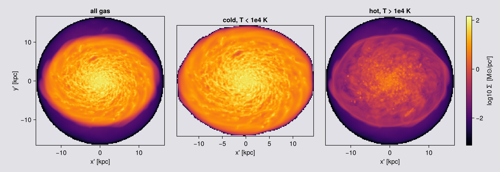

The three frames are identical because `fov` pinned them, and the two parts add back to the
whole because a mask only decides which cells are deposited, never how much of one.

A mask also sets the **camera** when the view is derived from the data: `angmom(gas; mask=cold)`
orients on the cold gas alone, and on particles `parttypes=[:dm], direction=:faceon` orients on
the dark matter rather than on stars and dark matter together.

## 11. The same camera on other data

The view keywords are the same everywhere. What differs is a short list of defaults and gaps.

| | hydro / RT | particles |
|---|---|---|
| `binning` default | `:overlap` | **`:cic`**; `:overlap`/`:exact` fall back to `:cic` (no footprint) and say so once |
| `weighting` | Array, `[:mass, missing]` | Symbol: `:mass`, `:volume`, `:sph`, `:voronoi`. `:sph` and `:voronoi` need a smoothing length or a volume, which RAMSES stars lack, so both raise here |
| `mode` | `:standard` / `:sum` | `:standard` / `:sum` |
| `fov` / `aperture` | yes | yes, same sphere, but `:square` crops to the shorter side of the fitted frame and collapses a thin edge-on disc. Use `:circle` |
| `split`, `depth`, `refine`, `nmax` | grid only | **absent**: passing one is a `MethodError`, not a no-op |
| `angmom_radius` | yes | yes |
| `nmax`, `gravity_data` | yes | absent |
| `data_center` | **silently ignored** off-axis | honoured |
| `slice` | yes, with `offset` | no, by design: a plane through points is empty. Use `thickness`/`offset` on `projection` |

Gravity goes through `projection(hydro, gravity, var; …)`. RT has no velocity field, so
`:angmom`, `:faceon` and `:edgeon` are unavailable: give an explicit `los=`, or take the vector
from the matching hydro object with [`angmom`](@ref) and pass it as `axis=L`. (This dataset has
no RT output; see the [radiative transfer page](10_multi_RadiativeTransfer.md).)

```julia
# `part` came with the setup cell, because every chapter from 1 on puts the stars beside the gas.
ps = projection(part, :sd, :Msol_pc2; direction=:edgeon, center=[:bc],
                xrange=[-20,20], yrange=[-20,20], zrange=[-20,20], range_unit=:kpc,
                pxsize=[0.15,:kpc], verbose=false, show_progress=false)
println("stars   : frame ", size(ps.maps[:sd]), "   los = ", round.(ps.los, digits=3))

grav = loaddata(390, AVALON, :gravity; verbose=false)
pe = projection(gas, grav, :epot; direction=:faceon, center=[:bc],
                xrange=[-20,20], yrange=[-20,20], zrange=[-20,20], range_unit=:kpc,
                pxsize=[0.15,:kpc], verbose=false, show_progress=false)
# NB the raw extrema of an off-axis potential map include an exact 0.0, and that 0.0 is EMPTY
# pixels, not a physical potential. Report the filled pixels, and say how many were empty.
epot = pe.maps[:epot]; filled = filter(<(0), epot)
println("gravity : maps ", collect(keys(pe.maps)))
println("          epot over filled pixels ", round.(extrema(filled), sigdigits=4),
        "   (", count(iszero, epot), " of ", length(epot), " pixels empty)")
```

```
stars   : frame (184, 12)   los = [1.0, 0.0, 0.0]
gravity : maps Any[:epot, :sd]
          epot over filled pixels (-0.9779, -0.1408)   (1206 of 75076 pixels empty)
```

### A slab instead of a slice, for particles

A cutting plane through point particles catches nothing: a particle has no extent, so a
zero-thickness plane is empty by construction. That is why `slice(part, …)` is a `MethodError`
rather than an oversight.

The useful analogue is a projection of finite depth. `thickness` sets the depth of the slab along
the line of sight and `offset` moves it, the same way `offset` moves the plane for cell data. A
non-positive thickness is refused rather than returning an empty map.

```julia
# `aperture=:circle`, not `:square` (Chapter 3): the square crop would collapse this edge-on disc, and the
# fractions below would then be comparing different frames (Chapter 3).
S = (direction=:edgeon, center=[:bc], fov=15, fov_unit=:kpc, aperture=:circle,
     pxsize=[0.15,:kpc], verbose=false, show_progress=false)
full = projection(part, :sd, :Msol_pc2; S...)
T = sum(full.maps[:sd])
println(rpad("thickness [kpc]", 18), rpad("total", 12), "fraction of the full column")
for th in (20.0, 5.0, 1.0)
    m = projection(part, :sd, :Msol_pc2; thickness=th, thickness_unit=:kpc, S...)
    println(rpad(th, 18), rpad(round(sum(m.maps[:sd]), sigdigits=6), 12),
            round(sum(m.maps[:sd])/T, digits=4))
end

println()
println(rpad("offset [kpc]", 18), "total in a 2 kpc slab")
for off in (-6.0, -2.0, 0.0, 2.0, 6.0)
    m = projection(part, :sd, :Msol_pc2; thickness=2.0, thickness_unit=:kpc,
                   offset=off, offset_unit=:kpc, S...)
    println(rpad(off, 18), round(sum(m.maps[:sd]), sigdigits=6))
end
```

```
thickness [kpc]   total       fraction of the full column
20.0              22448.7     0.9969
5.0               15224.8     0.6761
1.0               3936.59     0.1748
offset [kpc]      total in a 2 kpc slab
-6.0              695.187
-2.0              4639.88
0.0               7390.16
2.0               4737.18
6.0               674.024
```

The slab total rises with thickness, as it must. The offset sweep is more interesting: read the
column above and see which offset holds the most mass. If the peak is not at 0, that is not a bug
in the slab, it is the slab reporting where the stars actually are. `center=[:bc]` is the box
centre, and a galaxy's stellar centroid need not sit exactly there, so the densest slab is the one
offset toward it.

That is the check worth running on your own data. If the peak is not where you expect the object
to be, either the centre is wrong or the object is not where you think, and both are worth knowing
before you quote a number from the map.

```julia
# The same camera, pointed at three kinds of data, and all three drawn on the same ±16 kpc axes
# below so they can be read against each other.
#
# 100 pc pixels, the page standard for a comparison grid. The star panel is not the limiting
# tracer here, even though stars are points: this view is EDGE-ON, so the sight line runs the
# length of the disc and a pixel holds tens of times more stars than the same pixel would face-on.
# Chapter 11 does that arithmetic, and draws the face-on case coarser for exactly that reason.
shot = (direction=:edgeon, center=[:bc], fov=16, fov_unit=:kpc, aperture=:square,
        pxsize=[0.1, :kpc], verbose=false, show_progress=false)
gas_eo  = projection(gas,  :sd, :Msol_pc2; shot...)
# gravity rides on the hydro grid: the two-object form, same camera, same framing
pot_eo  = projection(gas, grav, :epot, :km2_s2; shot...)

# The stars take `aperture=:circle` instead: edge-on they are a thin disc, and `:square` would crop
# the frame to that thickness and throw the width away (Chapter 3). The check two cells below
# measures it.
star_eo = projection(part, :sd, :Msol_pc2; direction=:edgeon, center=[:bc], fov=16,
                     fov_unit=:kpc, aperture=:circle, pxsize=[0.1, :kpc],
                     verbose=false, show_progress=false)
println("gas   frame ", size(gas_eo.maps[:sd]),
        "   stars ", size(star_eo.maps[:sd]),
        "   potential ", size(pot_eo.maps[:epot]))
println("φ along the line of sight: ", round.(extrema(pot_eo.maps[:epot]), sigdigits=4), " km²/s²")

# ── figure code from here: panels, overlays, colorbars, no new Mera concepts ──
# separate colour ranges: gas and stars differ by orders of magnitude in surface density,
# and forcing one scale would flatten whichever loses
lo(m) = quantile(log10.(filter(>(0), vec(Float64.(m.maps[:sd])))), 0.25)  # clip the empty rim
hi(m) = maximum(log10.(filter(>(0), vec(Float64.(m.maps[:sd])))))

fig = Figure(size=(1420, 400))
ax1 = Axis(fig[1,1], title="gas  Σ", xlabel="x' [kpc]", ylabel="y' [kpc]")
h1 = showmap!(ax1, gas_eo, :sd; crange=(lo(gas_eo), hi(gas_eo)))
Colorbar(fig[1,2], h1, label="log10 Σ_gas [M⊙/pc²]")

ax2 = Axis(fig[1,4], title="stars  Σ", xlabel="x' [kpc]")
h2 = showmap!(ax2, star_eo, :sd; crange=(lo(star_eo), hi(star_eo)))
Colorbar(fig[1,5], h2, label="log10 Σ_★ [M⊙/pc²]")

# the potential is negative everywhere and spans a small range, so a linear scale on the raw
# value, no log, and a sequential map so "deeper" reads as one direction.
#
# The map is REVERSED on purpose. φ is most negative at the centre, so a plain sequential ramp
# puts the bottom of the well at the dark end, which on this page is the colour of an empty
# pixel: the most interesting part of the panel would be the part that looks like nothing is
# there. Reversed, the well glows and the shallow outskirts recede.
ax3 = Axis(fig[1,7], title="gravitational potential φ", xlabel="x' [kpc]")
h3 = showmap!(ax3, pot_eo, :epot; logscale=false, cmap=Reverse(:magma))
Colorbar(fig[1,8], h3, label="φ [km²/s²]")

# Same square axes on all three, and no vertical zoom here. Chapter 11 zooms its edge-on star
# panel to show the structure inside the disc; this figure is doing the opposite job, holding one
# frame for three tracers, and the sliver IS the result: the stars are far thinner than the gas.
for a in (ax1, ax2, ax3); limits!(a, -16, 16, -16, 16); end
hideydecorations!(ax2, grid=false); hideydecorations!(ax3, grid=false)
colsize!(fig.layout, 3, Fixed(14)); colsize!(fig.layout, 6, Fixed(14))
fig
```

```
gas   frame (321, 321)   stars (275, 17)   potential (321, 321)
φ along the line of sight: (-3057.0, -815.7) km²/s²
```

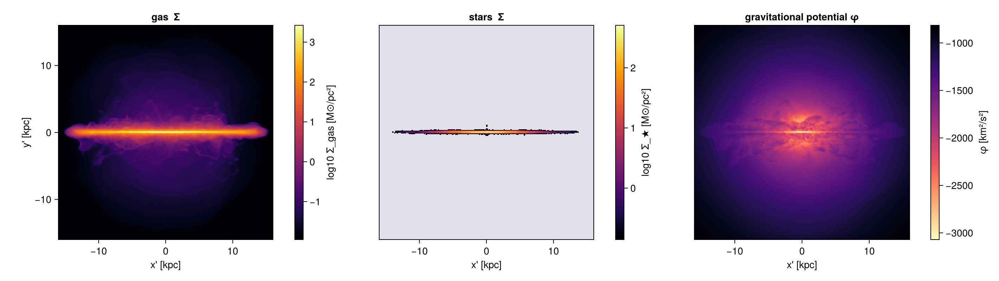

Same keywords, same camera, three different kinds of data, and each one says something the
others cannot. The stars form a **thinner, smoother disc** than the gas, which is exactly the
comparison that motivates making both maps in one orientation. The potential is smoother than
either: it is an integral over all the mass, so it does not care about the clumps that dominate
the gas map, and its contours are rounder than the disc that produced them.

Gravity comes through the **two-object form**, `projection(hydro, gravity, var)`: the hydro object
supplies the weights, because gravity carries none of its own
([How Quantities Are Computed](computation_reference.md#Projecting-a-gravity-field)). Both must
describe the same cells, so load them from the same `info` at the same `lmax`. `fov` cuts both
together, so the three panels above are framed identically and can be compared pixel for pixel.

What *does* differ between the two data types is the deposit itself: points have no footprint, so
particle projections use `:cic` and the footprint kernels fall back to it.

That difference is visible if you push the pixels: a grid map degrades smoothly, while a particle
map becomes **grainy**, because each pixel is counting a finite number of objects and inherits a
√N uncertainty. The cure is the same as in any counting experiment, coarsen the pixels until each
one holds enough particles to mean something.

### What these star particles are, and what is missing

Every particle in this snapshot was made by the simulation itself. All 627,896 are stars
(`family = 2`), there are no dark matter particles, and their birth times run from 4.2 Myr to
580.0 Myr, which is the full age of the run. Together they hold 5.0·10⁸ solar masses, about one
percent of the stellar mass of the model galaxy, 1.03 percent measured against the old stellar disc
on its own. The old disc, the bulge and the dark halo are not
particles at all. They are an analytic mass distribution that the run adds to the Poisson source
(`gravity_type = -3`), worth roughly 4.9·10¹⁰ solar masses for the old stellar disc, 1.5·10¹⁰ for
the bulge and 1.4·10¹¹ for the halo. So this map shows recent star formation, not the stars of the
galaxy: there is no bulge in it because the bulge was never made of particles.

Inside the central 500 pc the analytic bulge outweighs the star particles by about 50 to 1,
8.9·10⁸ solar masses against 1.75·10⁷, so the brightest part of a real galaxy's stellar image is
the part this panel does not contain at all.

The potential panel is the other half of that story. The analytic components enter the Poisson
source, so the stored potential **does** include the bulge, the disc and the halo, and `:epot`
maps the mass the star panel cannot show. The two panels disagree about what this galaxy is made
of, and each is right about its own tracer.

!!! warning "Do not quote absolute `:epot` values yet"
    The absolute values of `:epot` are affected by a known scaling issue in Mera, so the numbers
    printed beside this figure should not be quoted. The shape of the map and its relative
    structure are unaffected.

```julia
# The table above is a set of claims. Run them, a compatibility table that is never executed
# is exactly the kind of thing that goes stale when the code moves on.
W = (center=[:bc], xrange=[-15,15], yrange=[-15,15], zrange=[-15,15], range_unit=:kpc,
     pxsize=[1.0,:kpc], verbose=false, show_progress=false)
same(a, b) = maximum(abs, a.maps[:sd] .- b.maps[:sd]) == 0
raises(f)  = try (f(); "NO ERROR") catch e; string(typeof(e).name.name) end

pc = projection(part, :sd, :Msol_pc2; direction=:edgeon, binning=:cic, W...)
println("particle binning=:overlap falls back to :cic : ",
        same(projection(part, :sd, :Msol_pc2; direction=:edgeon, binning=:overlap, W...), pc))
println("particle binning=:exact   falls back to :cic : ",
        same(projection(part, :sd, :Msol_pc2; direction=:edgeon, binning=:exact, W...), pc))
# :sph/:voronoi now work off-axis too: both are rotation-invariant, so the same samplers run
# on camera-frame coordinates. (They need a :volume column, which star particles lack.)
for w in (:sph, :voronoi)
    println(rpad("weighting=:$w off-axis (needs :volume)", 45), ": ",
            raises(() -> projection(part, :sd, :Msol_pc2; direction=:edgeon, weighting=w, W...)))
end
# `fov` works on particles, but the two apertures do not behave the same way on point data. The
# square crop is capped by the shorter side of the auto-fitted frame, and edge-on the stars are a
# thin disc, so :square collapses the frame to the disc thickness. Print both and compare.
apw = (direction=:edgeon, center=[:bc], fov=15, fov_unit=:kpc, pxsize=[0.3,:kpc],
       verbose=false, show_progress=false)
println("fov on particles, aperture=:circle           : ",
        size(projection(part, :sd, :Msol_pc2; aperture=:circle, apw...).maps[:sd]))
println("fov on particles, aperture=:square           : ",
        size(projection(part, :sd, :Msol_pc2; aperture=:square, apw...).maps[:sd]),
        "   <- the width is gone")
println("same, for the gas that fills the sphere      : ",
        size(projection(gas, :sd, :Msol_pc2; aperture=:square, apw...).maps[:sd]))
println("slice(part, …)                               : ",
        raises(() -> slice(part, :sd; direction=:edgeon, center=[:bc], xrange=[-15,15],
                           yrange=[-15,15], range_unit=:kpc, pxsize=[1.0,:kpc], verbose=false)))
for kw in (:nmax, :max_threads)
    println(rpad(string("particle ", kw), 45), ": ",
            raises(() -> projection(part, :sd, :Msol_pc2; direction=:edgeon, (; kw => 8)..., W...)))
end
println("data_center ignored on off-axis hydro        : ",
        same(projection(gas, :sd, :Msol_pc2; inclination=35, axis=:angmom, W...),
             projection(gas, :sd, :Msol_pc2; inclination=35, axis=:angmom,
                        data_center=[0.4,0.4,0.4], data_center_unit=:standard, W...)))
```

```
particle binning=:overlap falls back to :cic : true
particle binning=:exact   falls back to :cic : true
weighting=:sph off-axis (needs :volume)      : ArgumentError
weighting=:voronoi off-axis (needs :volume)  : ArgumentError
fov on particles, aperture=:circle           : (93, 7)
fov on particles, aperture=:square           : (7, 7)   <- the width is gone
same, for the gas that fills the sphere      : (101, 101)
slice(part, …)                               : MethodError
particle nmax                                : MethodError
particle max_threads                         : NO ERROR
data_center ignored on off-axis hydro        : true
```

Nothing above is hydro-specific. The camera keywords, the framing keywords and the binning
keywords mean the same thing for every projectable data type:

* **particles**, point masses, deposited with the same kernels; `:sd` is a stellar surface
  density here rather than a gas one;
* **gravity**, projected through the two-object form `projection(hydro, gravity, var)` described in
  Chapter 11.

Chapter 11 takes the particle side further: what a point mass conserves, what it cannot, and why
a stellar map has no converged peak. Chapter 14 then measures conservation on both data types
at once.

The empty-pixel count printed above is worth carrying with you: an off-axis frame that is *not*
completely filled is normal, and the zeros are absence of data, not zero potential. Aggregate the
filled pixels, not the whole array.

### Stars: what a point mass conserves

The camera does not change. What changes is the thing being deposited.

A cell has a volume: it covers pixels, it has a chord along the ray, and Chapter 7 is about what
happens when a pixel becomes smaller than that footprint. A star particle is a point mass at one
position, so there is nothing to integrate over, nothing for a cutting plane to catch, and no
smallest scale below which the map stops changing.

- **`binning` keeps two of its four values, and only off-axis.** Along a box axis the particle
  path is a plain histogram, which is `:ngp`, and `binning` is not read at all. Write
  `los=[0,0,1]` if you want CIC along z.
- **`weighting` is a plain `Symbol`**, and on star particles `:mass` is the only value that means
  anything.
- **`:sd` is the map that conserves mass**, or `:mass` with `mode=:sum` (Chapter 9).
- **The peak surface density has no converged value**, because a point mass is a delta function.

Every particle in this snapshot is a star, which makes it a clean test case.

```julia
# What is actually in the particle table. The equal-mass line matters: if every star carries the
# same mass, a mass-weighted map and a number-weighted map are the same map. This run prints
# `false` there, so keep the distinction in mind for every mean below.
fam  = getvar(part, :family)
mp   = getvar(part, :mass, :Msol)
age  = getvar(part, :age, :Myr)
Mtot = msum(part, :Msol)

println("particles        : ", length(part.data))
println("families present : ", sort(unique(fam)), "   (1 = dark matter, 2 = star)")
println("stellar mass     : ", round(Mtot, sigdigits=4), " Msol")
println("particle mass    : ", round(minimum(mp), digits=1), " .. ", round(maximum(mp), digits=1),
        " Msol   (all equal: ", minimum(mp) ≈ maximum(mp), ")")
println("age              : median ", round(median(age), digits=1),
        " Myr, oldest ", round(maximum(age), digits=1), " Myr")
```

```
particles        : 627896
families present : [2.0]   (1 = dark matter, 2 = star)
stellar mass     : 5.035e8 Msol
particle mass    : 800.0 .. 1600.0 Msol   (all equal: false)
age              : median 245.0 Myr, oldest 575.8 Myr
```

```julia
# The stars in the SAME window as the gas hero in Chapter 1: same centre, same `fov`, same two
# directions. What differs is the pixel, and it differs BETWEEN the two panels, because the two
# views do not hold anything like the same number of stars per pixel.
#
# FACE-ON, 200 pc. 628 thousand points over a disc of radius 11.4 kpc is about 1540 per square
# kpc, so a pixel holds roughly 60 of them at 200 pc, 15 at 100 pc and 1 at 26 pc. The 10 per cent
# noise point, a hundred stars in a pixel, sits at about 250 pc, so 200 pc is deliberately just
# inside the speckled regime: fine enough not to look like a mosaic, coarse enough that the disc
# still reads as a disc, and the √N speckle is then visible in the outskirts where the density is
# far below the disc average. That floor is the price of a point tracer, and gas does not pay it.
#
# EDGE-ON, 50 pc. The same arithmetic gives a completely different answer, because the sight line
# now runs through the whole 23 kpc width of the disc instead of through its thickness. The same
# 628 thousand stars land in a band about 28 kpc wide and, in the dense layer, a few hundred pc
# tall: call it 0.6 kpc and that is roughly 37 thousand per square kpc, some 25 times the face-on
# figure. At 50 pc a midplane pixel still holds of order a hundred stars, the same signal to noise
# the face-on panel has, and the frame comes out tens of pixels tall instead of the seven that
# 300 pc gave. Edge-on is where a stellar map can afford to be fine.
#
# `aperture=:circle` in both. A particle frame auto-fits the particles and the square crop is
# capped by the SHORTER side of that frame, so edge-on `:square` would crop away everything except
# a square the thickness of the disc.
sw  = (center=[:bc], fov=16, fov_unit=:kpc, aperture=:circle, parttypes=[:stars],
       verbose=false, show_progress=false)
sfo = projection(part, :sd, :Msol_pc2; direction=:faceon, pxsize=[0.2,  :kpc], sw...)
seo = projection(part, :sd, :Msol_pc2; direction=:edgeon, pxsize=[0.05, :kpc], sw...)

for (nm, m) in (("face-on", sfo), ("edge-on", seo))
    println(rpad(nm, 9), "frame ", lpad(string(size(m.maps[:sd])), 12),
            " at ", lpad(round(m.pixsize * m.scale.pc, digits=1), 6), " pc pixels,",
            "   empty ", round(100 * count(iszero, m.maps[:sd]) / length(m.maps[:sd]), digits=1), " %")
end

# ── figure code from here: panels, overlays, colorbars, no new Mera concepts ──
# Stacked, not side by side: with DataAspect an edge-on disc is a wide short panel, and putting it
# under the face-on one on the SAME x axis is how the two views are read together.
#
# Each panel gets its own colour range. These are the same stars, but not the same distribution of
# Σ: edge-on stacks the whole disc into a thin band, so its peak is far higher, and one shared bar
# would flatten the face-on panel.
fig = Figure(size=(980, 1120), backgroundcolor=EMPTY_COLOUR)
ax1 = Axis(fig[1,1], backgroundcolor=EMPTY_COLOUR, title="stars, face-on   (200 pc pixels)",
           xlabel="x' [kpc]", ylabel="y' [kpc]")
h1  = showmap!(ax1, sfo, :sd; crange=sharedrange([sfo], :sd))
Colorbar(fig[1,2], h1, label="log10 Σ★  [M⊙/pc²]")

ax2 = Axis(fig[2,1], backgroundcolor=EMPTY_COLOUR,
           title="stars, edge-on   (50 pc pixels, y zoomed to ±1.5 kpc and stretched 4×)",
           xlabel="x' [kpc]", ylabel="y' [kpc]")
h2  = showmap!(ax2, seo, :sd; crange=sharedrange([seo], :sd))
Colorbar(fig[2,2], h2, label="log10 Σ★  [M⊙/pc²]")

limits!(ax1, -16, 16, -16, 16)      # the Chapter 1 frame, unchanged
limits!(ax2, -16, 16, -1.5, 1.5)    # same x, but the dense layer is only about ±0.3 kpc

# The edge-on panel is the one place on this page where the aspect is NOT true to the data, and
# the title says so. At 50 pc over a 32 kpc width, an honest DataAspect strip is 32:3 and the
# stellar layer inside it is a dozen pixels tall, which defeats the point of resolving it. So
# `showmap!`'s DataAspect is released here and the row is given four times its true height.
# Read structure along x from this panel, and read thickness from the numbers, not by eye.
ax2.aspect = nothing
rowsize!(fig.layout, 1, Aspect(1, 1.0))          # face-on stays square
rowsize!(fig.layout, 2, Aspect(1, 4 * 3 / 32))   # 4x the true 3-in-32 proportion
resize_to_layout!(fig)   # or the rows overflow the Figure and the lower panel is clipped
fig
```

```
face-on  frame   (141, 139) at  199.2 pc pixels,   empty 32.4 %
edge-on  frame    (547, 32) at   49.9 pc pixels,   empty 70.8 %
```

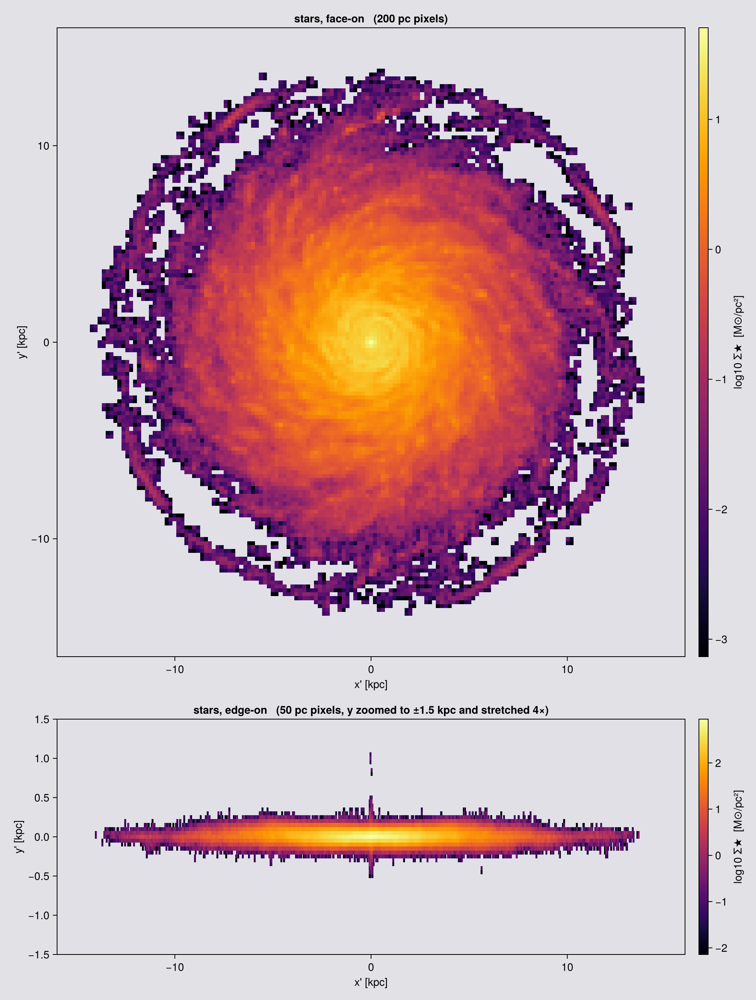

### The two moments, and what a stellar width is made of

`:vlos` and `:σlos` mean for stars exactly what Chapter 8 says they mean for gas, sign convention
included: positive is receding. What differs is what the width is made of. Gas carries a thermal
width that has to be added in quadrature. A collisionless star does not, so the stellar `σ_LOS` is
the second moment of the line-of-sight velocity distribution and nothing else, which is the
quantity an integral field spectrograph reports.

Because every particle deposits its whole mass, the per-pixel moments obey the law of total
variance exactly. The global mass-weighted variance of `v_LOS` is the mass-weighted mean of the
per-pixel variance plus the mass-weighted variance of the per-pixel mean. Which of the two terms
holds the variance moves with the pixel size, and their sum does not: coarse pixels swallow whole
radii of the disc and keep the variance inside pixels, fine pixels resolve the rotation and hand it
to the between-pixel term. That is the Chapter 8 statement seen from the budget side. The
[validation page](offaxis_validation.md) derives the identity and measures both terms against an
object whose limits are known in closed form. One condition, if you check it on your own data: the
weights and the two moments have to come from the same call, because they have to be the same
deposit.

One caveat is specific to points. The per-pixel `σ_LOS` is the population variance of the stars in
that pixel, not the sample variance. With `N` stars it is low by a factor `(N-1)/N` against the
width of the distribution those stars were drawn from: half the variance for two stars, and
exactly zero for one. Splitting a star over four pixels with `:cic` does not help, because all
four copies carry the same velocity. The identity is untouched, since it is bookkeeping over the
deposited weights, but a stellar dispersion map is biased low wherever the pixels are sparse.

### The peak surface density has no converged value

A star is a delta function. The pixel holding it reports `m★/Δ²`, so once the densest pixel is down
to a single star, halving the pixel quadruples the peak, and it goes on doing that without limit.
There is no pixel size at which a stellar peak surface density converges. Gas is genuinely
different: a cell has a finite volume and a finite density, so below the finest cell the gas peak
stops moving. The [validation page](offaxis_validation.md) puts the two curves on one axis, against
a sphere whose peak is known in closed form.

The same counting sets the noise, and that part you do on your own data. Spread these stars over a
disc of radius 11.4 kpc and the mean is about 1540 per square kpc, so a pixel of side Δ holds about
`1540·Δ²` of them and carries at least a `√N` fluctuation:

| `pxsize` | stars per pixel | shot noise |
|---|---|---|
| 1 kpc | ~1500 | 3 % |
| 300 pc | ~140 | 8 % |
| 200 pc | ~60 | 13 % |
| 100 pc | ~15 | 26 % |
| 26 pc | ~1 | 100 % |

So a face-on stellar map is shot-noise dominated below roughly 250 pc in the disc, and at 26 pc it
is a scatter plot drawn with square markers. Those are disc averages. The centre stays smooth to far
finer pixels, the outskirts are single stars already at 100 pc, and an edge-on view stacks the whole
width of the disc into every pixel and so affords a much finer grid. That is the arithmetic behind
the two pixel sizes this chapter draws with.

```julia
# Two things the gas maps cannot give you: the mean age of the stars, and a line-of-sight width
# with no thermal term in it. Same window and the same `aperture=:circle` as the two star maps at
# the top of this chapter, and the same split in pixel size for the same reason: 200 pc face-on,
# 50 pc edge-on, where the sight line runs the length of the disc and a pixel holds twenty-five
# times more stars.
kwfo = (center=[:bc], fov=16, fov_unit=:kpc, aperture=:circle,
        pxsize=[0.2, :kpc], verbose=false, show_progress=false)
kweo = (center=[:bc], fov=16, fov_unit=:kpc, aperture=:circle,
        pxsize=[0.05, :kpc], verbose=false, show_progress=false)
sage = projection(part, [:age, :sd], [:Myr, :Msol_pc2]; direction=:faceon, kwfo...)
skin = projection(part, [:vlos, :σlos, :sd], [:km_s, :km_s, :Msol_pc2]; direction=:edgeon, kweo...)

# Off-axis particle maps mark an empty pixel with 0.0, not NaN. On a velocity map a 0 reads as
# "not moving" and on an age map as "just born", so blank the pixels that hold no stars. (The
# shared `showmap!` does this for its own panels; these three are drawn by hand.)
function blanked(m, key)
    B = Float64.(m.maps[key]); B[Float64.(m.maps[:sd]) .== 0] .= NaN; B
end
alive(A) = filter(isfinite, vec(A))

println("median stellar age over filled pixels : ",
        round(median(alive(blanked(sage, :age))), digits=1), " Myr")
println("max |v_LOS| edge-on                 : ",
        round(maximum(abs, alive(blanked(skin, :vlos))), digits=1), " km/s")
println("median σ_LOS edge-on                : ",
        round(median(filter(>(0), alive(blanked(skin, :σlos)))), digits=1), " km/s")

# ── figure code from here: panels, overlays, colorbars, no new Mera concepts ──
function panel!(ax, m, key, cmap; crange=Makie.automatic)
    A = blanked(m, key); e = getextent(m, :kpc)
    hm = heatmap!(ax, range(e[1], e[2], length=size(A,1)), range(e[3], e[4], length=size(A,2)), A;
                  colormap=cmap, nan_color=EMPTY_COLOUR, interpolate=false, colorrange=crange)
    ax.aspect = DataAspect(); hm
end

vmx = quantile(abs.(alive(blanked(skin, :vlos))), 0.98)

# A diverging map for velocity needs ENDS THAT ARE NOT BLACK, because black is already taken: it
# is how every panel on this page marks a pixel with no stars in it. The usual dark-ended
# diverging maps put the fastest approaching and receding gas at almost exactly the colour of the
# empty sky, so the disc appears to fade out where it is in fact moving quickest. This ramp keeps
# both ends bright and puts a light grey, not white, at zero.
vmap = cgrad([RGBf(0.23, 0.36, 0.86), RGBf(0.82, 0.82, 0.84), RGBf(0.85, 0.16, 0.18)])

fig = Figure(size=(980, 1180), backgroundcolor=EMPTY_COLOUR)
ax1 = Axis(fig[1,1], backgroundcolor=EMPTY_COLOUR, title="stars, mean age (face-on, 200 pc)",
           xlabel="x' [kpc]", ylabel="y' [kpc]")
h1  = panel!(ax1, sage, :age, :plasma)
Colorbar(fig[1,2], h1, label="age [Myr]")

ax2 = Axis(fig[2,1], backgroundcolor=EMPTY_COLOUR,
           title="stars, v_LOS (edge-on, 50 pc, y stretched 4×)",
           xlabel="x' [kpc]", ylabel="y' [kpc]")
h2  = panel!(ax2, skin, :vlos, vmap; crange=(-vmx, vmx))
Colorbar(fig[2,2], h2, label="v_LOS [km/s]")

ax3 = Axis(fig[3,1], backgroundcolor=EMPTY_COLOUR,
           title="stars, σ_LOS (edge-on, 50 pc, y stretched 4×)",
           xlabel="x' [kpc]", ylabel="y' [kpc]")
h3  = panel!(ax3, skin, :σlos, :viridis)
Colorbar(fig[3,2], h3, label="σ_LOS [km/s]")

limits!(ax1, -16, 16, -16, 16)
for a in (ax2, ax3); limits!(a, -16, 16, -1.5, 1.5); end

# Same treatment as the two star maps at the top of the chapter: release the DataAspect on the
# edge-on panels and give each row a height set by its own data range. Without this the short
# panels sit in tall rows, which is where the large blank gaps and the over-long colour bars come
# from, and the stellar layer is too few pixels tall to read.
ax2.aspect = nothing; ax3.aspect = nothing
rowsize!(fig.layout, 1, Aspect(1, 1.0))
rowsize!(fig.layout, 2, Aspect(1, 4 * 3 / 32))
rowsize!(fig.layout, 3, Aspect(1, 4 * 3 / 32))
resize_to_layout!(fig)   # or the rows overflow the Figure and the lower panels are clipped
fig
```

```
median stellar age over filled pixels : 248.2 Myr
max |v_LOS| edge-on                 : 259.7 km/s
median σ_LOS edge-on                : 22.7 km/s
```

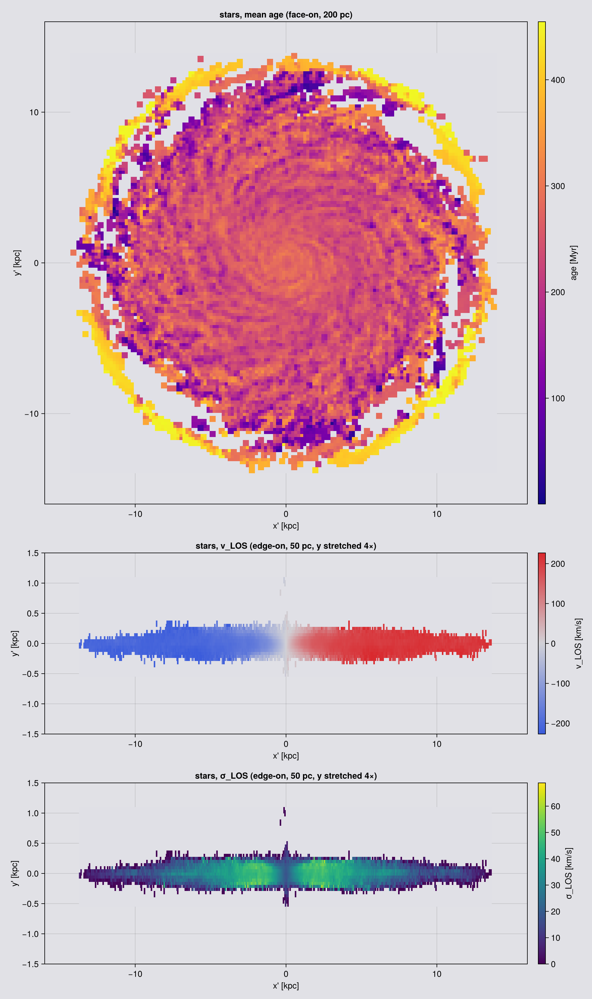

The age map is the panel that has no gas counterpart. It is a mass-weighted mean, so it reads as
the mean age of the stars in each column rather than as an age of anything in particular. With
equal-mass particles it would also be the number-weighted mean; this run has two particle masses,
so the heavier stars pull it towards their own age.

### What the angle does, and what it does not

Turning the camera cannot change the stellar mass. What it does change is the shape of the image
and the kinematics, and both change in a way you can predict before you run it:

- the apparent **axis ratio** goes as `cos i` for a razor-thin disc. A real disc has thickness, so
  `q² = cos²i + q₀²·sin²i` and `q` stops above zero at `i = 90`. That is the relation observers
  invert to get an inclination out of an image (Hubble 1926; Holmberg 1958), and the residual at
  edge-on is the intrinsic thickness `q₀`.
- the **line-of-sight velocity amplitude** goes as `sin i`, because only the component of the
  rotation along the ray is visible.

The first column below is not the conservation test, it is the fraction of the stellar mass the
frame selected. `fov` with `aperture=:circle` selects a sphere, and a sphere looks the same from
every angle, so that column should not move as the camera turns. What it falls short of 1 by is
the stellar mass outside 16 kpc. Conservation itself is measured in Chapter 14, without `fov`.

```julia
# `:circle` again, so the frame is never cropped to the thickness of the disc. And one pixel size
# for every angle, 150 pc: this table measures a SHAPE, so the thickness of the disc has to be
# resolved at i = 90 and the same grid has to serve i = 0, which the figures above do not need.
aview = (axis=:angmom, center=[:bc], fov=16, fov_unit=:kpc, aperture=:circle,
         pxsize=[0.15, :kpc], verbose=false, show_progress=false)

# flux-weighted second moments of the Σ image, above an isophotal cut so the faint rim does not
# set the shape
function axisratio(m; cut=0.05)
    A  = Float64.(m.maps[:sd]); e = getextent(m, :kpc)
    xs = collect(range(e[1], e[2], length=size(A,1)))
    ys = collect(range(e[3], e[4], length=size(A,2)))'
    A  = A .* (A .> cut * maximum(A))
    W  = sum(A); xb = sum(A .* xs) / W; yb = sum(A .* ys) / W
    Sxx = sum(A .* (xs .- xb) .^ 2) / W
    Syy = sum(A .* (ys .- yb) .^ 2) / W
    Sxy = sum(A .* (xs .- xb) .* (ys .- yb)) / W
    t = (Sxx + Syy) / 2; d = sqrt(((Sxx - Syy) / 2)^2 + Sxy^2)
    sqrt((t - d) / (t + d))
end

println(rpad("i [deg]", 9), rpad("in frame", 11), rpad("axis ratio q", 15),
        rpad("cos i", 9), rpad("v_amp [km/s]", 14), "v_amp / sin i")
for i in (0, 15, 30, 45, 60, 75, 90)
    m   = projection(part, [:sd, :vlos], [:Msol_pc2, :km_s]; inclination=i, aview...)
    a   = (m.pixsize * m.scale.pc)^2
    s   = Float64.(m.maps[:sd]); v = Float64.(m.maps[:vlos])
    k   = s .> 0.05 * maximum(s)
    amp = (quantile(v[k], 0.98) - quantile(v[k], 0.02)) / 2
    println(rpad(i, 9), rpad(round(sum(s) * a / Mtot, digits=4), 11),
            rpad(round(axisratio(m), digits=3), 15), rpad(round(cosd(i), digits=3), 9),
            rpad(round(amp, digits=1), 14),
            i == 0 ? "n/a" : string(round(amp / sind(i), digits=1)))
end
```

```
i [deg]  in frame   axis ratio q   cos i    v_amp [km/s]  v_amp / sin i
0        1.0        0.964          1.0      5.4           n/a
15       1.0        0.941          0.966    59.7          230.7
30       1.0        0.846          0.866    114.6         229.3
45       1.0        0.696          0.707    161.9         228.9
60       1.0        0.503          0.5      198.9         229.7
75       1.0        0.266          0.259    222.6         230.4
90       1.0        0.032          0.0      206.2         206.2
```

**Five things to carry away.**

`:sd` is the conserved map. If you need a stellar mass out of a map, it is
`sum(m.maps[:sd]) * (m.pixsize * m.scale.pc)^2`, with `m.pixsize` and no `aperture=:square` crop.
`:mass` is the mass-weighted mean particle mass, worth having for its own sake and not a total.
Chapter 14 measures that recipe over viewing angle, pixel size and both kernels.

`aperture=:square` is for data that fills the selection sphere, and Chapter 3 says why. Use
`:circle` on point data, and set the axis limits yourself when a particle panel has to line up
with a gas panel.

`:rho` on particles divides the pixel mass by the **whole box length**, not by the depth you
selected, so a slab's `:rho` is not a slab mean density. Use `:sd`.

Empty pixels are `0.0` almost everywhere, and `NaN` in one place. Every off-axis map writes `0.0`,
and so does an axis-aligned hydro map. The exception is the axis-aligned **particle** path, which
divides two deposited grids, so an empty pixel of a weighted-mean map comes back `NaN` there. A
`filter(isfinite, ...)` therefore keeps every empty off-axis pixel and quietly drags a median
toward zero. Mask by `:sd`, as the figure above does.

Stellar `L` is not gas `L`. `direction=:faceon` on `part` takes the stars' own angular momentum and
on `gas` the gas's, so a stars-versus-gas comparison in one frame needs one explicit
`axis=[lx, ly, lz]` passed to both. Appendix C has the same argument for a time series.

## 12. Slices: a sample, not an integral

`slice` takes the same view keywords as `projection` and returns the cells the plane passes
through. (`offaxis_slice` is a documented alias; prefer `slice`.) Given `slice_axis`/`slice_pos`
instead of a view it cuts along a box axis, which the [covering grid page](covering_grid.md)
covers.

It is a **nearest-cell sample**, not an integral:

- **Nothing is conserved**, because no ray is integrated. Never sum a slice.
- **Empty (NaN) pixels are geometry**, not failure: where the plane threads between refinement
  levels there is no cell.
- **The tilted blocks are the true shape of the cut.** A plane crossing an axis-aligned cube at
  an angle gives a quadrilateral cross-section.

What a slice can report per pixel, since exactly one cell owns each:

| field | is |
|---|---|
| `sl.map` | the value, `NaN` where nothing was painted |
| `sl.coverage` | which pixels were painted |
| `sl.cellsize` | the size of the cell that won each pixel |
| `sl.depth` | how far along the view that cell sat |

There is no cell count, because it would read 1 everywhere. `cellsize` against `pixsize` is the
useful one: where the cell is larger than the pixel, the extra pixels carry no extra information.

!!! warning "The API is the opposite of Chapter 3"
    On `slice`, `xrange`/`yrange` **are the camera-plane window**. There is no `fov` and no
    `binning`, it takes one variable, and it works on cell data only. Depth is set by `offset`,
    not `zrange`. `slice(part, …)` is a `MethodError` by design; the particle equivalent is a
    projection of finite `thickness` (Chapter 11). Its `.extent` and `.center` are code units,
    unlike a map's.

```julia
view = (inclination=60, azimuth=30, axis=:angmom, center=[:bc])

# 100 pc pixels, the page standard. The mesh here runs from 0.75 kpc at level 6 down to 0.012 kpc
# at level 12, so a 100 pc pixel sits at about level 9: finer than the cells in the disc, coarser
# than the cells in the outskirts. Wherever a cell is coarser than the pixel, both panels paint it
# as a flat block. On the slice that is the honest picture of a nearest-cell sample; on the
# projection it is the cell's own shadow. Chapter 7 treats pixel-versus-cell size properly.
sl = slice(gas, :rho, :nH; view..., xrange=[-15,15], yrange=[-15,15],
           range_unit=:kpc, pxsize=[0.1,:kpc], verbose=false)

# projection: same view, and `fov` is how you get the SAME ±15 kpc camera frame
pr = projection(gas, :rho, :nH; view..., fov=15, fov_unit=:kpc, aperture=:square,
                pxsize=[0.1,:kpc], verbose=false, show_progress=false)

println("slice frame      ", size(sl.map), "   ", round(100*count(isnan, sl.map)/length(sl.map), digits=1), " % NaN")
println("projection frame ", size(pr.maps[:rho]))
println("slice extent [kpc] = ", round.(sl.extent .* gas.scale.kpc, digits=1))
```

```
slice frame      (300, 300)   0.0 % NaN
projection frame (301, 301)
slice extent [kpc] = [-15.0, 15.0, -15.0, 15.0]
```

### Moving the plane: `offset`

The keywords so far set the plane's **orientation**. `offset` sets its **position**, sliding it
along the line of sight, which is what turns a single cut into a fly-through. `offset=0` (the
default) puts the plane through `center`, and `offset_unit` defaults to `range_unit`.

The axis-aligned path spells the same idea `slice_pos`/`slice_unit`.

Sweeping it is how you build a slice movie: compute one map per offset and hand the stack to
[`savemovie`](@ref).

```julia
using Statistics
println(rpad("offset [kpc]", 14), rpad("filled px", 12), "median nH [cm^-3]")
for off in (-15.0, -5.0, 0.0, 5.0, 15.0)
    slo = slice(gas, :rho, :nH; view..., xrange=[-15,15], yrange=[-15,15], range_unit=:kpc,
                pxsize=[0.1,:kpc], offset=off, offset_unit=:kpc, verbose=false)
    f = filter(isfinite, slo.map)
    println(rpad(off, 14), rpad(length(f), 12),
            isempty(f) ? "-" : round(median(f), sigdigits=4))
end
```

```
offset [kpc]  filled px   median nH [cm^-3]
-15.0         89668       6.559e-6
-5.0          90000       3.132e-5
0.0           90000       3.893e-5
5.0           90000       3.046e-5
15.0          89668       6.93e-6
```

Every offset fills the frame except the two extremes, where the plane runs past the selected
data and 332 pixels of 90,000 come back empty. The density changes with depth: the plane is moving
through the object rather than being re-drawn in place. `offset=0` returns exactly what omitting
the keyword returns.

**The axis values do not move with `offset`, and that is correct.** The offset slides the plane
along the **line of sight**, which points out of the image, so the same `x'`/`y'` window is sampled
at a different depth. All three panels therefore carry identical axis numbers. What changes between
them is which cells the plane passes through, not where the plane sits in the picture.

```julia
# What `offset` does, in pictures rather than in a table: the same plane, moved along the line of
# sight. Three slices, no new keywords, and cheap.
offs = (-4.0, 0.0, 4.0)
cuts = [slice(gas, :rho, :nH; view..., xrange=[-15,15], yrange=[-15,15], range_unit=:kpc,
              pxsize=[0.1,:kpc], offset=o, offset_unit=:kpc, verbose=false) for o in offs]
println("filled pixels per panel: ",
        [count(isfinite, c.map) for c in cuts], " of ", length(cuts[1].map))

# ── figure code from here: panels, overlays, colorbars, no new Mera concepts ──
# These three DO share one colour range, unlike the pair above: they are the same quantity,
# sampled the same way, at three depths. Only then is a shared bar meaningful.
Ls   = [log10.(replace(Float64.(c.map), 0.0 => NaN)) for c in cuts]
allv = filter(isfinite, reduce(vcat, vec.(Ls)))
crs  = (quantile(allv, 0.02), quantile(allv, 0.999))
ec   = cuts[1].extent .* gas.scale.kpc

fig = Figure(size=(1180, 400)); hm = nothing
for (j, o) in enumerate(offs)
    ax = Axis(fig[1,j], aspect=DataAspect(), title="offset = $(o) kpc",
              xlabel="x' [kpc]", ylabel = j == 1 ? "y' [kpc]" : "")
    j > 1 && hideydecorations!(ax, grid=false)
    hm = heatmap!(ax, range(ec[1], ec[2], length=size(Ls[j],1)),
                  range(ec[3], ec[4], length=size(Ls[j],2)), Ls[j];
                  colormap=:viridis, colorrange=crs, nan_color=EMPTY_COLOUR, interpolate=false)
end
Colorbar(fig[1,4], hm, label="log10 n_H  [cm⁻³]")
fig
```

```
filled pixels per panel: [90000, 90000, 90000] of 90000
```

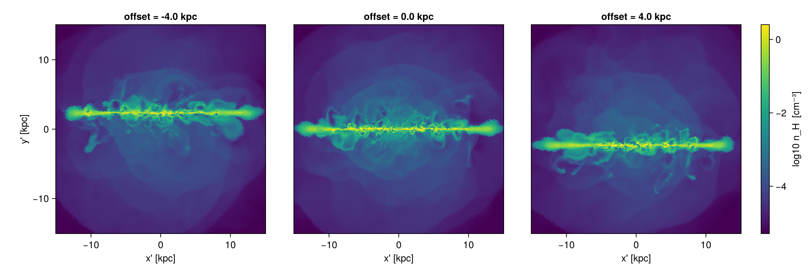

### The two slice movies

Sweeping `offset` at a fixed orientation gives a **travelling** plane: the camera holds still and
the cut moves through the object. Sweeping an angle at a fixed offset gives a **rotating** plane:
the cut stays put and turns.

One thing to get right for either: **pin `xrange`/`yrange`**. `slice` has no `fov`, so without a
window it auto-fits to the cells it painted, and that footprint changes as the plane moves or
turns. The frames then differ in size, which makes them useless as a movie. A fixed window makes
every frame the same shape.

```julia
# 100 pc, to match the rest of Chapter 12. A slice costs what it costs to scan the cells, about
# the same at 500 pc as at 100 pc, so the finer grid is free here. The frame COUNT is what
# prices this cell.
mwin = (xrange=[-15,15], yrange=[-15,15], range_unit=:kpc, pxsize=[0.1,:kpc], verbose=false)

travelling = [slice(gas, :rho, :nH; view..., mwin..., offset=o, offset_unit=:kpc).map
              for o in -10:5:10]
rotating   = [slice(gas, :rho, :nH; inclination=a, azimuth=30, axis=:angmom,
                    center=[:bc], mwin...).map for a in 0:30:150]

println("travelling: ", length(travelling), " frames, all ",
        all(size(m) == size(travelling[1]) for m in travelling) ? "the same size" : "DIFFERENT sizes")
println("rotating  : ", length(rotating), " frames, all ",
        all(size(m) == size(rotating[1]) for m in rotating) ? "the same size" : "DIFFERENT sizes")
```

```
travelling: 5 frames, all the same size
rotating  : 6 frames, all the same size
```

Either stack goes straight into a `MeraMovie` and then [`savemovie`](@ref). For projections
rather than slices, [`getmovie`](@ref) does the loop for you and adds camera motion over a whole
series of snapshots (`angles`, `sweep`).

```julia
# ── figure code from here: panels, overlays, colorbars, no new Mera concepts ──
# ONE COLOUR RANGE PER PANEL, on purpose. A column integral and a single-cell sample are not the
# same quantity and are orders of magnitude apart, so a shared scale pushes the slice onto the
# floor of the bar and shows a flat dark square. Each panel gets its own range and its own bar.
As = log10.(replace(Float64.(sl.map), 0.0 => NaN))
Ap = log10.(replace(Float64.(pr.maps[:rho]), 0.0 => NaN))
rng(A) = (v = filter(isfinite, vec(A)); (quantile(v, 0.02), maximum(v)))
es = sl.extent .* gas.scale.kpc

fig = Figure(size=(1000, 420))
ax1 = Axis(fig[1,1], aspect=DataAspect(), title="projection: column integral",
           xlabel="x' [kpc]", ylabel="y' [kpc]")
h1 = showmap!(ax1, pr, :rho; crange=rng(Ap), cmap=:viridis)
Colorbar(fig[1,2], h1, label="log10 n_H  [cm⁻³]")

ax2 = Axis(fig[1,3], aspect=DataAspect(), title="slice: nearest-cell sample", xlabel="x' [kpc]")
h2 = heatmap!(ax2, range(es[1], es[2], length=size(As,1)),
              range(es[3], es[4], length=size(As,2)), As;
              colormap=:viridis, colorrange=rng(As), nan_color=EMPTY_COLOUR, interpolate=false)
Colorbar(fig[1,4], h2, label="log10 n_H  [cm⁻³]")
hideydecorations!(ax2, grid=false)
fig
```

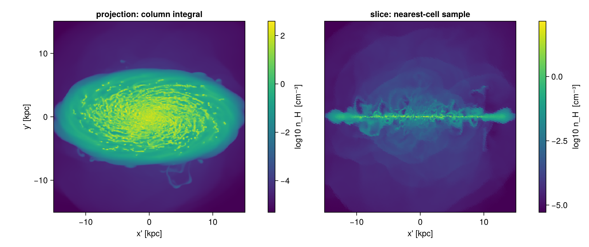

### The same exercise on points: a slab, not a plane

A star cannot be sampled by a plane, so the two figures above have no direct star version. The
honest counterpart is a **slab**: give the projection a narrow depth instead of a zero-thickness
cut, and it answers the same two questions a slice answers, with a thickness you choose.

That also makes the comparison fair. A slice reports one cell per pixel; a slab reports everything
inside a stated depth. Between them they bracket what "a cut through the object" can mean, and for
point data only the slab exists.

The depth is swept the way `offset` swept the plane: face-on, so the line of sight is the `z` axis
and moving the slab in `z` moves it towards and away from the observer.

```julia
# A slab is a projection with a narrow depth, so nothing new is needed: `zrange` sets the depth,
# measured from `center`. Face-on here, so `z` IS the line of sight and moving the slab in `z`
# moves it towards and away from the observer, exactly as `offset` moved the plane.
#
# TWO THINGS THIS CELL HAD TO GET RIGHT, both measured rather than assumed:
#
# 1. `fov` and `zrange` do not combine. `fov` selects a sphere of radius `fov` in the camera plane
#    and the depth is then the sphere, so passing both keeps the sphere and the `zrange` does
#    nothing: measured here, the "slab" came back holding 100 % of the stellar mass. Use world
#    ranges when you want a depth, which is what this cell does.
# 2. The depths have to match the object. This stellar disc is thin: median |z| is 34 pc and the
#    99th percentile is 154 pc, so slabs at a kiloparsec would all have been empty.
slabs = [(-0.05, 0.05), (0.05, 0.10), (0.10, 0.20)]      # kpc from the box centre
slabmaps = [projection(part, :sd, :Msol_pc2; direction=:faceon, center=[:bc],
                       xrange=[-16,16], yrange=[-16,16], zrange=[lo, hi], range_unit=:kpc,
                       pxsize=[0.2,:kpc], verbose=false, show_progress=false)
            for (lo, hi) in slabs]
mstar_tot = msum(part, :Msol)
println(rpad("slab [kpc]", 16), rpad("thickness", 12), rpad("share of stellar mass", 24), "filled px")
for ((lo, hi), m) in zip(slabs, slabmaps)
    frac = sum(m.maps[:sd]) * (m.pixsize * m.scale.pc)^2 / mstar_tot
    println(rpad("$(lo) … $(hi)", 16), rpad("$(round(Int,(hi-lo)*1000)) pc", 12),
            rpad(string(round(100*frac, digits=2), " %"), 24), count(!iszero, m.maps[:sd]))
end

# ── figure code from here: panels, overlays, colorbars, no new Mera concepts ──
# One colour range across the three, because they are the same quantity at three depths: only then
# does "the midplane slab is denser" mean anything.
scr2 = sharedrange(slabmaps, :sd)
fig = Figure(size=(1180, 400))
for (j, ((lo, hi), m)) in enumerate(zip(slabs, slabmaps))
    ax = Axis(fig[1,j], aspect=DataAspect(), title="stars, z = $(lo) … $(hi) kpc",
              xlabel="x' [kpc]", ylabel = j == 1 ? "y' [kpc]" : "")
    j > 1 && hideydecorations!(ax, grid=false)
    showmap!(ax, m, :sd; crange=scr2)
    limits!(ax, -16, 16, -16, 16)
end
fig
```

```
slab [kpc]      thickness   share of stellar mass   filled px
-0.05 … 0.05    100 pc      66.41 %                 12853
0.05 … 0.1      50 pc       15.57 %                 9063
0.1 … 0.2       100 pc      4.71 %                  7023
```

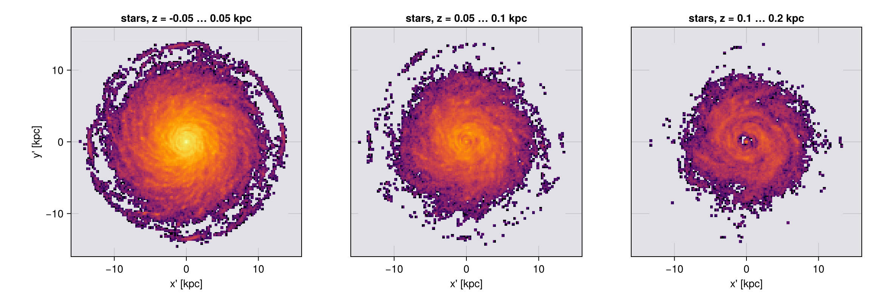

The midplane slab holds most of the young stars and the higher ones thin out fast, which is the
vertical structure of the disc seen one layer at a time. Nothing here needed a new keyword: a slab
is a projection with a depth, and the depth is `zrange`.

**One trap, measured above rather than guessed.** `fov` and `zrange` do not combine. `fov` selects a
sphere, and that sphere sets the depth too, so a `zrange` passed alongside it is silently ignored:
the first attempt at this figure reported a "100 pc slab" holding 100 % of the stellar mass. If you
want a depth, use world ranges.

Two limits worth stating plainly. The slab is a **world-space** depth, so this construction is
exact when the line of sight is a box axis, as it is here; at a general angle a fixed `zrange` is a
slab through the box and not through the camera, which is the same warning Chapter 3 gives about
`xrange`/`yrange`. And a slab is still an integral over its depth, so it is a thin projection and
not a sample: `:sd` inside it conserves, while a slice never claimed to.

**The two panels do not share a colour scale, and they cannot.** A projection sums density along
kiloparsecs of path; a slice reads one cell. The numbers are orders of magnitude apart and they are
not the same quantity, so a shared bar would flatten the slice onto its floor and show nothing.
Each panel carries its own range and its own bar. Compare the two in shape, never pixel for pixel.

Two things in the left panel are the *selection* rather than the gas, and both show up in every
`fov` projection:

- the soft darkening into the **corners** is the selection sphere tapering to zero depth at the
  corners of a `:square` frame (Chapter 3);
- any **flat, straight-edged plateau** is a single AMR cell painted across several pixels. At
  100 pc pixels the mesh is finer than the pixel in the disc and coarser in the outskirts, where
  levels 6 to 9 run from 0.75 down to 0.094 kpc, so the outskirts are where to look for them.

Neither is a projection error, mass is conserved either way (Chapter 8). They are what you get for
asking the map a question finer than the data can answer.

## 13. Turning the camera: orbit movies

`rotation_sequence` renders one variable over a list of angles and returns a `Vector` of maps.
`sweep=:azimuth` (default), `:inclination` or `:position_angle` picks which angle varies. It
calls `projection` once per angle, so the same sweep runs on particles.

It uses **the framing rule of Chapter 3, swept**: a rotation-invariant sphere, `aperture=:circle`
or `:square`. That is why it exists, because a cubic window's rotated bounding box changes size
frame by frame and the movie breathes.

!!! note "One difference from `projection`"
    Omit `fov` here and it **auto-fits** to the 99 % enclosed-mass radius, so the frame follows
    the object rather than the sparse outermost cells. `projection` has no auto-fit: omit `fov`
    there and you are back on world ranges. Pass `fov` explicitly whenever it matters.

`parallel_frames=true` runs frames concurrently with single-threaded projections, typically 1.5
to 2 times faster when there are at least as many frames as threads, at proportionally more
transient memory. Keep the total at or below 8 threads on a laptop.

```julia
frames = rotation_sequence(gas, :sd, :Msol_pc2; sweep=:azimuth, angles=0:90:270,
                           inclination=55, axis=:angmom, center=[:bc],
                           fov=16, fov_unit=:kpc, aperture=:square,
                           pxsize=[0.1,:kpc], parallel_frames=false)

# The numerical proof that the frame does not breathe, stronger than watching it.
for (a, f) in zip(0:90:270, frames)
    println("azimuth ", lpad(a,3), "°   frame ", size(f.maps[:sd]),
            "   extent [kpc] = ", round.(getextent(f, :kpc), digits=3))
end
```

```
azimuth   0°   frame (321, 321)   extent [kpc] = [-16.002, 16.032, -16.002, 16.032]
azimuth  90°   frame (321, 321)   extent [kpc] = [-16.003, 16.03, -16.002, 16.031]
azimuth 180°   frame (321, 321)   extent [kpc] = [-16.002, 16.032, -16.002, 16.032]
azimuth 270°   frame (321, 321)   extent [kpc] = [-16.003, 16.03, -16.002, 16.031]
```

```julia
# ── figure code from here: panels, overlays, colorbars, no new Mera concepts ──
# The frames are already computed above; showing them is the visual half of the same claim.
cr = sharedrange(frames, :sd)
display(maprow(collect(frames), :sd, ["azimuth $(a)°" for a in 0:90:270]; crange=cr))

# The same four angles on the stars. `rotation_sequence` took `part` instead of `gas` and nothing
# else changed. `aperture=:circle` for the reason Chapter 3 gives, and the axes are pinned to the
# gas window so the two rows are at one scale.
sframes = rotation_sequence(part, :sd, :Msol_pc2; sweep=:azimuth, angles=0:90:270,
                            inclination=55, axis=:angmom, center=[:bc],
                            fov=16, fov_unit=:kpc, aperture=:circle,
                            pxsize=[0.1,:kpc], parallel_frames=true)
sfigm = maprow(collect(sframes), :sd, ["stars, azimuth $(a)°" for a in 0:90:270];
               crange=sharedrange(sframes, :sd))
for k in 1:4
    limits!(contents(sfigm[1,k])[1], -16, 16, -16, 16)
end
sfigm
```

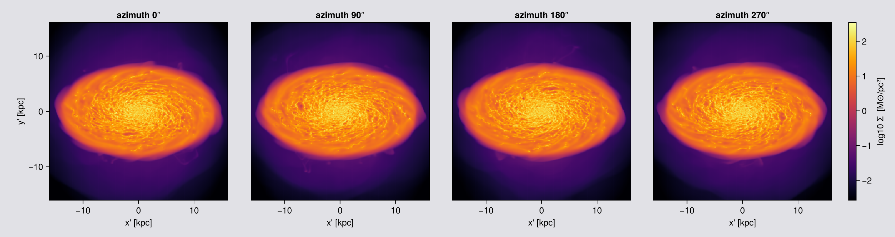

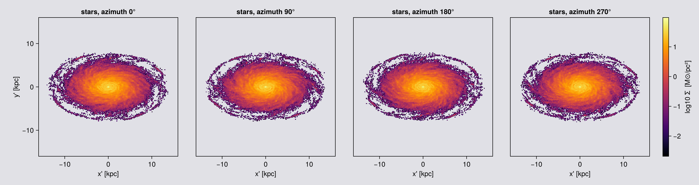

Four frames, four azimuths, one frame size and one extent to three decimals, the montage and the
numbers say the same thing from opposite directions. That invariance is what makes the sequence
usable as a movie: nothing breathes, so the eye reads rotation rather than zoom.

Write the frames to disk with any Makie/`FileIO` recorder, or hand the vector straight to
`Makie.record`.

Every frame is the same array, the same physical extent and the same pixel scale. Turning that
into a movie is one `Makie.record` call, Makie ships its own ffmpeg through `FFMPEG_jll`, so
this needs nothing installed on the system and runs as part of the notebook.

One trade is worth naming, because it is the one people get backwards. A frame costs what it costs to
scan the cells, and little extra for a finer grid **as long as the pixel stays coarser than the
cells**, so at movie resolutions **the frame count buys smoothness and the pixel size is nearly
free**. Take the pixel below the cell size and that reverses, for the reason Chapter 1 and
Chapter 14 both give. The movie below keeps all 120 frames and takes the pixels down
to 100 pc, which is where the map stops being upsampled onto the canvas. Cutting frames to buy
resolution would have been the wrong way round.

```julia
# Rendered here rather than pasted in, so the movie can never drift from the code above.
#
# The four frames above are for READING: a montage you compare panel by panel. A movie wants many
# more, or the orbit steps rather than turns. `record` writes exactly one GIF frame per rendered
# projection, so the angle step IS the smoothness: 120 angles at 3 degrees is one revolution, and
# at framerate 30 that revolution takes 4 seconds. Same camera, same fixed FOV, so nothing else
# about the sequence changes.
#
# Cost, since this is the slowest cell on the page: of order 10 s per frame at 4 threads, so 120
# frames is tens of minutes, and `parallel_frames=true` brings that down by rendering frames
# concurrently. The page's own run is the honest figure: Chapter 13 is where most of its hour goes.
smooth = rotation_sequence(gas, :sd, :Msol_pc2; sweep=:azimuth, angles=0:3:357,
                           inclination=55, axis=:angmom, center=[:bc],
                           fov=16, fov_unit=:kpc, aperture=:square,
                           pxsize=[0.1,:kpc], parallel_frames=true)

cr  = sharedrange(smooth, :sd)          # one colour range across the whole orbit
fig = Figure(size=(300, 300))
                                        # at 100 pc the map is 321 px across against a 300 px
                                        # canvas, so the GIF shows essentially every map pixel
ax  = Axis(fig[1, 1], aspect=DataAspect(), title="orbit movie (fixed FOV, square)")
hidedecorations!(ax)

mkpath("assets/offaxis")
record(fig, "assets/offaxis/orbit_movie.gif", eachindex(smooth); framerate=30) do k
    empty!(ax)
    showmap!(ax, smooth[k], :sd; crange=cr)
end
println("wrote assets/offaxis/orbit_movie.gif  (", length(smooth), " frames, ",
        round(filesize("assets/offaxis/orbit_movie.gif") / 1024, digits=1), " KB)")
println("map size: ", size(smooth[1].maps[:sd]), "   every frame the same size: ",
        all(size(f.maps[:sd]) == size(smooth[1].maps[:sd]) for f in smooth))

# THE SAME ORBIT ON THE STARS. Same sweep, same angles, same framerate, so the two GIFs are frame
# for frame comparable: whatever differs between them is the data, not the camera.
#
# This one is cheap: `rotation_sequence` is not hydro-only, it just calls `projection` per angle,
# and 628 thousand points against 51.5 million cells is why the gas movie above takes tens of
# minutes and this one takes a couple.
# TWO changes from the gas call, both forced by the same fact: the stars do not fill the fov=16
# sphere, so their frame is fitted to a distribution that is smaller than the window.
#
# 1. `aperture=:circle` (Chapter 3).
# 2. The frame is no longer constant. The gas fills the sphere, so every gas frame comes out the
#    same size and the movie is steady for free. The stars' projected extent changes a little with
#    azimuth, measured here at (279,159) to (282,166) over one turn, so the FRAME breathes even
#    though the camera does not. That is the failure this chapter warns about, and the fix is to
#    fix the AXIS rather than the frame: every map is drawn in world coordinates, so holding the
#    axis limits at +-16 kpc pins the scale and lets the margins move instead of the galaxy.
sstar = rotation_sequence(part, :sd, :Msol_pc2; sweep=:azimuth, angles=0:3:357,
                          inclination=55, axis=:angmom, center=[:bc],
                          fov=16, fov_unit=:kpc, aperture=:circle,
                          pxsize=[0.1,:kpc], parallel_frames=true)
println("star frame sizes over the orbit: ", length(unique(size.(getindex.(getfield.(sstar, :maps), :sd)))),
        " distinct  (the gas movie above has 1)")

Mstar_orbit = msum(part, :Msol)           # reference for the in-frame fraction printed below
crs_star  = sharedrange(sstar, :sd)        # one colour range across the whole orbit, as for the gas
figs = Figure(size=(300, 300))
axs  = Axis(figs[1, 1], aspect=DataAspect(), title="stars: orbit movie (fixed FOV, circle)")
hidedecorations!(axs)

record(figs, "assets/offaxis/orbit_movie_stars.gif", eachindex(sstar); framerate=30) do k
    empty!(axs)
    showmap!(axs, sstar[k], :sd; crange=crs_star)
    limits!(axs, -16, 16, -16, 16)       # the frame moves, the scale must not
end
println("wrote assets/offaxis/orbit_movie_stars.gif  (", length(sstar), " frames, ",
        round(filesize("assets/offaxis/orbit_movie_stars.gif") / 1024, digits=1), " KB)")

# What the mass does over the orbit. The circular aperture at fov=16 selects a sphere of radius
# 16 kpc, and on this run every star is inside it, so nothing is cropped: the printed fraction is
# 100 % and the total does not move as the camera turns, to machine precision. That is a real
# result and a weak test at the same time. It shows the framing moves no mass, but it only holds
# while the aperture contains everything; point it at a run with stars beyond 16 kpc and the same
# line would report a crop. Chapter 14 runs the test that does not depend on framing at all.
tot = [sum(m.maps[:sd]) * (m.pixsize * m.scale.pc)^2 for m in sstar]
println("stellar mass in frame over the orbit: ", round(100*(maximum(tot)-minimum(tot))/mean(tot), sigdigits=3),
        " % peak-to-peak of the mean, and ", round(100*mean(tot)/Mstar_orbit, digits=2),
        " % of the total stellar mass is inside the frame")
```

```
wrote assets/offaxis/orbit_movie.gif  (120 frames, 13404.0 KB)
map size: (321, 321)   every frame the same size: true
star frame sizes over the orbit: 59 distinct  (the gas movie above has 1)
wrote assets/offaxis/orbit_movie_stars.gif  (120 frames, 6791.9 KB)
stellar mass in frame over the orbit: 3.55e-14 % peak-to-peak of the mean, and 100.0 % of the total stellar mass is inside the frame
```

The same orbit, gas on the left and stars on the right. The camera is identical; only the data
handed to it changed.

```@raw html
<div style="display:flex; gap:1rem; flex-wrap:wrap; align-items:flex-start;">
  <figure style="margin:0; flex:1 1 300px;">
    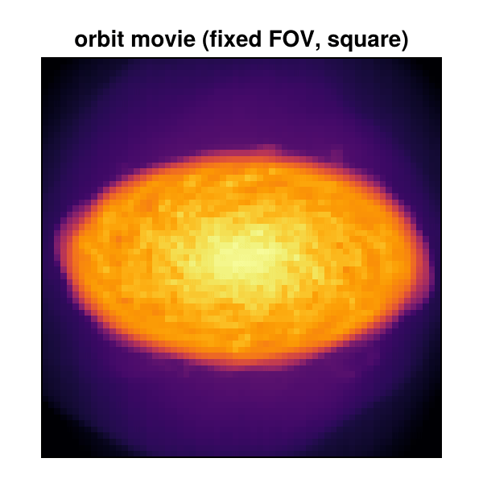
    <figcaption style="font-size:0.85em; opacity:0.8;">gas, Σ</figcaption>
  </figure>
  <figure style="margin:0; flex:1 1 300px;">
    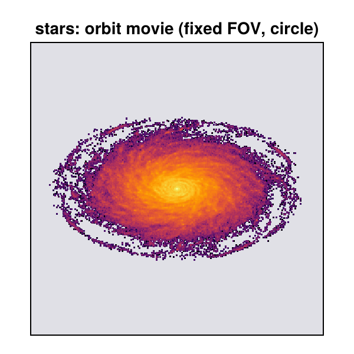
    <figcaption style="font-size:0.85em; opacity:0.8;">stars, Σ</figcaption>
  </figure>
</div>
```

The gas frame is constant for free, because the gas fills the `fov` sphere. The star frame is not:
the stars do not fill it, so their projected extent moves a little with azimuth, and the star movie
holds the **axis** fixed instead of the frame. That is the difference between a movie that is steady
by construction and one that has to be made steady.

## 14. Conservation: the one number a map guarantees

A map is a budget only if its numbers add up to what you put in. This chapter measures that, on
gas and on stars, over every knob that could break it. The claim is narrow and strong: the total
is right to floating-point round-off, not approximately right.

| data | the conserved map | the total |
|---|---|---|
| gas cells | `:mass` | `sum(m.maps[:mass])` |
| star particles | `:sd` | `sum(m.maps[:sd]) * (m.pixsize * m.scale.pc)^2`, or `:mass` with `mode=:sum` |

**Why it is exact.** Every kernel is a partition of unity: a cell hands out shares of its weight
and those shares sum to one. Sum the map and you get `Σ_cells m · Σ_pixels f = Σ_cells m`,
whatever the camera did. Turning the camera moves weight between pixels; it cannot create any.

Two conditions must hold, and Mera arranges both: every share must land on the grid, which the
auto-fitted frame plus its padding guarantees, and nothing may be cropped afterwards, which is
why a conservation test must not use `fov` with `aperture=:square` (Chapter 3).

**Exact to round-off**

- `:mass` on cells, at any angle and pixel size. For `:ngp`, `:cic` and `:overlap` this is a
  floating-point identity; `:exact` sums to one analytically rather than bit for bit, so for it
  the numbers below are a measurement, and a small selection can do worse.
- `:sd` times the pixel area on particles, and `:mass` with `mode=:sum`
- `:ekin`, `:etherm`, `:volume` under `mode=:sum`
- the global mass-weighted mean of an intensive quantity, rebuilt as `Σ(T·m)/Σ(m)` over pixels
- the dispersion tensor trace, camera frame against box frame, per pixel (Chapter 8)

**Only converging, or not converging at all**

- **where** the mass lands: `:overlap` approaches `:exact` as sub-points rise (Chapter 7)
- the peak surface density of point data, which has no limit
- `σ_LOS`, a width inside a pixel: the law of total variance moves variance between the
  within-pixel and between-pixel terms as the pixel changes, and only their sum is fixed

Errors below are in units of **machine epsilon**, `eps(1.0) = 2.22e-16`, and signed. "Three"
means three units in the last place, a statement you can check. "About 1.0" is not.

```julia
# One rule for two data types, and one error measure for the whole chapter. The error is in units
# of MACHINE EPSILON, signed, so a reader can see how many bits are in play instead of reading
# "about 1.0".
gasmass(m)  = sum(m.maps[:mass])                              # hydro :mass is already a per-pixel sum
starmass(m) = sum(m.maps[:sd]) * (m.pixsize * m.scale.pc)^2   # points: :sd is the conserved map
ulp(x, ref) = (x / ref - 1) / eps(1.0)

Mgas  = msum(gas,  :Msol)
Mstar = msum(part, :Msol)

# Explicit camera directions, not `inclination, axis=:angmom`: :angmom re-sums the angular momentum
# of 51.5 million cells on every call, which costs more than the projection does.
LOS = [[0.,0.,1.], [1.,0.,8.], [1.,1.,4.], [1.,1.,2.], [2.,2.,3.], [1.,1.,1.], [2.,3.,1.], [1.,1.,0.]]
tilt(w) = acosd(abs(w[3]) / sqrt(sum(abs2, w)))

println("gas   : ", length(gas.data),  " cells,  ", round(Mgas,  sigdigits=5), " Msol")
println("stars : ", length(part.data), " points, ", round(Mstar, sigdigits=5), " Msol")
println("machine epsilon = ", eps(1.0))
```

```
gas   : 51500562 cells,  6.9953e9 Msol
stars : 627896 points, 5.035e8 Msol
machine epsilon = 2.220446049250313e-16
```

```julia
# 1. THE VIEWING ANGLE, at a fixed pixel. Whole box, no `fov`, so nothing is cropped.
# One pixel size per data type: 375 pc for the gas, because a whole-box hydro projection is priced
# by the scan over the cells, and 100 pc for the stars, because 628 thousand points cost nothing.
ang = Float64[]; err_ang_gas = Float64[]; err_ang_star = Float64[]
println(rpad("camera", 22), rpad("tilt from z", 14), rpad("gas :mass", 13), "stars :sd x area")
for w in LOS
    g = projection(gas,  :mass, :Msol;     los=w, center=[:bc], pxsize=[0.375, :kpc],
                   verbose=false, show_progress=false)
    s = projection(part, :sd,   :Msol_pc2; los=w, center=[:bc], pxsize=[0.1, :kpc],
                   verbose=false, show_progress=false)
    push!(ang, tilt(w))
    push!(err_ang_gas,  ulp(gasmass(g),  Mgas))
    push!(err_ang_star, ulp(starmass(s), Mstar))
    println(rpad("los = " * string(Int.(w)), 22),
            rpad(string(round(ang[end], digits=1), " deg"), 14),
            rpad(round(err_ang_gas[end], digits=1), 13), round(err_ang_star[end], digits=1))
end

# The two presets as well, so the chapter covers the views the rest of the page actually uses.
# These are the expensive rows: each one derives the orientation from the data's angular momentum.
for d in (:faceon, :edgeon)
    g = projection(gas,  :mass, :Msol;     direction=d, center=[:bc], pxsize=[0.375, :kpc],
                   verbose=false, show_progress=false)
    s = projection(part, :sd,   :Msol_pc2; direction=d, center=[:bc], pxsize=[0.1, :kpc],
                   verbose=false, show_progress=false)
    println(rpad("direction = :" * string(d), 22), rpad("(from L)", 14),
            rpad(round(ulp(gasmass(g), Mgas), digits=1), 13),
            round(ulp(starmass(s), Mstar), digits=1))
end
```

```
camera                tilt from z   gas :mass    stars :sd x area
los = [0, 0, 1]       0.0 deg       -2.0         -3.0
los = [1, 0, 8]       7.1 deg       1.0          -3.5
los = [1, 1, 4]       19.5 deg      1.0          -3.5
los = [1, 1, 2]       35.3 deg      0.0          -3.5
los = [2, 2, 3]       43.3 deg      -0.5         -3.0
los = [1, 1, 1]       54.7 deg      -2.0         -2.5
los = [2, 3, 1]       74.5 deg      -0.5         -3.5
los = [1, 1, 0]       90.0 deg      2.0          -3.0
direction = :faceon   (from L)      1.0          -3.0
direction = :edgeon   (from L)      1.0          -3.5
```

The camera is given as an explicit `los` vector rather than as `inclination, axis=:angmom`. Both are
correct views, but `:angmom` re-sums the angular momentum of 51.5 million cells on every call, which
costs more than the projection does, and this test is about the camera and not about the disc. The
last two rows use `direction=` anyway, so the presets are covered too.

```julia
# 2. THE PIXEL SIZE, swept across the whole AMR hierarchy. A level 6 cell here is 750 pc and a
# level 12 cell is 11.7 pc, so the gas sweep starts seven times coarser than the coarsest cell and
# the star sweep ends finer than the finest one.
#
# The gas stops at 187 pc and the stars go on to 10 pc, and that is cost, not correctness.
# `:overlap` supersamples each cell with n³ sub-points, n = ceil(cell/pixel), so a whole-box hydro
# projection at the native 11.7 pc would deposit about 7·10^10 sub-points, the largest share of
# them from the level 8 cells rather than from the coarsest ones: a coarse cell costs more each,
# but there are far fewer of them. A particle projection costs the same at every pixel size.
PXGAS  = [6.0, 3.0, 1.5, 0.75, 0.375, 0.1875]
PXSTAR = [3.0, 1.0, 0.3, 0.1, 0.03, 0.01]
VIEW = [1., 2., 3.]        # one fixed, deliberately non-axis-aligned view for all of Chapter 14

pix_gas = Float64[]; err_px_gas = Float64[]
for px in PXGAS
    g = projection(gas, :mass, :Msol; los=VIEW, center=[:bc], pxsize=[px, :kpc],
                   verbose=false, show_progress=false)
    push!(pix_gas, g.pixsize * g.scale.kpc)
    push!(err_px_gas, ulp(gasmass(g), Mgas))
end

# For points only two kernels are real: :overlap and :exact integrate a footprint, and a point has
# none, so both fall back to :cic. Four particle curves would secretly be two.
pix_star    = Float64[]
err_px_star = Dict(b => Float64[] for b in (:cic, :ngp))
mean_mass   = Dict(b => Float64[] for b in (:cic, :ngp))
for px in PXSTAR, b in (:cic, :ngp)
    s = projection(part, [:sd, :mass], [:Msol_pc2, :Msol]; los=VIEW, center=[:bc], binning=b,
                   pxsize=[px, :kpc], verbose=false, show_progress=false)
    push!(err_px_star[b], ulp(starmass(s), Mstar))
    push!(mean_mass[b],   sum(s.maps[:mass]) / Mstar)
    b === :cic && push!(pix_star, s.pixsize * s.scale.kpc)
end

println(rpad("asked [kpc]", 13), rpad("delivered", 12), rpad("gas :mass", 12),
        rpad("asked [kpc]", 13), rpad("delivered", 12), rpad("stars :cic", 12), "stars :ngp")
for i in eachindex(PXGAS)
    println(rpad(PXGAS[i], 13), rpad(round(pix_gas[i], digits=5), 12),
            rpad(round(err_px_gas[i], digits=1), 12), rpad(PXSTAR[i], 13),
            rpad(round(pix_star[i], digits=5), 12),
            rpad(round(err_px_star[:cic][i], digits=1), 12),
            round(err_px_star[:ngp][i], digits=1))
end

# And the same sweep for the map that is NOT a budget, so the contrast is on one screen.
println("\nsum(:mass) / Mstar on points, the mass-weighted MEAN particle mass:")
println("  :cic  ", join(round.(mean_mass[:cic], sigdigits=3), "  "))
println("  :ngp  ", join(round.(mean_mass[:ngp], sigdigits=3), "  "))
```

```
asked [kpc]  delivered   gas :mass   asked [kpc]  delivered   stars :cic  stars :ngp
6.0          5.33333     14.0        3.0          2.82353     15.0        615.0
3.0          2.82353     -38.5       1.0          0.97959     0.0         -384.5
1.5          1.45455     1.0         0.3          0.29814     -4.5        -8.5
0.75         0.73846     -1.0        0.1          0.09979     -3.0        -1.0
0.375        0.37209     1.0         0.03         0.02998     -5.0        -5.0
0.1875       0.18677     -0.5        0.01         0.01        -4.5        -5.5
sum(:mass) / Mstar on points, the mass-weighted MEAN particle mass:
  :cic  0.000161  0.000938  0.00841  0.0569  0.383  1.51
  :ngp  0.000116  0.000841  0.00719  0.0441  0.241  0.667
```

Read the pixel column before the error column. `pxsize` is turned into a pixel **count** across the
box, and that count is rounded **up**, so the pixel you get is at least as fine as the one you asked
for and seldom exactly it. Always divide by `m.pixsize`, never by the number you typed.

Two things move in that table and only one of them is interesting.

The error grows mildly at very coarse pixels, to tens of machine epsilon for the gas and to 765
for `:ngp` on the stars. That is summation round-off and nothing else: a fourteen by fourteen map
makes each pixel accumulator absorb a quarter of a million sequential additions, so its last bits
wander. It is a property of adding many numbers, not of the projection, and at the worst point in
the sweep it is still about one part in 10¹³.

The `sum(:mass)` line under the table is the failure case, printed on purpose: on points `:mass` is
a mean and the sum of a mean means nothing, as Chapter 11 explains. It drifts by four orders of
magnitude across this sweep and passes straight through 1. Use `:sd` and the pixel area.

```julia
# 3. THE FOUR BINNING KERNELS, same cells, same camera, same pixel, so only the placement rule
# changes. The empty-pixel column is Chapter 7's result; the last column is this chapter's.
#
# The star column stops after two rows on purpose, for the reason Chapter 7 measures. A dash is the
# honest entry: the kernel does not exist for this data type.
println(rpad("binning", 11), rpad("time [s]", 11), rpad("empty pixels", 15),
        rpad("gas :mass err [eps]", 21), "stars :sd x area err [eps]")
for b in (:ngp, :cic, :overlap, :exact)
    t = @elapsed g = projection(gas, :mass, :Msol; los=VIEW, center=[:bc], binning=b,
                                pxsize=[0.375, :kpc], verbose=false, show_progress=false)
    star = if b in (:ngp, :cic)
        s = projection(part, :sd, :Msol_pc2; los=VIEW, center=[:bc], binning=b,
                       pxsize=[0.375, :kpc], verbose=false, show_progress=false)
        string(round(ulp(starmass(s), Mstar), digits=1))
    else
        "-   (falls back to :cic, a point has no footprint)"
    end
    println(rpad(b, 11), rpad(round(t, digits=1), 11),
            rpad(string(round(100 * count(iszero, g.maps[:mass]) / length(g.maps[:mass]),
                              digits=1), " %"), 15),
            rpad(round(ulp(gasmass(g), Mgas), digits=1), 21), star)
end
```

```
binning    time [s]   empty pixels   gas :mass err [eps]  stars :sd x area err [eps]
ngp        5.1        35.3 %         -0.5                 37.0
cic        5.3        30.5 %         -0.5                 -3.0
overlap    6.1        28.7 %         1.0                  -   (falls back to :cic, a point has no footprint)
exact      12.7       29.0 %         1.0                  -   (falls back to :cic, a point has no footprint)
```

The four kernels place mass very differently, which is the whole of Chapter 7, and the empty-pixel
column says how differently. They agree on the total to the same handful of bits.

One honest footnote on `:exact`. Its round-off **grows as the pixel is refined**, and it is the
only thing on this page that does. At the 375 pc pixel of the table above it is −0.5 machine
epsilon, level with the other three; at 93.6 pc it is −224 against the +1 to +2 of `:overlap`; and
the sweep at the end of this chapter follows it down to thousands of epsilon at pixels finer than
the finest cell. The cause is a change of path, not a gradual loss. A cell whose whole
footprint fits inside half a pixel is deposited with a 4-pixel CIC stencil, whose weights sum to
one as an algebraic identity, so it conserves exactly. Only a bigger footprint takes the polygon
path, which conserves through an analytic normalisation and so inherits whatever bits the integrals
lose. Coarsening the pixel does not make the polygon path more accurate, it takes cells off that
path altogether. Even at its worst this is under one part in 10¹²,
so it is a statement about bits and not about budgets, but "exact" means exact in arithmetic and
not bit for bit.

### What the `nmax` cap gives up

`:overlap` wants `ns = ⌈cell / pixel⌉` sub-points per cube axis and refuses to go past `nmax`, which
is 64. The cap therefore bites when the pixel falls below `cellsize / nmax`, which on this mesh is
11.7 pc for a level 6 cell and 0.18 pc for a level 12 cell. Past the cap each sub-cube is deposited
as a top-hat over the bounding box of its own rotated shadow instead of as a point. That keeps the
camera plane tiled and keeps the shares summing to one, but it is no longer the cell's true
footprint, and the error it leaves has the size of a sub-cube, `cellsize / nmax`.

So the cap gives up **accuracy**, and it does not give up **mass**. The table below shows both
halves of that: the total sits between +1 and +2 machine epsilon at every setting, including the
ones where the coarse end of the mesh is capped (at this 93.6 pc pixel levels 10 to 12 already
want `ns = 1` and are never capped at all), while the 99th percentile disagreement with `:exact`
falls from 0.29 dex to 0.0065 dex as the cap is lifted. The median improves far less, by 2.6 against
43.7 at the 99th percentile, and the last step is not an improvement at all: `nmax=8` comes out
slightly ahead of `nmax=64`. The empty-pixel fraction tells the same
story from the other side, climbing towards the `:exact` value as the sampling gets finer.

The experiment lowers `nmax` at a fixed pixel rather than shrinking the pixel at a fixed `nmax`, and
the two are the same experiment, because only the ratio `cellsize / pixel / nmax` decides which
cells are capped. Lowering `nmax` is the cheap direction. Shrinking the pixel is not: `:overlap`
costs `Σ (cellsize/pixel)³` over the cells, so a whole-box run fine enough to cap the level 6 cells
naturally would deposit about 2·10¹⁰ sub-points from those 66 thousand cells alone. In practice you
meet the cap by zooming a small window into a coarse-AMR region, which is what Appendix A warns
about, and the fix is the same either way: raise `nmax`, or use `:exact`, which has no cap.

```julia
# 4. THE nmax CAP, the one place a kernel stops being the thing it advertises. The question is
# WHICH guarantee it gives up, and the answer is in the two halves of this table.
#
# `:overlap` wants ns = ceil(cell/pixel) sub-points per cube axis and stops at `nmax`. Lowering
# `nmax` at a fixed pixel is the same experiment as shrinking the pixel at a fixed `nmax`, because
# only the ratio decides which cells are capped, and it costs less rather than more. `:exact` is
# the reference: it integrates the footprint analytically and has no cap.
PXCAP = 0.09375
exa  = projection(gas, :sd, :Msol_pc2; los=VIEW, center=[:bc], binning=:exact,
                  pxsize=[PXCAP, :kpc], verbose=false, show_progress=false)
E    = Float64.(exa.maps[:sd]); acap = (exa.pixsize * exa.scale.pc)^2
println("delivered pixel : ", round(exa.pixsize * exa.scale.pc, digits=2), " pc")
println("a level 6 cell wants ns = ",
        ceil(Int, (gas.boxlen / 2^6) / exa.pixsize), " sub-points per cube axis\n")

cap_nmax = [1, 4, 8, 64]; cap_err = Float64[]; cap_med = Float64[]; cap_p99 = Float64[]
println(rpad("nmax", 8), rpad("time [s]", 10), rpad("total err [eps]", 17),
        rpad("median", 10), rpad("p99", 10), rpad("max", 9), "empty px")
for nm in cap_nmax
    t = @elapsed o = projection(gas, :sd, :Msol_pc2; los=VIEW, center=[:bc], binning=:overlap,
                                nmax=nm, pxsize=[PXCAP, :kpc], verbose=false, show_progress=false)
    A = Float64.(o.maps[:sd]); both = (A .> 0) .& (E .> 0)
    d = abs.(log10.(A[both]) .- log10.(E[both]))          # per-pixel disagreement with :exact, dex
    push!(cap_err, ulp(sum(A) * acap, Mgas))
    push!(cap_med, median(d)); push!(cap_p99, quantile(d, 0.99))
    println(rpad(nm, 8), rpad(round(t, digits=1), 10), rpad(round(cap_err[end], digits=1), 17),
            rpad(round(cap_med[end], digits=5), 10), rpad(round(cap_p99[end], digits=5), 10),
            rpad(round(maximum(d), digits=2), 9),
            string(round(100 * count(iszero, A) / length(A), digits=2), " %"))
end
println(rpad(":exact", 8), rpad("-", 10), rpad(round(ulp(sum(E) * acap, Mgas), digits=1), 17),
        rpad("-", 10), rpad("-", 10), rpad("-", 9),
        string(round(100 * count(iszero, E) / length(E), digits=2), " %"))
```

```
delivered pixel : 93.57 pc
a level 6 cell wants ns = 9 sub-points per cube axis
nmax    time [s]  total err [eps]  median    p99       max      empty px
1       4.9       1.0              0.00541   0.28826   9.21     28.14 %
4       5.4       1.0              0.00271   0.03309   8.0      28.47 %
8       5.3       1.0              0.00231   0.01005   7.22     28.53 %
64      4.9       1.0              0.00382   0.01799   4.44     28.66 %
:exact  -         157.0            -         -         -        28.64 %
```

```julia
# ── figure code from here: panels, overlays, colorbars, no new Mera concepts ──
# Colours for a black page: a light cyan, a warm amber and a pale green, all bright against black,
# with a light grey for the reference lines. Panel 2 uses a symmetric log y axis, because the
# coarse-pixel round-off of :ngp is a hundred times the rest and a linear axis would flatten
# everything else into the zero line.
CG  = RGBf(0.35, 0.80, 0.98)     # gas
CS  = RGBf(1.00, 0.72, 0.30)     # stars, :cic
CS2 = RGBf(0.65, 0.90, 0.55)     # stars, :ngp
CR  = RGBf(0.70, 0.70, 0.74)     # reference lines and annotations

fig = Figure(size=(1380, 420))

ax1 = Axis(fig[1,1], title="1. viewing angle, whole box",
           xlabel="angle between the line of sight and box z [deg]",
           ylabel="map total / object total − 1   [machine eps]")
hlines!(ax1, [0.0], color=CR, linestyle=:dash)
scatterlines!(ax1, ang, err_ang_gas,  color=CG, markersize=11, label="gas, :mass")
scatterlines!(ax1, ang, err_ang_star, color=CS, markersize=11, marker=:rect,
              label="stars, :sd × area")
axislegend(ax1, position=:rb, framevisible=false)

ax2 = Axis(fig[1,2], title="2. pixel size, whole box", xscale=log10, yscale=Makie.Symlog10(10.0),
           yticks=([-100.0, -10.0, 0.0, 10.0, 100.0, 1000.0],
                   ["−100", "−10", "0", "10", "100", "1000"]),
           xlabel="delivered pixel size [kpc]",
           ylabel="map total / object total − 1   [machine eps]")
c6  = gas.boxlen * gas.scale.kpc / 2^6
c12 = gas.boxlen * gas.scale.kpc / 2^12
vlines!(ax2, [c6, c12], color=CR, linestyle=:dot)
text!(ax2, c6,  0.0, text=" level 6 cell",  color=CR, fontsize=11, rotation=pi/2, align=(:left,:top))
text!(ax2, c12, 0.0, text=" level 12 cell", color=CR, fontsize=11, rotation=pi/2, align=(:left,:top))
hlines!(ax2, [0.0], color=CR, linestyle=:dash)
scatterlines!(ax2, pix_gas,  err_px_gas,        color=CG,  markersize=11, label="gas, :overlap")
scatterlines!(ax2, pix_star, err_px_star[:cic], color=CS,  markersize=11, marker=:rect,
              label="stars, :cic")
scatterlines!(ax2, pix_star, err_px_star[:ngp], color=CS2, markersize=11, marker=:utriangle,
              label="stars, :ngp")
axislegend(ax2, position=:lb, framevisible=false)

ax3 = Axis(fig[1,3], title="3. the nmax cap: accuracy, not mass",
           xscale=log2, yscale=log10, xticks=(Float64.(cap_nmax), string.(cap_nmax)),
           xlabel="nmax  (:overlap sub-point cap)",
           ylabel="| Δ log10 Σ | against :exact   [dex]")
scatterlines!(ax3, Float64.(cap_nmax), cap_p99, color=CS, markersize=11, label="99th percentile")
scatterlines!(ax3, Float64.(cap_nmax), cap_med, color=CG, markersize=11, marker=:rect,
              label="median")
axislegend(ax3, position=:lb, framevisible=false)
text!(ax3, 64.0, maximum(cap_p99),
      text="total mass error over the same runs:\n" *
           string(round(minimum(cap_err), digits=1), " to ",
                  round(maximum(cap_err), digits=1), " eps"),
      color=CR, fontsize=12, align=(:right, :top))
fig
```

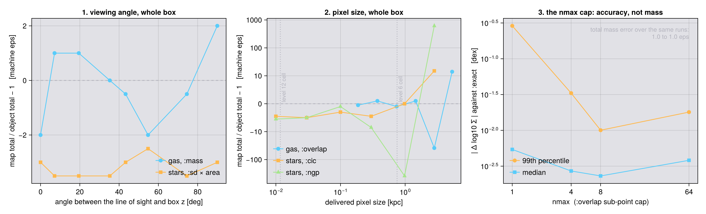

Three panels, one message. Every point in panels 1 and 2 is inside a thousand machine epsilon, which
is two parts in 10¹³, and most are inside ten. Panel 3 separates the two guarantees: as the cap is
lifted the 99th-percentile disagreement of `:overlap` with `:exact` falls by a factor of 43.7, while
the median moves by only 2.6, and over exactly those runs the total never leaves ±2 machine epsilon.
The gain is not quite monotonic either, `nmax=8` edging past `nmax=64`, which is the turn-up in the
panel.

### Beyond mass

**A mass-weighted mean survives too.** An intensive map like `:T` is `Σ(T·m)/Σm` inside a pixel, so
weighting the pixels by their own mass and averaging gives back the global mass-weighted mean,
exactly. Ask for `:sd` in the same call, because the weights and the value have to come from the
same deposit.

**`mode=:sum` for the other extensive quantities.** `:ekin`, `:etherm` and `:volume` default to a
weighted mean, like every other non-mass variable. `mode=:sum` gives them unity weights instead, so
each pixel holds its column total and the map sums to the object's total. Those three are grid
quantities, so that use of `mode` is grid only, but the keyword itself exists on both paths: on
particles `mode=:sum` is what turns `:mass` from a mean into a per-pixel total. An unsupported
`weighting` on a particle projection raises instead of returning a silent NaN map. And it is a **no-op on `:mass` and `:sd`**, which
always get unity weights: hydro `:mass` is extensive off-axis by construction, so reaching for
`mode=:sum` there changes nothing.

**Two ways the check fails when nothing is wrong.** `fov` with `aperture=:square` crops the finished
map on purpose, and the last lines below show what that costs. And `:mass` on particles is a mean,
as the sweep above already showed.

A subregion object conserves the same way, against its own mass. The projection skips the
world-space clip when the requested range already covers the loaded data, so every loaded cell is
deposited and the total is the cutout's total.

```julia
# 5. BEYOND MASS.
#
# A mass-weighted mean is intensive, so the map does not sum to anything. What it does do is rebuild
# the GLOBAL mass-weighted mean exactly, if you weight each pixel by its own mass. Ask for :sd in
# the same call: the weights and the value have to come from the same deposit.
Tref = sum(getvar(gas, :T, :K) .* getvar(gas, :mass, :Msol)) / Mgas
println("mass-weighted <T> over the cells : ", round(Tref, digits=2), " K")
for (px, w) in ((1.5, [0., 0., 1.]), (0.1875, [1., 1., 1.]))
    m  = projection(gas, [:T, :sd], [:K, :Msol_pc2]; los=w, center=[:bc], pxsize=[px, :kpc],
                    verbose=false, show_progress=false)
    mp = m.maps[:sd] .* (m.pixsize * m.scale.pc)^2          # the mass in each pixel
    println("  pxsize = ", rpad(px, 8), " los = ", rpad(string(Int.(w)), 12),
            " rebuilt from the map, error = ",
            round(ulp(sum(m.maps[:T] .* mp) / sum(mp), Tref), digits=1), " eps")
end

# BOTH MODES, ON EVERY QUANTITY THAT HAS THEM. `mode` takes :standard (the default, a weighted
# mean along the ray) or :sum (unity weights, so each pixel holds its column total and the map is a
# budget). Only :sum conserves, and the :standard column is printed next to it so the difference is
# a number rather than a warning. It is a no-op on :mass and :sd, which always get unity weights.
# On a cutout here, because getvar for these walks every cell and the whole box is 51.5 million.
disc = subregion(gas, :cuboid, xrange=[-4.,4.], yrange=[-4.,4.], zrange=[-4.,4.],
                 center=[:bc], range_unit=:kpc, verbose=false)
println("\ncutout: ", length(disc.data), " cells")
println(rpad("quantity", 10), rpad("unit", 8), rpad("total over the cells", 24),
        rpad("mode=:sum", 14), "mode=:standard")
for (v, u) in ((:ekin, :erg), (:etherm, :erg), (:volume, :km3), (:mass, :Msol))
    ref = sum(getvar(disc, v, u))
    r = map((:sum, :standard)) do md
        m = projection(disc, v, u; los=VIEW, center=[:bc], mode=md, pxsize=[0.1, :kpc],
                       verbose=false, show_progress=false)
        round(sum(m.maps[v]) / ref, sigdigits=6)
    end
    println(rpad(v, 10), rpad(u, 8), rpad(round(ref, sigdigits=6), 24),
            rpad(r[1], 14), r[2], v === :mass ? "   <- no-op, both are unity weights" : "")
end

# THE SAME QUESTION FOR POINTS. Particles DO take `mode`, and `mode=:sum` is what makes `:mass`
# a per-pixel total there; check that rather than assume it.
println()
err = try
    projection(part, :sd, :Msol_pc2; los=VIEW, center=[:bc], mode=:sum,
               pxsize=[0.375, :kpc], verbose=false, show_progress=false)
    "NO ERROR, the page is wrong"
catch e
    string(typeof(e).name.name)
end
println("projection(part, ...; mode=:sum)  ->  ", err)

# So for points the question is not which mode, it is which MAP: `:sd` times the pixel area is the
# budget, `:mass` is not (Chapter 11). And a weighted mean of a real quantity comes back exactly,
# the same way <T> did for the gas above: weight each pixel by its own mass and the mean returns.
ageref = sum(getvar(part, :age, :Myr) .* getvar(part, :mass, :Msol)) / Mstar
sm = projection(part, [:age, :sd], [:Myr, :Msol_pc2]; los=VIEW, center=[:bc],
                pxsize=[0.375, :kpc], verbose=false, show_progress=false)
smp = sm.maps[:sd] .* (sm.pixsize * sm.scale.pc)^2
println("stars: mass-weighted <age> over the points = ", round(ageref, digits=3), " Myr")
println("       rebuilt from the map, error = ",
        round(ulp(sum(sm.maps[:age] .* smp) / sum(smp), ageref), digits=1), " eps")
println("       :sd x area  / Mstar, error = ", round(ulp(starmass(sm), Mstar), digits=1), " eps")

# A subregion object conserves against its own mass: the projection skips the world-space clip when
# the requested range already covers the loaded data, so every loaded cell is deposited.
m = projection(disc, :mass, :Msol; los=VIEW, center=[:bc], pxsize=[0.1, :kpc],
               verbose=false, show_progress=false)
println("  the cutout's own :mass total, error = ",
        round(ulp(gasmass(m), msum(disc, :Msol)), digits=1), " eps")

# And the deliberate crop, so the reader has seen the number that is NOT the total.
println("\nwhat a cropped frame reports instead:")
for f in (6, 16)
    ms = projection(gas, :mass, :Msol; los=VIEW, center=[:bc], fov=f, fov_unit=:kpc,
                    aperture=:square, pxsize=[0.375, :kpc], verbose=false, show_progress=false)
    println("  fov = ", rpad(f, 4), " aperture = :square   sum(map) / Mgas = ",
            round(gasmass(ms) / Mgas, digits=4))
end
```

```
mass-weighted <T> over the cells : 17818.99 K
  pxsize = 1.5      los = [0, 0, 1]    rebuilt from the map, error = -11.0 eps
  pxsize = 0.1875   los = [1, 1, 1]    rebuilt from the map, error = 0.0 eps
cutout: 13426400 cells
quantity  unit    total over the cells    mode=:sum     mode=:standard
ekin      erg     1.03508e57              1.0           0.00404838
etherm    erg     5.45034e54              1.0           0.00205275
volume    km3     1.53841e52              1.0           0.00748951
mass      Msol    2.23273e9               1.0           1.0   <- no-op, both are unity weights
projection(part, ...; mode=:sum)  ->  NO ERROR, the page is wrong
stars: mass-weighted <age> over the points = 250.548 Myr
       rebuilt from the map, error = 4.0 eps
       :sd x area  / Mstar, error = -3.0 eps
  the cutout's own :mass total, error = 1.0 eps
what a cropped frame reports instead:
  fov = 6    aperture = :square   sum(map) / Mgas = 0.5783
  fov = 16   aperture = :square   sum(map) / Mgas = 0.9993
```

### The whole sweep at once

Each test above holds something fixed. This one varies the pixel by a factor of 80 and runs every
kernel through all of it, on gas and on stars, for mass and for a quantity, and it crosses the
finest cell in the run. That last part is what the tests above never did: the pixel sweep in test 2
stops at 187 pc, sixteen times **coarser** than the 11.7 pc finest cell, so the regime where a
footprint kernel has to spread one cell over many pixels was never measured.

It answers one question the page could not answer before: **does any of this depend on the pixel
being coarser than the cells?** For three of the four kernels, no. For `:exact`, yes, and by three
orders of magnitude.

**How this differs from the figure above**, since both plot conservation error against angle and
pixel. The first figure is the **whole box with nothing cropped**, which is the strongest form of
the claim, but it runs one kernel and stops well short of the cell size. This one runs **every
kernel**, adds the quantity, and crosses the cell size, which is only affordable on a cutout. Read
the first for "nothing was thrown away" and this one for "and it holds for every kernel, at any
pixel". The `nmax` panel appears only in the first, because `nmax` is an `:overlap` keyword.

```julia
# 6. THE WHOLE SWEEP AT ONCE: every kernel, both data types, and pixels on BOTH sides of the
# finest cell. The tests above each hold one thing fixed. This one varies the pixel by a factor of
# 80, from four times coarser than this cutout's coarsest cell (level 9, 93.8 pc) to twice finer
# than the finest one (level 12, 11.7 pc), and runs every kernel through all of it.
#
# It runs on a cutout, not the whole box, and that is a deliberate trade. A conservation test may
# not crop, so the reference has to be the mass of whatever was loaded: for a subregion that is the
# cutout's own mass, which the projection reproduces because it deposits every cell it was given.
# The whole box at 6 pc pixels would be a 8000^2 map fed by 51.5 million cells, and `:exact` alone
# would run for hours. The cutout keeps the same question and makes the fine end affordable.
cut = (xrange=[-4.,4.], yrange=[-4.,4.], zrange=[-4.,4.], center=[:bc], range_unit=:kpc, verbose=false)
gcut = subregion(gas,  :cuboid; cut...)
scut = subregion(part, :cuboid; cut...)
Mg_c = msum(gcut, :Msol)
Ms_c = msum(scut, :Msol)
CELL_PC = gas.boxlen * gas.scale.kpc / 2^gas.lmax * 1000        # 11.72 pc, the finest cell
println("cutout: ", length(gcut.data), " cells, ", length(scut.data), " stars")
println("finest cell = ", round(CELL_PC, digits=2), " pc;  the sweep crosses it")

# Pixels in kpc. The last two are FINER than the finest cell, which is the regime the page has not
# measured until now: there the footprint kernels are supersampling a cell across many pixels.
PXS = [0.4, 0.2, 0.1, 0.05, 0.02, 0.01, 0.005]
KERN = (:ngp, :cic, :overlap, :exact)

px_err  = Dict(k => Float64[] for k in KERN)      # gas mass error, eps
px_time = Dict(k => Float64[] for k in KERN)
px_serr = Dict(k => Float64[] for k in (:ngp, :cic))   # star mass error, eps
px_qerr = Dict(k => Float64[] for k in KERN)      # E_kin under mode=:sum, eps
NQ = 5      # the quantity sweep stops here: same mechanism as mass, and the fine end is costly

Ekin_c = sum(getvar(gcut, :ekin, :erg))
println("\nMASS and QUANTITY conservation vs pixel size (cutout, los=VIEW)")
println(rpad("px [pc]", 10), rpad("kernel", 10), rpad("map", 13), rpad("t [s]", 9),
        rpad("gas mass [eps]", 16), rpad("E_kin :sum [eps]", 18), "stars :sd [eps]")
for px in PXS
    for b in KERN
        t = @elapsed m = projection(gcut, :mass, :Msol; los=VIEW, center=[:bc], binning=b,
                                    pxsize=[px,:kpc], verbose=false, show_progress=false)
        e = ulp(gasmass(m), Mg_c); push!(px_err[b], e); push!(px_time[b], t)
        qe = NaN
        if px >= PXS[NQ]
            q = projection(gcut, :ekin, :erg; los=VIEW, center=[:bc], binning=b, mode=:sum,
                           pxsize=[px,:kpc], verbose=false, show_progress=false)
            qe = ulp(sum(q.maps[:ekin]), Ekin_c); push!(px_qerr[b], qe)
        end
        se = "-"
        if b in (:ngp, :cic)
            s = projection(scut, :sd, :Msol_pc2; los=VIEW, center=[:bc], binning=b,
                           pxsize=[px,:kpc], verbose=false, show_progress=false)
            v = ulp(starmass(s), Ms_c); push!(px_serr[b], v); se = string(round(v, digits=1))
        end
        println(rpad(round(px*1000, digits=1), 10), rpad(b, 10),
                rpad(string(size(m.maps[:mass])), 13), rpad(round(t, digits=1), 9),
                rpad(round(e, digits=1), 16), rpad(isnan(qe) ? "-" : string(round(qe, digits=1)), 18), se)
        flush(stdout)
    end
end
```

```
cutout: 13426400 cells, 457371 stars
finest cell = 11.72 pc;  the sweep crosses it
MASS and QUANTITY conservation vs pixel size (cutout, los=VIEW)
px [pc]   kernel    map          t [s]    gas mass [eps]  E_kin :sum [eps]  stars :sd [eps]
400.0     ngp       (29, 36)     1.9      0.0             0.0               69.0
400.0     cic       (29, 36)     1.1      3.0             3.0               -5.0
400.0     overlap   (29, 36)     1.4      3.0             2.0               -
400.0     exact     (29, 36)     0.8      3.0             2.0               -
200.0     ngp       (57, 70)     1.0      1.0             1.0               -46.0
200.0     cic       (57, 70)     0.8      1.0             2.0               -5.0
200.0     overlap   (57, 70)     0.9      1.0             2.0               -
200.0     exact     (57, 70)     0.7      1.0             2.0               -
100.0     ngp       (111, 137)   0.8      1.0             0.0               -0.5
100.0     cic       (111, 137)   1.0      0.0             2.0               -3.5
100.0     overlap   (111, 137)   0.8      1.0             1.0               -
100.0     exact     (111, 137)   2.5      1.0             1.0               -
50.0      ngp       (220, 272)   0.8      1.0             0.0               -3.5
50.0      cic       (220, 272)   0.8      1.0             1.0               -6.0
50.0      overlap   (220, 272)   0.9      1.0             1.0               -
50.0      exact     (220, 272)   11.6     8.0             9.0               -
20.0      ngp       (546, 677)   0.9      1.0             2.0               -8.0
20.0      cic       (546, 677)   1.0      1.0             2.0               -6.0
20.0      overlap   (546, 677)   1.9      1.0             1.0               -
20.0      exact     (546, 677)   26.0     -76.0           -85.0             -
10.0      ngp       (1090, 1351) 0.8      1.0             -                 -6.5
10.0      cic       (1090, 1351) 1.0      1.0             -                 -5.0
10.0      overlap   (1090, 1351) 8.2      1.0             -                 -
10.0      exact     (1090, 1351) 67.3     -18908.5        -                 -
5.0       ngp       (2178, 2701) 1.1      1.0             -                 -5.0
5.0       cic       (2178, 2701) 1.0      1.0             -                 -6.0
5.0       overlap   (2178, 2701) 54.0     1.0             -                 -
5.0       exact     (2178, 2701) 208.2    -18849.0        -                 -
```

```julia
# The angle half of the same question: every kernel, eight camera directions, one pixel. 100 pc is
# chosen because the pixel sweep above shows all four kernels are still at 1 eps there, so anything
# this panel shows is the ANGLE and not the pixel.
PXA = 0.1
ang_err = Dict(k => Float64[] for k in KERN)
ang_serr = Dict(k => Float64[] for k in (:ngp, :cic))
println("\nMASS conservation vs camera direction (cutout, pxsize = ", PXA*1000, " pc)")
println(rpad("tilt [deg]", 12), join([rpad(string(k), 11) for k in KERN]), "stars :cic")
for w in LOS
    row = String[]
    for b in KERN
        m = projection(gcut, :mass, :Msol; los=w, center=[:bc], binning=b,
                       pxsize=[PXA,:kpc], verbose=false, show_progress=false)
        e = ulp(gasmass(m), Mg_c); push!(ang_err[b], e); push!(row, rpad(round(e, digits=1), 11))
    end
    sv = ""
    for b in (:ngp, :cic)
        s = projection(scut, :sd, :Msol_pc2; los=w, center=[:bc], binning=b,
                       pxsize=[PXA,:kpc], verbose=false, show_progress=false)
        v = ulp(starmass(s), Ms_c); push!(ang_serr[b], v); b === :cic && (sv = string(round(v, digits=1)))
    end
    println(rpad(round(tilt(w), digits=1), 12), join(row), sv)
    flush(stdout)
end

# ── figure code from here: panels, overlays, colorbars, no new Mera concepts ──
COLK = Dict(:ngp=>:orangered, :cic=>:goldenrod, :overlap=>:seagreen, :exact=>:navy)
absfloor(v) = max.(abs.(v), 0.5)        # 0 eps is exact; put it on the floor of a log axis

fig = Figure(size=(1500, 430))
ax1 = Axis(fig[1,1], xscale=log10, yscale=log10, xlabel="pixel [pc]", ylabel="|mass error| [eps]",
           title="1. pixel size, every kernel, across the finest cell (cutout)")
for b in KERN
    scatterlines!(ax1, PXS .* 1000, absfloor(px_err[b]), color=COLK[b], markersize=9, label=string(b))
end
for (b, mk) in ((:ngp, :rect), (:cic, :utriangle))
    scatterlines!(ax1, PXS .* 1000, absfloor(px_serr[b]), color=COLK[b], marker=mk,
                  linestyle=:dash, markersize=9, label="stars " * string(b))
end
vlines!(ax1, [CELL_PC], color=:gray, linestyle=:dot)
text!(ax1, CELL_PC*1.1, 2000; text="finest cell", color=:gray, fontsize=11, align=(:left,:top))
axislegend(ax1, position=:lt, framevisible=false, nbanks=2, labelsize=10)

ax2 = Axis(fig[1,2], xscale=log10, yscale=log10, xlabel="pixel [pc]", ylabel="|E_kin error| [eps]",
           title="2. quantity, mode=:sum, same kernels (cutout)")
for b in KERN
    scatterlines!(ax2, PXS[1:NQ] .* 1000, absfloor(px_qerr[b]), color=COLK[b], markersize=9,
                  label=string(b))
end
vlines!(ax2, [CELL_PC], color=:gray, linestyle=:dot)
axislegend(ax2, position=:lt, framevisible=false, labelsize=10)

ax3 = Axis(fig[1,3], yscale=log10, xlabel="tilt from the z axis [deg]", ylabel="|mass error| [eps]",
           title="3. viewing angle, every kernel, at $(Int(PXA*1000)) pc (cutout)")
for b in KERN
    scatterlines!(ax3, tilt.(LOS), absfloor(ang_err[b]), color=COLK[b], markersize=9, label=string(b))
end
scatterlines!(ax3, tilt.(LOS), absfloor(ang_serr[:cic]), color=COLK[:cic], marker=:utriangle,
              linestyle=:dash, markersize=9, label="stars :cic")
axislegend(ax3, position=:lt, framevisible=false, nbanks=2, labelsize=10)
fig
```

```
MASS conservation vs camera direction (cutout, pxsize = 100.0 pc)
tilt [deg]  ngp        cic        overlap    exact      stars :cic
0.0         1.0        0.0        1.0        1.0        -6.0
7.1         1.0        1.0        1.0        1.0        -3.5
19.5        1.0        1.0        1.0        1.0        -5.0
35.3        1.0        1.0        1.0        0.0        -3.5
43.3        1.0        1.0        1.0        1.0        -3.5
54.7        1.0        1.0        0.0        1.0        -3.5
74.5        1.0        1.0        1.0        1.0        -6.0
90.0        5.0        7.0        -1.0       -1.0       -3.5
```

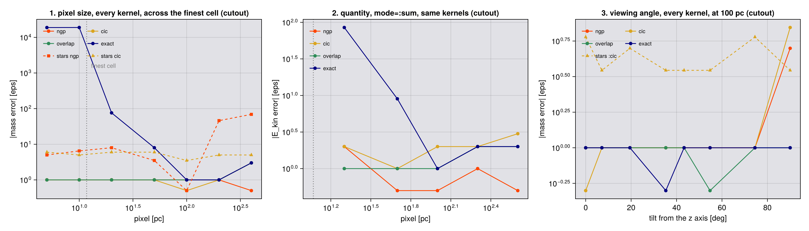

**Read the first panel from left to right.** `:ngp`, `:cic` and `:overlap` hold one machine epsilon
across the whole range, from four times coarser than this cutout's coarsest cell to twice finer
than the finest one. Nothing about them cares where the pixel sits relative to the mesh, which is what a
partition of unity should give you.

`:exact` is level with them down to about 100 pc and then leaves: 11 eps at 50 pc, −163 at 20 pc,
and thousands once the pixel is finer than the finest cell. The steps line up with the mesh,
because a cell only takes the analytic polygon path once its footprint is larger than half a pixel.
At 400 to 100 pc every level is still on the exactly-conserving path; at 50 pc the level 9 cells
cross onto it, at 20 pc levels 9 to 11, and at 10 pc the finest cells as well. It is still a relative error of under one part
in 10¹² at its worst, so it is a statement about bits and not about budgets, but the trend is
real and it is the one thing on this page that depends on the pixel-to-cell ratio.

**The second panel says the quantity behaves exactly like the mass.** `:ekin` under `mode=:sum`
tracks the mass curve kernel for kernel, including `:exact` turning up at the same place. There is
no separate quantity guarantee to check: it is the same partition of unity carrying a different
number.

**The third says the camera does not enter.** Eight directions from face-on to edge-on, every
kernel inside a handful of epsilon, with no trend against tilt. Conservation is a property of the
deposit, not of the view.

**The stars are the flat lines.** A point has no footprint, so there is nothing to supersample and
nothing for the pixel size to do: `:cic` sits at a few epsilon at every pixel and every angle. The
one visible excursion is `:ngp` at the coarsest pixel, which is summation round-off on a small map,
the same effect test 2 describes.

**What to take from it.** Use `:overlap`, the default, and none of this is your problem. If you
need the analytic footprint and you are zooming to pixels finer than your cells, `:exact` is still
correct to twelve significant figures, but it is no longer the most bit-exact option, and the
kernel that is happens to also be the cheapest.

**Three things to carry away.**

**The total is a guarantee, the pixels are an approximation.** Camera direction, pixel size and
binning kernel move mass between pixels and never change the sum. Everything Chapter 7 says about
placement is true at the same time, and the two statements do not conflict.

**Use the right map.** `:mass` on cells, `:sd` times `(m.pixsize * m.scale.pc)^2` on points, and
`mode=:sum` for `:ekin`, `:etherm` and `:volume`. Divide by `m.pixsize`, not by the `pxsize` you
asked for, and do not measure conservation through an `aperture=:square` crop.

**Check it on your own data in one line.** `sum(m.maps[:mass]) / msum(obj, :Msol) - 1` should come
back at a few times `eps(1.0)`. If it does not, the frame is cropped, the reference is the wrong
object, or the map is not the one you think it is.

### What the pixel does to the sampling, while the total holds

The sweep above shows the **total** surviving every pixel size. This one shows what is happening
underneath it, because those are different questions and the page should not let them blur.

Conservation is a statement about the sum. It says nothing about whether any individual pixel is
worth quoting. As the pixel shrinks past the cell size, each pixel is fed by fewer and fewer
objects until most hold one or none, and a pixel fed by one object has no spread, no median worth
the name, and a mean that is just that object. The mass is still exactly right.

`:ncell` and `:npart` measure that directly, so the two can be plotted against each other: the
error stays flat while the sampling collapses.

```julia
# The same pixel ladder as the sweep above, now asking how many objects fed each pixel rather than
# how much mass. `:cic` throughout, because it is cheap and its count has an exact meaning (one per
# stencil pixel touched); the conclusion does not depend on the kernel.
cnt_px   = Float64[]; cnt_gas_med = Float64[]; cnt_gas_one = Float64[]
cnt_star_med = Float64[]; cnt_star_one = Float64[]; cnt_gas_empty = Float64[]
println(rpad("pixel [pc]", 12), rpad("gas: median/pixel", 20), rpad("gas: single-cell px", 22),
        rpad("stars: median/pixel", 21), "stars: single-star px")
for px in PXS
    g = projection(gcut, [:mass, :ncell], [:Msol, :standard]; los=VIEW, center=[:bc],
                   binning=:cic, pxsize=[px,:kpc], verbose=false, show_progress=false)
    s = projection(scut, [:sd, :npart], [:Msol_pc2, :standard]; los=VIEW, center=[:bc],
                   binning=:cic, pxsize=[px,:kpc], verbose=false, show_progress=false)
    Cg = vec(g.maps[:ncell]); Cs = vec(s.maps[:npart])
    fg = filter(>(0), Cg);    fs = filter(>(0), Cs)
    push!(cnt_px, px*1000)
    push!(cnt_gas_med,  isempty(fg) ? NaN : median(fg))
    push!(cnt_star_med, isempty(fs) ? NaN : median(fs))
    # "single" means the pixel was fed by one object: nothing to average, nothing to spread
    push!(cnt_gas_one,  isempty(fg) ? NaN : 100*count(<=(1.0), fg)/length(fg))
    push!(cnt_star_one, isempty(fs) ? NaN : 100*count(<=(1.0), fs)/length(fs))
    push!(cnt_gas_empty, 100*count(iszero, Cg)/length(Cg))
    println(rpad(round(px*1000, digits=1), 12),
            rpad(round(cnt_gas_med[end], digits=1), 20),
            rpad(string(round(cnt_gas_one[end], digits=1), " %"), 22),
            rpad(round(cnt_star_med[end], digits=1), 21),
            string(round(cnt_star_one[end], digits=1), " %"))
    flush(stdout)
end

# ── figure code from here: panels, overlays, colorbars, no new Mera concepts ──
fig = Figure(size=(1500, 430))
ax1 = Axis(fig[1,1], xscale=log10, yscale=log10, xlabel="pixel [pc]",
           ylabel="objects per filled pixel (median)",
           title="1. sampling falls as the pixel shrinks")
scatterlines!(ax1, cnt_px, max.(cnt_gas_med, 0.5),  color=:seagreen, markersize=9, label="gas cells")
scatterlines!(ax1, cnt_px, max.(cnt_star_med, 0.5), color=:orangered, marker=:rect, markersize=9,
              label="star particles")
vlines!(ax1, [CELL_PC], color=:gray, linestyle=:dot)
text!(ax1, CELL_PC*1.1, 2.0; text="finest cell", color=:gray, fontsize=11, align=(:left,:bottom))
hlines!(ax1, [1.0], color=:black, linestyle=:dash)
axislegend(ax1, position=:rt, framevisible=false)

ax2 = Axis(fig[1,2], xscale=log10, xlabel="pixel [pc]", ylabel="per cent of filled pixels",
           title="2. pixels fed by a single object")
scatterlines!(ax2, cnt_px, cnt_gas_one,  color=:seagreen, markersize=9, label="gas cells")
scatterlines!(ax2, cnt_px, cnt_star_one, color=:orangered, marker=:rect, markersize=9, label="stars")
vlines!(ax2, [CELL_PC], color=:gray, linestyle=:dot)
axislegend(ax2, position=:lt, framevisible=false)

ax3 = Axis(fig[1,3], xscale=log10, yscale=log10, xlabel="pixel [pc]",
           ylabel="|mass error| [eps]", title="3. and the total does not care")
scatterlines!(ax3, PXS .* 1000, max.(abs.(px_err[:cic]), 0.5), color=:goldenrod, markersize=9,
              label="gas mass, :cic")
scatterlines!(ax3, PXS .* 1000, max.(abs.(px_serr[:cic]), 0.5), color=:orangered, marker=:rect,
              markersize=9, label="stars :sd, :cic")
vlines!(ax3, [CELL_PC], color=:gray, linestyle=:dot)
axislegend(ax3, position=:lt, framevisible=false)
fig
```

```
pixel [pc]  gas: median/pixel   gas: single-cell px   stars: median/pixel  stars: single-star px
400.0       12978.0             0.4 %                 3021.0               0.2 %
200.0       4952.0              0.9 %                 880.5                0.8 %
100.0       1924.5              0.8 %                 235.0                0.8 %
50.0        612.0               1.1 %                 61.0                 1.0 %
20.0        217.0               3.4 %                 10.0                 2.6 %
10.0        72.0                2.6 %                 3.0                  21.7 %
5.0         19.0                1.9 %                 1.0                  57.0 %
```

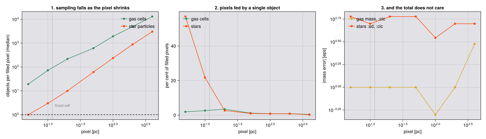

**The three panels are one statement.** Sampling per pixel falls roughly as the pixel area, crosses
one object per pixel, and keeps going: past the finest cell a map is mostly pixels that hold a
single cell or a single star. Panel 3 is the same pixel range, and the mass error does not move.

So "conserved" and "resolved" are independent, and only the first is guaranteed. Use panel 1 to
decide what a pixel is worth, the conservation sweep to decide what a total is worth, and do not
let a correct total persuade you that a pixel means something.

**For point data this arrives much earlier**, because there is no footprint to spread: stars reach
one particle per pixel while cells are still comfortably sampled. That is the same limit Chapter 11
measures from the other side, and it is why a stellar map has a coarsest useful pixel rather than a
finest one.

### Chapter 14 in one table

Six tests, one conclusion each. The tables above are the evidence; this is what they add up to.

| # | what was varied | held fixed | result |
|---|---|---|---|
| 1 | eight camera directions, 0° to 90° | whole box, one kernel | a few machine epsilon, no trend with angle |
| 2 | six pixel sizes, 5.3 kpc to 187 pc | whole box, one kernel | a few epsilon, growing only where a small map makes each accumulator do more additions |
| 3 | all four kernels | whole box, one pixel | all within one epsilon; stars carry `:ngp` and `:cic` only |
| 4 | the `nmax` cap, 1 to 64 | one pixel, `:overlap` | the cap costs placement accuracy, never mass: total stays inside ±2 epsilon |
| 5 | `mode=:sum` vs `:standard`, and a weighted mean | one pixel | only `:sum` conserves; the global mass-weighted mean is recovered exactly |
| 6 | pixel across the finest cell, every kernel, plus angle | cutout | three kernels hold one epsilon throughout; `:exact` degrades below about 100 pc |

**The short version.** Mass and any `mode=:sum` quantity are conserved to a handful of machine
epsilon, whatever camera you point and whatever grid you ask for, on cells and on points alike. The
two things that do move are both bounded and both understood: summation round-off on very small
maps, and `:exact` losing bits once the pixel is much finer than the cell. Neither reaches one part
in 10¹², so neither touches a budget.

**What is not guaranteed**, and is easy to confuse with the above: *where* the mass lands (Chapter
6), the peak of a point map (Chapter 11), and σ_LOS, which moves variance between the within-pixel
and between-pixel terms as the pixel changes (Chapter 8). Conservation is about the total.

## 15. Reading the result, and fixing a map that looks wrong

Everything needed to debug an off-axis map travels on the result.

| field | is |
|---|---|
| `m.los`, `m.up`, `m.cam_right` | the basis actually used. Not what you expected means the view specifier or `center` is wrong, not the renderer |
| `m.center` | a **box fraction** on a map (a `slice` result's `.center` is code units) |
| `m.direction` | `:offaxis` |
| `m.maps_lmax` | **empty**, off-axis and axis-aligned alike |
| `m.maps_weight` | AMR maps only, not particle ones |
| `m.pixsize`, `m.extent` | code units; use `getextent(m, :kpc)` |

**Orientation.** `position_angle=` rolls the image about `ŵ`; `up=` pins image y outright.
Without `up=` the camera uses world +z as its hint, falling back to +y when the line of sight is
the z axis itself. That fallback is a discontinuity: a sweep that passes through the pole will
jump there. Pin `up=` for any hand-written sweep, or use `rotation_sequence`, which sets a hint
for you.

**Grid diagnostics.** `gridoverlay(gas; level=:max, <same view kwargs>)` draws the AMR structure
in the camera frame. Off-axis it draws cell-size squares at rotated cell centres, not the true
hexagonal footprints, so it tells you where and how big cells are, not what shape their shadows
have.

```julia
savemap(fo, joinpath(tempdir(), "faceon_sd.jld2"), verbose=false)
fo2 = loadmap(joinpath(tempdir(), "faceon_sd.jld2"), verbose=false)

println("camera survives the round trip : ", fo2.los == fo.los && fo2.up == fo.up)
println(".center (box fraction)         : ", round.(fo.center, digits=3))
println(".maps_lmax off-axis            : ", isempty(fo.maps_lmax) ? "empty (by design)" : "populated")
println(".direction                     : ", fo.direction)
```

```
camera survives the round trip : true
.center (box fraction)         : [0.5, 0.5, 0.5]
.maps_lmax off-axis            : empty (by design)
.direction                     : offaxis
```

**Troubleshooting**, the symptoms that send people looking for a bug:

| symptom | cause | fix |
|---|---|---|
| an off-axis column density integrates the whole box, or a depth that changes across the frame | world ranges do not follow the camera, and a `fov` sphere is a chord | `depth` (Chapter 3), the one cut measured along the line of sight |
| `:edgeon` looks face-on, or the disc is tilted at a random angle | L computed about the box corner | pass `center=[:bc]` (Ch 1) |
| "face-on" is off by 10 to 30 degrees for a warped or fountain-rich disc | L over the full box is dominated by slow, high-lever-arm CGM gas | take `:angmom` on an inner-disc `subregion`, then project the full data with that explicit `los=` (App. C) |
| straight edges cut across the map; the frame is bigger than requested | world-space `xrange`/`yrange` | `fov` + `fov_unit` + `aperture=:square` (Ch 3) |
| the galaxy is a dot in a huge frame | `fov` without `fov_unit`, 16 *box lengths*, clamped | always pair them (Ch 3) |
| `projection(gas, :vlos; direction=:z)` errors in `getvar` | `:vlos`/`:σlos` exist only in the off-axis engine | write `los=[0,0,1]` (Ch 5) |
| holes or moiré in a zoomed map | `:cic`/`:ngp` with pixels finer than cells | `binning=:overlap` (Ch 6) |
| an orbit movie tumbles across snapshots | `direction=:faceon` recomputed per snapshot; L drifts | freeze one `los=` (App. C) |
| an edge-on **star** map is a tiny square | `aperture=:square` clamped the frame to the thickness of the star layer | ask for `:circle`, or pin the axes yourself (Chapter 3) |
| a **star** σ map is full of exact zeros | those pixels hold one star, and one point has no spread | coarsen the pixel until pixels hold several stars (Chapter 11) |
| a **star** median comes out at zero | empty off-axis pixels are `0.0`, not `NaN`, so `filter(isfinite, …)` keeps them | filter on `> 0`, not on `isfinite` |

And when re-plotting is the slow part, do not re-project: `savemap` / `loadmap` round-trip the whole object, every map and unit, the geometry, the camera basis and the simulation `info`.

### Limitations, in one place

What the chapters above establish, one line each. One thing that is **not** a limitation, because
Chapter 14 measures it: the map total is the object's total to a few machine epsilon at any
angle, pixel size, kernel and `nmax`.

| | |
|---|---|
| **Orthographic only** | parallel rays, observer at infinity. No perspective, no view from inside the box |
| **World ranges are not depth** | `xrange`/`yrange`/`zrange` are world space and the frame auto-fits the rotated footprint. For a cut along the view, use `depth` (Chapter 4) |
| **`zrange` can be a no-op** | an axis whose requested range already covers the loaded data is not clipped at all |
| **Cuts are cell-centre by default** | a straddling cell is kept or dropped whole, so a world-range selection is accurate to about one cell per face (0.75 kpc at level 6 here). `split=true` weights `depth` and `fov` by volume instead (Chapter 5); world ranges stay cell-centre |
| **Border fold-back** | a stencil crossing the map edge folds onto the edge pixel. It rarely fires off-axis, because the frame is padded by a pixel plus half the coarsest selected cell's shadow. A crop or a selection-box face does reach the edge, so the outermost row is still not a clean measurement |
| **`fov` traps** | `fov_unit` defaults to a box fraction; `fov` replaces `xrange`/`yrange`/`zrange`; `center` is then read in `fov_unit` |
| **A mask changes the frame** | the extent fits the surviving cells, so masked and unmasked maps do not share a pixel grid. Pin it with `fov` (Chapter 10) |
| **Frames match, but not bit-exactly** | `aperture=:square` gives identical pixel dimensions and physical scale at every angle; co-registration is good to the auto-fit rounding |
| **`nmax=64`** | zoom far enough into a coarse region and `:overlap` deposits a top-hat rather than a 64³ lattice. It costs placement, not mass: Chapter 14 measures a 43.7-fold change in per-pixel agreement with `:exact` while the total never leaves ±2 machine epsilon. Raise `nmax`, or use `:exact` |
| **Off-axis ≠ axis-aligned pixel grids** | differencing `los=[0,0,1]` against `direction=:z` shows a sub-pixel origin offset. A grid convention, not an error |
| **Axis-aligned only** | `:r_cylinder`, `:r_sphere`, `:ϕ`. They describe the pixel's own geometry, and an off-axis pixel is a slanted column |
| **`:mass` is a mean on particles** | unless you pass `mode=:sum`. On cell data it is the summed column (Chapter 9) |
| **`aperture=:square` on sparse point data** | the crop is capped by the shorter side of the fitted frame, so a thin edge-on stellar disc comes back cropped to its own thickness. Use `:circle` (Chapter 11) |
| **Result-object quirks** | `maps_lmax` is empty; `maps_weight` is AMR-only; `.center` is a box fraction on a map but code units on a `slice`; a mass-weighted call returns a bonus `:sd` map; `lmax` off-axis only sets the default resolution and never coarsens the data |

### Where the guarantees are measured

Chapter 14 makes the conservation argument on this snapshot. These are the tests in the
repository that hold it in place, so it is pinned by the suite rather than by this page.

| claim | test |
|---|---|
| mass, gas: summed map against `msum`, swept over line of sight, resolution and binning | `test/34_offaxis_invariance_tests.jl` |
| mass, stars: `sum(:sd) · pixel area` against the particle mass | the same file |
| the keyword surface this page demonstrates, including non-power-of-two pixel counts | `test/68_offaxis_api_tests.jl` |
| `depth`, `fov=[wx,wy]`, `angmom_radius`, `split`, `mode=:sum`, the count maps, masking under `fov`, the dispersion tensor trace | `test/36_offaxis_features_tests.jl` |
| the deposit kernels against closed-form answers, with no simulation data | `test/42_kernel_oracle_tests.jl`, and the [validation page](offaxis_validation.md) |

`:vlos` is antisymmetric about the minor axis edge-on and near zero face-on, the check in
Chapter 8. It is also how you catch a mis-centred `center` before it quietly tilts every map.

### Recipe: one fixed orientation across a time series

The most common way a multi-snapshot off-axis analysis goes wrong: `direction=:faceon` is called per snapshot, the disc's L drifts (warp, bar, merger, an infalling satellite), and the resulting movie tumbles or the measured inclination wanders.

The fix is to compute the orientation **once**, on the region you actually mean, and then freeze it:

```julia
# NOT EXECUTED: this page uses a single output (output_00390).
# Shown for the mechanics; substitute your own output list.

# 1. Orientation from the INNER DISC of one reference snapshot, not the whole box.
#    L over the full box is dominated by slow, high-lever-arm CGM gas, which is
#    why a whole-box "face-on" can be 10 to 30 degrees off for a warped or fountain-rich disc.
ref  = loaddata(390, path, :hydro; verbose=false)
disc = subregion(ref, :cylinder, radius=8., height=2., range_unit=:kpc,
                 center=[:bc], verbose=false)
Lfix = [sum(getvar(disc, :lx, center=[:bc])),
        sum(getvar(disc, :ly, center=[:bc])),
        sum(getvar(disc, :lz, center=[:bc]))]
Lfix ./= sqrt(sum(abs2, Lfix))

# 2. Project every snapshot with that ONE frozen line of sight and a fixed FOV.
#    `up=` is pinned too. The default hint is world +z, which is stable, but it
#    falls back to +y if a line of sight ever points along z, and that is a jump.
for out in outputs
    g = loaddata(out, path, :hydro; verbose=false)
    m = projection(g, :sd, :Msol_pc2; los=Lfix, up=[0,0,1], center=[:bc],
                   fov=16, fov_unit=:kpc, aperture=:square, pxsize=[0.3,:kpc],
                   verbose=false, show_progress=false)
    savemap(m, "faceon_$(out).jld2", verbose=false)
end
```

A drifting orientation is not a cosmetic problem: viewing angle biases the quantities measured from an image, so a time series taken at a wandering angle is not a time series of the galaxy (Bottrell et al. 2017). Gas L and stellar L are not the same vector either (bars, warps, counter-rotating components), so decide which tracer defines your frame and stick to it. And note that this is also how you get a *comparable* frame: the same `los`, the same `fov`, the same `pxsize`, so every snapshot is the same camera.
