!!! tip "Run it yourself"
    This page is also an executable **Jupyter notebook**: [open / download `06_offaxis_Projection.ipynb`](https://github.com/ManuelBehrendt/Notebooks/blob/master/Mera-Docs/version_1.1/06_offaxis_Projection.ipynb). The notebooks run end-to-end and double as part of Mera's test suite.

```@raw html
<!-- GENERATED FILE. Do not edit this markdown.
     Source notebook: 06_offaxis_Projection.ipynb
     Regenerate with: MERA_DIR=<repo checkout> ./render_docs.sh
     Any edit here is lost the next time the docs are rendered. -->
```

## 0. Off-axis projection, what this page gives you

Every map on this page comes out of one function call:

`projection(obj, var, unit; <view>, <framing>, <binning>, <pxsize>)`

Off-axis adds exactly one thing to the [axis-aligned page](06_hydro_Projection.md): orientation.
Everything you already know, `center`, `range_unit`, `pxsize`, `weighting` and units, works
unchanged.

Four things you set, one thing you read back. Each gets its own chapter below.

| what you set / read | keywords | chapter |
|---|---|---|
| view | `direction`, `inclination`, `azimuth`, `axis`, `los` | 1, 3 |
| framing | `fov`, `fov_unit`, `aperture`, `xrange`/`yrange`/`zrange`, `center` | 4 |
| quantity | `var`, `unit`, `weighting` | 5 |
| placement | `binning` | 6 |
| what you read back | `m.maps`, `getextent`, the camera vectors | 1, 10 |

Everything on this page uses one dataset, the AVALON run `AV05CD`, output 390: 51.5 million cells,
levels 6 to 12, in a 48 kpc box, at t = 580 Myr. It is one of the maintainer's research
simulations and not part of the public example set, so point the path at a snapshot of your own,
or set `MERA_AVALON`; every call on the page works the same on other data. The page runs 50 projection calls across 36 code
cells and draws 12 figures, plus two schematic diagrams and one movie.

The limitations are collected in Appendix A at the end.

## 1. Your first off-axis view

A projection is a camera. The data never moves, only the camera does. Two keywords show it.

!!! warning "`direction=:faceon` needs `center` on the object"
    `:faceon`/`:edgeon` (and `axis=:angmom`) derive the orientation from the **angular momentum of the loaded data about `center`**. `center` defaults to `[0.,0.,0.]`, the box **corner**, and L about a corner is dominated by the lever arm of the whole box. You get a plausible-looking tilted galaxy, no error and no warning. Always pass `center=[:bc]` (or the object's own centre). Detection: edge-on, `:vlos` must be antisymmetric about the minor axis (Chapter 7).

```julia
# The AVALON snapshot used by every cell below. Point this at your own run, or set the
# MERA_AVALON environment variable.
AVALON = get(ENV, "MERA_AVALON", "/Volumes/FASTStorage/Simulations/AVALONpaper/AV05CD/mera")

using Mera, CairoMakie, Statistics
CairoMakie.activate!(type="png")

gas  = loaddata(390, AVALON, :hydro; verbose=false)
info = gas.info

println("cells loaded : ", length(gas.data))
println("box length   : ", info.boxlen, " kpc")
println("levels       : ", gas.lmin, " to ", gas.lmax)
println("threads      : ", Threads.nthreads())
```

```
*__   __ _______ ______   _______
|  |_|  |       |    _ | |   _   |
|       |    ___|   | || |  |_|  |
|       |   |___|   |_||_|       |
|       |    ___|    __  |       |
| ||_|| |   |___|   |  | |   _   |
|_|   |_|_______|___|  |_|__| |__|
Mera v1.8.0 | Julia 1.12.7 | 8 threads
cells loaded : 51500562
box length   : 48.0 kpc
levels       : 6 to 12
threads      : 8
```

```julia
# ── figure code from here: panels, overlays, colorbars, no new Mera concepts ──
# ONE helper, used by every figure in this notebook. It encodes the rules that make a
# comparison honest: physical axes in kpc, DataAspect, no interpolation, an explicit
# NaN colour, and an optional SHARED colour range.
function showmap!(ax, m, key; logscale=true, cmap=:inferno, crange=nothing)
    A = Float64.(m.maps[key])
    A = logscale ? log10.(replace(A, 0.0 => NaN)) : A
    e = getextent(m, :kpc)
    xs = range(e[1], e[2], length=size(A,1))
    ys = range(e[3], e[4], length=size(A,2))
    hm = heatmap!(ax, xs, ys, A; colormap=cmap, nan_color=:black, interpolate=false,
                  colorrange = crange === nothing ? Makie.automatic : crange)
    ax.aspect = DataAspect()
    return hm
end

# shared colour range across a set of maps (2nd percentile → max), so panels are comparable
function sharedrange(ms, key; logscale=true)
    v = reduce(vcat, [vec(Float64.(m.maps[key])) for m in ms])
    v = logscale ? log10.(filter(x -> x > 0, v)) : filter(isfinite, v)
    (quantile(v, 0.02), maximum(v))
end

function maprow(ms, key, titles; clabel="log10 Σ  [M⊙/pc²]", cmap=:inferno,
                crange=nothing, logscale=true)
    n = length(ms); fig = Figure(size=(330n + 110, 380)); hm = nothing
    for i in 1:n
        ax = Axis(fig[1,i], title=titles[i], xlabel="x' [kpc]",
                  ylabel = i == 1 ? "y' [kpc]" : "")
        i > 1 && hideydecorations!(ax, grid=false)
        hm = showmap!(ax, ms[i], key; logscale=logscale, cmap=cmap, crange=crange)
    end
    Colorbar(fig[1, n+1], hm, label=clabel)
    fig
end
```

```
maprow (generic function with 1 method)
```

```julia
# ONE window, reused by every chapter, so the only thing that changes between cells
# is the keyword being taught. 100 pc pixels: this window renders six times across
# Chapters 1 and 3, which is the comparison-grid case in the note above.
win = (center=[:bc], fov=16, fov_unit=:kpc, aperture=:square,
       pxsize=[0.1, :kpc], verbose=false, show_progress=false)

fo = projection(gas, :sd, :Msol_pc2; direction=:faceon, win...)
eo = projection(gas, :sd, :Msol_pc2; direction=:edgeon, win...)

println("line of sight  ŵ = ", round.(fo.los, digits=3))
println("image up       û = ", round.(fo.up,  digits=3))
println("projection centre (box fraction) = ", round.(fo.center, digits=3))
println("frame: ", size(fo.maps[:sd]), "  and  ", size(eo.maps[:sd]))

cr = sharedrange([fo, eo], :sd)
maprow([fo, eo], :sd, ["direction=:faceon", "direction=:edgeon"]; crange=cr)
```

```
[Mera] Hint: getvar(:lx) has no `vcenter` — velocities are in the BOX frame.
             Pass vcenter=:auto for an object with bulk motion (`center=` sets the origin,
             `vcenter=` the frame).
             (shown once per session; verbose(false) silences Mera's messages)
line of sight  ŵ = [0.0, 0.001, 1.0]
image up       û = [1.0, -0.0, -0.0]
projection centre (box fraction) = [0.5, 0.5, 0.5]
frame: (321, 321)  and  (321, 321)
```

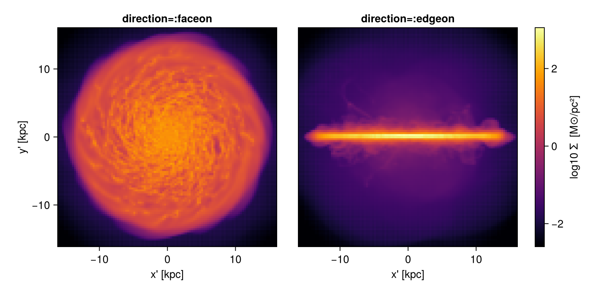

Read the output back:

- `m.maps` is a dict of 2-D arrays; `m.maps[:sd]` is the surface density in `Msol_pc2`.
- `getextent(m, :kpc)` returns `[xmin, xmax, ymin, ymax]` **in the image plane**, the raw `m.extent` is in code units, so always convert.
- `m.los`, `m.up`, `m.cam_right` are the camera basis the call actually used; `m.direction` reads `:offaxis`.

The `los` vector printed above is not a number you chose. It is the disc's angular momentum axis,
computed from your data about your `center`. Aligning the camera with the net angular momentum of
the disc is the standard way to define a simulated galaxy's own frame (Abadi et al. 2003). The
viewing angle is then an explicit parameter of the image, and a chosen one (Torrey et al. 2015;
Bottrell et al. 2017).

### How fine to make the pixels

`pxsize` is the one knob that costs time, and it costs less than most people expect. A projection
reads every cell once whatever the pixel size, so on a snapshot this size most of the work is the
read and not the grid. Measured on the machine that renders this page, at `fov=16`:

| `pxsize` | map | time |
|---|---|---|
| 300 pc | 107² | 12.5 s |
| 100 pc | 321² | 13.7 s |
| 50 pc | 641² | 17.9 s |
| 20 pc | 1601² | 103 s |
| 11.7 pc, the native cell size | 2735² | 452 s, 60 MB |

Resolution is nearly free down to about 50 pc, and then it stops being free. The page is drawn to
that rule: the comparison grids, which render six or eight times each, use 100 pc; the particle
figures in Chapter 12 go finer still, because points are cheap; and exactly one figure, the next
one, uses the simulation's own 11.7 pc so you can see what the run actually holds. If you want
more detail in a single panel of your own, 50 pc is where to go first, and it costs almost
nothing.

Two chapters keep coarse pixels on purpose. Chapter 6 is about the ratio of pixel to cell, so its
pixel sizes are the experiment. The movie cells are priced by frame count, not by pixel count.

Two things that do not move with `pxsize`: the mass on the map (Chapter 5) and σ_LOS (Chapter 7).
Pick it for the image you want.

```julia
# The one native-resolution figure on this page. The pixel is the finest cell in the run, so
# nothing is averaged away. It costs about 450 s and 60 MB for the map, against 12 to 20 s for
# every other figure here. Coarsen it if you are only re-running the page.
native = projection(gas, :sd, :Msol_pc2; direction=:faceon, center=[:bc],
                    fov=16, fov_unit=:kpc, aperture=:square,
                    pxsize=[gas.boxlen * gas.scale.kpc / 2^gas.lmax, :kpc],
                    verbose=false, show_progress=false)
println("native pixel : ", round(native.pixsize * native.scale.pc, digits=2), " pc")
println("map          : ", size(native.maps[:sd]))

# ── figure code from here: panels, overlays, colorbars, no new Mera concepts ──
fig = Figure(size=(780, 700))
ax  = Axis(fig[1,1], title="face-on Σ at the native cell size",
           xlabel="x' [kpc]", ylabel="y' [kpc]")
h   = showmap!(ax, native, :sd)
Colorbar(fig[1,2], h, label="log10 Σ  [M⊙/pc²]")
fig
```

```
native pixel : 11.72 pc
map          : (2731, 2731)
```

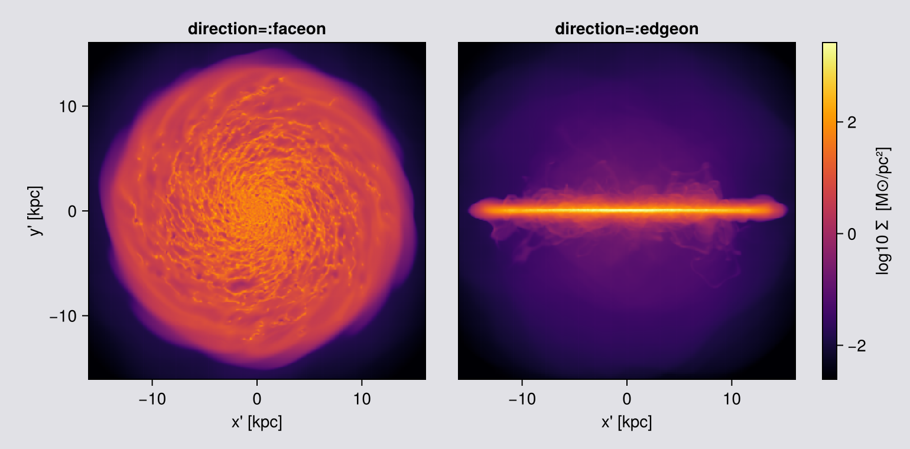

## 2. What a pixel contains

Before turning more knobs, it is worth being precise about what the numbers in a map *are*.

The camera is **orthographic**: every ray is parallel and the observer sits at infinity. There is
no vanishing point and no perspective, so nothing in the image gets larger by being nearer.

Mera reduces whatever view you specified to a single unit vector **ŵ**, the line of sight, and
completes it to a right-handed orthonormal camera basis **(r̂, û, ŵ)**, image x, image y, and the
viewing direction. Those are the three vectors you read back as `m.cam_right`, `m.up`, `m.los`.
`ŵ` points *out of* the image, toward you: the observer stands on the `+ŵ` side, and the camera
looks along `-ŵ`. Chapter 7 turns that into a sign you can check.

A pixel value is then built from everything along the parallel ray through that pixel, over the
whole depth of the selected data. For `:mass` it is the sum, for `:sd` the sum divided by the pixel
area, and for every other quantity the weighted mean along the ray (Chapter 5). This is the
emission-only limit of the standard volume rendering integral (Max 1995); in three dimensions it is
the X-ray transform of the field (Natterer 1986), the same object Radon (1917) introduced for the
two-dimensional case. That one picture explains most of what follows: it is why a projection
conserves mass, why `zrange` matters as much as `xrange`, and why a slice, which samples one plane
instead of integrating through the volume (Chapter 8), answers a different question.

`position_angle` is a **roll**: it rotates `(r̂, û)` together about `ŵ`. The line of sight does
not move, so the *scene* is unchanged, but whether the **frame** sees the same gas depends on
the aperture. With `aperture=:circle` a roll leaves `Σ` untouched, because the selection is a disc
and a disc is roll-invariant. With `aperture=:square` it moves a little, because the square crop
rotates inside the selection sphere and its corners sweep across different material. Measure it on
your own data rather than assuming either way.

One consequence deserves to be stated on its own, because the next chapter is built on it: since
the projection is orthographic, **moving the camera away from the galaxy changes nothing**. There
is no camera distance to set. The only control over what lands in frame is the *width of the
frame*, a field of view.

The step-by-step basis construction (the deterministic choice of "up", the Gram to Schmidt
completion, the roll matrix) lives in `?projection`; you do not need it to use any of this.


*Parallel rays, the image plane, and the camera basis `(r̂, û, ŵ)` planted at `center`. Right inset: `inclination` is measured from a **reference axis**, either the box `z` or the object's own angular-momentum axis `L`. They are not the same axis, and choosing the wrong one is the most common way to get a picture that looks right but is not. Tilted-ring fits of observed discs describe an orientation the same way, one inclination and one position angle per radius (Rogstad, Lockhart & Wright 1974).*

## 3. Choosing the view

**Observer vocabulary → Mera keywords** (the primary artefact of this chapter):

| you want | you say | Mera |
|---|---|---|
| a disc seen flat / on its side | face-on / edge-on | `direction=:faceon` / `:edgeon` |
| a specific inclination *i* | i = 60° | `inclination=60, axis=:angmom` |
| a specific position angle on the sky | PA = 30° | `position_angle=30` |
| a known viewing vector | ŵ = (1,1,1) | `los=[1,1,1]` |
| spherical camera angles | θ, φ | `theta=`, `phi=` (deprecated in 1.8, to be removed in 2.0; use `inclination`/`azimuth`) |
| turn the camera around the reference axis | *(no observational counterpart)* | `azimuth=` |

`inclination` is the angle between the line of sight and the disc's spin axis, `i = 0` face-on, the
quantity observers infer from the projected axis ratio (Hubble 1926; Holmberg 1958).
`position_angle` is the roll of the image about the line of sight, the analogue of the sky position
angle measured from north through east (de Vaucouleurs et al. 1991). Together they are the pair a
tilted-ring fit assigns to each radius of a disc (Rogstad, Lockhart & Wright 1974; Begeman 1989).

`azimuth` turns the **camera** around the reference `axis`, which is the box `z` by default and the
disc's own `L` with `axis=:angmom`. For an axisymmetric disc the picture only rotates, so it is a
*movie* parameter, not a modelling one, which is why it earns no static panel here and reappears in
Chapter 9.

**Reference axis.** `axis=:z` (default) tilts away from the box z-axis; `axis=:angmom` tilts away from the disc's own L, computed about `center`. `axis=[vx,vy,vz]` takes an explicit axis. `direction=:faceon/:edgeon` already imply `:angmom`, so combining them with `axis=` is an `ArgumentError`.

**Exactly one view specifier.** `los` | `inclination`/`azimuth` | `theta`/`phi` | `direction=:x/:y/:faceon/:edgeon` are mutually exclusive; giving two raises immediately. `direction=:z` is the default and does not count. `up=` and `position_angle=` are *modifiers* and combine with any of them.

**Angles are degrees by default** (`angle_unit=:rad` to switch).

!!! warning "`azimuth` is not `phi`"
    They cover the same directions when `axis=:z`, but the zero point differs by a quarter turn:
    `inclination = theta`, `azimuth = phi + 90`. `phi` is measured from `+x`, the usual spherical
    convention. `azimuth` starts 90° later, so that `inclination=0` gives the same image
    orientation as `direction=:z`. Passing `azimuth=phi` rotates the picture by 90°.

```julia
# Same window as Chapter 1, only `inclination` changes.
lad0  = projection(gas, :sd, :Msol_pc2; inclination=0,  axis=:angmom, win...)
lad30 = projection(gas, :sd, :Msol_pc2; inclination=30, axis=:angmom, win...)
lad60 = projection(gas, :sd, :Msol_pc2; inclination=60, axis=:angmom, win...)

# Is `direction=:faceon` the same as `inclination=0, axis=:angmom`? Separate the two halves of
# that question, the LINE OF SIGHT and the ROLL, because the answer differs for each.
println("max |ŵ_faceon − ŵ_inc0|     = ", maximum(abs, fo.los .- lad0.los))
println("angle(û_faceon, û_inc0)     = ",
        round(rad2deg(acos(clamp(sum(fo.up .* lad0.up), -1, 1))), digits=2), "°")
println("max |Σ_faceon − Σ_inc0|     = ", round(maximum(abs, lad0.maps[:sd] .- fo.maps[:sd]), digits=1))
# ... and the roll is recoverable exactly:
lad0_pa = projection(gas, :sd, :Msol_pc2; inclination=0, axis=:angmom, position_angle=-90, win...)
println("max |Σ_faceon − Σ_inc0,PA=-90| = ", maximum(abs, lad0_pa.maps[:sd] .- fo.maps[:sd]))

# "Exactly one view specifier" and "direction implies :angmom" are promises about behaviour:
for (lbl, kw) in (("inclination + los", (inclination=35, los=[1,1,1])),
                  ("direction=:faceon + axis", (direction=:faceon, axis=:angmom)))
    e = try (projection(gas, :sd; kw..., win...); "NO ERROR") catch e; typeof(e).name.name end
    println(rpad(lbl, 26), "→ ", e)
end

ladder = [lad0, lad30, lad60, eo]      # i = 90 is the edge-on map from Chapter 1
cr = sharedrange(ladder, :sd)
maprow(ladder, :sd, ["i = 0°", "i = 30°", "i = 60°", "i = 90°"]; crange=cr)
```

```
max |ŵ_faceon − ŵ_inc0|     = 0.0
angle(û_faceon, û_inc0)     = 90.0°
max |Σ_faceon − Σ_inc0|     = 194.8
max |Σ_faceon − Σ_inc0,PA=-90| = 1.3073986337985843e-12
inclination + los         → ArgumentError
direction=:faceon + axis  → ArgumentError
```

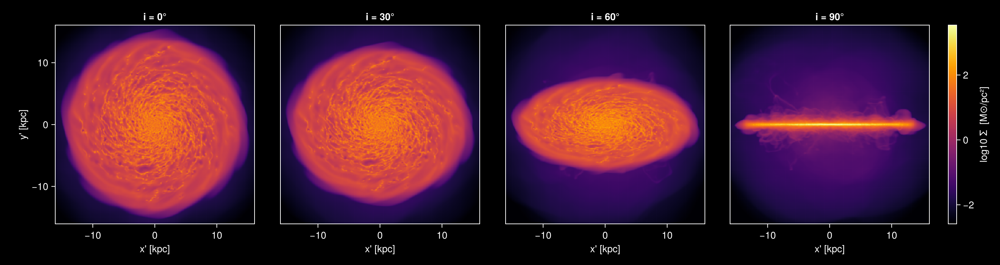

`direction=:faceon` and `inclination=0, axis=:angmom` are the **same line of sight**, the two `ŵ`
vectors agree to the last bit, but they are *not* the same image. A face-on view leaves the roll
about `ŵ` undetermined, and the two code paths break that tie differently: the `û` vectors come out
exactly **90° apart**, which is why the naive map-to-map difference above is large rather than zero.
`position_angle=-90` recovers `:faceon` to floating-point round-off; the residual printed above
is summation order across threads, not a real difference.

The lesson generalises past this one preset: whenever a view leaves a degree of freedom free,
compare the **camera vectors**, not the pixels. Two correct maps of the same scene can differ by a
roll.

**So:** pick `direction=:faceon/:edgeon` when you want the disc's own frame, `inclination`+`axis=:angmom` when you want a specific *i*, and `los=` when you already know the vector, for example when you want the same orientation across many snapshots (Appendix C).

## 4. Framing: world ranges versus camera field of view

This is the surprise that catches everyone, so take the problem first.

`xrange`, `yrange`, `zrange` (with `center` and `range_unit`) are **world-space** bounds, they select a box inside the simulation, exactly as they do for the axis-aligned path and for `subregion`. The camera frame is then auto-fitted to the **bounding box of that region after rotation**. Two consequences:

1. **The frame grows with tilt.** A world window comes back much taller once the camera tilts; the frame sizes printed by the next cell show by how much. Frames at different angles are not comparable, and the object appears to zoom.
2. **The window's own faces appear in the map** as straight edges cutting across the image. Worse than cosmetic: with no `zrange` the *entire box depth* of foreground and background gas sits in your disc map, so any column, scale height or Σ measured from it is contaminated.

There is **no line-of-sight depth slab in `projection`.** `zrange` clips world *z*; it coincides with depth only when the line of sight is near ±z, precisely the face-on case where you need it least. (Also: an axis whose requested range already covers the loaded data's range is not clipped at all, so `zrange` on already-subregioned data can silently do nothing.)

**The fix: `fov`.** The camera is orthographic, so the only framing control is `fov`, the half-width of the frame. `fov` selects a **sphere** about `center` (radius `fov`, or `√2·fov` for `aperture=:square`), and a sphere projects to the same disc at every orientation, so the frame is fixed by construction.

| `aperture` | selection | frame |
|---|---|---|
| `:circle` (default) | sphere of radius `fov` | rectangular array with **empty corners** |
| `:square` | sphere of radius √2·`fov`, cropped | **full rectangle, pixel-identical size and scale at every angle** |

Use `:square` whenever you will compare or animate frames.

!!! warning "`fov` always needs `fov_unit`"
    `fov_unit` defaults to `:standard`, which is a **box fraction**. `fov=16` alone means 16 box lengths, silently clamped to 0.49·boxlen. Always write `fov=16, fov_unit=:kpc`.

    Three more things `fov` does: it **replaces** any `xrange`/`yrange`/`zrange` you pass; it makes `center` be read in `fov_unit` (your `range_unit` is discarded); and it **cannot be combined with a per-cell `mask`** (the sphere selection changes the cell count, so the mask no longer matches).

    Caps: `:circle` at 0.49·boxlen, `:square` at 0.49/√2·boxlen, which is 16.6 kpc on this 48 kpc box. Above the cap `fov` is clamped with no warning, so pick a value below it on purpose.

```julia
# WORLD-space window, verbose=true so Mera's own hint about this is on the page.
world = projection(gas, :sd, :Msol_pc2; inclination=60, axis=:angmom, center=[:bc],
                   xrange=[-16,16], yrange=[-16,16], range_unit=:kpc,
                   pxsize=[0.1,:kpc], verbose=true, show_progress=false)

# CAMERA-plane frame, rotation-invariant sphere selection.
sq = projection(gas, :sd, :Msol_pc2; inclination=60, axis=:angmom, center=[:bc],
                fov=16, fov_unit=:kpc, aperture=:square,
                pxsize=[0.1,:kpc], verbose=false, show_progress=false)
ci = projection(gas, :sd, :Msol_pc2; inclination=60, axis=:angmom, center=[:bc],
                fov=16, fov_unit=:kpc, aperture=:circle,
                pxsize=[0.1,:kpc], verbose=false, show_progress=false)

for (nm, m) in (("xrange/yrange ±16 kpc", world), ("fov=16 :square", sq), ("fov=16 :circle", ci))
    println(rpad(nm, 24), " frame ", lpad(string(size(m.maps[:sd])), 12),
            "   extent [kpc] = ", round.(getextent(m, :kpc), digits=1))
end
```

```
[Mera] Hint: off-axis view with `xrange`/`yrange` but no `zrange`.
             These are WORLD-space bounds, so after rotation the full box depth folds into
             the image. Pass `zrange`, or `fov=<half-width>` for a fixed camera frame.
             (shown once per session; verbose(false) silences Mera's messages)
[Mera]: 2026-09-19T09:33:23.041
center: [0.5, 0.5, 0.5] ==> [24.0 [kpc] :: 24.0 [kpc] :: 24.0 [kpc]]
domain:
xmin::xmax: 0.1666667 :: 0.8333333  	==> 8.0 [kpc] :: 40.0 [kpc]
ymin::ymax: 0.1666667 :: 0.8333333  	==> 8.0 [kpc] :: 40.0 [kpc]
zmin::zmax: 0.0 :: 1.0  	==> 0.0 [kpc] :: 48.0 [kpc]
Selected var(s)=(:sd,)
Weighting      = :mass
Off-axis LOS   = [0.0, -0.8657, 0.5006]  (binning=:overlap)
Effective resolution: 481^2  →  map size: 330 x 576
xrange/yrange ±16 kpc    frame   (330, 576)   extent [kpc] = [-16.5, 16.5, -28.8, 28.7]
fov=16 :square           frame   (321, 321)   extent [kpc] = [-16.0, 16.0, -16.0, 16.0]
fov=16 :circle           frame   (325, 327)   extent [kpc] = [-16.2, 16.2, -16.3, 16.3]
```

```julia
# ── figure code from here: panels, overlays, colorbars, no new Mera concepts ──
cr = sharedrange([world, sq, ci], :sd)
ttl = ["xrange/yrange = ±16 kpc\n" * string(size(world.maps[:sd])),
       "fov=16, aperture=:square\n"  * string(size(sq.maps[:sd])),
       "fov=16, aperture=:circle\n"  * string(size(ci.maps[:sd]))]
fig = maprow([world, sq, ci], :sd, ttl; crange=cr)
# draw the REQUESTED ±16 kpc window on panel 1, so request and result are both visible
lines!(contents(fig[1,1])[1], [-16,16,16,-16,-16], [-16,-16,16,16,-16],
       color=:cyan, linestyle=:dash, linewidth=2)
fig
```

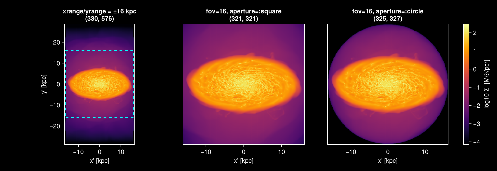

Read the frame sizes above, not just the pictures. The ±16 kpc request came back far taller:
`xrange`/`yrange`/`zrange` bound a box **in simulation coordinates**, and the frame is that box's
bounding box *after rotation*. The dashed cyan rectangle is what was asked for; everything outside
it is the rotated box's own footprint, and its faces are the straight edges cutting across the map.

Those faces are worse than cosmetic. A sight line just inside the slab crosses its full depth; a
sight line just outside clips only a corner. The column density therefore drops along a straight
line, a hard edge that looks like a rendering artefact but is the selection box seen from an angle.

`fov` avoids all of this by framing the **camera plane** instead. The selection is a sphere, which
projects to the same disc at every orientation, so the frame cannot breathe.

Mera prints a one-off note when it sees an off-axis view with a windowed `xrange`/`yrange` and no
`zrange`, because the result is easy to mistake for a bug in the data.

### Choosing `fov`

`fov` is a **half-width**: the frame spans ±`fov`, so `fov=15, fov_unit=:kpc` gives a 30 kpc image.

**What a given `fov` costs you in depth.** The selection is a sphere of radius `R`, `fov` for
`aperture=:circle`, `√2·fov` for `:square`. A ray at in-plane distance `d` from the centre
therefore integrates a **chord**, not a slab:

`depth(d) = 2·√(R² − d²)`

For `fov=15, aperture=:square` (`R` = 21.2 kpc):

| where in the frame | offset from centre | column depth |
|---|---|---|
| centre | 0 kpc | 42.4 kpc |
| middle of an edge | 15 kpc | 30.0 kpc |
| **corner** | 21.2 kpc | **0 kpc** |

The corners of a `:square` frame sit exactly on the selection sphere, so they integrate nothing.
That is the soft darkening you can see creeping into the corners of any `fov` projection of a
diffuse field, it is the selection boundary, not the gas. `:circle` tapers the same way, just at
its own frame edge instead of in the corners.

The practical rule is the one Chapter 5 already gave for edge pixels: **make `fov` comfortably
larger than the structure you are measuring.** For a galaxy centred in frame this costs nothing,
the disc sits where the depth is flattest, but never read a diffuse column, a profile, or a scale
height out to the frame boundary.

**So what is a natural `fov`?** One that puts the object inside the flat-depth part of the frame
and keeps the selection sphere inside the box. The gas disc here is about 23 kpc across, nine tenths of the gas mass sitting inside a
radius of 11.4 kpc, so a
`fov` of 16 kpc leaves it well inside the frame, where the depth is nearly flat. The upper bound
is enforced for you: `fov` is capped at 0.49·boxlen for `:circle` and 0.49/√2·boxlen for `:square`,
16.6 kpc on this box, which keeps the sphere from reaching outside the box and dragging the box
faces back into the image.

**Why you would deliberately change it.** A *smaller* `fov` is not just a tighter crop: it is a
**shallower column**, so it removes foreground and background that a wider frame would integrate
into your disc, the closest thing `projection` has to a depth cut, since there is no line-of-sight
slab. It also buys resolution, since the same pixel budget covers less sky. A *larger* `fov` buys
context and a deeper column, at the price of more unrelated material along every ray.

`fov` is the only framing control that does not change with angle. Frame every set you mean to
compare this way: angle ladders, snapshot series, movie frames.

## 5. What you can ask for, and what the number means

One call returns as many maps as you ask for. But the maps are not all the same *kind* of number, and this is where wrong values actually get published.

| kind | examples | what a pixel is | safe to sum? |
|---|---|---|---|
| **summed (extensive)** | `:mass` | the total in that column | **yes**, this is a budget (cell data only; on particles `:mass` is a mean, Chapter 12) |
| **per-area (extensive, divided)** | `:sd` | mass ÷ pixel area | no, `sum(:sd)` is not a mass; multiply by `pixsize²` in the right units first, or just use `:mass` |
| **weighted mean (intensive)** | `:T`, `:vx`, `:vlos`, `:σlos` | Σ(field·w) / Σw along the ray | no |

`weighting` is an **Array** for hydro/RT: `[quantity, unit]`. The default `[:mass, missing]` means mass weighting in code units. The same weight applies to every variable in the call. (For particles it is a plain `Symbol`; see Chapter 11.)

**A weighted mean is not an observable.** A mass-weighted projected `T` along a multiphase sightline is dominated by cold dense gas; `weighting=[:volume]` gives a different number again; neither is the emission-weighted temperature an X-ray observation would report. Quote projected means as *diagnostics*, not as measurements.

**Not available off-axis.** `:σx`, `:σy`, `:σz`, `:σ`, `:σr_cylinder`, `:σϕ_cylinder`, `:r_cylinder`, `:r_sphere`, `:ϕ` are tied to the box axes and are rejected with a clear error. **The exit ramp:** if you want any of those, use the axis-aligned path (`direction=:x/:y/:z`). If you want line-of-sight kinematics along +z specifically, that is still this page: write `los=[0,0,1]` (Chapter 7).

```julia
mv = projection(gas, [:mass, :T], [:Msol, :K];
                inclination=35, axis=:angmom, center=[:bc],
                fov=16, fov_unit=:kpc, aperture=:square, pxsize=[0.3,:kpc],
                weighting=[:mass, missing], verbose=false, show_progress=false)

# a mass-weighted call ships a free :sd map you did not ask for, expect it when you iterate keys
println("maps returned : ", collect(keys(mv.maps)))
println("units         : ", mv.maps_unit)

# ── the conservation guarantee, measured once, on the WHOLE box (no fov, no window) ──
mtot = projection(gas, :mass, :Msol; los=[1,1,1], center=[:bc],
                  pxsize=[0.5,:kpc], verbose=false, show_progress=false)
println("Σ(map) / msum(gas) − 1  =  ", sum(mtot.maps[:mass]) / msum(gas, :Msol) - 1)

# "Rejected with a clear error" is a promise about behaviour, check it rather than trust it.
for v in (:σx, :σy, :σz, :σ, :r_cylinder, :r_sphere, :ϕ)
    msg = try
        projection(gas, v; inclination=35, axis=:angmom, center=[:bc], xrange=[-15,15],
                   yrange=[-15,15], zrange=[-15,15], range_unit=:kpc, pxsize=[1.0,:kpc],
                   verbose=false, show_progress=false)
        "NO ERROR, the page is wrong"
    catch e
        first(replace(sprint(showerror, e), "\n" => " "), 62) * "…"
    end
    println(rpad(v, 14), msg)
end
```

```
maps returned : Any[:T, :mass, :sd]
units         : DataStructures.SortedDict{Any, Any, Base.Order.ForwardOrdering}(:T => :K, :mass => :Msol, :sd => :standard)
Σ(map) / msum(gas) − 1  =  -1.1102230246251565e-16
σx            projection: off-axis views (los/theta/phi/:faceon/:edgeon) do …
σy            projection: off-axis views (los/theta/phi/:faceon/:edgeon) do …
σz            projection: off-axis views (los/theta/phi/:faceon/:edgeon) do …
σ             projection: off-axis views (los/theta/phi/:faceon/:edgeon) do …
r_cylinder    projection: off-axis views (los/theta/phi/:faceon/:edgeon) do …
r_sphere      projection: off-axis views (los/theta/phi/:faceon/:edgeon) do …
ϕ             projection: off-axis views (los/theta/phi/:faceon/:edgeon) do …
```

That relative error is at the floating-point floor, and it stays there at any viewing angle, any pixel size and any `binning` (Appendix B).

One consequence worth knowing: cells whose deposit stencil crosses the map edge fold the outside fraction onto the **edge pixel**. Conservation is preserved by piling that mass into the outermost row, so the last radial bin of any profile taken from an off-axis map is wrong. Take profiles from a frame larger than the region you care about.

## 6. Placement: which binning

Chapter 5 settled the total. This chapter is about the **other** question: *where* the mass lands.

**Why the shadow is a hexagon.** Look at a cube from a general direction and you see three of its
six faces, the three meeting at the corner nearest you. The outline of those three faces is a
closed circuit of **six** cube edges, so the silhouette cast on the image plane has six sides. It
collapses to a rectangle in exactly one situation: when the line of sight lies in a coordinate
plane, i.e. when any component of `ŵ` is zero. Then only two faces front-face, and you get the
familiar square, `direction=:x/:y/:z`, face-on and edge-on are all that case. Off-axis you are
generically in the hexagonal regime.

Every cell is an **axis-aligned** cube, so for one camera every cell casts the same hexagon, only
at a different scale. One footprint rule serves the whole AMR hierarchy.

That hexagon generally straddles several pixels. The four `binning` kernels are four answers to
"how is it shared out", they all share it out completely (hence one total), but they place it
differently.


| `binning` | what it does | use it for |
|---|---|---|
| `:ngp` | all weight into the pixel containing the cell centre (nearest grid point, Hockney & Eastwood 1988) | fastest preview; holes and moiré when pixels are finer than cells |
| `:cic` | bilinear split over the 2×2 neighbouring pixels (cloud in cell, Hockney & Eastwood 1988) | fast preview; smoother, still no footprint |
| `:overlap` **(default)** | the cube is supersampled over its true footprint, the splatting idea of Westover (1990): `n³` sub-points with `n = ⌈cellsize/pixel⌉`, capped at `nmax=64`; cells past the cap deposit a footprint-sized top-hat, which is what keeps coarse cells hole-free | **everything you publish** |
| `:exact` | the analytic footprint integral (a box-spline chord field over the hexagon) | the reference the others are checked against; no cap, slower |

`:overlap` and `:exact` are threaded; `:ngp` and `:cic` run serially. `:exact` is the analytic
footprint integral. The projected shadow of a uniform cube is a box spline (de Boor, Höllig &
Riemenschneider 1993), and box splines are closed under the Radon transform (Entezari, Nilchian &
Unser 2012), which is what makes the per-pixel integral analytic. You do not need the derivation to
choose a `binning`.

The table is a claim. The cell below measures it, all four kernels on the same data, against
`:exact` as the reference.

```julia
# Which regime are you in? Binning only matters when PIXELS ARE FINER THAN CELLS.
PXFINE = 0.005          # kpc, the zoomed pixel size used by every binning comparison below
PXPREV = 0.02           # kpc, roughly one pixel per cell here, the sensible preview size

for l in sort(unique(getvar(gas, :level)))
    cs = info.boxlen / 2^l
    println("level ", l, ":  cell ", rpad(round(cs, digits=4), 7), " kpc",
            "  →  ", round(cs / PXFINE, digits=1), " pixels per cell at pxsize = ", PXFINE, " kpc")
end

zoom = (center=[:bc], fov=1.5, fov_unit=:kpc, aperture=:square,
        pxsize=[PXFINE, :kpc], verbose=false, show_progress=false)

kern = Dict{Symbol,Any}(); secs = Dict{Symbol,Float64}()
for k in (:ngp, :cic, :overlap, :exact)
    projection(gas, :sd, :Msol_pc2; inclination=60, axis=:angmom, binning=k, zoom...)   # warm-up
    secs[k] = @elapsed kern[k] = projection(gas, :sd, :Msol_pc2; inclination=60,
                                            axis=:angmom, binning=k, zoom...)
end
k_ngp, k_cic, k_ovl = kern[:ngp], kern[:cic], kern[:overlap]

# :exact is the analytic reference, measure the others against it rather than asserting.
E = Float64.(kern[:exact].maps[:sd])
println()
println(rpad("binning", 10), rpad("empty px", 11), rpad("time [s]", 10), "median |Δ| vs :exact [dex]")
for k in (:ngp, :cic, :overlap, :exact)
    A = Float64.(kern[k].maps[:sd]); both = (A .> 0) .& (E .> 0)
    d = k === :exact ? 0.0 : median(abs.(log10.(A[both]) .- log10.(E[both])))
    println(rpad(k, 10), rpad(string(round(100*count(iszero, A)/length(A), digits=1), " %"), 11),
            rpad(round(secs[k], digits=3), 10), round(d, digits=4))
end
```

```
level 6.0:  cell 0.75    kpc  →  150.0 pixels per cell at pxsize = 0.005 kpc
level 7.0:  cell 0.375   kpc  →  75.0 pixels per cell at pxsize = 0.005 kpc
level 8.0:  cell 0.1875  kpc  →  37.5 pixels per cell at pxsize = 0.005 kpc
level 9.0:  cell 0.0938  kpc  →  18.8 pixels per cell at pxsize = 0.005 kpc
level 10.0:  cell 0.0469  kpc  →  9.4 pixels per cell at pxsize = 0.005 kpc
level 11.0:  cell 0.0234  kpc  →  4.7 pixels per cell at pxsize = 0.005 kpc
level 12.0:  cell 0.0117  kpc  →  2.3 pixels per cell at pxsize = 0.005 kpc
binning   empty px   time [s]  median |Δ| vs :exact [dex]
ngp       39.0 %     1.134     0.4115
cic       14.8 %     1.163     0.2638
overlap   0.0 %      2.327     0.0131
exact     0.0 %      8.791     0.0
```

### One number is not enough: where the disagreement lives

The median above says `:overlap` and `:exact` agree closely. A median hides its tail, and for a
figure you publish the tail is the part that matters, so look at the distribution instead, split by
how bright the pixel is.

```julia
# Reuses the projections computed above: no new reads, no new projections.
using Statistics, Printf
A = Float64.(kern[:overlap].maps[:sd]); B = Float64.(kern[:exact].maps[:sd])
both = (A .> 0) .& (B .> 0)
d = abs.(log10.(A[both]) .- log10.(B[both])); v = B[both]; peak = maximum(v)

@printf("total flux  overlap/exact = %.6f\n\n", sum(A)/sum(B))
println(rpad("pixels", 26), rpad("count", 8), rpad("median", 10), rpad("p99", 10), "max  [dex]")
for (lo, hi, lbl) in ((0.0, 1e-3, "faint   (<0.1% of peak)"),
                      (1e-3, 1e-1, "mid     (0.1-10%)"),
                      (1e-1, Inf,  "bright  (>10% of peak)"))
    s = (v ./ peak .>= lo) .& (v ./ peak .< hi)
    any(s) || continue
    println(rpad(lbl, 26), rpad(count(s), 8),
            rpad(round(median(d[s]), digits=5), 10),
            rpad(round(quantile(d[s], 0.99), digits=5), 10),
            round(maximum(d[s]), digits=5))
end
```

```
total flux  overlap/exact = 0.999995
pixels                    count   median    p99       max  [dex]
faint   (<0.1% of peak)   74819   0.00173   0.0179    0.0277
mid     (0.1-10%)         238525  0.01616   0.0476    0.13302
bright  (>10% of peak)    46656   0.02052   0.04878   0.07281
```

**Do not carry these numbers to another simulation.** They are a property of *this* map: how many
cells fall in a pixel, the viewing angle, and how sparse the outskirts are. Repeating the same
measurement on a Milky-Way-like run at two angles and pixel sizes gave worst-case differences from
0.058 to 0.143 dex, all different from the value above.

The shape of the result does carry over, and it follows from how the two kernels work.
`:exact` integrates the footprint analytically. `:overlap` samples it with `n³` sub-points, so a
pixel's value is exact in the limit of many sub-points and noisy when few land in it. Hence:

- **the total is conserved either way**, to about one part in 10⁵ or better: both kernels share out
  every cell completely, so integrated quantities do not care which you pick
- **the worst per-pixel disagreement is in the faintest pixels**, the ones fed by few sub-points
- **bright structure agrees far better**, though "better" was still a few percent in one of the
  cases measured
- `:overlap` caps its supersampling at `nmax`, `:exact` has no cap, so cells much coarser than the
  pixel are where `:overlap` is weakest

**Which to use.** `:overlap` for interactive work, and for anything where you pay the cost many
times over: orbit movies, parameter sweeps, time series. `:exact` for a figure that goes in a paper,
where you render once and the runtime difference is irrelevant, and especially if you intend to
quote a value from a faint pixel or draw contours far down the colour scale. If you are unsure,
run the cell above on your own data and let it decide.

```julia
# ── figure code from here: panels, overlays, colorbars, no new Mera concepts ──
# Show the REGIME, not one strawman: :cic where you would actually use it, then the four
# kernels at pixels a few times finer than the local cell. :exact sits next to :overlap on
# purpose, so you can confirm the table's last column with your own eyes.
pc_ok = projection(gas, :sd, :Msol_pc2; inclination=60, axis=:angmom, binning=:cic,
                   center=[:bc], fov=1.5, fov_unit=:kpc, aperture=:square,
                   pxsize=[PXPREV,:kpc], verbose=false, show_progress=false)
k_exa = kern[:exact]
allv = reduce(vcat, [log10.(filter(>(0), vec(Float64.(p.maps[:sd]))))
                     for p in (pc_ok, k_ngp, k_cic, k_ovl, k_exa)])
cr = (quantile(allv, 0.02), maximum(allv))
maprow([pc_ok, k_ngp, k_cic, k_ovl, k_exa], :sd,
       [":cic @ $(PXPREV) kpc pixels
about 1 pixel per cell, a fine preview",
        ":ngp @ $(PXFINE) kpc pixels
all weight at cell centres",
        ":cic @ $(PXFINE) kpc pixels
2x2 split, still no footprint",
        ":overlap @ $(PXFINE) kpc pixels
same pixels, footprint deposit",
        ":exact @ $(PXFINE) kpc pixels
the analytic reference"]; crange=cr)
```

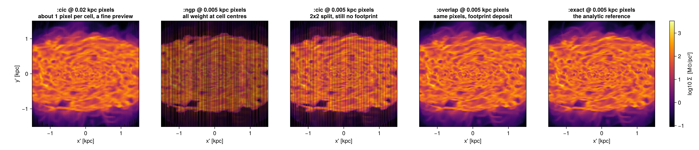

The totals agree and the pictures do not. Conservation alone is not enough.

Read the panels and the table together as one statement: **it is the pixel-to-cell ratio that
decides, not the kernel.** At the coarser pixel size, about one pixel per cell here, `:cic` is a
perfectly good preview. Push to pixels several times finer than a cell and the point-deposit
kernels fall apart: the empty-pixel column of the table above says how much of the map `:ngp` and
`:cic` leave blank. Each puts a cell's whole contribution at a single point, so the gaps between
cell centres receive nothing and the map acquires a texture that belongs to the grid rather than to
the galaxy. `:overlap` spreads each cell over the area its shadow actually covers and leaves **no**
pixel empty at any pixel size.

**And the numbers that justify the default.** The last column of that table is the median
per-pixel disagreement with `:exact`, the analytic footprint integral. `:overlap` sits far closer to
it than either point-deposit kernel, and the time column says what that costs. Those two columns
are the whole case for the default. They are printed rather than quoted here, because both move
with the data. `:exact` is the last panel above, so you can check the claim by eye as well: it
should be indistinguishable from `:overlap`.

The level table tells you which regime you are in: divide the local cell size by your `pxsize`.
Below about one pixel per cell, any kernel will do; well above it, only the footprint methods are
honest.

Practical rule: the default `:overlap` is already the accurate one, reach for `:cic`/`:ngp` when
you want a fast look at a sensible pixel size, and `:exact` when you want the analytic reference
rather than a sampled approximation to it.

## 7. Line-of-sight kinematics

`:vlos` is the velocity component along the line of sight, signed so that positive is receding,
and it is defined for **any** camera. That is what makes it different from `:σx`/`:σy`/`:σz`, which only exist along the box axes
and are rejected off-axis.

`:σlos` is `√(⟨v_LOS²⟩ − ⟨v_LOS⟩²)` over the mass in a pixel. With `:sd` and `:vlos` it completes
the zeroth, first and second moments of the line-of-sight velocity distribution, the three maps an
H I or CO cube is reduced to (Walter et al. 2008). It is a **width of a distribution inside one
pixel**, not a per-cell quantity, many cells along the ray land in the same pixel, each with its own
`v·ŵ`, and σ is how spread out they are. Edge-on, that spread is dominated by ordered rotation
along the sightline, not by turbulence. Do not call it a turbulent dispersion: an observed
dispersion carries the velocity gradient inside the resolution element and has to be corrected
before anyone calls it intrinsic (Davies et al. 2011).

In the map below that shows up as the **brightest σ_LOS off the disc plane, not in it**: a sightline
through the disc samples gas that is nearly co-rotating, while one passing above it crosses infalling
and outflowing material with a far wider velocity spread. The printed median and the panel colour
bar give the range σ_LOS covers here, and it is wide enough that the panels need a log scale.

The obvious next worry is that σ_LOS is then an artefact of how finely you pixelate. The code below
measures whether it is.

!!! warning "Sign convention"
    `:vlos` follows the observational convention: **positive means receding** (redshifted),
    negative means approaching (blueshifted), exactly as a radial velocity is reported in a paper.

    Note the relation to the camera. `ŵ` (`m.los`) points **out of** the image, toward the
    observer, so the map is `-(v·ŵ)`. If you compute the projection yourself from `m.los`,
    remember that minus sign, or your rotation curve comes out inverted.

    A sign flip inverts a rotation curve and changes nothing else in the figure, so check the shape
    too: on an edge-on map `:vlos` must be **antisymmetric about the minor axis**. If it is not, your
    `center` is off the object (Chapter 1).

```julia
kin = (center=[:bc], fov=15, fov_unit=:kpc, aperture=:square,
       pxsize=[0.1, :kpc], verbose=false, show_progress=false)

# ask for :sd alongside, used below only to SET THE COLOUR RANGE from where the mass is;
# every pixel is still plotted
keo = projection(gas, [:vlos, :σlos, :sd], [:km_s, :km_s, :Msol_pc2]; direction=:edgeon, kin...)
kfo = projection(gas, [:vlos, :σlos, :sd], [:km_s, :km_s, :Msol_pc2]; direction=:faceon, kin...)

finite(A) = filter(isfinite, vec(Float64.(A)))
println("edge-on   max |v_LOS| = ", round(maximum(abs, finite(keo.maps[:vlos])), digits=1), " km/s")
println("face-on   max |v_LOS| = ", round(maximum(abs, finite(kfo.maps[:vlos])), digits=1), " km/s")
println("median σ_LOS edge-on  = ", round(median(finite(keo.maps[:σlos])), digits=1), " km/s")
```

```
edge-on   max |v_LOS| = 218.1 km/s
face-on   max |v_LOS| = 45.0 km/s
median σ_LOS edge-on  = 20.3 km/s
```

```julia
# ── figure code from here: panels, overlays, colorbars, no new Mera concepts ──
# Every pixel is shown. The colour range is set from the bright pixels (98th percentile), so the
# disc's rotation is legible and the faint outskirts SATURATE rather than being hidden, a reader
# can see there is signal there and that it is off the end of the scale, which a black mask would
# have concealed.
kinvals(m, key) = Float64.(m.maps[key])

function kinpanel!(ax, m, key, cmap, crange; logscale=false)
    A = kinvals(m, key); A = logscale ? log10.(replace(A, 0.0 => NaN)) : A
    e = getextent(m, :kpc)
    hm = heatmap!(ax, range(e[1],e[2],length=size(A,1)), range(e[3],e[4],length=size(A,2)), A;
                  colormap=cmap, nan_color=:black, interpolate=false, colorrange=crange)
    ax.aspect = DataAspect(); hm
end

# Colour range from the 2nd to 98th percentile of ALL pixels, not just the bright ones. Scaling to
# the disc alone drives the halo off the end of the scale, and a saturated slab hides structure
# just as effectively as a mask does. σ_LOS spans the disc and the halo by a large factor here, so
# it needs a log scale to show both at once.
pix(m, key) = filter(isfinite, vec(Float64.(m.maps[key])))
vmax = quantile(abs.(pix(keo, :vlos)), 0.98)
sl   = filter(>(0), vcat(pix(keo, :σlos), pix(kfo, :σlos)))
srng = (log10(quantile(sl, 0.02)), log10(quantile(sl, 0.98)))

fig = Figure(size=(1180, 400))
ax1 = Axis(fig[1,1], title="edge-on  v_LOS", xlabel="x' [kpc]", ylabel="y' [kpc]")
h1  = kinpanel!(ax1, keo, :vlos, :balance, (-vmax, vmax))
Colorbar(fig[1,2], h1, label="v_LOS [km/s]")
ax2 = Axis(fig[1,4], title="edge-on  σ_LOS", xlabel="x' [kpc]")
h2  = kinpanel!(ax2, keo, :σlos, :viridis, srng; logscale=true)
ax3 = Axis(fig[1,5], title="face-on  σ_LOS", xlabel="x' [kpc]")
kinpanel!(ax3, kfo, :σlos, :viridis, srng; logscale=true)
hideydecorations!(ax2, grid=false); hideydecorations!(ax3, grid=false)
Colorbar(fig[1,6], h2, label="log10 σ_LOS [km/s]")
colsize!(fig.layout, 3, Fixed(14))    # spacer: keeps the v colorbar from reading as panel 2's ylabel
fig
```

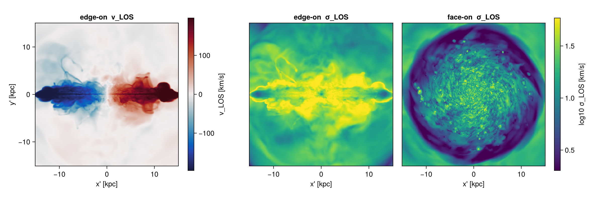

```julia
# Does σ_LOS depend on how finely you pixelate? Measure it rather than assume.
# (cells here run from 48/2^12 = 0.012 kpc at lmax to 48/2^6 = 0.75 kpc at lmin, so this
#  sweep sits at and above the coarse end of the hierarchy)
med(A) = median(filter(x -> isfinite(x) && x > 0, vec(Float64.(A))))
println(rpad("pxsize [kpc]", 15), rpad("median σ_LOS", 16), "mean σ_LOS")
for px in (0.15, 0.6, 2.4)
    p = projection(gas, :σlos, :km_s; direction=:edgeon, center=[:bc], fov=15, fov_unit=:kpc,
                   aperture=:square, pxsize=[px, :kpc], verbose=false, show_progress=false)
    v = filter(x -> isfinite(x) && x > 0, vec(Float64.(p.maps[:σlos])))
    println(rpad(px, 15), rpad(round(median(v), digits=1), 16), round(mean(v), digits=1))
end
```

```
pxsize [kpc]   median σ_LOS    mean σ_LOS
0.15           20.3            25.2
0.6            20.7            26.0
2.4            21.3            28.8
```

Now the result, and it is not the one the "width inside a pixel" picture suggests: **on this
galaxy a 16× change in `pxsize` barely moves σ_LOS**, as the table above shows. Here σ_LOS is set
mostly by the spread of velocities **along the ray**, and the ray is the same ray whatever the
pixel width. Making pixels smaller sub-divides the sky, not the sightline.

That is a licence on this galaxy, not a general one: choose `pxsize` for the *image* you want, and
σ_LOS will not move much under you here. Quote the pixel size anyway, so a reader can check. In
general σ_LOS is **not** resolution independent, and exactly how much of it a pixel holds is fixed
by the law of total variance, measured against an object with closed-form answers on the
[off-axis validation page](offaxis_validation.md).

!!! note "Shipped separately"
    Position-position-velocity (PPV) cubes, emission and absorption forward modelling, mock
    observations and FITS export are **in development in a separate module** and are not part of the
    released package. This page covers only the moment maps `:vlos` and `:σlos`. (Stated once, here.)

### Taking the rotation out

Chapter 7 said the edge-on σ_LOS is dominated by **ordered rotation**, not turbulence, because one
sightline crosses many radii that rotate at different speeds. That is a warning you can now act on.

A dispersion already subtracts the mean **inside each pixel**, so a single bulk velocity changes
nothing. What it cannot see is an ordered gradient **along the ray**. To remove that, subtract a
velocity field before projecting.

`rotation_frame` measures the field from the data itself: cells are binned by cylindrical radius,
the mass-weighted mean `vϕ` is taken per bin, and the result is a function of position.
`restframe` applies it and hands back an object every later call can use. This is the simulation
counterpart of correcting an observed dispersion for the velocity gradient across the beam
(Begeman 1989; Davies et al. 2011).

```julia
# Left at 0.8 kpc on purpose. The sweep above showed σ_LOS does not depend on the pixel
# size, so finer pixels buy nothing here, and this cell runs four projections plus a
# rotation frame and a subregion.
sig = (direction=:edgeon, center=:bc, fov=15, fov_unit=:kpc, aperture=:square,
       pxsize=[0.8,:kpc], verbose=false, show_progress=false)
good(A) = filter(x -> isfinite(x) && x > 0, vec(A))

# Do it twice: on everything, and on the disc alone. The contrast is the point.
# `subregion` cuts the object already in memory, so the snapshot is read once, not once per loop.
for (label, zr) in (("all gas", [-24.,24.]), ("disc only, |z| < 2 kpc", [-2.,2.]))
    g  = subregion(gas, :cuboid, zrange=zr, center=[:bc], range_unit=:kpc, verbose=false)
    f  = rotation_frame(g; center=:bc)          # the rotation curve measured from THIS gas
    gr = restframe(g; vcenter=f, center=:bc)
    a  = projection(g,  :σlos, :km_s; sig...).maps[:σlos]
    b  = projection(gr, :σlos, :km_s; sig...).maps[:σlos]
    ma, mb = median(good(a)), median(good(b))
    global σ_bulk_disc = mb          # kept for the thermal section below
    println(rpad(label, 24), "σ_LOS ", round(ma, digits=1), " → ", round(mb, digits=1),
            " km/s   (", round(100*(1 - mb/ma), digits=1), " % was rotation)")
end
```

```
all gas                 σ_LOS 21.1 → 59.9 km/s   (-184.2 % was rotation)
disc only, |z| < 2 kpc  σ_LOS 56.1 → 7.4 km/s   (86.9 % was rotation)
```

Read those two lines together, because they say different things.

Over **all** the gas, taking the rotation out barely moves σ_LOS. That is not the tool failing: it
is the measurement telling you that this σ_LOS is not rotation. Chapter 7 already showed why, the
brightest σ_LOS is *off* the disc plane, where a sightline crosses infalling and outflowing gas.

Restricted to the **disc**, much more of it goes. The percentage printed on that line is the
fraction of what looked like a dispersion in the plane that was really the rotation curve sampled
along the ray. What is left is the genuine spread about that curve.

So the frame is also a diagnostic. The fraction that disappears tells you how much of your
dispersion was ordered motion, and that number is worth quoting.

Two things to keep in mind.

**Use a fixed axis when comparing frames.** `direction=:faceon` and `:edgeon` derive their
orientation from the angular momentum, and changing the velocities changes `L`, so the camera moves
between the two maps. Each line above is internally consistent because both of its projections use
the same gas; for a controlled before/after comparison use `direction=:x/:y/:z`.

**`vcenter` also takes a plain vector or `:auto`**, so `restframe(gas; vcenter=:auto)` removes the
bulk motion of the whole selection. That will *not* change a dispersion, because a dispersion
already subtracts the mean in each pixel. It matters for velocity *maps*, not widths. Any function
`f(x, y, z)` works, so a model rotation curve or an outflow model can be subtracted the same way.

### The thermal part

The dispersion above is the **bulk** spread of gas velocities. A real line is also broadened by
thermal motion, and `:σ_thermal` gives that:

```math
\sigma_\mathrm{thermal} = \sqrt{\frac{k_B T}{\mu m_H}} = \sqrt{P/\rho} = \frac{c_s}{\sqrt{\gamma}}
```

The middle form is what Mera computes, and it is exact **without knowing μ**: `P/ρ` *is*
`k_B T/(μ m_H)` by the ideal gas law, whatever the ionization state. That matters on an RT run,
where μ varies cell by cell and the constant μ behind plain `:T` is wrong by a large factor.

It is **isotropic**. A Maxwellian has the same 1D width along every axis, so there is no
x/y/z or r/θ/ϕ version of it. Combine it with a directional bulk dispersion as

```math
\sigma_\mathrm{total}^2 = \sigma_\mathrm{bulk}^2 + \sigma_\mathrm{thermal}^2
```

adding the **variances**, because the line profile is a convolution.

```julia
th = getvar(gas, :σ_thermal, :km_s)
println("σ_thermal per cell : ", round(minimum(th), digits=2), " .. ", round(maximum(th), digits=2), " km/s")

# the two equivalent forms, as a check rather than an assertion
γ = info.gamma
println("equals cs/√γ       : ", isapprox(th, getvar(gas, :cs, :km_s) ./ sqrt(γ); rtol=1e-12))

# Combine with the bulk dispersion: variances add. Use the disc value from above, where the
# rotation has already been removed, so this is residual bulk motion rather than rotation.
σ_therm = median(filter(isfinite, th))
println("\nσ_bulk  (disc, rotation removed) = ", round(σ_bulk_disc, digits=2), " km/s")
println("σ_therm (all gas, median)        = ", round(σ_therm, digits=2), " km/s")
println("σ_total = √(σ_bulk² + σ_therm²)  = ", round(sqrt(σ_bulk_disc^2 + σ_therm^2), digits=2), " km/s")
```

```
σ_thermal per cell : 0.28 .. 1662.53 km/s
equals cs/√γ       : true
σ_bulk  (disc, rotation removed) = 7.38 km/s
σ_therm (all gas, median)        = 19.05 km/s
σ_total = √(σ_bulk² + σ_therm²)  = 20.43 km/s
```

One caveat if you are comparing against an observed line. `:σ_thermal` is the width of the
**mean gas particle**, of mass `μ m_H`. A line is broadened by the mass of the *emitting species*,
so for a species of mass `m_X`:

```math
\sigma_{\mathrm{thermal},X} = \sqrt{P/\rho}\;\sqrt{\mu m_H / m_X}
```

CO is 28 times heavier than hydrogen, so its thermal width is 5.3 times narrower. Use `getvar(gas, :mu)`
for the local μ when you need that scaling. Draine (2011) sets out the thermal and turbulent line
widths and the species-mass scaling in full.

## 8. Cutting planes: a sample, not an integral

`slice` is the cutting-plane function. It takes the same view keywords as `projection` and returns the cells the plane passes through. (`offaxis_slice` is a documented alias of the same function; prefer `slice`.)

It is a **nearest-cell sample**, not an integral. Three consequences:

- **It is not mass-conserving.** There is nothing to conserve, no ray is integrated. Never sum a slice.
- **Empty (NaN) pixels are geometry, not failure.** Where the plane threads between refinement levels there is simply no cell.
- **The tilted, elongated blocks are the true shape of the cut**, a plane crossing an axis-aligned cube at an angle gives a quadrilateral cross-section, and that is what you see.

And one API trap that is the *opposite* of Chapter 4: on `slice`, `xrange`/`yrange` **are the camera-plane window**. There is no `fov` and no `binning`; it takes exactly one variable and works on cell data only (hydro, gravity, RT). Depth is set by `offset` rather than `zrange`: see below. `slice(part, …)` is still a `MethodError`, and deliberately so, because a plane through point particles is empty by construction; the particle equivalent is a projection of finite `thickness`, shown in Chapter 11. Its `.extent` is code units and its `.center` really is code units too, unlike a map's.

```julia
view = (inclination=60, azimuth=30, axis=:angmom, center=[:bc])

# pxsize is 0.25 kpc, which is coarser than the cells over most of this frame (the finest cell
# here is 48/2^12 = 0.012 kpc). Sample a column integral well BELOW the local cell size and you
# resolve the SHADOW OF EACH CELL instead, flat straight-edged plateaus that overlap and read as
# stacked slabs. That is the AMR grid being displayed, not structure. Chapter 6 treats
# pixel-vs-cell size properly.
sl = slice(gas, :rho, :nH; view..., xrange=[-15,15], yrange=[-15,15],
           range_unit=:kpc, pxsize=[0.25,:kpc], verbose=false)

# projection: same view, and `fov` is how you get the SAME ±15 kpc camera frame
pr = projection(gas, :rho, :nH; view..., fov=15, fov_unit=:kpc, aperture=:square,
                pxsize=[0.25,:kpc], verbose=false, show_progress=false)

println("slice frame      ", size(sl.map), "   ", round(100*count(isnan, sl.map)/length(sl.map), digits=1), " % NaN")
println("projection frame ", size(pr.maps[:rho]))
println("slice extent [kpc] = ", round.(sl.extent .* gas.scale.kpc, digits=1))
```

```
slice frame      (120, 120)   0.0 % NaN
projection frame (121, 121)
slice extent [kpc] = [-15.0, 15.0, -15.0, 15.0]
```

### Moving the plane: `offset`

The keywords so far set the plane's **orientation**. `offset` sets its **position**, sliding it
along the line of sight, which is what turns a single cut into a fly-through. `offset=0` (the
default) puts the plane through `center`, and `offset_unit` defaults to `range_unit`.

The axis-aligned path spells the same idea `slice_pos`/`slice_unit`.

Sweeping it is how you build a slice movie: compute one map per offset and hand the stack to
[`savemovie`](@ref).

```julia
using Statistics
println(rpad("offset [kpc]", 14), rpad("filled px", 12), "median nH [cm^-3]")
for off in (-15.0, -5.0, 0.0, 5.0, 15.0)
    sl = slice(gas, :rho, :nH; view..., xrange=[-15,15], yrange=[-15,15], range_unit=:kpc,
               pxsize=[0.25,:kpc], offset=off, offset_unit=:kpc, verbose=false)
    f = filter(isfinite, sl.map)
    println(rpad(off, 14), rpad(length(f), 12),
            isempty(f) ? "-" : round(median(f), sigdigits=4))
end
```

```
offset [kpc]  filled px   median nH [cm^-3]
-15.0         14353       6.584e-6
-5.0          14400       3.14e-5
0.0           14400       3.886e-5
5.0           14400       3.04e-5
15.0          14353       6.917e-6
```

Every offset fills the frame, and the density changes with depth: the plane really is moving
through the object rather than being re-drawn in place. `offset=0` returns exactly what omitting
the keyword returns.

### The two slice movies

Sweeping `offset` at a fixed orientation gives a **travelling** plane: the camera holds still and
the cut moves through the object. Sweeping an angle at a fixed offset gives a **rotating** plane:
the cut stays put and turns.

One thing to get right for either: **pin `xrange`/`yrange`**. `slice` has no `fov`, so without a
window it auto-fits to the cells it painted, and that footprint changes as the plane moves or
turns. The frames then differ in size, which makes them useless as a movie. A fixed window makes
every frame the same shape.

```julia
win = (xrange=[-15,15], yrange=[-15,15], range_unit=:kpc, pxsize=[0.5,:kpc], verbose=false)

travelling = [slice(gas, :rho, :nH; view..., win..., offset=o, offset_unit=:kpc).map
              for o in -10:5:10]
rotating   = [slice(gas, :rho, :nH; inclination=a, azimuth=30, axis=:angmom,
                    center=[:bc], win...).map for a in 0:30:150]

println("travelling: ", length(travelling), " frames, all ",
        all(size(m) == size(travelling[1]) for m in travelling) ? "the same size" : "DIFFERENT sizes")
println("rotating  : ", length(rotating), " frames, all ",
        all(size(m) == size(rotating[1]) for m in rotating) ? "the same size" : "DIFFERENT sizes")
```

```
travelling: 5 frames, all the same size
rotating  : 6 frames, all the same size
```

Either stack goes straight into a `MeraMovie` and then [`savemovie`](@ref). For projections
rather than slices, [`getmovie`](@ref) does the loop for you and adds camera motion over a whole
series of snapshots (`angles`, `sweep`).

```julia
# ── figure code from here: panels, overlays, colorbars, no new Mera concepts ──
As = log10.(replace(Float64.(sl.map), 0.0 => NaN))
Ap = log10.(replace(Float64.(pr.maps[:rho]), 0.0 => NaN))
cr = (quantile(filter(isfinite, vcat(vec(As), vec(Ap))), 0.02),
      maximum(filter(isfinite, vcat(vec(As), vec(Ap)))))
es = sl.extent .* gas.scale.kpc

fig = Figure(size=(880, 400))
ax1 = Axis(fig[1,1], aspect=DataAspect(), title="projection: column integral",
           xlabel="x' [kpc]", ylabel="y' [kpc]")
h = showmap!(ax1, pr, :rho; crange=cr, cmap=:viridis)
ax2 = Axis(fig[1,2], aspect=DataAspect(), title="slice: nearest-cell sample", xlabel="x' [kpc]")
heatmap!(ax2, range(es[1],es[2],length=size(As,1)), range(es[3],es[4],length=size(As,2)),
         As, colormap=:viridis, colorrange=cr, nan_color=:black, interpolate=false)
hideydecorations!(ax2, grid=false)
Colorbar(fig[1,3], h, label="log10 n_H [cm⁻³]")
fig
```

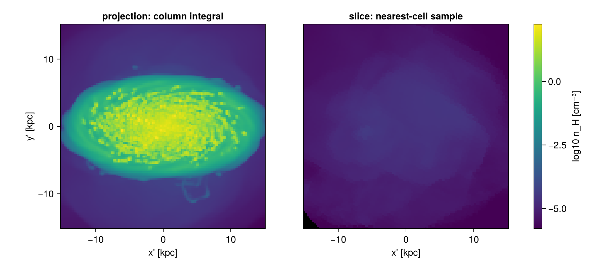

Two things in the left panel are the *selection* rather than the gas, and both show up in every
`fov` projection:

- the soft darkening into the **corners** is the selection sphere tapering to zero depth at the
  corners of a `:square` frame (Chapter 4);
- any **flat, straight-edged plateau** in the outskirts is a single AMR cell's projected shadow.
  You only see it when you sample a column integral much finer than the local cell. At 0.25 kpc
  pixels the cells here are finer than the pixels almost everywhere, so it stays out of the way.

Neither is a projection error, mass is conserved either way (Chapter 5). They are what you get
for asking the map a question finer than the data can answer.

## 9. Turning the camera: orbit movies

`rotation_sequence` renders one variable from a list of angles and returns a `Vector` of map objects. `sweep=:azimuth` (default), `:inclination` or `:position_angle` chooses which angle varies.

It uses **the same framing rule as Chapter 4, swept**: a rotation-invariant sphere selection, `aperture=:circle` or `:square`. That is the whole reason it exists, a cubic window's rotated bounding box changes size frame by frame, so the movie breathes.

!!! note "One difference from `projection`"
    Omit `fov` on `rotation_sequence` and it **auto-fits** to the 99 % enclosed-mass radius, so the frame follows the object rather than the sparse outermost cells. `projection` has **no** auto-fit, omit `fov` there and you are back on world ranges. If you learned `fov=16` in Chapter 4 and drop it here, your framing rule silently changes. Pass `fov` explicitly whenever it matters.

`parallel_frames=true` runs the frames concurrently with single-threaded projections instead of the reverse; it is typically ~1.5 to 2× faster when there are at least as many frames as threads, at proportionally more transient memory. Keep the total at or below 8 threads on a laptop.

```julia
frames = rotation_sequence(gas, :sd, :Msol_pc2; sweep=:azimuth, angles=0:90:270,
                           inclination=55, axis=:angmom, center=[:bc],
                           fov=16, fov_unit=:kpc, aperture=:square,
                           pxsize=[0.5,:kpc], parallel_frames=false)

# The numerical proof that the frame does not breathe, stronger than watching it.
for (a, f) in zip(0:90:270, frames)
    println("azimuth ", lpad(a,3), "°   frame ", size(f.maps[:sd]),
            "   extent [kpc] = ", round.(getextent(f, :kpc), digits=3))
end
```

```
azimuth   0°   frame (65, 65)   extent [kpc] = [-16.007, 16.158, -15.959, 16.205]
azimuth  90°   frame (65, 65)   extent [kpc] = [-16.009, 16.156, -15.96, 16.205]
azimuth 180°   frame (65, 65)   extent [kpc] = [-16.007, 16.158, -15.959, 16.205]
azimuth 270°   frame (65, 65)   extent [kpc] = [-16.009, 16.156, -15.96, 16.205]
```

```julia
# ── figure code from here: panels, overlays, colorbars, no new Mera concepts ──
# The frames are already computed above; showing them is the visual half of the same claim.
cr = sharedrange(frames, :sd)
maprow(collect(frames), :sd, ["azimuth $(a)°" for a in 0:90:270]; crange=cr)
```

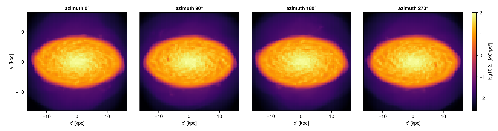

Four frames, four azimuths, one frame size and one extent to three decimals, the montage and the
numbers say the same thing from opposite directions. That invariance is what makes the sequence
usable as a movie: nothing breathes, so the eye reads rotation rather than zoom.

Write the frames to disk with any Makie/`FileIO` recorder, or hand the vector straight to
`Makie.record`.

Every frame is the same array, the same physical extent and the same pixel scale. Turning that
into a movie is one `Makie.record` call, Makie ships its own ffmpeg through `FFMPEG_jll`, so
this needs nothing installed on the system and runs as part of the notebook:

```julia
# Rendered here rather than pasted in, so the movie can never drift from the code above.
#
# The four frames above are for READING: a montage you compare panel by panel. A movie wants many
# more, or the orbit steps rather than turns. `record` writes exactly one GIF frame per rendered
# projection, so the angle step IS the smoothness: 120 angles at 3 degrees is one revolution, and
# at framerate 30 that revolution takes 4 seconds. Same camera, same fixed FOV, so nothing else
# about the sequence changes.
smooth = rotation_sequence(gas, :sd, :Msol_pc2; sweep=:azimuth, angles=0:3:357,
                           inclination=55, axis=:angmom, center=[:bc],
                           fov=16, fov_unit=:kpc, aperture=:square,
                           pxsize=[0.5,:kpc], parallel_frames=true)

cr  = sharedrange(smooth, :sd)          # one colour range across the whole orbit
fig = Figure(size=(300, 300))           # frame COUNT drives smoothness, canvas size drives file
                                        # size. The map itself is far smaller than the canvas (the
                                        # frame size is printed below), so a 300 px canvas loses
                                        # nothing and keeps a 120-frame GIF manageable.
ax  = Axis(fig[1, 1], aspect=DataAspect(), title="orbit movie (fixed FOV, square)")
hidedecorations!(ax)

mkpath("assets/offaxis")
record(fig, "assets/offaxis/orbit_movie.gif", eachindex(smooth); framerate=30) do k
    empty!(ax)
    showmap!(ax, smooth[k], :sd; crange=cr)
end
println("wrote assets/offaxis/orbit_movie.gif  (", length(smooth), " frames, ",
        round(filesize("assets/offaxis/orbit_movie.gif") / 1024, digits=1), " KB)")
println("map size: ", size(smooth[1].maps[:sd]), "   every frame the same size: ",
        all(size(f.maps[:sd]) == size(smooth[1].maps[:sd]) for f in smooth))
```

```
wrote assets/offaxis/orbit_movie.gif  (120 frames, 5771.5 KB)
map size: (65, 65)   every frame the same size: true
```


## 10. Reading the result, and fixing a map that looks wrong

Everything you need to debug an off-axis map travels on the result. You already printed the camera in Chapter 1; here is how to read it.

- `m.los`, `m.up`, `m.cam_right`, the basis actually used. If `m.los` is not what you expected, your view specifier or your `center` is the problem, not the renderer.
- `m.center` is a **box fraction** on a map object (a `slice` result's `.center` is code units, different quantity, same field name).
- `m.direction` reads `:offaxis`.
- `m.maps_lmax` is **empty**, off-axis and on the axis-aligned path alike; `m.maps_weight` exists on AMR map objects only, not on particle ones.
- `m.pixsize` and `m.extent` are code units, use `getextent(m, :kpc)`.

**Orientation fixes.** `position_angle=` rolls the image about `ŵ`; `up=` pins the image-y direction outright. Note that when you write your own loop over hand-made `los=` vectors, the automatic up-vector (the world axis least parallel to `ŵ`) can **flip mid-sweep** and your animation will jump. Fix `up=` explicitly, or use `rotation_sequence`, which sets an up-hint for you.

**Grid diagnostics.** `gridoverlay(gas; level=:max, <same view kwargs>)` draws the AMR structure in the camera frame. Read it honestly: off-axis it draws **cell-size squares at rotated cell centres**, not the true projected hexagonal footprints, so it tells you *where* and *how big* cells are, not what shape their shadows have.

```julia
savemap(fo, joinpath(tempdir(), "faceon_sd.jld2"), verbose=false)
fo2 = loadmap(joinpath(tempdir(), "faceon_sd.jld2"), verbose=false)

println("camera survives the round trip : ", fo2.los == fo.los && fo2.up == fo.up)
println(".center (box fraction)         : ", round.(fo.center, digits=3))
println(".maps_lmax off-axis            : ", isempty(fo.maps_lmax) ? "empty (by design)" : "populated")
println(".direction                     : ", fo.direction)
```

```
camera survives the round trip : true
.center (box fraction)         : [0.5, 0.5, 0.5]
.maps_lmax off-axis            : empty (by design)
.direction                     : offaxis
```

**Troubleshooting**, seven symptoms, seven causes:

| symptom | cause | fix |
|---|---|---|
| `:edgeon` looks face-on, or the disc is tilted at a random angle | L computed about the box corner | pass `center=[:bc]` (Ch 1) |
| "face-on" is off by 10 to 30 degrees for a warped or fountain-rich disc | L over the full box is dominated by slow, high-lever-arm CGM gas | take `:angmom` on an inner-disc `subregion`, then project the full data with that explicit `los=` (App. C) |
| straight edges cut across the map; the frame is bigger than requested | world-space `xrange`/`yrange` | `fov` + `fov_unit` + `aperture=:square` (Ch 4) |
| the galaxy is a dot in a huge frame | `fov` without `fov_unit`, 16 *box lengths*, clamped | always pair them (Ch 4) |
| `projection(gas, :vlos; direction=:z)` errors in `getvar` | `:vlos`/`:σlos` exist only in the off-axis engine | write `los=[0,0,1]` (Ch 5) |
| holes or moiré in a zoomed map | `:cic`/`:ngp` with pixels finer than cells | `binning=:overlap` (Ch 6) |
| an orbit movie tumbles across snapshots | `direction=:faceon` recomputed per snapshot; L drifts | freeze one `los=` (App. C) |

And when re-plotting is the slow part, do not re-project: `savemap` / `loadmap` round-trip the whole object, every map and unit, the geometry, the camera basis and the simulation `info`.

## 11. The same camera on other data

The view keywords are the same everywhere. What differs is a short list of defaults and gaps, all in one table:

| | hydro / RT | particles |
|---|---|---|
| `binning` default | `:overlap` | **`:cic`**; `:overlap`/`:exact` fall back to `:cic` (points have no footprint) and say so once per session |
| `weighting` | **Array**, `[:mass, missing]` | **Symbol**, `:mass`, `:volume`, `:sph`, `:voronoi`, all available off-axis. `:sph` is the standard SPH kernel weighting (Monaghan 1992) and conserves mass nearly independently of angle; `:voronoi` trades that for sharp cell edges, so prefer `:sph` for quantitative maps |
| `fov` / `fov_unit` / `aperture` | yes | **yes**, same rotation-invariant sphere selection; the framing is a selection, so it does not care what is deposited |
| `mode`, `nmax`, `max_threads`, `gravity_data` | yes | absent |
| `data_center` | **silently ignored** on the off-axis hydro path | honoured |
| `slice` | yes, with `offset` to move the plane | no, and by design: a plane through points is empty. Use `thickness`/`offset` on `projection` for a slab |
| `thickness` / `offset` | not applicable (a slice is the cell equivalent) | **yes**, project a slab of finite depth and move it along the line of sight |

Gravity goes through the combined call form `projection(hydro, gravity, var; …)`. RT data has no velocity field, so `:angmom`, `:faceon` and `:edgeon` are unavailable, give an explicit `los=`, or take `[:lx,:ly,:lz]` from the matching hydro object with `getvar` and pass the result as `axis=[lx,ly,lz]`. (This dataset has no RT output; see the [radiative transfer page](10_multi_RadiativeTransfer.md).)

```julia
part = loaddata(390, AVALON, :particles; verbose=false)
ps = projection(part, :sd, :Msol_pc2; direction=:edgeon, center=[:bc],
                xrange=[-20,20], yrange=[-20,20], zrange=[-20,20], range_unit=:kpc,
                pxsize=[0.15,:kpc], verbose=false, show_progress=false)
println("stars   : frame ", size(ps.maps[:sd]), "   los = ", round.(ps.los, digits=3))

grav = loaddata(390, AVALON, :gravity; verbose=false)
pe = projection(gas, grav, :epot; direction=:faceon, center=[:bc],
                xrange=[-20,20], yrange=[-20,20], zrange=[-20,20], range_unit=:kpc,
                pxsize=[0.15,:kpc], verbose=false, show_progress=false)
# NB the raw extrema of an off-axis potential map include an exact 0.0, and that 0.0 is EMPTY
# pixels, not a physical potential. Report the filled pixels, and say how many were empty.
epot = pe.maps[:epot]; filled = filter(<(0), epot)
println("gravity : maps ", collect(keys(pe.maps)))
println("          epot over filled pixels ", round.(extrema(filled), sigdigits=4),
        "   (", count(iszero, epot), " of ", length(epot), " pixels empty)")
```

```
stars   : frame (184, 12)   los = [1.0, 0.0, 0.0]
gravity : maps Any[:epot, :sd]
          epot over filled pixels (-0.9787, -0.1408)   (1206 of 75076 pixels empty)
```

### A slab instead of a slice, for particles

A cutting plane through point particles catches nothing: a particle has no extent, so a
zero-thickness plane is empty by construction. That is why `slice(part, …)` is a `MethodError`
rather than an oversight.

The useful analogue is a projection of finite depth. `thickness` sets the depth of the slab along
the line of sight and `offset` moves it, the same way `offset` moves the plane for cell data. A
non-positive thickness is refused rather than returning an empty map.

```julia
S = (direction=:edgeon, center=[:bc], fov=15, fov_unit=:kpc, aperture=:square,
     pxsize=[0.15,:kpc], verbose=false, show_progress=false)
full = projection(part, :sd, :Msol_pc2; S...)
T = sum(full.maps[:sd])
println(rpad("thickness [kpc]", 18), rpad("total", 12), "fraction of the full column")
for th in (20.0, 5.0, 1.0)
    m = projection(part, :sd, :Msol_pc2; thickness=th, thickness_unit=:kpc, S...)
    println(rpad(th, 18), rpad(round(sum(m.maps[:sd]), sigdigits=6), 12),
            round(sum(m.maps[:sd])/T, digits=4))
end

println()
println(rpad("offset [kpc]", 18), "total in a 2 kpc slab")
for off in (-6.0, -2.0, 0.0, 2.0, 6.0)
    m = projection(part, :sd, :Msol_pc2; thickness=2.0, thickness_unit=:kpc,
                   offset=off, offset_unit=:kpc, S...)
    println(rpad(off, 18), round(sum(m.maps[:sd]), sigdigits=6))
end
```

```
thickness [kpc]   total       fraction of the full column
20.0              6604.45     0.9989
5.0               4914.64     0.7433
1.0               1414.72     0.214
offset [kpc]      total in a 2 kpc slab
-6.0              75.3251
-2.0              734.259
0.0               2499.54
2.0               708.87
6.0               74.6582
```

The slab total rises with thickness, as it must. The offset sweep is more interesting: read the
column above and see which offset holds the most mass. If the peak is not at 0, that is not a bug
in the slab, it is the slab reporting where the stars actually are. `center=[:bc]` is the box
centre, and a galaxy's stellar centroid need not sit exactly there, so the densest slab is the one
offset toward it.

That is the check worth running on your own data. If the peak is not where you expect the object
to be, either the centre is wrong or the object is not where you think, and both are worth knowing
before you quote a number from the map.

```julia
# The same camera, pointed at a different data type. `fov` frames both identically, so the two
# panels can be compared pixel for pixel.
# 200 pc pixels. Finer than the 300 pc most gas figures use, and still coarse enough that
# the STAR panel is not dominated by shot noise, since the outskirts get very few particles
# per pixel. Chapter 12 does that arithmetic.
shot = (direction=:edgeon, center=[:bc], fov=16, fov_unit=:kpc, aperture=:square,
        pxsize=[0.2, :kpc], verbose=false, show_progress=false)
gas_eo  = projection(gas,  :sd, :Msol_pc2; shot...)
star_eo = projection(part, :sd, :Msol_pc2; shot...)
# gravity rides on the hydro grid: the two-object form, same camera, same framing
pot_eo  = projection(gas, grav, :epot, :km2_s2; shot...)
println("gas   frame ", size(gas_eo.maps[:sd]),
        "   stars ", size(star_eo.maps[:sd]),
        "   potential ", size(pot_eo.maps[:epot]))
println("φ along the line of sight: ", round.(extrema(pot_eo.maps[:epot]), sigdigits=4), " km²/s²")

# ── figure code from here: panels, overlays, colorbars, no new Mera concepts ──
# separate colour ranges: gas and stars differ by orders of magnitude in surface density,
# and forcing one scale would flatten whichever loses
lo(m) = quantile(log10.(filter(>(0), vec(Float64.(m.maps[:sd])))), 0.25)  # clip the empty rim
hi(m) = maximum(log10.(filter(>(0), vec(Float64.(m.maps[:sd])))))

fig = Figure(size=(1420, 400))
ax1 = Axis(fig[1,1], title="gas  Σ", xlabel="x' [kpc]", ylabel="y' [kpc]")
h1 = showmap!(ax1, gas_eo, :sd; crange=(lo(gas_eo), hi(gas_eo)))
Colorbar(fig[1,2], h1, label="log10 Σ_gas [M⊙/pc²]")

ax2 = Axis(fig[1,4], title="stars  Σ", xlabel="x' [kpc]")
h2 = showmap!(ax2, star_eo, :sd; crange=(lo(star_eo), hi(star_eo)))
Colorbar(fig[1,5], h2, label="log10 Σ_★ [M⊙/pc²]")

# the potential is negative everywhere and spans a small range, a linear scale on the raw
# value, no log, and a sequential map so "deeper" reads as one direction
ax3 = Axis(fig[1,7], title="gravitational potential φ", xlabel="x' [kpc]")
h3 = showmap!(ax3, pot_eo, :epot; logscale=false, cmap=:magma)
Colorbar(fig[1,8], h3, label="φ [km²/s²]")

hideydecorations!(ax2, grid=false); hideydecorations!(ax3, grid=false)
colsize!(fig.layout, 3, Fixed(14)); colsize!(fig.layout, 6, Fixed(14))
fig
```

```
gas   frame (161, 161)   stars (9, 9)   potential (161, 161)
φ along the line of sight: (-2980.0, -815.5) km²/s²
```

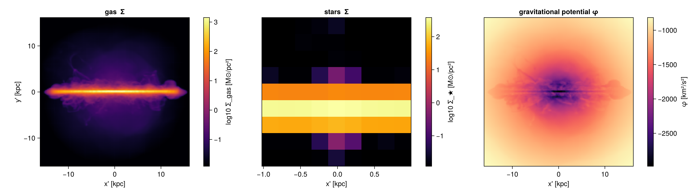

Same keywords, same camera, three different kinds of data, and each one says something the
others cannot. The stars form a **thinner, smoother disc** than the gas, which is exactly the
comparison that motivates making both maps in one orientation. The potential is smoother than
either: it is an integral over all the mass, so it does not care about the clumps that dominate
the gas map, and its contours are rounder than the disc that produced them.

Gravity comes through the **two-object form**, `projection(hydro, gravity, var)`: the hydro object
supplies the weights and the gravity object the field, so both must describe the same cells,
load them from the same `info` at the same `lmax`. `fov` cuts both together, so the three panels
above are framed identically and can be compared pixel for pixel.

What *does* differ between the two data types is the deposit itself: points have no footprint, so
particle projections use `:cic` and the footprint kernels fall back to it.

That difference is visible if you push the pixels: a grid map degrades smoothly, while a particle
map becomes **grainy**, because each pixel is counting a finite number of objects and inherits a
√N uncertainty. The cure is the same as in any counting experiment, coarsen the pixels until each
one holds enough particles to mean something.

```julia
# The table above is a set of claims. Run them, a compatibility table that is never executed
# is exactly the kind of thing that goes stale when the code moves on.
W = (center=[:bc], xrange=[-15,15], yrange=[-15,15], zrange=[-15,15], range_unit=:kpc,
     pxsize=[1.0,:kpc], verbose=false, show_progress=false)
same(a, b) = maximum(abs, a.maps[:sd] .- b.maps[:sd]) == 0
raises(f)  = try (f(); "NO ERROR") catch e; string(typeof(e).name.name) end

pc = projection(part, :sd, :Msol_pc2; direction=:edgeon, binning=:cic, W...)
println("particle binning=:overlap falls back to :cic : ",
        same(projection(part, :sd, :Msol_pc2; direction=:edgeon, binning=:overlap, W...), pc))
println("particle binning=:exact   falls back to :cic : ",
        same(projection(part, :sd, :Msol_pc2; direction=:edgeon, binning=:exact, W...), pc))
# :sph/:voronoi now work off-axis too: both are rotation-invariant, so the same samplers run
# on camera-frame coordinates. (They need a :volume column, which star particles lack.)
for w in (:sph, :voronoi)
    println(rpad("weighting=:$w off-axis (needs :volume)", 45), ": ",
            raises(() -> projection(part, :sd, :Msol_pc2; direction=:edgeon, weighting=w, W...)))
end
println("fov works on particles                       : ",
        size(projection(part, :sd, :Msol_pc2; direction=:edgeon, center=[:bc], fov=15,
                        fov_unit=:kpc, aperture=:square, pxsize=[1.0,:kpc],
                        verbose=false, show_progress=false).maps[:sd]))
println("slice(part, …)                               : ",
        raises(() -> slice(part, :sd; direction=:edgeon, center=[:bc], xrange=[-15,15],
                           yrange=[-15,15], range_unit=:kpc, pxsize=[1.0,:kpc], verbose=false)))
for kw in (:nmax, :max_threads)
    println(rpad(string("particle ", kw), 45), ": ",
            raises(() -> projection(part, :sd, :Msol_pc2; direction=:edgeon, (; kw => 8)..., W...)))
end
println("data_center ignored on off-axis hydro        : ",
        same(projection(gas, :sd, :Msol_pc2; inclination=35, axis=:angmom, W...),
             projection(gas, :sd, :Msol_pc2; inclination=35, axis=:angmom,
                        data_center=[0.4,0.4,0.4], data_center_unit=:standard, W...)))
```

```
particle binning=:overlap falls back to :cic : true
particle binning=:exact   falls back to :cic : true
weighting=:sph off-axis (needs :volume)      : ArgumentError
weighting=:voronoi off-axis (needs :volume)  : ArgumentError
fov works on particles                       : (4, 4)
slice(part, …)                               : MethodError
particle nmax                                : MethodError
particle max_threads                         : NO ERROR
data_center ignored on off-axis hydro        : true
```

Nothing above is hydro-specific. The camera keywords, the framing keywords and the binning
keywords mean the same thing for every projectable data type:

* **particles**, point masses, deposited with the same kernels; `:sd` is a stellar surface
  density here rather than a gas one;
* **gravity**, projected through the two-object form `projection(hydro, gravity, var)` described in
  Chapter 11.

Chapter 12 takes the particle side further: what a point mass conserves, what it cannot, and why
a stellar map has no converged peak.

The empty-pixel count printed above is worth carrying with you: an off-axis frame that is *not*
completely filled is normal, and the zeros are absence of data, not zero potential. Aggregate the
filled pixels, not the whole array.

## 12. Stars: what a point mass conserves

The camera does not change here. The view keywords, the framing keywords and the way a result is
read back are the ones the chapters above already cover. What changes is the thing being
deposited.

A cell has a volume. It covers pixels, it has an exact chord along the ray, and Chapter 6 is about
what happens when a pixel becomes smaller than that footprint. A star particle has none of this.
It is a point mass at one position, so there is nothing to integrate over, nothing for a cutting
plane to catch, and no smallest scale below which the map stops changing.

Four consequences, and they are the whole chapter:

- **`binning` keeps two of its four values, and only off-axis.** `:overlap` and `:exact` integrate
  a footprint, so on points they fall back to `:cic` and say so once per session. Along a box axis
  (`direction=:x/:y/:z`) the particle path is a plain histogram, which is `:ngp`, and `binning` is
  not read at all. Write `los=[0,0,1]` if you want CIC along z.
- **`weighting` is a plain `Symbol`,** and on star particles `:mass` is the only value that means
  anything. The other three want a cell volume or a smoothing length that RAMSES stars do not
  carry (Chapter 11 runs that claim).
- **`:sd` is the map that conserves mass.** `:mass` is not an extensive map on particles. That is
  the one real trap on this page.
- **The peak surface density has no converged value,** because a point mass is a delta function.

This snapshot is a clean test case: every particle in it is a star.

```julia
# What is actually in the particle table. The equal-mass line matters: if every star carries the
# same mass, a mass-weighted map and a number-weighted map are the same map.
fam  = getvar(part, :family)
mp   = getvar(part, :mass, :Msol)
age  = getvar(part, :age, :Myr)
Mtot = msum(part, :Msol)

println("particles        : ", length(part.data))
println("families present : ", sort(unique(fam)), "   (1 = dark matter, 2 = star)")
println("stellar mass     : ", round(Mtot, sigdigits=4), " Msol")
println("particle mass    : ", round(minimum(mp), digits=1), " .. ", round(maximum(mp), digits=1),
        " Msol   (all equal: ", minimum(mp) ≈ maximum(mp), ")")
println("age              : median ", round(median(age), digits=1),
        " Myr, oldest ", round(maximum(age), digits=1), " Myr")
```

```
particles        : 627896
families present : [2.0]   (1 = dark matter, 2 = star)
stellar mass     : 5.035e8 Msol
particle mass    : 800.0 .. 1600.0 Msol   (all equal: false)
age              : median 245.0 Myr, oldest 575.8 Myr
```

```julia
# Particle projections are cheap: this is 628 thousand deposits and one pass over a short table,
# well under a second even at fine pixels. So the star figures are drawn at 150 pc, which still
# keeps about 35 stars in a disc pixel. The arithmetic behind that number is further down.
sw  = (center=[:bc], fov=16, fov_unit=:kpc, aperture=:square, parttypes=[:stars],
       pxsize=[0.15, :kpc], verbose=false, show_progress=false)
sfo = projection(part, :sd, :Msol_pc2; direction=:faceon, sw...)
seo = projection(part, :sd, :Msol_pc2; direction=:edgeon, sw...)

println("frame ", size(sfo.maps[:sd]), "   empty pixels face-on ",
        round(100 * count(iszero, sfo.maps[:sd]) / length(sfo.maps[:sd]), digits=1), " %")

# ── figure code from here: panels, overlays, colorbars, no new Mera concepts ──
cr = sharedrange([sfo, seo], :sd)
maprow([sfo, seo], :sd, ["stars, face-on", "stars, edge-on"];
       crange=cr, clabel="log10 Σ★  [M⊙/pc²]")
```

```
frame (184, 184)   empty pixels face-on 35.8 %
```


### Mass is conserved, at any angle and any pixel size

Every deposit Mera uses for particles is a partition of unity. A particle hands out shares of its
mass to pixels and the shares sum to exactly one: `:ngp` gives its whole mass to one pixel, `:cic`
splits it bilinearly over four, and a stencil that reaches past the edge of the frame folds the
outside share back onto the edge pixel. Turning the camera or changing the grid moves mass between
pixels and never creates or destroys any, so the map total is the particle total to round-off.

The conserved map is `:sd`, so the total is `Σ(sd) · pixel area`. Two ways that check fails when
nothing is wrong, both easy to hit:

- **`fov` with `aperture=:square` crops the finished map on purpose.** The selection is a sphere of
  radius √2·`fov` and the crop keeps the inscribed square, so the corners are discarded after the
  deposit. What you then get is the mass inside your frame, which is the right number for a figure
  and the wrong number for a conservation test. Measure conservation without `fov`.
- **Divide by `m.pixsize`, not by the pixel size you asked for.** `pxsize` is converted into a
  pixel count across the whole box and that count is rounded, so the pixel you get is close to the
  one you asked for and not equal to it. `m.pixsize` is the one the map was built with.

```julia
# Σ(sd · pixel area) is the deposited mass. Sweep the two things that could break it, and both
# deposit schemes. No fov, for the reason above.
mass_from(m) = sum(m.maps[:sd]) * (m.pixsize * m.scale.pc)^2      # Msol_pc2 → Msol

for bin in (:cic, :ngp)
    println("binning = :", bin)
    println("  ", rpad("pxsize [kpc]", 14), rpad("i = 0", 18), rpad("i = 45", 18), "i = 90")
    for px in (1.0, 0.3, 0.1)
        row = map((0, 45, 90)) do i
            m = projection(part, :sd, :Msol_pc2; inclination=i, axis=:angmom, center=[:bc],
                           binning=bin, pxsize=[px, :kpc], verbose=false, show_progress=false)
            mass_from(m) / Mtot - 1
        end
        println("  ", rpad(px, 14), join(rpad.(round.(row, sigdigits=2), 18)))
    end
end
```

```
binning = :cic
  pxsize [kpc]  i = 0             i = 45            i = 90
  1.0           -4.4e-16          -2.6e-15          3.3e-15
  0.3           -1.0e-15          -1.1e-15          -1.6e-15
  0.1           -6.7e-16          -7.8e-16          -7.8e-16
binning = :ngp
  pxsize [kpc]  i = 0             i = 45            i = 90
  1.0           -8.7e-14          -6.2e-14          7.0e-14
  0.3           -6.0e-15          1.1e-15           8.3e-14
  0.1           -2.2e-16          -5.6e-16          8.2e-15
```

Both schemes conserve, at every angle and every pixel size in the table, and the residuals are
round-off rather than approximation. Nothing physical separates them here. For cell data the same
argument has to survive a footprint spanning many pixels, which is what Chapter 6 is about; for
points there is no footprint, so this is the easy case rather than the hard one.

### `:mass` is not the map you want

For gas, `:mass` is the extensive map: a pixel holds the mass of its column and the map sums to a
budget (Chapter 5). For particles it is not. There is no extensive branch on the particle path, so
`:mass` goes through the same machinery as `:T` or `:vx` and comes back as a mass-weighted mean,
`Σ(mᵢ·mᵢ) / Σmᵢ`. A pixel holds the mean mass of the stars in it, and the sum over the map is a
number with no meaning.

The tell is that the sum moves with the pixel size. Shrink the pixels and more and more of them
hold a single star, whose mass-weighted mean mass is just its own mass, so the sum creeps up toward
the total for entirely the wrong reason. Watch it climb while `Σ(sd · area)` does not move.

```julia
println(rpad("pxsize [kpc]", 14), rpad("Σ(:mass map)/M", 18),
        rpad("Σ(:sd·area)/M", 20), "filled pixels")
for px in (0.2, 0.1, 0.05, 0.02)
    m   = projection(part, [:mass, :sd], [:Msol, :Msol_pc2]; direction=:faceon, center=[:bc],
                     pxsize=[px, :kpc], verbose=false, show_progress=false)
    pxa = (m.pixsize * m.scale.pc)^2
    nf  = count(>(0), m.maps[:sd])
    println(rpad(px, 14),
            rpad(round(sum(m.maps[:mass]) / Mtot, sigdigits=3), 18),
            rpad(round(sum(m.maps[:sd]) * pxa / Mtot, digits=12), 20),
            string(round(100 * nf / length(m.maps[:sd]), digits=2), " %"))
end
```

```
pxsize [kpc]  Σ(:mass map)/M    Σ(:sd·area)/M       filled pixels
0.2           0.0211            1.0                 67.59 %
0.1           0.0685            1.0                 56.1 %
0.05          0.209             1.0                 43.36 %
0.02          0.773             1.0                 25.74 %
```

### The two moments, and the identity that ties them together

`:vlos` and `:σlos` mean for stars exactly what Chapter 7 says they mean for gas, sign convention
included: positive is receding. What differs is what the width is made of. Gas carries a thermal
width that has to be added in quadrature. A collisionless star does not, so the stellar `σ_LOS` is
the second moment of the line-of-sight velocity distribution and nothing else, which is the
quantity an integral field spectrograph reports.

Because every particle deposits its whole mass, the per-pixel moments obey an exact piece of
bookkeeping, the law of total variance:

```math
\sigma_\mathrm{global}^2 \;=\; \big\langle \sigma_p^2 \big\rangle_W \;+\; \mathrm{Var}_W\!\big(\mu_p\big)
```

The global mass-weighted variance of `v_LOS` is the mass-weighted mean of the per-pixel variance
plus the mass-weighted variance of the per-pixel mean. The first term is the spread inside pixels,
the second the spread between them. It holds to round-off at any pixel size and any angle, on one
condition: the weights and the two moments have to come from the same call, because they have to
be the same deposit.

```julia
# One call, so the weights and the two moments come from the same deposit.
kv  = projection(part, [:sd, :vlos, :σlos], [:Msol_pc2, :km_s, :km_s];
                 direction=:edgeon, center=[:bc], pxsize=[0.2, :kpc],
                 verbose=false, show_progress=false)
pxa = (kv.pixsize * kv.scale.pc)^2
W   = Float64.(kv.maps[:sd]) .* pxa                # mass per pixel, Msol
mu  = Float64.(kv.maps[:vlos])
sg  = Float64.(kv.maps[:σlos])
Mw  = sum(W)
vbar    = sum(W .* mu) / Mw
within  = sum(W .* sg .^ 2) / Mw
between = sum(W .* (mu .- vbar) .^ 2) / Mw

# the same two numbers straight from the particles, with no projection involved
vlos_p = -(getvar(part, :vx, :km_s) .* kv.los[1] .+
           getvar(part, :vy, :km_s) .* kv.los[2] .+
           getvar(part, :vz, :km_s) .* kv.los[3])
wp     = getvar(part, :mass, :Msol)
vbar_p = sum(wp .* vlos_p) / sum(wp)
var_p  = sum(wp .* (vlos_p .- vbar_p) .^ 2) / sum(wp)

println("mass on the map / msum : ", round(Mw / Mtot, digits=12))
println("mean v_LOS  map ", round(vbar, digits=6),
        "   particles ", round(vbar_p, digits=6), " km/s")
println("variance    map ", round(within + between, digits=4),
        "   particles ", round(var_p, digits=4), " (km/s)^2")
println()

# the split moves with the pixel size, the sum does not
println(rpad("pxsize [kpc]", 14), rpad("within-pixel [%]", 19),
        rpad("between-pixel [%]", 20), "sum / particles")
for px in (2.0, 0.5, 0.125)
    k  = projection(part, [:sd, :vlos, :σlos], [:Msol_pc2, :km_s, :km_s];
                    direction=:edgeon, center=[:bc], pxsize=[px, :kpc],
                    verbose=false, show_progress=false)
    a  = (k.pixsize * k.scale.pc)^2
    w  = Float64.(k.maps[:sd]) .* a
    u  = Float64.(k.maps[:vlos]); s = Float64.(k.maps[:σlos])
    mw = sum(w); vb = sum(w .* u) / mw
    wi = sum(w .* s .^ 2) / mw; be = sum(w .* (u .- vb) .^ 2) / mw
    println(rpad(px, 14), rpad(round(100 * wi / (wi + be), digits=1), 19),
            rpad(round(100 * be / (wi + be), digits=1), 20),
            round((wi + be) / var_p, digits=10))
end
```

```
mass on the map / msum : 1.0
mean v_LOS  map 0.302409   particles 0.302409 km/s
variance    map 22741.6499   particles 22741.6499 (km/s)^2
pxsize [kpc]  within-pixel [%]   between-pixel [%]   sum / particles
2.0           17.8               82.2                1.0
0.5           7.7                92.3                1.0
0.125         6.8                93.2                1.0
```

Read the sweep, not only the identity. The split moves with the pixel size while the sum stays
put. Coarse pixels swallow whole radii of the disc, so nearly all of the variance sits inside
pixels; fine pixels resolve the rotation and hand it to the between-pixel term. That is the
Chapter 7 statement seen from the budget side.

One caveat is specific to points. The per-pixel `σ_LOS` is the population variance of the stars in
that pixel, not the sample variance. With `N` stars it is low by a factor `(N-1)/N` against the
width of the distribution those stars were drawn from: half the variance for two stars, and
exactly zero for one. Splitting a star over four pixels with `:cic` does not help, because all
four copies carry the same velocity. The identity above is untouched, since it is bookkeeping over
the deposited weights, but a stellar dispersion map is biased low wherever the pixels are sparse.

### The peak surface density has no converged value

A star is a delta function. The pixel holding it reports `m★/Δ²`, so once the densest pixel is down
to a single star, halving the pixel quadruples the peak, and it goes on doing that without limit.
There is no pixel size at which a stellar peak surface density converges. Gas is genuinely
different: a cell has a finite volume and a finite density, so below the finest cell the gas peak
stops moving.

The same counting sets the noise. Spread these stars over a disc of radius 11.4 kpc and the mean is
about 1540 per square kpc, so a pixel of side Δ holds about `1540·Δ²` of them and carries at least
a `√N` fluctuation:

| `pxsize` | stars per pixel | shot noise |
|---|---|---|
| 1 kpc | ~1500 | 3 % |
| 300 pc | ~140 | 8 % |
| 100 pc | ~15 | 26 % |
| 26 pc | ~1 | 100 % |

So a stellar map is shot-noise dominated below roughly 250 pc in the disc, and at 26 pc it is a
scatter plot drawn with square markers. Those are disc averages: the centre stays smooth to far
finer pixels and the outskirts are single stars already at 100 pc, which is why the cell below
prints the occupancy of the densest pixel instead of trusting the average.

```julia
# One line of sight for both, so the two curves are the same view. The gas cutout is the only
# expensive line in this chapter, one pass over the full cell table, so it is done once here and
# never inside the loop.
L    = [sum(getvar(gas, :lx, center=[:bc])), sum(getvar(gas, :ly, center=[:bc])),
        sum(getvar(gas, :lz, center=[:bc]))]
pcut = subregion(part, :sphere, radius=3., center=[:bc], range_unit=:kpc, verbose=false)
gcut = subregion(gas,  :sphere, radius=3., center=[:bc], range_unit=:kpc, verbose=false)
mbar = median(getvar(pcut, :mass, :Msol))

pxs   = [0.8, 0.4, 0.2, 0.1, 0.05, 0.025]
speak = Float64[]; gpeak = Float64[]
println(rpad("pxsize [kpc]", 14), rpad("max Σ★", 13), rpad("stars in that pixel", 21),
        rpad("max Σ_gas", 13), "empty pixels")
for px in pxs
    ms = projection(pcut, :sd, :Msol_pc2; los=L, center=[:bc], pxsize=[px, :kpc],
                    verbose=false, show_progress=false)
    mg = projection(gcut, :sd, :Msol_pc2; los=L, center=[:bc], pxsize=[px, :kpc],
                    verbose=false, show_progress=false)
    S = Float64.(ms.maps[:sd]); a = (ms.pixsize * ms.scale.pc)^2
    push!(speak, maximum(S)); push!(gpeak, maximum(Float64.(mg.maps[:sd])))
    println(rpad(px, 14), rpad(round(speak[end], sigdigits=4), 13),
            rpad(round(speak[end] * a / mbar, digits=1), 21),
            rpad(round(gpeak[end], sigdigits=4), 13),
            string(round(100 * count(iszero, S) / length(S), digits=1), " %"))
end

# ── figure code from here: panels, overlays, colorbars, no new Mera concepts ──
fig = Figure(size=(600, 440))
ax  = Axis(fig[1,1], xscale=log10, yscale=log10, xreversed=true,
           xlabel="pxsize [kpc]", ylabel="peak Σ  [M⊙/pc²]",
           title="the gas peak converges, the stellar peak does not")
lines!(ax, pxs, speak[end] .* (pxs ./ pxs[end]) .^ -2,
       color=:gray, linestyle=:dash, label="Δ⁻², one star per pixel")
scatterlines!(ax, pxs, speak, color=:orangered, label="stars")
scatterlines!(ax, pxs, gpeak, color=:steelblue, label="gas")
axislegend(ax, position=:lt)
fig
```

```
pxsize [kpc]  max Σ★       stars in that pixel  max Σ_gas    empty pixels
0.8           18.55        14354.9              52.75        16.0 %
0.4           32.28        6350.1               66.97        15.9 %
0.2           38.4         1904.1               108.0        18.3 %
0.1           63.13        785.9                244.2        20.0 %
0.05          82.83        258.3                364.2        21.1 %
0.025         107.5        83.9                 436.9        21.5 %
```

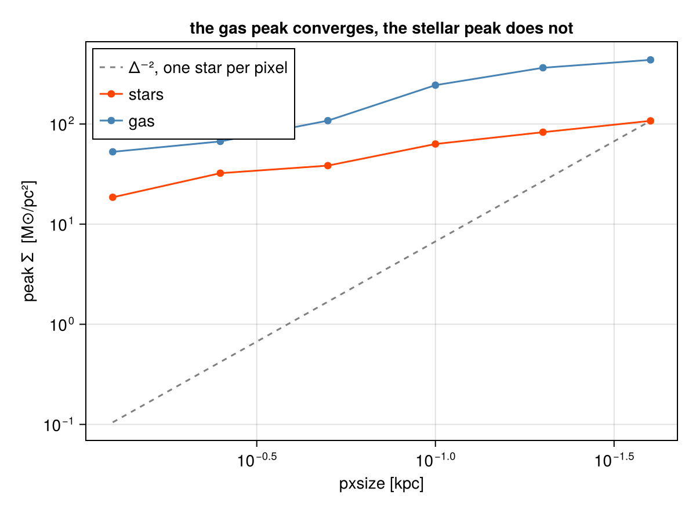

```julia
# Two things the gas maps cannot give you: the mean age of the stars, and a line-of-sight width
# with no thermal term in it.
kw   = (center=[:bc], fov=16, fov_unit=:kpc, aperture=:square,
        pxsize=[0.15, :kpc], verbose=false, show_progress=false)
sage = projection(part, [:age, :sd], [:Myr, :Msol_pc2]; direction=:faceon, kw...)
skin = projection(part, [:vlos, :σlos, :sd], [:km_s, :km_s, :Msol_pc2]; direction=:edgeon, kw...)

# Off-axis particle maps put 0.0 in empty pixels, not NaN. On a velocity map a 0 reads as "not
# moving", and on an age map as "just born", so blank the pixels that hold no stars.
function blanked(m, key)
    B = Float64.(m.maps[key]); B[Float64.(m.maps[:sd]) .== 0] .= NaN; B
end
alive(A) = filter(isfinite, vec(A))

println("mean stellar age over filled pixels : ",
        round(median(alive(blanked(sage, :age))), digits=1), " Myr")
println("max |v_LOS| edge-on                 : ",
        round(maximum(abs, alive(blanked(skin, :vlos))), digits=1), " km/s")
println("median σ_LOS edge-on                : ",
        round(median(filter(>(0), alive(blanked(skin, :σlos)))), digits=1), " km/s")

# ── figure code from here: panels, overlays, colorbars, no new Mera concepts ──
function panel!(ax, m, key, cmap; crange=Makie.automatic)
    A = blanked(m, key); e = getextent(m, :kpc)
    hm = heatmap!(ax, range(e[1], e[2], length=size(A,1)), range(e[3], e[4], length=size(A,2)), A;
                  colormap=cmap, nan_color=:black, interpolate=false, colorrange=crange)
    ax.aspect = DataAspect(); hm
end

vmx = quantile(abs.(alive(blanked(skin, :vlos))), 0.98)
fig = Figure(size=(1420, 400))
ax1 = Axis(fig[1,1], title="stars, mean age (face-on)", xlabel="x' [kpc]", ylabel="y' [kpc]")
h1  = panel!(ax1, sage, :age, :plasma)
Colorbar(fig[1,2], h1, label="age [Myr]")
ax2 = Axis(fig[1,4], title="stars, v_LOS (edge-on)", xlabel="x' [kpc]")
h2  = panel!(ax2, skin, :vlos, :balance; crange=(-vmx, vmx))
Colorbar(fig[1,5], h2, label="v_LOS [km/s]")
ax3 = Axis(fig[1,7], title="stars, σ_LOS (edge-on)", xlabel="x' [kpc]")
h3  = panel!(ax3, skin, :σlos, :viridis)
Colorbar(fig[1,8], h3, label="σ_LOS [km/s]")
hideydecorations!(ax2, grid=false); hideydecorations!(ax3, grid=false)
colsize!(fig.layout, 3, Fixed(14)); colsize!(fig.layout, 6, Fixed(14))
fig
```

```
mean stellar age over filled pixels : 249.4 Myr
max |v_LOS| edge-on                 : 100.7 km/s
median σ_LOS edge-on                : 21.9 km/s
```

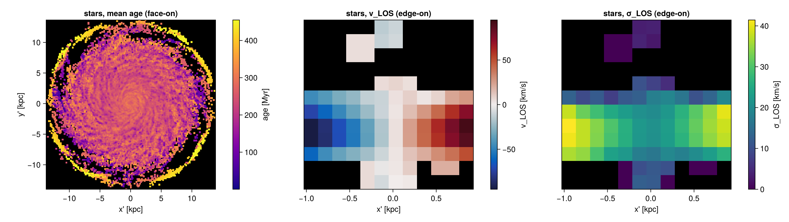

The age map is the panel that has no gas counterpart. It is a mass-weighted mean, so it reads as
the mean age of the stars in each column rather than as an age of anything in particular, and with
equal-mass particles it is also the number-weighted mean.

### What the angle does, and what it does not

Turning the camera cannot change the stellar mass. What it does change is the shape of the image
and the kinematics, and both change in a way you can predict before you run it:

- the apparent **axis ratio** goes as `cos i` for a razor-thin disc. A real disc has thickness, so
  `q² = cos²i + q₀²·sin²i` and `q` stops above zero at `i = 90`. That is the relation observers
  invert to get an inclination out of an image (Hubble 1926; Holmberg 1958), and the residual at
  edge-on is the intrinsic thickness `q₀`.
- the **line-of-sight velocity amplitude** goes as `sin i`, because only the component of the
  rotation along the ray is visible.

The first column below is not the conservation test. With `fov` and `aperture=:square` the frame
crops the map, so that column is the fraction of the stellar mass inside the frame, and it is
allowed to move with the angle. Conservation was measured further up, without `fov`.

```julia
aview = (axis=:angmom, center=[:bc], fov=16, fov_unit=:kpc, aperture=:square,
         pxsize=[0.15, :kpc], verbose=false, show_progress=false)

# flux-weighted second moments of the Σ image, above an isophotal cut so the faint rim does not
# set the shape
function axisratio(m; cut=0.05)
    A  = Float64.(m.maps[:sd]); e = getextent(m, :kpc)
    xs = collect(range(e[1], e[2], length=size(A,1)))
    ys = collect(range(e[3], e[4], length=size(A,2)))'
    A  = A .* (A .> cut * maximum(A))
    W  = sum(A); xb = sum(A .* xs) / W; yb = sum(A .* ys) / W
    Sxx = sum(A .* (xs .- xb) .^ 2) / W
    Syy = sum(A .* (ys .- yb) .^ 2) / W
    Sxy = sum(A .* (xs .- xb) .* (ys .- yb)) / W
    t = (Sxx + Syy) / 2; d = sqrt(((Sxx - Syy) / 2)^2 + Sxy^2)
    sqrt((t - d) / (t + d))
end

println(rpad("i [deg]", 9), rpad("in frame", 11), rpad("axis ratio q", 15),
        rpad("cos i", 9), rpad("v_amp [km/s]", 14), "v_amp / sin i")
for i in (0, 15, 30, 45, 60, 75, 90)
    m   = projection(part, [:sd, :vlos], [:Msol_pc2, :km_s]; inclination=i, aview...)
    a   = (m.pixsize * m.scale.pc)^2
    s   = Float64.(m.maps[:sd]); v = Float64.(m.maps[:vlos])
    k   = s .> 0.05 * maximum(s)
    amp = (quantile(v[k], 0.98) - quantile(v[k], 0.02)) / 2
    println(rpad(i, 9), rpad(round(sum(s) * a / Mtot, digits=4), 11),
            rpad(round(axisratio(m), digits=3), 15), rpad(round(cosd(i), digits=3), 9),
            rpad(round(amp, digits=1), 14),
            i == 0 ? "n/a" : string(round(amp / sind(i), digits=1)))
end
```

```
i [deg]  in frame   axis ratio q   cos i    v_amp [km/s]  v_amp / sin i
0        1.0        0.964          1.0      5.4           n/a
15       1.0        0.941          0.966    59.7          230.7
30       0.9992     0.846          0.866    114.6         229.3
45       0.9965     0.695          0.707    161.9         228.9
60       0.9738     0.5            0.5      198.9         229.7
75       0.8241     0.307          0.259    212.3         219.8
90       0.294      0.139          0.0      93.1          93.1
```

**Four things to carry away.**

`:sd` is the conserved map and `:mass` is not. If you need a stellar mass out of a map, it is
`sum(m.maps[:sd]) * (m.pixsize * m.scale.pc)^2`, with `m.pixsize` and no `aperture=:square` crop.

`:rho` on particles divides the pixel mass by the **whole box length**, not by the depth you
selected, so a slab's `:rho` is not a slab mean density. Use `:sd`.

Empty pixels differ between the two paths. Off-axis they are `0.0`, on the axis-aligned path they
are `NaN`. A `filter(isfinite, ...)` therefore keeps every empty off-axis pixel and quietly drags
a median toward zero. Mask by `:sd`, as the figure above does.

Stellar `L` is not gas `L`. `direction=:faceon` on `part` takes the stars' own angular momentum and
on `gas` the gas's, so a stars-versus-gas comparison in one frame needs one explicit
`axis=[lx, ly, lz]` passed to both. Appendix C has the same argument for a time series.

## Appendix A, Limitations, in one place

The one limitations table. Twelve rows, one line each, gathering what the chapters above establish.

| | |
|---|---|
| **Orthographic only** | parallel rays, observer at infinity. No perspective, no observer-inside-the-box view. |
| **No line-of-sight depth slab** | `xrange`/`yrange`/`zrange` are world-space; the frame always auto-fits the rotated footprint. `zrange` clips world *z*, and only coincides with depth near a ±z line of sight. |
| **`zrange` can be a no-op** | an axis whose requested range already covers the loaded data's range is not clipped at all. |
| **Slab edges are cell-centre cuts** | cells are kept or dropped by their centre; straddlers are not clipped, so a world-range selection is accurate to about one cell size per face (0.75 kpc at level 6, the coarsest here). |
| **Border fold-back** | stencils crossing the map edge fold onto the edge pixel, the outermost row/column of any off-axis map is not a clean measurement. |
| **`fov` footguns** | `fov_unit` defaults to a box fraction; `fov` replaces `xrange`/`yrange`/`zrange`; `center` is then read in `fov_unit`; `fov` cannot be combined with a per-cell `mask`. |
| **Frames match, but not bit-exactly** | `aperture=:square` gives identical pixel dimensions and identical physical scale at every angle; co-registration is good to the auto-fit rounding, not to the bit. |
| **`nmax=64`** | zoom far enough into a coarse-AMR region and `:overlap` deposits a footprint-sized top-hat rather than a 64³ sub-point lattice. Detect by raising `nmax`, or use `:exact` (no cap). |
| **Off-axis ≠ axis-aligned pixel grids** | differencing `los=[0,0,1]` against `direction=:z` shows a sub-pixel origin offset. That is a grid convention, not an error. |
| **Variables unavailable off-axis** | `:σx :σy :σz :σ :σr_cylinder :σϕ_cylinder :r_cylinder :r_sphere :ϕ`, use `direction=:x/:y/:z`. |
| **`:mass` is not extensive on particles** | on cell data `:mass` is the summed column and the map is a budget; on particles it is a mass-weighted mean particle mass, so the map does not sum to a mass. Use `:sd` times the pixel area (Chapter 12). |
| **Result-object quirks** | `maps_lmax` is empty (it is empty on the axis-aligned path too); `maps_weight` is AMR-only; `.center` is a box fraction on a map but code units on a `slice`; a mass-weighted call returns a bonus `:sd` map; `lmax` off-axis only sets the default resolution and never coarsens the data. |
| **Shipped separately** | column integrals, emission/absorption, PPV cubes, mock observations and FITS export are in development in a separate module, not in the released package. |

## Appendix B, Where the guarantees are measured

Two claims on this page are load-bearing, so neither rests on prose.

**Mass is conserved at any angle and any pixel size.** Every binning mode is a partition-of-unity
deposit: each cell distributes its full weight across the pixels of the camera plane with shares
that sum to exactly 1, so the total deposited weight is `Σ m_cell` regardless of *where* the cells
land. Rotating the camera or changing the pixel grid only moves weight between pixels; it never
creates or destroys any. Cells whose stencil reaches past the border fold the outside share back
onto the edge pixel, so the sum is preserved rather than leaking. For `:overlap` the same argument
holds per sub-point, and for `:exact` the per-pixel footprint integrals are renormalised to the
cell volume, so the conserved total is exact by construction in both.

Chapter 5 measures it once on this dataset, and prints `Σ(map) / msum(gas) − 1`.

**Stars conserve the same way, and the test names the recipe.** For particles the same partition-of-unity argument runs on points instead of footprints, and the conserved map is `:sd`, not `:mass`. `test/34_offaxis_invariance_tests.jl`, lines 142 to 156, sweeps line of sight, resolution and binning over a particle dataset and asserts `sum(ps.maps[:sd]) * (ps.pixsize * part.scale.pc)^2` against the particle mass. Chapter 12 runs that check on this snapshot, for `:cic` and `:ngp`.

**The kinematics recover the right axis.** `:vlos` is antisymmetric about the minor axis edge-on
and near-zero face-on, the check in Chapter 7, which is also how you detect a mis-centred
`center` before it silently tilts every map you make.

Both are pinned by the test suite rather than by this page, over a grid of viewing angles, pixel
sizes (including non-power-of-two) and binning kernels, see `test/34_offaxis_invariance_tests.jl`
and `test/68_offaxis_api_tests.jl` in the repository. If a change ever broke one of them, the
suite would fail before the documentation did.

## Appendix C, Recipe: one fixed orientation across a time series

The most common way a multi-snapshot off-axis analysis goes wrong: `direction=:faceon` is called per snapshot, the disc's L drifts (warp, bar, merger, an infalling satellite), and the resulting movie tumbles or the measured inclination wanders.

The fix is to compute the orientation **once**, on the region you actually mean, and then freeze it:

```julia
# NOT EXECUTED: this page uses a single output (output_00390).
# Shown for the mechanics; substitute your own output list.

# 1. Orientation from the INNER DISC of one reference snapshot, not the whole box.
#    L over the full box is dominated by slow, high-lever-arm CGM gas, which is
#    why a whole-box "face-on" can be 10 to 30 degrees off for a warped or fountain-rich disc.
ref  = loaddata(390, path, :hydro; verbose=false)
disc = subregion(ref, :cylinder, radius=8., height=2., range_unit=:kpc,
                 center=[:bc], verbose=false)
Lfix = [sum(getvar(disc, :lx, center=[:bc])),
        sum(getvar(disc, :ly, center=[:bc])),
        sum(getvar(disc, :lz, center=[:bc]))]
Lfix ./= sqrt(sum(abs2, Lfix))

# 2. Project every snapshot with that ONE frozen line of sight and a fixed FOV.
#    `up=` is pinned too, so the auto-up tie-break cannot flip mid-series.
for out in outputs
    g = loaddata(out, path, :hydro; verbose=false)
    m = projection(g, :sd, :Msol_pc2; los=Lfix, up=[0,0,1], center=[:bc],
                   fov=16, fov_unit=:kpc, aperture=:square, pxsize=[0.3,:kpc],
                   verbose=false, show_progress=false)
    savemap(m, "faceon_$(out).jld2", verbose=false)
end
```

A drifting orientation is not a cosmetic problem: viewing angle biases the quantities measured from an image, so a time series taken at a wandering angle is not a time series of the galaxy (Bottrell et al. 2017). Gas L and stellar L are not the same vector either (bars, warps, counter-rotating components), so decide which tracer defines your frame and stick to it. And note that this is also how you get a *comparable* frame: the same `los`, the same `fov`, the same `pxsize`, so every snapshot is the same camera.
