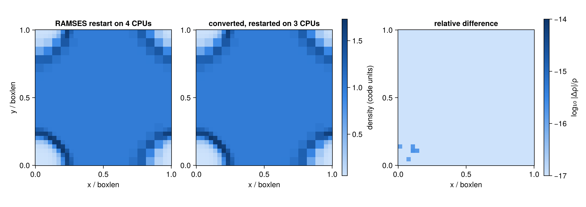
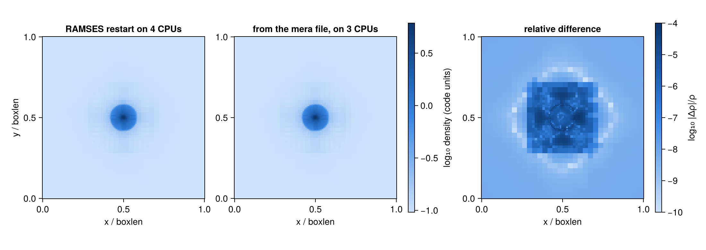

```@raw html
<!-- GENERATED FILE. Do not edit this markdown.
     Source notebook: 07_2_multi_RAMSES_Restart.ipynb
     Regenerate with: MERA_DIR=<repo checkout> ./render_docs.sh
     Any edit here is lost the next time the docs are rendered. -->
```

# Restart RAMSES with any number of CPUs

!!! tip "Run it yourself"
    This page is also an executable **Jupyter notebook**: [open / download `07_2_multi_RAMSES_Restart.ipynb`](https://github.com/ManuelBehrendt/Notebooks/blob/master/Mera-Docs/version_1.1/07_2_multi_RAMSES_Restart.ipynb). The notebooks run end-to-end and double as part of Mera's test suite.


RAMSES writes one file per MPI rank, and it restarts only with the number of ranks that wrote
the output. Mera can rewrite an output for any other number, in two ways:

| you have | use | result |
|---|---|---|
| the RAMSES output | [`repartition`](@ref) | every value bit-identical; RAMSES continues the run to round-off |
| only Mera data or a mera file | [`writeramses`](@ref) | leaves bit-identical; refined cells rebuilt from them; RAMSES continues the run, physically consistent |

This page shows what each step does and why, and then checks the result three ways: against
RAMSES's own files, value by value, and by letting RAMSES continue the run. Every number and
figure below is computed on this page, and RAMSES itself runs from it.

Supported: 3-D runs with `ordering='hilbert'`, periodic or simple physical boundaries
(outflow, reflexive, imposed), hydro, MHD, RT, gravity, particles (dark matter, stars, tracers,
sink clouds), sinks and clumps. Not yet: `ordering='bisection'`, IO groups
(`IOGROUPSIZEREP`), `QUADHILBERT`, 1-D and 2-D runs.

```julia
# Two RAMSES test runs, both written on 4 CPUs, and the RAMSES build that made them.
# Point these at your own runs and build, or set the environment variables.
RUNS   = get(ENV, "MERA_RAMSESRUNS", "/Volumes/FASTStorage/projects/RamsesConverter/testruns")
RAMSES = get(ENV, "MERA_RAMSES_BIN", "/Volumes/FASTStorage/projects/RamsesConverter/build/hydro/bin/ramses3d")
MPIRUN = get(ENV, "MERA_MPIRUN", "/opt/local/bin/mpirun")
# the validation tables of the full test suite (section 6), produced by the same code
SUITE  = get(ENV, "MERA_RAMSESSUITE", "/Volumes/FASTStorage/projects/RamsesConverter/e2e/results")

using Mera, CairoMakie, Printf, Statistics
CairoMakie.activate!(type="png")
const RW = Mera.RamsesWriter        # the file-format machinery, used here only to look inside

SEDOV = joinpath(RUNS, "sedov3d_amr_lb_ncpu4")     # AMR hydro, levels 4 to 7, load-balanced
DMGAS = joinpath(RUNS, "dm_gas3d_ncpu4")           # gas + self-gravity + 30,000 DM particles
WORK  = mktempdir()                                 # every file this page writes goes here

info = getinfo(6, SEDOV, verbose=false)
println("sedov:  ncpu = ", info.ncpu, ", levels ", info.levelmin, " to ", info.levelmax,
        ", ", info.grid_info.ngridmax, " grids max per rank")
println("dm_gas: ncpu = ", getinfo(4, DMGAS, verbose=false).ncpu, ", particles: ",
        getinfo(4, DMGAS, verbose=false).part_info.Ndm)
```

```
*__   __ _______ ______   _______
|  |_|  |       |    _ | |   _   |
|       |    ___|   | || |  |_|  |
|       |   |___|   |_||_|       |
|       |    ___|    __  |       |
| ||_|| |   |___|   |  | |   _   |
|_|   |_|_______|___|  |_|__| |__|
Mera v1.8.0 | Julia 1.12.7 | 8 threads
sedov:  ncpu = 4, levels 4 to 7, 10000 grids max per rank
dm_gas: ncpu = 4, particles: 30000
```

```julia
# ── tools used below, no new Mera concepts ──
# Run RAMSES in `dir` from output `n` on `ncpu` ranks; true if it finished normally.
function run_ramses(dir, nml, n, ncpu)
    log = joinpath(dir, "run.log")
    ok = success(pipeline(Cmd(`$MPIRUN -np $ncpu $RAMSES $nml $n`; dir=dir); stdout=log, stderr=log))
    return ok && occursin("Run completed", read(log, String))
end

# A restart namelist: the run's own, with the memory per rank set to what the new ranks need.
function restart_namelist(src, dst; ngridmax, npartmax=0)
    txt = read(src, String)
    txt = replace(txt, r"^\s*(ngridmax|ngridtot|npartmax|nparttot)\s*=.*$"mi => "")
    txt = replace(txt, r"^&AMR_PARAMS\s*$"mi =>
                  "&AMR_PARAMS\nngridmax=$ngridmax" * (npartmax > 0 ? "\nnpartmax=$npartmax" : ""))
    write(dst, txt)
end

# The value of the finest (leaf) cell under each pixel of an n×n slice at height z (box units).
function slice_map(t, z, n, value)
    img = fill(NaN, n, n)
    for i in 1:n, j in 1:n
        x = ((i - 0.5) / n, (j - 0.5) / n, z)
        g = RW.find_grid(t, 1, RW.Coord((0, 0, 0))); l = 1
        while true
            c = ntuple(d -> floor(Int, x[d] * 2^l), 3)
            child = RW.find_grid(t, l + 1, RW.Coord(c))
            if child == 0
                img[i, j] = value(l, g, RW.cell_index((c .& 1)...)); break
            end
            g, l = child, l + 1
        end
    end
    img
end

function density_slice(dir, iout, z, n)
    t  = RW.read_global_tree(dir, iout; verbose=false)
    cs = RW.open_cell_files(dir, "hydro", iout, t.header.ncpu, t.header.nlevelmax, 0)
    slice_map(t, z, n, (l, g, ind) -> RW.cell_value(cs, t.src_cpu[l][g], l, t.src_cpu[l][g],
                                                    t.src_pos[l][g], ind, 1))
end

const CPU_COLORS = ["#2a78d6", "#eb6834", "#1baf7a", "#eda100", "#e87ba4", "#008300", "#4a3aa7", "#e34948"]
function label_ranks!(ax, img, n)
    for r in 1:maximum(filter(!isnan, img))
        idx = findall(==(r), img); isempty(idx) && continue
        cx = sum(first(Tuple(I)) for I in idx) / length(idx) / n
        cy = sum(last(Tuple(I)) for I in idx) / length(idx) / n
        text!(ax, cx, cy; text=string(Int(r)), align=(:center, :center), color=:white,
              fontsize=15, font=:bold, strokecolor=:black, strokewidth=1.5)
    end
end
ok_mark(b) = b ? "yes" : "NO";
```

## 1. Why this is needed

A RAMSES restart reads `amr_*.outXXXXX`, `hydro_*.outXXXXX` and the rest, one file per rank, and
every rank reads exactly its own file. Start the run on another number of ranks and RAMSES stops
before the first step. The cell below tries it: the 4-CPU output, restarted on 3 ranks.

```julia
d = mkpath(joinpath(WORK, "wrong_ncpu"))
cp(joinpath(SEDOV, "output_00006"), joinpath(d, "output_00006"))
cp(joinpath(SEDOV, "sedov3d_amr_lb.nml"), joinpath(d, "run.nml"))
println("RAMSES finished: ", run_ramses(d, "run.nml", 6, 3))
foreach(println, filter(l -> occursin(r"ncpu|compatible"i, l), readlines(joinpath(d, "run.log"))))
```

```
RAMSES finished: false
 Number of processes not compatible
 ncpu should be set equal to           4
```

## 2. How RAMSES splits a run over CPUs

RAMSES orders all cells along a **Hilbert curve**, a line that visits every cell once and keeps
neighbouring cells close together on the line. The curve is cut into as many pieces as there are
ranks, each with about the same amount of work, and every rank owns one piece: its **domain**.

A rank also keeps a thin layer of cells that belong to its neighbours, the **ghost zone**, because
the hydro solver needs the neighbouring values at the domain border. The files store exactly
what each rank holds in memory: its own grids, the ghost grids and the boundary grids, linked by
pointers (father, neighbours, children).

Changing the number of ranks therefore changes every file: the curve is cut differently, other
cells become ghosts, and every pointer changes. The left panel is the decomposition RAMSES itself
wrote; the other two are the ones `repartition` computes for 3 and 7 ranks.

```julia
t = RW.read_global_tree(joinpath(SEDOV, "output_00006"), 6; verbose=false)
n, z = 256, 0.03                     # a slice just above the blast, which sits at the origin
fig = Figure(size=(1050, 390))
for (col, ncpu) in enumerate((4, 3, 7))
    # ncpu = 4 with RAMSES's own curve cuts (bound_key from the files): what RAMSES wrote
    dec = ncpu == 4 ? RW.decompose(t, 4; bound_key=copy(t.header.bound_key)) : RW.decompose(t, ncpu)
    img = slice_map(t, z, n, (l, g, ind) -> Float64(dec.cpu_map[l][g, ind]))
    ax = Axis(fig[1, col]; aspect=DataAspect(), xlabel="x / boxlen", ylabel=col == 1 ? "y / boxlen" : "",
              title = ncpu == 4 ? "as written: 4 CPUs (RAMSES)" : "repartition: $ncpu CPUs")
    heatmap!(ax, range(0, 1; length=n), range(0, 1; length=n), img;
             colormap=cgrad(CPU_COLORS[1:ncpu]; categorical=true), colorrange=(0.5, ncpu + 0.5))
    label_ranks!(ax, img, n)
end
fig
```


```julia
# What rank 2 of 3 keeps in memory, level by level: its own grids and the ghost layer around them.
dec3 = RW.decompose(t, 3)
lt   = RW.build_local_tree(t, dec3, 2)
fig = Figure(size=(1050, 390))
for (col, lev) in enumerate((3, 4, 5))
    ax = Axis(fig[1, col]; aspect=DataAspect(), title="level $lev grids on rank 2 of 3",
              xlabel="x / boxlen", ylabel=col == 1 ? "y / boxlen" : "")
    img = fill(NaN, n, n); held = Set(lt.grids[lev])
    for i in 1:n, j in 1:n
        ig = RW.Coord((floor(Int, (i - 0.5) / n * 2^(lev - 1)), floor(Int, (j - 0.5) / n * 2^(lev - 1)),
                       floor(Int, z * 2^(lev - 1))))
        g = RW.find_grid(t, lev, ig); g == 0 && continue
        img[i, j] = g in held ? (RW.grid_owner(t, dec3, lev, g) == 2 ? 1.0 : 2.0) : 0.0
    end
    heatmap!(ax, range(0, 1; length=n), range(0, 1; length=n), img;
             colormap=cgrad(["#e4e3dd", CPU_COLORS[1], CPU_COLORS[2]]; categorical=true), colorrange=(-0.5, 2.5))
end
Legend(fig[1, 4], [PolyElement(color=c) for c in (CPU_COLORS[1], CPU_COLORS[2], "#e4e3dd")],
       ["own grids", "ghost grids", "not on this rank"]; framevisible=false)
fig
```


White: the level is not refined there. The ghost layer is one cell wide around the domain (two
for MHD, whose solver reaches further); RAMSES needs it filled at the restart, so the new files
must carry it.

## 3. `repartition`: what it does, step by step

| step | what | how | why |
|---|---|---|---|
| 1 | read the global octree | all old `amr_*` files, every grid once, with its position | the new split needs the whole tree, not one rank's piece |
| 2 | new domains | the Hilbert curve cut into `ncpu` pieces of equal work (cells, and particles with `balance_particles=true`) | each rank then has the same load, and none exceeds `npartmax` |
| 3 | each new rank's octree | own grids + ghost grids + boundary grids, with every pointer | RAMSES reads this, and nothing else, into memory |
| 4 | the cell files | `hydro_*`, `grav_*`, `rt_*`: values copied bit for bit into the new grid order | no value is recomputed, so nothing can change |
| 5 | particles and text files | each particle to the rank owning the finest cell around it; clump rows re-dealt; `info_*.txt` gets the new `ncpu` and domain table; files that do not depend on `ncpu` are copied | the rest of the output, consistent with the new split |

```julia
rep = repartition(6, SEDOV, 3; outpath=joinpath(WORK, "sedov_3cpu"));
```

```
[1/5] reading the octree of output_00006
  reading amr file 1 / 4
  reading amr file 4 / 4
      1010 grids on 7 levels, ncpu = 4, periodic box, nexpand_bound = 1
[2/5] Hilbert decomposition for 3 ranks
[3/5] building the local octree of every rank
[4/5] writing amr / hydro / grav / rt files
[5/5] particles, clump tables and text files
RAMSES output repartitioned: ncpu 4 → 3
  from : /Volumes/FASTStorage/projects/RamsesConverter/testruns/sedov3d_amr_lb_ncpu4/output_00006
  to   : /var/folders/k5/gw4hqgwj5_qf8sljz0091x1m0000gp/T/jl_iBMuXo/sedov_3cpu/output_00006
  own grids per rank      : min 335, max 338
  grids in memory per rank: min 592, max 673  (own + ghost + boundary)
  restart namelist needs  : ngridmax ≥ 674
  14 files written in 0.6 s
```

The report's last numbers go into the restart namelist: each rank must be allowed at least
`ngridmax` grids (and `npartmax` particles). With fewer ranks each rank holds more.

## 4. Check 1: RAMSES's own files are reproduced

If the method is right, it must reproduce what RAMSES wrote when it is given RAMSES's own
decomposition. So each of the four original files is rebuilt from the global tree, with the
original curve cuts, and compared with the RAMSES file. The comparison is index-free: every grid is
identified by its level and position, and every pointer by the position it points to, so a
different grid numbering is not counted as a difference. Grids, ghost zones, boundary grids,
every pointer and the per-level counts must all match.

```julia
# Every grid named by (level, list, position); every pointer by the position it points to.
function canonical_amr(path)
    h, lists = RW.read_amr_file(path)
    L = Int(h.nlevelmax); ncoarse = Int(h.nx * h.ny * h.nz); ngm = Int(h.ngridmax)
    where = Dict{Int32,Tuple{Int,RW.Coord}}()
    for l in 1:L, g in lists[l], i in 1:RW.ngrids(g)
        where[g.ind_grid[i]] = (l, RW.grid_coord(view(g.xg, i, :), l))
    end
    cellc(p) = p == 0 ? nothing : p <= ncoarse ? (0, p) :
               (ind = (p - ncoarse - 1) ÷ ngm + 1; ig = p - ncoarse - (ind - 1) * ngm;
                haskey(where, ig) ? (where[ig]..., ind) : (:dangling, ig))
    gridc(p) = p == 0 ? nothing : get(where, p, (:dangling, p))
    out = Dict(f => Set() for f in (:grids, :father, :nbor, :son, :cpu_map))
    for l in 1:L, (ib, g) in enumerate(lists[l]), i in 1:RW.ngrids(g)
        key = (l, ib, RW.grid_coord(view(g.xg, i, :), l))
        push!(out[:grids], key)
        push!(out[:father], (key, cellc(g.father[i])))
        push!(out[:nbor], (key, Tuple(cellc(x) for x in g.nbor[i, :])))
        push!(out[:son], (key, Tuple(gridc(x) for x in g.son[i, :])))
        push!(out[:cpu_map], (key, Tuple(g.cpu_map[i, :])))
    end
    out
end

src = joinpath(SEDOV, "output_00006")
dec4 = RW.decompose(t, 4; bound_key=copy(t.header.bound_key))
nexp = RW.detect_nexpand_bound(src)
lts  = [RW.build_local_tree(t, dec4, k; nexpand_bound=nexp) for k in 1:4]
nt   = RW.global_numbtot([l.numbl for l in lts], t.header.nlevelmax)
umt  = maximum(RW.ngrid_current, lts)
println(rpad("rank", 6), rpad("grids", 8), rpad("grids", 8), rpad("fathers", 9), rpad("neighbours", 12),
        rpad("children", 10), "owners")
for k in 1:4
    tmp = tempname()
    RW.write_amr_file(tmp, RW.amr_file_content(t, dec4, lts[k], Int(t.header.ngridmax), nt, umt)...)
    a, b = canonical_amr(RW.amr_filename(src, 6, k)), canonical_amr(tmp)
    println(rpad(k, 6), rpad(length(a[:grids]), 8), rpad(ok_mark(a[:grids] == b[:grids]), 8),
            rpad(ok_mark(a[:father] == b[:father]), 9), rpad(ok_mark(a[:nbor] == b[:nbor]), 12),
            rpad(ok_mark(a[:son] == b[:son]), 10), ok_mark(a[:cpu_map] == b[:cpu_map]))
    rm(tmp)
end
```

```
rank  grids   grids   fathers  neighbours  children  owners
1     383     yes     yes      yes         yes       yes
2     468     yes     yes      yes         yes       yes
3     752     yes     yes      yes         yes       yes
4     705     yes     yes      yes         yes       yes
```

Every rank's tree is rebuilt exactly. The same check passes for every run of the test suite, a
16-level cosmological run on 16 CPUs and a galaxy simulation on 640 CPUs (53 s, 2.2 GB RAM). The
new decompositions are made by the same code, so they are what RAMSES itself would write with that
number of ranks.

## 5. Check 2: the values do not change

[`compareramses`](@ref) compares two outputs written with any numbers of CPUs: the octree, every
hydro, gravity and RT value (as a fraction of that variable's largest value) and every particle,
matched by its identity. A converted output must hold exactly the same numbers, and so must an
output taken to another rank count and back.

```julia
println(rpad("conversion", 22), rpad("same octree", 13), rpad("max |Δ| hydro", 15), "particles, max |Δx|")
for (label, a, b, ncpu) in (("4 → 1",     SEDOV, nothing, 1), ("4 → 3", SEDOV, nothing, 3),
                           ("4 → 7",     SEDOV, nothing, 7), ("4 → 8", SEDOV, nothing, 8),
                           ("dm_gas 4 → 7", DMGAS, nothing, 7))
    o   = a == DMGAS ? 4 : 6
    out = joinpath(WORK, "check2_" * replace(label, r"\W+" => "_"))
    repartition(o, a, ncpu; outpath=out, verbose=false)
    c = compareramses(o, a, out)
    println(rpad(label, 22), rpad(ok_mark(c.same_tree), 13), rpad(@sprintf("%.1e", maximum(c.maxdiff["hydro"])), 15),
            c.nparticles[1], ", ", @sprintf("%.1e", c.particle_maxdiff[1]))
end
# and back: 4 → 3 → 4 must be the original, file by file in content
repartition(6, joinpath(WORK, "sedov_3cpu"), 4; outpath=joinpath(WORK, "sedov_back"), verbose=false)
c = compareramses(6, SEDOV, joinpath(WORK, "sedov_back"))
println(rpad("4 → 3 → 4", 22), rpad(ok_mark(c.same_tree), 13), @sprintf("%.1e", maximum(c.maxdiff["hydro"])))
```

```
conversion            same octree  max |Δ| hydro  particles, max |Δx|
4 → 1                 yes          0.0e+00        0, 0.0e+00
4 → 3                 yes          0.0e+00        0, 0.0e+00
4 → 7                 yes          0.0e+00        0, 0.0e+00
4 → 8                 yes          0.0e+00        0, 0.0e+00
dm_gas 4 → 7          yes          0.0e+00        30000, 0.0e+00
4 → 3 → 4             yes          0.0e+00
```

All differences are exactly zero: the values are copied, never recomputed.

## 6. Check 3: RAMSES continues the run

The decisive test. The converted 3-CPU output is restarted with RAMSES on 3 ranks, and the next
output is compared with the one RAMSES writes when it restarts the original on 4 ranks. RAMSES
runs on different rank counts are not bit-identical in general: sums are taken in a different
order, so round-off differs. That round-off level, about `1e-15`, is the target.

```julia
# the converted output, in its own run directory, with a namelist sized for 3 ranks
run3 = joinpath(WORK, "sedov_3cpu")
restart_namelist(joinpath(SEDOV, "sedov3d_amr_lb.nml"), joinpath(run3, "run.nml");
                 ngridmax=max(20_000, round(Int, 1.3 * rep.ngridmax_needed)))
println("RAMSES on 3 ranks finished: ", run_ramses(run3, "run.nml", 6, 3))

native = joinpath(RUNS, "sedov3d_amr_lb_ncpu4_restart")   # RAMSES's own restart on 4 ranks
c = compareramses(7, native, run3)
println("same octree after one output: ", c.same_tree)
println(@sprintf("largest difference, every hydro variable: %.1e", maximum(c.maxdiff["hydro"])))
```

```
RAMSES on 3 ranks finished: true
same octree after one output: true
largest difference, every hydro variable: 7.6e-16
```

```julia
ρn = density_slice(joinpath(native, "output_00007"), 7, z, n)
ρc = density_slice(joinpath(run3,   "output_00007"), 7, z, n)
rel = abs.(ρc .- ρn) ./ abs.(ρn)
blues = cgrad(["#cde2fb", "#86b6ef", "#3987e5", "#1c5cab", "#0d366b"])
fig = Figure(size=(1100, 390))
for (col, (img, ttl)) in enumerate(((ρn, "RAMSES restart on 4 CPUs"), (ρc, "converted, restarted on 3 CPUs")))
    ax = Axis(fig[1, col]; aspect=DataAspect(), title=ttl, xlabel="x / boxlen", ylabel=col == 1 ? "y / boxlen" : "")
    hm = heatmap!(ax, range(0, 1; length=n), range(0, 1; length=n), img; colormap=blues, colorrange=extrema(ρn))
    col == 2 && Colorbar(fig[1, 3], hm; label="density (code units)", width=10)
end
ax = Axis(fig[1, 4]; aspect=DataAspect(), title="relative difference", xlabel="x / boxlen")
hm = heatmap!(ax, range(0, 1; length=n), range(0, 1; length=n), log10.(max.(rel, 1e-17));
              colormap=blues, colorrange=(-17, -14))
Colorbar(fig[1, 5], hm; label="log₁₀ |Δρ|/ρ", width=10)
fig
```



The two runs agree to machine precision everywhere: RAMSES cannot tell the converted output from
its own. Particles are the stricter test, because gravity couples every particle to the whole mass
distribution. The run with 30,000 dark-matter particles, converted to 7 ranks and continued:

```julia
run7 = joinpath(WORK, "check2_dm_gas_4_7")
r7 = repartition(4, DMGAS, 7; outpath=run7, overwrite=true, verbose=false)
restart_namelist(joinpath(DMGAS, "dm_gas3d.nml"), joinpath(run7, "run.nml");
                 ngridmax=max(20_000, round(Int, 1.3 * r7.ngridmax_needed)),
                 npartmax=max(200_000, 3 * r7.npart_max))
println("RAMSES on 7 ranks finished: ", run_ramses(run7, "run.nml", 4, 7))
c = compareramses(5, joinpath(RUNS, "dm_gas3d_ncpu4_restart"), run7)
println("same octree: ", c.same_tree, ",  particles matched by identity: ", c.nmatched)
println(@sprintf("largest difference: hydro %.1e, gravity %.1e, particle position %.1e boxlen",
                 maximum(c.maxdiff["hydro"]), maximum(c.maxdiff["grav"]), c.particle_maxdiff[1]))
```

```
RAMSES on 7 ranks finished: true
same octree: true,  particles matched by identity: 30000
largest difference: hydro 8.5e-15, gravity 1.2e-14, particle position 5.6e-16 boxlen
```

The full test suite ran the same check on every kind of run Mera reads. The table is the suite's
own result file; the "reference" is either RAMSES's restart on the original rank count or the
original uninterrupted run.

```julia
# the suite's result file: one header line, then one run per line
function readsuite(file)
    lines = readlines(joinpath(SUITE, file))
    hdr = split(lines[1], ',')
    parsecell(s) = (s = strip(s, '"'); s == "true" ? true : s == "false" ? false :
                    something(tryparse(Float64, s), s))
    [Dict(zip(hdr, parsecell.(split(l, ',')))) for l in lines[2:end]]
end
fmt(x) = x isa Number && !isnan(x) ? @sprintf("%.0e", x) : "–"
println(rpad("run", 28), rpad("CPUs", 8), rpad("octree", 8), rpad("hydro", 8), rpad("grav", 8),
        rpad("rt", 8), "particles |Δx|")
for r in readsuite("restart.csv")
    println(rpad(r["run"], 28), rpad("$(Int(r["ncpu_old"])) → $(Int(r["ncpu_new"]))", 8),
            rpad(r["same_octree"] ? "same" : "DIFF", 8), rpad(fmt(r["hydro"]), 8),
            rpad(fmt(r["grav"]), 8), rpad(fmt(r["rt"]), 8), fmt(r["dx_boxlen"]))
end
```

```
run                         CPUs    octree  hydro   grav    rt      particles |Δx|
sedov3d_amr_lb_ncpu4        4 → 3   same    8e-16   –       –       0e+00
sedov3d_amr_lb_ncpu4        4 → 1   same    8e-16   –       –       0e+00
sedov3d_amr_lb_ncpu4        4 → 7   same    8e-16   –       –       0e+00
sedov3d_amr_lb_ncpu8        8 → 5   same    9e-16   –       –       0e+00
sedov3d_amr_ncpu1           1 → 8   same    1e-15   –       –       0e+00
sedov3d_amr_ncpu3           3 → 6   same    1e-15   –       –       0e+00
sedov3d_uniform_ncpu4       4 → 3   same    5e-16   –       –       0e+00
sedov3d_uniform_ncpu4       4 → 7   same    0e+00   –       –       0e+00
sedov3d_outflow_ncpu4       4 → 3   same    6e-15   –       –       0e+00
sedov3d_outflow_ncpu4       4 → 8   same    6e-15   –       –       0e+00
dm_gas3d_ncpu4              4 → 7   same    8e-15   1e-14   –       6e-16
dm_gas3d_ncpu4              4 → 1   same    1e-14   4e-13   –       6e-16
sedov3d_grav_part_ncpu4     4 → 2   same    1e-15   2e-12   –       0e+00
sedov3d_grav_part_ncpu4     4 → 7   same    5e-16   5e-13   –       0e+00
starform3d_ncpu4            4 → 6   same    4e-02   9e-03   –       1e-01
sinks3d_ncpu4               4 → 3   same    2e-15   2e-12   –       0e+00
clumps3d_ncpu4              4 → 8   same    2e-15   7e-15   –       0e+00
mhdtube3d_ncpu4             4 → 5   same    2e-13   –       –       0e+00
stromgren3d_ncpu4           4 → 6   same    0e+00   –       0e+00   0e+00
```

Every run continues with the same octree and round-off differences. Two things continue only
statistically, by design: **stochastic star formation** and **Monte-Carlo tracers** draw random
numbers from seeds that depend on the rank count, exactly as when RAMSES itself changes the
number of ranks between runs.

## 7. From Mera data and mera files: `writeramses`

Mera keeps the **leaf cells** (the finest cell at each place) with all their variables, plus the
particles and sinks. A restart needs more: the whole octree, the values of the refined (parent)
cells, and a few header numbers. [`writeramses`](@ref) rebuilds them:

| needed by RAMSES | in Mera | how it is obtained |
|---|---|---|
| the octree | leaf cells with level and position | every leaf implies all its ancestors: rebuilt exactly |
| leaf values | all variables, code units | copied |
| refined-cell values | not stored | average of the 8 children in conserved variables (mass, momentum, total energy), bottom up, as RAMSES's `upload_fine` |
| ghost and boundary grids, pointers | not stored | built as in `repartition` |
| time, per-level time steps, energy bookkeeping | `info.grid_info.amr_header` | copied (saved in mera files since Mera 1.8.0) |

### Is the data complete?

A restart needs **every** cell of the box, every level and variable, every particle. A subregion
can never become a restart of the same simulation: the missing volume has no data.
[`restart_completeness`](@ref) proves completeness from the data itself, not from what the user
says was loaded, and `writeramses` refuses incomplete data. The most important test is exact
**coverage**: the leaves, counted in units of the finest cell, must fill the box exactly, in
integer arithmetic.

```julia
di   = getinfo(4, DMGAS, verbose=false)
q    = (verbose=false, show_progress=false)
gas  = gethydro(di; q...);  grav = getgravity(di; q...);  part = getparticles(di; q...)
ok, report = restart_completeness(gas; gravity=grav, particles=part)
println(ok ? "COMPLETE" : "NOT complete")
for (k, v) in report
    println("   ", rpad(k, 18), v)
end
```

```
COMPLETE
   hydro variables   ✔ 5 of 5
   hydro levels      ✔ lmin/lmax 5/7, simulation 5/7
   hydro region      ✔ ranges [0.0, 1.0, 0.0, 1.0, 0.0, 1.0]
   no clamping       ✔ smallr 0.0, smallc 0.0
   unique cells      ✔ 52466 cells, 52466 distinct
   no overlap        ✔ 0 leaves lie inside another leaf
   full coverage     ✔ leaves cover 1.000000000000 of the box
   closed octs       ✔ 0 missing siblings
   levels            ✔ leaf levels (5, 7), levelmin 5
   finite values     ✔ hydro, 5 columns
   positive density  ✔ min ρ = 0.09492952494378508
   gravity cells     ✔ 52466 cells, same as hydro
   gravity finite    ✔
   particle fields   ✔ all 11
   particle count    ✔ 30000 particles, header_*.txt lists 30000
   particle region   ✔ ranges [0.0, 1.0, 0.0, 1.0, 0.0, 1.0]
```

```julia
# What is refused, and which check catches it.
keep = trues(length(gas.data)); keep[1] = false
cases = [("the full data", gas),
         ("a subregion, half the box", subregion(gas, :cuboid, xrange=[0, 0.5], verbose=false)),
         ("levels up to levelmax - 1", gethydro(di; lmax=di.levelmax - 1, q...)),
         ("density only", gethydro(di, [:rho]; q...)),
         ("one cell removed", Mera._copy_with_data(gas, Mera._subset_table_keyed(gas.data, keep)))]
println(rpad("data", 30), rpad("complete", 10), "failed checks")
for (name, h) in cases
    okc, rp = restart_completeness(h; gravity=grav, particles=part)
    failed = [k for (k, v) in rp if startswith(v, "✘")]
    println(rpad(name, 30), rpad(ok_mark(okc), 10), isempty(failed) ? "–" : join(failed, ", "))
end
```

```
data                          complete  failed checks
the full data                 yes       –
a subregion, half the box     NO        hydro region, full coverage, gravity cells
levels up to levelmax - 1     NO        hydro levels, gravity cells
density only                  NO        hydro variables
one cell removed              NO        full coverage, gravity cells
```

### Through a mera file, back to RAMSES

The complete data is saved as a mera file, loaded again as a user without the RAMSES output would,
and written as a 3-CPU RAMSES output. Its leaves must equal the original's exactly.

```julia
mf = mkpath(joinpath(WORK, "merafile"))
savedata(gas, mf, :write; verbose=false); savedata(grav, mf, :append; verbose=false)
savedata(part, mf, :append; verbose=false)
gas2  = loaddata(4, mf, :hydro; verbose=false)
grav2 = loaddata(4, mf, :gravity; verbose=false)
part2 = loaddata(4, mf, :particles; verbose=false)

runm = joinpath(WORK, "from_merafile")
wr = writeramses(3; hydro=gas2, gravity=grav2, particles=part2, outpath=runm, verbose=false)
c = compareramses(4, DMGAS, runm; leaves_only=true)
println("same octree: ", c.same_tree)
println(@sprintf("leaf cells, largest difference: hydro %.1e, gravity %.1e", maximum(c.maxdiff["hydro"]),
                 maximum(c.maxdiff["grav"])))
println("particles: ", c.nparticles, @sprintf(", largest position difference %.1e", c.particle_maxdiff[1]))
```

```
same octree: true
leaf cells, largest difference: hydro 0.0e+00, gravity 0.0e+00
particles: (30000, 30000), largest position difference 0.0e+00
```

### What RAMSES makes of it

The output written from the mera file, restarted on 3 ranks, against RAMSES's own restart. The
comparison uses the **leaf cells**, the cells that carry the solution. Some values RAMSES stores in
refined cells are never updated after a restart (the coarse levels of a uniform grid, for
example), so they keep the rebuilt averages and say nothing about the run.

```julia
restart_namelist(joinpath(DMGAS, "dm_gas3d.nml"), joinpath(runm, "run.nml");
                 ngridmax=max(20_000, round(Int, 1.3 * wr.ngridmax_needed)),
                 npartmax=max(200_000, 3 * wr.npart_max))
println("RAMSES on 3 ranks finished: ", run_ramses(runm, "run.nml", 4, 3))
c = compareramses(5, joinpath(RUNS, "dm_gas3d_ncpu4_restart"), runm; leaves_only=true)
println("same octree: ", c.same_tree)
println(@sprintf("leaf cells, largest difference: hydro %.1e, gravity %.1e, particle position %.1e boxlen",
                 maximum(c.maxdiff["hydro"]), maximum(c.maxdiff["grav"]), c.particle_maxdiff[1]))
```

```
RAMSES on 3 ranks finished: true
same octree: true
leaf cells, largest difference: hydro 6.0e-05, gravity 3.4e-06, particle position 2.3e-06 boxlen
```

```julia
# Where the differences sit: a slice through the centre of the gas, one output after the restart.
ρn = density_slice(joinpath(RUNS, "dm_gas3d_ncpu4_restart", "output_00005"), 5, 0.5, n)
ρm = density_slice(joinpath(runm, "output_00005"), 5, 0.5, n)
relm = abs.(ρm .- ρn) ./ abs.(ρn)
fig = Figure(size=(1100, 390))
for (col, (img, ttl)) in enumerate(((ρn, "RAMSES restart on 4 CPUs"), (ρm, "from the mera file, on 3 CPUs")))
    ax = Axis(fig[1, col]; aspect=DataAspect(), title=ttl, xlabel="x / boxlen", ylabel=col == 1 ? "y / boxlen" : "")
    hm = heatmap!(ax, range(0, 1; length=n), range(0, 1; length=n), log10.(img); colormap=blues,
                  colorrange=log10.(extrema(ρn)))
    col == 2 && Colorbar(fig[1, 3], hm; label="log₁₀ density (code units)", width=10)
end
ax = Axis(fig[1, 4]; aspect=DataAspect(), title="relative difference", xlabel="x / boxlen")
hm = heatmap!(ax, range(0, 1; length=n), range(0, 1; length=n), log10.(max.(relm, 1e-17));
              colormap=blues, colorrange=(-10, -4))
Colorbar(fig[1, 5], hm; label="log₁₀ |Δρ|/ρ", width=10)
println(@sprintf("median |Δρ|/ρ in this slice: %.1e,  largest: %.1e", median(relm), maximum(relm)))
fig
```

```
median |Δρ|/ρ in this slice: 6.1e-09,  largest: 9.1e-05
```



The octree is the same and the differences are small, but larger than round-off. The figure shows
where they sit: only in the refined region around the centre, where parent cells were rebuilt,
typically `1e-8` and `1e-4` at most. The reason is known. After averaging the children, RAMSES's hydro update applies `pressure_fix` to refined cells
as well, so their stored energy is not exactly the average of the children. RAMSES uses those
parent values once, in the first step after the restart, before it overwrites them. The mera
file does not hold them, so they are rebuilt, and the run is **physically consistent, but not
bit-identical** to a restart from the original files. MHD has no `pressure_fix` and stays at
round-off. Gravity adds a second effect: the Poisson solver starts from the rebuilt coarse
potential and converges to its tolerance, not to the last bit.

The suite's result for every run:

```julia
println(rpad("run", 28), rpad("octree", 8), rpad("hydro", 9), rpad("grav", 9), rpad("rt", 9), "particles |Δx|")
# leaf cells, as above
for r in readsuite("mera_restart.csv")
    println(rpad(r["run"], 28), rpad(r["same_octree"] ? "same" : "DIFF", 8),
            rpad(fmt(r["hydro_leaves"]), 9), rpad(fmt(r["grav_leaves"]), 9), rpad(fmt(r["rt_leaves"]), 9),
            fmt(r["dx_boxlen"]))
end
```

```
run                         octree  hydro    grav     rt       particles |Δx|
sedov3d_amr_lb_ncpu4        same    2e-04    –        –        –
sedov3d_amr_lb_ncpu8        same    2e-04    –        –        –
sedov3d_amr_ncpu1           same    2e-04    –        –        –
sedov3d_amr_ncpu3           same    2e-04    –        –        –
sedov3d_uniform_ncpu4       same    5e-16    –        –        –
sedov3d_outflow_ncpu4       same    1e-07    –        –        –
dm_gas3d_ncpu4              same    6e-05    3e-06    –        2e-06
sedov3d_grav_part_ncpu4     same    2e-04    1e-05    –        –
starform3d_ncpu4            same    5e-02    8e-03    –        1e-01
sinks3d_ncpu4               same    2e-15    2e-12    –        –
clumps3d_ncpu4              same    2e-15    8e-15    –        –
mhdtube3d_ncpu4             same    7e-16    –        –        –
stromgren3d_ncpu4           same    0e+00    –        0e+00    –
```

| run type | difference after one output | why |
|---|---|---|
| uniform grids, MHD, sinks, clumps, RT | round-off | nothing is lost |
| AMR hydro | `1e-7` to `2e-4` | refined cells rebuilt; RAMSES's `pressure_fix` is not an average |
| gravity | potential `3e-6` to `1e-5`, particles `2e-6` box lengths | the Poisson solver restarts from the rebuilt coarse potential |
| stochastic star formation | statistical | random seeds depend on the rank count |

When the RAMSES files still exist, `repartition` is the exact route. `writeramses` is for the
case where only Mera data is left.

## 8. Mera files written before 1.8.0

The per-level time steps are needed for runs with gravity or particles (without them the first
steps deviate by about 3 %). Mera stores them in `info.grid_info.amr_header` since 1.8.0.
`writeramses` takes them from the mera file, else from the original simulation if it still exists
at the recorded path, else it writes the files and warns. [`upgrade_merafile`](@ref) adds them to an
old file while its simulation still exists, and saves it again through a temporary file, so an
interrupted upgrade never damages the original:

```julia
upgrade_merafile(250, "/merafiles")                               # simulation at the recorded path
upgrade_merafile(250, "/merafiles"; simulation="/new/place/sim")  # simulation moved
```

## 9. In short

- `repartition(output, path, ncpu; outpath)` rewrites a RAMSES output for any number of ranks.
  Values bit-identical; RAMSES continues to round-off.
- `writeramses(ncpu; hydro, gravity, particles, sinks, outpath)` writes one from complete Mera
  data, also from a mera file. Leaves bit-identical; the restart is physically consistent.
- `restart_completeness` proves the data is complete; `compareramses` checks any two outputs.
- Set `ngridmax` and `npartmax` in the restart namelist from the report, and start RAMSES with
  `mpirun -np ncpu ramses3d run.nml output`.
