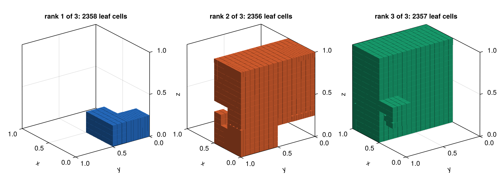
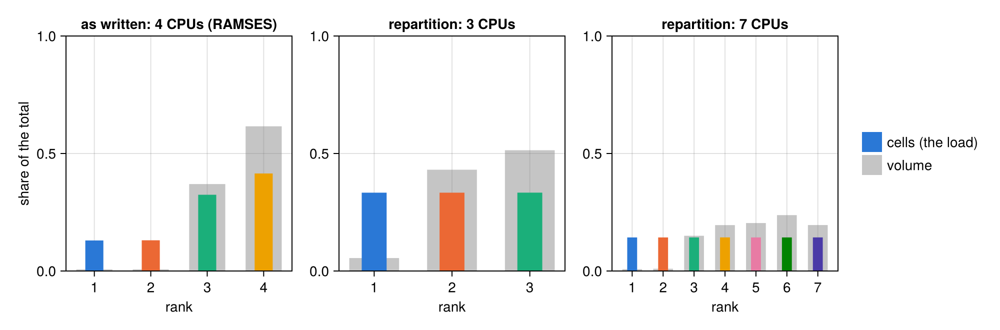
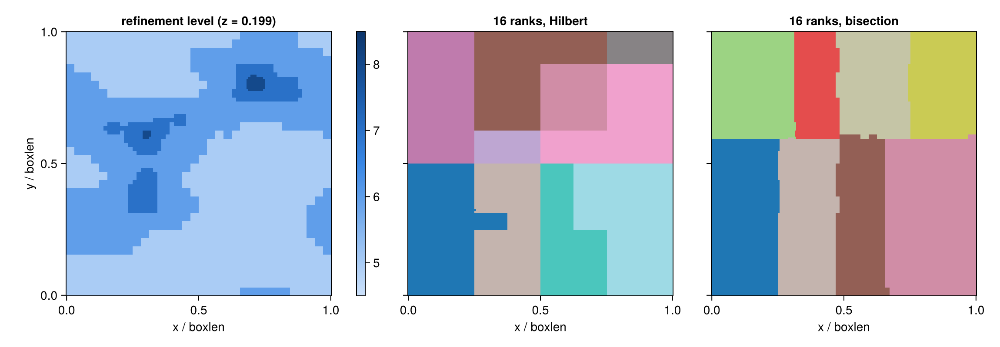
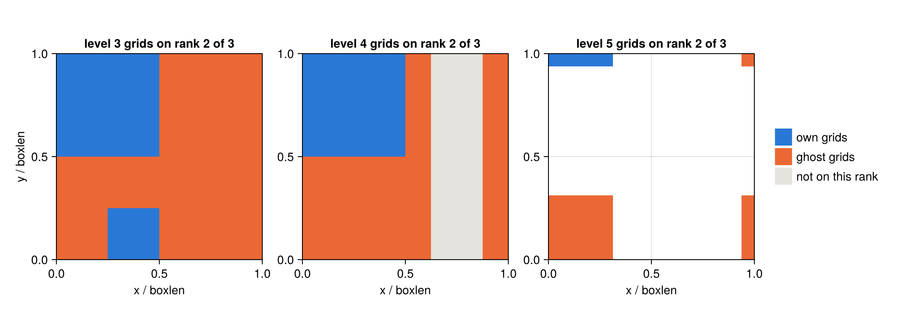
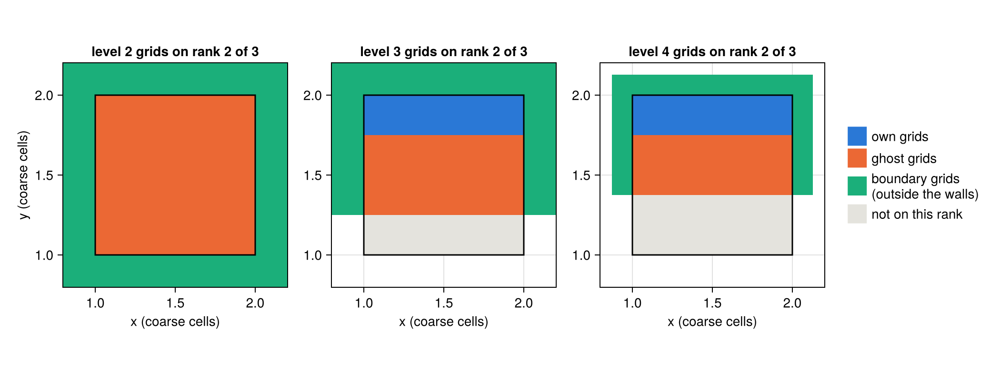
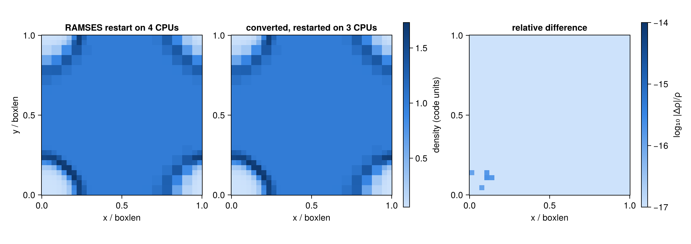
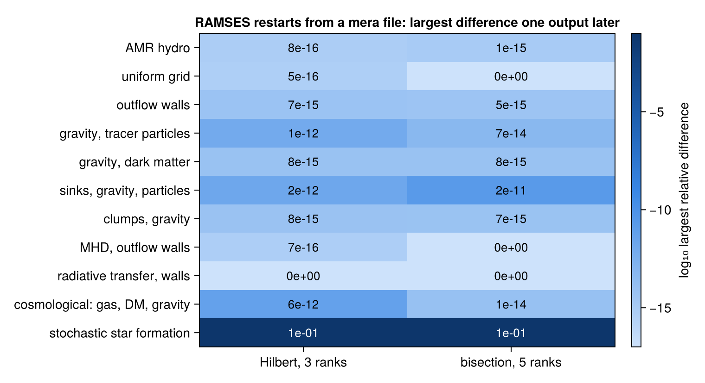

```@raw html
<!-- GENERATED FILE. Do not edit this markdown.
     Source notebook: 07_2_multi_RAMSES_Restart.ipynb
     Regenerate with: MERA_DIR=<repo checkout> ./render_docs.sh
     Any edit here is lost the next time the docs are rendered. -->
```

# Restart RAMSES with any number of CPUs

!!! tip "Run it yourself"
    This page is also an executable **Jupyter notebook**: [open / download `07_2_multi_RAMSES_Restart.ipynb`](https://github.com/ManuelBehrendt/Notebooks/blob/master/Mera-Docs/version_1.1/07_2_multi_RAMSES_Restart.ipynb). The notebooks run end-to-end and double as part of Mera's test suite.


RAMSES writes one file per data type and MPI rank (`amr_`, `hydro_`, `grav_`, `rt_`, `part_`, ...),
and it restarts only with the number of ranks that wrote them ([section 1](#1.-Why-this-is-needed)). Mera rewrites an output for any other number of ranks.

## At a glance

**If you have the RAMSES output.** Rewrite it for the new number of ranks; every value is copied:

```julia
r = repartition(250, "/sims/run", 512; outpath="/sims/run_512")   # output 250, written for 512 ranks
c = compareramses(250, "/sims/run", "/sims/run_512")               # check: same octree, same values?
```

Put `r.ngridmax_needed` and `r.npart_max` into the restart namelist as `ngridmax` and `npartmax`,
then run `mpirun -np 512 ramses3d run.nml 250` in `/sims/run_512`. How it works:
[sections 2](#2.-How-RAMSES-splits-a-run-over-CPUs) and [3](#3.-repartition:-what-it-does,-step-by-step).

**If you only have a mera file.** A [mera file](07_multi_Mera_Files.md) is Mera's compressed copy of
an output in one file. It keeps every leaf cell, so `writeramses` can write new RAMSES files
from it, also when the original output is deleted:

```julia
gas  = loaddata(250, "/merafiles", :hydro)          # load each data type from the mera file
grav = loaddata(250, "/merafiles", :gravity)
part = loaddata(250, "/merafiles", :particles)
ok, report = restart_completeness(gas; gravity=grav, particles=part)                     # nothing missing?
r = writeramses(512; hydro=gas, gravity=grav, particles=part, outpath="/sims/run_512")   # written for 512 ranks
```

Data loaded with `gethydro` and the other readers works the same. Load the gravity with
`getgravity(info; parents=true)` before saving, so that it continues exactly. How it works:
[section 8](#8.-From-Mera-data-and-mera-files:-writeramses).

| function | what it does | more |
|---|---|---|
| [`repartition`](@ref) | rewrites a RAMSES output for any number of ranks; every value copied | [§3](#3.-repartition:-what-it-does,-step-by-step), [§5](#5.-Check-2:-the-values-do-not-change) |
| [`writeramses`](@ref) | writes a RAMSES output from complete Mera data; leaf cells copied, refined cells rebuilt as RAMSES builds them | [§8](#8.-From-Mera-data-and-mera-files:-writeramses) |
| [`restart_completeness`](@ref) | checks that Mera data holds the whole box: every level, variable and particle | [§8](#8.-From-Mera-data-and-mera-files:-writeramses) |
| `getgravity(info; parents=true)` | also loads the gravity of the refined cells, which RAMSES needs to continue exactly | [§8](#8.-From-Mera-data-and-mera-files:-writeramses) |
| [`compareramses`](@ref) | compares two outputs written with any numbers of ranks: octree, every value, every particle | [§5](#5.-Check-2:-the-values-do-not-change) |
| [`upgrade_merafile`](@ref) | adds what a restart needs to a mera file saved before Mera 1.8.0 | [§9](#9.-Mera-files-written-before-1.8.0) |

Both writers take `ordering=:bisection` and `iogroupsize=n` for runs that use them ([§10](#10.-Other-layouts-and-older-RAMSES-versions)).

**What to expect.** `repartition`: identical values. `writeramses`: identical leaf cells,
particles and sinks; refined cells rebuilt. RAMSES then continues to round-off (`1e-15` gas, up to
`2e-11` gravity), as it does when it changes the rank count itself
([§7](#7.-Check-4:-RAMSES-continues-the-run), [§11](#11.-Every-kind-of-run,-every-route), [§12](#12.-When-results-differ,-and-by-how-much)). Large outputs: [§13](#13.-Large-outputs:-time-and-memory).

## About this page

The page explains each step and then checks the result four ways:

1. **Same files as RAMSES** (section 4): Mera takes a 4-rank RAMSES output, keeps RAMSES's own 4 domains, and writes the four amr files again with its own writer.
   Every grid, ghost grid and pointer equals RAMSES's file. This tests the writer itself: the same
   code builds the files for any other rank count.
2. **Same values** (section 5): rewritten for 1, 3, 7 and 8 ranks, and 4 → 3 → 4, every cell value
   and particle differs from the original by exactly 0.
3. **Same memory in RAMSES** (section 6): when RAMSES reads files, it also rebuilds its ghost zones
   and the tables that tell each rank which cells to exchange with which other rank. A wrong pointer
   or flag in the new files would show only there. So RAMSES reads the new files and writes its
   memory out before the first step; this equals the dump from the original files bit for bit, on
   1 to 8 ranks (104 of 104 dumps in the validation suite).
4. **Same evolution** (section 7): RAMSES runs 13 steps from the new files on 3 ranks; the result
   matches RAMSES's own restart on 4 ranks to `8e-16`, as close as RAMSES restarts itself (`1e-15`).

RAMSES runs from this page. Only the validation-suite tables (sections 6 and 7) and the benchmark
(section 13) are read from result files.

**Supported:** 3-D runs, uniform or AMR, cosmological or not; Hilbert or bisection ordering; plain
files or IO groups; periodic, outflow, reflexive or imposed boundaries; hydro, MHD, RT, gravity,
particles (also the legacy format), sinks and clumps. **Not supported:** the orderings `'planar'`
and `'angular'`, `QUADHILBERT` builds, 1-D and 2-D runs.

## Setup

### The simulations

Paths to the test runs and to the RAMSES builds used on this page. To run the page yourself, change
them or set the environment variables. The two main runs, both written on 4 CPUs:

| name | run | used in |
|---|---|---|
| `SEDOV` | Sedov blast, AMR levels 4 to 7, load-balanced | sections 1 to 7 and 10 |
| `DMGAS` | gas, self-gravity and 30,000 dark-matter particles | sections 5, 7 and 8 |

The other runs (outflow walls, cosmological, MHD, RT, the public test simulations) are named where
they are used.

```julia
# Two RAMSES test runs, both written on 4 CPUs, and the RAMSES build that made them.
# Point these at your own runs and build, or set the environment variables.
RUNS   = get(ENV, "MERA_RAMSESRUNS", "/Volumes/FASTStorage/projects/RamsesConverter/testruns")
RAMSES = get(ENV, "MERA_RAMSES_BIN", "/Volumes/FASTStorage/projects/RamsesConverter/build/hydro/bin/ramses3d")
# the same RAMSES with ONE line disabled, so it can write its memory right after reading (section 6)
RAMSES_READBACK = get(ENV, "MERA_RAMSES_READBACK_BIN",
                      "/Volumes/FASTStorage/projects/RamsesConverter/build/readback-hydro/bin/ramses3d")
MPIRUN = get(ENV, "MERA_MPIRUN", "/opt/local/bin/mpirun")
# the result tables of the RAMSES validation suite (sections 6 and 7): RAMSES run on files written
# by Mera's converter (RamsesConverter/e2e, run with this Mera)
SUITE  = get(ENV, "MERA_RAMSESSUITE", "/Volumes/FASTStorage/projects/RamsesConverter/e2e/results")

using Mera, CairoMakie, Printf, Statistics
CairoMakie.activate!(type="png")
const RW = Mera.RamsesWriter        # the file-format machinery, used here only to look inside

SEDOV = joinpath(RUNS, "sedov3d_amr_lb_ncpu4")     # AMR hydro, levels 4 to 7, load-balanced
DMGAS = joinpath(RUNS, "dm_gas3d_ncpu4")           # gas + self-gravity + 30,000 DM particles
WORK  = mktempdir()                                 # every file this page writes goes here

info = getinfo(6, SEDOV, verbose=false)
println("sedov:  ncpu = ", info.ncpu, ", levels ", info.levelmin, " to ", info.levelmax,
        ", ", info.grid_info.ngridmax, " grids max per rank")
println("dm_gas: ncpu = ", getinfo(4, DMGAS, verbose=false).ncpu, ", particles: ",
        getinfo(4, DMGAS, verbose=false).part_info.Ndm)
```

```
*__   __ _______ ______   _______
|  |_|  |       |    _ | |   _   |
|       |    ___|   | || |  |_|  |
|       |   |___|   |_||_|       |
|       |    ___|    __  |       |
| ||_|| |   |___|   |  | |   _   |
|_|   |_|_______|___|  |_|__| |__|
Mera v1.8.0 | Julia 1.12.7 | 8 threads
[ Info: Mera v1.8.0
sedov:  ncpu = 4, levels 4 to 7, 10000 grids max per rank
dm_gas: ncpu = 4, particles: 30000
```

### Helper functions

Small tools for this page, not part of Mera: start RAMSES with `mpirun` (`run_ramses`), write a
restart namelist with enough memory per rank (`restart_namelist`), draw a slice through the octree
(`slice_map`, `density_slice`), label the ranks in figures, and list the leaf cells (`leaf_cells`).
They use `Mera.RamsesWriter` (`RW`) only to look inside the files.

```julia
# ── tools used below, no new Mera concepts ──
# Run RAMSES in `dir` from output `n` on `ncpu` ranks; true if it finished normally.
function run_ramses(dir, nml, n, ncpu; bin=RAMSES)
    log = joinpath(dir, "run.log")
    ok = success(pipeline(Cmd(`$MPIRUN -np $ncpu $bin $nml $n`; dir=dir); stdout=log, stderr=log))
    return ok && occursin("Run completed", read(log, String))
end

# A restart namelist: the run's own, with the memory per rank set to what the new ranks need.
function restart_namelist(src, dst; ngridmax, npartmax=0, run_extra="", output_extra="")
    txt = read(src, String)
    txt = replace(txt, r"^\s*(ngridmax|ngridtot|npartmax|nparttot|nstepmax|foutput)\s*=.*$"mi => "")
    txt = replace(txt, r"^&AMR_PARAMS\s*$"mi =>
                  "&AMR_PARAMS\nngridmax=$ngridmax" * (npartmax > 0 ? "\nnpartmax=$npartmax" : ""))
    isempty(run_extra)    || (txt = replace(txt, r"^&RUN_PARAMS\s*$"mi => "&RUN_PARAMS\n$run_extra"))
    isempty(output_extra) || (txt = replace(txt, r"^&OUTPUT_PARAMS\s*$"mi => "&OUTPUT_PARAMS\n$output_extra"))
    write(dst, txt)
end

# The value of the finest (leaf) cell under each pixel of an n×n slice. The slice is the plane
# perpendicular to box axis `axis` (1 = x, 2 = y, 3 = z) at `pos` (box units); the default is the
# x-y plane at height z = pos.
function slice_map(t, pos, n, value; axis=3)
    img = fill(NaN, n, n)
    for i in 1:n, j in 1:n
        u, v = (i - 0.5) / n, (j - 0.5) / n
        x = axis == 3 ? (u, v, pos) : axis == 2 ? (u, pos, v) : (pos, u, v)
        g = RW.find_grid(t, 1, RW.Coord((0, 0, 0))); l = 1
        while true
            c = ntuple(d -> floor(Int, x[d] * 2^l), 3)
            child = RW.find_grid(t, l + 1, RW.Coord(c))
            if child == 0
                img[i, j] = value(l, g, RW.cell_index((c .& 1)...)); break
            end
            g, l = child, l + 1
        end
    end
    img
end

function density_slice(dir, iout, z, n)
    t  = RW.read_global_tree(dir, iout; verbose=false)
    cs = RW.open_cell_files(dir, "hydro", iout, t.header.ncpu, t.header.nlevelmax, 0)
    slice_map(t, z, n, (l, g, ind) -> RW.cell_value(cs, t.src_cpu[l][g], l, t.src_cpu[l][g],
                                                    t.src_pos[l][g], ind, 1))
end

const CPU_COLORS = ["#2a78d6", "#eb6834", "#1baf7a", "#eda100", "#e87ba4", "#008300", "#4a3aa7", "#e34948"]
blues = cgrad(["#cde2fb", "#86b6ef", "#3987e5", "#1c5cab", "#0d366b"])   # one sequential scale for every map
function label_ranks!(ax, img, n)
    for r in 1:maximum(filter(!isnan, img))
        idx = findall(==(r), img); isempty(idx) && continue
        cx = sum(first(Tuple(I)) for I in idx) / length(idx) / n
        cy = sum(last(Tuple(I)) for I in idx) / length(idx) / n
        text!(ax, cx, cy; text=string(Int(r)), align=(:center, :center), color=:white,
              fontsize=15, font=:bold, strokecolor=:black, strokewidth=1.5)
    end
end
ok_mark(b) = b ? "yes" : "NO"

# Every leaf cell: level, grid, cell index, centre (box units) and size.
function leaf_cells(t)
    out = NamedTuple[]
    for l in 1:RW.nlevels(t), (g, ig) in enumerate(t.levels[l].ig), ind in 1:8
        RW.is_refined(t, l, ig, ind) && continue
        o = RW.cell_offset(ind)
        c = (2ig[1] + o[1], 2ig[2] + o[2], 2ig[3] + o[3])
        push!(out, (l=l, g=g, ind=ind, x=(c .+ 0.5) ./ 2^l, dx=1 / 2^l))
    end
    out
end;
```

## 1. Why this is needed

Each rank reads its own files (`amr_*.outXXXXX`, `hydro_*.outXXXXX`, ...). On another number of
ranks RAMSES stops before the first step. The 4-CPU output, restarted on 3 ranks:

```julia
d = mkpath(joinpath(WORK, "wrong_ncpu"))
cp(joinpath(SEDOV, "output_00006"), joinpath(d, "output_00006"))
cp(joinpath(SEDOV, "sedov3d_amr_lb.nml"), joinpath(d, "run.nml"))
println("RAMSES finished: ", run_ramses(d, "run.nml", 6, 3))
foreach(println, filter(l -> occursin(r"ncpu|compatible"i, l), readlines(joinpath(d, "run.log"))))
```

```
RAMSES finished: false
 Number of processes not compatible
 ncpu should be set equal to           4
```

## 2. How RAMSES splits a run over CPUs

RAMSES orders all cells along a **Hilbert curve**, a line through every cell that keeps neighbours
close. It cuts the curve into one piece per rank, each with about the same work. A rank's piece is
its **domain**.

Each rank also keeps copies of the cells next to its border, the **ghost zone**, because the solver
needs them. The files store exactly what each rank holds: its own grids, ghost grids and boundary
grids, linked by pointers. So a new number of ranks changes every file.

The figures use the Sedov blast in the corner of a periodic box. The first figure cuts three planes
through the blast, just inside the box faces. Top row: RAMSES's split on 4 CPUs. Other rows:
`repartition` for 3 and 7 CPUs. Domains are small near the blast, because a domain holds a share of
the cells, not of the volume.

```julia
t = RW.read_global_tree(joinpath(SEDOV, "output_00006"), 6; verbose=false)
n, z = 256, 0.03                 # 0.03: just inside the box faces that meet at the blast
decs = [(4, "as written: 4 CPUs (RAMSES)", RW.decompose(t, 4; bound_key=copy(t.header.bound_key))),
        (3, "repartition: 3 CPUs",         RW.decompose(t, 3)),
        (7, "repartition: 7 CPUs",         RW.decompose(t, 7))]
planes = [(3, "x-y plane (z = 0.03)", "x", "y"), (2, "x-z plane (y = 0.03)", "x", "z"),
          (1, "y-z plane (x = 0.03)", "y", "z")]
fig = Figure(size=(1000, 1000))
for (row, (ncpu, name, dec)) in enumerate(decs), (col, (axis, pname, xl, yl)) in enumerate(planes)
    img = slice_map(t, z, n, (l, g, ind) -> Float64(dec.cpu_map[l][g, ind]); axis=axis)
    ax = Axis(fig[row, col]; aspect=DataAspect(), title = row == 1 ? pname : "",
              xlabel = row == 3 ? "$xl / boxlen" : "", ylabel = "$yl / boxlen",
              xticklabelsvisible = row == 3)
    heatmap!(ax, range(0, 1; length=n), range(0, 1; length=n), img;
             colormap=cgrad(CPU_COLORS[1:ncpu]; categorical=true), colorrange=(0.5, ncpu + 0.5))
    label_ranks!(ax, img, n)
    col == 1 && Label(fig[row, 0], name; rotation=π/2, font=:bold, tellheight=false)
end
fig
```



```julia
# The load behind those shapes: cells owned per rank, counted on every level (the unit RAMSES and
# repartition balance), and each rank's share of the box VOLUME, measured on its leaf cells.
leaves = leaf_cells(t)
fig = Figure(size=(1000, 330))
for (col, (ncpu, name, dec)) in enumerate(decs)
    cells  = [sum(count(==(k), dec.cpu_map[l]) for l in 1:RW.nlevels(t)) for k in 1:ncpu]
    volume = [sum(c.dx^3 for c in leaves if dec.cpu_map[c.l][c.g, c.ind] == k; init=0.0) for k in 1:ncpu]
    ax = Axis(fig[1, col]; title=name, xlabel="rank", ylabel = col == 1 ? "share of the total" : "",
              xticks=1:ncpu, limits=(nothing, (0, 1)))
    barplot!(ax, (1:ncpu) .- 0.2, cells ./ sum(cells); width=0.38, color=CPU_COLORS[1:ncpu])
    barplot!(ax, (1:ncpu) .+ 0.2, volume; width=0.38, color=(:gray, 0.45))
    @printf("%-28s cells per rank %s   (max/min %.3f)\n", name, string(cells), maximum(cells) / minimum(cells))
end
Legend(fig[1, 4], [PolyElement(color=CPU_COLORS[1]), PolyElement(color=(:gray, 0.45))],
       ["cells (the load)", "volume"]; framevisible=false)
fig
```

```
as written: 4 CPUs (RAMSES)  cells per rank [1050, 1056, 2621, 3353]   (max/min 3.193)
repartition: 3 CPUs          cells per rank [2693, 2693, 2694]   (max/min 1.000)
repartition: 7 CPUs          cells per rank [1154, 1154, 1154, 1155, 1154, 1154, 1155]   (max/min 1.001)
```



Coloured bars: after `repartition` every rank holds the same number of cells, to within one.
RAMSES's own split is uneven (1,050 to 3,353 cells): it rebalances only every `nremap` steps, with
its own cost function, and will rebalance the converted run the same way. Grey bars: the volume per
rank differs a lot.

The cosmological test run at a = 0.2, split for 16 ranks in both orderings Mera writes (section 10).
Left: the refinement level in a slice through the finest cells. Middle: Hilbert domains, pieces of
one curve that interlock. Right: bisection domains, boxes cut along x, y and z in turn. Domains are
small where the cells are fine:

```julia
COSMO3D = joinpath(RUNS, "cosmo3d_ncpu8")       # the cosmological test run, 8 CPUs, AMR levels 5 to 8
tc = RW.read_global_tree(joinpath(COSMO3D, "output_00004"), 4; verbose=false)    # a = 0.2
dh, db = RW.new_decomposition(tc, 16; ordering=:hilbert), RW.new_decomposition(tc, 16; ordering=:bisection)
# the slice goes through the finest cells: the middle of the deepest level's grids
deep = tc.levels[end].ig
zc = (sort([Int(g[3]) for g in deep])[cld(length(deep), 2)] + 0.5) / 2.0^(RW.nlevels(tc) - 1)
lev = slice_map(tc, zc, n, (l, g, ind) -> Float64(l))
rk(dec) = slice_map(tc, zc, n, (l, g, ind) -> Float64(dec.cpu_map[l][g, ind]))
fig = Figure(size=(1150, 400))
ax = Axis(fig[1, 1]; aspect=DataAspect(), title=@sprintf("refinement level (z = %.3f)", zc), xlabel="x / boxlen", ylabel="y / boxlen")
hm = heatmap!(ax, range(0, 1; length=n), range(0, 1; length=n), lev; colormap=blues, colorrange=(4.5, 8.5))
Colorbar(fig[1, 2], hm; ticks=5:8, width=10)
for (col, (dec, name)) in enumerate(((dh, "16 ranks, Hilbert"), (db, "16 ranks, bisection")))
    ax = Axis(fig[1, col + 2]; aspect=DataAspect(), title=name, xlabel="x / boxlen", yticklabelsvisible=false)
    heatmap!(ax, range(0, 1; length=n), range(0, 1; length=n), rk(dec);
             colormap=cgrad(:tab20, 16; categorical=true), colorrange=(0.5, 16.5))
    cells = [sum(count(==(k), dec.cpu_map[l]) for l in 1:RW.nlevels(tc)) for k in 1:16]
    @printf("%-20s cells per rank %d to %d\n", name, minimum(cells), maximum(cells))
end
fig
```

```
16 ranks, Hilbert    cells per rank 11871 to 11872
16 ranks, bisection  cells per rank 11278 to 12363
```



```julia
# What rank 2 of 3 keeps in memory, level by level: its own grids and the ghost layer around them.
dec3 = RW.decompose(t, 3)
lt   = RW.build_local_tree(t, dec3, 2)
fig = Figure(size=(1050, 390))
for (col, lev) in enumerate((3, 4, 5))
    ax = Axis(fig[1, col]; aspect=DataAspect(), title="level $lev grids on rank 2 of 3",
              xlabel="x / boxlen", ylabel=col == 1 ? "y / boxlen" : "")
    img = fill(NaN, n, n); held = Set(lt.grids[lev])
    for i in 1:n, j in 1:n
        ig = RW.Coord((floor(Int, (i - 0.5) / n * 2^(lev - 1)), floor(Int, (j - 0.5) / n * 2^(lev - 1)),
                       floor(Int, z * 2^(lev - 1))))
        g = RW.find_grid(t, lev, ig); g == 0 && continue
        img[i, j] = g in held ? (RW.grid_owner(t, dec3, lev, g) == 2 ? 1.0 : 2.0) : 0.0
    end
    heatmap!(ax, range(0, 1; length=n), range(0, 1; length=n), img;
             colormap=cgrad(["#e4e3dd", CPU_COLORS[1], CPU_COLORS[2]]; categorical=true), colorrange=(-0.5, 2.5))
end
Legend(fig[1, 4], [PolyElement(color=c) for c in (CPU_COLORS[1], CPU_COLORS[2], "#e4e3dd")],
       ["own grids", "ghost grids", "not on this rank"]; framevisible=false)
fig
```



White: not refined there.

### Ghost zones and box boundaries

`repartition` builds the ghost grids with RAMSES's own rules (`authorize_fine`, `refine_fine`,
`make_boundary_flag`), level by level. A rank holds:

| what | why |
|---|---|
| every level-1 grid | RAMSES keeps the coarse level on every rank |
| the grids it owns (parent cell on its piece of the curve) | its own work |
| every grid within one cell of its own cells (two for MHD) | the solver reaches that far across the border |
| the children of those grids, level by level | a ghost region is refined like its owner |
| boundary grids beyond physical walls | the solver at a wall reads cells outside the box |

**Periodic box** (the default, no `&BOUNDARY_PARAMS`): the box wraps around, and the ghost layer
continues across the face. In the level-4 panel above, rank 2 owns x < 0.5; the orange strip at
x > 0.875 is ghost, its neighbour across the periodic face.

**Physical walls** (outflow, reflexive, imposed; set in `&BOUNDARY_PARAMS`): RAMSES adds one layer
of coarse cells outside each wall, and the ranks hold **boundary grids** there. They copy the
refinement of the cell inside the wall. Their values come from `make_boundary_hydro`: the inside
value, with the normal velocity flipped at a reflexive wall and inflow suppressed at an outflow wall.

The Sedov run below has outflow walls on all six faces: a 3 × 3 × 3 coarse grid with the box in the
centre. On 3 ranks:

```julia
OUTFLOW = joinpath(RUNS, "sedov3d_outflow_ncpu4")                 # 4 CPUs, outflow on all faces
to = RW.read_global_tree(joinpath(OUTFLOW, "output_00004"), 4; verbose=false)
println("coarse grid ", to.geom.n, ", box = coarse cells ", to.geom.cmin, " to ", to.geom.cmax,
        ", ", length(to.boundaries), " walls: ",
        join(unique(("reflexive", "outflow", "imposed")[b.btype ÷ 10 + 1] for b in to.boundaries), ", "))
deco = RW.decompose(to, 3)
lto  = [RW.build_local_tree(to, deco, k) for k in 1:3]
println(rpad("rank", 6), rpad("own grids", 11), rpad("ghost grids", 13), "boundary grids")
for k in 1:3
    own = sum(lto[k].numbl[k, :])
    println(rpad(k, 6), rpad(own, 11), rpad(sum(lto[k].numbl) - own, 13), sum(lto[k].numbb))
end
```

```
coarse grid (3, 3, 3), box = coarse cells (1, 1, 1) to (1, 1, 1), 6 walls: outflow
rank  own grids  ghost grids  boundary grids
1     32539      2998         3246
2     32538      3190         3194
3     32540      2997         3246
```

```julia
# Rank 2's grids around the box, in a slice through the box centre, levels 2 to 4. Coordinates in
# coarse cells: the box is the square from 1 to 2.
k, zc = 2, 1.5
lt2 = lto[k]; held = [Set(lt2.grids[l]) for l in eachindex(lt2.grids)]
bnd = [Set(lt2.bgrids[l]) for l in eachindex(lt2.bgrids)]
m = 280; X = range(0.8, 2.2; length=m)
fig = Figure(size=(1050, 390))
for (col, l) in enumerate((2, 3, 4))
    img = fill(NaN, m, m)
    for (i, x) in enumerate(X), (j, y) in enumerate(X)
        ig = RW.Coord((floor(Int, x * 2^(l - 1)), floor(Int, y * 2^(l - 1)), floor(Int, zc * 2^(l - 1))))
        if ig in bnd[l]
            img[i, j] = 3.0
        else
            g = RW.find_grid(to, l, ig); g == 0 && continue
            img[i, j] = g in held[l] ? (RW.grid_owner(to, deco, l, g) == k ? 1.0 : 2.0) : 0.0
        end
    end
    ax = Axis(fig[1, col]; aspect=DataAspect(), title="level $l grids on rank $k of 3",
              xlabel="x (coarse cells)", ylabel = col == 1 ? "y (coarse cells)" : "")
    heatmap!(ax, X, X, img; colormap=cgrad(["#e4e3dd", CPU_COLORS[1], CPU_COLORS[2], CPU_COLORS[3]];
             categorical=true), colorrange=(-0.5, 3.5))
    lines!(ax, [1, 2, 2, 1, 1], [1, 1, 2, 2, 1]; color=:black, linewidth=1.5)       # the walls
end
Legend(fig[1, 4], [PolyElement(color=c) for c in (CPU_COLORS[1], CPU_COLORS[2], CPU_COLORS[3], "#e4e3dd")],
       ["own grids", "ghost grids", "boundary grids\n(outside the walls)", "not on this rank"]; framevisible=false)
fig
```



The black square is the box. Rank 2 holds boundary grids where its own and ghost cells reach the
walls.

## 3. `repartition`: what it does, step by step

| step | what | how | why |
|---|---|---|---|
| 1 | read the global octree | every old `amr_*` file | the new split needs the whole tree |
| 2 | new domains | Hilbert curve cut into `ncpu` pieces of equal work (cells, plus particles with `balance_particles=true`) | equal load; no rank exceeds `npartmax` |
| 3 | each rank's octree | own + ghost + boundary grids, with every pointer | this is what RAMSES loads |
| 4 | cell files | `hydro_*`, `grav_*`, `rt_*` values copied bit for bit | nothing is recomputed |
| 5 | particles and text files | each particle to the rank of its cell; clump rows re-dealt; `info_*.txt` gets the new domains; other files copied | the rest of the output |

```julia
rep = repartition(6, SEDOV, 3; outpath=joinpath(WORK, "sedov_3cpu"));
```

```
[1/5] reading the octree of output_00006
  reading amr file 4 / 4
      1010 grids on 7 levels, ncpu = 4, periodic box, nexpand_bound = 1
[2/5] hilbert decomposition for 3 ranks
[3/5] building the local octree of every rank
[4/5] writing amr / hydro / grav / rt files
[5/5] particles, clump tables and text files
RAMSES output repartitioned: ncpu 4 → 3
  from : /Volumes/FASTStorage/projects/RamsesConverter/testruns/sedov3d_amr_lb_ncpu4/output_00006
  to   : /var/folders/k5/gw4hqgwj5_qf8sljz0091x1m0000gp/T/jl_vmIXLB/sedov_3cpu/output_00006
  own grids per rank      : min 335, max 338
  grids in memory per rank: min 592, max 673  (own + ghost + boundary)
  restart namelist needs  : ngridmax ≥ 674
  14 files written in 0.8 s
```

The report's last line goes into the restart namelist: `ngridmax` (and `npartmax`) per rank. Fewer
ranks need more per rank.

## 4. Check 1: RAMSES's own files are reproduced

This check changes nothing: same output, same 4 ranks, same domain walls as RAMSES. Mera writes the
four amr files (one per rank) again with its own writer and compares them with the files RAMSES
wrote. If they match, the writer builds each rank's tree (own grids, ghosts, pointers) exactly as
RAMSES does, and the same code then builds the files for other rank counts.

Grids are matched by level and position, pointers by what they point to, so a different numbering
does not count as a difference. Grids, ghosts, boundary grids, pointers and the counts per level
must all match.

```julia
# Every grid named by (level, list, position); every pointer by the position it points to.
function canonical_amr(path)
    h, lists = RW.read_amr_file(path)
    L = Int(h.nlevelmax); ncoarse = Int(h.nx * h.ny * h.nz); ngm = Int(h.ngridmax)
    where = Dict{Int32,Tuple{Int,RW.Coord}}()
    for l in 1:L, g in lists[l], i in 1:RW.ngrids(g)
        where[g.ind_grid[i]] = (l, RW.grid_coord(view(g.xg, i, :), l))
    end
    cellc(p) = p == 0 ? nothing : p <= ncoarse ? (0, p) :
               (ind = (p - ncoarse - 1) ÷ ngm + 1; ig = p - ncoarse - (ind - 1) * ngm;
                haskey(where, ig) ? (where[ig]..., ind) : (:dangling, ig))
    gridc(p) = p == 0 ? nothing : get(where, p, (:dangling, p))
    out = Dict(f => Set() for f in (:grids, :father, :nbor, :son, :cpu_map))
    for l in 1:L, (ib, g) in enumerate(lists[l]), i in 1:RW.ngrids(g)
        key = (l, ib, RW.grid_coord(view(g.xg, i, :), l))
        push!(out[:grids], key)
        push!(out[:father], (key, cellc(g.father[i])))
        push!(out[:nbor], (key, Tuple(cellc(x) for x in g.nbor[i, :])))
        push!(out[:son], (key, Tuple(gridc(x) for x in g.son[i, :])))
        push!(out[:cpu_map], (key, Tuple(g.cpu_map[i, :])))
    end
    out
end

src = joinpath(SEDOV, "output_00006")
dec4 = RW.decompose(t, 4; bound_key=copy(t.header.bound_key))
nexp = RW.detect_nexpand_bound(src)
lts  = [RW.build_local_tree(t, dec4, k; nexpand_bound=nexp) for k in 1:4]
nt   = RW.global_numbtot([l.numbl for l in lts], t.header.nlevelmax)
umt  = maximum(RW.ngrid_current, lts)
println(rpad("rank", 6), rpad("grids", 8), rpad("grids", 8), rpad("fathers", 9), rpad("neighbours", 12),
        rpad("children", 10), "owners")
for k in 1:4
    tmp = tempname()
    RW.write_amr_file(tmp, RW.amr_file_content(t, dec4, lts[k], Int(t.header.ngridmax), nt, umt)...)
    a, b = canonical_amr(RW.amr_filename(src, 6, k)), canonical_amr(tmp)
    println(rpad(k, 6), rpad(length(a[:grids]), 8), rpad(ok_mark(a[:grids] == b[:grids]), 8),
            rpad(ok_mark(a[:father] == b[:father]), 9), rpad(ok_mark(a[:nbor] == b[:nbor]), 12),
            rpad(ok_mark(a[:son] == b[:son]), 10), ok_mark(a[:cpu_map] == b[:cpu_map]))
    rm(tmp)
end
```

```
rank  grids   grids   fathers  neighbours  children  owners
1     383     yes     yes      yes         yes       yes
2     468     yes     yes      yes         yes       yes
3     752     yes     yes      yes         yes       yes
4     705     yes     yes      yes         yes       yes
```

The same on the run with outflow walls, boundary grids included:

```julia
srco = joinpath(OUTFLOW, "output_00004")
dec4o = RW.decompose(to, 4; bound_key=copy(to.header.bound_key))
lto4  = [RW.build_local_tree(to, dec4o, k; nexpand_bound=RW.detect_nexpand_bound(srco)) for k in 1:4]
nto   = RW.global_numbtot([l.numbl for l in lto4], to.header.nlevelmax)
umto  = maximum(RW.ngrid_current, lto4)
println(rpad("rank", 6), rpad("grids", 8), rpad("boundary", 10), rpad("grids", 8), rpad("fathers", 9),
        rpad("neighbours", 12), rpad("children", 10), "owners")
for k in 1:4
    tmp = tempname()
    RW.write_amr_file(tmp, RW.amr_file_content(to, dec4o, lto4[k], Int(to.header.ngridmax), nto, umto)...)
    a, b = canonical_amr(RW.amr_filename(srco, 4, k)), canonical_amr(tmp)
    nb = count(key -> key[2] > 4, a[:grids])                   # lists beyond the 4 CPU lists: walls
    println(rpad(k, 6), rpad(length(a[:grids]), 8), rpad(nb, 10), rpad(ok_mark(a[:grids] == b[:grids]), 8),
            rpad(ok_mark(a[:father] == b[:father]), 9), rpad(ok_mark(a[:nbor] == b[:nbor]), 12),
            rpad(ok_mark(a[:son] == b[:son]), 10), ok_mark(a[:cpu_map] == b[:cpu_map]))
    rm(tmp)
end
```

```
rank  grids   boundary  grids   fathers  neighbours  children  owners
1     29097   2490      yes     yes      yes         yes       yes
2     29097   2490      yes     yes      yes         yes       yes
3     29097   2490      yes     yes      yes         yes       yes
4     29027   2450      yes     yes      yes         yes       yes
```

Every rank is rebuilt exactly. The same holds for every run of the RAMSES validation suite, a
16-level cosmological run on 16 CPUs and a galaxy run on 640 CPUs. New splits come from the same
code, so they are what RAMSES would write.

## 5. Check 2: the values do not change

[`compareramses`](@ref) compares two outputs with any rank counts: the octree, every hydro, gravity
and RT value (relative to the variable's largest value) and every particle, matched by identity. A
conversion, and a round trip, must give exactly zero:

```julia
println(rpad("conversion", 22), rpad("same octree", 13), rpad("max |Δ| hydro", 15), "particles, max |Δx|")
for (label, a, b, ncpu) in (("4 → 1",     SEDOV, nothing, 1), ("4 → 3", SEDOV, nothing, 3),
                           ("4 → 7",     SEDOV, nothing, 7), ("4 → 8", SEDOV, nothing, 8),
                           ("dm_gas 4 → 7", DMGAS, nothing, 7))
    o   = a == DMGAS ? 4 : 6
    out = joinpath(WORK, "check2_" * replace(label, r"\W+" => "_"))
    repartition(o, a, ncpu; outpath=out, verbose=false)
    c = compareramses(o, a, out)
    println(rpad(label, 22), rpad(ok_mark(c.same_tree), 13), rpad(@sprintf("%.1e", maximum(c.maxdiff["hydro"])), 15),
            c.nparticles[1], ", ", @sprintf("%.1e", c.particle_maxdiff[1]))
end
# and back: 4 → 3 → 4 must be the original, file by file in content
repartition(6, joinpath(WORK, "sedov_3cpu"), 4; outpath=joinpath(WORK, "sedov_back"), verbose=false)
c = compareramses(6, SEDOV, joinpath(WORK, "sedov_back"))
println(rpad("4 → 3 → 4", 22), rpad(ok_mark(c.same_tree), 13), @sprintf("%.1e", maximum(c.maxdiff["hydro"])))
```

```
conversion            same octree  max |Δ| hydro  particles, max |Δx|
4 → 1                 yes          0.0e+00        0, 0.0e+00
4 → 3                 yes          0.0e+00        0, 0.0e+00
4 → 7                 yes          0.0e+00        0, 0.0e+00
4 → 8                 yes          0.0e+00        0, 0.0e+00
dm_gas 4 → 7          yes          0.0e+00        30000, 0.0e+00
4 → 3 → 4             yes          0.0e+00
```

All zero: the values are copied, never recomputed.

## 6. Check 3: RAMSES reads the files exactly

RAMSES rebuilds ghost zones and communication tables when it reads files, so a wrong pointer would
show only there. The test: RAMSES reads the files and writes its memory out **before any step**,
once from the converted files and once from the originals on 4 ranks. The two dumps are compared.

RAMSES has no switch for this: after a restart it refuses to write before its first step (one test
in `amr/output_amr.f90`). The dumps come from a RAMSES build with that one line disabled, run with
`nstepmax` one step ahead and `foutput=1`.

```julia
# nstep_coarse of the restart output: nstepmax one ahead makes RAMSES stop after that dump
nstep = Int(RW.read_amr_file(RW.amr_filename(joinpath(SEDOV, "output_00006"), 6, 1))[1].nstep_coarse)
function readback_dump(src_run, ncpu, name; ngridmax=20_000)
    d = mkpath(joinpath(WORK, name))
    isdir(joinpath(d, "output_00006")) || cp(joinpath(src_run, "output_00006"), joinpath(d, "output_00006"))
    restart_namelist(joinpath(SEDOV, "sedov3d_amr_lb.nml"), joinpath(d, "run.nml"); ngridmax=ngridmax,
                     run_extra="nstepmax=$(nstep + 1)", output_extra="foutput=1")
    ok = run_ramses(d, "run.nml", 6, ncpu; bin=RAMSES_READBACK)
    return ok ? joinpath(d, "output_00007") : nothing
end
ref = readback_dump(SEDOV, 4, "readback_original_4cpu")                    # original files, 4 ranks
println(rpad("ranks", 8), rpad("same time", 11), rpad("same octree", 13), "every value identical")
for ncpu in (1, 3, 7, 8)
    conv = joinpath(WORK, "readback_conv_$(ncpu)cpu")
    r = repartition(6, SEDOV, ncpu; outpath=conv, overwrite=true, verbose=false)
    dump = readback_dump(conv, ncpu, "readback_conv_$(ncpu)cpu"; ngridmax=max(20_000, 2 * r.ngridmax_needed))
    same_time = readlines(joinpath(ref, "info_00007.txt"))[[6, 9]] == readlines(joinpath(dump, "info_00007.txt"))[[6, 9]]   # nstep_coarse, time
    c = compareramses(7, dirname(ref), dirname(dump))
    println(rpad(ncpu, 8), rpad(ok_mark(same_time), 11), rpad(ok_mark(c.same_tree), 13),
            ok_mark(all(v -> all(iszero, v), values(c.maxdiff))))
end
```

```
ranks   same time  same octree  every value identical
1       yes        yes          yes
3       yes        yes          yes
7       yes        yes          yes
8       yes        yes          yes
```

Identical, bit for bit, for every rank count. The RAMSES validation suite ran the same test on all
13 kinds of run (particles, sinks, MHD, RT) on 1 to 8 ranks, particle and sink records included:

```julia
# the suite's result file: one header line, then one run per line
function readsuite(file)
    lines = readlines(joinpath(SUITE, file))
    hdr = split(lines[1], ',')
    parsecell(s) = (s = strip(s, '"'); s == "true" ? true : s == "false" ? false :
                    something(tryparse(Float64, s), s))
    [Dict(zip(hdr, parsecell.(split(l, ',')))) for l in lines[2:end]]
end
fmt(x) = x isa Number && !isnan(x) ? @sprintf("%.0e", x) : "–"
rb = readsuite("readback.csv")
println(rpad("run", 26), "ranks 1 to 8: bit-identical dump")
for run in unique(r["run"] for r in rb)
    rs = [r for r in rb if r["run"] == run]
    println(rpad(run, 26), join((r["bit_identical"] ? "✔" : "✘" for r in sort(rs; by=r -> r["ncpu"])), " "))
end
println("\n", count(r -> r["bit_identical"], rb), " of ", length(rb), " dumps bit-identical")
```

```
run                       ranks 1 to 8: bit-identical dump
sedov3d_amr_lb_ncpu4      ✔ ✔ ✔ ✔ ✔ ✔ ✔ ✔
sedov3d_amr_lb_ncpu8      ✔ ✔ ✔ ✔ ✔ ✔ ✔ ✔
sedov3d_amr_ncpu1         ✔ ✔ ✔ ✔ ✔ ✔ ✔ ✔
sedov3d_amr_ncpu3         ✔ ✔ ✔ ✔ ✔ ✔ ✔ ✔
sedov3d_uniform_ncpu4     ✔ ✔ ✔ ✔ ✔ ✔ ✔ ✔
sedov3d_outflow_ncpu4     ✔ ✔ ✔ ✔ ✔ ✔ ✔ ✔
dm_gas3d_ncpu4            ✔ ✔ ✔ ✔ ✔ ✔ ✔ ✔
sedov3d_grav_part_ncpu4   ✔ ✔ ✔ ✔ ✔ ✔ ✔ ✔
starform3d_ncpu4          ✔ ✔ ✔ ✔ ✔ ✔ ✔ ✔
sinks3d_ncpu4             ✔ ✔ ✔ ✔ ✔ ✔ ✔ ✔
clumps3d_ncpu4            ✔ ✔ ✔ ✔ ✔ ✔ ✔ ✔
mhdtube3d_ncpu4           ✔ ✔ ✔ ✔ ✔ ✔ ✔ ✔
stromgren3d_ncpu4         ✔ ✔ ✔ ✔ ✔ ✔ ✔ ✔
104 of 104 dumps bit-identical
```

## 7. Check 4: RAMSES continues the run

Two runs from output 6: RAMSES's own restart on 4 ranks, and the converted files on 3 ranks. Both
run to output 7 (13 steps) and are compared there. Had RAMSES read anything wrong, they would drift
apart.

They cannot agree bit for bit. On another number of ranks RAMSES adds its sums (time step, gravity)
in another order, and it converts velocity to momentum and back. The end of this section measures
that floor on RAMSES alone.

```julia
# the converted output, in its own run directory, with a namelist sized for 3 ranks
run3 = joinpath(WORK, "sedov_3cpu")
restart_namelist(joinpath(SEDOV, "sedov3d_amr_lb.nml"), joinpath(run3, "run.nml");
                 ngridmax=max(20_000, round(Int, 1.3 * rep.ngridmax_needed)))
println("RAMSES on 3 ranks finished: ", run_ramses(run3, "run.nml", 6, 3))

native = joinpath(RUNS, "sedov3d_amr_lb_ncpu4_restart")   # RAMSES's own restart on 4 ranks
c = compareramses(7, native, run3)
println("same octree after one output: ", c.same_tree)
println(@sprintf("largest difference, every hydro variable: %.1e", maximum(c.maxdiff["hydro"])))
```

```
RAMSES on 3 ranks finished: true
same octree after one output: true
largest difference, every hydro variable: 7.6e-16
```

```julia
ρn = density_slice(joinpath(native, "output_00007"), 7, z, n)
ρc = density_slice(joinpath(run3,   "output_00007"), 7, z, n)
rel = abs.(ρc .- ρn) ./ abs.(ρn)
fig = Figure(size=(1100, 390))
for (col, (img, ttl)) in enumerate(((ρn, "RAMSES restart on 4 CPUs"), (ρc, "converted, restarted on 3 CPUs")))
    ax = Axis(fig[1, col]; aspect=DataAspect(), title=ttl, xlabel="x / boxlen", ylabel=col == 1 ? "y / boxlen" : "")
    hm = heatmap!(ax, range(0, 1; length=n), range(0, 1; length=n), img; colormap=blues, colorrange=extrema(ρn))
    col == 2 && Colorbar(fig[1, 3], hm; label="density (code units)", width=10)
end
ax = Axis(fig[1, 4]; aspect=DataAspect(), title="relative difference", xlabel="x / boxlen")
hm = heatmap!(ax, range(0, 1; length=n), range(0, 1; length=n), log10.(max.(rel, 1e-17));
              colormap=blues, colorrange=(-17, -14))
Colorbar(fig[1, 5], hm; label="log₁₀ |Δρ|/ρ", width=10)
fig
```



Machine precision everywhere: RAMSES cannot tell the converted files from its own. Particles are a
stricter test, because gravity couples each particle to all the mass. The run with 30,000
dark-matter particles, converted to 7 ranks:

```julia
run7 = joinpath(WORK, "check2_dm_gas_4_7")
r7 = repartition(4, DMGAS, 7; outpath=run7, overwrite=true, verbose=false)
restart_namelist(joinpath(DMGAS, "dm_gas3d.nml"), joinpath(run7, "run.nml");
                 ngridmax=max(20_000, round(Int, 1.3 * r7.ngridmax_needed)),
                 npartmax=max(200_000, 3 * r7.npart_max))
println("RAMSES on 7 ranks finished: ", run_ramses(run7, "run.nml", 4, 7))
c = compareramses(5, joinpath(RUNS, "dm_gas3d_ncpu4_restart"), run7)
println("same octree: ", c.same_tree, ",  particles matched by identity: ", c.nmatched)
println(@sprintf("largest difference: hydro %.1e, gravity %.1e, particle position %.1e boxlen",
                 maximum(c.maxdiff["hydro"]), maximum(c.maxdiff["grav"]), c.particle_maxdiff[1]))
```

```
RAMSES on 7 ranks finished: true
same octree: true,  particles matched by identity: 30000
largest difference: hydro 8.5e-15, gravity 1.2e-14, particle position 5.6e-16 boxlen
```

**RAMSES alone, for comparison:** the Sedov run on 4 and on 8 CPUs from the start, and a restart on
its own 4 CPUs against the uninterrupted run:

```julia
floorcmp = [("RAMSES from t = 0 on 4 vs 8 CPUs, output 7",
          compareramses(7, SEDOV, joinpath(RUNS, "sedov3d_amr_lb_ncpu8"))),
         ("RAMSES uninterrupted vs restarted, both on 4 CPUs",
          compareramses(7, SEDOV, joinpath(RUNS, "sedov3d_amr_lb_ncpu4_restart"))),
         ("converted to 3 CPUs, restarted, vs RAMSES restart on 4",
          compareramses(7, joinpath(RUNS, "sedov3d_amr_lb_ncpu4_restart"), run3))]
println(rpad("comparison", 58), rpad("octree", 8), "largest hydro difference")
for (name, c) in floorcmp
    println(rpad(name, 58), rpad(c.same_tree ? "same" : "DIFF", 8), @sprintf("%.1e", maximum(c.maxdiff["hydro"])))
end
```

```
comparison                                                octree  largest hydro difference
RAMSES from t = 0 on 4 vs 8 CPUs, output 7                same    1.5e-15
RAMSES uninterrupted vs restarted, both on 4 CPUs         same    1.1e-15
converted to 3 CPUs, restarted, vs RAMSES restart on 4    same    7.6e-16
```

The RAMSES validation suite, every kind of run. The reference is RAMSES's own restart, or the
uninterrupted run:

```julia
println(rpad("run", 28), rpad("CPUs", 8), rpad("octree", 8), rpad("hydro", 8), rpad("grav", 8),
        rpad("rt", 8), "particles |Δx|")
for r in readsuite("restart.csv")
    println(rpad(r["run"], 28), rpad("$(Int(r["ncpu_old"])) → $(Int(r["ncpu_new"]))", 8),
            rpad(r["same_octree"] ? "same" : "DIFF", 8), rpad(fmt(r["hydro"]), 8),
            rpad(fmt(r["grav"]), 8), rpad(fmt(r["rt"]), 8), fmt(r["dx_boxlen"]))
end
```

```
run                         CPUs    octree  hydro   grav    rt      particles |Δx|
sedov3d_amr_lb_ncpu4        4 → 3   same    8e-16   –       –       0e+00
sedov3d_amr_lb_ncpu4        4 → 1   same    8e-16   –       –       0e+00
sedov3d_amr_lb_ncpu4        4 → 7   same    8e-16   –       –       0e+00
sedov3d_amr_lb_ncpu8        8 → 5   same    9e-16   –       –       0e+00
sedov3d_amr_ncpu1           1 → 8   same    1e-15   –       –       0e+00
sedov3d_amr_ncpu3           3 → 6   same    1e-15   –       –       0e+00
sedov3d_uniform_ncpu4       4 → 3   same    5e-16   –       –       0e+00
sedov3d_uniform_ncpu4       4 → 7   same    0e+00   –       –       0e+00
sedov3d_outflow_ncpu4       4 → 3   same    6e-15   –       –       0e+00
sedov3d_outflow_ncpu4       4 → 8   same    6e-15   –       –       0e+00
dm_gas3d_ncpu4              4 → 7   same    8e-15   1e-14   –       6e-16
dm_gas3d_ncpu4              4 → 1   same    1e-14   4e-13   –       6e-16
sedov3d_grav_part_ncpu4     4 → 2   same    1e-15   2e-12   –       0e+00
sedov3d_grav_part_ncpu4     4 → 7   same    5e-16   5e-13   –       0e+00
starform3d_ncpu4            4 → 6   same    4e-02   9e-03   –       1e-01
sinks3d_ncpu4               4 → 3   same    2e-15   2e-12   –       0e+00
clumps3d_ncpu4              4 → 8   same    2e-15   7e-15   –       0e+00
mhdtube3d_ncpu4             4 → 5   same    2e-13   –       –       0e+00
stromgren3d_ncpu4           4 → 6   same    0e+00   –       0e+00   0e+00
```

Same octree and round-off everywhere, except **stochastic star formation** (and Monte-Carlo
tracers): their random seeds depend on the rank count, as when RAMSES itself changes it.
`starform3d` is another random realization, not an error.

## 8. From Mera data and mera files: `writeramses`

Mera keeps the **leaf cells** (the finest cell at each place), the particles and the sinks. A
restart also needs the whole octree, the refined (parent) cells and some header values.
[`writeramses`](@ref) rebuilds them:

| RAMSES needs | Mera has | how |
|---|---|---|
| the octree | leaves with level and position | each leaf implies its ancestors: exact |
| leaf values | all variables | copied |
| refined hydro cells | not stored | average of the 8 children, as RAMSES's `upload_fine` (internal energy for `interpol_var` 1 or 2, else total energy) |
| refined gravity cells | `getgravity(info; parents=true)` | stored as RAMSES wrote them: gravity is solved per level, not averaged |
| ghost and boundary grids, pointers | not stored | built as in `repartition` |
| time, time steps per level, energies | `info.grid_info.amr_header` | copied (in mera files since Mera 1.8.0) |

### Is the data complete?

A restart needs every cell, level, variable and particle; a subregion cannot become a restart.
[`restart_completeness`](@ref) checks this from the data itself, and `writeramses` refuses
incomplete data. The key test: the leaves must fill the box exactly, counted in integers.

```julia
di   = getinfo(4, DMGAS, verbose=false)
q    = (verbose=false, show_progress=false)
gas  = gethydro(di; q...);  part = getparticles(di; q...)
grav = getgravity(di; parents=true, q...)     # also the gravity of the refined cells, as RAMSES stored it
ok, report = restart_completeness(gas; gravity=grav, particles=part)
println(ok ? "COMPLETE" : "NOT complete")
for (k, v) in report
    println("   ", rpad(k, 18), v)
end
```

```
COMPLETE
   hydro variables   ✔ 5 of 5
   hydro levels      ✔ lmin/lmax 5/7, simulation 5/7
   hydro region      ✔ ranges [0.0, 1.0, 0.0, 1.0, 0.0, 1.0]
   no clamping       ✔ smallr 0.0, smallc 0.0
   unique cells      ✔ 52466 cells, 52466 distinct
   no overlap        ✔ 0 leaves have other leaves inside them
   full coverage     ✔ leaves cover 1.000000000000 of the box
   closed octs       ✔ 0 cells of partly filled octs are missing
   levels            ✔ leaf levels (5, 7), levelmin 5
   finite values     ✔ hydro, 5 columns
   positive density  ✔ min ρ = 0.09492952494378508
   gravity cells     ✔ 52466 cells, same as hydro
   gravity finite    ✔
   gravity parents   ✔ 7494 refined cells as stored (restart to round-off)
   particle fields   ✔ all 11
   particle count    ✔ 30000 particles, header_*.txt lists 30000
   particle region   ✔ ranges [0.0, 1.0, 0.0, 1.0, 0.0, 1.0]
```

```julia
# What is refused, and which check catches it.
keep = trues(length(gas.data)); keep[1] = false
cases = [("the full data", gas),
         ("a subregion, half the box", subregion(gas, :cuboid, xrange=[0, 0.5], verbose=false)),
         ("levels up to levelmax - 1", gethydro(di; lmax=di.levelmax - 1, q...)),
         ("density only", gethydro(di, [:rho]; q...)),
         ("one cell removed", Mera._copy_with_data(gas, Mera._subset_table_keyed(gas.data, keep)))]
println(rpad("data", 30), rpad("complete", 10), "failed checks")
for (name, h) in cases
    okc, rp = restart_completeness(h; gravity=grav, particles=part)
    failed = [k for (k, v) in rp if startswith(v, "✘")]
    println(rpad(name, 30), rpad(ok_mark(okc), 10), isempty(failed) ? "–" : join(failed, ", "))
end
```

```
data                          complete  failed checks
the full data                 yes       –
a subregion, half the box     NO        hydro region, full coverage, gravity cells
levels up to levelmax - 1     NO        hydro levels, gravity cells
density only                  NO        hydro variables
one cell removed              NO        full coverage, gravity cells
```

### Through a mera file, back to RAMSES

Save the complete data as a mera file, load it again, write it for 3 CPUs. The leaves must equal the
original, the rebuilt hydro parents must equal RAMSES's, and the gravity parents come from the file:

```julia
mf = mkpath(joinpath(WORK, "merafile"))
savedata(gas, mf, :write; verbose=false); savedata(grav, mf, :append; verbose=false)
savedata(part, mf, :append; verbose=false)
gas2  = loaddata(4, mf, :hydro; verbose=false)
grav2 = loaddata(4, mf, :gravity; verbose=false)
part2 = loaddata(4, mf, :particles; verbose=false)

runm = joinpath(WORK, "from_merafile")
wr = writeramses(3; hydro=gas2, gravity=grav2, particles=part2, outpath=runm, verbose=false)
c = compareramses(4, DMGAS, runm; leaves_only=true)
println("same octree: ", c.same_tree)
println(@sprintf("leaf cells, largest difference: hydro %.1e, gravity %.1e", maximum(c.maxdiff["hydro"]),
                 maximum(c.maxdiff["grav"])))
println("particles: ", c.nparticles, @sprintf(", largest position difference %.1e", c.particle_maxdiff[1]))
call = compareramses(4, DMGAS, runm)                    # all cells: leaves AND rebuilt parents
println("rebuilt refined cells, hydro per variable: ", join((@sprintf("%.1e", x) for x in call.maxdiff["hydro"]), "  "))
println("gravity parents in the mera file: ", length(grav2.used_descriptors[:parents].level), " cells; ",
        "all gravity cells, largest difference: ", @sprintf("%.1e", maximum(call.maxdiff["grav"])))
```

```
same octree: true
leaf cells, largest difference: hydro 0.0e+00, gravity 0.0e+00
particles: (30000, 30000), largest position difference 0.0e+00
rebuilt refined cells, hydro per variable: 4.5e-18  2.7e-16  2.7e-16  2.7e-16  2.9e-16
gravity parents in the mera file: 7494 cells; all gravity cells, largest difference: 0.0e+00
```

### What RAMSES makes of it

The output from the mera file, restarted on 3 ranks, against RAMSES's own restart. For contrast, the
same with averaged gravity parents, as from a mera file saved without `parents=true`. Only leaf cells
are compared: some refined values are never updated after a restart (for example the coarse levels
of a uniform grid).

```julia
restart_namelist(joinpath(DMGAS, "dm_gas3d.nml"), joinpath(runm, "run.nml");
                 ngridmax=max(20_000, round(Int, 1.3 * wr.ngridmax_needed)),
                 npartmax=max(200_000, 3 * wr.npart_max))
println("RAMSES on 3 ranks finished: ", run_ramses(runm, "run.nml", 4, 3))
# the same data with averaged gravity parents
runa = joinpath(WORK, "from_merafile_averaged")
wa = writeramses(3; hydro=gas2, gravity=getgravity(di; q...), particles=part2, outpath=runa, verbose=false)
cp(joinpath(runm, "run.nml"), joinpath(runa, "run.nml"))
println("RAMSES on 3 ranks finished: ", run_ramses(runa, "run.nml", 4, 3))
for (label, dir) in (("gravity parents as stored", runm), ("gravity parents averaged", runa))
    c = compareramses(5, joinpath(RUNS, "dm_gas3d_ncpu4_restart"), dir; leaves_only=true)
    println(@sprintf("%-26s octree %s, largest difference: hydro %.1e, gravity %.1e, particle position %.1e boxlen",
                     label, c.same_tree ? "same" : "DIFF", maximum(c.maxdiff["hydro"]), maximum(c.maxdiff["grav"]),
                     c.particle_maxdiff[1]))
end
```

```
RAMSES on 3 ranks finished: true
RAMSES on 3 ranks finished: true
gravity parents as stored  octree same, largest difference: hydro 7.2e-15, gravity 8.0e-15, particle position 5.6e-16 boxlen
gravity parents averaged   octree same, largest difference: hydro 4.6e-05, gravity 3.4e-06, particle position 2.3e-06 boxlen
```

```julia
# Where the differences sit: a slice through the centre of the gas, one output after the restart.
ρn = density_slice(joinpath(RUNS, "dm_gas3d_ncpu4_restart", "output_00005"), 5, 0.5, n)
fig = Figure(size=(1100, 390))
ax = Axis(fig[1, 1]; aspect=DataAspect(), title="RAMSES restart on 4 CPUs", xlabel="x / boxlen", ylabel="y / boxlen")
hm = heatmap!(ax, range(0, 1; length=n), range(0, 1; length=n), log10.(ρn); colormap=blues)
Colorbar(fig[1, 2], hm; label="log₁₀ density (code units)", width=10)
for (col, (dir, ttl)) in enumerate(((runa, "gravity parents averaged"), (runm, "gravity parents as stored")))
    rel = abs.(density_slice(joinpath(dir, "output_00005"), 5, 0.5, n) .- ρn) ./ abs.(ρn)
    ax = Axis(fig[1, 2col + 1]; aspect=DataAspect(), title=ttl, xlabel="x / boxlen")
    hm = heatmap!(ax, range(0, 1; length=n), range(0, 1; length=n), log10.(max.(rel, 1e-17));
                  colormap=blues, colorrange=(-17, -4))
    Colorbar(fig[1, 2col + 2], hm; label="log₁₀ |Δρ|/ρ", width=10)
    println(@sprintf("%-26s largest |Δρ|/ρ in this slice: %.1e", ttl, maximum(rel)))
end
fig
```

```
gravity parents averaged   largest |Δρ|/ρ in this slice: 9.0e-05
gravity parents as stored  largest |Δρ|/ρ in this slice: 1.2e-14
```


Stored gravity parents: round-off. Averaged ones: the gas differs by up to `5e-5` around the
centre, the potential by `3e-6`.

Why: RAMSES solves gravity on each level and keeps each level's potential in the refined cells.
After a restart it starts from those and stops at its tolerance. Averages differ from RAMSES's own
coarse potential by 0.3 to 0.6 %, so the solver stops at another answer, and the gas follows.
`getgravity(info; parents=true)` keeps the stored values (in `used_descriptors[:parents]`, saved in
mera files), and `writeramses` writes them back.

The hydro parents need no storing. With `interpol_var` 1 or 2, RAMSES averages the children's
**internal** energy and adds the parent's kinetic energy (`upl` in `hydro/interpol_hydro.f90`).
`writeramses` does the same, so the parents match to `1e-16`. Averaging the total energy instead
makes the parent too hot; that cost `2e-4` after a restart of the AMR Sedov run.

With the RAMSES files, use `repartition`, the exact route. `writeramses` is for when only Mera data
is left. Section 11 restarts RAMSES from mera files of every kind of run.

## 9. Mera files written before 1.8.0

Since 1.8.0 a mera file stores the amr header (exact time, time steps per level, step counters), and
the gravity parents when loaded with `parents=true`. For an older file `writeramses` takes the header
from the original simulation if it still exists, with the same result. If the simulation is gone, it
writes anyway and warns: the time steps per level are then unknown, and RAMSES needs them for
gravity and particles. The cost, measured by removing the header, the gravity parents and the
simulation path:

```julia
oldruns = [("sedov3d_amr_lb_ncpu4", 6), ("clumps3d_ncpu4", 3), ("sedov3d_grav_part_ncpu4", 6), ("dm_gas3d_ncpu4", 4)]
println(rpad("run", 26), rpad("", 30), rpad("octree", 8), rpad("hydro", 9), rpad("grav", 9), "particles |Δx|")
for (run, o) in oldruns, oldfile in (false, true)
    ri = getinfo(o, joinpath(RUNS, run), verbose=false)
    d  = (hydro     = gethydro(ri; q...),
          gravity   = ri.gravity   ? getgravity(ri; parents=!oldfile, q...) : nothing,
          particles = ri.particles ? getparticles(ri; q...) : nothing)
    if oldfile                                  # as a file saved before 1.8.0, simulation deleted
        for obj in values(d)
            obj === nothing && continue
            obj.info = deepcopy(obj.info)
            empty!(obj.info.grid_info.amr_header); obj.info.path = "/nowhere"
        end
    end
    dir = joinpath(WORK, "oldfile_" * run * (oldfile ? "_old" : "_new"))
    # the old-file case warns (text above); keep the table readable
    w = Base.CoreLogging.with_logger(Base.CoreLogging.NullLogger()) do
        writeramses(3; d..., outpath=dir, verbose=false)
    end
    nmlf = only(filter(endswith(".nml"), readdir(joinpath(RUNS, run))))
    restart_namelist(joinpath(RUNS, run, nmlf), joinpath(dir, nmlf);
                     ngridmax=max(20_000, round(Int, 1.3 * w.ngridmax_needed)),
                     npartmax=isempty(w.npart_per_rank) ? 0 : max(200_000, 3 * w.npart_max))
    run_ramses(dir, nmlf, o, 3) || (println(rpad(run, 26), "RAMSES FAILED"); continue)
    c = compareramses(o + 1, joinpath(RUNS, run * "_restart"), dir; leaves_only=true)
    println(rpad(run, 26), rpad(oldfile ? "old file, simulation gone" : "header and parents", 30),
            rpad(c.same_tree ? "same" : "DIFF", 8), rpad(@sprintf("%.0e", maximum(c.maxdiff["hydro"])), 9),
            rpad(haskey(c.maxdiff, "grav") ? @sprintf("%.0e", maximum(c.maxdiff["grav"])) : "–", 9),
            c.nmatched > 0 ? @sprintf("%.0e", c.particle_maxdiff[1]) : "–")
end
```

```
run                                                     octree  hydro    grav     particles |Δx|
sedov3d_amr_lb_ncpu4      header and parents            same    8e-16    –        –
sedov3d_amr_lb_ncpu4      old file, simulation gone     same    8e-16    –        –
clumps3d_ncpu4            header and parents            same    2e-15    8e-15    –
clumps3d_ncpu4            old file, simulation gone     same    2e-16    8e-15    –
sedov3d_grav_part_ncpu4   header and parents            same    2e-15    1e-12    –
sedov3d_grav_part_ncpu4   old file, simulation gone     same    2e-06    7e-07    –
dm_gas3d_ncpu4            header and parents            same    7e-15    8e-15    6e-16
dm_gas3d_ncpu4            old file, simulation gone     DIFF    3e-02    4e-02    1e-03
```

Hydro runs are fine without the header. With gravity the differences grow (averaged parents). With
many particles the first step uses a wrong time step, the octree changes and the results differ by
a few per cent. Upgrade such files first.

`upgrade_merafile` adds the header and the gravity parents to an old file while its simulation still
exists. It saves through a temporary file, so an interrupted upgrade cannot damage the original:

```julia
upgrade_merafile(250, "/merafiles")                               # simulation at the recorded path
upgrade_merafile(250, "/merafiles"; simulation="/new/place/sim")  # simulation moved
```

## 10. Other layouts and older RAMSES versions

### Bisection ordering

With `ordering='bisection'` RAMSES cuts the box instead of the curve: a wall splits n ranks into n÷2
and the rest, along x, y and z in turn. The amr files store this tree. `repartition` rebuilds each
rank's files from it (a ghost cell touches the rank's box), builds a new balanced tree for another
rank count, or converts to Hilbert. The restart namelist must name the ordering.

The Sedov run with bisection on 4 ranks from the start:

```julia
bis = joinpath(WORK, "sedov_bisection"); mkpath(bis)
nml = replace(read(joinpath(SEDOV, "sedov3d_amr_lb.nml"), String), r"^&RUN_PARAMS\s*$"m => "&RUN_PARAMS\nordering='bisection'")
write(joinpath(bis, "run.nml"), nml)
println("RAMSES from the start, 4 ranks, bisection: ",
        success(pipeline(Cmd(`$MPIRUN -np 4 $RAMSES run.nml`; dir=bis); stdout=joinpath(bis, "run.log"))))
bisref = joinpath(WORK, "sedov_bisection_restart"); mkpath(bisref)      # RAMSES's own restart
cp(joinpath(bis, "output_00006"), joinpath(bisref, "output_00006")); cp(joinpath(bis, "run.nml"), joinpath(bisref, "run.nml"))
println("RAMSES's own restart on 4 ranks: ", run_ramses(bisref, "run.nml", 6, 4))

# RAMSES's own files, rebuilt from their own tree
src = joinpath(bis, "output_00006")
t   = RW.read_global_tree(src, 6; verbose=false)
println("rank 1 rebuilt exactly (own grids, ghosts, tree): ", RW.rank1_reproduced(t, src, 6, 1))

println(rpad("new ranks", 12), rpad("ordering", 12), rpad("octree", 8), "hydro after one output")
for (nr, ord) in ((3, :bisection), (7, :bisection), (3, :hilbert))
    dir = joinpath(WORK, "sedov_bisection_to$(nr)_$ord")
    r = repartition(6, bis, nr; outpath=dir, ordering=ord, verbose=false)
    # the run's own namelist, naming the ordering of the new files
    restart_namelist(joinpath(SEDOV, "sedov3d_amr_lb.nml"), joinpath(dir, "run.nml"); ngridmax=max(20_000, round(Int, 1.3 * r.ngridmax_needed)),
                     run_extra=ord === :bisection ? "ordering='bisection'" : "")
    ok = run_ramses(dir, "run.nml", 6, nr)
    c = compareramses(7, bisref, dir; leaves_only=true)
    println(rpad(nr, 12), rpad(ord, 12), rpad(ok && c.same_tree ? "same" : "DIFF", 8), @sprintf("%.0e", maximum(c.maxdiff["hydro"])))
end
```

```
RAMSES from the start, 4 ranks, bisection: true
RAMSES's own restart on 4 ranks: true
rank 1 rebuilt exactly (own grids, ghosts, tree): true
new ranks   ordering    octree  hydro after one output
3           bisection   same    2e-15
7           bisection   same    9e-16
3           hilbert     same    9e-16
```

Add `ordering='bisection'` to the namelist where the files use it; Hilbert is the default. Mera
also reads bisection outputs (it then reads every file).

### IO groups

With `IOGROUPSIZEREP = n` RAMSES puts the files of every n ranks into one folder `group_GGGGG`.
`repartition` and `writeramses` read such outputs and write them with `iogroupsize = n`:

```julia
grp = joinpath(WORK, "sedov_groups")
repartition(6, SEDOV, 5; outpath=grp, iogroupsize=2, verbose=false)
g6 = joinpath(grp, "output_00006")
for d in filter(startswith("group_"), readdir(g6))
    println(d, ": ", join(filter(f -> startswith(f, "amr_"), readdir(joinpath(g6, d))), ", "))
end
c = compareramses(6, SEDOV, grp)
println("every value kept: ", c.same_tree && all(v -> all(iszero, v), values(c.maxdiff)))
```

```
group_00001: amr_00006.out00001, amr_00006.out00002
group_00002: amr_00006.out00003, amr_00006.out00004
group_00003: amr_00006.out00005
every value kept: true
```

In the RAMSES version used here `IOGROUPSIZEREP` is fixed at compile time (`amr/amr_parameters.f90`),
so a grouped output restarts only with a build of the same value. Two quirks of that version:

- it looks for `output_N/info_N.txt` even with groups, so the writer puts a copy there;
- it creates only the `group_00001` folder of its next output, so the other group folders must exist
  before it writes.

With a build for `IOGROUPSIZEREP = 2`, grouped outputs from both writers restarted on 3 ranks to
round-off (hydro `8e-16` for the AMR Sedov run; hydro `7e-15`, gravity `8e-15`, particles `5e-16`
box lengths for the run with gravity and particles).

### Older RAMSES versions

Outputs from before 2018 differ, and each difference is handled:

| what | how it is handled |
|---|---|
| no `namelist.txt` | walls read from the boundary grids in the amr files; wall type and ghost width chosen so that rank 1's file is rebuilt exactly (if none fits, the namelist is asked for); `interpol_var` from the stored parent cells |
| no hydro descriptor | the variable layout Mera detects (MHD: face fields at 5 to 10, pressure at 11) |
| particle files without `part_file_descriptor.txt` | read and written in their legacy layout, metallicity included |
| gravity files with the forces only | read as `[:ax, :ay, :az]` |

A cosmological run from such a version (16 ranks, 1.09 million particles), loaded with Mera and
written back:

```julia
COSMO = get(ENV, "MERA_COSMO", "/Volumes/FASTStorage/Simulations/Mera-Tests/RAMSES/yt_cosmo")
ci = getinfo(80, COSMO, verbose=false)
println("gravity variables: ", ci.gravity_variable_list, ";  particle fields: ", ci.particles_variable_list)
cgas = gethydro(ci; q...); cgrav = getgravity(ci; parents=true, q...); cpart = getparticles(ci; q...)
println("complete: ", first(restart_completeness(cgas; gravity=cgrav, particles=cpart)))
cw = joinpath(WORK, "cosmo_from_mera")
writeramses(8; hydro=cgas, gravity=cgrav, particles=cpart, outpath=cw, verbose=false)
c = compareramses(80, COSMO, cw)
println(@sprintf("octree %s; all cells, largest difference: hydro %.0e, gravity %.0e; particles %d of %d, position %.0e",
                 c.same_tree ? "same" : "DIFF", maximum(c.maxdiff["hydro"]), maximum(c.maxdiff["grav"]),
                 c.nparticles[2], c.nparticles[1], c.particle_maxdiff[1]))
cgas = cgrav = cpart = nothing; GC.gc()
```

```
gravity variables: [:ax, :ay, :az];  particle fields: [:vx, :vy, :vz, :mass, :birth, :metals]
complete: true
octree same; all cells, largest difference: hydro 6e-17, gravity 0e+00; particles 1090895 of 1090895, position 0e+00
```

Every cell and every particle equals the original. Legacy stars are numbered apart from dark
matter, so `compareramses` matches them by identity and kind.

## 11. Every kind of run, every route

Two tests on every kind of data: first the written files, then RAMSES restarting from mera files.

### The files

Each public test simulation goes through six routes: `repartition` to Hilbert on 3 ranks, to
bisection on 5 ranks and to IO groups, and the same three with `writeramses` from a mera file.
RAMSES does not run here; the files are compared with the original.

How to read the table:

- **repartition**, **mera file: leaves**: the largest difference over every variable, particle and
  sink, relative to the variable's largest value. Zero is a bit-for-bit copy.
- **refined cells, local**: rebuilt cells carry round-off. Each is compared with the size of what was
  averaged into it (the cell and its 8 children), so an error would show even in a faint cell. For
  the pressure that size includes (γ − 1) times the kinetic and magnetic energy density, because
  the pressure is the total energy minus those two.
- **–**: RAMSES keeps no averages here. On a uniform grid it never updates the cells below
  `levelmin`; with `static_gas=.true.` (`clumps3d`) the gas never evolves. The restarts below show
  that these runs continue to round-off.

IO-group outputs are first converted to plain files for Mera's readers. The test suite
(`test/86_ramses_writer_tests.jl`) runs the same matrix and also rebuilds every rank's files.

```julia
PUBLIC = joinpath(get(ENV, "MERA_TEST_DATA", "/Volumes/FASTStorage/Simulations/Mera-Tests"), "RAMSES-PUBLIC")
sims = [("sedov3d_amr", 7, "AMR hydro, periodic"), ("sedov3d_grav_part", 7, "gravity, tracer particles"),
        ("mhdtube3d", 6, "MHD, outflow walls"), ("clumps3d", 4, "clumps, gravity"),
        ("stromgren3d", 7, "RT, uniform grid, walls"), ("sinks3d", 2, "sinks, gravity, particles"),
        ("ramses_abc_flow", 2, "MHD, uniform grid"), ("ramses_rt_dirac", 2, "RT and MHD, AMR"),
        ("legacy_particles3d", 3, "legacy particles, one rank"), ("cosmo3d", 3, "cosmological, gas and DM"),
        ("sedov3d_bisection", 6, "RAMSES bisection output"), ("dm_gas3d_bisection", 4, "bisection, gravity, DM"),
        ("sedov3d_iogroups", 3, "RAMSES IO-group output")]
routes = [("Hilbert", 3, (ordering=:hilbert,)), ("bisection", 5, (ordering=:bisection,)),
          ("IO groups", 3, (ordering=:hilbert, iogroupsize=2))]
worst(c) = c.same_tree ? maximum(vcat([maximum(v) for v in values(c.maxdiff)], collect(c.particle_maxdiff), c.sink_maxdiff)) : Inf
# The refined cells only, each compared with the size of what was averaged into it: the cell and its
# 8 children, and for the pressure also (gamma - 1) times their kinetic and magnetic energy density.
function local_scale(vals, v, names, gamma)
    s = maximum(abs, vals[v])
    if names[v] === :p
        iv = [findfirst(==(c), names) for c in (:vx, :vy, :vz)]
        ib = [findfirst(==(c), names) for c in (:bx_left, :by_left, :bz_left, :bx_right, :by_right, :bz_right)]
        for k in eachindex(vals[1])
            e = 0.5 * vals[1][k] * sum(vals[i][k]^2 for i in iv)
            all(!isnothing, ib) && (e += 0.125 * sum((vals[ib[d]][k] + vals[ib[d+3]][k])^2 for d in 1:3))
            s = max(s, (gamma - 1) * e)
        end
    end
    s
end
function refined_local(src, out, iout, info)
    ta, tb = RW.read_global_tree(src, iout; verbose=false), RW.read_global_tree(out, iout; verbose=false)
    worst = 0.0
    for (kind, names) in (("hydro", info.variable_list), ("grav", info.gravity_variable_list), ("rt", info.rt_variable_list))
        ca = RW.open_cell_files(src, kind, iout, ta.header.ncpu, ta.header.nlevelmax, length(ta.boundaries))
        ca === nothing && continue
        cb = RW.open_cell_files(out, kind, iout, tb.header.ncpu, tb.header.nlevelmax, length(tb.boundaries))
        for l in 1:RW.nlevels(ta)-1, (g, ig) in enumerate(ta.levels[l].ig), ind in 1:8
            gc = RW.find_grid(ta, l + 1, RW.child_coord(ig, ind)); gc == 0 && continue
            h = tb.levels[l].lookup[ig]
            vals = [vcat(RW.cell_value(ca, ta.src_cpu[l][g], l, ta.src_cpu[l][g], ta.src_pos[l][g], ind, v),
                         [RW.cell_value(ca, ta.src_cpu[l+1][gc], l + 1, ta.src_cpu[l+1][gc], ta.src_pos[l+1][gc], k, v) for k in 1:8])
                    for v in 1:ca.nvar]
            for v in 1:ca.nvar
                b = RW.cell_value(cb, tb.src_cpu[l][h], l, tb.src_cpu[l][h], tb.src_pos[l][h], ind, v)
                worst = max(worst, abs(vals[v][1] - b) / max(local_scale(vals, v, names, info.gamma), floatmin()))
            end
        end
    end
    worst
end
static(info) = lowercase(strip(string(get(get(info.namelist_content, "&RUN_PARAMS", Dict()), "static_gas", ".false.")))) in (".true.", "t", ".t.")
M = fill(NaN, length(sims), 7)       # repartition x3 | mera-file leaves (all routes) | mera-file refined x3
for (i, (name, o, _)) in enumerate(sims)
    src = joinpath(PUBLIC, name); dir = joinpath(src, "output_" * lpad(o, 5, '0'))
    for (j, (lab, n, kw)) in enumerate(routes)                       # RAMSES files to RAMSES files
        out = joinpath(WORK, "matrix", name, "repartition " * lab)
        repartition(o, src, n; outpath=out, overwrite=true, verbose=false, kw...)
        M[i, j] = worst(compareramses(o, src, out))
    end
    mpath = src                                                       # Mera's readers need plain files
    if RW.groupsize_of(dir) > 0
        mpath = joinpath(WORK, "matrix", name, "plain"); RW.repartition(dir, 4; outpath=mpath, overwrite=true, verbose=false)
    end
    mi = getinfo(o, mpath, verbose=false); uniform = mi.levelmin == mi.levelmax
    d = (hydro = gethydro(mi; q...), gravity = mi.gravity ? getgravity(mi; parents=true, q...) : nothing,
         rt = mi.rt ? getrt(mi; q...) : nothing, particles = mi.particles ? getparticles(mi; q...) : nothing,
         sinks = mi.sinks ? getsinks(mi; verbose=false) : nothing)
    mf = mkpath(joinpath(WORK, "matrix", name, "merafile")); mode = :write
    for obj in values(d)
        obj === nothing && continue
        savedata(obj, mf, mode; verbose=false); mode = :append
    end
    L = NamedTuple{keys(d)}(Tuple(obj === nothing ? nothing : loaddata(o, mf, k; verbose=false) for (k, obj) in pairs(d)))
    M[i, 4] = 0.0
    for (j, (lab, n, kw)) in enumerate(routes)                       # mera file to RAMSES files
        out = joinpath(WORK, "matrix", name, "mera file " * lab)
        Base.CoreLogging.with_logger(Base.CoreLogging.NullLogger()) do
            writeramses(n; L..., outpath=out, overwrite=true, verbose=false, kw...)
        end
        M[i, 4] = max(M[i, 4], worst(compareramses(o, src, out; leaves_only=true)))
        # RAMSES keeps no averages to compare with on a uniform grid or with static gas
        M[i, 4 + j] = uniform || static(mi) ? NaN : refined_local(dir, joinpath(out, "output_" * lpad(o, 5, '0')), o, mi)
    end
end
cols = ["repartition: " .* first.(routes); "mera file: leaves, all routes"; "mera file, refined: " .* first.(routes)]
cell(x) = rpad(isnan(x) ? "–" : x == 0 ? "0" : @sprintf("%.0e", x), 11)
println(rpad("", 50), rpad("RAMSES files to RAMSES files", 33), "| mera file: leaves | refined cells, local")
println(rpad("simulation", 22), rpad("covers", 28), join(rpad(r[1], 11) for r in routes), "| ", rpad("all", 9), "| ",
        join(rpad(r[1], 11) for r in routes))
for (i, (name, _, what)) in enumerate(sims)
    println(rpad(name, 22), rpad(what, 28), join(cell(x) for x in M[i, 1:3]), "| ", rpad(cell(M[i, 4]), 9), "| ",
            join(cell(x) for x in M[i, 5:7]))
end
```

```
                                                  RAMSES files to RAMSES files     | mera file: leaves | refined cells, local
simulation            covers                      Hilbert    bisection  IO groups  | all      | Hilbert    bisection  IO groups
sedov3d_amr           AMR hydro, periodic         0          0          0          | 0          | 7e-16      7e-16      7e-16
sedov3d_grav_part     gravity, tracer particles   0          0          0          | 0          | 7e-16      7e-16      7e-16
mhdtube3d             MHD, outflow walls          0          0          0          | 0          | 6e-16      6e-16      6e-16
clumps3d              clumps, gravity             0          0          0          | 0          | –          –          –
stromgren3d           RT, uniform grid, walls     0          0          0          | 0          | –          –          –
sinks3d               sinks, gravity, particles   0          0          0          | 0          | 8e-16      8e-16      8e-16
ramses_abc_flow       MHD, uniform grid           0          0          0          | 0          | –          –          –
ramses_rt_dirac       RT and MHD, AMR             0          0          0          | 0          | 1e-15      1e-15      1e-15
legacy_particles3d    legacy particles, one rank  0          0          0          | 0          | –          –          –
cosmo3d               cosmological, gas and DM    0          0          0          | 0          | 5e-16      5e-16      5e-16
sedov3d_bisection     RAMSES bisection output     0          0          0          | 0          | 4e-16      4e-16      4e-16
dm_gas3d_bisection    bisection, gravity, DM      0          0          0          | 0          | 7e-16      7e-16      7e-16
sedov3d_iogroups      RAMSES IO-group output      0          0          0          | 0          | 4e-16      4e-16      4e-16
```

### RAMSES restarts from a mera file

Every kind of run: saved as a mera file, written in both orderings, restarted by RAMSES, compared
with RAMSES's own restart (leaf cells, one output later). The gravity is loaded with `parents=true`:

```julia
RAMSES_MHD = get(ENV, "MERA_RAMSES_MHD_BIN", "/Volumes/FASTStorage/projects/RamsesConverter/build/mhd/bin/ramses3d_mhd")
RAMSES_RT  = get(ENV, "MERA_RAMSES_RT_BIN",  "/Volumes/FASTStorage/projects/RamsesConverter/build/rt/bin/ramses3d_rt")
# (run, restart output, RAMSES's own restart, build, what it covers)
mruns = [("sedov3d_amr_lb_ncpu4", 6, "sedov3d_amr_lb_ncpu4_restart", RAMSES, "AMR hydro"),
         ("sedov3d_uniform_ncpu4", 5, "sedov3d_uniform_ncpu4_restart", RAMSES, "uniform grid"),
         ("sedov3d_outflow_ncpu4", 4, "sedov3d_outflow_ncpu4_restart", RAMSES, "outflow walls"),
         ("sedov3d_grav_part_ncpu4", 6, "sedov3d_grav_part_ncpu4_restart", RAMSES, "gravity, tracer particles"),
         ("dm_gas3d_ncpu4", 4, "dm_gas3d_ncpu4_restart", RAMSES, "gravity, dark matter"),
         ("sinks3d_ncpu4", 4, "sinks3d_ncpu4_restart", RAMSES, "sinks, gravity, particles"),
         ("clumps3d_ncpu4", 3, "clumps3d_ncpu4_restart", RAMSES, "clumps, gravity"),
         ("mhdtube3d_ncpu4", 5, "mhdtube3d_ncpu4_restart", RAMSES_MHD, "MHD, outflow walls"),
         ("stromgren3d_ncpu4", 6, "stromgren3d_ncpu4_restart", RAMSES_RT, "radiative transfer, walls"),
         ("cosmo3d_ncpu8", 3, "cosmo3d_ncpu8_restart2", RAMSES, "cosmological: gas, DM, gravity"),
         ("starform3d_ncpu4", 4, "starform3d_ncpu4_restart", RAMSES, "stochastic star formation")]
restarts = NamedTuple[]
println(rpad("run", 24), rpad("covers", 32), rpad("ordering", 11), rpad("ranks", 6), rpad("octree", 8), rpad("hydro", 8), rpad("grav", 8), rpad("rt", 8), "particles")
for (run, o, ref, bin, what) in mruns
    src = joinpath(RUNS, run); ri = getinfo(o, src, verbose=false)
    d = (hydro     = gethydro(ri; q...),
         gravity   = ri.gravity   ? getgravity(ri; parents=true, q...) : nothing,
         rt        = ri.rt        ? getrt(ri; q...) : nothing,
         particles = ri.particles ? getparticles(ri; q...) : nothing,
         sinks     = ri.sinks     ? getsinks(ri; verbose=false) : nothing)
    mf = mkpath(joinpath(WORK, "merafile_" * run)); mode = :write          # through a mera file
    for obj in values(d)
        obj === nothing && continue
        savedata(obj, mf, mode; verbose=false); mode = :append
    end
    L = NamedTuple{keys(d)}(Tuple(obj === nothing ? nothing : loaddata(o, mf, k; verbose=false) for (k, obj) in pairs(d)))
    nmlf = only(filter(endswith(".nml"), readdir(joinpath(RUNS, ref))))
    # the cosmological reference stops two coarse steps after the restart and writes after each
    steps = occursin("cosmo", run) ? "nstepmax=$(ri.grid_info.nstep_coarse + 2)" : ""
    for (ord, n) in (("hilbert", 3), ("bisection", 5))
        dir = joinpath(WORK, "mera_restart_$(run)_$ord")
        w = Base.CoreLogging.with_logger(Base.CoreLogging.NullLogger()) do
            writeramses(n; L..., outpath=dir, ordering=Symbol(ord), overwrite=true, verbose=false)
        end
        restart_namelist(joinpath(RUNS, ref, nmlf), joinpath(dir, nmlf);
                         ngridmax=max(20_000, round(Int, 1.3 * w.ngridmax_needed)),
                         npartmax=isempty(w.npart_per_rank) ? 0 : max(200_000, 3 * w.npart_max),
                         run_extra=join(filter(!isempty, [ord == "bisection" ? "ordering='bisection'" : "", steps]), "\n"),
                         output_extra=isempty(steps) ? "" : "foutput=1")
        isdir(joinpath(src, "ic")) && !ispath(joinpath(dir, "ic")) && symlink(realpath(joinpath(src, "ic")), joinpath(dir, "ic"))
        run_ramses(dir, nmlf, o, n; bin=bin) || (println(rpad(run, 24), "RAMSES FAILED"); continue)
        c = compareramses(o + 1, joinpath(RUNS, ref), dir; leaves_only=true)
        f(k) = haskey(c.maxdiff, k) ? maximum(c.maxdiff[k]) : NaN
        push!(restarts, (run=run, what=what, ordering=ord, ranks=n, same=c.same_tree, hydro=f("hydro"), grav=f("grav"),
                         rt=f("rt"), part=c.nmatched > 0 ? c.particle_maxdiff[1] : NaN))
        r = restarts[end]; s(x) = isnan(x) ? "–" : @sprintf("%.0e", x)
        println(rpad(run, 24), rpad(what, 32), rpad(ord, 11), rpad(n, 6), rpad(r.same ? "same" : "DIFF", 8),
                rpad(s(r.hydro), 8), rpad(s(r.grav), 8), rpad(s(r.rt), 8), s(r.part))
    end
end
```

```
run                     covers                          ordering   ranks octree  hydro   grav    rt      particles
sedov3d_amr_lb_ncpu4    AMR hydro                       hilbert    3     same    8e-16   –       –       –
sedov3d_amr_lb_ncpu4    AMR hydro                       bisection  5     same    1e-15   –       –       –
sedov3d_uniform_ncpu4   uniform grid                    hilbert    3     same    5e-16   –       –       –
sedov3d_uniform_ncpu4   uniform grid                    bisection  5     same    0e+00   –       –       –
sedov3d_outflow_ncpu4   outflow walls                   hilbert    3     same    7e-15   –       –       –
sedov3d_outflow_ncpu4   outflow walls                   bisection  5     same    5e-15   –       –       –
sedov3d_grav_part_ncpu4 gravity, tracer particles       hilbert    3     same    2e-15   1e-12   –       –
sedov3d_grav_part_ncpu4 gravity, tracer particles       bisection  5     same    2e-15   7e-14   –       –
dm_gas3d_ncpu4          gravity, dark matter            hilbert    3     same    7e-15   8e-15   –       6e-16
dm_gas3d_ncpu4          gravity, dark matter            bisection  5     same    8e-15   7e-15   –       6e-16
sinks3d_ncpu4           sinks, gravity, particles       hilbert    3     same    2e-15   2e-12   –       –
sinks3d_ncpu4           sinks, gravity, particles       bisection  5     same    2e-15   2e-11   –       –
clumps3d_ncpu4          clumps, gravity                 hilbert    3     same    2e-15   8e-15   –       –
clumps3d_ncpu4          clumps, gravity                 bisection  5     same    2e-15   7e-15   –       –
mhdtube3d_ncpu4         MHD, outflow walls              hilbert    3     same    7e-16   –       –       –
mhdtube3d_ncpu4         MHD, outflow walls              bisection  5     same    0e+00   –       –       –
stromgren3d_ncpu4       radiative transfer, walls       hilbert    3     same    0e+00   –       0e+00   –
stromgren3d_ncpu4       radiative transfer, walls       bisection  5     same    0e+00   –       0e+00   –
cosmo3d_ncpu8           cosmological: gas, DM, gravity  hilbert    3     same    8e-16   6e-12   –       1e-16
cosmo3d_ncpu8           cosmological: gas, DM, gravity  bisection  5     same    4e-16   1e-14   –       1e-16
starform3d_ncpu4        stochastic star formation       hilbert    3     same    5e-02   8e-03   –       1e-01
starform3d_ncpu4        stochastic star formation       bisection  5     same    4e-02   8e-03   –       1e-01
```

```julia
# The same table as a picture: the largest difference of each restart (hydro, gravity, RT and
# particle positions together), on the scale from round-off to the stochastic run.
labs = unique([(r.run, r.what) for r in restarts])
pick(run, ord) = only(r for r in restarts if r.run == run && r.ordering == ord)
V = [maximum(filter(!isnan, [r.hydro, r.grav, r.rt, r.part])) for r in (pick(run, ord) for (run, _) in labs, ord in ("hilbert", "bisection"))]
fig = Figure(size=(760, 40 + 34 * length(labs)))
ax = Axis(fig[1, 1]; xticks=(1:2, ["Hilbert, 3 ranks", "bisection, 5 ranks"]), yticks=(1:length(labs), [w for (_, w) in labs]),
          yreversed=true, title="RAMSES restarts from a mera file: largest difference one output later")
hm = heatmap!(ax, 1:2, 1:length(labs), permutedims(log10.(max.(V, 1e-17))); colormap=blues, colorrange=(-17, -1))
for i in eachindex(labs), j in 1:2
    text!(ax, j, i; text=@sprintf("%.0e", V[i, j]), align=(:center, :center), fontsize=13,
          color=V[i, j] > 1e-6 ? :white : :black)
end
Colorbar(fig[1, 2], hm; label="log₁₀ largest relative difference", width=10)
fig
```



| run type | difference after one output | why |
|---|---|---|
| hydro on AMR or uniform grids, with physical walls | round-off | the rebuilt parents are RAMSES's own |
| with self-gravity, particles, sinks or clumps | round-off (gravity `1e-11` or better) | the gravity parents are kept as stored (`parents=true`) |
| MHD and radiative transfer | round-off | the two rules below |
| cosmological (gas, dark matter, gravity, AMR) | round-off | the exact amr header carries the expansion factor and its time steps |
| stochastic star formation | statistical | random seeds depend on the rank count |

Hilbert and bisection give the same result; the ordering only decides which rank holds which cell.
The two rules: an MHD parent takes each face field from the four children on that face; photon
densities are zero below `levelmin`, because RAMSES sets the light speed to zero there, and their
fluxes are averaged like every other parent.

### Where an error would show

A converter's most likely bug is a wrong ghost cell or pointer at a rank border, so it would show
along those borders. The maps show |Δρ|/ρ between the restart from the mera file and RAMSES's own,
one output later; black dots mark the rank borders. Three hard cases:

```julia
# The leaf cell under each pixel for any box, also with wall layers (coarse cells around the box).
function leaf_slice(t, z, n, value)
    g0 = t.geom; img = fill(NaN, n, n)
    for i in 1:n, j in 1:n
        xc = ntuple(d -> g0.cmin[d] + (d == 1 ? (i - 0.5) / n : d == 2 ? (j - 0.5) / n : z) * g0.nx_loc, 3)
        g = RW.find_grid(t, 1, RW.Coord(ntuple(d -> floor(Int32, xc[d]), 3))); g == 0 && continue
        l = 1
        while true
            c = ntuple(d -> floor(Int, xc[d] * 2^l), 3)
            child = RW.find_grid(t, l + 1, RW.Coord(c))
            child == 0 && (img[i, j] = value(l, g, RW.cell_index((c .& 1)...)); break)
            g, l = child, l + 1
        end
    end
    img
end
function reldiff_slice(ref, new, iout, z, n; kind="hydro", ivar=1)
    ta, tb = RW.read_global_tree(ref, iout; verbose=false), RW.read_global_tree(new, iout; verbose=false)
    ca = RW.open_cell_files(ref, kind, iout, ta.header.ncpu, ta.header.nlevelmax, length(ta.boundaries))
    cb = RW.open_cell_files(new, kind, iout, tb.header.ncpu, tb.header.nlevelmax, length(tb.boundaries))
    leaf_slice(ta, z, n, (l, g, ind) -> begin
        h = tb.levels[l].lookup[ta.levels[l].ig[g]]
        a = RW.cell_value(ca, ta.src_cpu[l][g], l, ta.src_cpu[l][g], ta.src_pos[l][g], ind, ivar)
        b = RW.cell_value(cb, tb.src_cpu[l][h], l, tb.src_cpu[l][h], tb.src_pos[l][h], ind, ivar)
        abs(a - b) / max(abs(a), floatmin())
    end)
end
# pixels where the rank changes: the borders of the domains RAMSES restarted from
function rank_borders(dir, iout, z, n)
    t = RW.read_global_tree(dir, iout; verbose=false); dec = RW.own_decomposition(t)
    r = leaf_slice(t, z, n, (l, g, ind) -> Float64(dec.cpu_map[l][g, ind]))
    [Point2f((i - 0.5) / n, (j - 0.5) / n) for i in 1:n-1, j in 1:n-1 if r[i, j] != r[i+1, j] || r[i, j] != r[i, j+1]]
end
cases = [("cosmo3d_ncpu8", "bisection", 3, 0.5, "cosmological, bisection, 5 ranks"),
         ("mhdtube3d_ncpu4", "hilbert", 5, 0.5, "MHD tube, Hilbert, 3 ranks"),
         ("stromgren3d_ncpu4", "bisection", 6, 0.03, "radiative transfer, bisection, 5 ranks")]
refs = Dict(r[1] => r[3] for r in mruns)
fig = Figure(size=(1150, 420))
for (col, (run, ord, o, zs, ttl)) in enumerate(cases)
    dir = joinpath(WORK, "mera_restart_$(run)_$ord")
    d = reldiff_slice(joinpath(RUNS, refs[run], "output_" * lpad(o + 1, 5, '0')), joinpath(dir, "output_" * lpad(o + 1, 5, '0')), o + 1, zs, n)
    ax = Axis(fig[1, col]; aspect=DataAspect(), title=ttl, xlabel="x / box", ylabel=col == 1 ? "y / box" : "",
              yticklabelsvisible=col == 1)
    hm = heatmap!(ax, range(0, 1; length=n), range(0, 1; length=n), log10.(max.(d, 1e-17)); colormap=blues, colorrange=(-17, -12))
    scatter!(ax, rank_borders(joinpath(dir, "output_" * lpad(o, 5, '0')), o, zs, n); color=:black, markersize=1.6)
    col == 3 && Colorbar(fig[1, 4], hm; label="log₁₀ |Δρ|/ρ, one output after the restart", width=10)
    @printf("%-42s largest |Δρ|/ρ in the slice %.1e\n", ttl, maximum(filter(!isnan, d)))
end
fig
```

```
cosmological, bisection, 5 ranks           largest |Δρ|/ρ in the slice 4.2e-16
MHD tube, Hilbert, 3 ranks                 largest |Δρ|/ρ in the slice 0.0e+00
radiative transfer, bisection, 5 ranks     largest |Δρ|/ρ in the slice 0.0e+00
```


Round-off without structure, or zero, and nothing along the rank borders.

## 12. When results differ, and by how much

Every route copies values or computes them as RAMSES does, so differences come from few places:

| where | largest difference | why |
|---|---|---|
| `repartition`: every cell, particle and sink | 0 | copied (§5, §11) |
| `writeramses`: leaf cells, particles, sinks | 0 | copied (§8, §11) |
| `writeramses`: refined hydro, MHD and RT cells | `1e-15` of the averaged values | RAMSES's rules; only the order of the additions differs (§11) |
| RAMSES continuing from converted files | `1e-15` (hydro) to `2e-11` (gravity) | sums are added in another order on another rank count; the gravity solver then stops at a slightly different answer within its tolerance (§7, §11) |
| stochastic star formation, Monte-Carlo tracers | statistical | random seeds depend on the rank count (§7) |

Two avoidable cases give more:

| case | difference | how to avoid it |
|---|---|---|
| gravity loaded without `parents=true` | gas `5e-5`, potential `3e-6` | `getgravity(info; parents=true)` (§8) |
| mera file from before 1.8.0 whose simulation is gone | up to a few per cent with many particles | `upgrade_merafile` while the simulation still exists (§9) |

**Is that small enough?** Compare with RAMSES restarting its own output on its own ranks, over the
same interval, against the run that never stopped:

```julia
# What RAMSES gives by itself: its own restart on the original ranks against the run that never
# stopped, one output after the restart (leaf cells, every variable, particle positions). The
# cosmological reference of section 11 stops after one coarse step, so here its other restart is
# used, which runs to the next output at a = 0.2: a longer interval.
alone = Dict{String,Float64}()
for (run, o, ref, _, _) in mruns
    ref1 = occursin("cosmo", run) ? "cosmo3d_ncpu8_restart" : ref
    c = compareramses(o + 1, joinpath(RUNS, run), joinpath(RUNS, ref1); leaves_only=true)
    v = [maximum(x) for x in values(c.maxdiff)]
    c.nmatched > 0 && push!(v, c.particle_maxdiff[1])
    alone[run] = maximum(v)
end
println(rpad("run", 24), rpad("covers", 32), rpad("from a mera file", 18), "RAMSES restarting itself")
for (run, _, _, _, what) in mruns
    m = maximum(maximum(filter(!isnan, [r.hydro, r.grav, r.rt, r.part])) for r in restarts if r.run == run)
    println(rpad(run, 24), rpad(what, 32), rpad(@sprintf("%.0e", m), 18), @sprintf("%.0e", alone[run]),
            occursin("cosmo", run) ? "   (to a = 0.2)" : "")
end
```

```
run                     covers                          from a mera file  RAMSES restarting itself
sedov3d_amr_lb_ncpu4    AMR hydro                       1e-15             1e-15
sedov3d_uniform_ncpu4   uniform grid                    5e-16             9e-16
sedov3d_outflow_ncpu4   outflow walls                   7e-15             7e-15
sedov3d_grav_part_ncpu4 gravity, tracer particles       1e-12             6e-14
dm_gas3d_ncpu4          gravity, dark matter            8e-15             8e-15
sinks3d_ncpu4           sinks, gravity, particles       2e-11             2e-15
clumps3d_ncpu4          clumps, gravity                 8e-15             0e+00
mhdtube3d_ncpu4         MHD, outflow walls              7e-16             3e-15
stromgren3d_ncpu4       radiative transfer, walls       0e+00             1e-15
cosmo3d_ncpu8           cosmological: gas, DM, gravity  6e-12             9e-14   (to a = 0.2)
starform3d_ncpu4        stochastic star formation       1e-01             6e-15
```

**Hydro, MHD and RT:** about `1e-15`, as close as RAMSES gets to itself.

**Gravity:** up to `2e-11` after a change of rank count, against about `1e-14` for RAMSES on its own
ranks. This comes from RAMSES: section 6 showed that it holds the same state after reading either
files. On other ranks the gravity solver adds its sums in another order and stops at its tolerance
(`epsilon = 1e-4` here) at a slightly different answer. `2e-11` is seven orders of magnitude below
that tolerance.

**Star formation:** on its own ranks RAMSES draws the same random numbers again (`1e-15`); on other
ranks it draws other ones.

So every difference is zero, round-off, or what RAMSES itself does when the rank count changes.

## 13. Large outputs: time and memory

`repartition` holds the octree in memory once, plus the tree of the rank it is writing. It never
loads the values: the old files are mapped into memory, and the system reads blocks as needed. So
the memory grows with the number of grids, not with the size of the output.

What makes an output large:

- **many grids**: about 110 bytes per grid for the octree, and as much again for other tables;
- **many ranks**: every file holds small records for every list of every rank, so with thousands of
  ranks the files are mostly these records. `repartition` takes the list sizes from the amr files
  and skips the records.

The table comes from `benchmark_results/ramses_conversion.jl`, run on this laptop (8 threads, 32 GB
RAM, data on a USB disk), each step in its own process. Peak memory: macOS's peak memory footprint,
without file pages the system can drop. Identical: every cell, particle and sink bit for bit; for
Mera data the round-off of the refined cells is shown instead.

```julia
# the benchmark's result file, read like the suite's (an absolute path passes through joinpath)
bench = readsuite(joinpath(pkgdir(Mera), "benchmark_results", "ramses_conversion_result", "results.csv"))
println(rpad("output", 22), rpad("size", 9), rpad("grids", 11), rpad("ranks", 13), rpad("route", 25),
        rpad("time", 9), rpad("peak memory", 13), "identical")
gbtext(gb) = gb < 1 ? @sprintf("%.0f MB", 1024gb) : @sprintf("%.1f GB", gb)
for r in sort(bench; by=r -> r["case"] == "ranks" ? 0 : 1, alg=Base.Sort.DEFAULT_STABLE)
    g = r["grids"]
    grids = !(g isa Number) ? "–" : g >= 1e6 ? @sprintf("%.1fM", g / 1e6) : @sprintf("%.0fk", g / 1e3)
    same  = r["identical"] === true ? "yes" : @sprintf("refined cells %.0e", r["maxdiff"])
    println(rpad(r["output"], 22), rpad(gbtext(r["input_gb"]), 9), rpad(grids, 11),
            rpad("$(Int(r["ncpu_from"])) → $(Int(r["ncpu_to"]))", 13), rpad(r["route"], 25),
            rpad(@sprintf("%.0f s", r["seconds"]), 9), rpad(@sprintf("%.1f GB", r["peak_gb"]), 13), same)
end
```

```
output                size     grids      ranks        route                    time     peak memory  identical
cosmo3d               20 MB    11k        8 → 1024     repartition              18 s     1.0 GB       yes
cosmo3d               737 MB   11k        1024 → 8     repartition back         7 s      0.9 GB       yes
cosmo3d               20 MB    11k        8 → 1024     writeramses (Mera data)  10 s     1.2 GB       refined cells 1e-16
cosmo3d               20 MB    11k        8 → 4096     repartition              110 s    1.3 GB       yes
cosmo3d               8.5 GB   11k        4096 → 8     repartition back         24 s     1.3 GB       yes
cosmo3d               20 MB    11k        8 → 4096     writeramses (Mera data)  97 s     1.4 GB       refined cells 1e-16
mw_L10                5.7 GB   4.0M       640 → 64     repartition              69 s     1.9 GB       yes
manu_sim_sf_L14       14.1 GB  7.2M       2048 → 256   repartition              199 s    2.3 GB       yes
L13_SN5_CD_only       54.2 GB  25.1M      5120 → 512   repartition              669 s    6.3 GB       yes
```

- **Every value is kept**, also to 4096 ranks and back, and for the 54 GB output.
- **Memory follows the grids**: 1.9 GB for 4 million grids, 2.3 GB for 7 million, 6.3 GB for 25
  million; about 0.25 GB per million grids plus 0.5 GB. The 54 GB output does not need to fit in the
  laptop's 32 GB.
- **Time follows the disk**: the 54 GB output is read and 27 GB are written in 11 minutes, about
  120 MB/s on this USB disk.
- **Many ranks cost disk, not memory**: at 4096 ranks the 20 MB cosmological run becomes 8.5 GB,
  mostly per-list records. Writing them takes most of the 110 s; reading back takes 25 s.
- **`writeramses` holds the data in memory**, like loading it with Mera. For a large run whose
  RAMSES files exist, `repartition` streams.
- **Production scale**: the gallery recipe
  [Rewriting a RAMSES output for any number of CPUs](https://github.com/ManuelBehrendt/Notebooks/tree/master/Mera-Docs/version_1.1/gallery/005_ramses_any_rank_count)
  runs both routes on a 58 GB galaxy output (197 million leaf cells, 28 million grids, 5120 ranks)
  with 16 threads. `repartition` to 512, 5120 and 10240 ranks: 1.5, 4.5 and 13 minutes, at most
  10.5 GB. `writeramses` from the 16 GB mera file (33 GB loaded): 5 to 15 minutes, 67 to 73 GB with
  the data. Every leaf cell is identical on both routes.

## 14. In short

Functions and calls: [At a glance](#At-a-glance). Before the restart:

- **Namelist**: `ngridmax` and `npartmax` from the report (`ngridmax_needed`, `npart_max`);
  `ordering='bisection'` if the new files use it.
- **IO groups**: a RAMSES build with the same `IOGROUPSIZEREP`.
- **Start**: `mpirun -np ncpu ramses3d run.nml output`, in the folder given as `outpath`.
- **Refused**: incomplete data, and a cosmological run from a mera file saved before Mera 1.8.0
  whose simulation is gone, because its expansion history is unknown (`force=true` writes it anyway).
- **Random numbers**: stochastic star formation and Monte-Carlo tracers continue statistically, as
  when RAMSES itself changes the rank count.
