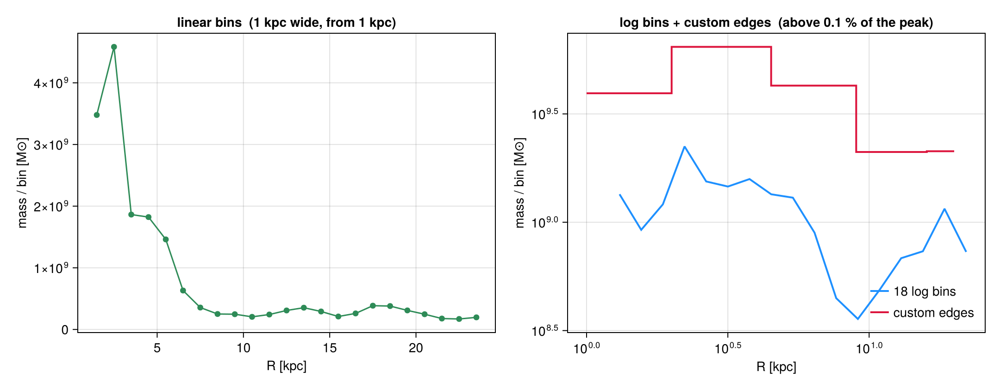
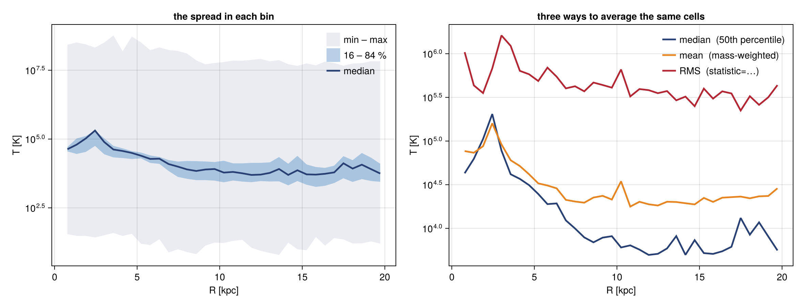
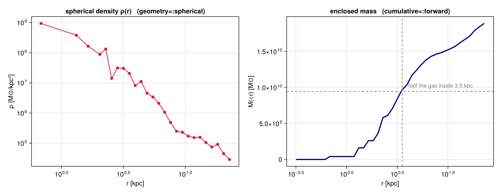
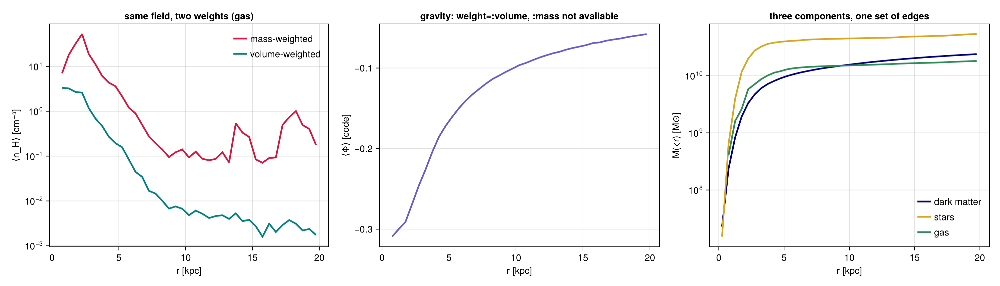
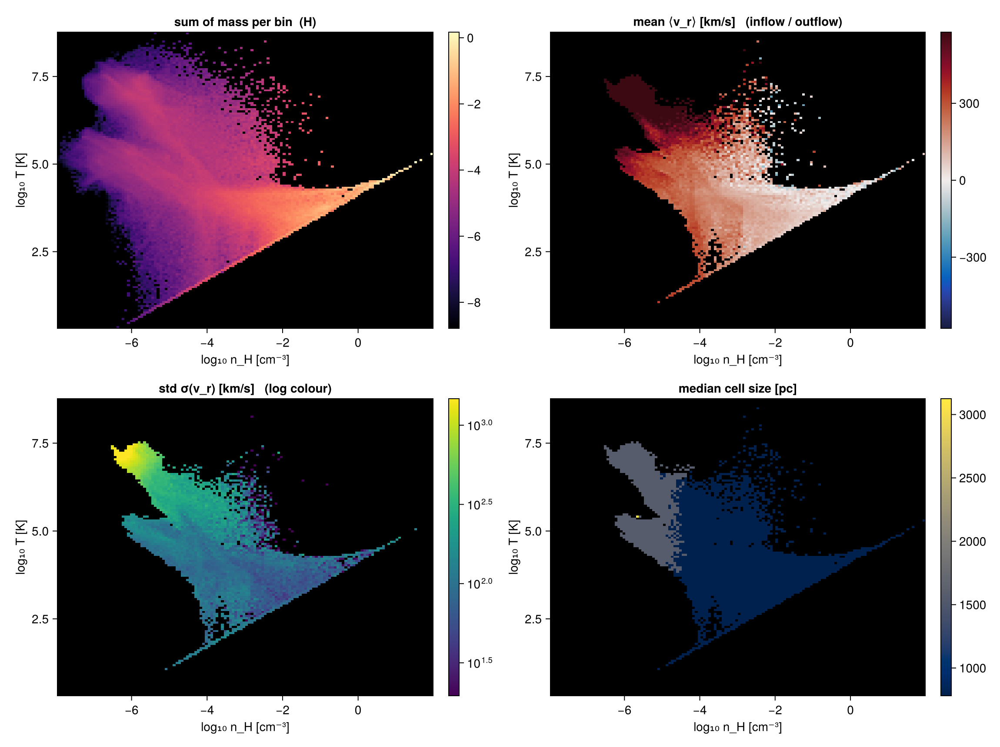
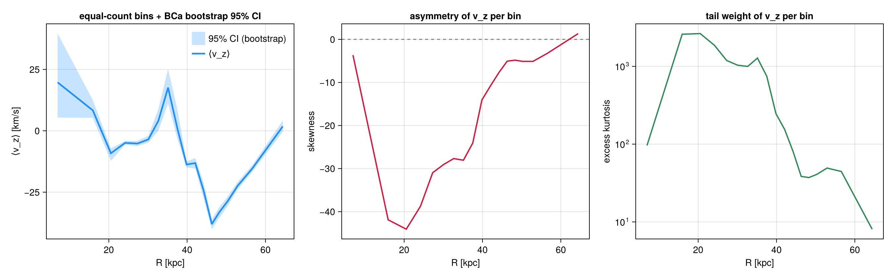

```@raw html
<!-- GENERATED FILE. Do not edit this markdown.
     Source notebook: 15_multi_Profiles_Phase.ipynb
     Regenerate with: MERA_DIR=<repo checkout> ./render_docs.sh
     Any edit here is lost the next time the docs are rendered. -->
```

# Profiles & phase diagrams, a step-by-step guide

!!! tip "Run it yourself"
    This page is also an executable **Jupyter notebook**: [open / download `15_multi_Profiles_Phase.ipynb`](https://github.com/ManuelBehrendt/Notebooks/blob/master/Mera-Docs/version_1.1/15_multi_Profiles_Phase.ipynb). The notebooks run end-to-end and double as part of Mera's test suite.


`profile`, `phase`, `profile3d` and `profiletimeseries` are **general, weighted
reductions** over any Mera field, a *profile* bins by one quantity (often a **radius**) and reports
per-bin **statistics** of another; a *phase diagram* is a 2-D weighted histogram. They work on
**3-D data** (gas / gravity / particles) **and on projected 2-D maps**.

This guide builds the core features up one at a time, on **one galaxy**. Six sections cover the
essentials with a plot each; the remaining features share the same API and are summarised at the end.

## Setup, load the galaxy once

Load hydro, gravity and **particles** from **one** snapshot. That matters more than it looks: every
number on this page is then about the same matter at the same time, so a mass decomposition can be
compared against the gravity field of the same run. Mixing two runs would put gas from one and
stars from another into the same total. Define a reusable physical **center**; profiles take a
`center` in any length unit.

```julia
# Example-data root. Point this at your own simulation folder, or set the
# MERA_EXAMPLES environment variable; every path below is built from it.
MERA_EXAMPLES = get(ENV, "MERA_EXAMPLES", "/Volumes/FASTStorage/Simulations/Mera-Tests");

using Mera, CairoMakie, Statistics   # Statistics: quantile, used for the colour limits in §5
CairoMakie.activate!()
BASE = MERA_EXAMPLES   # <-- change me
info  = getinfo(100, joinpath(BASE,"RAMSES/spiral_clumps"), verbose=false)
gas   = gethydro(info,  verbose=false, show_progress=false)
grav  = getgravity(info, lmax=gas.lmax, verbose=false, show_progress=false)
parts = getparticles(info, verbose=false, show_progress=false)   # SAME snapshot as the gas
ctr = [:bc]                         # box centre; e.g. [24.,24.,24.] with range_unit=:kpc also works
println("gas cells = ", length(gas.data), "   particles = ", length(parts.data))
```

```
*__   __ _______ ______   _______
|  |_|  |       |    _ | |   _   |
|       |    ___|   | || |  |_|  |
|       |   |___|   |_||_|       |
|       |    ___|    __  |       |
| ||_|| |   |___|   |  | |   _   |
|_|   |_|_______|___|  |_|__| |__|
Mera v1.8.0 | Julia 1.12.7 | 8 threads
gas cells = 590311   particles = 453200
```

## 1. The simplest profile, binning a quantity

With only a bin field, `profile` returns the **summed weight** per bin, e.g. the radial **mass
profile** M(R). The radius is measured about `center`; `nbins`, `xrange`, `scale` and units are
physical. `scale=:log` gives log-spaced bins, **base 10 and not natural log**: the edges are
`10 .^ range(log10(lo), log10(hi), length=nbins+1)`, the low edge is clamped to the smallest
positive value, and the top edge is inclusive. Set bins by **count** (`nbins`), by a **physical width**
(`binsize=0.5` in `xunit`, or `binsize=(500,:pc)` with its own unit; a dimensionless **dex** step
under `scale=:log`), or by fully custom `edges=`, `binsize`/`edges` override `nbins`. Returns `x`
(centres), `edges`, `count`, `sum` (Σweight), `sumw2`.

```julia
# Binning is a choice, and a bad one invents structure. 50 bins from R = 0 leaves the inner
# ones nearly empty; on a log axis those become spikes several decades deep. Wider bins
# starting at 1 kpc show the same galaxy without the noise.
pl  = profile(gas, :r_cylinder; weight=:mass, binsize=1.0, xrange=(1.0,24), center=ctr, range_unit=:kpc, xunit=:kpc)
plg = profile(gas, :r_cylinder; weight=:mass, nbins=18, scale=:log, xrange=(1.0,24), center=ctr, range_unit=:kpc, xunit=:kpc)
pe  = profile(gas, :r_cylinder; weight=:mass, edges=[0.,2.,4.,8.,16.,24.], center=ctr, range_unit=:kpc, xunit=:kpc)
pbs = profile(gas, :r_cylinder; weight=:mass, binsize=(500,:pc), xrange=(0,24), center=ctr, range_unit=:kpc, xunit=:kpc)
println("binsize=(500,:pc) → bin width [kpc] = ", round(diff(pbs.edges)[1], digits=3), "  (", length(pbs.edges)-1, " bins)")
M(p) = p.sum .* gas.scale.Msol      # code mass -> Msol

fig = Figure(size=(1080,420))
ax1 = Axis(fig[1,1], xlabel="R [kpc]", ylabel="mass / bin [M⊙]", title="linear bins  (1 kpc wide, from 1 kpc)")
scatterlines!(ax1, pl.x, M(pl), color=:seagreen)
ax2 = Axis(fig[1,2], xscale=log10, yscale=log10, xlabel="R [kpc]", ylabel="mass / bin [M⊙]",
           title="log bins + custom edges  (above 0.1 % of the peak)")
o = M(plg) .> 1e-3 * maximum(M(plg))   # a bin can hold cells and almost no mass: filter on mass
lines!(ax2, plg.x[o], M(plg)[o], color=:dodgerblue, linewidth=2, label="18 log bins")
stairs!(ax2, pe.x, max.(M(pe),1), color=:crimson, step=:center, linewidth=2, label="custom edges")
axislegend(ax2, position=:rb, framevisible=false)
fig
```

```
binsize=(500,:pc) → bin width [kpc] = 0.5  (48 bins)
```



## 2. Per-bin statistics, a binned statistic is not a histogram

Give a **second field** `yvar` and the bin stops being a count. Every bin now carries, for that
field, weighted by `weight`:

| field | what it is |
|:--|:--|
| `mean` | the weighted mean |
| `median`, `quantiles` | the 50th percentile, and whichever percentiles you ask for in `qlevels` |
| `std` | the weighted standard deviation |
| `sem` | the standard error **on the mean**, `std/√neff`, with Kish's effective sample size |
| `min`, `max` | the extremes actually present |
| `count`, `sum`, `sumw2` | how many cells, their summed weight, and its square |
| `custom` | whatever your own `statistic=f` returned |

**`std` and `sem` answer different questions**, and confusing them is the usual mistake. `std` is
how much the gas in that bin *actually varies*; it does not shrink when you add cells. `sem` is how
well the *mean* is pinned down; it shrinks as more cells enter the bin. Error bars on a mean want
`sem`. A claim about the gas wants `std`, or better, quantiles.

### The `statistic` keyword: your own reduction, per bin

The table above is what Mera computes for you. `statistic=f` is the escape hatch for everything
else. Mera sorts the cells into bins, and then, **once for each bin**, hands your function that
bin's numbers and asks for a single value back. The answers land in `custom`, one per bin.

Two things to know before writing one.

**What your function receives.** `y` is a plain Julia vector of the `yvar` values of the cells that
fell in this bin, and `w` is their weights (their masses, with `weight=:mass`). Nothing exotic:
anything you can do to a vector, you can do here.

**Which form Mera calls.** If your function takes two arguments it is called as `f(y, w)`, so you
can weight. If it takes one it is called as `f(y)`, and then **the weights are not involved at
all**, which is a real trap: a one-argument function treats a tiny cell and a massive one alike.

Now read the line in the code below, right to left:

```julia
statistic = (y, w) -> sqrt(sum(w .* y.^2) / sum(w))
```

`(y, w) -> …` is Julia's anonymous function: "given `y` and `w`, compute this". Then `y.^2` squares
every temperature (the dot means element by element), `w .* y.^2` weights each square by that
cell's mass, `sum(...) / sum(w)` is the mass-weighted mean of the squares, and `sqrt` brings it
back to kelvin. That is the **root mean square**, and it is in here precisely because Mera does not
provide it: squaring first means a few very hot cells count enormously, which is why the red curve
sits a decade above the mean.

Other things people actually want, all tested on this snapshot at mid-radius:

```julia
# how many cells in the bin are hotter than 10^6 K        -> 1391
statistic = y -> count(>(1e6), y)

# what fraction of the bin's MASS is hotter than 10^6 K    -> 0.0022
statistic = (y, w) -> sum(w[y .> 1e6]) / sum(w)

# the mass-weighted geometric mean, the natural average
# for something spread over decades                        -> 6836 K
statistic = (y, w) -> exp(sum(w .* log.(y)) / sum(w))

# the interquartile range, a spread that ignores extremes  -> 7.5e6 K
statistic = y -> quantile(y, 0.75) - quantile(y, 0.25)     # needs `using Statistics`
```

The first and last are one-argument forms, so they count cells rather than mass. That is the right
choice for "how many cells" and the wrong one if you meant "how much gas", which is what the second
example does instead.

### Reading the figure

The left panel is the honest description of a bin: the median, the 16–84 % band holding the bulk
of the gas, and the min–max envelope. The band is narrow while the envelope spans six decades,
which is the multiphase ISM in one picture.

The right panel is the same cells reduced three ways, and they do **not** agree. At R = 10 kpc the
median is 6.0 × 10³ K, the mean 3.5 × 10⁴ K, and the RMS 6.6 × 10⁵ K: each about a decade above
the last. That ordering, median < mean < RMS, is the signature of a strongly skewed distribution,
where a small mass of very hot gas sets the mean and dominates the RMS while most of the gas is
cool.

`±std` is deliberately **not** drawn. It is symmetric, and here the spread is larger than the mean,
so `mean − std` is negative: meaningless for a temperature and impossible to draw on a log axis.
For a quantity spread over decades, quantiles are the honest spread.

```julia
# One set of binning options, reused for both calls so the two profiles share identical bins.
# `weight=:mass` makes every statistic mass-weighted; `unit=:K` asks for the temperature in kelvin;
# `xunit=:kpc` and `range_unit=:kpc` say the radii are kpc; `center=ctr` is the box centre.
common = (weight=:mass, unit=:K, nbins=35, xrange=(0.5,20), center=ctr, range_unit=:kpc, xunit=:kpc)

# Profile 1: the built-in statistics. `quantiles=` asks for three percentiles per bin, which come
# back as a matrix with one column per level, in the order requested.
pT = profile(gas, :r_cylinder, :T; common..., quantiles=[0.16, 0.5, 0.84])

# Profile 2: the same bins, but with our own reduction. Mera calls this once per bin with that
# bin's temperatures `y` and masses `w`, and stores the result in `pC.custom`.
pC = profile(gas, :r_cylinder, :T; common...,
             statistic=(y,w) -> sqrt(sum(w .* y.^2) / sum(w)))    # mass-weighted RMS

# Empty bins come back as NaN, and a zero minimum cannot be drawn on a log axis, so keep the bins
# that actually hold gas. Every array below is filtered by the same mask, so they stay aligned.
ok  = (pT.count .> 0) .& (pT.min .> 0)
x   = pT.x[ok]                       # bin centres, kpc
mn  = pT.min[ok];  mx = pT.max[ok]   # the extremes present in each bin
q16 = pT.quantiles[ok,1]             # column 1 = the 0.16 level we asked for
q50 = pT.quantiles[ok,2]             # column 2 = 0.50, the median
q84 = pT.quantiles[ok,3]             # column 3 = 0.84
mu  = pT.mean[ok]                    # mass-weighted mean
sem = pT.sem[ok]                     # uncertainty ON THE MEAN, not the spread of the gas
rms = pC.custom[ok]                  # whatever `statistic` returned, here the RMS

# ── figure code from here: panels, overlays, colorbars, no new Mera concepts ──
NAVY=RGBf(0.16,0.25,0.45); BLUE=RGBf(0.20,0.47,0.74); ORANGE=RGBf(0.90,0.52,0.13); RED=RGBf(0.70,0.15,0.20)
fig = Figure(size=(1180,450))
ax1 = Axis(fig[1,1], yscale=log10, xlabel="R [kpc]", ylabel="T [K]", title="the spread in each bin")
band!(ax1, x, mn, mx, color=(NAVY,0.10), label="min – max")
band!(ax1, x, q16, q84, color=(BLUE,0.35), label="16 – 84 %")
lines!(ax1, x, q50, color=NAVY, linewidth=2.5, label="median")
axislegend(ax1, position=:rt, framevisible=false)

ax2 = Axis(fig[1,2], yscale=log10, xlabel="R [kpc]", ylabel="T [K]",
           title="three ways to average the same cells")
lines!(ax2, x, q50, color=NAVY,   linewidth=2.5, label="median  (50th percentile)")
lines!(ax2, x, mu,  color=ORANGE, linewidth=2.5, label="mean  (mass-weighted)")
lines!(ax2, x, rms, color=RED,    linewidth=2.5, label="RMS  (statistic=…)")
# sem whiskers belong on the mean. Every third bin, and only where the lower whisker stays positive,
# because a log axis cannot draw down to zero.
se = [i for i in 1:3:length(x) if mu[i]-sem[i] > 0]
errorbars!(ax2, x[se], mu[se], sem[se], color=ORANGE, whiskerwidth=7)
axislegend(ax2, position=:rt, framevisible=false)
fig
```



## 3. Density, enclosed mass & normalization

`geometry=:spherical` (shell `4/3·π·Δr³`) or `:cylindrical` (annulus `π·Δr²`) divides the binned
weight by the shell volume to give a physical **`density`** (`weight`-unit per `xunit`³, +
`shell_volume`). `cumulative=:forward` (or `:reverse`) adds `cumsum`/`cumcount`, the **enclosed
mass** M(<r), which is where a half-mass radius comes from. `normalize=:sum` gives per-bin
`fraction` (Σ=1); `normalize=:pdf` gives a true probability density (∫=1), so `profile` can bin
*by* density and hand back a ρ-PDF.

For PDFs specifically, [`pdf`](@ref) is the direct route and the
[Statistics](statistics.md) page covers weighting, normalisation and the log-normal question in
one place.

```julia
pr = profile(gas, :r_sphere; weight=:mass, geometry=:spherical, cumulative=:forward, scale=:log,
             xrange=(0.3,24), nbins=40, center=ctr, range_unit=:kpc, xunit=:kpc)
ρ = pr.density .* gas.scale.Msol; Menc = pr.cumsum .* gas.scale.Msol
frac  = Menc ./ Menc[end]
rhalf = pr.x[findfirst(>=(0.5), frac)]          # where half the gas is enclosed

fig = Figure(size=(1080,420))
a1 = Axis(fig[1,1], xscale=log10, yscale=log10, xlabel="r [kpc]", ylabel="ρ [M⊙/kpc³]",
          title="spherical density ρ(r)   (geometry=:spherical)")
od = ρ .> 0; scatterlines!(a1, pr.x[od], ρ[od], color=:crimson)
a2 = Axis(fig[1,2], xscale=log10, xlabel="r [kpc]", ylabel="M(<r) [M⊙]",
          title="enclosed mass   (cumulative=:forward)")
lines!(a2, pr.x, Menc, color=:navy, linewidth=2.5)
hlines!(a2, [0.5*Menc[end]], color=:gray, linestyle=:dash)
vlines!(a2, [rhalf], color=:gray, linestyle=:dash)
text!(a2, rhalf*1.15, 0.52*Menc[end]; text="half the gas inside $(round(rhalf,digits=1)) kpc",
      color=:gray, fontsize=12, align=(:left,:bottom))
fig
```



## 4. Weighting & components, mass vs volume vs none

A bin holds many cells, and `weight` decides how much each of them counts towards the bin's value.
The choice is not cosmetic: on an AMR grid it changes the answer, because a refined region packs
many small cells into the space of one coarse cell.

| `weight` | each cell counts in proportion to | the mean then follows |
|---|---|---|
| `:mass` | its mass | where the material is |
| `:volume` | the space it fills | where the volume is (grid data only) |
| `:none` | nothing, every cell counts once | where the refinement is |
| any field, e.g. `:T` | that field's value | whatever you chose |

Dense gas occupies little volume and carries most of the mass, so a mass-weighted mean sits high
above a volume-weighted one wherever a bin mixes dense clumps with thin gas. Neither is the right
answer on its own: the gap between them is itself the measurement, and it tells you the bin is not
uniform. Say which one you used.

**Gravity and RT data carry no `:mass` column**, so `weight=:mass` cannot work there. Use `:volume`
or `:none` for those.

**Comparing components starts with shared bins.** Pass `edges=` (a vector of bin boundaries) instead
of `nbins=`, and every profile built from it lands on exactly the same radii. Curves on shared edges
can be divided, subtracted or stacked afterwards; curves on separately chosen bins cannot. Combine
that with `mask=`, a boolean vector selecting rows, and one snapshot gives the gas, the stars and the
dark matter on one axis.

```julia
# --- shared bins ---------------------------------------------------------------------------
# A vector of BIN BOUNDARIES, not a bin count. 41 boundaries make 40 bins of 0.5 kpc each.
# Every profile below is handed this same vector, which is what makes the curves comparable:
# identical radii, so they can be divided, subtracted or stacked afterwards.
ed = collect(range(0, 20, length=41))

# One bundle of options reused by every call, so a difference between two curves can only come
# from what we deliberately change (the weight, or the component), never from the binning.
common = (edges=ed, center=ctr, range_unit=:kpc, xunit=:kpc)

# --- the same field, three weights ---------------------------------------------------------
# :rho is the density of each cell; `unit=:nH` reports it as a hydrogen number density in cm^-3.
pmw = profile(gas, :r_sphere, :rho; weight=:mass,   unit=:nH, common...)   # follows the material
pvw = profile(gas, :r_sphere, :rho; weight=:volume, unit=:nH, common...)   # follows the space

# Gravity data has no :mass column, so weight=:mass would fail here. :volume is the natural choice
# for a field defined on the grid; :none would weight by refinement instead of by physical size.
pep = profile(grav, :r_sphere, :epot; weight=:volume, common...)

# --- components on those same bins ----------------------------------------------------------
# `getparticlemask` builds a boolean vector, one entry per particle, true for the family asked for.
# Passing it as `mask=` restricts the profile to those rows; nothing is copied or reloaded.
mstars = getparticlemask(parts, :stars; verbose=false)
mdm    = getparticlemask(parts, :dm;    verbose=false)

# With no yvar, `profile` sums the WEIGHT per bin, so weight=:mass gives the mass per bin in `.sum`.
# `cumulative=:forward` adds those bins up from the inside out, so `.cumsum` is the mass enclosed
# inside each bin's outer edge. Results are in code units; multiply by scale.Msol for solar masses.
cg = profile(gas,   :r_sphere; weight=:mass, cumulative=:forward, common...)
cs = profile(parts, :r_sphere; weight=:mass, cumulative=:forward, mask=mstars, common...)
cd = profile(parts, :r_sphere; weight=:mass, cumulative=:forward, mask=mdm,    common...)
Mg = cg.cumsum .* gas.scale.Msol
Ms = cs.cumsum .* parts.scale.Msol
Md = cd.cumsum .* parts.scale.Msol

# --- plot ------------------------------------------------------------------------------------
fig = Figure(size=(1500, 430))

ax1 = Axis(fig[1,1], yscale=log10, xlabel="r [kpc]", ylabel="⟨n_H⟩ [cm⁻³]",
           title="same field, two weights (gas)")
o1 = pmw.mean .> 0; o2 = pvw.mean .> 0        # log axis: drop empty bins, which report 0
lines!(ax1, pmw.x[o1], pmw.mean[o1], color=:crimson, linewidth=2.5, label="mass-weighted")
lines!(ax1, pvw.x[o2], pvw.mean[o2], color=:teal,    linewidth=2.5, label="volume-weighted")
axislegend(ax1, position=:rt, framevisible=false)

ax2 = Axis(fig[1,2], xlabel="r [kpc]", ylabel="⟨Φ⟩ [code]",
           title="gravity: weight=:volume, :mass not available")
og = isfinite.(pep.mean)
lines!(ax2, pep.x[og], pep.mean[og], color=:slateblue, linewidth=2.5)

ax3 = Axis(fig[1,3], yscale=log10, xlabel="r [kpc]", ylabel="M(<r) [M⊙]",
           title="three components, one set of edges")
for (M, col, lab) in ((Md, :navy, "dark matter"), (Ms, :goldenrod, "stars"), (Mg, :seagreen, "gas"))
    ok = M .> 0                                # again, only bins that have something in them
    lines!(ax3, cg.x[ok], M[ok], color=col, linewidth=2.5, label=lab)
end
axislegend(ax3, position=:rb, framevisible=false)
fig
```



## 5. Phase diagrams, colour is a knob

`phase` is a 2-D weighted histogram of two fields, the classic mass-weighted **ρ to T** diagram.
With a third field `cvar` each cell is coloured by the per-cell weighted **mean**; `cstat` swaps
that for `:std`/`:median`/`:min`/`:max`/`:full` or a function. `normalize=:pdf` makes a 2-D PDF,
and `xedges`/`yedges` accept custom edges.

Same ρ–T plane, four questions. **Every title says which statistic is drawn**, because a colour
means nothing until you know whether it is a sum, a mean, a median or a spread:

| panel | statistic | what it answers |
|:--|:--|:--|
| mass | **sum** of the weight per bin | where the gas is |
| ⟨v_r⟩ | **mean** radial velocity about the box centre | inflow against outflow, and the hot wind |
| σ(v_r) | **standard deviation** per bin | how ordered that motion is |
| cell size | **median** | where the refinement went, a property of the run, not the gas |

Three habits worth copying. Bins holding almost no mass carry wild means, and one of them will set
the colour range for a whole panel, so they are masked first. `v_r` here is one-sided, a wind
rather than a symmetric field, so the diverging limits come from a percentile of `|v_r|` rather
than its extremes. And **σ spans 1.7 dex**, so it gets a log colour scale, without which the disc
is a single flat colour; the cell size spans 0.3 dex and takes only three values, being the AMR
level, so a log scale there would add nothing.

```julia
# --- four views of the SAME plane -------------------------------------------------------------
# `phase` is a 2-D weighted histogram: it bins the cells by two fields and sums the weight that
# lands in each bin. Here the plane is density against temperature, the standard way of asking
# which physical states the gas is in.
#
# One shared bundle, so all four panels sit on exactly the same grid of bins and can be compared
# pixel by pixel:
#   nbins=(140,140)  140 bins along x, 140 along y
#   xscale/yscale    :log, base 10, because density and temperature each span many decades
#   xunit/yunit      the units the two AXES are measured in (n_H in cm⁻³, T in K)
#   weight=:mass     the quantity summed into each bin
kw = (weight=:mass, nbins=(140,140), xscale=:log, yscale=:log, xunit=:nH, yunit=:K,
      center=ctr, range_unit=:kpc)

# Two fields: `H` is the summed weight per bin, so with weight=:mass this is a mass map.
ph  = phase(gas, :rho, :T; kw...)

# A THIRD field adds a per-bin reduction of that field, and `cstat` picks which one. The bins do
# not change; only what the colour shows. Options: :mean (default), :median, :min, :max, :std,
# :quantiles, :full (all of them at once), or a function of your own. `cunit` is that third field's unit,
# which is independent of xunit/yunit.
pvr = phase(gas, :rho, :T, :vr_sphere; cstat=:mean,   cunit=:km_s, kw...)  # the average motion
psd = phase(gas, :rho, :T, :vr_sphere; cstat=:std,    cunit=:km_s, kw...)  # the spread of that motion
pcs = phase(gas, :rho, :T, :cellsize;  cstat=:median, cunit=:pc,   kw...)  # the typical cell size

# --- keep the colours honest -------------------------------------------------------------------
# A bin holding almost no mass still reports a mean, but that mean comes from a handful of cells
# and can be enormous. One such bin then sets the colour range and flattens the whole panel into
# a single tone. Drop them first, exactly as the radial profiles drop bins with too few points.
keep = ph.H .>= 1e-6 * sum(ph.H)        # keep a bin only if it holds a millionth of the total mass

# NaN is the "nothing here" value for Makie: a NaN pixel is left unpainted rather than drawn as
# zero, which on a diverging colour map would otherwise look like a real measurement of zero.
function mask(M)
    out = similar(M, Float64)
    @inbounds for i in eachindex(M); out[i] = keep[i] ? M[i] : NaN; end
    return out
end

function qq(M, p)                       # a percentile of the finite entries of a map
    v = filter(isfinite, vec(M))
    return isempty(v) ? 0.0 : quantile(v, p)
end

# v_r here is one-sided, a wind blowing outwards rather than a balanced in-and-out field, so its
# extremes are a poor guide to the range worth showing. Take a high percentile of |v_r| and apply
# it symmetrically, which keeps zero at the centre of the diverging map so the SIGN stays readable.
vlim = qq(abs.(mask(pvr.mean)), 0.90)

sig  = mask(psd.std); sig[sig .<= 0] .= NaN   # a log colour scale needs strictly positive values

# ── figure code from here: panels, overlays, colorbars, no new Mera concepts ──
# `xedges`/`yedges` are the bin BOUNDARIES, 141 of them for 140 bins. A heatmap wants one
# coordinate per bin, so take each pair's midpoint; log10 because the axes are labelled in log10.
xc = log10.((ph.xedges[1:end-1].+ph.xedges[2:end])./2)
yc = log10.((ph.yedges[1:end-1].+ph.yedges[2:end])./2)
lg(M) = log10.(replace(M, 0.0=>NaN))    # log10 of a map, empty bins blanked instead of becoming -Inf
fig = Figure(size=(1150,860))
# Each row below is one panel. The title names the STATISTIC, because a colour means nothing
# until you know whether it is a sum, a mean, a median or a spread.
#          title (naming the statistic)          data              colourmap  range                          log?
panels = (("sum of mass per bin  (H)",           lg(ph.H),         :magma,   nothing,                        identity),
          ("mean ⟨v_r⟩ [km/s]   (inflow / outflow)", mask(pvr.mean), :balance, (-vlim, vlim),                identity),
          ("std σ(v_r) [km/s]   (log colour)",   sig,              :viridis, (qq(sig,0.02), qq(sig,0.995)),  log10),
          ("median cell size [pc]",              mask(pcs.median), :cividis, nothing,                        identity))
for (k,(lab,M,cm,rng,csc)) in enumerate(panels)
    r=(k-1)÷2+1; c=2*((k-1)%2)+1        # 2×2 layout, each panel followed by its own colour bar
    ax  = Axis(fig[r,c], xlabel="log₁₀ n_H [cm⁻³]", ylabel="log₁₀ T [K]", title=lab)
    kwc = rng === nothing ? (; colormap=cm) : (; colormap=cm, colorrange=rng)   # nothing = let Makie choose
    hm  = csc === log10 ? heatmap!(ax, xc, yc, M; colorscale=log10, kwc...) :
                          heatmap!(ax, xc, yc, M; kwc...)
    ax.backgroundcolor = :black         # masked (NaN) bins show as background, not as a colour
    Colorbar(fig[r,c+1], hm)
end
fig
```

```
[Mera] Hint: getvar(:vr_sphere) has no `vcenter` — velocities are in the BOX frame.
             Pass vcenter=:auto for an object with bulk motion (`center=` sets the origin,
             `vcenter=` the frame).
             (shown once per session; verbose(false) silences Mera's messages)
```



## 6. Distribution shape & uncertainties, moments, equal-count bins, bootstrap CIs

Three statistics upgrades, all opt-in and composable:

* **`skewness`** and (excess) **`kurtosis`** are always returned with a `yvar`, the asymmetry and
  tail-weight of each bin's distribution (a Gaussian gives both ≈ 0).
* **`scale=:equal`** places *quantile-spaced* edges so every bin holds about the same number of
  points, far steadier statistics where the disk thins out (vs fixed-width bins that empty out).
* **`bootstrap=N`** resamples each bin to add confidence intervals for the per-bin mean and median
  (`mean_ci`/`median_ci`, `nbins×2`) plus `median_se`; `ci=:percentile` (default), `:basic` or
  `:bca` (bias-corrected & accelerated). It is deterministic (seeded), so reruns match.

The three panels are separate on purpose. In this galaxy the skewness of `v_z` reaches **-44**
while the excess kurtosis reaches **2600**: drawn on one axis the skewness is a flat line on zero,
and the strongly one-sided vertical motion in the mid-disc, which is the interesting part, is
invisible.

```julia
# --- one profile carrying three extra kinds of information --------------------------------------
# scale=:equal puts the bin EDGES at quantiles of the data instead of at fixed widths, so every bin
# ends up holding roughly the same number of cells. Where the disc thins out, fixed-width bins run
# empty and their statistics turn noisy; equal-count bins stay equally well determined, at the price
# of being physically wider out there. Read the x axis as "bin centre", not "bin of constant size".
#
# bootstrap=800 resamples the cells inside each bin 800 times and looks at how much the per-bin mean
# moves. The spread of those 800 means is the confidence interval, and it assumes nothing about the
# distribution being Gaussian, which matters here because it is not. ci=:bca is the bias-corrected
# and accelerated interval (the others are :percentile and :basic), and confidence_level=0.95 makes
# it a 95% interval. The resampling is seeded, so
# running the cell again gives exactly the same interval rather than a slightly different one.
pe = profile(gas, :r_cylinder, :vz; weight=:mass, unit=:km_s, scale=:equal, nbins=18,
             center=ctr, range_unit=:kpc, xunit=:kpc, bootstrap=800, ci=:bca, confidence_level=0.95)

println("equal-count points/bin (min..max): ", extrema(pe.count), "  → nearly equal")

ok = pe.count .> 5                 # a bin with a handful of cells has no meaningful shape
x  = pe.x[ok]                      # bin centres, kpc
mu = pe.mean[ok]                   # the mass-weighted ⟨v_z⟩ of each bin
lo = pe.mean_ci[ok,1]              # mean_ci is nbins×2: column 1 is the lower end of the interval,
hi = pe.mean_ci[ok,2]              # column 2 the upper. (median_ci and median_se come along too.)
sk = pe.skewness[ok]               # asymmetry of the v_z distribution in the bin; 0 = symmetric
ku = pe.kurtosis[ok]               # EXCESS kurtosis, i.e. tail weight; 0 = Gaussian, not 3

# Skewness runs to -44 here and excess kurtosis to 2600: on one axis the skewness is a flat
# line on zero and the panel says nothing. One axis each, and the kurtosis in log.
fig = Figure(size=(1350,420))
ax1 = Axis(fig[1,1], xlabel="R [kpc]", ylabel="⟨v_z⟩ [km/s]", title="equal-count bins + BCa bootstrap 95% CI")
# The band is the confidence interval on the MEAN, not the spread of the gas. It is narrow because
# each bin holds tens of thousands of cells; σ(v_z) itself is far wider (that is pe.std).
band!(ax1, x, lo, hi, color=(:dodgerblue,0.25), label="95% CI (bootstrap)")
lines!(ax1, x, mu, color=:dodgerblue, linewidth=2.5, label="⟨v_z⟩")
axislegend(ax1, position=:rt, framevisible=false)
ax2 = Axis(fig[1,2], xlabel="R [kpc]", ylabel="skewness", title="asymmetry of v_z per bin")
hlines!(ax2, [0.0], color=:gray, linestyle=:dash)     # the symmetric case, for reference
lines!(ax2, x, sk, color=:crimson, linewidth=2)
ax3 = Axis(fig[1,3], xlabel="R [kpc]", ylabel="excess kurtosis", yscale=log10,
           title="tail weight of v_z per bin")
lines!(ax3, x, ku, color=:seagreen, linewidth=2)
fig
```

```
equal-count points/bin (min..max): (32096, 33456)  → nearly equal
```



## More features (same API, no separate plot here)

These use exactly the same `profile`/`phase` calls shown above:

* **Many fields in one pass**, pass `yvar` as a vector to bin once and reduce several fields together
  (cheaper than one call per field); per-field stats live under `p.fields[:T]`, in `p.yvars` order:
  `profile(gas, :r_cylinder, [:T, :rho]; weight=:mass, nbins=40, center=ctr, range_unit=:kpc)`.
* **Velocity decomposition**, `getvar` splits each cell's velocity about `center` into
  `:vr_cylinder` (radial in/outflow, ±), `:vϕ_cylinder` (rotation), `:vz` (vertical), plus the
  spherical triplet `:vr_sphere`/`:vθ_sphere`/`:vϕ_sphere`. Profiling them gives ⟨v⟩(R) (`mean`,
  signed) and the **rest-frame dispersion** σ(R) (`std`, about the per-bin mean, so net rotation
  doesn't inflate it). [`velocitydispersion`](@ref) returns σ_R/σ_ϕ/σ_z and the total σ in one call.
  These are **3-D, per-annulus** dispersions about the bin mean (intra-bin shear retained); for a
  **local, per-pixel line-of-sight** dispersion use the projected `:σlos` map instead,
  `profile(projection(gas, :σlos, :km_s; direction=:edgeon, center=ctr, range_unit=:kpc), :σlos; xvar=:r, weight=:sd)`.
* **Select particles**, `getparticlemask(parts, :stars)` (or `:dm`/`:clouds`/… , a family `Int`, or
  `(family=…, tag=…)`) builds a boolean mask to pass as `mask=` to any profile call.
* **Profiles from a 2-D map**, `profile` also takes a `projection` result: bin map pixels by
  image-plane radius `:r` (a surface brightness Σ(R)), by `:x`/`:y`, or by another map; weight by
  `:none`/`:area` or a map key. Works for off-axis (e.g. edge-on) maps too, `:r` stays centred on
  the object. `profile(proj, :sd; xvar=:r, weight=:none, xunit=:kpc, nbins=30)`.
* **3-D profiles**, `profile3d(gas, :rho, :T, :z; weight=:mass, nbins=(80,80,24), …)` bins by three
  fields; marginalizing one axis reproduces `phase` exactly (a built-in consistency check).
* **Evolution across snapshots**, `profiletimeseries(loadfn, outputs, xvar, yvar; …)` stacks a
  profile over many outputs into an `(nbins × n_snapshots)` matrix on a fixed radius axis.

## Takeaway

| feature | call |
|---|---|
| bin a quantity; log/custom `edges` | `profile(obj, x)` |
| per-bin mean/std/sem/quantiles/min/max/custom | `profile(obj, x, y; statistic=…)` |
| density / enclosed mass / fraction / pdf | `geometry`, `cumulative`, `normalize` |
| many fields in one pass | `profile(obj, x, [y1,y2])` → `.fields` |
| mass / volume / none / field weighting | `weight=…` |
| components (gas / stars / DM) on shared bins | `edges=…` + `mask=getparticlemask(…)` |
| velocity decomposition ⟨v_ϕ⟩/⟨v_r⟩ + σ_r/σ_ϕ/σ_z | `profile(obj, r, :vϕ_cylinder/:vr_cylinder/:vz)` |
| select particles by type/family/tag | `getparticlemask` |
| profile from a 2-D map (Σ(R), map-weighted) | `profile(m::DataMapsType, …)` |
| 2-D phase; colour by mean/std/…; PDF | `phase(obj, x, y[, c]; cstat, normalize)` |
| 3-D histogram; marginal == phase | `profile3d` |
| radius-vs-time evolution | `profiletimeseries` |
| distribution shape; equal-count bins; bootstrap CIs | `skewness`/`kurtosis`, `scale=:equal`, `bootstrap=N` |

Profiles & phase work on **gas, gravity, particles and projected maps** (`source=:data`
or `:map`). Everything here is regression-tested in the Mera test suite. For *line-of-sight*
distributions (per-pixel spectra, velocity cubes) see the [Off-axis Projection](06_offaxis_Projection.md) guide.
