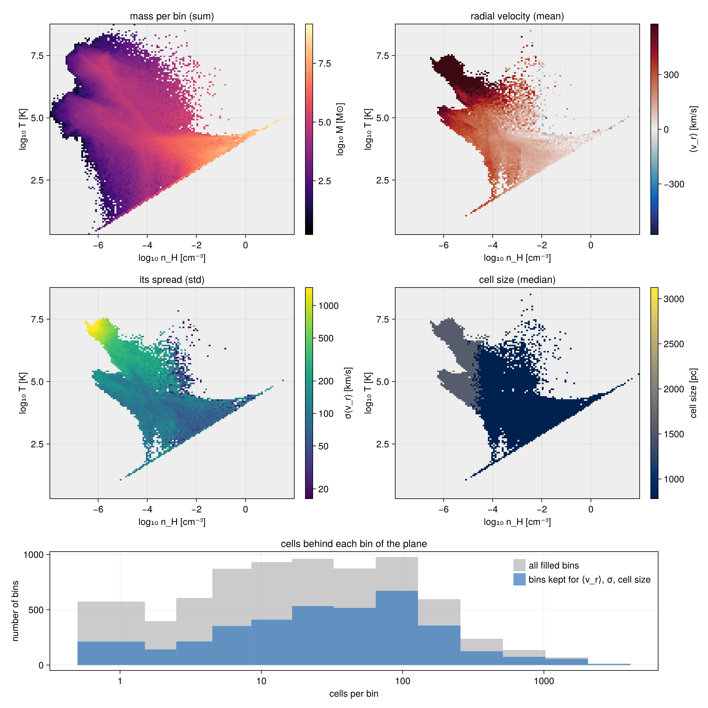

```@raw html
<!-- GENERATED FILE. Do not edit this markdown.
     Source notebook: 15_multi_Profiles_Phase.ipynb
     Regenerate with: MERA_DIR=<repo checkout> ./render_docs.sh
     Any edit here is lost the next time the docs are rendered. -->
```

# Profiles and phase diagrams

!!! tip "Run it yourself"
    This page is also an executable **Jupyter notebook**: [open / download `15_multi_Profiles_Phase.ipynb`](https://github.com/ManuelBehrendt/Notebooks/blob/master/Mera-Docs/version_1.1/15_multi_Profiles_Phase.ipynb). The notebooks run end-to-end and double as part of Mera's test suite.


A profile sorts cells into bins and reports, for every bin, the total weight (for example the
mass) and statistics of a second quantity. Mera makes profiles in one, two and three dimensions:

| function | bins by | example | works on |
|:--|:--|:--|:--|
| `profile` | one quantity (1-D) | temperature against radius | gas, gravity, RT, particles, projected maps |
| `phase` | two quantities (2-D) | gas mass in the density–temperature plane | gas, gravity, RT, particles, projected maps |
| `profile3d` | three quantities (3-D) | gas mass by density, temperature and height | gas, gravity, RT, particles |
| `profiletimeseries` | one quantity, over many snapshots | how a radial profile changes in time | gas, gravity, RT, particles |

**Any quantity can be used.** The bin quantity, the quantity reduced per bin, and the weight can
each be anything `getvar` knows: stored fields such as `:rho` or `:vx`, and derived quantities
such as `:T`, `:mach`, `:r_sphere`, `:vr_cylinder`, `:cellsize`, `:epot` or `:mass`. On a
projected map, the quantities are its maps (`:sd`, `:vlos`, …), the image-plane radius `:r` and
the coordinates `:x`, `:y`.

This page uses one galaxy and adds one feature at a time:

| section | what it shows |
|:--|:--|
| 1 | choosing the bins |
| 2 | statistics per bin, and your own |
| 3 | density and enclosed mass |
| 4 | weighting, a gravity profile, and gas, stars and dark matter on shared bins |
| 5 | phase diagrams |
| 6 | distribution shape and error bars on the mean |
| More features | several quantities at once, velocities, projected maps, 3-D, time series |

## Setup

Load gas, gravity and particles from **one** snapshot, so every number on the page is about the
same matter at the same time. `center` is the origin of every radius below; it takes any length
unit. The last lines set one plot style for the whole page: every radial plot runs from 0 to
`Rmax` = 20 kpc, and has a thin panel below it with the number of cells or particles in each bin.

```julia
# Example-data root. Point this at your own simulation folder, or set the
# MERA_EXAMPLES environment variable; every path below is built from it.
MERA_EXAMPLES = get(ENV, "MERA_EXAMPLES", "/Volumes/FASTStorage/Simulations/Mera-Tests");

using Mera, CairoMakie, Statistics   # Statistics: quantile, used in §2 and §5
CairoMakie.activate!()
BASE = MERA_EXAMPLES   # <-- change me
info  = getinfo(100, joinpath(BASE,"RAMSES/spiral_clumps"), verbose=false)
gas   = gethydro(info,  verbose=false, show_progress=false)
grav  = getgravity(info, lmax=gas.lmax, verbose=false, show_progress=false)
parts = getparticles(info, verbose=false, show_progress=false)   # SAME snapshot as the gas
ctr = [:bc]                         # box centre; [50.,50.,50.] with range_unit=:kpc is the same point
println("gas cells = ", length(gas.data), "   particles = ", length(parts.data))

# Plot style for the whole page (figure code only, no Mera concepts).
update_theme!(fontsize=15, Lines=(linewidth=2.5,), Legend=(framevisible=false,),
              Axis=(titlefont=:regular, titlesize=16, xgridcolor=(:black,0.07), ygridcolor=(:black,0.07)))
C = (blue=RGBf(0.20,0.47,0.74), navy=RGBf(0.16,0.25,0.45), orange=RGBf(0.90,0.52,0.13),
     red=RGBf(0.70,0.15,0.20), green=RGBf(0.18,0.55,0.34), gold=RGBf(0.85,0.62,0.10),
     purple=RGBf(0.42,0.32,0.66))
# Log-axis ticks at whole powers of ten; on a range shorter than two decades, also at 2× and 5×.
function decades(lo, hi)
    t = 10.0 .^ (ceil(Int, log10(lo)):floor(Int, log10(hi)))
    length(t) >= 2 && return t
    return [m * 10.0^e for e in floor(Int, log10(lo)):ceil(Int, log10(hi)) for m in (1, 2, 5) if lo <= m * 10.0^e <= hi]
end
function pow10(vs)                                         # labels 10ⁿ and 2×10ⁿ
    map(vs) do v
        e = floor(Int, log10(v) + 1e-9); m = round(Int, v / 10.0^e)
        m == 1 ? rich("10", superscript(string(e))) : rich("$(m)×10", superscript(string(e)))
    end
end
logy = (yscale=log10, yticks=decades, ytickformat=pow10)     # splat into Axis for a log y axis
Rmax = 20                                                   # radial plots run from 0 to Rmax kpc
rax  = (limits=((0, Rmax), nothing), xticks=0:5:Rmax)      # splat into Axis for a radius axis

# A thin panel docked under a profile: how many cells or particles fall in each bin. Few counts
# mean a noisy bin; an empty bin leaves a gap. `top` is the profile axis above it.
function countaxis(fig, row, col, top; ylabel="cells", xlabel="R [kpc]", log=true)
    yax = log ? logy : (limits=((0, Rmax), (0, nothing)),)
    ac  = Axis(fig[row+1, col]; merge(rax, yax)..., xlabel=xlabel, ylabel=ylabel)
    linkxaxes!(top, ac)
    hidexdecorations!(top; grid=false, ticks=false)        # the x axis labels move to the panel below
    return ac
end
# counts per bin as steps over the bin edges; zero becomes a gap, which a log axis needs
countsteps!(ac, edges, n; kw...) = stairs!(ac, edges, replace(Float64.(vcat(n, n[end])), 0.0 => NaN); step=:post, kw...)
squeeze!(fig) = (rowsize!(fig.layout, 2, Relative(0.22)); rowgap!(fig.layout, 1, 6));   # count row: thin, close
```

```
*__   __ _______ ______   _______
|  |_|  |       |    _ | |   _   |
|       |    ___|   | || |  |_|  |
|       |   |___|   |_||_|       |
|       |    ___|    __  |       |
| ||_|| |   |___|   |  | |   _   |
|_|   |_|_______|___|  |_|__| |__|
Mera v1.8.0 | Julia 1.12.7 | 8 threads
gas cells = 590311   particles = 453200
```

## 1. Choosing the bins

With only a bin quantity, `profile` returns the **summed weight** per bin; with `weight=:mass`,
that is the mass per bin. Radii are measured from `center`. There are four ways to set the bins:

| keyword | bins |
|:--|:--|
| `nbins=40` | 40 bins of equal width over `xrange` |
| `binsize=1.0`, `binsize=(500,:pc)` | a fixed width, in `xunit` or in its own unit |
| `scale=:log` | log-spaced (base 10); with `binsize`, the width is in dex |
| `edges=[0,1,2,4,8]` | your own bin boundaries |

`binsize` and `edges` override `nbins`. The result holds `x` (bin centres), `edges`, `count`,
`sum` (summed weight) and `sumw2`.

Mass per bin grows with the bin width, so profiles with different bins only agree after dividing
by the width. The right panel does this: three binnings, one curve.

**Bins and cells.** The thin panel under each profile shows how many cells (or particles) each bin
holds. A bin with few counts gives a noisy value; an empty bin leaves a gap. A cell counts in the
one bin that holds its centre. Bins much narrower than
the cells therefore hold few cells, or none, and the profile becomes jagged. The cells of this
run are 0.8 to 3 kpc wide, which is why the 0.5 kpc curve jumps and its innermost bin is empty.

```julia
# Four binnings of the same gas, out to Rmax = 20 kpc.
kwr = (weight=:mass, center=ctr, range_unit=:kpc, xunit=:kpc)
pl  = profile(gas, :r_cylinder; binsize=1.0,       xrange=(0,Rmax), kwr...)    # 1 kpc wide
pbs = profile(gas, :r_cylinder; binsize=(500,:pc), xrange=(0,Rmax), kwr...)    # width in its own unit
plg = profile(gas, :r_cylinder; nbins=15, scale=:log, xrange=(1,Rmax), kwr...) # a log axis cannot start at 0
pcu = profile(gas, :r_cylinder; edges=[0.,1,2,4,8,12,16,20], kwr...)
println("binsize=(500,:pc): ", length(pbs.edges)-1, " bins of ", round(diff(pbs.edges)[1], digits=3), " kpc")

M(p)    = p.sum .* gas.scale.Msol      # mass per bin [Msol]
dMdR(p) = M(p) ./ diff(p.edges)        # mass per kpc of radius, independent of the bin width

# ── figure code from here ──
fig = Figure(size=(1100,560))
ax1 = Axis(fig[1,1]; rax..., logy..., ylabel="mass per bin [M⊙]", title="1 kpc bins")
o = M(pl) .> 0                         # an empty bin has no place on a log axis
scatterlines!(ax1, pl.x[o], M(pl)[o], color=C.green)
countsteps!(countaxis(fig, 1, 1, ax1), pl.edges, pl.count, color=C.green)

ax2 = Axis(fig[1,2]; rax..., logy..., ylabel="dM/dR [M⊙ / kpc]", title="three binnings, divided by the bin width")
o = dMdR(pbs) .> 0
lines!(ax2, pbs.x[o], dMdR(pbs)[o], color=(C.navy,0.35), linewidth=1.5, label="0.5 kpc bins")
o = dMdR(plg) .> 1e-3 * maximum(dMdR(plg))      # the first log bin holds cells but almost no mass
scatterlines!(ax2, plg.x[o], dMdR(plg)[o], color=C.blue, markersize=8, label="15 log bins")
stairs!(ax2, pcu.edges, vcat(dMdR(pcu), dMdR(pcu)[end]), step=:post, color=C.red, label="custom edges")
axislegend(ax2, position=:rt)
c2 = countaxis(fig, 1, 2, ax2)
countsteps!(c2, pbs.edges, pbs.count, color=(C.navy,0.35), linewidth=1.5)
countsteps!(c2, plg.edges, plg.count, color=C.blue)
countsteps!(c2, pcu.edges, pcu.count, color=C.red)
squeeze!(fig)
fig
```

```
binsize=(500,:pc): 40 bins of 0.5 kpc
```


## 2. Statistics per bin

Give a second quantity, and every bin reports statistics of it, weighted by `weight`:

| field | what it is |
|:--|:--|
| `mean` | the weighted mean |
| `median`, `quantiles` | the median, and the percentiles asked for in `quantiles` |
| `std` | the weighted standard deviation |
| `sem` | the standard error of the mean, `std/√neff` (Kish's effective sample size) |
| `min`, `max` | the extremes in the bin |
| `skewness`, `kurtosis` | the shape of the distribution (section 6) |
| `count`, `sum`, `sumw2` | number of cells, summed weight, summed squared weight |
| `custom` | what your own `statistic` returned |

`std` and `sem` answer different questions. `std` is how much the gas in a bin varies; it does not
shrink with more cells. `sem` is how well the mean is known; it does shrink. Use `sem` for error
bars on a mean (section 6 shows a more robust way), and `std` or quantiles to describe the gas.

### Your own statistic

`statistic=f` is called once per bin, and its results land in `custom`. A function of two
arguments, `f(y, w)`, gets the bin's values `y` and weights `w`. A function of one argument,
`f(y)`, gets only the values, so **the weights are ignored**. The figure uses the mass-weighted
root mean square:

```julia
statistic = (y, w) -> sqrt(sum(w .* y.^2) / sum(w))
```

More examples, with their result for the bin at R = 10 kpc:

```julia
statistic = y -> count(>(1e6), y)                        # cells hotter than 1e6 K   -> 912
statistic = (y, w) -> sum(w[y .> 1e6]) / sum(w)          # mass fraction above 1e6 K -> 0.0031
statistic = (y, w) -> exp(sum(w .* log.(y)) / sum(w))    # geometric mean            -> 6222 K
statistic = y -> quantile(y, 0.75) - quantile(y, 0.25)   # interquartile range       -> 1.1e7 K
```

The first and last count cells, not mass, because they take one argument. This is why the
interquartile range is so large: 45 % of the cells in this bin are hotter than 10⁶ K, but they
hold only 0.3 % of its mass.

**Reading the figure.** Left: the median, the 16 to 84 % band and the min to max envelope. The band
is narrow, while the envelope spans about seven decades: this is the multiphase gas. Right: three
averages of the same cells. At R = 10 kpc the median is 6.0 × 10³ K, the mean 3.5 × 10⁴ K and the
RMS 6.6 × 10⁵ K. Median < mean < RMS is the mark of a skewed distribution: a little very hot gas
sets the mean, while most of the gas is cool. `±std` is not drawn; here it is larger than the
mean, so `mean − std` would be negative.

```julia
# One set of binning options, reused for both calls so the two profiles share identical bins.
# `weight=:mass` makes every statistic mass-weighted; `unit=:K` asks for the temperature in kelvin;
# `xunit=:kpc` and `range_unit=:kpc` say the radii are kpc; `center=ctr` is the box centre.
common = (weight=:mass, unit=:K, nbins=40, xrange=(0,Rmax), center=ctr, range_unit=:kpc, xunit=:kpc)

# Profile 1: the built-in statistics. `quantiles=` asks for three percentiles per bin, which come
# back as a matrix with one column per level, in the order requested.
pT = profile(gas, :r_cylinder, :T; common..., quantiles=[0.16, 0.5, 0.84])

# Profile 2: the same bins, but with our own reduction. Mera calls this once per bin with that
# bin's temperatures `y` and masses `w`, and stores the result in `pC.custom`.
pC = profile(gas, :r_cylinder, :T; common...,
             statistic=(y,w) -> sqrt(sum(w .* y.^2) / sum(w)))    # mass-weighted RMS

# Empty bins come back as NaN, and a zero minimum cannot be drawn on a log axis, so keep the bins
# that actually hold gas. Every array below is filtered by the same mask, so they stay aligned.
ok  = (pT.count .> 0) .& (pT.min .> 0)
x   = pT.x[ok]                       # bin centres, kpc
mn  = pT.min[ok];  mx = pT.max[ok]   # the extremes present in each bin
q16 = pT.quantiles[ok,1]             # column 1 = the 0.16 level we asked for
q50 = pT.quantiles[ok,2]             # column 2 = 0.50, the median
q84 = pT.quantiles[ok,3]             # column 3 = 0.84
mu  = pT.mean[ok]                    # mass-weighted mean
sem = pT.sem[ok]                     # uncertainty ON THE MEAN, not the spread of the gas
rms = pC.custom[ok]                  # whatever `statistic` returned, here the RMS

# ── figure code from here ──
fig = Figure(size=(1180,580))
ax1 = Axis(fig[1,1]; rax..., logy..., ylabel="T [K]", title="the spread in each bin")
band!(ax1, x, mn, mx, color=(C.navy,0.10), label="min – max")
band!(ax1, x, q16, q84, color=(C.blue,0.35), label="16 – 84 %")
lines!(ax1, x, q50, color=C.navy, label="median")
axislegend(ax1, position=:rt)
countsteps!(countaxis(fig, 1, 1, ax1), pT.edges, pT.count, color=C.navy)

ax2 = Axis(fig[1,2]; rax..., logy..., ylabel="T [K]", title="three ways to average the same cells")
lines!(ax2, x, q50, color=C.navy,   linewidth=2.5, label="median  (50th percentile)")
lines!(ax2, x, mu,  color=C.orange, label="mean  (mass-weighted)")
lines!(ax2, x, rms, color=C.red,    linewidth=2.5, label="RMS  (statistic=…)")
# sem whiskers belong on the mean. Every third bin, and only where the lower whisker stays positive,
# because a log axis cannot draw down to zero.
se = [i for i in 1:3:length(x) if mu[i]-sem[i] > 0]
errorbars!(ax2, x[se], mu[se], sem[se], color=C.orange, whiskerwidth=7)
axislegend(ax2, position=:rt)
countsteps!(countaxis(fig, 1, 2, ax2), pT.edges, pT.count, color=C.navy)
squeeze!(fig)
fig
```


## 3. Density and enclosed mass

* `geometry=:spherical` divides each bin's summed weight by its shell volume,
  `4/3·π·(r₂³ − r₁³)`, and returns it as `density`, in weight unit per `xunit`³.
  `geometry=:cylindrical` divides by the annulus area, `π·(r₂² − r₁²)`, which gives a surface
  density per `xunit`².
* `cumulative=:forward` (or `:reverse`) adds `cumsum` and `cumcount`. With `weight=:mass`,
  `cumsum` is the enclosed mass M(<r), from which the half-mass radius follows.
* `normalize=:sum` adds `fraction` (summing to 1), and `normalize=:pdf` a probability density
  (integrating to 1). For distributions of a single quantity, [`pdf`](@ref) is the direct route;
  the [Statistics](statistics.md) page covers it.

**What this density is.** With `weight=:mass`, `density` is the mass in a shell divided by the
volume of the shell: the mean density of the shell. It is not a median, and not a mass-weighted
mean. It matches the **volume-weighted** mean of the cell densities (section 4), which the left
panel shows as open circles. The two differ slightly where the cells of a shell do not fill it
exactly, because a cell counts in the shell that holds its centre. The shells here are 1 kpc
wide, no narrower than the smallest cells.

```julia
ed3 = collect(0:1.0:Rmax)              # 1 kpc shells
pr = profile(gas, :r_sphere; weight=:mass, geometry=:spherical, cumulative=:forward,
             edges=ed3, center=ctr, range_unit=:kpc, xunit=:kpc)
ρ     = pr.density .* gas.scale.Msol ./ 1e9   # shell mass / shell volume, Msol/kpc^3 -> Msol/pc^3
Menc  = pr.cumsum  .* gas.scale.Msol          # Msol inside each bin's outer edge
rhalf = pr.edges[1 + findfirst(>=(0.5), Menc ./ Menc[end])]   # half the gas inside Rmax is within rhalf

# For comparison: the volume-weighted mean of the cell densities, on the same shells.
pv = profile(gas, :r_sphere, :rho; weight=:volume, unit=:Msol_pc3,
             edges=ed3, center=ctr, range_unit=:kpc, xunit=:kpc)

# ── figure code from here ──
fig = Figure(size=(1100,560))
a1 = Axis(fig[1,1]; rax..., logy..., ylabel="ρ [M⊙ / pc³]", title="density  (geometry=:spherical)")
od = ρ .> 0
scatterlines!(a1, pr.x[od], ρ[od], color=C.red, markersize=8, label="shell mass / shell volume")
ov = pv.mean .> 0
scatter!(a1, pv.x[ov], pv.mean[ov], color=:transparent, strokecolor=C.navy, strokewidth=1.5,
         markersize=13, label="volume-weighted mean of ρ")
axislegend(a1, position=:rt)
countsteps!(countaxis(fig, 1, 1, a1; xlabel="r [kpc]"), pr.edges, pr.count, color=C.red)

a2 = Axis(fig[1,2]; rax..., ylabel="M(<r) [10¹⁰ M⊙]", title="enclosed mass  (cumulative=:forward)")
lines!(a2, pr.edges, vcat(0, Menc) ./ 1e10, color=C.navy)
hlines!(a2, [0.5*Menc[end]/1e10], color=:gray50, linestyle=:dash, linewidth=1.5)
vlines!(a2, [rhalf], color=:gray50, linestyle=:dash, linewidth=1.5)
text!(a2, rhalf + 0.5, 0.5*Menc[end]/1e10; text="half the gas inside $(Rmax) kpc\nlies within $(round(rhalf, digits=1)) kpc",
      color=:gray35, fontsize=14, align=(:left,:top), offset=(0,-6))
# the enclosed mass at r uses every cell inside r: `cumcount`, not the count per shell
lines!(countaxis(fig, 1, 2, a2; ylabel="cells inside r", xlabel="r [kpc]"), pr.edges[2:end], pr.cumcount, color=C.navy)
squeeze!(fig)
fig
```


## 4. Weighting, gravity, and components

`weight` decides how much each cell counts in its bin. On an AMR grid this changes the answer,
because a refined region packs many small cells into little space.

| `weight` | each cell counts in proportion to | the mean follows |
|:--|:--|:--|
| `:mass` | its mass | the material |
| `:volume` | the space it fills (grid data only) | the volume |
| `:none` | nothing, every cell counts once | the refinement |
| any quantity, e.g. `:T` | that quantity | your choice |

Dense gas fills little space but holds most of the mass. Wherever a bin mixes clumps with thin
gas, the mass-weighted mean density therefore lies far above the volume-weighted one (left panel).
The gap itself is information: the bin is not uniform. Always state which weight you used.

**Gravity and RT data have no mass**, so use `weight=:volume` there. The middle panel profiles the
gravitational potential this way, in (km/s)². Its zero point is arbitrary, so read its shape and
its differences between radii, not single values (see
[How Quantities Are Computed](computation_reference.md#Gravity)).

**Components need shared bins.** Pass the same `edges=` vector to every call, and all curves land
on the same radii, so they can be added, divided or compared. With a `mask=` from
`getparticlemask`, one snapshot gives gas, stars and dark matter on one axis (right panel).

```julia
# Shared bins: 41 boundaries make 40 bins of 0.5 kpc. Every call below gets the same vector, so
# a difference between two curves can only come from the weight or the component.
ed     = collect(range(0, Rmax, length=41))
common = (edges=ed, center=ctr, range_unit=:kpc, xunit=:kpc)

# The same quantity, two weights. `unit=:nH` reports the density as hydrogen atoms per cm^3.
pmw = profile(gas, :r_sphere, :rho; weight=:mass,   unit=:nH, common...)   # follows the material
pvw = profile(gas, :r_sphere, :rho; weight=:volume, unit=:nH, common...)   # follows the space

# Gravity has no mass column, so weight by volume. `unit=:km2_s2` gives the potential in (km/s)^2.
pep = profile(grav, :r_sphere, :epot; weight=:volume, unit=:km2_s2, common...)

# Components on the same bins. `getparticlemask` returns one Bool per particle, true for the
# family asked for; `mask=` restricts the profile to those rows. With no second quantity, `sum` is
# the mass per bin, and `cumulative=:forward` adds it up from the centre: the enclosed mass.
mstars = getparticlemask(parts, :stars; verbose=false)
mdm    = getparticlemask(parts, :dm;    verbose=false)
cg = profile(gas,   :r_sphere; weight=:mass, cumulative=:forward, common...)
cs = profile(parts, :r_sphere; weight=:mass, cumulative=:forward, mask=mstars, common...)
cd = profile(parts, :r_sphere; weight=:mass, cumulative=:forward, mask=mdm,    common...)
Mg, Ms, Md = cg.cumsum .* gas.scale.Msol, cs.cumsum .* parts.scale.Msol, cd.cumsum .* parts.scale.Msol

# ── figure code from here ──
fig = Figure(size=(1500,570))
ax1 = Axis(fig[1,1]; rax..., logy..., ylabel="⟨n_H⟩ [cm⁻³]", title="gas density, two weights")
o1 = pmw.mean .> 0; o2 = pvw.mean .> 0          # empty bins report 0, which a log axis cannot show
lines!(ax1, pmw.x[o1], pmw.mean[o1], color=C.red,  label="weight=:mass")
lines!(ax1, pvw.x[o2], pvw.mean[o2], color=C.blue, label="weight=:volume")
axislegend(ax1, position=:rt)
countsteps!(countaxis(fig, 1, 1, ax1; xlabel="r [kpc]"), ed, pmw.count, color=C.navy)       # the same cells for both weights

ax2 = Axis(fig[1,2]; rax..., ylabel="⟨Φ⟩ [10⁴ (km/s)²]", title="gravitational potential, weight=:volume")
og = isfinite.(pep.mean)
lines!(ax2, pep.x[og], pep.mean[og] ./ 1e4, color=C.purple)
countsteps!(countaxis(fig, 1, 2, ax2; xlabel="r [kpc]"), ed, pep.count, color=C.purple)

ax3 = Axis(fig[1,3]; rax..., logy..., ylabel="M(<r) [M⊙]", title="enclosed mass, one set of edges")
c3  = countaxis(fig, 1, 3, ax3; ylabel="inside r", xlabel="r [kpc]")
for (Mc, pc, col, lab) in ((Ms, cs, C.gold, "stars"), (Md, cd, C.navy, "dark matter"), (Mg, cg, C.green, "gas"))
    ok = Mc .> 1e8                               # the innermost bins hold too few particles to show
    lines!(ax3, ed[2:end][ok], Mc[ok], color=col, label=lab)
    lines!(c3, ed[2:end], replace(Float64.(pc.cumcount), 0.0 => NaN), color=col)   # particles or cells inside r
end
axislegend(ax3, position=:rb)
squeeze!(fig)
fig
```


## 5. Phase diagrams

`phase(obj, x, y)` is a 2-D histogram of the summed weight; here, the gas mass in the
density–temperature plane. A third quantity colours each bin by a statistic of it, chosen with
`cstat`: `:mean` (the default), `:median`, `:std`, `:min`, `:max`, `:quantiles`, `:full` (all of
them) or your own function. `normalize=:pdf` gives a 2-D probability density, and `xedges`,
`yedges` take custom bins. `weight_unit=:Msol` sums the mass in solar masses; the default is code
units.

The four panels share one grid of bins and differ only in what the colour shows:

| panel | statistic | what it answers |
|:--|:--|:--|
| mass | **sum** of the weight | where the gas is |
| ⟨v_r⟩ | **mean** radial velocity about the centre | inflow or outflow |
| σ(v_r) | **standard deviation** of v_r | how ordered that motion is |
| cell size | **median** | where the run refined; a property of the simulation, not of the gas |

Three habits make such panels readable. Bins with almost no mass get wild means, and one of them
can set the colour range of a whole panel, so they are masked first. `v_r` is mostly outflow here,
so the symmetric colour limits come from a percentile of `|v_r|`, not from its extremes. And σ
spans 1.7 dex, so it gets a log colour scale. Velocities are measured in the box frame.

The histogram at the bottom shows how many cells stand behind each bin. A colour from a bin with
one or two cells is a single measurement, not an average; a bin with thousands of cells is well
determined. The blue bars are the bins kept for the three colour panels. Here several hundred bins hold a
single cell, and the bins dropped by the mass cut hold 36 % of the cells but almost no mass: the
hot, thin gas fills many cells.

```julia
# --- four views of the SAME plane -------------------------------------------------------------
# `phase` is a 2-D weighted histogram: it bins the cells by two fields and sums the weight that
# lands in each bin. Here the plane is density against temperature, the standard way of asking
# which physical states the gas is in.
#
# One shared bundle, so all four panels sit on exactly the same grid of bins and can be compared
# pixel by pixel:
#   nbins=(140,140)  140 bins along x, 140 along y
#   xscale/yscale    :log, base 10, because density and temperature each span many decades
#   xunit/yunit      the units the two AXES are measured in (n_H in cm⁻³, T in K)
#   weight=:mass     the quantity summed into each bin, in weight_unit (default: code units)
kw = (weight=:mass, weight_unit=:Msol, nbins=(140,140), xscale=:log, yscale=:log, xunit=:nH, yunit=:K,
      center=ctr, range_unit=:kpc)

# Two fields: `H` is the summed weight per bin, so with weight=:mass this is a mass map in Msol.
ph  = phase(gas, :rho, :T; kw...)

# A THIRD field adds a per-bin reduction of that field, and `cstat` picks which one. The bins do
# not change; only what the colour shows. Options: :mean (default), :median, :min, :max, :std,
# :quantiles, :full (all of them at once), or a function of your own. `cunit` is that third field's unit,
# which is independent of xunit/yunit.
pvr = phase(gas, :rho, :T, :vr_sphere; cstat=:mean,   cunit=:km_s, kw...)  # the average motion
psd = phase(gas, :rho, :T, :vr_sphere; cstat=:std,    cunit=:km_s, kw...)  # the spread of that motion
pcs = phase(gas, :rho, :T, :cellsize;  cstat=:median, cunit=:pc,   kw...)  # the typical cell size

# --- keep the colours honest -------------------------------------------------------------------
# A bin holding almost no mass still reports a mean, but that mean comes from a handful of cells
# and can be enormous. One such bin then sets the colour range and flattens the whole panel into
# a single tone. Drop them first, exactly as the radial profiles drop bins with too few points.
keep = ph.H .>= 1e-6 * sum(ph.H)        # keep a bin only if it holds a millionth of the total mass

# NaN is the "nothing here" value for Makie: a NaN pixel is left unpainted rather than drawn as
# zero, which on a diverging colour map would otherwise look like a real measurement of zero.
function mask(M)
    out = similar(M, Float64)
    @inbounds for i in eachindex(M); out[i] = keep[i] ? M[i] : NaN; end
    return out
end

function qq(M, p)                       # a percentile of the finite entries of a map
    v = filter(isfinite, vec(M))
    return isempty(v) ? 0.0 : quantile(v, p)
end

# v_r here is one-sided, a wind blowing outwards rather than a balanced in-and-out field, so its
# extremes are a poor guide to the range worth showing. Take a high percentile of |v_r| and apply
# it symmetrically, which keeps zero at the centre of the diverging map so the SIGN stays readable.
vlim = qq(abs.(mask(pvr.mean)), 0.90)

sig  = mask(psd.std); sig[sig .<= 0] .= NaN   # a log colour scale needs strictly positive values

# How many cells stand behind each bin? The same bins with weight=:none: then `H` counts cells.
nc = phase(gas, :rho, :T; kw..., weight=:none, xedges=ph.xedges, yedges=ph.yedges).H
println("cells in the plane: ", Int(sum(nc)), "   filled bins: ", count(nc .> 0),
        "   cells in the bins kept for the colour panels: ", Int(sum(nc[keep])))

# ── figure code from here ──
# A heatmap wants one coordinate per bin: the midpoints of the 141 edges, in log10 like the axes.
xc = log10.((ph.xedges[1:end-1] .+ ph.xedges[2:end]) ./ 2)
yc = log10.((ph.yedges[1:end-1] .+ ph.yedges[2:end]) ./ 2)
lg(M) = log10.(replace(M, 0.0=>NaN))    # empty bins become blank instead of -Inf
fig = Figure(size=(1150,1150))
#          title                    colour-bar label         data                         colour map  range                           scale
panels = (("mass per bin (sum)",    "log₁₀ M [M⊙]",          lg(ph.H),                    :magma,   nothing,                        identity),
          ("radial velocity (mean)", "⟨v_r⟩ [km/s]",         mask(pvr.mean),              :balance, (-vlim, vlim),                  identity),
          ("its spread (std)",      "σ(v_r) [km/s]",         sig,                         :viridis, (qq(sig,0.02), qq(sig,0.995)),  log10),
          ("cell size (median)",    "cell size [pc]",        mask(pcs.median),            :cividis, nothing,                        identity))
for (k, (title, clabel, M, cm, rng, csc)) in enumerate(panels)
    r = (k-1)÷2 + 1; c = 2*((k-1)%2) + 1   # 2×2 layout, each panel followed by its colour bar
    ax  = Axis(fig[r,c]; xlabel="log₁₀ n_H [cm⁻³]", ylabel="log₁₀ T [K]", title=title,
               backgroundcolor=RGBf(0.93,0.93,0.93))   # masked (NaN) bins show as light grey
    kwc = rng === nothing ? (; colormap=cm) : (; colormap=cm, colorrange=rng)
    hm  = heatmap!(ax, xc, yc, M; colorscale=csc, kwc...)
    cticks = csc === log10 ? ([20,50,100,200,500,1000,2000], ["20","50","100","200","500","1000","2000"]) : Makie.automatic
    Colorbar(fig[r,c+1], hm, label=clabel, ticks=cticks)
end

# Bottom row: a histogram of the cells per bin, for all filled bins and for those kept above.
# Counts are whole numbers, so the classes are 1, 2, 3–4, 5–8, 9–16, …: edges halfway between integers.
he  = log10.(vcat(0.5, [2.0^k + 0.5 for k in 0:ceil(Int, log2(maximum(nc)))]))
tk  = 0:ceil(Int, log10(maximum(nc)))
axh = Axis(fig[3,1:4]; xlabel="cells per bin", ylabel="number of bins", title="cells behind each bin of the plane",
           xticks=(tk, string.(10 .^ tk)))
hist!(axh, log10.(nc[nc .> 0]); bins=he, color=(:gray60,0.5), label="all filled bins")
hist!(axh, log10.(nc[keep]);     bins=he, color=(C.blue,0.7),  label="bins kept for ⟨v_r⟩, σ, cell size")
axislegend(axh, position=:rt)
rowsize!(fig.layout, 3, Relative(0.22))
fig
```

```
[Mera] Hint: getvar(:vr_sphere) has no `vcenter` — velocities are in the BOX frame.
             Pass vcenter=:auto for an object with bulk motion (`center=` sets the origin,
             `vcenter=` the frame).
             (shown once per session; verbose(false) silences Mera's messages)
cells in the plane: 590311   filled bins: 7243   cells in the bins kept for the colour panels: 380390
```



## 6. Distribution shape and error bars on the mean

A mean alone can mislead, for two reasons. First, the same mean can come from very different gas:
in one bin, all the gas moves at about that speed; in another, most of it is at rest and a few
cells move very fast. Second, a mean from a limited number of cells is itself uncertain, and a
difference between two bins may be noise. This section shows three options that answer both. They
are off by default and can be combined.

**The shape of each bin: `skewness` and `kurtosis`.** Every profile with a second quantity returns
them.

* `skewness` measures asymmetry. It is 0 for a symmetric distribution. A negative value means a
  long tail towards low values: here, a few cells with large negative `v_z`.
* `kurtosis` (the *excess* kurtosis) measures how much of the distribution lies in rare,
  extreme values. It is 0 for a Gaussian. A large value means a narrow core plus a few outliers.

**Bins with equal counts: `scale=:equal`.** It places the edges so that every bin holds about the
same number of cells. With fixed widths, bins where the gas is sparse hold few cells and their
statistics get noisy; equal-count bins are all measured equally well. The price is that bins are
wider where the gas is sparse, so the bin centres are unevenly spaced (the dots in the figure), while the count panels below stay
flat.

**Error bars on the mean: `bootstrap=N`.** How well is the mean of a bin known? The usual formula,
`sem = std/√n` (section 2), works well when the values are well behaved. When a few extreme cells
set the `std`, as here, it becomes unreliable. The bootstrap works directly with the cells. It draws the cells of a bin at random, with repetition, to build N new
samples of the same size, and computes the mean of each. The range that holds the central 95 % of
these N means is the confidence interval (`confidence_level=0.95`). The result gains `mean_ci` and
`median_ci` (columns: lower, upper end) and `median_se`. Use it whenever you compare means between
radii, regions or simulations, and when bins are small or skewed. If the intervals of two bins
overlap, their difference may be noise.

`ci` sets how the interval is computed: `:percentile` (default), `:basic` or `:bca` (bias-corrected
and accelerated). `:bca` is more accurate for skewed data, but its cost grows with the square of
the cells per bin; use it for bins of a few thousand cells or fewer. The random draws are seeded,
so a rerun gives the same interval.

**Reading the figure.** Left: the mean vertical velocity with its 95 % interval. Where the band
does not include zero, the net motion is real, not noise. The band shows how well the mean is
known, not how much the gas moves: the spread of `v_z` in each bin (`std`) is 40 to 80 km/s.
Middle and right: the skewness reaches about −45 and the kurtosis several thousand. Most gas has a
small `v_z`, and a few cells move much faster downwards. For such gas, `mean ± std` is a poor
summary; quantiles (section 2) describe it better.

```julia
# Equal-count bins inside the disc, with shape statistics and a bootstrap on every bin.
pb = profile(gas, :r_cylinder, :vz; weight=:mass, unit=:km_s, scale=:equal, nbins=18, xrange=(0,Rmax),
             center=ctr, range_unit=:kpc, xunit=:kpc, bootstrap=800, confidence_level=0.95)
println("cells per bin (min, max): ", extrema(pb.count))

x  = pb.x                          # bin centres, kpc
mu = pb.mean                       # mass-weighted mean v_z of each bin
lo = pb.mean_ci[:,1]               # mean_ci is nbins×2: column 1 the lower end of the interval,
hi = pb.mean_ci[:,2]               # column 2 the upper end
sk = pb.skewness                   # asymmetry; 0 = symmetric
ku = pb.kurtosis                   # EXCESS kurtosis, tail weight; 0 = Gaussian

# ── figure code from here ──
fig = Figure(size=(1350,540))
ax1 = Axis(fig[1,1]; rax..., ylabel="⟨v_z⟩ [km/s]", title="mean with 95 % bootstrap interval")
hlines!(ax1, [0.0], color=:gray50, linestyle=:dash, linewidth=1.5)
band!(ax1, x, lo, hi, color=(C.blue,0.30), label="95 % interval")
scatterlines!(ax1, x, mu, color=C.blue, markersize=8, label="⟨v_z⟩")
axislegend(ax1, position=:rt)
ax2 = Axis(fig[1,2]; rax..., ylabel="skewness", title="asymmetry of v_z")
hlines!(ax2, [0.0], color=:gray50, linestyle=:dash, linewidth=1.5)     # the symmetric case
scatterlines!(ax2, x, sk, color=C.red, markersize=8)
ax3 = Axis(fig[1,3]; rax..., logy..., ylabel="excess kurtosis", title="tail weight of v_z")
scatterlines!(ax3, x, ku, color=C.green, markersize=8)
# equal-count bins: a linear count axis from zero shows that every bin holds about the same number
for (k, ax) in enumerate((ax1, ax2, ax3))
    countsteps!(countaxis(fig, 1, k, ax; log=false), pb.edges, pb.count, color=C.navy)
end
squeeze!(fig)
fig
```

```
cells per bin (min, max): (3847, 4754)
```


## More features

All of these use the same calls as above.

### Several quantities in one pass

Give `yvar` as a vector. The cells are binned once, which is faster than one call per quantity.
The statistics of each quantity are in `fields`:

```julia
p = profile(gas, :r_cylinder, [:T, :rho]; weight=:mass, nbins=40, center=ctr, range_unit=:kpc, xunit=:kpc)
p.fields[:T].mean
```

### Velocity profiles

`getvar` splits each cell's velocity into components about `center`:

| quantity | component |
|:--|:--|
| `:vr_cylinder` | radial, in the disc plane (positive outwards) |
| `:vϕ_cylinder` | rotation |
| `:vz` | vertical |
| `:vr_sphere`, `:vθ_sphere`, `:vϕ_sphere` | the spherical components |

In a profile of a component, `mean` is the mean motion ⟨v⟩(R), and `std` is the velocity dispersion
σ(R). σ is measured about the bin's own mean, so rotation does not add to it. Velocities are in the
box frame. [`velocitydispersion`](@ref) returns σ_R, σ_ϕ, σ_z and the total σ in one call.

```julia
pv = profile(gas, :r_cylinder, :vϕ_cylinder; weight=:mass, unit=:km_s, nbins=20, xrange=(0,20),
             center=ctr, range_unit=:kpc, xunit=:kpc)
pv.mean, pv.std              # rotation curve and dispersion
```

### Profiles of projected maps

`profile` and `phase` also take a [`projection`](@ref) result. Pixels are binned by the
image-plane radius `:r`, by `:x` or `:y`, or by another map. The weight is `:none` (every pixel
counts once) or another map. This gives, for example, a surface density profile Σ(R). It works for
off-axis maps too, such as an edge-on view.

```julia
proj = projection(gas, :sd, :Msol_pc2; pxsize=[200., :pc], center=ctr, range_unit=:kpc)
ps   = profile(proj, :sd; xvar=:r, xunit=:kpc, xrange=(0,20), nbins=20)     # Σ(R)
```

A profile of a map differs from a profile of the gas: each pixel holds the whole line of sight.
For example, `:σlos` is the velocity spread along each line of sight, while `std` of a 3-D profile
is the spread over a whole ring:

```julia
edge = projection(gas, [:sd, :σlos], [:Msol_pc2, :km_s]; direction=:edgeon, pxsize=[200., :pc],
                  center=ctr, range_unit=:kpc)
profile(edge, :σlos; xvar=:r, weight=:sd, xunit=:kpc, xrange=(0,20), nbins=20)
```

### Selecting particles

`getparticlemask(parts, :stars)` returns one `true` or `false` per particle; pass it as `mask=`
to any call. It takes a family name (`:stars`, `:dm`, `:clouds`, …), a family number, or
`(family=…, tag=…)`.

### Three quantities: `profile3d`

`H` holds the summed weight in each 3-D bin. Summing over one axis, `sum(p3.H; dims=3)`, gives the
`phase` diagram of the other two.

```julia
p3 = profile3d(gas, :rho, :T, :z; weight=:mass, weight_unit=:Msol, nbins=(80,80,24),
               xscale=:log, yscale=:log, yunit=:K, zunit=:kpc, center=ctr, range_unit=:kpc)
```

### Many snapshots: `profiletimeseries`

`profiletimeseries` computes the same profile for every output and stacks the results into a
matrix with one column per snapshot. Fixed `edges` keep the bins the same in every snapshot.

```julia
load(out) = gethydro(getinfo(out, path, verbose=false), verbose=false)
ts = profiletimeseries(load, [50, 75, 100], :r_cylinder, :T; weight=:mass, unit=:K,
                       edges=collect(0:1.0:20), center=ctr, range_unit=:kpc, xunit=:kpc)
ts.M, ts.t                   # nbins × snapshots, and the time of each snapshot
```

## Summary

| task | call |
|:--|:--|
| bin a quantity: width, log, custom edges | `profile(obj, x; nbins, binsize, scale, edges)` |
| statistics per bin, or your own | `profile(obj, x, y; statistic=…)` |
| density, enclosed mass, fraction, pdf | `geometry`, `cumulative`, `normalize` |
| mass, volume, none or any quantity as weight | `weight=…` |
| gas, stars and dark matter on shared bins | `edges=…`, `mask=getparticlemask(…)` |
| 2-D phase diagram, coloured by a statistic | `phase(obj, x, y[, c]; cstat)` |
| distribution shape, equal-count bins, error bars | `skewness`, `kurtosis`, `scale=:equal`, `bootstrap=N` |
| several quantities in one pass | `profile(obj, x, [y1, y2])`, then `fields` |
| velocity profiles and dispersions | `profile(obj, :r_cylinder, :vϕ_cylinder)`, `velocitydispersion` |
| profile or phase diagram of a projected map | `profile(map, var; xvar=:r)`, `phase(map, x, y)` |
| 3-D histogram | `profile3d` |
| a profile over time | `profiletimeseries` |

The result's `source` field says whether a profile came from data (`:data`) or from a map
(`:map`). For distributions along the line of sight (spectra, velocity cubes), see the
[Off-axis Projection](06_offaxis_Projection.md) page.
