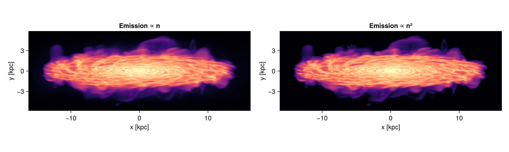
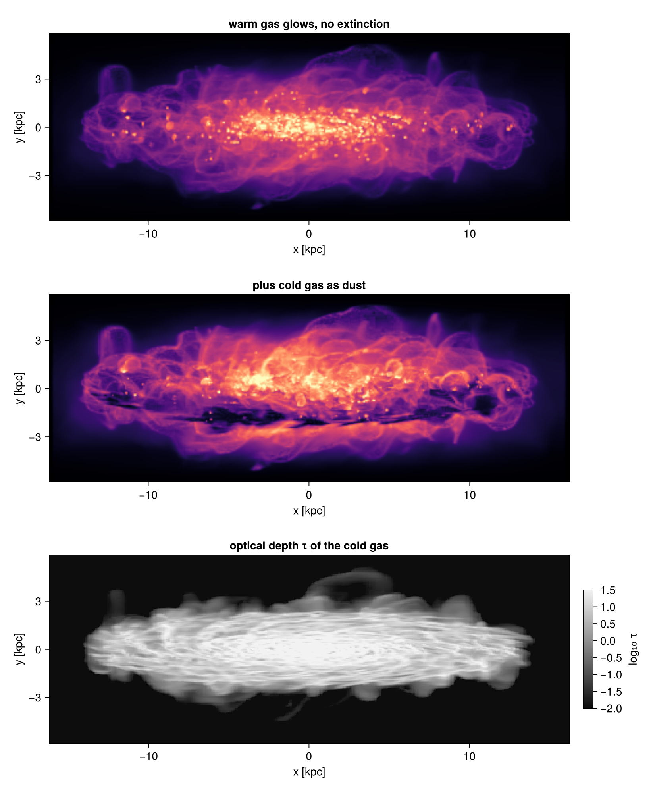
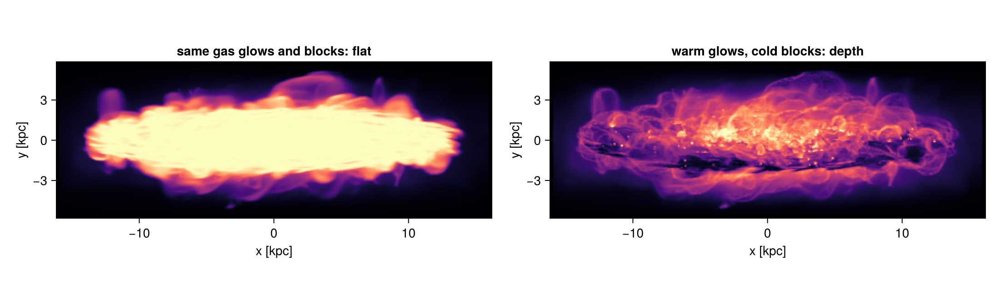
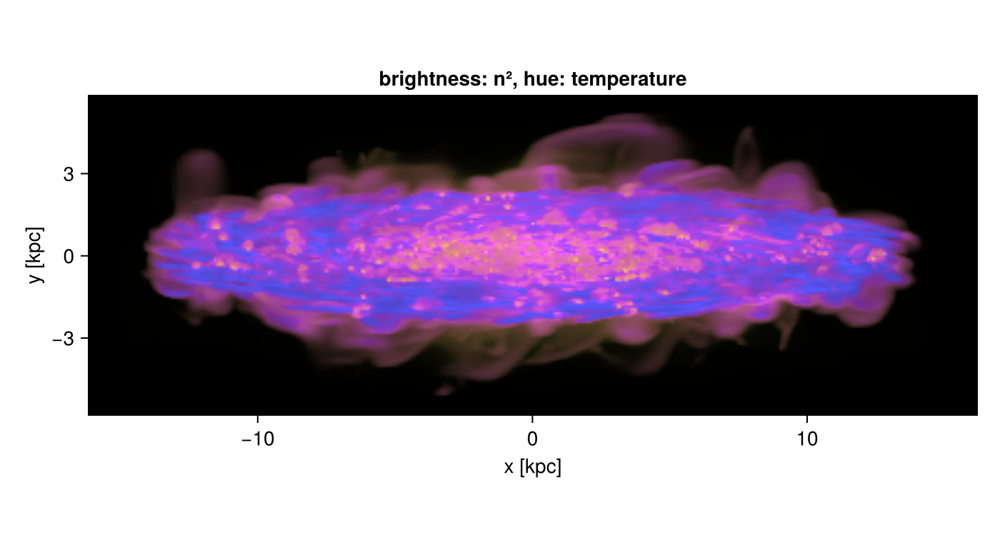
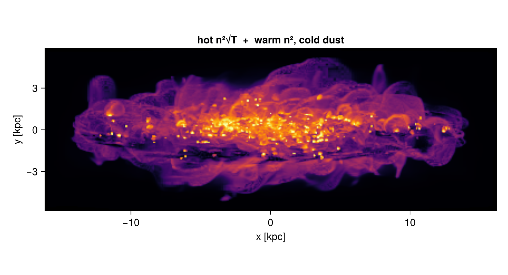
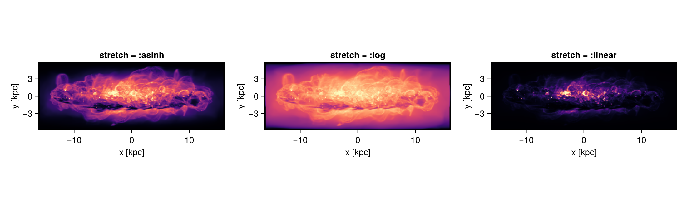
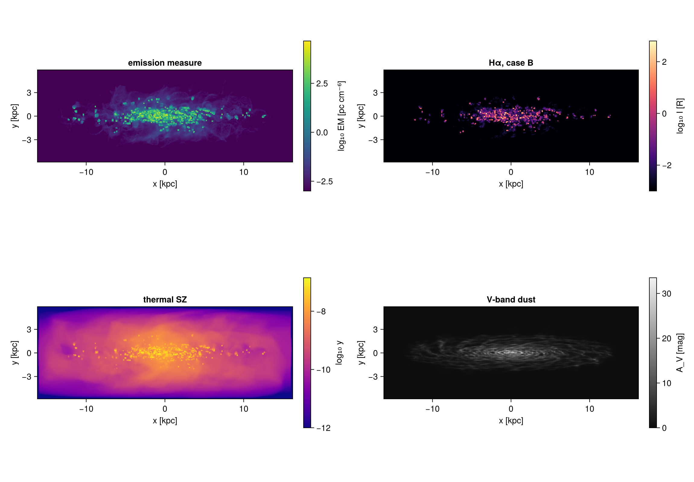

```@raw html
<!-- GENERATED FILE. Do not edit this markdown.
     Source notebook: 16_multi_Transfer_Functions.ipynb
     Regenerate with: MERA_DIR=<repo checkout> ./render_docs.sh
     Any edit here is lost the next time the docs are rendered. -->
```

# Transfer functions: emission and extinction

!!! tip "Run it yourself"
    This page is also an executable **Jupyter notebook**: [open / download `16_multi_Transfer_Functions.ipynb`](https://github.com/ManuelBehrendt/Notebooks/blob/master/Mera-Docs/version_1.1/16_multi_Transfer_Functions.ipynb). The notebooks run end-to-end and double as part of Mera's test suite.


A normal projection adds up a quantity along each line of sight. A **transfer-function projection**
asks two questions about every cell instead:

* **What glows?** An [`Emission`](@ref) gives each cell an emissivity `j`.
* **What blocks light?** An [`Extinction`](@ref) gives each cell an extinction coefficient `α` (per cm).

Mera then follows each line of sight from the back of the volume to the observer. Every cell adds
its own light and dims the light from everything behind it. An AMR cell has one value inside, so
the light leaving a cell of path length `ℓ` is known exactly:

    I_out = I_in · e^(−Δτ)  +  j ℓ · (1 − e^(−Δτ)) / Δτ,        Δτ = α ℓ

There is no step size to choose. Dense gas in front hides and dims what lies behind it, which is
what gives these pictures their depth. The result is a map with numbers, and [`tonemap`](@ref)
turns it into an image.

This page builds it up on one galaxy, one idea per section.

## Setup

Load the gas of one snapshot. The views below all use the galaxy's own spin axis (`axis=:angmom`),
so the same keywords are collected once in `view`.

```julia
# Example-data root. Point this at your own simulation folder, or set the
# MERA_EXAMPLES environment variable; every path below is built from it.
MERA_EXAMPLES = get(ENV, "MERA_EXAMPLES", "/Volumes/FASTStorage/Simulations/Mera-Tests");

using Mera, CairoMakie, Statistics
CairoMakie.activate!()
info = getinfo(300, joinpath(MERA_EXAMPLES, "RAMSES/mw_L10"), verbose=false)
gas  = gethydro(info, verbose=false, show_progress=false)

# One view for the whole page: the disc seen at 80 degrees from its spin axis, a 32 × 32 × 6 kpc
# box around the centre, 80 pc pixels. `verbose=false` keeps the output short.
view = (inclination=80, axis=:angmom, center=[:bc], range_unit=:kpc,
        xrange=[-16, 16], yrange=[-16, 16], zrange=[-3, 3], pxsize=[80, :pc], verbose=false)

# A small helper for the figures: show a tonemapped image with its axes in kpc.
function show_image!(pos, m, img; title="")
    x0, x1, y0, y1 = getextent(m, :kpc)          # map extent in kpc, measured from the view centre
    ax = Axis(pos, title=title, xlabel="x [kpc]", ylabel="y [kpc]", aspect=DataAspect())
    image!(ax, x0..x1, y0..y1, img)              # the image is indexed [ix, iy], like the map
    return ax
end
println("gas cells = ", length(gas.data))
```

```
*__   __ _______ ______   _______
|  |_|  |       |    _ | |   _   |
|       |    ___|   | || |  |_|  |
|       |   |___|   |_||_|       |
|       |    ___|    __  |       |
| ||_|| |   |___|   |  | |   _   |
|_|   |_|_______|___|  |_|__| |__|
Mera v1.8.0 | Julia 1.12.7 | 8 threads
gas cells = 28320979
```

## 1. Emission only: a glowing column

Without extinction nothing blocks light, so the map is simply the sum of `j` along the line of
sight. `Emission(:rho; unit=:nH)` lets every cell glow in proportion to its hydrogen number density.
`power=2` makes `j ∝ n²`: the dense clumps now dominate, because doubling the density quadruples
the light.

```julia
# j = n  and  j = n²; no Extinction, so this is a plain column of the emissivity
m_n  = projection(gas, Emission(:rho; unit=:nH); view...)
m_n2 = projection(gas, Emission(:rho; unit=:nH, power=2); view...)
println(m_n)          # a short summary: size and what was integrated
println("I is in cm⁻³ · cm for j = n, and in cm⁻⁶ · cm for j = n²")

fig = Figure(size=(1100, 330))
show_image!(fig[1, 1], m_n,  tonemap(m_n;  colormap=:magma); title="Emission ∝ n")
show_image!(fig[1, 2], m_n2, tonemap(m_n2; colormap=:magma); title="Emission ∝ n²")
fig
```

```
[Mera] Hint: getvar(:lx) has no `vcenter` — velocities are in the BOX frame.
             Pass vcenter=:auto for an object with bulk motion (`center=` sets the origin,
             `vcenter=` the frame). On a halo streaming at ~200 km/s this shifted |J| by 34 %.
             (shown once per session; verbose(false) silences Mera's messages)
TransferMapType: 405 × 146 pixels, emission only
I is in cm⁻³ · cm for j = n, and in cm⁻⁶ · cm for j = n²
```



## 2. Adding extinction: dust lanes

Now let the **warm** gas glow and the **cold** gas block light. This is a picture, not an
observable: real recombination light goes as `n²`, and warm gas here includes million-degree
coronal gas that emits no visible light. Section 9 gives recipes with real units.

`when` selects which cells take part; it takes the same conditions as [`filterdata`](@ref).
`tau1_at=[5, :Msol_pc2]` says a column of 5 M⊙/pc² of cold gas has an optical depth of 1. That is
about 4.6 times stronger than V-band dust, so it stands for far-ultraviolet extinction. Putting
dust only in gas below 10⁴ K is also a choice: dust survives in warm ionised gas and is destroyed
by sputtering only above about 10⁶ K.

The lower panel shows the optical depth `τ`. For the fraction of a smooth background that gets
through a pixel use `exp.(-m.tau_eff)`, which averages the transmission instead of the optical
depth.

```julia
glow = Emission(:rho; unit=:nH, when=Above(:T, 1e4; unit=:K))                  # warm gas glows
dust = Extinction(:rho; tau1_at=[5, :Msol_pc2], when=Below(:T, 1e4; unit=:K))  # cold gas blocks

m_glow = projection(gas, glow; view...)               # the same light, nothing in the way
m_dust = projection(gas, glow, dust; view...)         # with the cold gas in front
println(m_dust)

fig = Figure(size=(820, 1000))
show_image!(fig[1, 1], m_glow, tonemap(m_glow; colormap=:magma); title="warm gas glows, no extinction")
show_image!(fig[2, 1], m_dust, tonemap(m_dust; colormap=:magma); title="plus cold gas as dust")
x0, x1, y0, y1 = getextent(m_dust, :kpc)
ax = Axis(fig[3, 1], title="optical depth τ of the cold gas", xlabel="x [kpc]", ylabel="y [kpc]", aspect=DataAspect())
logtau = log10.(max.(m_dust.tau, 1e-3))              # a floor keeps empty pixels finite on a log scale
hm = heatmap!(ax, x0..x1, y0..y1, logtau, colormap=:grays, colorrange=(-2, 1.5))
Colorbar(fig[3, 2], hm, label="log₁₀ τ", height=Relative(0.6))
fig
```

```
TransferMapType: 405 × 146 pixels, emission + extinction, supersample 2, median τ = 3.01
```



## 3. Depth needs emission and extinction that differ

If every cell glows and blocks in the **same proportion**, `j/α` is the same everywhere. A thick
region can then only approach that one ratio, and the picture turns into a flat, compressed column
density: there is nothing in front of anything. Structure in front of structure appears only when
`j` and `α` come from different gas, or grow differently with density.

The numbers below show it. With `j ∝ n` and `α ∝ n` from all gas, the thick disc becomes one bright
band.

```julia
same = projection(gas, Emission(:rho; unit=:nH), Extinction(:rho; tau1_at=[5, :Msol_pc2]); view...)
lit  = m_n.I .> 0
kept = same.I[lit] ./ m_n.I[lit]                     # fraction of the light that survives
println("j ∝ n, α ∝ n:  light kept, 5th / 50th percentile = ", round.(quantile(kept, [0.05, 0.5]), digits=3))

fig = Figure(size=(1100, 330))
show_image!(fig[1, 1], same,   tonemap(same;   colormap=:magma); title="same gas glows and blocks: flat")
show_image!(fig[1, 2], m_dust, tonemap(m_dust; colormap=:magma); title="warm glows, cold blocks: depth")
fig
```

```
j ∝ n, α ∝ n:  light kept, 5th / 50th percentile = [0.046, 0.995]
```



## 4. Physical strength, or a strength for pictures

`Extinction` needs exactly one way to set how strong it is:

| keyword | meaning |
|:--|:--|
| `kappa=[209, :cm2_g]` | opacity per gram of gas; Milky Way diffuse dust in the V band |
| `tau1_at=[23, :Msol_pc2]` | τ = 1 at this column; the same dust written as a column |
| `sigma=[σ, :cm2]` with `unit=:nH` | a cross section per particle |
| `median_tau=1` | picked from the data so the median τ of the map is 1 |
| `alpha_scale=a` | a fixed factor, `α = a · q^power` per cm |

The first three are physics. `κ_V ≈ 209 cm²` per gram of gas comes from `C_ext = 4.89e-22 cm²`
per hydrogen atom for R_V = 3.1 dust (Draine 2003, ARA&A 41, 241, Table 4) with 1.4 m_H of gas
per H. Measurements span about 140 to 210 cm²/g, so treat it as good to some tens of percent.
Optical depth becomes magnitudes as `A = 1.086 τ`.

`median_tau` is for pictures, and it depends on the view, so it changes from frame to frame of a
movie. Every map records the strength it used in `alpha_scale`; pass that back to keep it fixed.
Extinction-only maps need no ordering and are quick.

Dust follows metals and dies in hot gas. Both are one line with the function form of
`Extinction`, which takes quantities like `Emission` does:

```julia
Extinction((ρ, Z) -> ρ * Z, :rho => :g_cm3, :metallicity => :Zsun;   # dust ∝ Z
           kappa=[209, :cm2_g], when=Below(:T, 1e6; unit=:K))        # sputtered above ~10⁶ K
```

```julia
cold = Below(:T, 1e4; unit=:K)
a = projection(gas, Extinction(:rho; kappa=[209, :cm2_g], when=cold); view...)
b = projection(gas, Extinction(:rho; tau1_at=[23, :Msol_pc2], when=cold); view...)
c = projection(gas, Extinction(:rho; median_tau=1, when=cold); view...)
d = projection(gas, Extinction(:rho; alpha_scale=c.alpha_scale, when=cold); view...)   # frozen

medtau(m) = round(median(filter(>(0), vec(m.tau))), sigdigits=3)
println("kappa = 209 cm²/g     : median τ = ", medtau(a))
println("tau1_at = 23 Msol/pc² : median τ = ", medtau(b))
println("median_tau = 1        : median τ = ", medtau(c), ",  alpha_scale = ", round(c.alpha_scale, sigdigits=4))
println("alpha_scale frozen    : the same map as median_tau? ", d.tau ≈ c.tau)
```

```
kappa = 209 cm²/g     : median τ = 0.674
tau1_at = 23 Msol/pc² : median τ = 0.671
median_tau = 1        : median τ = 1.0,  alpha_scale = 2.1000000000000002e-20
alpha_scale frozen    : the same map as median_tau? true
```

## 5. Colour from a second quantity

`color = :T => :K` records, for every pixel, the average temperature along the line of sight,
weighted by the light that reaches you. With `j ∝ n²` that is an emission-measure-weighted
temperature, dimmed by dust: it is what the glowing gas looks like, not a spectroscopic
temperature. [`tonemap`](@ref) turns it into hue while the emission sets the brightness, and
`saturation` sets how strong the hue is. With `:plasma`, dark blue is cold and yellow is hot.

Keep in mind that Mera's `:T` assumes one mean molecular weight, μ = 1/X ≈ 1.32. In ionised gas
the true temperature is about 2.2 times lower. Section 9 shows how to work around it.

```julia
glow_T = Emission(:rho; unit=:nH, power=2, color=:T => :K)
m_col  = projection(gas, glow_T, dust; view...)
println("temperature of the visible gas, 2nd to 98th percentile: ",
        round.(quantile(filter(isfinite, vec(m_col.color)), [0.02, 0.98]), sigdigits=2), " K")

fig = Figure(size=(700, 380))
show_image!(fig[1, 1], m_col, tonemap(m_col; colormap=:plasma); title="brightness: n², hue: temperature")
fig
```

```
temperature of the visible gas, 2nd to 98th percentile: [47.0, 2.0e6] K
```



## 6. Your own emission function

Any Julia function works. Name each quantity it needs with its unit, in the order of the
function's arguments. Emissions also add up. Here hot gas follows the shape of thermal free-free
emission, `j ∝ n² √T`, plus the warm gas with its own weight.

Two honest caveats: free-free is the right shape only where it dominates, above about 10⁷ K at
solar metallicity, since line emission dominates below that (Sutherland & Dopita 1993, ApJS 88,
253). And the weights below mix two quantities that have different units, which makes this a
picture rather than a measurement.

```julia
# bremsstrahlung shape for the hot gas (the constant in front does not change the picture)
bremss = Emission((n, T) -> n^2 * sqrt(T), :rho => :nH, :T => :K; when=Above(:T, 1e6; unit=:K))
warm   = Emission(:rho; unit=:nH, power=2, when=InRange(:T, 1e4, 1e6; unit=:K))
mix    = bremss + 1e3 * warm                        # the weights are yours to choose
m_mix  = projection(gas, mix, dust; view...)

fig = Figure(size=(700, 380))
show_image!(fig[1, 1], m_mix, tonemap(m_mix; colormap=:inferno); title="hot n²√T  +  warm n², cold dust")
fig
```



## 7. Pixels and supersampling

A pixel stores one optical depth. When a pixel covers several cells, a thick cell can dim a
neighbour that shares the pixel but not a single ray. The error shrinks when pixels are no larger
than the cells. With both emission and extinction, `supersample=:auto` therefore computes each pixel
on a finer grid and averages it (here 2 × 2, because the finest cells are 47 pc and the pixels
80 pc). It costs about `k²` more work. `supersample=1` switches it off.

```julia
t_auto = @elapsed m_auto = projection(gas, glow, dust; view...)
t_one  = @elapsed m_one  = projection(gas, glow, dust; view..., supersample=1)
lit    = m_auto.I .> 0
change = abs.(m_one.I[lit] .- m_auto.I[lit]) ./ m_auto.I[lit]
println("supersample = ", m_auto.supersample, ": ", round(t_auto, digits=1), " s;  off: ", round(t_one, digits=1), " s")
println("pixels that change by more than 10 %: ", round(100 * count(>(0.1), change) / length(change), digits=2), " %")
```

```
supersample = 2: 12.9 s;  off: 7.7 s
pixels that change by more than 10 %: 3.22 %
```

## 8. Tone mapping and saving

The map keeps physical numbers; [`tonemap`](@ref) only decides how they look.

* `stretch`: `:asinh` (default) shows faint and bright structure together; `:log` and `:linear` are
  the other choices
* `percentiles`: which percentiles of the lit pixels become black and full brightness
* `colormap`, `saturation` (for a colour quantity), `gamma`

To write a picture file, turn the image so that row 1 is the top: `save("galaxy.png", rotl90(img))`.

```julia
fig = Figure(size=(1100, 330))
for (k, s) in enumerate((:asinh, :log, :linear))
    show_image!(fig[1, k], m_dust, tonemap(m_dust; stretch=s, colormap=:magma); title="stretch = :$s")
end
fig
```



## 9. Recipes with real units

The pictures above are illustrations. The same two blocks also make quantities with units, as
long as you put the physics into `j` yourself. Two rules carry most of it:

* `m.I` is `∫ j dl` with `dl` in **cm**. For a surface brightness per steradian, divide an
  emissivity that was summed over all directions by `4π`.
* Mera's `:T` assumes μ = 1/X ≈ 1.32. Use `unit=:K_mu`, which returns `T/μ`, and multiply by the
  μ you want (about 0.59 for ionised gas). Without a radiative-transfer run, temperature is the
  only guide to what is ionised.

The maps below are: the dispersion measure of free electrons, the emission measure, the Hα
surface brightness in Rayleigh (case B recombination), the thermal Sunyaev-Zel'dovich `y`, and a
V-band extinction map in magnitudes.

One caveat decides how much these mean. Without a radiative-transfer run, gas counts as ionised
only when it is hot enough to ionise itself. Real Hα comes mostly from gas photoionised by stars
at about 8000 K, which this test fails, so the Hα map below shows only collisionally ionised gas
and misses most HII regions. With a RAMSES-RT run, use the ionisation fractions instead
(`:n_e`, `:n_HII`) and `:T_rt`, which carries the local mean molecular weight of each cell.

```julia
c   = gas.info.constants                  # cgs constants
X, Y = 0.76, 0.24                          # RAMSES mass fractions
ne_nH  = 1 + 2 * (Y / (4X))                # 1.158 electrons per H, H and He fully ionised
mu_ion = 1 / (2X + 3Y/4)                   # 0.588 for ionised gas
Pe_P   = mu_ion * (X + Y/2)                # 0.518: the electron share of the pressure
ionised = Above(:T, 2e4 / mu_ion; unit=:K_mu)    # true T above 2e4 K

# dispersion measure: DM = ∫ n_e dl  [pc cm⁻³]
dm = projection(gas, Emission(:rho; unit=:nH, strength=ne_nH/c.pc, when=ionised); view...)

# emission measure: EM = ∫ n_e n_p dl  [pc cm⁻⁶]
em = projection(gas, Emission(:rho; unit=:nH, power=2, strength=ne_nH/c.pc, when=ionised); view...)

# Halpha, case B: 4π j / (n_e n_p) = α_eff(T) hν, here in Rayleigh (Draine 2011, eq. 14.8)
function halpha_R(nH, T_over_mu)
    T4 = clamp(mu_ion * T_over_mu / 1e4, 0.1, 3.0)          # the fit is valid here
    return ne_nH * nH^2 * 1.17e-13 * T4^(-0.942 - 0.031*log(T4)) / 1e6
end
ha = projection(gas, Emission(halpha_R, :rho => :nH, :T => :K_mu;
                when = ionised & Below(:T, 5e4 / mu_ion; unit=:K_mu)); view...)

# thermal SZ: y = (σ_T / m_e c²) ∫ P_e dl
ysz = projection(gas, Emission(:p; unit=:Ba, strength = Pe_P * c.sigma_T / (c.me * c.c^2),
                 when=ionised); view...)

# V-band extinction of Milky Way dust, destroyed above ~1e6 K; A = 1.086 τ
av = projection(gas, Extinction(:rho; kappa=[209, :cm2_g], when=Below(:T, 1e6; unit=:K)); view...)

println("DM  [pc cm⁻³]     max = ", round(maximum(dm.I), sigdigits=3))
println("EM  [pc cm⁻⁶]     max = ", round(maximum(em.I), sigdigits=3))
println("Hα  [R]           max = ", round(maximum(ha.I), sigdigits=3))
println("y                 max = ", round(maximum(ysz.I), sigdigits=3))
println("A_V [mag]         max = ", round(1.086 * maximum(av.tau), sigdigits=3))

# a physical cross-check: on the same gas, I[R] ≈ 0.36 EM T₄^-0.92 (Haffner et al. 2003)
warm = ionised & Below(:T, 5e4 / mu_ion; unit=:K_mu)
em_w = projection(gas, Emission(:rho; unit=:nH, power=2, strength=ne_nH/c.pc, when=warm); view...)
ok   = em_w.I .> 1
ratio = median(ha.I[ok] ./ (0.36 .* em_w.I[ok]))
println("\nHα / (0.36 EM) on the same gas: ", round(ratio, digits=2),
        "   (T₄^-0.92, so ≈1 at 8000 K and ≈0.3 at 3e4 K)")
```

```
DM  [pc cm⁻³]     max = 1330.0
EM  [pc cm⁻⁶]     max = 46100.0
Hα  [R]           max = 633.0
y                 max = 1.4e-7
A_V [mag]         max = 33.5
Hα / (0.36 EM) on the same gas: 0.34   (T₄^-0.92, so ≈1 at 8000 K and ≈0.3 at 3e4 K)
```

```julia
# physical maps get a colorbar, not a tone mapping
function physmap!(pos, m, data; title="", label="", colormap=:viridis)
    x0, x1, y0, y1 = getextent(m, :kpc)
    ax = Axis(pos[1, 1], title=title, xlabel="x [kpc]", ylabel="y [kpc]", aspect=DataAspect())
    hm = heatmap!(ax, x0..x1, y0..y1, data, colormap=colormap)
    Colorbar(pos[1, 2], hm, label=label, height=Relative(0.8))
    return ax
end
lg(A, floor) = log10.(max.(A, floor))       # a floor keeps empty pixels finite

fig = Figure(size=(1150, 800))
physmap!(fig[1, 1], em,  lg(em.I, 1e-3),        title="emission measure", label="log₁₀ EM [pc cm⁻⁶]")
physmap!(fig[1, 2], ha,  lg(ha.I, 1e-3),        title="Hα, case B",       label="log₁₀ I [R]", colormap=:magma)
physmap!(fig[2, 1], ysz, lg(ysz.I, 1e-12),      title="thermal SZ",       label="log₁₀ y", colormap=:plasma)
physmap!(fig[2, 2], av,  1.086 .* av.tau,       title="V-band dust",      label="A_V [mag]", colormap=:grays)
fig
```



## Limits and where to go next

* Only gas cells emit and absorb. Stars are particles and do not glow here yet.
* Light scattered **into** the line of sight is not modelled. Extinction removes light that is
  absorbed and light that is scattered away, which is exact for a source behind a screen and
  makes light from inside dusty gas somewhat too dark. Dust scatters about two thirds of the
  V-band light it removes (Draine 2003).
* The camera is orthographic: all rays are parallel, which is what makes the front-to-back order
  exact.
* The cost grows with the number of cells that glow or block, and with `supersample²`.
* Views and framing work as for [off-axis projections](06_offaxis_Projection.md): `direction`,
  `inclination`/`azimuth`/`axis`, `position_angle`, `xrange`/`yrange`/`zrange`.

API: [`Emission`](@ref), [`Extinction`](@ref), [`TransferMapType`](@ref), [`tonemap`](@ref),
[`projection`](@ref).

**References.** The per-cell solution is the formal solution of radiative transfer for a constant
source function (Rybicki & Lightman 1979, eq. 1.30), the form used in volume rendering by Max
(1995, IEEE TVCG 1, 99). Dust values: Draine (2003, ARA&A 41, 241); Bohlin, Savage & Drake (1978,
ApJ 224, 132); the metallicity scaling in Rémy-Ruyer et al. (2014, A&A 563, A31); sputtering in
hot gas in Draine & Salpeter (1979, ApJ 231, 77) and Tsai & Mathews (1995, ApJ 448, 84). Hα case B
follows Draine (2011, *Physics of the Interstellar and Intergalactic Medium*, eq. 14.8), with the
Rayleigh convention of Haffner et al. (2003, ApJS 149, 405). The thermal SZ effect is Sunyaev &
Zel'dovich (1972); see Carlstrom, Holder & Reese (2002, ARA&A 40, 643). The asinh stretch follows
Lupton et al. (2004, PASP 116, 133).
