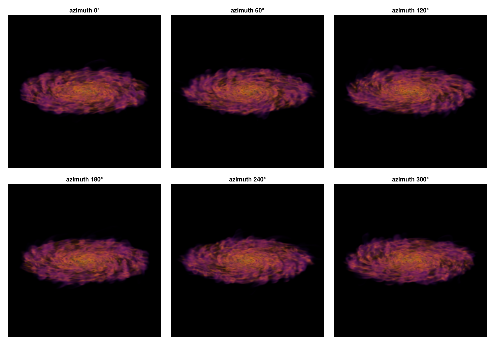

```@raw html
<!-- GENERATED FILE. Do not edit this markdown.
     Source notebook: 17_multi_Volume_Rendering.ipynb
     Regenerate with: MERA_DIR=<repo checkout> ./render_docs.sh
     Any edit here is lost the next time the docs are rendered. -->
```

# Volume rendering: pictures of any quantity

!!! tip "Run it yourself"
    This page is also an executable **Jupyter notebook**: [open / download `17_multi_Volume_Rendering.ipynb`](https://github.com/ManuelBehrendt/Notebooks/blob/master/Mera-Docs/version_1.1/17_multi_Volume_Rendering.ipynb). The notebooks run end-to-end and double as part of Mera's test suite.


A projection adds a quantity up along the line of sight. **Volume rendering** instead gives every
cell a **colour** and an **opacity** from its value, and lets the gas in front cover the gas
behind it:

    α = 1 − e^(−σ(v) ℓ),      colour += (what is still visible) · α · colour(v)

`ℓ` is the path through the cell, so opacity is set **per unit length**: `tau_unit_length=[300, :pc]`
means the most opaque gas reaches optical depth 1 over 300 pc. Because of that the picture stays
the same when you change the pixel size or zoom in, which is not true of a renderer that uses a
fixed opacity per step.

This is a tool for **illustrations**: the colours and the opacity are choices, not measurements.
For maps with physical units use [`projection`](@ref).

Three functions:

| function | what it does |
|:--|:--|
| [`volumerender`](@ref) | one picture |
| [`volumeorbit`](@ref) | turn around the object, one look for every frame |
| [`volumepath`](@ref) | move the camera between keyframes: angles, centre and zoom |

## Setup

One galaxy, and a view used by most of the page.

```julia
# Example-data root. Point this at your own simulation folder, or set the
# MERA_EXAMPLES environment variable; every path below is built from it.
MERA_EXAMPLES = get(ENV, "MERA_EXAMPLES", "/Volumes/FASTStorage/Simulations/Mera-Tests");

using Mera, CairoMakie
CairoMakie.activate!()
info = getinfo(300, joinpath(MERA_EXAMPLES, "RAMSES/mw_L10"), verbose=false)
gas  = gethydro(info, verbose=false, show_progress=false)

# a 32 × 32 × 12 kpc box around the centre, seen at 70 degrees from the spin axis
view = (inclination=70, axis=:angmom, center=[:bc], range_unit=:kpc,
        xrange=[-16, 16], yrange=[-16, 16], zrange=[-6, 6], pxsize=[120, :pc], verbose=false)

# a small helper: show an image with its axes in kpc
function show_image!(pos, m; title="")
    x0, x1, y0, y1 = getextent(m, :kpc)
    ax = Axis(pos, title=title, xlabel="x [kpc]", ylabel="y [kpc]", aspect=DataAspect())
    image!(ax, x0..x1, y0..y1, m.image)     # the image is indexed [ix, iy], like a map
    return ax
end
println("gas cells = ", length(gas.data))
```

```
*__   __ _______ ______   _______
|  |_|  |       |    _ | |   _   |
|       |    ___|   | || |  |_|  |
|       |   |___|   |_||_|       |
|       |    ___|    __  |       |
| ||_|| |   |___|   |  | |   _   |
|_|   |_|_______|___|  |_|__| |__|
Mera v1.8.0 | Julia 1.12.7 | 8 threads
gas cells = 28320979
```

## 1. The first picture

`volumerender` needs a quantity and, if you want to control it, a colour range and an opacity.
Dense gas is drawn bright and blocks what lies behind it.

```julia
m = volumerender(gas, :rho; unit=:nH, colorrange=(1e-3, 1e2), colormap=:inferno,
                 opacity_gamma=2, tau_unit_length=[300, :pc], view...)
println(m)              # size, quantity, how much of the frame is filled
println(m.look)         # the colours and the opacity, resolved to numbers

fig = Figure(size=(700, 430))
show_image!(fig[1, 1], m; title="density, volume rendered")
fig
```

```
[Mera] Hint: getvar(:lx) has no `vcenter` — velocities are in the BOX frame.
             Pass vcenter=:auto for an object with bulk motion (`center=` sets the origin,
             `vcenter=` the frame). On a halo streaming at ~200 km/s this shifted |J| by 34 %.
             (shown once per session; verbose(false) silences Mera's messages)
VolumeRenderType: 271 × 187 pixels, :rho, filled 19.9 %, supersample 3
VolumeLook(:rho in :nH, log (-3.0, 2.0), :inferno, opacity (0.0, 1.0), τ=1 over 300.0 pc)
```


## 2. Opacity is set per length

`tau_unit_length` says over which length the most opaque gas reaches optical depth 1. A short
length makes the gas solid and you see only its surface; a long one makes it glassy and you look
right through the disc.

Leave it out and Mera picks a strength from the data, so that the median optical depth of the
picture is `tau_target` (1.5 by default). That is the quickest way to a usable first image.

```julia
fig = Figure(size=(1150, 380))
for (k, L) in enumerate((100, 300, 2000))
    mk = volumerender(gas, :rho; unit=:nH, colorrange=(1e-3, 1e2), colormap=:inferno,
                      opacity_gamma=2, tau_unit_length=[L, :pc], view...)
    show_image!(fig[1, k], mk; title="τ = 1 over $L pc")
end
fig
```


Because the opacity is per length, the picture does not depend on how finely you sample it. The
same render at 240 pc and at 60 pc pixels differs in sharpness, not in brightness or depth. A
renderer that uses one opacity per step instead has to be re-tuned every time the resolution
changes.

```julia
fig = Figure(size=(1150, 380))
for (k, px) in enumerate((240, 60))
    mk = volumerender(gas, :rho; unit=:nH, colorrange=(1e-3, 1e2), colormap=:inferno,
                      opacity_gamma=2, tau_unit_length=[300, :pc],
                      Base.structdiff(view, (pxsize=0,))..., pxsize=[px, :pc])
    println("pixels of $px pc: filled ", round(100 * sum(mk.alpha) / length(mk.alpha), digits=1), " %")
    show_image!(fig[1, k], mk; title="$px pc pixels")
end
fig
```

```
pixels of 240 pc: filled 19.4 %
pixels of 60 pc: filled 20.0 %
```


## 3. Colour range, ramp and gamma

Three knobs decide what stands out:

* `colorrange` is the range of values that gets colour. Values below it are transparent when the
  opacity ramp starts at 0, values above it are drawn like the top of the range.
* `opacity=(lo, hi)` are the ends of the opacity ramp across that range.
* `opacity_gamma` bends the ramp. Above 1 the faint gas stays transparent and only the densest
  parts become solid, which is usually what makes a picture readable.

```julia
fig = Figure(size=(1150, 380))
settings = [("wide range, straight ramp", (1e-4, 1e2), 1.0),
            ("wide range, gamma 3",       (1e-4, 1e2), 3.0),
            ("narrow range on the dense gas", (1.0, 1e2), 1.0)]
for (k, (title, cr, g)) in enumerate(settings)
    mk = volumerender(gas, :rho; unit=:nH, colorrange=cr, colormap=:inferno, opacity_gamma=g,
                      tau_unit_length=[300, :pc], view...)
    show_image!(fig[1, k], mk; title=title)
end
fig
```


## 4. Other quantities

Any quantity works, including derived ones. A quantity that fills the whole volume, such as
temperature, easily turns into fog: give it a **long** `tau_unit_length`, a **narrow**
`colorrange` around what you want to see, and `opacity_gamma > 1`, so only the extreme values
become solid.

```julia
fig = Figure(size=(1150, 380))
mt = volumerender(gas, :T; unit=:K, colorrange=(3e5, 1e7), colormap=:plasma, opacity=(0.0, 0.8),
                  opacity_gamma=4, tau_unit_length=[3000, :pc], view...)
show_image!(fig[1, 1], mt; title="temperature: the hot gas only")
mv = volumerender(gas, :v; unit=:km_s, colorrange=(20, 300), colormap=:viridis, opacity_gamma=3,
                  tau_unit_length=[1000, :pc], view...)
show_image!(fig[1, 2], mv; title="speed")
fig
```


Besides the picture, a render carries two maps you can work with: `alpha`, how much of each pixel
is filled, and `value`, the value of the quantity you actually see along that line of sight.

```julia
x0, x1, y0, y1 = getextent(m, :kpc)
fig = Figure(size=(1150, 380))
ax1 = Axis(fig[1, 1], title="alpha: how solid the pixel is", xlabel="x [kpc]", ylabel="y [kpc]", aspect=DataAspect())
hm1 = heatmap!(ax1, x0..x1, y0..y1, m.alpha, colormap=:grays, colorrange=(0, 1))
Colorbar(fig[1, 2], hm1, height=Relative(0.8))
ax2 = Axis(fig[1, 3], title="the density you see", xlabel="x [kpc]", ylabel="y [kpc]", aspect=DataAspect())
hm2 = heatmap!(ax2, x0..x1, y0..y1, log10.(replace(m.value, NaN => 1e-6)), colormap=:inferno, colorrange=(-2, 2))
Colorbar(fig[1, 4], hm2, label="log₁₀ n_H [cm⁻³]", height=Relative(0.8))
fig
```


## 5. Choosing the view

The view keywords are those of the off-axis [`projection`](@ref): `direction` (`:x`, `:y`, `:z`,
`:faceon`, `:edgeon`), or `inclination` and `azimuth` about a reference `axis` (`:angmom` is the
object's own spin axis), plus `position_angle` to roll the picture and `xrange`/`yrange`/`zrange`
to cut the volume.

```julia
look = volumelook(gas, :rho; unit=:nH, colorrange=(1e-3, 1e2), colormap=:inferno,
                  opacity_gamma=2, tau_unit_length=[300, :pc], view...)   # one look for all four
fig = Figure(size=(1000, 760))
for (k, (title, kw)) in enumerate([("face on",      (direction=:faceon,)),
                                   ("edge on",      (direction=:edgeon,)),
                                   ("inclined 45°", (inclination=45, axis=:angmom)),
                                   ("inclined 70°, turned 60°", (inclination=70, azimuth=60, axis=:angmom))])
    mk = volumerender(gas, :rho; look=look, Base.structdiff(view, (inclination=0, axis=:z))..., kw...)
    show_image!(fig[(k-1) ÷ 2 + 1, (k-1) % 2 + 1], mk; title=title)
end
fig
```


## 6. Movies: orbits

`volumeorbit` turns the view around the object. It selects a **sphere** around the centre, so every
frame shares one field of view and the galaxy does not appear to zoom, and it resolves the look
once, so the colours and the opacity do not flicker.

Save the frames as images and turn them into a movie with [`moviefromframes`](@ref):

```julia
frames = volumeorbit(gas, :rho; unit=:nH, angles=0:2:358, inclination=70, fov=16, fov_unit=:kpc,
                     colorrange=(1e-3, 1e2), tau_unit_length=[300, :pc], opacity_gamma=2,
                     pxsize=[120, :pc])
mkpath("frames")
for (k, f) in enumerate(frames)
    save(joinpath("frames", "f" * lpad(k, 4, '0') * ".png"), rotl90(f.image))
end
moviefromframes("frames", "orbit.gif"; fps=25)
```

Six frames of such an orbit:

```julia
orbit = volumeorbit(gas, :rho; unit=:nH, angles=0:60:300, inclination=70, fov=16, fov_unit=:kpc,
                    center=[:bc], pxsize=[150, :pc], colorrange=(1e-3, 1e2), colormap=:inferno,
                    opacity_gamma=2, tau_unit_length=[300, :pc], verbose=false)
println(length(orbit), " frames of ", size(orbit[1].image), " pixels, one look: ",
        all(f -> f.look === orbit[1].look, orbit))

fig = Figure(size=(1150, 800))
for (k, f) in enumerate(orbit)
    ax = Axis(fig[(k-1) ÷ 3 + 1, (k-1) % 3 + 1], title="azimuth $(60*(k-1))°", aspect=DataAspect())
    hidedecorations!(ax)
    image!(ax, f.image)
end
fig
```

```
6 frames of (218, 219) pixels, one look: true
```



## 7. Movies: a camera path

`volumepath` moves the camera between keyframes. Each keyframe can set `inclination`, `azimuth`,
`position_angle`, `fov` (half the width of the picture, so smaller means closer) and `center`, and
anything you leave out keeps its previous value. Angles and centres move in a straight line, the
zoom moves geometrically, and each segment is eased in and out so the motion does not jerk.
Every frame is cropped to exactly `res` pixels, which a movie needs.

```julia
path = volumepath(gas, :rho; unit=:nH, colorrange=(1e-3, 1e2), colormap=:inferno,
                  opacity_gamma=2, tau_unit_length=[300, :pc],
                  keyframes=[(inclination=0,  azimuth=0,   fov=16),    # face on, wide
                             (inclination=80, azimuth=120, fov=16),    # tilt and turn
                             (inclination=80, azimuth=240, fov=5)],    # turn on and move in
                  frames=6, res=280, fov_unit=:kpc, verbose=false)
println("pixel size per frame [pc]: ", round.([f.pixsize * gas.scale.pc for f in path], digits=1))

fig = Figure(size=(1150, 800))
for (k, f) in enumerate(path)
    ax = Axis(fig[(k-1) ÷ 3 + 1, (k-1) % 3 + 1], title="frame $k", aspect=DataAspect())
    hidedecorations!(ax)
    image!(ax, f.image)
end
fig
```

```
pixel size per frame [pc]: [114.0, 114.0, 114.0, 101.1, 53.8, 35.7]
```


## 8. What it is, and what it is not

* **An illustration.** Colour and opacity are choices. Nothing here is a surface brightness or an
  optical depth of a real observation; use [`projection`](@ref) for maps with units.
* **Exact geometry.** Each cell contributes its true path length, and the cells are composited in
  the exact front-to-back order of the AMR grid, so there is no sampling noise and no step size.
* **Orthographic.** The camera looks at the object from outside, with parallel rays. It can circle
  the object, move, and zoom, but it cannot fly through the gas: that needs a perspective camera.
* **Cost.** On this galaxy, 13 million cells and a 270 × 190 frame take a few seconds with 8
  threads. A movie is that per frame, so a 180-frame orbit is a coffee break.
* Keep one [`volumelook`](@ref) for a whole movie, otherwise the colours shift from frame to frame.

API: [`volumerender`](@ref), [`volumelook`](@ref), [`volumeorbit`](@ref), [`volumepath`](@ref),
[`VolumeRenderType`](@ref), [`VolumeLook`](@ref).
