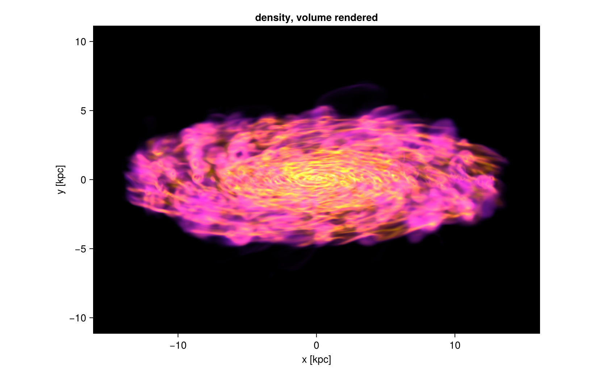
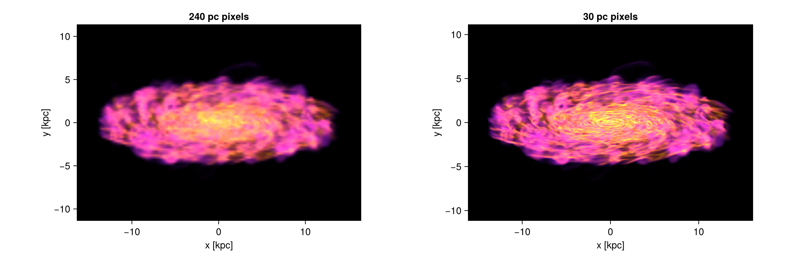
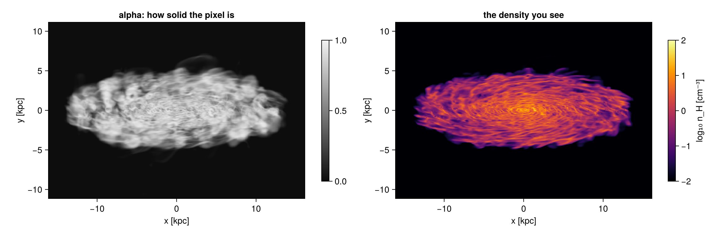
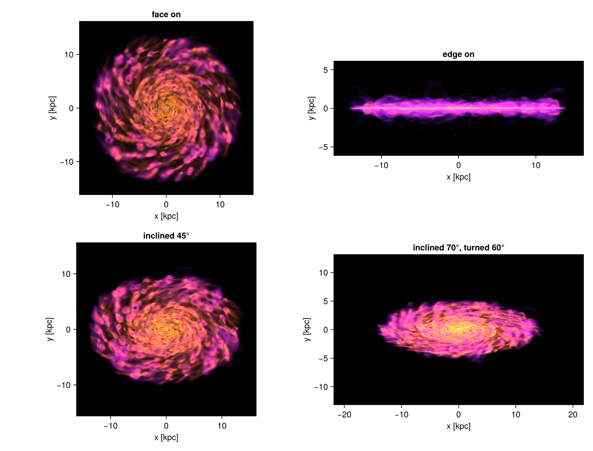
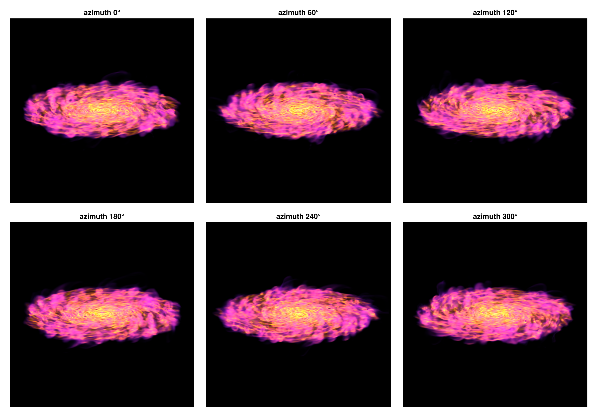
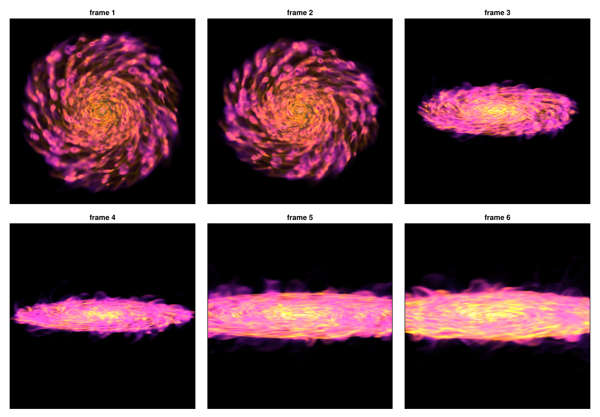
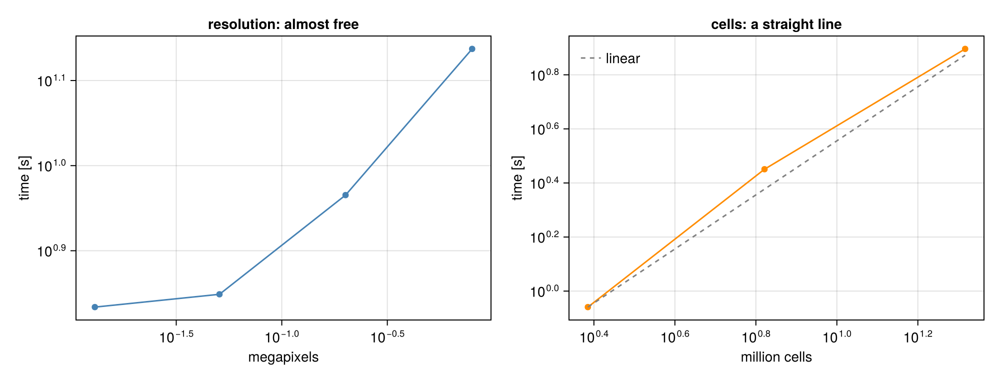

```@raw html
<!-- GENERATED FILE. Do not edit this markdown.
     Source notebook: 17_multi_Volume_Rendering.ipynb
     Regenerate with: MERA_DIR=<repo checkout> ./render_docs.sh
     Any edit here is lost the next time the docs are rendered. -->
```

# Volume rendering: pictures of any quantity

!!! tip "Run it yourself"
    This page is also an executable **Jupyter notebook**: [open / download `17_multi_Volume_Rendering.ipynb`](https://github.com/ManuelBehrendt/Notebooks/blob/master/Mera-Docs/version_1.1/17_multi_Volume_Rendering.ipynb). The notebooks run end-to-end and double as part of Mera's test suite.


A projection adds a quantity up along the line of sight. **Volume rendering** instead gives every
cell a **colour** and an **opacity** from its value, and lets the gas in front cover the gas
behind it:

    α = 1 − e^(−σ(v) ℓ),      colour += (what is still visible) · α · colour(v)

`ℓ` is the path through the cell, so opacity is set **per unit length**: `tau_unit_length=[300, :pc]`
means the most opaque gas reaches optical depth 1 over 300 pc. Because of that the picture stays
the same when you change the pixel size or zoom in, which is not true of a renderer that uses a
fixed opacity per step.

This is a tool for **illustrations**: the colours and the opacity are choices, not measurements.
For maps with physical units use [`projection`](@ref).

| function | what it does |
|:--|:--|
| [`volumerender`](@ref) | one picture |
| [`volumeorbit`](@ref) | turn around the object, one look for every frame |
| [`volumepath`](@ref) | move the camera between keyframes: angles, centre and zoom |
| [`volumelook`](@ref) | resolve colours and opacity once, and reuse them |

All colour maps on this page are colour-blind friendly: `:viridis`, `:cividis`, `:magma`,
`:inferno` and `:plasma`. If you want the reach of a rainbow, use a scientific one such as
`:roma` or `:batlow` (Crameri), which keep an even lightness and stay readable for colour-blind
readers.

## Setup

One galaxy, two views: a detailed one at 30 pc pixels for single pictures, and a coarser one at
60 pc for the panels that compare settings side by side.

```julia
# Example-data root. Point this at your own simulation folder, or set the
# MERA_EXAMPLES environment variable; every path below is built from it.
MERA_EXAMPLES = get(ENV, "MERA_EXAMPLES", "/Volumes/FASTStorage/Simulations/Mera-Tests");

using Mera, CairoMakie
CairoMakie.activate!()
info = getinfo(300, joinpath(MERA_EXAMPLES, "RAMSES/mw_L10"), verbose=false)
gas  = gethydro(info, verbose=false, show_progress=false)

# a 32 × 32 × 12 kpc box, seen at 70 degrees from the spin axis
view  = (inclination=70, axis=:angmom, center=[:bc], range_unit=:kpc,
         xrange=[-16, 16], yrange=[-16, 16], zrange=[-6, 6], pxsize=[30, :pc], verbose=false)
panel = Base.setindex(view, [60, :pc], :pxsize)     # the same view, coarser, for comparison grids

function show_image!(pos, m; title="")
    x0, x1, y0, y1 = getextent(m, :kpc)
    ax = Axis(pos, title=title, xlabel="x [kpc]", ylabel="y [kpc]", aspect=DataAspect())
    image!(ax, x0..x1, y0..y1, m.image)     # the image is indexed [ix, iy], like a map
    return ax
end
println("gas cells = ", length(gas.data), ",  threads = ", Threads.nthreads())
```

```
*__   __ _______ ______   _______
|  |_|  |       |    _ | |   _   |
|       |    ___|   | || |  |_|  |
|       |   |___|   |_||_|       |
|       |    ___|    __  |       |
| ||_|| |   |___|   |  | |   _   |
|_|   |_|_______|___|  |_|__| |__|
Mera v1.8.0 | Julia 1.12.7 | 8 threads
gas cells = 28320979,  threads = 8
```

## 1. The first picture

`volumerender` needs a quantity. Everything else has a default, and the opacity strength is taken
from the data unless you set it.

```julia
t = @elapsed m = volumerender(gas, :rho; unit=:nH, colorrange=(1e-3, 1e2), colormap=:inferno,
                              opacity_gamma=2, tau_unit_length=[300, :pc], exposure=2.5, view...)
println(m, "   (", round(t, digits=1), " s)")
println(m.look)

fig = Figure(size=(820, 520))
show_image!(fig[1, 1], m; title="density, volume rendered")
fig
```

```
VolumeRenderType: 1075 × 742 pixels, :rho, filled 20.1 %   (23.7 s)
VolumeLook(:rho in :nH, log (-3.0, 2.0), :inferno, opacity (0.0, 1.0), exposure 2.5, τ=1 over 300.0 pc)
```



## 2. Every parameter, and what it does

| parameter | what it decides |
|:--|:--|
| `unit` | the unit the quantity is read in, e.g. `:nH` for a density in cm⁻³ |
| `scale` | `:log` (default) or `:linear`: how values are spread across the colour range |
| `colorrange=(lo, hi)` | which values get colour. Below `lo` is transparent (with `opacity` starting at 0), above `hi` looks like `hi`. Without it, `percentiles` of the cell values are used. |
| `colormap` | the colours; `:viridis`, `:cividis`, `:magma`, `:inferno`, `:plasma`, or `:roma`/`:batlow` |
| `opacity=(lo, hi)` | the ends of the opacity ramp across the colour range |
| `opacity_gamma` | bends that ramp; above 1 keeps faint gas transparent so only the densest parts are solid |
| `iso=[…]`, `iso_width`, `iso_alpha` | surfaces at chosen values (section 7) |
| `tau_unit_length=[L, :pc]` | the length over which the most opaque gas reaches optical depth 1 |
| `tau_target` | used instead, when `tau_unit_length` is not given: the median optical depth of the map |
| `exposure` | brightens the finished picture, like a camera exposure |
| `background` | `:black` (default), `:white`, or any colour |
| `supersample` | sub-pixels per side, `:auto` by default |
| view keywords | `direction`, `inclination`, `azimuth`, `axis`, `position_angle`, `center`, `range_unit`, `xrange`/`yrange`/`zrange`, `pxsize` or `res` |

The next sections show what the important ones do to the same galaxy.

## 3. The transfer functions themselves

Two curves decide everything: how a value becomes a **colour**, and how it becomes an **opacity**.
Both live on the colour range. The plot below shows them for the settings used above and for two
variations, so you can see what `opacity`, `opacity_gamma` and `iso` really change.

```julia
# rebuild the opacity curve of a look, so it can be drawn
opacity_curve(l, v) = Mera._look_alpha(l, Mera._look_t(l, v))

vals  = 10 .^ range(-3, 2, length=400)                       # n_H from 1e-3 to 1e2
base  = volumelook(gas, :rho; unit=:nH, colorrange=(1e-3, 1e2), opacity=(0.0, 1.0),
                   tau_unit_length=[300, :pc], panel...)
soft  = volumelook(gas, :rho; unit=:nH, colorrange=(1e-3, 1e2), opacity=(0.0, 1.0),
                   opacity_gamma=3, tau_unit_length=[300, :pc], panel...)
shell = volumelook(gas, :rho; unit=:nH, colorrange=(1e-3, 1e2), opacity=(0.0, 0.0),
                   iso=[0.01, 1.0, 100.0], iso_width=0.15, iso_alpha=0.9,
                   tau_unit_length=[300, :pc], panel...)

fig = Figure(size=(1000, 620))
ax1 = Axis(fig[1, 1], xscale=log10, xlabel="n_H [cm⁻³]", ylabel="opacity of a cell",
           title="the opacity curve")
lines!(ax1, vals, opacity_curve.(Ref(base), vals),  label="ramp 0 → 1", linewidth=2.5)
lines!(ax1, vals, opacity_curve.(Ref(soft), vals),  label="the same, gamma = 3", linewidth=2.5)
lines!(ax1, vals, opacity_curve.(Ref(shell), vals), label="three surfaces", linewidth=2.5)
axislegend(ax1, position=:lt, framevisible=false)

# the colour curve: the colour map across the same range, drawn in "position in the range"
strip = repeat(Mera.RGB{Float64}.(get(Mera.colorschemes[:inferno], range(0, 1, length=256))), 1, 2)
ticks = [1e-3, 1e-2, 1e-1, 1.0, 10.0, 100.0]
ax2 = Axis(fig[2, 1], xlabel="n_H [cm⁻³]", title="the colour map (:inferno)",
           yticksvisible=false, yticklabelsvisible=false,
           xticks=([Mera._look_t(base, v) for v in ticks], ["1e-3", "1e-2", "0.1", "1", "10", "100"]))
image!(ax2, 0..1, 0..1, strip)
rowsize!(fig.layout, 2, Relative(0.22))
fig
```


The opacity curve says how solid a cell of a given value is; `tau_unit_length` then turns that
into a real optical depth over a real length. The colour curve says which colour it gets. Nothing
else is hidden: these two curves plus the length scale are the whole model.

## 4. Opacity is set per length

A short `tau_unit_length` makes the gas solid, so you see its surface; a long one makes it glassy
and you look through the disc.

```julia
fig = Figure(size=(1150, 380))
for (k, L) in enumerate((100, 300, 2000))
    mk = volumerender(gas, :rho; unit=:nH, colorrange=(1e-3, 1e2), colormap=:inferno,
                      opacity_gamma=2, tau_unit_length=[L, :pc], exposure=2.5, panel...)
    show_image!(fig[1, k], mk; title="τ = 1 over $L pc")
end
fig
```


Because opacity is per length, the picture does not depend on how finely you sample it. The same
render at 240 pc and at 30 pc pixels differs in sharpness, not in brightness or depth.

```julia
fig = Figure(size=(1150, 380))
for (k, px) in enumerate((240, 30))
    mk = volumerender(gas, :rho; unit=:nH, colorrange=(1e-3, 1e2), colormap=:inferno,
                      opacity_gamma=2, tau_unit_length=[300, :pc], exposure=2.5,
                      Base.setindex(view, [px, :pc], :pxsize)...)
    println("pixels of $px pc: ", size(mk.image), ", filled ",
            round(100 * sum(mk.alpha) / length(mk.alpha), digits=1), " %")
    show_image!(fig[1, k], mk; title="$px pc pixels")
end
fig
```

```
pixels of 240 pc: (137, 95), filled 19.4 %
pixels of 30 pc: (1075, 742), filled 20.1 %
```



## 5. When a picture comes out too dark

A thin, see-through rendering collects little light, so it looks dark. Four levers help, in this
order:

1. **`exposure`** brightens the finished picture, like a longer exposure on a camera. Colours that
   run past white are clipped, so raise it until the brightest parts are white and no further.
2. **A shorter `tau_unit_length`** makes the gas itself more opaque, so more of it contributes.
3. **A narrower `colorrange`** puts the colours where your gas actually is.
4. **`opacity_gamma` closer to 1**, or a higher low end of `opacity`, lets faint gas take part.

A colour map that is bright at its low end, such as `:viridis` or `:cividis`, also helps: `:inferno`
and `:magma` start at black, which makes thin gas disappear.

```julia
thin = (unit=:nH, colorrange=(1e-3, 1e2), colormap=:inferno, opacity_gamma=3,
        tau_unit_length=[3000, :pc])            # deliberately too transparent
fig = Figure(size=(1150, 760))
show_image!(fig[1, 1], volumerender(gas, :rho; thin..., panel...); title="dark: thin and gamma 3")
show_image!(fig[1, 2], volumerender(gas, :rho; thin..., exposure=6, panel...); title="exposure = 6")
show_image!(fig[2, 1], volumerender(gas, :rho; thin..., tau_unit_length=[300, :pc], panel...);
            title="τ = 1 over 300 pc instead")
show_image!(fig[2, 2], volumerender(gas, :rho; unit=:nH, colorrange=(0.1, 1e2), colormap=:cividis,
                                    opacity_gamma=1.5, tau_unit_length=[300, :pc], panel...);
            title="narrow range, bright colour map")
fig
```


## 6. Colour range, ramp and gamma

The same three knobs, each on its own.

```julia
fig = Figure(size=(1150, 380))
settings = [("wide range, straight ramp", (1e-4, 1e2), 1.0),
            ("wide range, gamma 3",       (1e-4, 1e2), 3.0),
            ("narrow range on the dense gas", (1.0, 1e2), 1.0)]
for (k, (title, cr, g)) in enumerate(settings)
    mk = volumerender(gas, :rho; unit=:nH, colorrange=cr, colormap=:inferno, opacity_gamma=g,
                      tau_unit_length=[300, :pc], exposure=2.5, panel...)
    show_image!(fig[1, k], mk; title=title)
end
fig
```


## 7. Isosurfaces

`iso=[…]` puts a **surface** at each value: only gas near it is opaque, everything else stays
see-through. Values far apart pick out structures of very different size, from the small to the
large. Here the three surfaces are **10⁻³**, **10⁻¹** and **10 cm⁻³**, which on this galaxy pick
out the outer envelope, the shells that fill the disc, and the small dense clumps inside it.

Choose values the data actually has: this galaxy reaches 103 cm⁻³, and a surface at 100 cm⁻³
catches four cells, so it draws nothing.

* `iso_width` is the half width of a shell in **dex**, because the scale is logarithmic. Keep it
  small (0.05) so a shell stays thin and you can see through it.
* `iso_alpha` is how solid the centre of a shell is, one number or **one per shell**. The
  outermost surface covers by far the largest area, so give it the smallest value, here
  `[0.12, 0.3, 0.7]`, otherwise it hides everything inside.
* `opacity=(0, 0)` draws the surfaces alone, and a long `tau_unit_length` with a higher
  `exposure` keeps them translucent and still bright.

```julia
shells  = [1e-3, 1e-1, 1e1]
alphas  = [0.12, 0.3, 0.7]          # the widest surface is the faintest
iso_kw  = (unit=:nH, colorrange=(1e-4, 1e3), colormap=:roma, opacity=(0.0, 0.0),
           iso_width=0.05, tau_unit_length=[500, :pc])
iso_all = volumerender(gas, :rho; iso=shells, iso_alpha=alphas, exposure=10, iso_kw..., view...)
println(iso_all.look)

fig = Figure(size=(1150, 800))
show_image!(fig[1, 1], iso_all; title="10⁻³, 10⁻¹ and 10 cm⁻³ together")
# alone, each surface needs its own exposure: a small surface catches less light
for (k, (v, a, e)) in enumerate(zip(shells, alphas, [8, 10, 28]))
    mk = volumerender(gas, :rho; iso=[v], iso_alpha=a, exposure=e, iso_kw..., panel...)
    show_image!(fig[2, k], mk; title="$(v) cm⁻³ alone")
end
fig
```

```
VolumeLook(:rho in :nH, log (-4.0, 3.0), :roma, opacity (0.0, 0.0), 3 isosurface(s) at [0.001, 0.1, 10.0], exposure 10.0, τ=1 over 500.0 pc)
```


## 8. Other quantities

Any quantity works. One that fills the whole volume, such as temperature, easily turns into fog:
give it a **long** `tau_unit_length`, a **narrow** `colorrange`, and `opacity_gamma > 1`.

```julia
fig = Figure(size=(1150, 380))
mt = volumerender(gas, :T; unit=:K, colorrange=(3e5, 1e7), colormap=:plasma, opacity=(0.0, 0.8),
                  opacity_gamma=4, tau_unit_length=[3000, :pc], exposure=4, panel...)
show_image!(fig[1, 1], mt; title="temperature: the hot gas only")
mv = volumerender(gas, :v; unit=:km_s, colorrange=(20, 300), colormap=:cividis, opacity_gamma=3,
                  tau_unit_length=[1000, :pc], exposure=3, panel...)
show_image!(fig[1, 2], mv; title="speed")
fig
```

```
[Mera] Hint: getvar(:v) has no `vcenter` — velocities are in the BOX frame.
             Pass vcenter=:auto for an object with bulk motion (`center=` sets the origin,
             `vcenter=` the frame).
             (shown once per session; verbose(false) silences Mera's messages)
```


Besides the picture, a render carries two maps: `alpha`, how much of each pixel is filled, and
`value`, the value of the quantity you actually see along that line of sight.

```julia
x0, x1, y0, y1 = getextent(m, :kpc)
fig = Figure(size=(1150, 380))
ax1 = Axis(fig[1, 1], title="alpha: how solid the pixel is", xlabel="x [kpc]", ylabel="y [kpc]", aspect=DataAspect())
hm1 = heatmap!(ax1, x0..x1, y0..y1, m.alpha, colormap=:grays, colorrange=(0, 1))
Colorbar(fig[1, 2], hm1, height=Relative(0.8))
ax2 = Axis(fig[1, 3], title="the density you see", xlabel="x [kpc]", ylabel="y [kpc]", aspect=DataAspect())
hm2 = heatmap!(ax2, x0..x1, y0..y1, log10.(replace(m.value, NaN => 1e-6)), colormap=:inferno, colorrange=(-2, 2))
Colorbar(fig[1, 4], hm2, label="log₁₀ n_H [cm⁻³]", height=Relative(0.8))
fig
```



## 9. Choosing the view

The view keywords are those of the off-axis [`projection`](@ref): `direction` (`:x`, `:y`, `:z`,
`:faceon`, `:edgeon`), or `inclination` and `azimuth` about a reference `axis` (`:angmom` is the
object's own spin axis), plus `position_angle` to roll the picture and `xrange`/`yrange`/`zrange`
to cut the volume.

```julia
look = volumelook(gas, :rho; unit=:nH, colorrange=(1e-3, 1e2), colormap=:inferno,
                  opacity_gamma=2, tau_unit_length=[300, :pc], exposure=2.5, panel...)  # one look for all four
fig = Figure(size=(1000, 760))
for (k, (title, kw)) in enumerate([("face on",      (direction=:faceon,)),
                                   ("edge on",      (direction=:edgeon,)),
                                   ("inclined 45°", (inclination=45, axis=:angmom)),
                                   ("inclined 70°, turned 60°", (inclination=70, azimuth=60, axis=:angmom))])
    mk = volumerender(gas, :rho; look=look, Base.structdiff(panel, (inclination=0, axis=:z))..., kw...)
    show_image!(fig[(k-1) ÷ 2 + 1, (k-1) % 2 + 1], mk; title=title)
end
fig
```



## 10. Movies: orbits

`volumeorbit` turns the view around the object. It selects a **sphere** around the centre, so every
frame shares one field of view and the galaxy does not appear to zoom, and it resolves the look
once, so the colours and the opacity do not flicker.

```julia
frames = volumeorbit(gas, :rho; unit=:nH, angles=0:2:358, inclination=70, fov=16, fov_unit=:kpc,
                     colorrange=(1e-3, 1e2), tau_unit_length=[300, :pc], opacity_gamma=2,
                     pxsize=[60, :pc])
mkpath("frames")
for (k, f) in enumerate(frames)
    save(joinpath("frames", "f" * lpad(k, 4, '0') * ".png"), rotl90(f.image))
end
moviefromframes("frames", "orbit.gif"; fps=25)
```

```julia
orbit = volumeorbit(gas, :rho; unit=:nH, angles=0:60:300, inclination=70, fov=16, fov_unit=:kpc,
                    center=[:bc], pxsize=[60, :pc], colorrange=(1e-3, 1e2), colormap=:inferno,
                    opacity_gamma=2, tau_unit_length=[300, :pc], exposure=2.5, verbose=false)
println(length(orbit), " frames of ", size(orbit[1].image), " pixels, one look: ",
        all(f -> f.look === orbit[1].look, orbit))

fig = Figure(size=(1150, 800))
for (k, f) in enumerate(orbit)
    ax = Axis(fig[(k-1) ÷ 3 + 1, (k-1) % 3 + 1], title="azimuth $(60*(k-1))°", aspect=DataAspect())
    hidedecorations!(ax)
    image!(ax, f.image)
end
fig
```

```
6 frames of (540, 543) pixels, one look: true
```



## 11. Movies: a camera path

`volumepath` moves the camera between keyframes. Each keyframe can set `inclination`, `azimuth`,
`position_angle`, `fov` (half the width of the picture, so smaller means closer) and `center`;
anything left out keeps its previous value. Angles and centres move in a straight line, the zoom
moves geometrically, and each segment is eased in and out. Every frame is cropped to exactly `res`
pixels, which a movie needs.

```julia
path = volumepath(gas, :rho; unit=:nH, colorrange=(1e-3, 1e2), colormap=:inferno,
                  opacity_gamma=2, tau_unit_length=[300, :pc], exposure=2.5,
                  keyframes=[(inclination=0,  azimuth=0,   fov=16),    # face on, wide
                             (inclination=80, azimuth=120, fov=16),    # tilt and turn
                             (inclination=80, azimuth=240, fov=5)],    # turn on and move in
                  frames=6, res=440, fov_unit=:kpc, verbose=false)
println("pixel size per frame [pc]: ", round.([f.pixsize * gas.scale.pc for f in path], digits=1))

fig = Figure(size=(1150, 800))
for (k, f) in enumerate(path)
    ax = Axis(fig[(k-1) ÷ 3 + 1, (k-1) % 3 + 1], title="frame $k", aspect=DataAspect())
    hidedecorations!(ax)
    image!(ax, f.image)
end
fig
```

```
pixel size per frame [pc]: [72.6, 72.6, 72.6, 64.4, 34.2, 22.7]
```



## 12. How the cost scales

Two numbers decide how long a render takes, and they behave very differently.

* **The number of cells sets the cost**, in a straight line: twice the cells, twice the time. Cut
  the volume with `xrange`/`yrange`/`zrange` or a [`subregion`](@ref) and it gets faster in
  proportion.
* **Pixels are nearly free.** Most cells are smaller than a pixel, and such a cell costs the same
  whatever the resolution is. A finer picture is cheap; a bigger volume is not.

`supersample` adds a modest amount per level, not the square of it, for the same reason.

```julia
look_s = volumelook(gas, :rho; unit=:nH, colorrange=(1e-3, 1e2), opacity_gamma=2,
                    tau_unit_length=[300, :pc], panel...)
pix = Float64[]; tpix = Float64[]
for px in (240, 120, 60, 30)
    volumerender(gas, :rho; look=look_s, Base.setindex(view, [px, :pc], :pxsize)..., supersample=1)
    t = @elapsed mk = volumerender(gas, :rho; look=look_s,
                                   Base.setindex(view, [px, :pc], :pxsize)..., supersample=1)
    push!(pix, prod(size(mk.image)) / 1e6); push!(tpix, t)
    println("pixel size $px pc: ", size(mk.image), "  ", round(t, digits=2), " s")
end

ncell = Float64[]; tcell = Float64[]
for radius in (4, 8, 16)
    sub = subregion(gas, :sphere, radius=radius, center=[:bc], range_unit=:kpc, verbose=false)
    lk = volumelook(sub, :rho; unit=:nH, colorrange=(1e-3, 1e2), opacity_gamma=2,
                    tau_unit_length=[300, :pc], panel...)
    volumerender(sub, :rho; look=lk, panel..., supersample=1)
    t = @elapsed volumerender(sub, :rho; look=lk, panel..., supersample=1)
    push!(ncell, length(sub.data) / 1e6); push!(tcell, t)
    println("sphere of $radius kpc: ", length(sub.data), " cells  ", round(t, digits=2), " s")
end

slope(x, y) = (log(y[end]) - log(y[1])) / (log(x[end]) - log(x[1]))
println("\ntime ~ pixels^", round(slope(pix, tpix), digits=2),
        "   and   time ~ cells^", round(slope(ncell, tcell), digits=2))

fig = Figure(size=(1000, 380))
ax1 = Axis(fig[1, 1], xscale=log10, yscale=log10, xlabel="megapixels", ylabel="time [s]",
           title="resolution: almost free")
scatterlines!(ax1, pix, tpix, color=:steelblue)
ax2 = Axis(fig[1, 2], xscale=log10, yscale=log10, xlabel="million cells", ylabel="time [s]",
           title="cells: a straight line")
scatterlines!(ax2, ncell, tcell, color=:darkorange)
lines!(ax2, ncell, tcell[1] .* ncell ./ ncell[1], color=:gray, linestyle=:dash, label="linear")
axislegend(ax2, position=:lt, framevisible=false)
fig
```

```
pixel size 240 pc: (137, 95)  6.82 s
pixel size 120 pc: (271, 187)  7.06 s
pixel size 60 pc: (539, 372)  9.23 s
pixel size 30 pc: (1075, 742)  13.71 s
sphere of 4 kpc: 2427002 cells  0.87 s
sphere of 8 kpc: 6626805 cells  2.82 s
sphere of 16 kpc: 20737653 cells  7.87 s
time ~ pixels^0.17   and   time ~ cells^1.02
```



## 13. What it is, and what it is not

* **An illustration.** Colour and opacity are choices. Nothing here is a surface brightness or an
  optical depth of a real observation; use [`projection`](@ref) for maps with units.
* **Exact geometry.** Each cell contributes its true path length, and the cells are composited in
  the exact front-to-back order of the AMR grid, so there is no sampling noise and no step size.
* **Orthographic.** The camera looks at the object from outside, with parallel rays. It can circle
  the object, move and zoom, but it cannot fly through the gas: that needs a perspective camera.
* **Threads.** Rendering uses all available threads; `max_threads` caps it. Start Julia with
  `julia -t 8` for the timings on this page.
* Keep one [`volumelook`](@ref) for a whole movie, otherwise the colours shift from frame to frame.

API: [`volumerender`](@ref), [`volumelook`](@ref), [`volumeorbit`](@ref), [`volumepath`](@ref),
[`VolumeRenderType`](@ref), [`VolumeLook`](@ref).
