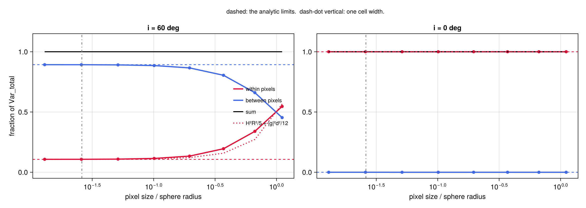
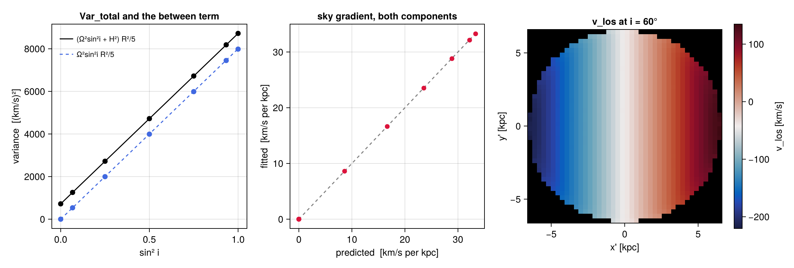
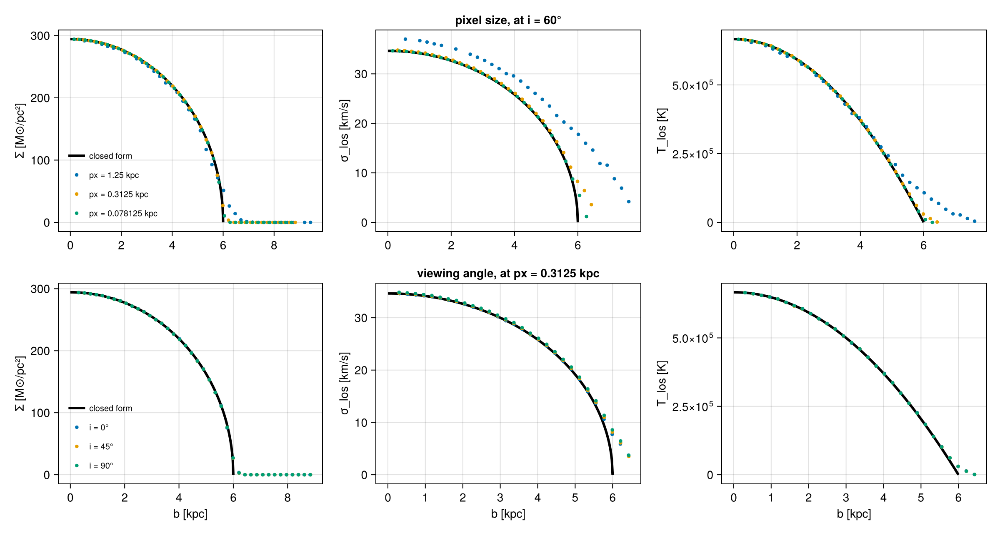
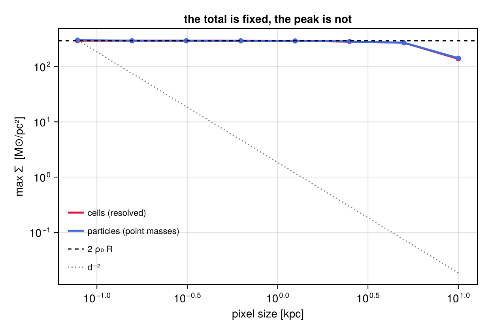
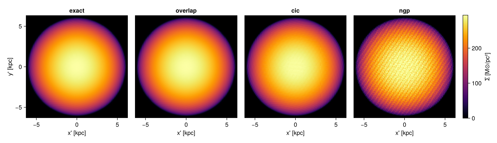

!!! tip "Run it yourself"
    This page is also an executable **Jupyter notebook**: [open / download `offaxis_validation.ipynb`](https://github.com/ManuelBehrendt/Notebooks/blob/master/Mera-Docs/version_1.1/offaxis_validation.ipynb). The notebooks run end-to-end and double as part of Mera's test suite.

```@raw html
<!-- GENERATED FILE. Do not edit this markdown.
     Source notebook: offaxis_validation.ipynb
     Regenerate with: MERA_DIR=<repo checkout> ./render_docs.sh
     Any edit here is lost the next time the docs are rendered. -->
```

## 0. What this page is for

This page checks Mera's off-axis projection against answers that are known in closed form. It uses
no simulation files. It builds a small object whose density, velocity and temperature are written
down as formulas, projects it at several pixel sizes and several viewing angles, and compares what
comes back with what the formulas say.

The point of the exercise is to separate two kinds of claim that are easy to confuse.

| | class A, exact | class B, convergent |
|---|---|---|
| what is claimed | equality to round-off | a limit, or an identity between terms |
| holds at | every pixel size, every angle, every binning | only as the pixel shrinks |
| examples | total mass, total momentum, total thermal energy, mass-weighted mean velocity, mass-weighted mean temperature, the variance decomposition | the per-pixel dispersion, the peak surface density, the radial profiles |
| what sets the limit | nothing, it is bookkeeping | the physical size of the pixel, then the cell size of the data |

Class A rests on one property of the deposit and nothing else. Each cell hands out shares of itself
to pixels, and those shares sum to exactly one. Rotating the camera or changing the pixel grid moves
weight between pixels. It never creates or destroys any. Every class A statement below is that one
line, read twice.

Class B is where beam smearing lives. The line-of-sight dispersion is not resolution independent,
and saying so is not a caveat. It is an exact statement, the law of total variance, and Chapter 3
measures both of its terms and their sum.

The object is a uniform sphere with solid-body rotation, uniform expansion, a bulk velocity and a
parabolic temperature profile. The sphere is chosen because its projected surface density is a chord
length, which is the same from every direction. The rotation is chosen because it varies only across
the sky. The expansion is chosen because it varies only along the ray. Those two pieces drive the two
terms of the variance decomposition one each, which is what makes the decomposition readable.

Everything runs on a `2^7` cubed grid in a 20 kpc box and needs no downloads. The total running
time is printed by the last cell. The [off-axis tutorial](06_offaxis_Projection.md) is the page
that teaches the keywords. This one only tests them.

```julia
# The whole object is built here. No files are read.
using Mera, Mera.IndexedTables, CairoMakie, LinearAlgebra, Statistics, Printf
CairoMakie.activate!(type="png")

"""
    analytic_sphere(; lmax=7, R=0.3, ...) -> (; gas, part, truth)

A uniform-density sphere of radius `R` (code length) centred in the box, on a uniform `2^lmax`
cubed grid, with an analytic velocity field and an analytic temperature profile. No simulation
files. `gas` and `part` carry the SAME mass distribution: one particle per occupied cell, sitting
at the cell centre, with that cell's mass and velocity. So the two objects have identical total
mass, identical mean velocity and identical global velocity variance, and only the deposit differs.
"""
function analytic_sphere(; lmax::Int           = 7,
                           R::Float64          = 0.3,                 # code length
                           rho0::Float64       = 1.0,                 # code density
                           axis                = [0.3, -0.2, 1.0],    # rotation axis, unnormalised
                           OmegaR_kms::Float64 = 200.0,               # |Omega| * R
                           HR_kms::Float64     = 60.0,                # H * R
                           vbulk_kms           = [30.0, -20.0, 50.0],
                           T0_K::Float64       = 1.0e6,
                           edge::Symbol        = :fraction,           # or :sharp
                           nsub::Int           = 4,
                           lbox_kpc::Float64   = 20.0,
                           vunit_kms::Float64  = 200.0)

    cst  = createconstants()
    info = Mera.InfoType()
    info.constants = cst
    info.boxlen    = 1.0
    info.levelmin  = lmax;  info.levelmax = lmax
    info.ndim      = 3;     info.gamma    = 5/3
    # isbits fields of an InfoType() are uninitialised memory, not errors. getvar reads info.time on
    # every call (it is the default of ref_time), so set them rather than inherit whatever was there.
    info.time      = 0.0;   info.aexp     = 1.0;   info.omega_l = 0.0
    info.unit_l    = lbox_kpc * cst.kpc
    info.unit_t    = info.unit_l / (vunit_kms * 1e5)
    info.unit_v    = info.unit_l / info.unit_t
    info.unit_d    = cst.mH
    info.unit_m    = info.unit_d * info.unit_l^3
    info.scale     = createscales(info.unit_l, info.unit_d, info.unit_t, info.unit_m, cst)
    info.hydro = true;  info.amr = true;  info.particles = true
    info.nvarh = 5
    info.variable_list           = [:rho, :vx, :vy, :vz, :p]
    info.particles_variable_list = [:vx, :vy, :vz, :mass]

    s  = info.scale
    Om = normalize(Float64.(axis)) .* (OmegaR_kms / s.km_s / R)   # code 1/time
    H  = HR_kms / s.km_s / R                                      # code 1/time
    vb = Float64.(vbulk_kms) ./ s.km_s                            # code velocity
    pf = T0_K / s.K                                               # p/rho at the centre, code units

    N = 2^lmax;  dx = info.boxlen / N;  half = info.boxlen / 2

    # inside-fraction of one cell: 1, 0, or an nsub^3 sub-sample on the surface layer
    function frac(x, y, z)
        d = sqrt(x^2 + y^2 + z^2);  h = dx/2;  dg = h*sqrt(3)
        d + dg <= R && return 1.0
        d - dg >= R && return 0.0
        edge === :sharp && return d <= R ? 1.0 : 0.0
        k = 0
        for ia in 0:nsub-1, ib in 0:nsub-1, ic in 0:nsub-1
            xs = x + (-0.5 + (ia+0.5)/nsub)*dx
            ys = y + (-0.5 + (ib+0.5)/nsub)*dx
            zs = z + (-0.5 + (ic+0.5)/nsub)*dx
            xs^2 + ys^2 + zs^2 <= R^2 && (k += 1)
        end
        return k / nsub^3
    end

    lv=Int[]; cxv=Int[]; cyv=Int[]; czv=Int[]
    ro=Float64[]; vxv=Float64[]; vyv=Float64[]; vzv=Float64[]; pv=Float64[]
    X=Float64[]; Y=Float64[]; Z=Float64[]; PM=Float64[]; ID=Int[]

    for k in 1:N, j in 1:N, i in 1:N
        x = (i-0.5)*dx - half;  y = (j-0.5)*dx - half;  z = (k-0.5)*dx - half
        f = frac(x, y, z);  f == 0.0 && continue
        ux = vb[1] + (Om[2]*z - Om[3]*y) + H*x        # v = vbulk + Omega x s + H s
        uy = vb[2] + (Om[3]*x - Om[1]*z) + H*y
        uz = vb[3] + (Om[1]*y - Om[2]*x) + H*z
        r  = rho0 * f
        Tn = max(1.0 - (x^2 + y^2 + z^2)/R^2, 0.0)    # T(s) / T0
        push!(lv, lmax); push!(cxv, i); push!(cyv, j); push!(czv, k)
        push!(ro, r); push!(vxv, ux); push!(vyv, uy); push!(vzv, uz); push!(pv, r*pf*Tn)
        push!(X, (i-0.5)*dx); push!(Y, (j-0.5)*dx); push!(Z, (k-0.5)*dx)
        push!(PM, r*dx^3); push!(ID, length(PM))
    end

    gas = Mera.HydroDataType()
    gas.data = IndexedTables.table(lv, cxv, cyv, czv, ro, vxv, vyv, vzv, pv;
                 names=[:level,:cx,:cy,:cz,:rho,:vx,:vy,:vz,:p], pkey=[:level,:cx,:cy,:cz])
    gas.info = info;  gas.lmin = lmax;  gas.lmax = lmax;  gas.boxlen = info.boxlen
    gas.ranges = [0.,1.,0.,1.,0.,1.];  gas.selected_hydrovars = [1,2,3,4,5]
    gas.used_descriptors = Dict();  gas.smallr = 0.0;  gas.smallc = 0.0;  gas.scale = info.scale

    prt = Mera.PartDataType()
    prt.data = IndexedTables.table(ID, fill(lmax, length(ID)), X, Y, Z, vxv, vyv, vzv, PM;
                 names=[:id,:level,:x,:y,:z,:vx,:vy,:vz,:mass], pkey=[:id])
    prt.info = info;  prt.lmin = lmax;  prt.lmax = lmax;  prt.boxlen = info.boxlen
    prt.ranges = [0.,1.,0.,1.,0.,1.];  prt.selected_partvars = [:vx,:vy,:vz,:mass]
    prt.used_descriptors = Dict();  prt.scale = info.scale

    truth = (; R, rho0, Omega=Om, H, vbulk=vb, T0_K, dx, info, scale=s,
               M=sum(PM), ncell=length(PM))
    return (; gas, part=prt, truth)
end

T_START = time()
build = @elapsed S = analytic_sphere(lmax=7)
gas, part, t = S.gas, S.part, S.truth
sc = t.scale

println("cells occupied     : ", t.ncell)
println("cell size          : ", round(t.dx * sc.kpc, digits=5), " kpc")
println("sphere radius      : ", round(t.R  * sc.kpc, digits=3), " kpc   (",
        round(t.R / t.dx, digits=1), " cells)")
println("build time         : ", round(build, digits=2), " s")
println()
# Every unit scale is deliberately far from 1. On a fixture where scale.kpc == 1 a missing or a
# doubled unit conversion looks identical to a correct one, and that has hidden real bugs.
println("scale.kpc          : ", sc.kpc)
println("scale.km_s         : ", sc.km_s)
println("scale.K            : ", round(sc.K, sigdigits=6))
println("scale.Msol         : ", round(sc.Msol, sigdigits=6))
println()
println("|Omega| R          : ", round(norm(t.Omega) * t.R * sc.km_s, digits=2), " km/s")
println("H R                : ", round(t.H * t.R * sc.km_s, digits=2), " km/s")
println("rotation axis      : ", round.(normalize(t.Omega), digits=4))
println("bulk velocity      : ", round.(t.vbulk .* sc.km_s, digits=2), " km/s")
```

```
*__   __ _______ ______   _______
|  |_|  |       |    _ | |   _   |
|       |    ___|   | || |  |_|  |
|       |   |___|   |_||_|       |
|       |    ___|    __  |       |
| ||_|| |   |___|   |  | |   _   |
|_|   |_|_______|___|  |_|__| |__|
Mera v1.8.0 | Julia 1.12.7 | 8 threads
[ Info: Mera v1.8.0
cells occupied     : 247768
cell size          : 0.15625 kpc
sphere radius      : 6.0 kpc   (38.4 cells)
build time         : 0.8 s
scale.kpc          : 20.000000000000004
scale.km_s         : 200.0
scale.K            : 6.32807e6
scale.Msol         : 1.96152e11
|Omega| R          : 200.0 km/s
H R                : 60.0 km/s
rotation axis      : [0.2822, -0.1881, 0.9407]
bulk velocity      : [30.0, -20.0, 50.0] km/s
```

```julia
# How well does the grid represent the continuum sphere? Everything later that is NOT exact is
# measured against these numbers, not against the formulas, so they belong up front.
Mgrid = msum(gas, :Msol)
Mana  = (4/3)*pi*t.R^3 * t.rho0 * sc.Msol
Tbar  = wstat(Float64.(getvar(gas, :T, :K)), Float64.(getvar(gas, :mass, :Msol))).mean
Egrid = sum(getvar(gas, :etherm, :erg))
Eana  = (2/5) * t.rho0 * (t.T0_K/sc.K) * (4/3)*pi*t.R^3 * sc.erg

println(rpad("quantity", 26), rpad("grid", 16), rpad("continuum", 16), "grid/continuum - 1")
for (n, g, a) in (("total mass [Msol]",      Mgrid, Mana),
                  ("mass-weighted T [K]",    Tbar,  0.4*t.T0_K),
                  ("total p*V [erg]",        Egrid, Eana))
    println(rpad(n, 26), rpad(round(g, sigdigits=7), 16), rpad(round(a, sigdigits=7), 16),
            @sprintf("%+.3e", g/a - 1))
end
println()
println("particle mass equals gas mass : ", msum(part, :Msol) == Mgrid)
println("particle count                : ", length(part.data))
```

```
quantity                  grid            continuum       grid/continuum - 1
total mass [Msol]         2.218388e10     2.218429e10     -1.814e-05
mass-weighted T [K]       399930.1        400000.0        -1.748e-04
total p*V [erg]           1.1154939999999999e571.1157089999999999e57-1.930e-04
particle mass equals gas mass : true
particle count                : 247768
```

Those three residuals are the resolution of the test bench. The sphere is a stack of cubes, so its
volume, its mean temperature and its thermal energy are only as close to the continuum formulas as
the grid allows. Nothing below can be more accurate than that against a formula, and the class A
identities are therefore stated against the **cell data**, not against the formulas. The formulas
come back in Chapters 5 to 7, where the question is convergence rather than bookkeeping.

`:etherm` is `p V`, with no factor `1/(gamma - 1)`. That is Mera's definition, so the continuum
number above is the integral of `p` over the sphere, not the internal energy of a monatomic gas.

## 1. The object, written out

Let `s = r - r0` with `r0` the centre of the box, which is also the centre of the sphere. Inside
`|s| <= R`:

```math
\rho = \rho_0, \qquad
\mathbf{v} = \mathbf{v}_{\rm bulk} + \boldsymbol{\Omega}\times\mathbf{s} + H\,\mathbf{s}, \qquad
T(s) = T_0\left(1 - \frac{s^2}{R^2}\right)
```

`T` is planted through the pressure, because Mera reads `:T` as `p/rho` in code units and puts all
the physics in the unit factor: `p = rho * T / scale.K` makes `getvar(gas, :T, :K)` return `T(s)`
exactly.

**The line-of-sight velocity splits in two.** Mera's `:vlos` is `-(v . w)` with `w = m.los` the unit
vector that points out of the image toward the observer, so positive means receding. Write
`z' = s . w`. The triple product `(Omega x s) . w = s . (w x Omega)` gives

```math
v_{\rm los}(\mathbf{s}) \;=\; v_0 \;+\; \mathbf{g}\cdot\mathbf{s} \;-\; H z' ,
\qquad v_0 \equiv -\,\mathbf{v}_{\rm bulk}\!\cdot\!\hat{\mathbf{w}},
\qquad \mathbf{g} \equiv \boldsymbol{\Omega}\times\hat{\mathbf{w}} .
```

Since `g . w = 0`, the vector `g` lies **entirely in the sky plane**. So in camera coordinates

```math
v_{\rm los}(x',y',z') = v_0 + g_{x'} x' + g_{y'} y' - H z',
\qquad g_{x'} = \mathbf{g}\cdot\hat{\mathbf{r}},\;\; g_{y'} = \mathbf{g}\cdot\hat{\mathbf{u}},
\qquad |\mathbf{g}| = \Omega \sin i
```

with `i` the angle between the rotation axis and the line of sight. **The rotation varies only
across the sky. The expansion varies only along the ray.** That is the whole design of the test
field, and Chapter 3 is that sentence turned into a measurement.

**Chord and surface density.** A sightline at sky impact parameter `b` crosses the sphere over
`z'` in `[-l/2, +l/2]` with `l(b) = 2 sqrt(R^2 - b^2)`, by Pythagoras in the plane holding the ray
and the centre. The density is uniform, so

```math
\Sigma(b) = \rho_0\, l(b) = 2\rho_0\sqrt{R^2-b^2}, \qquad \Sigma(0) = 2\rho_0 R .
```

This is the same from every direction. A sphere has no preferred axis, so an angle dependence in a
measured `Sigma(b)` can only come from the grid or from a bug.

**Mean and dispersion along one ray.** The mass is uniform in `z'` and symmetric about `z' = 0`, so
`<z'> = 0` and `Var(z') = l^2/12`. From the split above,

```math
\langle v_{\rm los}\rangle(b) = v_0 + \mathbf{g}\cdot\mathbf{b},
\qquad
\sigma_{\rm los}(b) = \frac{H\sqrt{R^2-b^2}}{\sqrt{3}} = \frac{H\,\Sigma(b)}{2\sqrt{3}\,\rho_0} .
```

The second form says the dispersion map is proportional to the surface density map, at every angle,
with a slope that is fixed by `H` alone. The two maps are built by different code, so that is a
useful thing to check.

**Projected temperature.** Mass weighting along the ray is uniform in `z'`, so

```math
T_{\rm los}(b) = \frac{1}{l}\int_{-l/2}^{l/2}\! T_0\!\left(1-\frac{b^2+z'^2}{R^2}\right) dz'
= T_0\left(1 - \frac{b^2}{R^2} - \frac{l^2}{12R^2}\right)
= \frac{2}{3}T_0\left(1 - \frac{b^2}{R^2}\right)
```

using `l^2/12 = (R^2-b^2)/3`. The factor `2/3` is not free: a wrong weighting misses it.

**Whole-sphere moments.** For a uniform sphere `<s_i s_j> = (R^2/5) delta_ij`, because
`<s^2> = 3R^2/5`. With `g` perpendicular to `w`, the cross term `<(g.s) z'>` vanishes, so

```math
\langle v_{\rm los}\rangle = v_0, \qquad
{\rm Var}(v_{\rm los}) = \bigl(\Omega^2\sin^2 i + H^2\bigr)\frac{R^2}{5}, \qquad
\langle T\rangle_{\rm mass} = \tfrac{2}{5}T_0, \qquad
M = \tfrac{4}{3}\pi R^3\rho_0 .
```

Those are the numbers the chapters below aim at.

```julia
# Figure and analysis helpers. No new Mera concepts below this line.
showmap!(ax, m, key; logscale=false, cmap=:inferno, crange=nothing) = begin
    A = Float64.(m.maps[key])
    A = logscale ? log10.(replace(A, 0.0 => NaN)) : replace(A, 0.0 => NaN)
    e = getextent(m, :kpc)
    hm = heatmap!(ax, range(e[1], e[2], length=size(A,1)),
                      range(e[3], e[4], length=size(A,2)), A;
                  colormap=cmap, nan_color=:black, interpolate=false,
                  colorrange = crange === nothing ? Makie.automatic : crange)
    ax.aspect = DataAspect(); hm
end

# The camera the call actually used, not a vector we assumed. Reading the prediction off m.los,
# m.up and m.cam_right means the orientation convention is part of what is being tested.
gvec(t, m)  = cross(t.Omega, m.los) .* t.scale.km_s        # km/s per code length, in the sky plane
sinI(t, m)  = norm(cross(normalize(t.Omega), m.los))
v0of(t, m)  = -dot(t.vbulk, m.los) * t.scale.km_s          # km/s

var_pred(t, m)     = (sum(abs2, gvec(t,m)) + (t.H*t.scale.km_s)^2) * t.R^2/5   # (km/s)^2
within_pred(t)     = (t.H*t.scale.km_s)^2 * t.R^2/5
between_pred(t, m) = sum(abs2, gvec(t,m)) * t.R^2/5
beam_pred(t, m, d) = sum(abs2, gvec(t,m)) * d^2/12          # d in code length

sd_pred(t, b)  = 2*t.rho0*sqrt(max(t.R^2 - b^2, 0.0)) * t.scale.Msol_pc2
sig_pred(t, b) = t.H*sqrt(max(t.R^2 - b^2, 0.0))/sqrt(3) * t.scale.km_s
T_pred(t, b)   = (2/3)*t.T0_K*max(1 - b^2/t.R^2, 0.0)

# The law of total variance, read straight off the returned maps.
function decompose(m; wkey=:sd)
    W = vec(Float64.(m.maps[wkey]))
    V = vec(Float64.(m.maps[:vlos]))
    G = vec(Float64.(m.maps[:σlos]))
    Mt = sum(W); vbar = sum(W .* V)/Mt
    within  = sum(W .* G.^2)/Mt
    between = sum(W .* (V .- vbar).^2)/Mt
    return (; vbar, within, between, total = within + between)
end

# The geometry-free reference: the same moments taken over the cells, with no projection involved.
function refstats(obj, los)
    mc = Float64.(getvar(obj, :mass, :Msol))
    vc = Float64.(-(getvar(obj,:vx,:km_s).*los[1] .+ getvar(obj,:vy,:km_s).*los[2] .+
                    getvar(obj,:vz,:km_s).*los[3]))
    w = wstat(vc, mc)
    return (; mean=w.mean, var=w.std^2, M=sum(mc))
end

# mass-weighted least squares fit of v_los = a + b x' + c y' over the filled pixels
function skyfit(m; wkey=:sd)
    W = Float64.(m.maps[wkey]); V = Float64.(m.maps[:vlos])
    nx, ny = size(W); px = m.pixsize
    A = zeros(3,3); rhs = zeros(3)
    for j in 1:ny, i in 1:nx
        w = W[i,j]; w <= 0 && continue
        u = (1.0, m.extent[1] + (i-0.5)*px, m.extent[3] + (j-0.5)*px)
        for a in 1:3
            rhs[a] += w*u[a]*V[i,j]
            for c in 1:3; A[a,c] += w*u[a]*u[c]; end
        end
    end
    return A \ rhs      # (v0 [km/s], dv/dx', dv/dy' [km/s per code length])
end

relerr(a, b) = abs(a - b) / abs(b)
println("helpers ready")
```

```
helpers ready
```

## 2. Class A: the identities that hold exactly

Write the deposit as shares. Cell `i` gives share `f_ip` of itself to pixel `p`, and

```math
\sum_p f_{ip} = 1 \quad \text{for every } i .
```

That is the only hypothesis. For `binning=:exact` the share is the chord integral of the sightline
through the cube, divided over the pixels and renormalised, so the shares are a partition of unity
to machine precision. For `:overlap` the same holds per sub-point, and for `:cic` and `:ngp` it is
the standard bilinear and nearest-pixel deposit. With weights `w_i` and values `v_i`, a projection
returns

```math
W_p = \sum_i w_i f_{ip}, \qquad
S_p = \sum_i v_i w_i f_{ip}, \qquad
\mu_p = S_p / W_p
```

and summing over pixels collapses the shares:

```math
\sum_p W_p = \sum_i w_i, \qquad \sum_p W_p \mu_p = \sum_i v_i w_i .
```

Every identity in the table below is one of those two lines. Note what is **not** being used: the
chord integral matters here only through the partition of unity. The exactness is bookkeeping, not
geometry, which is exactly why it survives any angle and any pixel size.

| | identity | Mera form |
|---|---|---|
| A1 | total mass | `sum(m.maps[:mass]) == msum(gas, :Msol)` |
| A2 | total mass from the surface density | `sum(m.maps[:sd]) * (m.pixsize*scale.pc)^2 == msum(gas, :Msol)` |
| A3 | mass-weighted mean line-of-sight velocity | `sum(M.*V)/sum(M)` equals the cell-level mass-weighted mean |
| A4 | total line-of-sight momentum | `sum(M .* V)` equals `sum(m_cell .* v_cell)` |
| A5 | mass-weighted mean temperature | `sum(M.*T)/sum(M)` equals the cell-level mass-weighted mean |
| A6 | total thermal energy | `sum(m.maps[:etherm])` with `mode=:sum` equals `sum(getvar(gas, :etherm))` |
| A7 | law of total variance | Chapter 3 |

`mode=:sum` is a property of the whole call, and under it every other variable returns a weighted
sum rather than a mean, so `:etherm` gets a call of its own.

```julia
# The most expensive cell on the page: 5 views x 3 pixel sizes x 3 binnings, plus one extra call
# each for the mode=:sum energy. Every pixel size here is at or above the cell size, which is the
# only regime class A needs; Chapter 3 goes finer.
axrot = collect(normalize(t.Omega))
VIEWS = Any[("i =  0 deg",      (inclination=0,  azimuth=0, axis=axrot)),
            ("i = 45 deg",      (inclination=45, azimuth=0, axis=axrot)),
            ("i = 90 deg",      (inclination=90, azimuth=0, axis=axrot)),
            ("los=[1,1,1]",     (los=[1.0, 1.0, 1.0],)),
            ("los=[1,-2,0.5]",  (los=[1.0, -2.0, 0.5],))]
PXA  = [2.5, 0.625, 0.15625]                 # kpc: 16, 4 and 1 cell widths
BINS = (:exact, :overlap, :cic)

Tref  = wstat(Float64.(getvar(gas, :T, :K)), Float64.(getvar(gas, :mass, :Msol))).mean
Eref  = sum(getvar(gas, :etherm, :erg))
errs  = Dict(k => Float64[] for k in (:A1,:A2,:A3,:A4,:A5,:A6,:A7))

runtime = @elapsed for (_, kw) in VIEWS, px in PXA, b in BINS
    m = projection(gas, [:mass, :sd, :vlos, :σlos, :T], [:Msol, :Msol_pc2, :km_s, :km_s, :K];
                   kw..., pxsize=[px, :kpc], binning=b, weighting=[:mass, missing],
                   verbose=false, show_progress=false)
    e = projection(gas, :etherm, :erg; kw..., pxsize=[px, :kpc], binning=b, mode=:sum,
                   verbose=false, show_progress=false)
    r  = refstats(gas, m.los)
    Mm = Float64.(m.maps[:mass]); Vm = Float64.(m.maps[:vlos]); Tm = Float64.(m.maps[:T])
    d  = decompose(m)
    push!(errs[:A1], relerr(sum(Mm), r.M))
    push!(errs[:A2], relerr(sum(m.maps[:sd]) * (m.pixsize*sc.pc)^2, r.M))
    push!(errs[:A3], relerr(sum(Mm .* Vm)/sum(Mm), r.mean))
    push!(errs[:A4], relerr(sum(Mm .* Vm), r.M * r.mean))
    push!(errs[:A5], relerr(sum(Mm .* Tm)/sum(Mm), Tref))
    push!(errs[:A6], relerr(sum(e.maps[:etherm]), Eref))
    push!(errs[:A7], relerr(d.total, r.var))
end

labels = Dict(:A1 => "A1  total mass",
              :A2 => "A2  mass from :sd",
              :A3 => "A3  mean v_los",
              :A4 => "A4  total momentum",
              :A5 => "A5  mean T",
              :A6 => "A6  total p*V",
              :A7 => "A7  variance sum")
println(length(VIEWS)*length(PXA)*length(BINS), " projections in ", round(runtime, digits=1), " s")
println()
println(rpad("identity", 24), rpad("worst rel. error", 20), "median rel. error")
for k in (:A1,:A2,:A3,:A4,:A5,:A6,:A7)
    println(rpad(labels[k], 24),
            rpad(@sprintf("%.3e", maximum(errs[k])), 20),
            @sprintf("%.3e", median(errs[k])))
end
println()
println("worst over everything : ", @sprintf("%.3e", maximum(maximum(v) for v in values(errs))))
println("tolerance claimed     : 1e-12")
```

```
45 projections in 8.3 s
identity                worst rel. error    median rel. error
A1  total mass          8.770e-15           6.878e-16
A2  mass from :sd       8.598e-15           6.878e-16
A3  mean v_los          1.748e-14           6.823e-16
A4  total momentum      2.110e-14           2.114e-16
A5  mean T              5.094e-15           8.733e-16
A6  total p*V           4.686e-15           1.562e-16
A7  variance sum        1.869e-14           8.342e-16
worst over everything : 2.110e-14
tolerance claimed     : 1e-12
```

Every identity sits at the floating-point floor, at every angle, at every pixel size and for every
binning. The residuals are not zero because the unit conversions inside `getvar` do arithmetic; the
off-axis regression suite uses the same `1e-12` tolerance for the same reason, see
`test/34_offaxis_invariance_tests.jl`.

The same identity has been measured on real data. On a 51.5 million cell AVALON snapshot,
`sum(:sd)*(pixsize*scale.pc)^2 / msum - 1` lands between 0 and 4.4e-16 for gas at pixel sizes of
0.5, 0.2 and 0.1 kpc and inclinations of 0, 45 and 90 degrees, and around 1e-15 for star particles
with `:cic`, rising to 8e-14 with `:ngp`. The synthetic object is not a special case.

### Two ways the check fails when nothing is wrong

Both of these were hit while writing this page, which is why they are here rather than in a
footnote. Neither is a bug in the projection. Both produce a number that looks like broken
conservation.

```julia
look = (inclination=45, azimuth=0, axis=axrot, verbose=false, show_progress=false)

# Trap 1. `fov` is a camera-plane window, and it is allowed to throw mass away. It first selects a
# SPHERE of radius fov (or fov*sqrt(2) for :square) about `center`, and `aperture=:square` then
# crops the finished map to the inscribed square. Both steps remove mass on purpose.
# Note `center=[:bc]`: fov selects about `center`, which defaults to the box CORNER.
full = projection(gas, :mass, :Msol; look..., pxsize=[0.5, :kpc])
fsq  = projection(gas, :mass, :Msol; look..., center=[:bc], fov=4, fov_unit=:kpc,
                  aperture=:square, pxsize=[0.5, :kpc])
fci  = projection(gas, :mass, :Msol; look..., center=[:bc], fov=4, fov_unit=:kpc,
                  aperture=:circle, pxsize=[0.5, :kpc])
println("sphere radius is ", round(t.R*sc.kpc, digits=2), " kpc, the fov below is 4 kpc")
println(rpad("no fov (whole object)",      30), @sprintf("%+.3e", sum(full.maps[:mass])/Mgrid - 1))
println(rpad("fov=4, aperture=:circle",    30), @sprintf("%+.3e", sum(fci.maps[:mass])/Mgrid - 1))
println(rpad("fov=4, aperture=:square",    30), @sprintf("%+.3e", sum(fsq.maps[:mass])/Mgrid - 1))

# Trap 2. `pxsize` is a request. The pixel count is rounded UP, so the pixel you get is at most the
# pixel you asked for. Dividing by the requested size instead of `m.pixsize` is a silent error of
# order one percent, which is exactly the size of a bug worth chasing.
req = 0.3                                       # kpc; 20/0.3 is not an integer
m   = projection(gas, :sd, :Msol_pc2; look..., pxsize=[req, :kpc])
got = m.pixsize * sc.kpc
println()
println("requested pixel : ", req, " kpc")
println("m.pixsize       : ", round(got, digits=6), " kpc     (map ", size(m.maps[:sd]), ")")
println(rpad("divide by the REQUESTED area", 32),
        @sprintf("%+.3e", sum(m.maps[:sd])*(req*1000)^2/Mgrid - 1))
println(rpad("divide by m.pixsize", 32),
        @sprintf("%+.3e", sum(m.maps[:sd])*(m.pixsize*sc.pc)^2/Mgrid - 1))
```

```
sphere radius is 6.0 kpc, the fov below is 4 kpc
no fov (whole object)         +0.000e+00
fov=4, aperture=:circle       -6.768e-01
fov=4, aperture=:square       -3.594e-01
requested pixel : 0.3 kpc
m.pixsize       : 0.298507 kpc     (map (43, 43))
divide by the REQUESTED area    +1.002e-02
divide by m.pixsize             +2.220e-16
```

The `fov` deficits above are the feature working. A circular aperture selects a sphere of the
requested radius, a square aperture selects a slightly larger sphere and then crops the map to the
inscribed square, and the sphere on this page is wider than the 4 kpc window, so both lose mass.
Use `fov` to frame a picture. Do not use it to audit a total.

The pixel-size line is the more dangerous one, because the number it produces is small enough to be
mistaken for a real leak. `pxsize` sets `res = ceil(boxlen / pixel)`, so the pixel you receive is at
most the one you asked for. Always read `m.pixsize` back.

## 3. Class B: the line-of-sight dispersion

`:σlos` is built per pixel as a mass-weighted second moment about that pixel's own mean:

```math
\mu_p = \frac{\sum_i v_i w_i f_{ip}}{\sum_i w_i f_{ip}}, \qquad
\sigma_p = \sqrt{\frac{\sum_i v_i^2 w_i f_{ip}}{\sum_i w_i f_{ip}} - \mu_p^2 } .
```

Both deposits use the same geometric shares, so the same `W_p`, and `W_p` is the `:mass` map (and,
up to the pixel area, the `:sd` map). Sum the second-moment line over pixels, subtract `M` times the
square of the global mean, and the shares collapse again:

```math
\boxed{\;
{\rm Var}_{\rm total}
= \underbrace{\frac{1}{M}\sum_p W_p \sigma_p^2}_{\text{within pixels}}
+ \underbrace{\frac{1}{M}\sum_p W_p (\mu_p - \bar v)^2}_{\text{between pixels}}
\;}
```

with `Var_total` the mass-weighted variance of `-(v . w)` over the cells, which does not know about
the pixel grid at all. This is the law of total variance. The **sum** is class A, exact at every
pixel size. Each **term** is class B.

For this object both limits are known. The rotation lives entirely in the sky plane and the
expansion entirely along the ray, so as the pixel shrinks

```math
\text{within} \;\to\; \frac{H^2R^2}{5}, \qquad
\text{between} \;\to\; \frac{\Omega^2\sin^2 i\; R^2}{5},
```

and for a pixel of side `d` well inside the sphere the within term rises above its floor by

```math
\text{within} \;\approx\; \frac{H^2R^2}{5} + \frac{|\mathbf{g}|^2 d^2}{12},
```

because `v_los` is a linear function of the sky coordinates, a linear function over a square pixel
has variance `d^2/12` per axis, and the two contributions do not correlate: for every sightline
through a centred sphere the chord is symmetric in `z'`, so the cross term vanishes exactly.

At the other end, when the pixel is wider than the object, every cell lands in one pixel, the within
term is the whole variance and the between term is zero. So whenever there is a gradient across the
sky the two curves must cross, and their sum must not move.

```julia
# Eight pixel sizes, from 64 cell widths down to half a cell. The finest two are the slow ones.
PX = [10.0, 5.0, 2.5, 1.25, 0.625, 0.3125, 0.15625, 0.078125]      # kpc
lad(kw) = [projection(gas, [:sd, :vlos, :σlos], [:Msol_pc2, :km_s, :km_s];
                      kw..., pxsize=[px, :kpc], binning=:exact,
                      verbose=false, show_progress=false) for px in PX]

tilt = (inclination=60, azimuth=0, axis=axrot)
face = (inclination=0,  azimuth=0, axis=axrot)
sweep = @elapsed begin
    L60 = lad(tilt)
    L00 = lad(face)
end
r60 = refstats(gas, L60[1].los)
r00 = refstats(gas, L00[1].los)
println(2*length(PX), " projections in ", round(sweep, digits=1), " s")
println()
println("i = 60 deg,  Var_total from the cells = ", round(r60.var, digits=2), " (km/s)^2")
println("predicted (Omega^2 sin^2 i + H^2) R^2/5 = ", round(var_pred(t, L60[1]), digits=2))
println()
println(rpad("px [kpc]",10), rpad("px/cell",9), rpad("within",12), rpad("between",12),
        rpad("sum",12), rpad("sum/Var-1",13), "beam pred.")
for (px, m) in zip(PX, L60)
    d = decompose(m)
    println(rpad(px, 10), rpad(round(m.pixsize/t.dx, digits=3), 9),
            rpad(round(d.within, digits=2), 12), rpad(round(d.between, digits=2), 12),
            rpad(round(d.total, digits=2), 12),
            rpad(@sprintf("%+.2e", d.total/r60.var - 1), 13),
            round(within_pred(t) + beam_pred(t, m, m.pixsize), digits=2))
end
println()
println("within -> H^2 R^2/5          = ", round(within_pred(t), digits=2), " (km/s)^2")
println("between -> Omega^2 sin^2 i R^2/5 = ", round(between_pred(t, L60[1]), digits=2))
# Below one cell the pixel stops subdividing anything. What is left is the spread of cell-centre
# velocities across one cell, |g|^2 dx^2/12, which is the floor under the floor.
println("cell-scale residual |g|^2 dx^2/12 = ", round(beam_pred(t, L60[1], t.dx), digits=3),
        "  (compare with the H term above)")
println()
# A weighted mean is not an unweighted one. Empty pixels are stored as 0.0, not NaN.
V = L60[end].maps[:vlos]; W = Float64.(L60[end].maps[:sd])
println("mean(m.maps[:vlos])            = ", round(mean(V), digits=3), " km/s   (meaningless)")
println("sum(W.*V)/sum(W)               = ", round(sum(W .* V)/sum(W), digits=3), " km/s")
println("-(vbulk . w) from the formula  = ", round(v0of(t, L60[end]), digits=3), " km/s")

# ── figure code from here: the decomposition, normalised by the total that does not move ──
fig = Figure(size=(1180, 420))
for (col, (L, r, lbl, m0)) in enumerate(((L60, r60, "i = 60 deg", L60[1]), (L00, r00, "i = 0 deg", L00[1])))
    d  = [decompose(m) for m in L]
    xs = [m.pixsize/t.R for m in L]
    ax = Axis(fig[1, col], xscale=log10, title=lbl,
              xlabel="pixel size / sphere radius", ylabel = col == 1 ? "fraction of Var_total" : "")
    lines!(ax, xs, [x.within/r.var  for x in d], color=:crimson,     linewidth=2.5, label="within pixels")
    scatter!(ax, xs, [x.within/r.var for x in d], color=:crimson)
    lines!(ax, xs, [x.between/r.var for x in d], color=:royalblue,   linewidth=2.5, label="between pixels")
    scatter!(ax, xs, [x.between/r.var for x in d], color=:royalblue)
    lines!(ax, xs, [x.total/r.var   for x in d], color=:black, linewidth=2, label="sum")
    hlines!(ax, [within_pred(t)/r.var], color=:crimson, linestyle=:dash)
    hlines!(ax, [between_pred(t, m0)/r.var], color=:royalblue, linestyle=:dash)
    lines!(ax, xs, [(within_pred(t) + beam_pred(t, m0, m.pixsize))/r.var for m in L],
           color=:crimson, linestyle=:dot, linewidth=2, label="H²R²/5 + |g|²d²/12")
    vlines!(ax, [t.dx/t.R], color=:grey, linestyle=:dashdot)
    ylims!(ax, -0.05, 1.15)
    col == 1 && axislegend(ax, position=:rc, framevisible=false, labelsize=11)
end
Label(fig[0, 1:2], "dashed: the analytic limits.  dash-dot vertical: one cell width.", fontsize=12)
fig
```

```
16 projections in 3.6 s
i = 60 deg,  Var_total from the cells = 6721.69 (km/s)^2
predicted (Omega^2 sin^2 i + H^2) R^2/5 = 6720.0
px [kpc]  px/cell  within      between     sum         sum/Var-1    beam pred.
10.0      42.667   3672.52     3049.17     6721.69     +1.55e-15    3806.42
5.0       25.6     2282.08     4439.61     6721.69     -1.11e-16    1831.11
2.5       14.222   1312.29     5409.4      6721.69     +8.88e-16    1062.94
1.25      7.529    901.29      5820.4      6721.69     +6.66e-16    816.12
0.625     3.879    770.03      5951.65     6721.69     +6.66e-16    745.51
0.3125    1.969    733.22      5988.47     6721.69     +8.88e-16    726.57
0.15625   0.992    723.53      5998.16     6721.69     -4.22e-15    721.67
0.078125  0.498    722.26      5999.43     6721.69     -8.88e-15    720.42
within -> H^2 R^2/5          = 720.0 (km/s)^2
between -> Omega^2 sin^2 i R^2/5 = 6000.0
cell-scale residual |g|^2 dx^2/12 = 1.695  (compare with the H term above)
mean(m.maps[:vlos])            = -32.57 km/s   (meaningless)
sum(W.*V)/sum(W)               = -42.075 km/s
-(vbulk . w) from the formula  = -42.075 km/s
```



Read the black line first. It is flat at 1 across a factor of 128 in pixel size, to the precision
printed in the table above. That is the class A part, and it is the reason the rest of the figure
can be trusted.

Then read the two coloured lines. When the pixel is wider than the sphere, everything is inside one
pixel: the within term carries the whole variance and the between term is near zero. As the pixel
shrinks the two exchange, and each settles on its own analytic limit, the dashed horizontals. The
dotted line is the beam-smearing estimate `H²R²/5 + |g|²d²/12`, and it tracks the within term over
the range where the pixel is smaller than the object and larger than a cell.

The right panel is the control. At `i = 0` the line of sight is along the rotation axis, so
`g = Omega x w` is zero, there is nothing for a pixel to average over across the sky, and the within
term does not move with pixel size at all. Same code, same object, no beam smearing, because there
is no sky gradient to smear.

Two things the figure says that a caveat cannot.

**Beam smearing is bookkeeping, not loss.** Nothing is destroyed when the pixel is coarse. The
variance moves from the between term to the within term, and the sum is fixed. Quoting `σ_los` at a
pixel size is therefore meaningful, and quoting it without one is not.

**Convergence is to the data, not to zero.** The grey vertical line is one cell width. To the left
of it the pixel no longer subdivides anything, because each ray meets a fixed set of cells that each
carry one velocity. The within term stops falling at the floor set by `H`, plus a residual of order
`(|g| * cellsize)^2/12` from the cell discretisation, which the numbers above put far below the
floor for this object. On real data the same is true with the cell size of the run in place of the
cell size here.

This is also the correction to the tutorial. On a galaxy the along-the-ray spread usually dominates,
so `σ_los` looks almost pixel independent over a realistic range of pixel sizes. That is a property
of the galaxy, not of `:σlos`. The general statement is the identity above.

## 4. The same object as particles

`gas` and `part` hold the same masses at the same places with the same velocities. Only the deposit
differs: cells have a footprint and are integrated, particles are points and are deposited with
`:cic`. `:overlap` and `:exact` have no meaning for a point and fall back to `:cic` with a hint.

```julia
PL = [projection(part, [:sd, :vlos, :σlos], [:Msol_pc2, :km_s, :km_s];
                 tilt..., pxsize=[px, :kpc], binning=:cic,
                 verbose=false, show_progress=false) for px in PX]
rp = refstats(part, PL[1].los)

println("particle Var_total equals the gas value : ", isapprox(rp.var, r60.var; rtol=1e-12))
println()
println(rpad("px [kpc]",10), rpad("within",12), rpad("between",12), rpad("sum",12), "sum/Var-1")
for (px, m) in zip(PX, PL)
    d = decompose(m)
    println(rpad(px, 10), rpad(round(d.within, digits=2), 12), rpad(round(d.between, digits=2), 12),
            rpad(round(d.total, digits=2), 12), @sprintf("%+.2e", d.total/rp.var - 1))
end

# There is no particle :mass map. The generic branch returns a mass-WEIGHTED MEAN of the particle
# mass, which is not a per-pixel total, and summing it gives a number that drifts with pixel size.
println()
println(rpad("px [kpc]", 10), rpad("sum(:mass)/M", 16), "sum(:sd * A)/M")
for px in PX[4:end]
    mm = projection(part, [:mass, :sd], [:Msol, :Msol_pc2]; tilt..., pxsize=[px, :kpc],
                    verbose=false, show_progress=false)
    println(rpad(px, 10),
            rpad(round(sum(mm.maps[:mass])/Mgrid, digits=6), 16),
            round(sum(mm.maps[:sd]) * (mm.pixsize*sc.pc)^2 / Mgrid, digits=12))
end
```

```
particle Var_total equals the gas value : true
px [kpc]  within      between     sum         sum/Var-1
10.0      3676.14     3045.55     6721.69     +4.00e-15
5.0       2281.76     4439.93     6721.69     -3.77e-15
2.5       1311.9      5409.79     6721.69     +4.44e-16
1.25      901.22      5820.47     6721.69     +8.88e-16
0.625     770.04      5951.65     6721.69     +4.44e-16
0.3125    733.22      5988.47     6721.69     +8.88e-16
0.15625   723.5       5998.19     6721.69     +8.88e-16
0.078125  719.46      6002.22     6721.69     +8.88e-16
px [kpc]  sum(:mass)/M    sum(:sd * A)/M
1.25      0.000489        1.0
0.625     0.001515        1.0
0.3125    0.005298        1.0
0.15625   0.019929        1.0
0.078125  0.077674        1.0
```

!!! warning "`projection(part, :mass)` is not a per-pixel mass"
    Hydro has a `:mass` map. Particles do not. `:mass` falls through the generic branch, which
    returns the mass-weighted mean of whatever you asked for, so for `:mass` it returns the
    mass-weighted mean particle mass in each pixel. Summing it gives a number that climbs toward
    the true total as the pixels approach one particle each, and never means anything on the way.
    Measured on the AVALON star particles, `sum(:mass)/M` reads 0.0115, 0.0384, 0.121 and 0.487 at
    pixel sizes of 0.2, 0.1, 0.05 and 0.02 kpc, while `sum(:sd * A)/M` stays at 1 to round-off.
    The column printed above repeats that on this object. **For particles use `:sd` and multiply by
    `m.pixsize^2` in matching units.**

The particle decomposition holds to the same precision as the hydro one, which is the point: the
identity comes from the partition of unity, and `:cic` has it just as `:exact` does. Compare the two
`within`/`between` tables and they track each other until the pixel drops below the lattice spacing
of the particles, where the point sampling starts to show.

## 5. The angle test

Two kinds of prediction. Some quantities must not depend on the viewing direction at all, because
the sphere is isotropic in everything but its velocity field. Others must depend on it in a way that
is written down.

| quantity | prediction |
|---|---|
| total mass, total `p V`, mass-weighted `T` | independent of angle, exactly (Chapter 2) |
| `Sigma(b)` | independent of angle, up to the grid |
| `sigma_los(0)` | `H R / sqrt(3)`, independent of angle up to the beam term |
| `Var_total` | `(Omega^2 sin^2 i + H^2) R^2 / 5` |
| between term, small pixels | `Omega^2 sin^2 i R^2 / 5` |
| sky gradient of `v_los` | the vector `g = Omega x w`, of length `Omega sin i`, lying in the sky plane |
| map zero point | `v_0 = -(v_bulk . w)` |

The last two are read off the camera vectors the call returns, `m.los`, `m.up` and `m.cam_right`,
so the orientation convention is part of what is being tested rather than something assumed. Driving
the angle with `inclination` and `axis=` set to the rotation axis makes `i` exactly the angle
between the rotation axis and the line of sight, which is what the formulas use.

```julia
ANG = [0, 15, 30, 45, 60, 75, 90]
MA  = [projection(gas, [:sd, :vlos, :σlos], [:Msol_pc2, :km_s, :km_s];
                  inclination=a, azimuth=0, axis=axrot, pxsize=[0.3125, :kpc], binning=:exact,
                  verbose=false, show_progress=false) for a in ANG]

println(rpad("i [deg]",9), rpad("sin i",9), rpad("Var meas.",12), rpad("Var pred.",12),
        rpad("between",12), rpad("betw. pred.",12), "max sigma_los")
for (a, m) in zip(ANG, MA)
    d = decompose(m)
    println(rpad(a, 9), rpad(round(sinI(t, m), digits=4), 9),
            rpad(round(d.total, digits=2), 12), rpad(round(var_pred(t, m), digits=2), 12),
            rpad(round(d.between, digits=2), 12), rpad(round(between_pred(t, m), digits=2), 12),
            round(maximum(m.maps[:σlos]), digits=3))
end
println()
println("H R / sqrt(3) = ", round(t.H*t.R/sqrt(3)*sc.km_s, digits=3), " km/s  (the last column)")
println()

# The sky gradient, fitted from the map, against g = Omega x w read off the returned camera.
println(rpad("i [deg]",9), rpad("v0 fit",11), rpad("v0 pred.",11),
        rpad("|grad| fit",13), rpad("|grad| pred.",13), "angle(fit, pred) [deg]")
for (a, m) in zip(ANG, MA)
    f = skyfit(m)                                   # (v0, dv/dx', dv/dy'), per code length
    gp = gvec(t, m)
    gf = [f[2], f[3]]
    gq = [dot(gp, m.cam_right), dot(gp, m.up)]      # predicted, in image coordinates
    ang = norm(gf) * norm(gq) > 0 ?
          rad2deg(acos(clamp(dot(gf, gq)/(norm(gf)*norm(gq)), -1, 1))) : 0.0
    println(rpad(a, 9), rpad(round(f[1], digits=3), 11), rpad(round(v0of(t, m), digits=3), 11),
            rpad(round(norm(gf)/sc.kpc, digits=4), 13), rpad(round(norm(gq)/sc.kpc, digits=4), 13),
            round(ang, digits=3))
end
println()
println("|grad| is in km/s per kpc;  Omega = ", round(norm(t.Omega)*sc.km_s/sc.kpc, digits=4),
        " km/s per kpc")

# ── figure code from here ──
fig = Figure(size=(1180, 400))
s2 = [sinI(t, m)^2 for m in MA]
ax1 = Axis(fig[1,1], xlabel="sin² i", ylabel="variance  [(km/s)²]",
           title="Var_total and the between term")
ss = range(0, 1, length=100)
lines!(ax1, ss, [(norm(t.Omega)^2*x + t.H^2)*t.R^2/5*sc.km_s^2 for x in ss],
       color=:black, label="(Ω²sin²i + H²) R²/5")
scatter!(ax1, s2, [decompose(m).total for m in MA], color=:black, markersize=11)
lines!(ax1, ss, [norm(t.Omega)^2*x*t.R^2/5*sc.km_s^2 for x in ss],
       color=:royalblue, linestyle=:dash, label="Ω²sin²i R²/5")
scatter!(ax1, s2, [decompose(m).between for m in MA], color=:royalblue, markersize=11)
axislegend(ax1, position=:lt, framevisible=false, labelsize=11)

ax2 = Axis(fig[1,2], xlabel="predicted  [km/s per kpc]", ylabel="fitted  [km/s per kpc]",
           title="sky gradient, both components")
fits = [skyfit(m) for m in MA]
gf = reduce(vcat, [[f[2], f[3]] ./ sc.kpc for f in fits])
gq = reduce(vcat, [[dot(gvec(t,m), m.cam_right), dot(gvec(t,m), m.up)] ./ sc.kpc for m in MA])
lo, hi = minimum(vcat(gf, gq)), maximum(vcat(gf, gq))
lines!(ax2, [lo, hi], [lo, hi], color=:grey, linestyle=:dash)
scatter!(ax2, gq, gf, color=:crimson, markersize=10)

ax3 = Axis(fig[1,3], title="v_los at i = 60°", xlabel="x' [kpc]", ylabel="y' [kpc]")
h = showmap!(ax3, MA[5], :vlos; cmap=:balance)
Colorbar(fig[1,4], h, label="v_los [km/s]")
fig
```

```
i [deg]  sin i    Var meas.   Var pred.   between     betw. pred. max sigma_los
0        0.0      720.18      720.0       0.0         0.0         34.61
15       0.2588   1256.21     1255.9      534.87      535.9       34.629
30       0.5      2720.68     2720.0      1996.16     2000.0      34.67
45       0.7071   4721.18     4720.0      3992.31     4000.0      34.737
60       0.866    6721.69     6720.0      5988.47     6000.0      34.799
75       0.9659   8186.16     8184.1      7449.76     7464.1      34.843
90       1.0      8722.19     8720.0      7984.63     8000.0      34.896
H R / sqrt(3) = 34.641 km/s  (the last column)
i [deg]  v0 fit     v0 pred.   |grad| fit   |grad| pred. angle(fit, pred) [deg]
0        -59.265    -59.265    0.0          0.0          142.554
15       -60.965    -60.965    8.6084       8.6273       0.0
30       -58.509    -58.509    16.6302      16.6667      0.0
45       -52.066    -52.066    23.5187      23.5702      0.0
60       -42.075    -42.075    28.8044      28.8675      0.0
75       -29.217    -29.217    32.1271      32.1975      0.0
90       -14.367    -14.367    33.2605      33.3333      0.0
|grad| is in km/s per kpc;  Omega = 33.3333 km/s per kpc
```



The measured variance follows the `sin² i` line with a floor at `H²R²/5`, and the between term
follows the same line through the origin. The fitted gradient sits on the one-to-one diagonal in
both components, which means the map really is the linear gradient the formula predicts and that
`m.cam_right` and `m.up` are the axes they claim to be. A swapped or sign-flipped camera axis would
show up as points off the diagonal, not as a worse fit.

The gradient fit is class B, not class A. The fit samples each pixel at its centre, while the value
in the pixel is the mass-weighted mean over the pixel, and the two agree only as the pixel shrinks.
The whole table is taken at one pixel size, so read its residual as the size of that effect at
0.3125 kpc, not as a bound.

The last column of the first table is the one that barely moves with angle. The chord through the
centre has the same length from every direction, so the central dispersion is `H R / sqrt(3)`
whatever the camera does. It is not exactly constant at a finite pixel, because the beam term
`|g|² d²/12` of Chapter 3 rides on top of it and that term does depend on the angle. Compare the
column with the printed `H R / sqrt(3)` and the difference is that term.

## 6. Profiles: the shape, not just the total

Three maps, three closed forms:

```math
\Sigma(b) = 2\rho_0\sqrt{R^2-b^2}, \qquad
\sigma_{\rm los}(b) = \frac{H\sqrt{R^2-b^2}}{\sqrt 3}, \qquad
T_{\rm los}(b) = \frac{2}{3}T_0\left(1-\frac{b^2}{R^2}\right) .
```

The first two are the same shape, which is the statement `sigma_los = H Sigma / (2 sqrt(3) rho_0)`
from Chapter 1. All three are independent of viewing angle.

Radial profiles come from `profile(m, key; xvar=:r)`, which bins the pixels by image-plane radius
about the map centre. For an off-axis map that centre is the projection pivot, which here is the
centre of the box and therefore the centre of the sphere, so no fitting is needed to find it.

```julia
# convergence at one angle, and angle independence at one pixel size
PXP  = [1.25, 0.3125, 0.078125]
ANGP = [0, 45, 90]
conv = [projection(gas, [:sd, :σlos, :T], [:Msol_pc2, :km_s, :K]; tilt..., pxsize=[px, :kpc],
                   binning=:exact, verbose=false, show_progress=false) for px in PXP]
rots = [projection(gas, [:sd, :σlos, :T], [:Msol_pc2, :km_s, :K]; inclination=a, azimuth=0,
                   axis=axrot, pxsize=[0.3125, :kpc], binning=:exact,
                   verbose=false, show_progress=false) for a in ANGP]

function prof(m, key)
    w = key === :sd ? :none : :sd
    profile(m, key; xvar=:r, xunit=:kpc, nbins=40, weight=w)
end
function worstdev(m, key, predf; bmax=0.8*t.R)
    p  = prof(m, key)
    b  = p.x ./ sc.kpc
    pr = [predf(t, x) for x in b]
    ok = (b .< bmax) .& (p.count .> 0) .& isfinite.(p.mean) .& (pr .> 0)
    return maximum(abs.(p.mean[ok] .- pr[ok]) ./ pr[ok])
end

println("worst relative deviation from the closed form, over b < 0.8 R")
println()
println(rpad("px [kpc]", 12), rpad("Sigma", 14), rpad("sigma_los", 14), "T_los")
for (px, m) in zip(PXP, conv)
    println(rpad(px, 12),
            rpad(@sprintf("%.3e", worstdev(m, :sd,   sd_pred)),  14),
            rpad(@sprintf("%.3e", worstdev(m, :σlos, sig_pred)), 14),
            @sprintf("%.3e", worstdev(m, :T, T_pred)))
end
println()
println(rpad("i [deg]", 12), rpad("Sigma", 14), rpad("sigma_los", 14), "T_los")
for (a, m) in zip(ANGP, rots)
    println(rpad(a, 12),
            rpad(@sprintf("%.3e", worstdev(m, :sd,   sd_pred)),  14),
            rpad(@sprintf("%.3e", worstdev(m, :σlos, sig_pred)), 14),
            @sprintf("%.3e", worstdev(m, :T, T_pred)))
end
println()
# The limb is the honest failure: Sigma goes as sqrt(R - b) there, so its slope is infinite and a
# pixel average converges more slowly than anywhere else.
pl = prof(conv[end], :sd); bl = pl.x ./ sc.kpc
inb = (bl .> 0.95*t.R) .& (bl .< t.R) .& (pl.count .> 0)
println("same deviation over 0.95 R < b < R : ",
        @sprintf("%.3e", maximum(abs.(pl.mean[inb] .- [sd_pred(t,x) for x in bl[inb]]) ./
                                 [sd_pred(t,x) for x in bl[inb]])))

# ── figure code from here ──
bb = range(0, t.R*sc.kpc, length=300)
fig = Figure(size=(1200, 640))
for (row, (ms, lbls, ttl)) in enumerate((
        (conv, ["px = $(q) kpc" for q in PXP], "pixel size, at i = 60°"),
        (rots, ["i = $(a)°"     for a in ANGP], "viewing angle, at px = 0.3125 kpc")))
    for (col, (key, predf, ylab)) in enumerate(((:sd,   sd_pred,  "Σ [M⊙/pc²]"),
                                                (:σlos, sig_pred, "σ_los [km/s]"),
                                                (:T,    T_pred,   "T_los [K]")))
        ax = Axis(fig[row, col], xlabel = row == 2 ? "b [kpc]" : "", ylabel=ylab,
                  title = col == 2 ? ttl : "")
        lines!(ax, bb, [predf(t, x/sc.kpc) for x in bb], color=:black, linewidth=3,
               label="closed form")
        for (m, l) in zip(ms, lbls)
            p = prof(m, key)
            scatter!(ax, p.x, p.mean, markersize=6, label=l)
        end
        row == 1 && col == 1 && axislegend(ax, position=:lb, framevisible=false, labelsize=10)
        row == 2 && col == 1 && axislegend(ax, position=:lb, framevisible=false, labelsize=10)
    end
end
fig
```

```
worst relative deviation from the closed form, over b < 0.8 R
px [kpc]    Sigma         sigma_los     T_los
1.25        2.671e-02     1.905e-01     3.131e-02
0.3125      3.374e-03     1.506e-02     8.151e-03
0.078125    1.113e-03     2.673e-03     5.657e-04
i [deg]     Sigma         sigma_los     T_los
0           3.348e-03     4.453e-03     8.563e-03
45          4.607e-03     1.007e-02     5.889e-03
90          4.355e-03     1.751e-02     5.984e-03
same deviation over 0.95 R < b < R : 5.714e-02
```



All three profiles sit on their closed forms, and the three viewing angles sit on top of each
other. The residual in the angle table is the grid, not the camera: the sphere is built from cubes
and a stack of cubes is not isotropic, so the leftover spread must shrink when `lmax` is raised.
That is the check to run if a future change makes it grow.

The limb line printed above is the honest part. Near `b = R` the surface density goes as
`sqrt(R - b)`, so its slope is infinite, and a pixel average there converges more slowly than
anywhere else. Quote profiles from the interior, or say which bins are limb bins.

## 7. The peak has no fixed value

The total of a map is class A. Its maximum is not, and the two behave differently for the same
object depending on what the object is made of.

For the resolved sphere the peak pixel is the pixel average of the central column, so for a pixel
of side `d` centred on the middle,

```math
\max \Sigma \;\approx\; 2\rho_0 R\left(1-\frac{d^2}{12R^2}\right) \;\longrightarrow\; 2\rho_0 R ,
```

using `<b²> = d²/6` over a square pixel. It converges, from below, and the limit is a number.

For the same mass carried by point particles there is no limit. Below the spacing of the points each
occupied pixel holds one particle, so the peak is `m_p / d^2` and grows without bound as `d^-2`.
Same total, same identity, no peak.

```julia
pk = Dict(:gas => Float64[], :part => Float64[])
for px in PX
    mh = projection(gas,  :sd, :Msol_pc2; tilt..., pxsize=[px, :kpc], binning=:exact,
                    verbose=false, show_progress=false)
    mp = projection(part, :sd, :Msol_pc2; tilt..., pxsize=[px, :kpc],
                    verbose=false, show_progress=false)
    push!(pk[:gas],  maximum(mh.maps[:sd]))
    push!(pk[:part], maximum(mp.maps[:sd]))
end
peak_ana = 2*t.rho0*t.R*sc.Msol_pc2

println("2 rho0 R = ", round(peak_ana, digits=3), " Msol/pc^2")
println()
println(rpad("px [kpc]",11), rpad("px/cell",9), rpad("max Sigma, cells",18),
        rpad("/ 2 rho0 R",13), "max Sigma, points")
for (i, px) in enumerate(PX)
    println(rpad(px, 11), rpad(round(px/(t.dx*sc.kpc), digits=3), 9),
            rpad(round(pk[:gas][i], digits=3), 18),
            rpad(round(pk[:gas][i]/peak_ana, digits=6), 13),
            round(pk[:part][i], digits=3))
end

# ── figure code from here ──
fig = Figure(size=(620, 420))
ax = Axis(fig[1,1], xscale=log10, yscale=log10, xlabel="pixel size [kpc]",
          ylabel="max Σ  [M⊙/pc²]", title="the total is fixed, the peak is not")
lines!(ax, PX, pk[:gas],  color=:crimson,   linewidth=2.5, label="cells (resolved)")
scatter!(ax, PX, pk[:gas], color=:crimson)
lines!(ax, PX, pk[:part], color=:royalblue, linewidth=2.5, label="particles (point masses)")
scatter!(ax, PX, pk[:part], color=:royalblue)
hlines!(ax, [peak_ana], color=:black, linestyle=:dash, label="2 ρ₀ R")
lines!(ax, PX, pk[:part][end] .* (PX ./ PX[end]).^(-2), color=:grey, linestyle=:dot, label="d⁻²")
axislegend(ax, position=:lb, framevisible=false, labelsize=11)
fig
```

```
2 rho0 R = 294.228 Msol/pc^2
px [kpc]   px/cell  max Sigma, cells  / 2 rho0 R   max Sigma, points
10.0       64.0     138.281           0.469978     142.611
5.0        32.0     270.478           0.91928      270.699
2.5        16.0     284.185           0.965865     285.152
1.25       8.0      291.518           0.990787     290.915
0.625      4.0      293.381           0.997121     293.0
0.3125     2.0      293.966           0.999108     293.987
0.15625    1.0      294.15            0.999733     294.321
0.078125   0.5      294.28            1.000176     302.158
```



Two curves, one object, one map key. The cell version flattens onto `2 rho_0 R`. The particle
version keeps climbing along the `d^-2` guide once the pixels are smaller than the spacing of the
points. Both conserve their total to round-off at every point on the x axis.

The practical form: a peak surface density, a peak column, a peak brightness is only a number once
you say at what pixel size it was measured, and it is only a converged number if the thing you are
measuring is resolved. The total never needs that qualification.

## 8. Which binning, and what it changes

Chapter 2 already showed that the class A identities hold for `:exact`, `:overlap` and `:cic`
equally, because they all have the partition of unity. So conservation cannot tell them apart. What
separates them is where the mass lands, and that only matters when the pixels are finer than the
cells.

```julia
pxf = 0.078125                       # half a cell: the regime where centre deposits leave holes
mb  = Dict(b => projection(gas, [:sd, :mass], [:Msol_pc2, :Msol]; tilt..., pxsize=[pxf, :kpc],
                           binning=b, verbose=false, show_progress=false)
           for b in (:exact, :overlap, :cic, :ngp))
fp  = mb[:exact].maps[:sd] .> 0.0    # the exact footprint: where the object really is

println("pixel size ", pxf, " kpc = ", round(pxf/(t.dx*sc.kpc), digits=3), " cell widths")
println()
println(rpad("binning",11), rpad("mass error",14), rpad("hole fraction",16), "worst dev. of Sigma, b<0.8R")
for b in (:exact, :overlap, :cic, :ngp)
    m = mb[b]
    holes = count(fp .& (m.maps[:sd] .== 0.0)) / count(fp)
    println(rpad(string(b), 11),
            rpad(@sprintf("%.3e", relerr(sum(m.maps[:mass]), Mgrid)), 14),
            rpad(round(holes, digits=4), 16),
            @sprintf("%.3e", worstdev(m, :sd, sd_pred)))
end

# ── figure code from here ──
fig = Figure(size=(1180, 340))
cr = (0.0, 2*t.rho0*t.R*sc.Msol_pc2)
for (i, b) in enumerate((:exact, :overlap, :cic, :ngp))
    ax = Axis(fig[1,i], title=string(b), xlabel="x' [kpc]", ylabel = i == 1 ? "y' [kpc]" : "")
    i > 1 && hideydecorations!(ax, grid=false)
    h = showmap!(ax, mb[b], :sd; crange=cr)
    i == 4 && Colorbar(fig[1,5], h, label="Σ [M⊙/pc²]")
end
fig
```

```
pixel size 0.078125 kpc = 0.5 cell widths
binning    mass error    hole fraction   worst dev. of Sigma, b<0.8R
exact      9.630e-15     0.0             1.113e-03
overlap    0.000e+00     0.0             1.158e-03
cic        1.720e-16     0.0211          1.263e-03
ngp        0.000e+00     0.0376          3.534e-03
```



The mass column is flat: every kernel conserves. The hole column is not. At half a cell per pixel
the centre deposits `:cic` and `:ngp` light only the pixels near each cell centre and leave the rest
of the cell's shadow black, while `:overlap` and `:exact` fill the projected shadow. The profile
column turns that into the error it causes.

So conservation is necessary and not sufficient. Use `:exact` or `:overlap` when the map out-resolves
the data, and `:cic` or `:ngp` for a fast preview. The same comparison on a real AMR galaxy is in
`test/35_offaxis_accuracy_tests.jl`.

## 9. Summary

```julia
println(rpad("quantity", 34), rpad("class", 8), rpad("statement", 40), "measured")
rows = [
 ("total mass",                "A", "= msum(gas)",                        maximum(errs[:A1])),
 ("total mass from :sd",       "A", "= msum(gas)",                        maximum(errs[:A2])),
 ("mean v_los, mass weighted", "A", "= cell-level mean",                  maximum(errs[:A3])),
 ("total LOS momentum",        "A", "= sum(m v) over cells",              maximum(errs[:A4])),
 ("mean T, mass weighted",     "A", "= cell-level mean",                  maximum(errs[:A5])),
 ("total p*V (mode=:sum)",     "A", "= sum over cells",                   maximum(errs[:A6])),
 ("within + between",          "A", "= Var_total",                        maximum(errs[:A7])),
]
for (n, c, s, e) in rows
    println(rpad(n, 34), rpad(c, 8), rpad(s, 40), @sprintf("%.3e", e))
end
println()
println(rpad("quantity", 34), rpad("class", 8), "limit")
println(rpad("within term", 34), rpad("B", 8), "-> H^2 R^2/5 = ", round(within_pred(t), digits=2), " (km/s)^2")
println(rpad("between term", 34), rpad("B", 8), "-> Omega^2 sin^2 i R^2/5, angle dependent")
println(rpad("max Sigma, cells", 34), rpad("B", 8), "-> 2 rho0 R = ", round(peak_ana, digits=3), " Msol/pc^2")
println(rpad("max Sigma, particles", 34), rpad("B", 8), "-> no limit, grows as d^-2")
println(rpad("Sigma(b), sigma_los(b), T_los(b)", 34), rpad("B", 8), "-> the closed forms of Chapter 1")
println()
println("total notebook time so far : ", round((time() - T_START)/60, digits=2), " minutes")
```

```
quantity                          class   statement                               measured
total mass                        A       = msum(gas)                             8.770e-15
total mass from :sd               A       = msum(gas)                             8.598e-15
mean v_los, mass weighted         A       = cell-level mean                       1.748e-14
total LOS momentum                A       = sum(m v) over cells                   2.110e-14
mean T, mass weighted             A       = cell-level mean                       5.094e-15
total p*V (mode=:sum)             A       = sum over cells                        4.686e-15
within + between                  A       = Var_total                             1.869e-14
quantity                          class   limit
within term                       B       -> H^2 R^2/5 = 720.0 (km/s)^2
between term                      B       -> Omega^2 sin^2 i R^2/5, angle dependent
max Sigma, cells                  B       -> 2 rho0 R = 294.228 Msol/pc^2
max Sigma, particles              B       -> no limit, grows as d^-2
Sigma(b), sigma_los(b), T_los(b)  B       -> the closed forms of Chapter 1
total notebook time so far : 0.82 minutes
```

## Appendix, what this page does not test

* **Perspective.** The camera is orthographic. There is no observer distance to get wrong, so there
  is nothing here to check.
* **AMR.** The grid is uniform, one level. The identities do not care, because the partition of
  unity is per cell whatever the cell size, and the off-axis frame pads by half the coarsest
  selected cell's shadow. But the profile convergence on a multi-level grid is a different
  measurement, and it is not made here.
* **`weighting=[:volume]` and the other weights.** The algebra of Chapter 3 is identical with any
  weight in place of mass, and only mass weighting is measured here.
* **`fov` and cropped frames.** Chapter 2 shows what they cost and stops there, deliberately. Every
  class A measurement on this page uses the full auto-fitted frame.
* **Cosmological units, `ref_time`, particle ages.** The object has no expansion history.

The guarantees this page illustrates are pinned by the test suite rather than by the page, over a
grid of viewing angles, pixel sizes including non-powers of two, and binning kernels, see
`test/34_offaxis_invariance_tests.jl`, `test/35_offaxis_accuracy_tests.jl` and
`test/68_offaxis_api_tests.jl`. The tutorial that teaches the keywords is
[Off-axis Projection](06_offaxis_Projection.md).
