```@raw html
<!-- GENERATED FILE. Do not edit this markdown.
     Source notebook: test_simulations.ipynb
     Regenerate with: MERA_DIR=<repo checkout> ./render_docs.sh
     Any edit here is lost the next time the docs are rendered. -->
```

# The Test Simulations

!!! tip "Run it yourself"
    This page is also an executable **Jupyter notebook**: [open / download `test_simulations.ipynb`](https://github.com/ManuelBehrendt/Notebooks/blob/master/Mera-Docs/version_1.1/test_simulations.ipynb). The notebooks run end-to-end and double as part of Mera's test suite.


Mera's test suite runs on small RAMSES simulations whose correct answers are known for reasons
that have nothing to do with Mera: an analytic law, numbers published by the RAMSES developers, or
an input file written by hand. They are public, so anyone can rerun the checks, and they make good
first data to try Mera on.

This page gives each of them the first look Mera gives any simulation, [`quicklook`](@ref), with
nothing tuned to the run. Where that first look misses what a simulation is about, a few
[report cards](report.md) chosen for it follow.

| simulation | what it covers | known answer |
|---|---|---|
| `sedov3d_amr` | hydrodynamics on an adaptive grid, 8 domains | Sedov–Taylor blast, radius ∝ t^(2/5) |
| `sedov3d_bisection` | the same blast, domains cut by a tree | every file rebuilt exactly |
| `sedov3d_iogroups` | files in IO-group folders | every file rebuilt exactly |
| `sedov3d_grav_part` | gravity and tracer particles | tracer count and mass conserved |
| `dm_gas3d_bisection` | gas, gravity and 30 000 dark-matter particles | the particle count of the input file |
| `sinks3d` | a sink: an accreting point mass | its mass grows between snapshots |
| `ramses_smbh_bondi` | RAMSES test `sink/smbh-bondi`, unchanged | 40 published numbers |
| `mhdtube3d` | MHD, 11 hydro variables | ∇·B = 0 forces Bx ≡ 1 |
| `ramses_abc_flow` | RAMSES test `mhd/abc-flow`, unchanged | 22 published numbers |
| `stromgren3d` | radiative transfer and ionisation | the Strömgren ionisation front |
| `ramses_rt_dirac` | RAMSES test `rt/rt-dirac` (RT with MHD), unchanged | 25 published numbers |
| `cosmo3d` | a cosmological run: gas, dark matter, gravity | every file rebuilt exactly |

Three more simulations in the release serve the test suite only: a Mera file, the 2017 particle
format and the clump-finder test. The release README describes all of them in detail.

**Units.** `quicklook` picks physical units that suit each run. The larger runs read in kpc, M⊙ and
cm⁻³. Several tests keep RAMSES's default units (1 cm, 1 g/cm³, 1 s), so they read in cm, g and
g/cm³: a blast in a box of half a centimetre is what those numbers describe.

## Setup

[`download_testdata`](@ref) fetches all of them (about 300 MB) and returns the folder.

```julia
# Example-data root. Point this at your own copy, or set the MERA_EXAMPLES environment variable.
MERA_EXAMPLES = get(ENV, "MERA_EXAMPLES", "/Volumes/FASTStorage/Simulations/Mera-Tests");
TESTDATA = joinpath(MERA_EXAMPLES, "RAMSES-PUBLIC")   # or: TESTDATA = download_testdata()

using Mera, CairoMakie
CairoMakie.activate!()
sim(name) = joinpath(TESTDATA, name);
```

```
*__   __ _______ ______   _______
|  |_|  |       |    _ | |   _   |
|       |    ___|   | || |  |_|  |
|       |   |___|   |_||_|       |
|       |    ___|    __  |       |
| ||_|| |   |___|   |  | |   _   |
|_|   |_|_______|___|  |_|__| |__|
Mera v1.9.0 | Julia 1.12.7 | 8 threads
[ Info: Mera v1.9.0
```

## Hydrodynamics and the grid

### `sedov3d_amr`: a blast wave

A point explosion in uniform gas. The shock radius grows as t^(2/5) (Sedov–Taylor), which the test
suite checks across the seven snapshots. The explosion sits at the box origin and the box is
periodic, so the maps show a quarter of the blast in each corner.

```julia
q = quicklook(7; path=sim("sedov3d_amr"))
quicklookplot(q)
```

```
[Mera]: quicklook output 7, reading gas: 2026-10-27T10:32:37.568
   8 CPU file(s), levels 4-7 of 7  (full resolution)
Processing files: 100%|██████████████████████████████████████████████████| Time: 0:00:00 (50.70 ms/it)
✓ File processing complete! Combining results...
   projecting 3 gas map(s) [z, x, y] and the phase diagram from 7071 cells
┌─ Mera quicklook ── output 7 (RAMSES) ───────────────
│ box        : 0.5 cm      levels 4–7  (finest 0.003906 cm)
│ grid       : ndim 3 · ncpu 8 · nvarh 5
│ time       : 0.009912 s
│ read       : 7071 cells  (full resolution)
│ gas mass   : 0.125 g
│ ρ range    : 0.05543 … 2.661 g/cm³
│ T range    : 1.582e-13 … 1.325e-6 K
└─ 5.39 s ──────────────────────────────────
[Mera]: quicklook output 7 finished: 2026-10-27T10:32:42.772
```

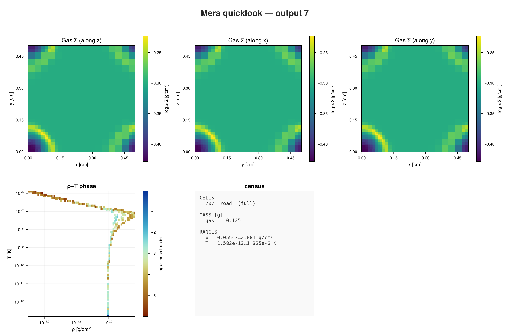

The default report centres its profile on the box, which here is far from the blast. Cards chosen
for this run measure the radius from the origin, where the explosion started, as the shortest
distance in the periodic box (`:r_sphere_periodic`), so the four corners count as one blast. The
phase diagram plots density against pressure: the shocked shell is dense and at high pressure, the
hot interior thin.

```julia
rep = report(7; path=sim("sedov3d_amr"), output=:none, cards=[
    ProfileCard(:hydro, :r_sphere_periodic, :rho; geometry=:spherical, center=[0.0, 0.0, 0.0],
                range_unit=:cm, xunit=:cm, unit=:g_cm3, nbins=32, yscale=:identity),
    PhaseCard(:hydro, :rho, :p; xunit=:g_cm3, yunit=:Ba)])
render(rep, :plot; ncols=2)
```

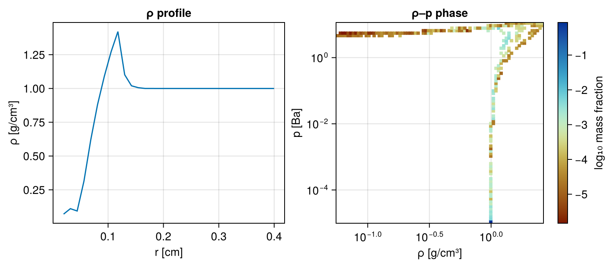

### `sedov3d_bisection`: the same blast, cut differently

The same explosion, but RAMSES splits the box among its processes with a tree (`bisection`)
instead of the Hilbert curve. The reader has to follow a different file layout; the numbers agree
with `sedov3d_amr` to the last digit.

```julia
quicklook(7; path=sim("sedov3d_bisection"));
```

```
[Mera]: quicklook output 7, reading gas: 2026-10-27T10:33:02.775
   4 CPU file(s), levels 4-7 of 7  (full resolution)
✓ File processing complete! Combining results...
   projecting 3 gas map(s) [z, x, y] and the phase diagram from 7071 cells
┌─ Mera quicklook ── output 7 (RAMSES) ───────────────
│ box        : 0.5 cm      levels 4–7  (finest 0.003906 cm)
│ grid       : ndim 3 · ncpu 4 · nvarh 5
│ time       : 0.009912 s
│ read       : 7071 cells  (full resolution)
│ gas mass   : 0.125 g
│ ρ range    : 0.05543 … 2.661 g/cm³
│ T range    : 1.582e-13 … 1.325e-6 K
└─ 2.11 s ──────────────────────────────────
[Mera]: quicklook output 7 finished: 2026-10-27T10:33:02.896
```

### `sedov3d_iogroups`: files in IO groups

RAMSES can group its files into folders, one per few processes (`IOGROUPSIZE`). Mera's readers do
not read this layout yet, and say so.

```julia
try
    getinfo(3, sim("sedov3d_iogroups"), verbose=false)
catch e
    println(sprint(showerror, e))
end
```

```
[Mera]: /Volumes/FASTStorage/Simulations/Mera-Tests/RAMSES-PUBLIC/sedov3d_iogroups/output_00003 is written in IO groups (group_00001/, group_00002/, …; RAMSES's IOGROUPSIZE). Mera's readers do not read IO groups yet. Run RAMSES with IOGROUPSIZE=0 to get a plain output.
```

## Gravity and particles

### `sedov3d_grav_part`: tracer particles

The blast again, with self-gravity and 124 990 tracer particles that move with the gas. Tracers
carry no mass of their own; the dashboard counts them separately.

```julia
quicklook(7; path=sim("sedov3d_grav_part"));
```

```
[Mera]: quicklook output 7, reading gas: 2026-10-27T10:33:02.915
   8 CPU file(s), levels 4-7 of 7  (full resolution)
✓ File processing complete! Combining results...
   projecting 3 gas map(s) [z, x, y] and the phase diagram from 7071 cells
[Mera]: quicklook output 7, reading particles: 2026-10-27T10:33:03.021
┌─ Mera quicklook ── output 7 (RAMSES) ───────────────
│ box        : 0.5 cm      levels 4–7  (finest 0.003906 cm)
│ grid       : ndim 3 · ncpu 8 · nvarh 5
│ time       : 0.009912 s
│ particles  : 124990 total  —  stars 0 · DM 0 · tracers 124990
│ read       : 7071 cells  (full resolution)
│ gas mass   : 0.125 g
│ ρ range    : 0.05542 … 2.661 g/cm³
│ T range    : 1.582e-13 … 1.325e-6 K
└─ 3.82 s ──────────────────────────────────
[Mera]: quicklook output 7 finished: 2026-10-27T10:33:06.730
```

### `dm_gas3d_bisection`: gas and dark matter

Gas and 30 000 dark-matter particles under self-gravity, collapsing to the centre. The gas mass of
0.1 g and the dark-matter mass of 1 g are the round numbers of the initial conditions.

```julia
quicklookplot(quicklook(4; path=sim("dm_gas3d_bisection")))
```

```
[Mera]: quicklook output 4, reading gas: 2026-10-27T10:33:06.745
   4 CPU file(s), levels 5-7 of 7  (full resolution)
✓ File processing complete! Combining results...
   projecting 3 gas map(s) [z, x, y] and the phase diagram from 52466 cells
[Mera]: quicklook output 4, reading particles: 2026-10-27T10:33:06.917
┌─ Mera quicklook ── output 4 (RAMSES) ───────────────
│ box        : 1 cm      levels 5–7  (finest 0.007812 cm)
│ grid       : ndim 3 · ncpu 4 · nvarh 5
│ time       : 0.06128 s
│ particles  : 30000 total  —  stars 0 · DM 30000
│ read       : 52466 cells  (full resolution)
│ gas mass   : 0.1 g
│ ρ range    : 0.09493 … 6.139 g/cm³
│ T range    : 1.545e-9 … 9.866e-8 K
│ part. mass : DM 1 g
└─ 1.77 s ──────────────────────────────────
[Mera]: quicklook output 4 finished: 2026-10-27T10:33:08.510
```

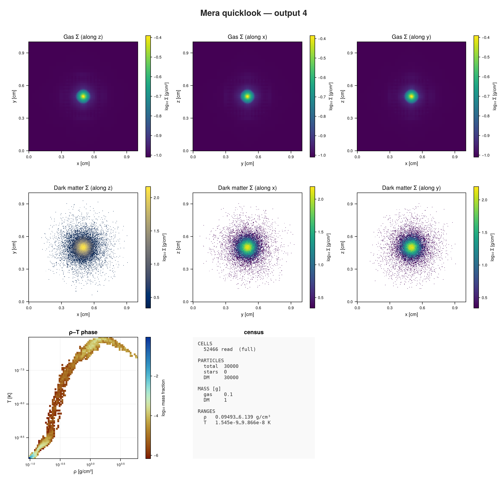

## Sinks

### `sinks3d`: one sink

A sink is an accreting point mass. RAMSES writes sinks to their own catalogue, and the dashboard
marks each one with a circle on the maps.

```julia
quicklookplot(quicklook(2; path=sim("sinks3d")))
```

```
[Mera]: quicklook output 2, reading gas: 2026-10-27T10:33:08.898
   8 CPU file(s), levels 5-6 of 6  (full resolution)
Processing files: 100%|██████████████████████████████████████████████████| Time: 0:00:00 (19.19 ms/it)
✓ File processing complete! Combining results...
   projecting 3 gas map(s) [z, x, y] and the phase diagram from 262144 cells
[Mera]: quicklook output 2, reading particles: 2026-10-27T10:33:09.250
┌─ Mera quicklook ── output 2 (RAMSES) ───────────────
│ box        : 250 pc      levels 5–6  (finest 3.906 pc)
│ grid       : ndim 3 · ncpu 8 · nvarh 5
│ time       : 26.18 Myr
│ read       : 262144 cells  (full resolution)
│ gas mass   : 3.828e6 M⊙
│ n_H range  : 4.307 … 7.614 cm⁻³
│ T range    : 5.406 … 7.063 K
│ sinks      : 1  ·  mass 2721 M⊙
└─ 0.91 s ──────────────────────────────────
[Mera]: quicklook output 2 finished: 2026-10-27T10:33:09.803
```

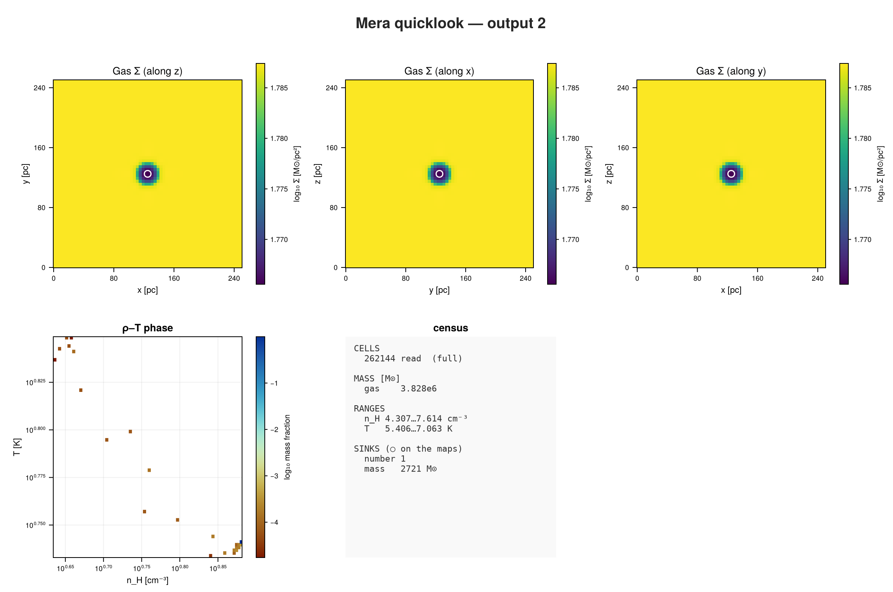

### `ramses_smbh_bondi`: Bondi accretion

RAMSES's own test of a black hole accreting from the surrounding gas, run unchanged. It is the
largest of the set, so `quicklook` reads it one level coarser to stay within its cell budget, and
says so. A density profile around the sink shows the gas falling in.

```julia
quicklookplot(quicklook(15; path=sim("ramses_smbh_bondi")))
```

```
[Mera]: quicklook output 15, reading gas: 2026-10-27T10:33:10.564
   8 CPU file(s), levels 6-7 of 8  (budgeted to ~2000000 cells)
Processing files: 100%|██████████████████████████████████████████████████| Time: 0:00:00 ( 0.10  s/it)
✓ File processing complete! Combining results...
   projecting 3 gas map(s) [z, x, y] and the phase diagram from 2097152 cells
[Mera]: quicklook output 15, reading particles: 2026-10-27T10:33:12.264
┌─ Mera quicklook ── output 15 (RAMSES) ───────────────
│ box        : 1 kpc      levels 6–8  (finest 3.906 pc)
│ grid       : ndim 3 · ncpu 8 · nvarh 5
│ time       : 51940 yr
│ read       : 2097152 cells  ⚠ coarse levels ≤ 7 of 8
│ gas mass   : 245200 M⊙  (mass-conserving)
│ n_H range  : 0.007415 … 0.1147 cm⁻³  ⚠ peaks smoothed (lower bound)
│ T range    : 1.705 … 66650 K  ⚠ peaks smoothed (lower bound)
│ sinks      : 1  ·  mass 1.005e6 M⊙
└─ 1.78 s ──────────────────────────────────
[Mera]: quicklook output 15 finished: 2026-10-27T10:33:12.307
[ Info: sfr_snapshot: using eta_sn=1.0e-10 from the run's namelist to rebuild birth masses from the current :mass. Stars older than 5.0 Myr are scaled by 1/(1-eta_sn), which RAISES the rate. Pass eta_sn=0 to switch this off, or eta_sn=<value> to set it.
```

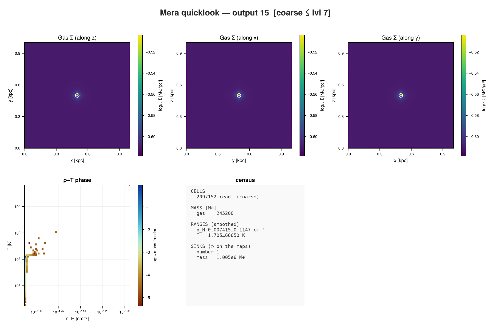

```julia
rep = report(15; path=sim("ramses_smbh_bondi"), output=:none, cards=[
    ProfileCard(:hydro, :r_sphere, :rho; geometry=:spherical, center=[:bc], range_unit=:pc,
                xunit=:pc, unit=:nH, nbins=40, yscale=:log),
    ProfileCard(:hydro, :r_sphere, :T; geometry=:spherical, center=[:bc], range_unit=:pc,
                xunit=:pc, unit=:K, nbins=40, yscale=:log)])
render(rep, :plot; ncols=2)
```

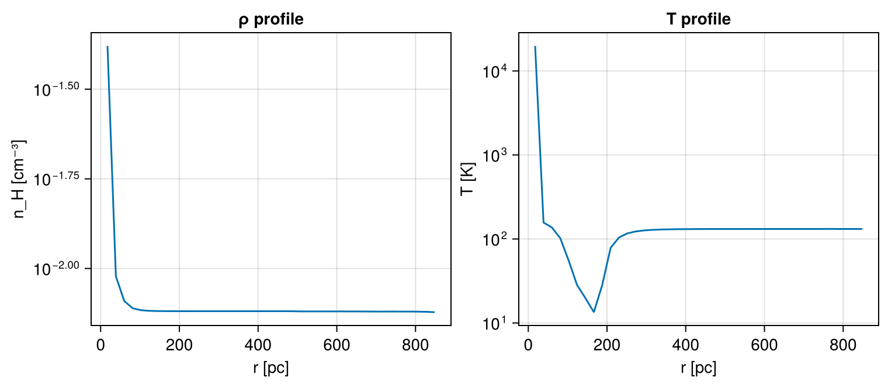

## Magnetic fields

### `mhdtube3d`: a magnetic shock tube

Two states of gas and field meet along x and launch waves in both directions. The field component
along the tube cannot change (∇·B = 0), so |B| never drops below that constant Bx. Along x the tube
projects to a uniform map; profiles along x show the waves.

```julia
quicklookplot(quicklook(6; path=sim("mhdtube3d")))
```

```
[Mera]: quicklook output 6, reading gas: 2026-10-27T10:33:14.590
   8 CPU file(s), levels 4-5 of 5  (full resolution)
✓ File processing complete! Combining results...
   projecting 3 gas map(s) [z, x, y] and the phase diagram from 32768 cells
┌─ Mera quicklook ── output 6 (RAMSES) ───────────────
│ box        : 2 cm      levels 4–5  (finest 0.0625 cm)
│ grid       : ndim 3 · ncpu 8 · nvarh 11
│ time       : 0.5022 s
│ read       : 32768 cells  (full resolution)
│ gas mass   : 4.281 g
│ ρ range    : 0.1174 … 0.9924 g/cm³
│ T range    : 1.78e-8 … 3.153e-8 K
│ |B| range  : 3.546 … 6.688 G
│ plasma β   : 0.1281 … 3.947  (β<1 ⇒ B-dominated)
└─ 0.87 s ──────────────────────────────────
[Mera]: quicklook output 6 finished: 2026-10-27T10:33:15.452
```

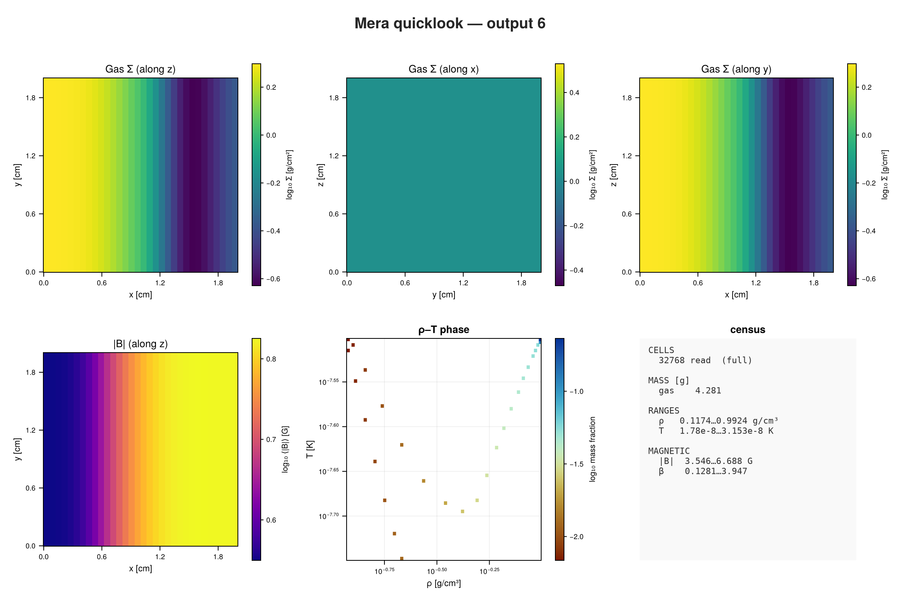

```julia
rep = report(6; path=sim("mhdtube3d"), output=:none, cards=[
    ProfileCard(:hydro, :x, :rho; xunit=:cm, unit=:g_cm3, nbins=32, yscale=:identity),
    ProfileCard(:hydro, :x, :bmag; xunit=:cm, unit=:Gauss, nbins=32, yscale=:identity)])
render(rep, :plot; ncols=2)
```


### `ramses_abc_flow`: a dynamo

RAMSES's own MHD test, run unchanged. The density stays exactly 1 g/cm³ everywhere, because the test
holds it fixed and lets a prescribed flow amplify the magnetic field. The gas maps are therefore one
colour, and the |B| panel is the one to look at.

```julia
quicklookplot(quicklook(2; path=sim("ramses_abc_flow")))
```

```
[Mera]: quicklook output 2, reading gas: 2026-10-27T10:33:16.331
   8 CPU file(s), levels 5-5 of 5  (full resolution)
✓ File processing complete! Combining results...
   projecting 3 gas map(s) [z, x, y] and the phase diagram from 32768 cells
┌─ Mera quicklook ── output 2 (RAMSES) ───────────────
│ box        : 1 cm      levels 5–5  (finest 0.03125 cm)
│ grid       : ndim 3 · ncpu 8 · nvarh 11
│ time       : 10 s
│ read       : 32768 cells  (full resolution)
│ gas mass   : 1 g
│ ρ range    : 1 … 1 g/cm³
│ T range    : 1.044e-8 … 1.059e-8 K
│ |B| range  : 0.005458 … 4.967 G
│ plasma β   : 0.6808 … 562500  (β<1 ⇒ B-dominated)
└─ 0.7 s ──────────────────────────────────
[Mera]: quicklook output 2 finished: 2026-10-27T10:33:17.030
```

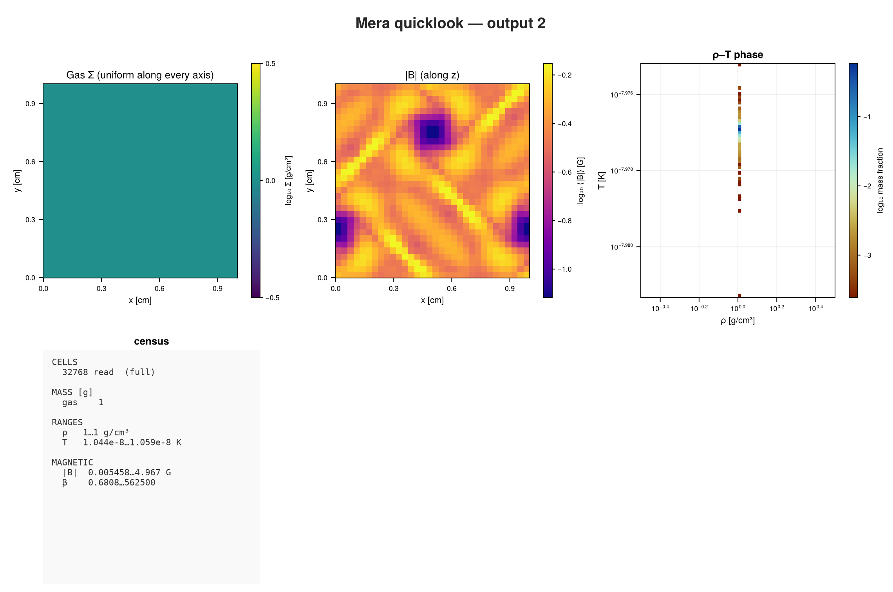

## Radiative transfer

### `stromgren3d`: an ionised sphere

A source in the box corner ionises uniform hydrogen gas (n_H = 10⁻³ cm⁻³, set in the run). The
ionised region grows towards the Strömgren radius, and its front follows
r(t) = r_S (1 − e^(−t/t_rec))^(1/3). The gas density does not change, so the gas maps are uniform;
the ionised-fraction map shows the sphere.

On an RT run Mera uses the run's own composition: the hydrogen fraction from its RT header
(here X = 1, pure hydrogen) and the mean molecular weight of each cell from its ionisation. The
temperature is therefore physical in both the neutral and the ionised gas.

```julia
quicklookplot(quicklook(7; path=sim("stromgren3d")))
```

```
[Mera]: quicklook output 7, reading gas: 2026-10-27T10:33:17.356
   8 CPU file(s), levels 5-5 of 5  (full resolution)
✓ File processing complete! Combining results...
   projecting 3 gas map(s) [z, x, y] and the phase diagram from 32768 cells
┌─ Mera quicklook ── output 7 (RAMSES) ───────────────
│ box        : 15 kpc      levels 5–5  (finest 468.8 pc)
│ grid       : ndim 3 · ncpu 8 · nvarh 8
│ time       : 500 Myr
│ read       : 32768 cells  (full resolution)
│ gas mass   : 8.275e7 M⊙
│ n_H range  : 0.001 … 0.001 cm⁻³
│ T range    : 116.8 … 21600 K  (μ from the ionisation)
│ ionised    : 3.931 % of the gas mass  (xHII 4.578e-5 … 0.9996)
└─ 0.86 s ──────────────────────────────────
[Mera]: quicklook output 7 finished: 2026-10-27T10:33:18.199
```

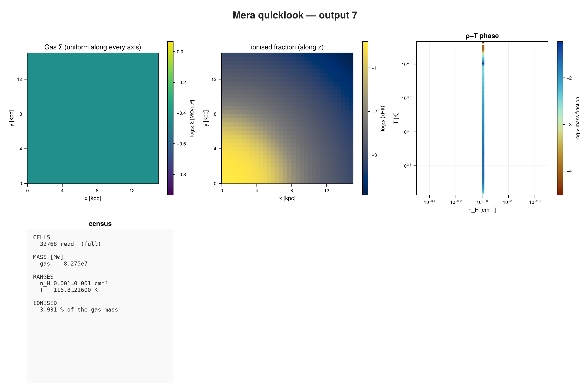

```julia
rep = report(7; path=sim("stromgren3d"), output=:none, cards=[
    ProfileCard(:hydro, :r_sphere, :xHII; geometry=:spherical, center=[0.0, 0.0, 0.0],
                range_unit=:kpc, xunit=:kpc, nbins=40, yscale=:identity),
    ProfileCard(:hydro, :r_sphere, :T; geometry=:spherical, center=[0.0, 0.0, 0.0],
                range_unit=:kpc, xunit=:kpc, unit=:K, nbins=40, yscale=:log)])
render(rep, :plot; ncols=2)
```

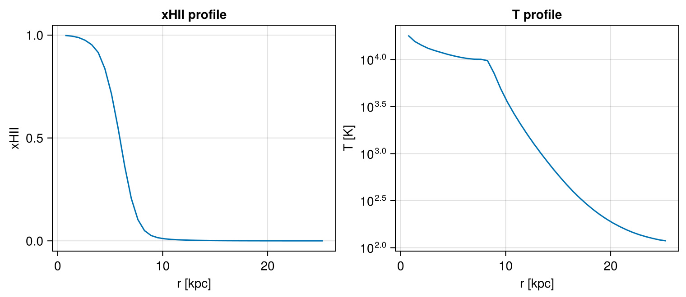

### `ramses_rt_dirac`: radiation with MHD

RAMSES's own RT test with the MHD solver, run unchanged: three sources in a magnetised medium. The
photon density of the first group shows the radiation spreading from the sources.

```julia
quicklookplot(quicklook(2; path=sim("ramses_rt_dirac")))
```

```
[Mera]: quicklook output 2, reading gas: 2026-10-27T10:33:18.604
   8 CPU file(s), levels 3-6 of 6  (full resolution)
✓ File processing complete! Combining results...
   projecting 3 gas map(s) [z, x, y] and the phase diagram from 25040 cells
┌─ Mera quicklook ── output 2 (RAMSES) ───────────────
│ box        : 5 pc      levels 3–6  (finest 0.07812 pc)
│ grid       : ndim 3 · ncpu 8 · nvarh 14
│ time       : 30010 yr
│ read       : 25040 cells  (full resolution)
│ gas mass   : 4033 M⊙
│ n_H range  : 183.7 … 2345 cm⁻³
│ T range    : 15.08 … 9709 K  (μ from the ionisation)
│ ionised    : 0.2054 % of the gas mass  (xHII 1e-20 … 1)
│ |B| range  : 8.273 … 61.4 μG
│ plasma β   : 0.06187 … 300.9  (β<1 ⇒ B-dominated)
└─ 0.78 s ──────────────────────────────────
[Mera]: quicklook output 2 finished: 2026-10-27T10:33:19.377
```

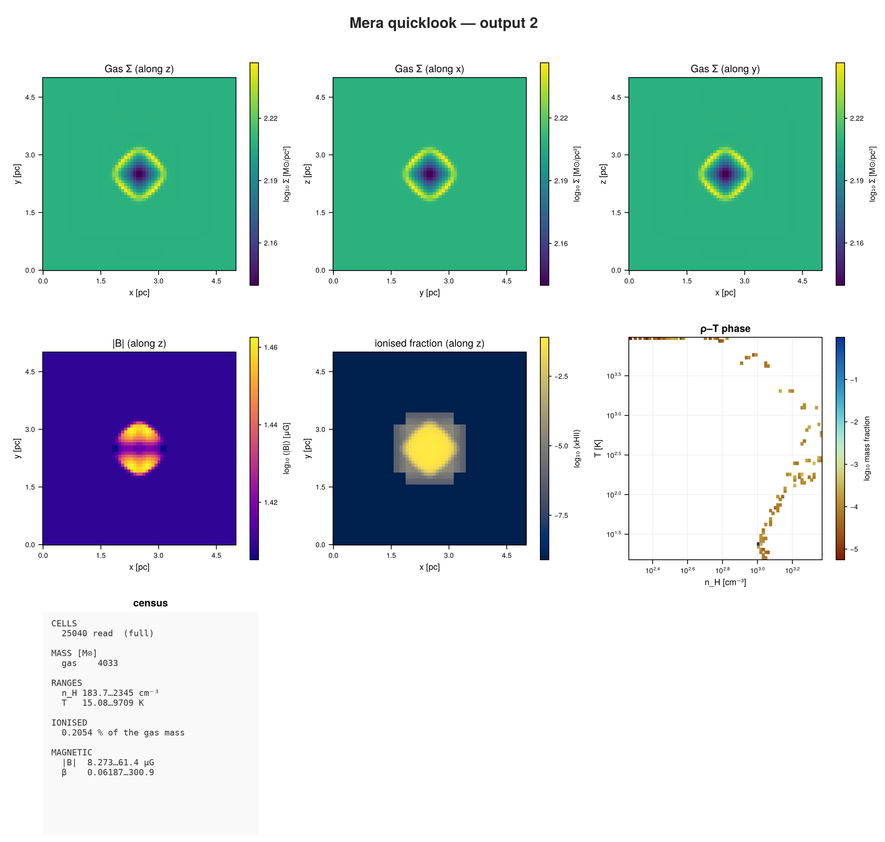

```julia
rep = report(2; path=sim("ramses_rt_dirac"), output=:none, cards=[
    ProjectionCard(:rt, :Np1; res=128),
    ProjectionCard(:hydro, :xHII; res=128)])
render(rep, :plot; ncols=2)
```

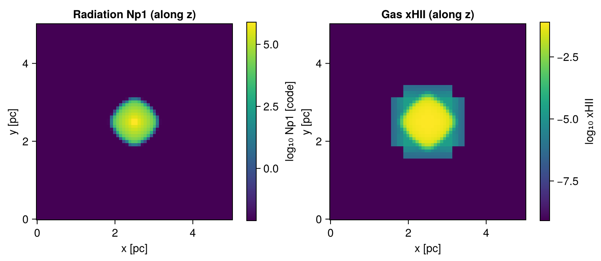

## Cosmology

### `cosmo3d`: a small cosmological box

Gas and dark matter from RAMSES's cosmological initial conditions, here at z ≈ 9. The box is
125 kpc across now and 1.25 Mpc comoving. Filaments and the first haloes show in the gas. The
dark-matter particles still sit close to their starting grid, which leaves a regular pattern in
the particle maps.

The run has no cooling and no heating, so the gas in the emptiest regions cools far below a
kelvin as the box expands. That cold tail in the phase diagram is real.

```julia
quicklookplot(quicklook(3; path=sim("cosmo3d")))
```

```
[Mera]: quicklook output 3, reading gas: 2026-10-27T10:33:24.028
   8 CPU file(s), levels 5-8 of 8  (full resolution)
✓ File processing complete! Combining results...
   projecting 3 gas map(s) [z, x, y] and the phase diagram from 74740 cells
[Mera]: quicklook output 3, reading particles: 2026-10-27T10:33:24.241
┌─ Mera quicklook ── output 3 (RAMSES) ───────────────
│ box        : 125.5 kpc (1.25 Mpc comoving)      levels 5–8  (finest 490.1 pc)
│ grid       : ndim 3 · ncpu 8 · nvarh 5
│ time       : 548 Myr   z = 8.963
│ particles  : 32768 total  —  stars 0 · DM 32768
│ read       : 74740 cells  (full resolution)
│ gas mass   : 1.099e10 M⊙
│ n_H range  : 2.605e-5 … 0.1162 cm⁻³
│ T range    : 6.834e-6 … 122200 K
│ part. mass : DM 6.656e10 M⊙
└─ 0.43 s ──────────────────────────────────
[Mera]: quicklook output 3 finished: 2026-10-27T10:33:24.435
```

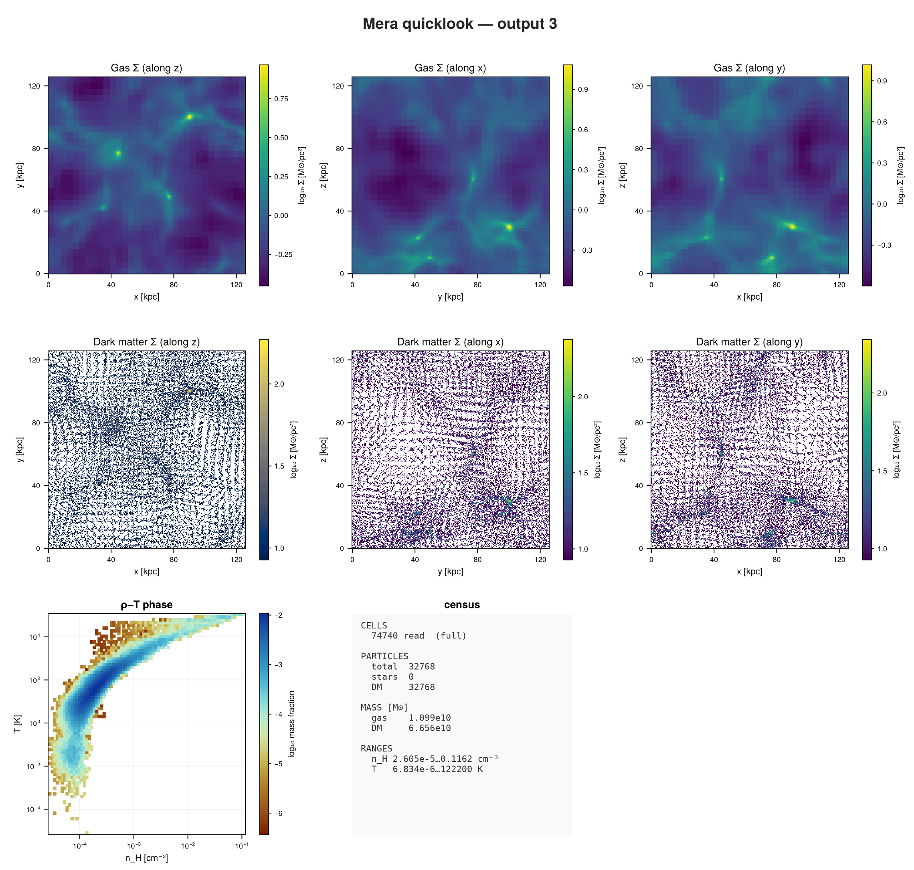

## Next steps

- [First Look](first_look.md): `quicklook` and `report` in depth, on a large galaxy run.
- [Composable Reports](report.md): all card types and their options.
- [Testing Framework](advanced_features/testing_guide.md): the checks these simulations back.
